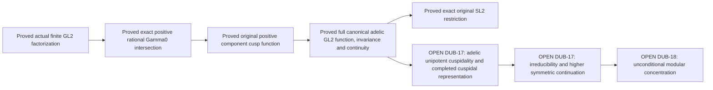
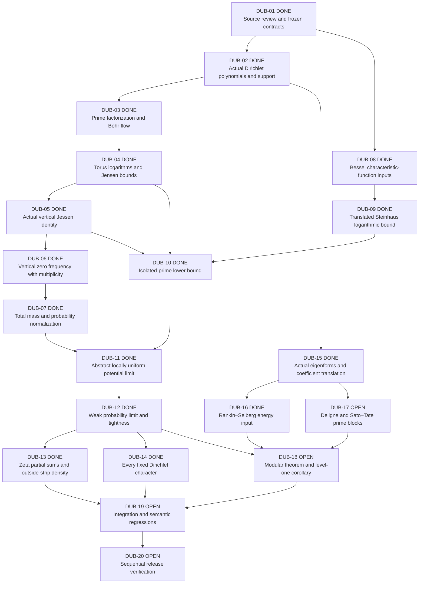

# Dubon 2026 — proof architecture

Original integral induced tensor, actual coefficient embeddings and source auxiliary comparison (19 October 2026): Geraghty Definition 2.2.1 is constructed literally as original determinant-localized regular functions with reversed-weight upper-Borel covariance over every coefficient algebra and right translation. Generic determinant primality over the original PID, extension of polynomial covariance to singular matrices, adjugate row elimination and original-ring divisibility give a uniform determinant denominator B=max(0,-lambda_last). A constructed infinite-order scalar in the original local ring gives numerator degree D=max(0,sum(lambda)+rank*B). The entire module lies in one finite polynomial stage, so finite generation and freeness follow without a supplied lattice or dimension bound. The actual finite embedding tensor uses the proved individual factors and native tensor bases. Its original embedding index is finite by number-field degree. Existing completion extension and valuation comparison construct its local integer maps and their continuity from actual field embeddings. Original unitary local evaluation constructs the algebraic tensor action. The final actual source consumer derives finite freeness of the original auxiliary automorphic module over the actual primary quotient group ring and its exact unnormalized weighted-trace coinvariant comparison; no coefficient representation, finite-free coefficient module, integral embedding maps or finite-index certificate is supplied. Exact unresolved source dependency: DUB-17 frozen Theorem 2.6 / DUB-18 Corollary 8.2 -> higher symmetric-power continuation -> BLGG potential automorphy and patching -> CHT/Geraghty integral unitary auxiliary modules -> Geraghty Definitions 2.2.1 and 2.2.3 original integral induced tensor coefficients and arithmetic action. Acceptance remains 16/20; DUB-17-20 remain open. The actual modular residual representation and its source image bounds, existence and prescribed adequacy of the common coefficient field, source unitary fields/forms and remaining local choices, dominant highest-weight identification and nonzeroness, continuity of the tensor action in the canonical coefficient-module topology, nonzero localized Hecke/Galois realization, crystalline/Selmer dimensions, R=T and source automorphy continuation remain unresolved. Continuity is proved for the constructed integer embeddings, not yet for the full tensor action. The unramified-prime sufficient condition for cyclotomic degree is not newly asserted. No root pin or proof limit changed. The 4,832-module production aggregate and focused exhaustive original integral induced tensor, constructed field-embedding coefficients and exact primary auxiliary comparison audit pass with zero diagnostics. Sequential foundation/paper verification of the 4,832-module scope is pending. The preceding 4,805-module scope passed sequential canonical verification. Selected coordinate, determinant and GL-density proofs are adapted from frozen TauCeti, Subspace-Theorems and newer Mathlib sources; original source files, licenses and provenance are retained.

Earlier dated implementation paragraphs are historical checkpoints; the current mathematical scope is stated above.

Actual source split unitary family, primary auxiliary comparison and source coefficient-subfield symmetric-adjoint degree/smallness prime (19 October 2026): Original arbitrary-rank finite-place matrices have a genuine paired-CM-place unitary insertion; original integral evaluation has a section under precisely the original form's local integrality condition. The condition fails at only finitely many original places. Supported finite-family lifts preserve the separate original principal-congruence smallness place. The actual upper/lower parabolic levels and maximal-primary intermediate level are compact open in the full original CM unitary adelic group, with the exact original arithmetic quotient and finiteness proved. The actual primary auxiliary automorphic module is finite free over its actual quotient group ring; coinvariants recover upper-level forms by the exact unnormalized weighted trace. Topology, arithmetic smallness, arithmetic class finiteness, quotient finiteness and local-to-global source-level realization are derived in the consumer, not independent supplied certificates. For the original continuous rank-two representation with full SL2 image, the exact full adjoint of its actual homogeneous symmetric power now constructs the smallness prime. Native cyclotomic degree and cyclic Galois results derive a nontrivial character square from 2*[K:Q]<l-1. The existing scalar-witness theorem and actual adjoint scalar cancellation prove that the original primitive l-th root lies outside the fixed field of the adjoint kernel. Root noncontainment and a separately supplied residual adjoint representation are no longer inputs to that consumer; continuity of the actual adjoint is constructed from the original discrete rank-two representation. The actual original cyclotomic character has a Galois value of order equal to the original adjoined-field degree. Original scalar lifts give the factor-two bound [K(zeta_l):K] <= 2*[E(zeta_l):E], for E the actual symmetric-adjoint fixed field. The strict source degree conclusion follows for every positive m. This now holds for the exact lower SL2(k-prime) and upper k-units*GL2(k-prime) image conditions via the original coefficient embedding, without identifying k-prime with k. The source degree hypothesis itself excludes characteristics two and three. The m=1 conclusion derives root noncontainment and feeds the actual continuous-adjoint smallness-prime consumer under those same subfield image conditions. Exact unresolved source dependency: DUB-17 Theorem 2.6 / DUB-18 Corollary 8.2 -> genuine higher-symmetric-power continuation -> source potential automorphy/patching -> integral unitary auxiliary automorphic modules -> actual source split-place parabolic family and maximal-primary quotient inside the original small CM unitary level. The same required chain uses BLGG 3.6.1: actual residual symmetric-power adjoint -> primitive-root noncontainment -> original simultaneous Frobenius smallness prime -> actual compact-open small principal level. BLGG Lemma 6.1.2 also requires the strict cyclotomic degree over the actual symmetric-adjoint fixed field for arbitrary positive m, with the source coefficient-subfield image bounds. Acceptance remains 16/20; DUB-17-20 remain open. The actual primary auxiliary module consumer still takes an original CM number field, specified positive invertible form, finite family of distinct split CM-place pairs outside bad-form places and the separate principal place, a large residue prime, and an explicit finite free coefficient representation. The actual source subfield prime consumer takes an original continuous rank-two representation, its SL2-subfield lower and scalar-GL2-subfield upper image bounds, a primitive l-th root and [K(zeta_l):K]>2. It derives root noncontainment and the smallness-prime/level conditions; it does not construct the modular representation or prove its image bounds. BLGG 6.1.2's degree conclusion is proved under its source degree and image inputs. Its separate unramified-prime sufficient condition is not claimed; the available explicit large-prime number-field sufficient bound is stated separately. Prescribed source fields/forms and remaining prime/local/refinement constraints, exact integral induced highest-weight coefficient representation, nonzero localized Hecke/Galois realization, crystalline/Selmer dimensions, R=T and source automorphy continuation remain unresolved. No final Dubon acceptance gate closes here. Sequential foundation/paper verification passes with zero diagnostics for the 4,805-module scope: all thirteen retained regressions, 33,926 exhaustive theorem checks, 14,454 registered consumers and sixteen linters. The reproduction manifest records the receipt; acceptance remains 16/20 and DUB-17-20 remain open. The preceding 4,766-module scope passed sequential canonical verification. Only the required consumer dependency chain is promoted; two compiling intermediate quotient probes remain in scratch. No root pin or proof limit changed.

Earlier dated implementation paragraphs are historical checkpoints; the current mathematical scope is stated above.

Original unitary arithmetic class finiteness, exact auxiliary consumer and source smallness prime (19 October 2026): For the original specified positive CM Hermitian form, the actual attached adelic lattices are finite free of full rational rank and recover their original adelic and local lattice regions. A fixed positive integer gives positive integral trace forms. Native trace-dual bases and density prove uniform dual-lattice containment and hence a uniform Gram determinant bound. Adapted proved integral reduction yields finite actual Gram classes; original complex embeddings bound the original CM scalar actions, and adapted finite integral sublevels give finitely many joint action invariants. Equality of the invariants recovers an original field-linear Hermitian isometry and a rational unitary matrix carrying one actual lattice onto the other. Density then recovers the actual integral adelic level. The original unitary arithmetic double-coset quotient is therefore finite at the integral level, and compactness transfers finiteness to every original open level. The existing finite-freeness, coinvariant and exact unnormalized auxiliary trace comparison now derives arithmetic class finiteness instead of assuming it. The original prescribed Frobenius class can be realized outside every finite set of original places with arbitrarily large original rational residue characteristic. The same size bound implies [K(zeta_p):K] exceeds the required rank. Kernel noncontainment of the two original continuous Galois maps yields simultaneous trivial first Frobenius image, nontrivial second image, absolute unramifiedness and the cyclotomic degree restriction. Applied to the specified positive definite CM form, this constructs an actual compact open principal unitary level with trivial arithmetic stabilizers and finite original arithmetic double cosets at that prime. The cyclotomic map is now constructed from the actual primitive root and its established continuity; source root noncontainment in the fixed field of the residual kernel proves the required kernel separation. Exact unresolved source dependency: DUB-17 Theorem 2.6 and DUB-18 Corollary 8.2 -> higher symmetric-power continuation -> BLGG potential automorphy and patching -> CHT integral unitary auxiliary modules -> finite original arithmetic double cosets at the prescribed open level. The same exact module chain also requires the source smallness prime of BLGG 3.6.1. The final theorem accepts the original continuous residual map and the explicit source hypothesis that the primitive root does not belong to the field fixed by its kernel. It constructs the genuine cyclotomic map and proves the prime/level conclusions. The actual modular adjoint residual representation and its source root noncontainment are not yet supplied. The source solvable CM extension and prescribed local splitting/form conditions, highest-weight integral coefficient module, nonzero localized Hecke summand, crystalline dimensions, Selmer and Hecke/deformation comparisons and higher symmetric-power continuation remain open. DUB-17-20 remain open; acceptance remains 16/20. Class finiteness holds for every original open subgroup of the specified definite CM group. Sequential foundation/paper verification passes with zero diagnostics for the 4,766-module scope: all thirteen retained regressions, 33,671 exhaustive theorem checks, 14,346 registered consumers and sixteen linters. The reproduction manifest records the receipt; acceptance remains 16/20 and DUB-17-20 remain open. The preceding 4,710-module scope passed sequential canonical verification. No root pin or proof limit changed.

Earlier dated implementation paragraphs are historical checkpoints; the current mathematical scope is stated above.

The refreshed proof reuse search is now applied: proved Tau Ceti reduction, approximation and finite sublevels feed the original unitary arithmetic class theorem. Current scope and verification are stated above; source evidence and rejected conditional candidates remain in Tools/lean-reuse-audit-20261019.json.

Actual parabolic quotients and constructed CM adelic small levels (19 October 2026): The original integral matrix U0 and U1 satisfy exactly the printed last-row residue conditions. Their actual quotient is the original residue-field unit group, with surjectivity proved by lifting units and using diagonal matrices. The existing arithmetic completion-residue equivalence and finiteness theorem identify the original number-field residue field. The local primary quotient has exact order q^v_q(Nw-1), cyclicity, the required divisibility from the original ideal-norm congruence, and the universal maximal-primary-quotient property. For the actual product level subgroups at a finite family of selected original places, the quotient is proved to be the product of the original local quotients. Its maximal primary quotient is constructed directly from the original group by the power-image kernel; no cyclic decomposition is assumed. The existing group-algebra theorems then derive locality, the augmentation description of every maximal ideal, and complete compact Noetherian maximal-adic coefficient data for this literal auxiliary group algebra. Every finite group separated by the actual decreasing reduction kernels embeds in one finite-depth image. The repository original matrix congruence image theorem and adic separation therefore prove that finite subgroups of the genuine residual congruence kernel are residue-primary. Faithful coefficient transport retains the same finite local subgroup. Native rational cyclotomic irreducibility, the minimal-polynomial divisibility theorem and Cayley-Hamilton prove that a nonidentity prime-order rational endomorphism has dimension at least p-1. Restricting the original number-field matrix action to the same rational vector space excludes every residue-primary torsion matrix when card(iota)*[K:Q] < p-1. The original definite Hermitian arithmetic stabilizers are already finite by compactness; their faithful conjugated local congruence images now prove their triviality. The exact auxiliary-module consumer derives finite freeness and the unnormalized weighted trace comparison from this literal level condition. Neither an arithmetic-smallness nor a local torsion-free certificate is supplied. The existing original finite-adelic Galois action constructs the actual place-permuting CM involution, proves its continuity and compatibility with principal elements, and defines the original finite-adelic unitary subgroup preserving the specified form. The principal arithmetic inclusion and closedness are proved. Properness of every original completion makes the product of original valuation rings compact, hence the integral finite adeles compact. Native matrix subrings and compact unit subgroups give the compact open original integral matrix level and its unitary intersection. The actual local integral matrix map and residue topology construct a compact open principal refinement at any specified original finite place. At residue characteristic p with card(iota)*[K:Q] < p-1, the existing arithmetic congruence theorem proves triviality of its conjugate arithmetic stabilizers. Every open refinement has finite quotient. The exact consumer therefore proves finite freeness of the original weighted automorphic function module over the actual level quotient group algebra and identifies coinvariants by the original unnormalized weighted trace, without supplied ambient group, principal inclusion, compactness, local congruence, smallness or finite level-quotient certificates. Euclid, original lying-over and the actual residue comparison also construct an original place of residue characteristic above the required size bound outside any finite list of rational primes. The exact existence consumer constructs a compact open principal unitary level with trivial arithmetic stabilizers, with no supplied prime or level witness. Exact unresolved source dependency: DUB-17, frozen Dubon Theorem 2.6, and DUB-18 Corollary 8.2 -> genuine non-CM modular Sato-Tate -> higher symmetric-power continuation -> BLGG potential automorphy and arithmetic patching -> Section 3.6 auxiliary Hecke modules and coefficient action -> Section 3.2 literal last-row U0/U1, its maximal coefficient-primary quotient Delta, and the actual complete local group algebra. Acceptance remains 16/20; DUB-17-20 remain open. The original CM field and form positive at every complex embedding remain inputs. Their actual adelic unitary group, principal arithmetic inclusion and basic compact open small principal levels are constructed; the existence theorem avoids any finite list of rational primes. The source field choices, prescribed local forms and splittings, source auxiliary primes satisfying all local restrictions and parabolic refinements inside the source global adelic unitary level remain required. The fixed-place auxiliary comparison retains its original place and explicit bound card(iota)*[K:Q] < p-1. The parabolic groups and maximal primary quotients are the original local and finite-family product levels; the source split-prime norm comparison remains. Finite actual arithmetic double cosets, highest-weight lattices, nonzero localized Hecke summands and their primary quotient action compatible with the universal Galois deformation remain required. No finite arithmetic quotient is inferred from compactness of the level, and no entire local torsion-free theorem is asserted. The earlier full diagonal torus and fixed-determinant count are not identified with the source single-character quotient. Modular rank-two realization and residual image, crystalline conditions and dimensions, source Selmer, R=T, potential automorphy and higher continuation remain open. Sequential foundation/paper verification passes with zero diagnostics for the 4,710-module scope: all thirteen retained regressions, 33,467 exhaustive theorem checks, 14,240 registered consumers and sixteen linters. The reproduction manifest records the receipt; acceptance remains 16/20 and DUB-17-20 remain open. The preceding 4,676-module scope passed sequential canonical verification. No root pin or proof limit changed.

Earlier dated implementation paragraphs are historical checkpoints; the current mathematical scope is stated above.

Actual full polarized unframed universality and Hermitian arithmetic auxiliary comparison (19 October 2026): The actual CM trace-ring intertwiner is symmetric, using the original universal scalar centralizer. Its actual CM matrices extend continuously to the original full arithmetic group with the original quadratic component and fixed odd similitude. Existing complete-local simple-root lifting yields the required residue-one scalar square root. A single original residue-one matrix basis change aligns the actual CM matrices and original universal polarization. The actual full polarized universal representation descends strictly over its own complete Noetherian local CM trace algebra, with the entire original residual representation preserved. No symmetry, scalar-root, full extension, residue compatibility or full strict-descent certificate is assumed in the final original-object consumer. The actual complete local CM trace algebra now represents all original continuous full polarized unframed lifts with fixed source similitude over every complete Noetherian local coefficient target. The source consumer proves a bijection from actual continuous residue-preserving coefficient maps to actual strict GL-conjugacy classes and proves compatibility with every original continuous residue-preserving coefficient change. Framed universality and trace generation are consumed through the original arithmetic objects; no unframed representability certificate is assumed. For the actual space of left arithmetic-invariant, right weight-equivariant functions, trivial arithmetic stabilizers construct unique double-coset coordinates. The auxiliary evaluation isomorphism is derived from these coordinates, and the quotient action is proved pointwise equal to the original weighted right translation. Finite actual double cosets, a finite level quotient and a finite free weight lattice imply finite freeness over the entire level-quotient group algebra. The actual coinvariant quotient is isomorphic to the base-level forms by the original unnormalized weighted trace. One source-facing theorem assembles finite freeness, the coinvariant isomorphism and its pointwise source formula; no freeness, basis of forms, coordinate-equivalence or trace-isomorphism certificate is assumed. The actual principal number-field adele subgroup is proved discrete using the pinned bounded-conjugates theorem. Compact finite components and bounded infinite components therefore contain finitely many field elements. Pinned functional calculus proves compactness of the complex isometry matrices of every positive definite Hermitian form. Applied to every original complex embedding, this proves finiteness of the original CM Hermitian arithmetic intersection with every compact finite-adelic matrix set and hence every conjugate level stabilizer. The principal arithmetic embedding is faithful at each finite completion. A torsion-free local level image now forces those finite stabilizers to be trivial. The proof is restricted to the specified adelic subgroup before forming its double cosets, and an explicit consumer derives finite freeness and the exact unnormalized trace on coinvariants for the original weighted automorphic functions. No arithmetic-stabilizer finiteness, smallness, basis or trace-isomorphism certificate is assumed. Exact unresolved source dependency: OPEN DUB-17, Dubon Theorem 2.6 non-CM modular application: higher symmetric-power continuation <- potential automorphy <- the source CM polarized deformation and unitary Hecke comparison <- the actual full polarized unframed deformation problem <- whole polarized strict descent to the original CM trace algebra. DUB-17, Dubon Theorem 2.6: genuine non-CM modular Sato-Tate via higher symmetric-power continuation, BLGG potential automorphy and source unitary-group Hecke patching. BLGG Section 3.6 requires finite free auxiliary modules and specialization by the trace of the actual level quotient; CHT Lemma 3.3.1 supplies this algebraic step. DUB-17, Dubon Theorem 2.6: non-CM modular Sato-Tate through BLGG potential automorphy and higher symmetric-power continuation. BLGG Section 3.6 needs the integral unitary auxiliary modules of CHT Lemma 3.3.1. Their evaluation and group-ring freeness require trivial arithmetic stabilizers; this increment derives that assumption from the original definite Hermitian form, a compact finite-adelic level and torsion-freeness of its image at one finite place. Acceptance remains 16/20; DUB-17-20 remain open. The original definite Hermitian matrix, its actual adelic subgroup containing the principal arithmetic image, compact level and one-place torsion-free condition are explicit. The source field and unitary form with the prescribed finite local behavior, existence of a suitable local level, finiteness of its original arithmetic double cosets, highest-weight lattice, BLGG parabolic quotient and nonzero localized Hecke summands with compatible deformation action remain to be constructed. No finite double-coset claim is made for the full ambient general linear group. The modular rank-two realization and residual image, crystalline deformation quotients and dimensions, source Selmer comparison, arithmetic R=T, potential automorphy and continuation remain required. The full polarized unframed universality construction also retains the original rank-two Galois representation, CM field and residual-image hypotheses as inputs; it does not construct that representation from the source modular form. Sequential foundation/paper verification passes with zero diagnostics for the 4,676-module scope: all thirteen retained regressions, 33,248 exhaustive theorem checks, 14,152 registered consumers and sixteen linters. The reproduction manifest records the receipt; acceptance remains 16/20 and DUB-17-20 remain open. The preceding 4,628-module scope passed sequential canonical verification. No root pin or proof limit changed.

Earlier dated implementation paragraphs are historical checkpoints; the current mathematical scope is stated above.

Actual CM trace-ring conjugate-duality intertwiner (19 October 2026): The actual original polarized coefficient fiber over dual numbers is identified with the continuous fixed-similitude first-order fiber, preserving the original residue map, base character and maximal-adic topology. Evaluation on original universal matrix coefficients proves residue-field linearity of the cotangent-to-cocycle equivalence. The actual Noetherian ring and native maximal-cotangent dual finiteness prove continuous full-adjoint cocycle finite-dimensionality. Rank-nullity and the existing continuous H1 quotient give the full-adjoint framed tangent formula. The actual finite-base arithmetic consumer uses its derived residual generators. For the original odd rank-two CM symmetric power with full SL2 image, p > 3, n < p and 2*n < card(k)-1, the previously derived H0 vanishing gives dim(relative maximal cotangent) = dim(continuous full-adjoint H1) + (n+1)^2. Multiplication by the actual symmetric polarization identifies the full-adjoint real fixed space with skew-transpose matrices. Strict upper coordinates and native finite-sum counting give its exact dimension. The original real absolute Galois restriction is constructed in the actual finite totally real base subgroup, with original complex conjugation retained. Native cyclic-image invariant comparison and actual original real restriction give full-adjoint H0 dimension (n+1)*n/2, while native finite-group continuous averaging proves actual real H1 and H2 vanish when two is nonzero. No real restriction, conjugation generation, real invariant dimension or cohomology-vanishing certificate is assumed. The actual universal polarized representation yields genuine continuous CM general linear matrices, with exact reduction to the original homogeneous symmetric power. Native residual spanning and Nakayama prove that these original universal CM matrices span the whole matrix algebra over the same polarized coefficient quotient. Native centralizer results make every matrix/invertible CM stabilizer scalar. For the full universal polarized representation, the original disconnected real component inverts that scalar; the actual residue-one condition and odd residue characteristic force it to be one. Finally native continuous trace descent gives a genuine CM representation over its own original closed trace algebra, with an original change of basis reducing to the identity. The actual CM kernel is open and profinite in its original topology, and arithmetic character finiteness constructs a finite residual presentation. Compact coefficient specialization maps the whole closed trace algebra onto the specialized trace algebra. Existing framed and trace universality therefore prove locality, Noetherianity, the literal maximal-adic topology and completeness of the actual universal CM trace algebra. Existing whole trace descent and framed universality also prove that two actual continuous lifts with the same absolutely irreducible residual representation and identical traces on every group element are strictly conjugate; the finite presentation is explicit and derived for the arithmetic CM group. The original CM conjugation is continuous and preserves residual absolute irreducibility. The actual trace descent has its true residue identification compatible with the ambient reduction and retains the exact original residual CM representation. The prescribed base multiplier is continuous in the trace ring, and the original universal real-place element yields a symmetric matrix and the actual CM conjugate-duality equation. Strict trace descent transports this to conjugate-dual trace equality in the trace ring. Native local GL surjectivity lifts the original residual polarization, and proved equal-trace strict conjugacy constructs an actual trace-ring intertwining matrix with that prescribed reduction. The final original-object theorem derives this intertwiner for the actual universal CM trace ring from the displayed arithmetic residual input and size conditions. Exact unresolved source dependency: DUB-17 Theorem 2.6 and higher symmetric-power continuation -> potential automorphy -> source polarized CM arithmetic deformation/Hecke comparison -> original framed deformation ring -> actual complete local CM trace ring -> original trace-ring conjugate-duality intertwiner -> symmetric polarization and full strict equivalence -> source unframed polarized universality, crystalline local conditions and unitary Hecke comparison. The cotangent and real-cohomology results serve the same source deformation/Selmer chain. DUB-18 requires the resulting genuine modular theorem. Acceptance remains 16/20; DUB-17-20 remain open. The original continuous rank-two arithmetic representation, full residual SL2 image, source totally real and CM fields, compatible base similitude and displayed prime/degree/size conditions remain explicit upstream inputs. No construction of the rank-two representation or its image from a genuine modular form is supplied. The framed cotangent and continuous full-adjoint tangent are unrestricted by crystalline conditions; the exact real H0/H1/H2 statements use the same chosen original arithmetic embedding and do not discharge the missing finite-place conditions or source global Selmer comparison. The actual CM trace ring is proved complete local and Noetherian, and its continuous descended matrices have a conjugate-duality intertwiner reducing to the original residual polarization. Symmetry of this trace-ring matrix, extension to the full polarized representation, strict equivalence with the original full polarized lift and the full unframed polarized universal property remain open. The scalar square-root adjustment required for full strict equivalence has not yet been constructed. Source crystalline conditions and dimensions, unitary Hecke modules, arithmetic R=T, potential automorphy and higher symmetric-power continuation remain required. The original equal-trace strict-conjugacy theorem retains its explicit absolute residual irreducibility, residue compatibility, completeness and finite-presentation hypotheses; its arithmetic CM consumer derives the presentation, and the actual trace-ring intertwiner consumer derives the required trace and residual-duality identities. Sequential foundation/paper verification passes with zero diagnostics for the 4,628-module scope: all thirteen retained regressions, 32,977 exhaustive theorem checks, 14,057 registered consumers and sixteen linters. The reproduction manifest records the receipt; acceptance remains 16/20 and DUB-17-20 remain open. The preceding 4,585-module scope passed sequential canonical verification. No root pin or proof limit changed.

Earlier dated implementation paragraphs are historical checkpoints; the current mathematical scope is stated above.

Actual CM symmetric-power realization, continuous tangent classification and full-adjoint invariants (19 October 2026): The actual quadratic restriction character and its fixing kernel; the original real-place involution, its nonidentity component and continuous splitting; the genuine CM Galois kernel and both Krull topology comparisons; the split arithmetic decomposition and continuous kernel coordinate; the continuous extension preserving original CM matrix and real-place values; the symmetric polarization involution and odd real-place similitude; full component and similitude identities; direct construction of the original complete local Noetherian arithmetic polarized deformation ring and continuous universal representation from these CM inputs. No separate whole-group polarized representation or residual-similitude certificate is assumed. In the assembled symmetric-power consumer, the original higher-dimensional CM matrices, symmetric polarization and exact conjugate-duality identity are also derived from a continuous odd rank-two arithmetic representation. Faithful four-variable coefficient extraction transfers the actual determinant-polynomial covariance to the literal existing homogeneous matrices. The explicit binomial antidiagonal duality matrix is invertible when the degree factorial is nonzero and has the exact parity transpose sign. The original odd involution makes the CM polarization symmetric. The full residual similitude is computed as determinant^n times the quadratic component sign^(n+1). The actual arithmetic polarized ring consumes this constructed representation; no polarization, higher-dimensional residual representation or whole-group residual-similitude certificate is an input. The source full adjoint is constructed on all original matrices, with matrix conjugation on the identity component and negative transpose on j. Its original perfect trace pairing is equivariant for the entire disconnected group. The actual fixed-similitude dual-number reduction kernel is identified with all matrices. Original lift differences give full-adjoint cocycles, and both inverse constructions recover the original representations and cocycles. Continuity is preserved for discrete residual coefficients. Actual identity-reducing GL_n strict conjugacy is equivalent to equality in the existing continuous H1, and every continuous H1 class is realized by a genuine lift. An explicit arithmetic symmetric-power consumer retains the original CM matrices and derives factorial nonvanishing from n less than the residue characteristic. Native perfection of the finite-field SL2 and the already-proved perfect-subgroup character-kernel lemma show that the original full rank-two SL2 image survives restriction to the actual CM kernel. Native finite symmetric-power absolute irreducibility then applies to those original CM matrices under q > 3, n < q and 2*n < card(L)-1. Original-field Schur descent and the actual nonidentity real-place component prove that the entire polarized full-adjoint invariant submodule is zero. No additional CM image, CM irreducibility, scalar-invariant or H0-vanishing certificate is assumed. Exact unresolved source dependency: DUB-17 Theorem 2.6 higher symmetric-power continuation via potential automorphy: original odd rank-two arithmetic representation -> literal CM polarized symmetric power -> source fixed-similitude deformation ring and continuous full-adjoint tangent classes -> local crystalline conditions and polarized Selmer dimensions -> arithmetic Hecke/R-to-T comparison -> automorphy and continuation. The finite totally real base and totally complex quadratic field, original continuous rank-two arithmetic residual representation, its determinant -1 at the chosen actual real-place involution, nonzero degree factorial, nonzero exceptional integer divisible by the residue prime, and base coefficient character matching the determinant^n on the CM subgroup and taking -1 at the chosen involution remain explicit. No genuine modular-form association of the rank-two representation, full residual SL2 image, source field selection, crystalline local conditions or dimensions, unitary Hecke modules, arithmetic R-to-T comparison, potential automorphy or higher symmetric-power continuation is proved. Acceptance remains 16/20; DUB-17-20 remain open. The continuous first-order classification imposes no crystalline local condition and does not identify the localized source cotangent module or derive its dimension. The characteristic-bound consumer discharges factorial nonvanishing only for its stated n < q input. The full adjoint is not silently replaced by the earlier fixed-determinant trace-zero Selmer module. The CM image and full-adjoint invariant conclusion require the explicitly displayed original rank-two full SL2 image and the stated numerical bounds; they do not prove that image for a modular form. Neither the local crystalline deformation condition nor its tangent dimension follows merely from full-adjoint H0 vanishing. Sequential foundation/paper verification passes with zero diagnostics for the 4,585-module scope: all thirteen retained regressions, 32,716 exhaustive theorem checks, 13,975 registered consumers and sixteen linters. The reproduction manifest records the receipt; acceptance remains 16/20 and DUB-17-20 remain open. The preceding 4,538-module scope passed sequential canonical verification. No root pin or proof limit changed.

Earlier dated implementation paragraphs are historical checkpoints; the current mathematical scope is stated above.

Source polarized coefficient ring and finite-base arithmetic classification (19 October 2026): The source target, coefficient functor, faithful doubled matrices and exact equations; the literal polarized ideal quotient of the native original framed ring; locality, Noetherianity, completeness and the original maximal-adic quotient topology; the actual continuous universal polarized representation with original residue, component and prescribed similitude; all complete local coefficient fibers, exact evaluation and coefficient naturality. No separate polarized universal-property, locality, completeness, continuity or residual-comparison certificates are inputs. The actual open arithmetic subgroups inherit finite prime-character sets by their proved topological subgroup comparisons. The finite-base fixing group is identified with its genuine Galois group in both directions of the original Krull topology. Native residual presentation theory then constructs finite generators, discharging the generator premise in the actual finite-base polarized coefficient ring and its continuous universal classification, exact evaluation and coefficient naturality. Exact unresolved source dependency: DUB-17 Theorem 2.6: higher symmetric-power continuation through potential automorphy, source unitary/CM deformation comparison, and its original polarized coefficient ring and fixed-similitude continuous deformation classification. For arbitrary profinite groups, the residual representation, finite residual generators and compatible base similitude remain explicit. For the actual finite-base arithmetic Galois groups, arithmetic character finiteness derives those generators, and the same literal polarized quotient classifies all continuous fixed-similitude lifts with exact evaluation and naturality. The finite base field, nonzero exceptional integer divisible by the coefficient prime, continuous original polarized residual representation and residual-compatible base similitude remain explicit. No genuine CM modular residual representation, crystalline local components or dimensions, unitary Hecke modules, arithmetic R-to-T comparison, potential automorphy or higher symmetric-power continuation is constructed. DUB-17-20 remain open, with 16/20 gates complete. Sequential foundation/paper verification passes with zero diagnostics for the 4,538-module scope: all thirteen retained regressions, 32,391 exhaustive theorem checks, 13,836 registered consumers and sixteen linters. The reproduction manifest records the receipt; acceptance remains 16/20 and DUB-17-20 remain open. The preceding 4,495-module scope passed sequential canonical verification. No root pin or proof limit changed.

Earlier dated implementation paragraphs are historical checkpoints; the current mathematical scope is stated above.

Converging auxiliary coefficient actions and source-family review (19 October 2026): Original cyclic auxiliary generators construct reverse maps from the genuine finite group algebras to every parameter quotient below the congruence level. No reverse-map certificate is supplied. Finite primary group algebras over the compact local coefficient ring are proved local, Noetherian, compact separated and complete in their original finite-module topology. The specified original generators construct one local continuous power-series action. Polynomial density identifies each reverse composition with the parameter quotient map, giving the required maximal-adic containment of its kernel. The action factors the original fixed-determinant arithmetic parameter map. Exact selection constructs the original comparison and its coupled action without an assumed compatibility square. For the actual preliminary rational family, nonzero free auxiliary modules give the exact IsPatchingSystem condition: faithful restriction identifies each annihilator with the proved small kernel, so annihilator convergence is no longer an independent input. Original cyclic generation proves surjectivity of the actual coefficient actions. The annihilator quotient is consequently the auxiliary coefficient algebra; genuine auxiliary freeness and a uniform auxiliary rank bound give quotient freeness and the exact Module.UniformlyBoundedRank class without separate quotient certificates. Exact unresolved source dependency: DUB-17 Theorem 2.6: higher symmetric-power continuation, potential automorphy, arithmetic patching, actual common coefficient actions and module hypotheses. Arithmetic residual and coefficient realization, genuine higher-weight crystalline conditions and dimensions, genuine Hecke modules with nonzero freeness and bounded auxiliary ranks, specialization, patched domain and depth, arithmetic R-to-T comparison and automorphy remain required. DUB-17-20 remain open. The currently constructed rational enlarged-support fixed-determinant rings and their full torus character algebras are preliminary arithmetic objects. They are not identified with the source unitary-group Hecke deformation family. Generic parameter convergence and quotient-module transfers do not construct that missing identification. Match the number of auxiliary character directions. BLGG uses the maximal l-power quotient of its (n-1,1)-parabolic level quotient. The current rational full-torus family has Fin degree directions per prime. A proved full-Iwahori variant or a source-compatible parabolic action is required; no identification of these distinct parameter families is assumed. BLGG obtains the auxiliary scalar map from the determinant of its universal deformation (pp. 18-19). This must not be silently identified with the current fixed-determinant rational deformation problem: in the parabolic local model, an unramified complementary block and fixed unramified determinant would force the remaining inertia character to be trivial. Use the actual polarized/CM deformation problem or fully prove the alternative full-Iwahori fixed-determinant route. Sequential foundation/paper verification passes with zero diagnostics for the 4,495-module scope: all thirteen retained regressions, 32,176 exhaustive theorem checks, 13,729 registered consumers and sixteen linters. The reproduction manifest records the receipt; acceptance remains 16/20 and DUB-17-20 remain open. The preceding 4,473-module scope passed sequential canonical verification. No root pin or proof limit changed.

Earlier dated implementation paragraphs are historical checkpoints; the current mathematical scope is stated above.

Actual selected ring family, compact parameter action and uniform finite quotients (19 October 2026): Under the displayed compact Hausdorff Noetherian local coefficient assumptions, the coefficientwise topology on the actual finite-variable power-series ring is compact and maximal-adic. Existing native finite-variable Noetherianity and compact separated local-ring theorems supply this directly; the reused compact adic precompleteness supplies completeness. The original residue algebra identification derives locality of the coefficient map. The same residue-one character differences derive locality of the actual fixed parameter action. The compact separated ring-hom theorem then proves continuity in the original coefficient topologies, independently of the auxiliary discrete coefficient topology used to construct the algebra map. The actual arithmetic ring supplies its own Noetherianity, compactness, Hausdorff topology and residue comparison. The final exact selected-family consumer retains the scalar-compatible original ring quotient and now constructs the local continuous action and the compact Noetherian adic complete common parameter algebra. The fixed base maximal ideal has one chosen finite generating set. Lifting it through the actual augmentation quotient and adjoining the genuine fixed parameter images generates each auxiliary maximal ideal with at most the fixed number of parameter directions plus the base generator count. Pinned Ideal.index_pow_le gives explicit bounds on every original maximal-adic quotient from those generators. The bound is the fixed residue-field cardinality raised to the geometric sum of powers of the fixed generator bound, so it is independent of the selected primes and auxiliary level. No uniform size certificate is supplied. The final actual arithmetic consumer selects good prime families at every positive level, retaining exact cardinality, finite avoidance, original local dimensions and the zero common dual-Selmer kernel. It derives the exact Algebra.UniformlyBoundedRank class for their genuine enlarged-support fixed-determinant rings from the constructed quotient comparisons. Surjective maps to genuine local deformation quotients induce surjections on every maximal-adic quotient. The actual original arithmetic family supplies Noetherianity and finite residue fields, so its proved uniform rank descends to any such quotient family without a supplied rank or finiteness certificate. Exact unresolved source dependency: DUB-17 Theorem 2.6 Sato-Tate input -> higher symmetric-power continuation -> potential automorphy -> actual arithmetic patching -> a common compact Noetherian adic parameter ring with its original continuous algebra action and scalar-compatible augmentation quotient. The same actual enlarged-support ring family must satisfy Algebra.UniformlyBoundedRank before the existing generic patching algebra can be used. This proves the compact Noetherian adic common parameter ring and local continuous action under the explicit compact coefficient hypotheses, and derives uniform finite-quotient rank for the actual original enlarged-support fixed-determinant ring family. The source-specific higher-weight local deformation conditions and their dimensions have not been imposed or derived. The genuine modular residual representation/full SL2 image, modular determinant and coefficient realization, actual Hecke modules and freeness, annihilator convergence, patched domain/depth comparison, arithmetic R-to-T map, automorphy and higher symmetric-power continuation remain open. Acceptance remains 16/20; DUB-17-20 are not closed. Quotient descent retains the actual quotient maps and surjectivity as explicit inputs until the source-specific local deformation conditions are constructed. Sequential foundation/paper verification passes with zero diagnostics for the 4,473-module scope: all thirteen retained regressions, 32,040 exhaustive theorem checks, 13,698 registered consumers and sixteen linters. The reproduction manifest records the receipt; acceptance remains 16/20 and DUB-17-20 remain open. The preceding 4,458-module scope passed sequential canonical verification. No root pin or proof limit changed.

Earlier dated implementation paragraphs are historical checkpoints; the current mathematical scope is stated above.

Exact selected family and scalar-compatible common parameter ring (19 October 2026): Preservation of maximal ideals under a ring isomorphism and the proved original maximal-adic quotient topology derive continuity of the actual character augmentation comparison and its inverse. Quotient locality is derived from the existing algebra isomorphism; no continuity or quotient-locality certificate is supplied. The selected characters, residue identities, underlying algebra map and every universal matrix are unchanged. For the original symmetric-power residual representation with the displayed full SL2 image and coefficient-prime bound, native prime selection constructs the dimension-bounded auxiliary family avoiding every supplied finite excluded set. The exact named selection property retains congruence, each original unramified local dimension and the zero common restriction kernel on the genuine dual Selmer group for the original local subspaces. Its enlarged support is constructed and proved nonzero. That exact family now carries the original continuous character augmentation quotient and universal-matrix comparison; the family, its good-prime properties and the enlarged-support hypotheses are no longer separate inputs. Existing pointwise arithmetic detection extends the selected good-prime family to exactly the dimension of the original dual Selmer group, preserving finite avoidance, the genuine local dimensions and zero common restriction kernel. These are genuine added primes; no zero parameter directions are introduced. Each actual finite cyclic tame coefficient quotient supplies a generator. The ideal generated by its original character differences equals the full character augmentation ideal. Residue-one characters and actual universal-ring adic completeness construct a power-series map by pinned evaluation, with no supplied character family, generator or convergence certificate. The exact selected family now carries a common power-series algebra indexed by Fin g times Fin degree, where g is the original dual-Selmer dimension, independent of the auxiliary level. Bijective renaming preserves the variable ideal and every universal matrix. The image of that same fixed ideal recovers the actual original-support universal ring. A finite-variable series with zero constant coefficient is in the variable ideal. Consequently the original quotient comparison respects the common parameter algebra, whose base-ring action is constructed from constant coefficients. The final arithmetic consumer assembles this scalar-compatible comparison with the exact selected family, its local dimensions and its original zero dual-Selmer kernel. Exact unresolved source dependency: DUB-17, frozen Theorem 2.6 and its Sato-Tate input (source lines 1616-1687), then DUB-18 Corollary 8.2: primitive_satoTate_of_higher_continuation_alone <- higher symmetric-power continuation <- potential automorphy and arithmetic patching <- actual compatible deformation and Hecke data <- auxiliary character augmentation quotient and original-support universal ring comparison. The same selected family must retain its dual-Selmer zero kernel and local dimensions in this augmentation comparison. This constructs the actual original-support universal-ring quotient identification and its character augmentation specialization. It does not impose or derive the remaining higher-weight crystalline deformation conditions or their dimensions. The modular residual representation and full SL2 image, actual modular determinant, arithmetic Hecke modules and freeness, compatible patching and automorphy, and higher symmetric-power continuation remain open. Acceptance remains 16/20; DUB-17-20 are not closed. The selected-family assembly retains the explicit residual representation, full SL2 image, prime-field residue identification, determinant lift and original local subspaces; it does not construct them from a modular form. The common parameter algebra and scalar-compatible ring specialization are constructed, but its required compact coefficient realization, the genuine crystalline local deformation dimensions, uniform arithmetic ranks, Hecke modules, their freeness and annihilator convergence, the patched domain/depth comparison, automorphy and higher continuation still require proof. This is the ring-specialization dependency, not a complete arithmetic patching system. Sequential foundation/paper verification passes with zero diagnostics for the 4,458-module scope: all thirteen retained regressions, 31,973 exhaustive theorem checks, 13,678 registered consumers and sixteen linters. The reproduction manifest records the receipt; acceptance remains 16/20 and DUB-17-20 remain open. The preceding 4,434-module scope passed sequential canonical verification. No root pin or proof limit changed.

Earlier dated implementation paragraphs are historical checkpoints; the current mathematical scope is stated above.

Original-support universal ring and augmentation quotient comparison (19 October 2026): The actual simultaneous auxiliary inertia quotient is a complete Noetherian local ring whose original quotient topology is maximal-adic. Its universal matrices preserve the original residue and determinant and kill every original auxiliary inertia group. Automatic coefficient continuity, the proved auxiliary quotient classification and original-support representation descent construct the full original-support fixed-determinant framed classification, with evaluation on every original universal matrix. The two actual classifications construct both coefficient maps between the auxiliary inertia quotient and the base-support framed fixed-determinant ring. Matrix evaluation and classification injectivity prove that both composites are identities. The constructed algebra isomorphism preserves the genuine residue map and every universal matrix; no comparison isomorphism or inverse-map premise is supplied. The constructed selected degree-parameter character family has augmentation quotient algebra-isomorphic to the actual base-support framed fixed-determinant ring, preserving every universal matrix under actual arithmetic support restriction. Auxiliary inertia and local compatibility inputs are derived from original support and the selected primes. The inertia-quotient comparison is a continuous algebra equivalence for the two original coefficient topologies. At every prime the separately chosen original local embeddings give conjugate universal matrices under the same ring comparison; an actual conjugating matrix and its equality are constructed. Exact unresolved source dependency: DUB-17, frozen Theorem 2.6 and its Sato-Tate input (source lines 1616-1687), then DUB-18 Corollary 8.2: primitive_satoTate_of_higher_continuation_alone <- higher symmetric-power continuation <- potential automorphy and arithmetic patching <- actual compatible deformation and Hecke data <- auxiliary character augmentation quotient and original-support universal ring comparison. This constructs the actual original-support universal-ring quotient identification and its character augmentation specialization. It does not impose or derive the remaining higher-weight crystalline deformation conditions or their dimensions. The modular residual representation and full SL2 image, actual modular determinant, arithmetic Hecke modules and freeness, compatible patching and automorphy, and higher symmetric-power continuation remain open. Acceptance remains 16/20; DUB-17-20 are not closed. Sequential foundation/paper verification passes with zero diagnostics for the 4,434-module scope: all thirteen retained regressions, 31,811 exhaustive theorem checks, 13,650 registered consumers and sixteen linters. The reproduction manifest records the receipt; acceptance remains 16/20 and DUB-17-20 remain open. The preceding 4,403-module scope passed sequential canonical verification. No root pin or proof limit changed.

Earlier dated implementation paragraphs are historical checkpoints; the current mathematical scope is stated above.

Original-support auxiliary family, adic descent and framed-fiber comparison (19 October 2026): One finite-family group-algebra map has augmentation image equal to the sum of the local character augmentation ideals. Divisibility of original support integers constructs a continuous surjective restriction of the actual arithmetic Galois groups. The original ramification theorem proves that this restriction kills norm inertia outside the original support, so every pulled-back original determinant is unramified at selected auxiliary primes. Normal restriction constructs a global conjugator between the separately chosen local embeddings. Lifting its residual matrix and proving basis invariance of the original inertia relation ideal removes literal local residual compatibility as an input. The actual universal ring for the pulled-back original residual and determinant data carries the whole selected auxiliary family with exactly degree scalar parameters per prime for rank degree+1. Its augmentation image equals the sum of the original local inertia relation ideals; neither a global deformation lift, determinant inertia triviality nor local residual compatibility is supplied. Every actual continuous discrete arithmetic representation constructs a faithful finite Galois factor. Every inertia element in a finite arithmetic factor lifts through the generated local field to the actual original norm-inertia subgroup. Thus triviality of the original local representation implies actual finite-field unramifiedness. For support b = a times the product of Q, auxiliary unramifiedness implies unramifiedness outside a. Transport of the actual primewise condition and the existing original-stage union give an embedding in the original-support extension with the same ambient values. Killing the original auxiliary inertia groups therefore kills the full kernel of actual arithmetic support restriction. Continuous discrete representations descend uniquely; existing adic power reductions and separation give the same result for actual separated adic matrix representations. Actual original-support framed fixed-determinant fibers are equivalent to precisely the auxiliary-support fibers with trivial original auxiliary inertia. Their frame, residue matrices and determinant are retained. The sum of the actual auxiliary inertia relation ideals has the exact simultaneous kernel criterion and defines a nontrivial local coefficient quotient; its residual triviality is derived from original support. Exact unresolved source dependency: DUB-17, frozen Theorem 2.6 (lines 1616-1687), and DUB-18 Corollary 8.2 -> higher symmetric-power continuation -> arithmetic automorphy and patching -> auxiliary local deformation rings and coefficient-group action -> fixed cyclotomic primary quotient and labelled local characters. This assembly derives original-support representation descent and framed-fiber equivalence. The actual universal-ring quotient identification and its augmentation specialization remain to be assembled. The modular residual representation and full SL2 image, actual determinant and crystalline higher-weight local conditions, arithmetic Hecke modules and freeness, compatible patching and automorphy, and higher symmetric-power continuation remain open. Acceptance remains 16/20; DUB-17-20 are not closed. Sequential foundation/paper verification passes with zero diagnostics for the 4,403-module scope: all thirteen retained regressions, 31,598 exhaustive theorem checks, 13,632 registered consumers and sixteen linters. The reproduction manifest records the receipt; acceptance remains 16/20 and DUB-17-20 remain open. The preceding 4,372-module scope passed sequential canonical verification. No root pin or proof limit changed.

Earlier dated implementation paragraphs are historical checkpoints; the current mathematical scope is stated above.

Universal auxiliary character map and augmentation comparison (18 October 2026): Strict residue-one conjugacy uniquely identifies every labelled diagonal character. Original complete-local inertia restriction is surjective. The original Galois norm order, native cyclotomic irreducibility and N(zeta-1)=p prove surjectivity of the actual prime cyclotomic character on the same original norm inertia. Finite tame generation, the common killed wild subgroup and the inertia exponent now prove the cyclotomic kernel inclusion. Continuous finite factorization is enlarged to contain the original primitive root, so no finite factor, root, inertia exponent or cyclotomic-kernel certificate is supplied to the global consumer. The fixed quotient Delta_(p,q) is the actual quotient of (Z/pZ) units by the image of the q-primary power map. Its order is q^v_q(p-1), and q^level divides it at the selected prime. Prime-to-q residual torsion is killed, giving the unique actual inertia action through this fixed quotient. Over Artinian coefficients, the same diagonal basis supplies whole local characters and fixed-quotient characters with the exact selected Frobenius weights and trivial residual quotient values. Artinian power reductions and native Krull separation remove the Artinian restriction for the unique matrix-valued inertia action over the original Noetherian maximal-adic coefficient ring. No compatible diagonal bases or completeness premise is needed for this factorization. Whole Artinian character decompositions and native adic separation prove that the entire original local image commutes over Noetherian adic coefficients. Native Hensel-adjugate diagonalization then supplies one complete-coefficient basis and all labelled characters; no compatible family of quotient bases is chosen. The actual characters construct the scalar map from the group algebra of the fixed primary quotient to the original coefficient ring. Its literal augmentation image equals the original matrix relation ideal imposing trivial norm inertia, after every coefficient change. The existing arithmetic universal fixed-determinant representation, residue equivalence and complete Noetherian local data instantiate the comparison on the literal universal ring, removing the supplied global lift. When the prescribed determinant is unramified on this original inertia group, its actual determinant formula proves that the last of degree+1 characters is determined by the first degree. The group algebra of exactly degree copies of the fixed quotient has the same unramified augmentation specialization on the actual universal arithmetic ring. Exact unresolved source dependency: DUB-17, frozen Theorem 2.6 (lines 1616-1687), and DUB-18 Corollary 8.2 -> higher symmetric-power continuation -> arithmetic automorphy and patching -> auxiliary local deformation rings and coefficient-group action -> fixed cyclotomic primary quotient and labelled local characters. The actual residual arithmetic representation, its prime-field identification and literal local compatibility with the selected residual torus remain displayed inputs; the degree-parameter version also retains unramifiedness of the prescribed determinant. The universal ring and universal lift are constructed inputs from the existing repository, not supplied lift hypotheses. Joint auxiliary-family parameter maps, identification with the base-support global deformation quotient, the actual determinant/local crystalline conditions, arithmetic Hecke modules and freeness, compatible patching/automorphy, modular Galois realization and higher continuation remain open. Acceptance remains 16/20; DUB-17-20 are not closed. Sequential foundation/paper verification passes with zero diagnostics for the 4,372-module scope: all thirteen retained regressions, 31,510 exhaustive theorem checks, 13,583 registered consumers and sixteen linters. The reproduction manifest records the receipt; acceptance remains 16/20 and DUB-17-20 remain open. The preceding 4,338-module scope passed sequential canonical verification. No root pin or proof limit changed.

Earlier dated implementation paragraphs are historical checkpoints; the current mathematical scope is stated above.

Selected auxiliary-prime character classification (18 October 2026): In arbitrary rank, native simple-root lifting and Mathlib adjugates construct a strict Frobenius basis; the adapted ideal-power argument makes actual tame inertia diagonal. The original embedding square gives an open finite restriction kernel; native residue Frobenius generation then decomposes the whole actual finite local representation into unit-valued characters, with cyclic inertia and coordinate equations b^p=b. The native selected-prime construction retains its explicit split torus witness through the dimension-bounded family killing the original dual Selmer group. An actual original norm-residue Frobenius has that same finite conjugacy class. At these selected primes the local consumer derives residual inertia triviality, the residue characteristic, p different from q, p=1 in the residue field, distinct weights, and the coefficient eigenbasis. For an actual continuous global Artinian deformation into discrete coefficients, the existing finite Galois factorization constructs the finite number field, local restriction and commuting embedding square. The resulting character theorem applies to the whole original local restriction, allowing an enlarged ramification set. Exact unresolved source dependency: DUB-17 Theorem 2.6 <- higher symmetric-power continuation <- potential automorphy and arithmetic patching <- required auxiliary local deformation rings <- same original Frobenius/inertia matrix classification Actual modular residual representation, prime-field coefficient realization and the SL2 image required by prime selection remain open. The global character consumer assumes the actual continuous Artinian deformation and its literal local reduction compatibility; it does not assume a finite factor, inertia triviality or a diagonal Frobenius basis. Complete local-ring realization with Delta_Q action and quotient comparison, crystalline conditions, arithmetic Hecke comparison, automorphy and higher continuation remain open. No source gate closes: 16/20 gates, DUB-17-20 open. Sequential foundation/paper verification passes with zero diagnostics for the 4,338-module scope: all thirteen retained regressions, 31,444 exhaustive theorem checks, 13,536 registered consumers and sixteen linters. The reproduction manifest records the receipt; acceptance remains 16/20 and DUB-17-20 remain open. The preceding 4,317-module scope passed sequential canonical verification. No root pin or proof limit changed.

Earlier dated implementation paragraphs are historical checkpoints; the current mathematical scope is stated above.

Original unramified lifts and finite tame deformation constraints (18 October 2026): Actual original local fixed-determinant unramified representations lift along every surjective local finite coefficient-ring map, for prescribed continuous unramified determinant compatible with the residual determinant. Frobenius and the fixed-determinant matrix lift are constructed, not assumed. Original local norm inertia restricts trivially to the retained finite unramified factor. Each same selected prime has residually trivial inertia, with no new inertia hypothesis. Original unramified trace-zero H1 classes identify with actual continuous fixed-determinant unramified lifts modulo strict conjugacy. The same family kills original dual Selmer and has actual fixed-determinant unramified first-order dimension equal to the symmetric degree. The same original rational-prime completion has norm-residue cardinality p by transport of the existing native original-residue theorem. For an original finite number-field restriction with its literal embedding square, actual norm inertia in the finite quotient has a constructed normal p-group wild subgroup and a tame generator with Frobenius conjugation t -> t^p and prime-to-p tame order. Frobenius, the contracted prime, uniformizer, tame character and wild-order bound are constructed. The existing native Artinian residual matrix p-group theorem kills this wild subgroup for residual-unramified coefficient-q deformations when p differs from q. Their actual finite inertia image is cyclic and their Frobenius and inertia matrices satisfy the tame power relation. Exact unresolved source dependency: Dubon Theorem 2.6 (DUB-17, frozen lines 1616-1687) and Corollary 8.2 (DUB-18) <- primitive_satoTate_of_higher_continuation_alone <- higher symmetric-power continuation <- potential automorphy and arithmetic patching <- actual auxiliary local deformation conditions and arithmetic Hecke comparison <- original unramified deformation classes/lifts and finite tame matrix constraints. DUB-17 Theorem 2.6 and DUB-18 Corollary 8.2 still require the actual modular residual representation with its image and coefficient realization, ramified Taylor-Wiles local rings and their Delta_Q action and quotient comparison, higher-weight crystalline conditions and dimensions, Hecke freeness, compatible arithmetic patching, automorphy and descent to higher symmetric-power continuation. The finite tame and matrix equations are necessary local conditions; their converse realization and the arithmetic ring/module comparison are not proved by these equations. Acceptance remains 16/20; DUB-17-20 open. Sequential foundation/paper verification passes with zero diagnostics for the 4,317-module scope: all thirteen retained regressions, 31,395 exhaustive theorem checks, 13,508 registered consumers and sixteen linters. The reproduction manifest records the receipt; acceptance remains 16/20 and DUB-17-20 remain open. The preceding 4,284-module scope passed sequential canonical verification, including the repaired separate theorem and construction registries. No root pin or proof limit changed.

Earlier dated implementation paragraphs are historical checkpoints; the current mathematical scope is stated above.

Same auxiliary primes with local dimensions and zero dual Selmer kernel (18 October 2026): The actual local field supplies residue Frobenius, cyclic finite inertia quotients, arbitrarily divisible quotient depth and finite continuous H1, proving that its unramified H1 dimension equals its invariant dimension. The same rational-prime completion and algebraic closure specialize this identity without changing the original field embedding or topology. An existing native comparison identifies this kernel with the original trace-zero deformation cohomology restriction kernel. Every chosen finite unramified Frobenius class generates the original local finite image. The original symmetric trace-detection and prime-selection proofs retain their constructed torus conjugacy, so these very same detecting primes have local unramified trace-zero H1 dimension equal to the symmetric degree. For an actual continuous rank-two representation over ZMod q with full SL2 image, q different from two and three, and 2*degree < q-1, the original dual Selmer subspace attached to the specified exceptional local conditions therefore has a finite family of good regular congruence primes, outside any finite set, of cardinality at most its dimension, with those local dimensions and zero common restriction kernel. No cyclicity, quotient depth, local/global H1 finiteness, prescribed Frobenius witness, commuting trace test or pointwise detection assumption is supplied. Exact unresolved source dependency: Dubon Theorem 2.6 (DUB-17, frozen lines 1616-1687) and level-one Corollary 8.2 (DUB-18) <- primitive_satoTate_of_higher_continuation_alone <- higher symmetric-power continuation <- potential automorphy and arithmetic patching <- compatible Hecke/deformation data and actual auxiliary local conditions <- rationalArithmetic_symmetric_dimensional_auxiliary_dualSelmer_eq_bot. The final dependency now provides the same Selmer-killing prime family and original local unramified H1 dimensions; the intervening automorphy/deformation realization steps remain. Actual modular rank-two representation realization, its full SL2 residual image and prime-field coefficient realization remain. The comparison with the required arithmetic local deformation rings, crystalline conditions and dimensions, Hecke-module freeness, compatible patching data, arithmetic automorphy/descent and higher symmetric-power continuation remain open. The local unramified cohomology dimension is now proved; it does not by itself realize the Taylor-Wiles local deformation rings. The exact final consumer uses 34 of the 37 audited scratch modules; the older Selmer-only consumer and two superseded absolute-Frobenius comparison modules remain outside that dependency closure. Acceptance remains 16/20 with DUB-17-20 open. Sequential foundation/paper verification passes with zero diagnostics for the 4,284-module scope: all thirteen retained regressions, 31,263 exhaustive theorem checks, 13,431 registered consumers and sixteen linters. The reproduction manifest records the receipt; acceptance remains 16/20 and DUB-17-20 remain open. The preceding 4,250-module production scope passed sequential canonical verification.

Earlier dated implementation paragraphs are historical checkpoints; the current mathematical scope is stated above.

Actual symmetric-power auxiliary prime families (18 October 2026): For an actual continuous rank-two representation over ZMod q with full SL2 residual image, q different from two and three, and 2*degree < q-1, every nonzero native continuous cyclotomic-adjoint H1 class of its actual symmetric power is detected at a good prime outside any finite set and congruent to one modulo q^level. The same prime has a literal original local Frobenius with separable residual characteristic polynomial. The scalar-kernel value, commuting trace test, finite Galois factor and original-completion Frobenius are constructed. Symmetric-power absolute irreducibility and trace-zero invariant vanishing are also derived under their explicit bounds. Native Burnside, distinct-weight projections, global character/root results and Chebotarev replace a separate higher-rank finite-image H1 development. The original global H1 finiteness and strict dimension descent now construct a finite family detecting every class of any original dual Selmer subspace, at most its dimension many primes, outside any prescribed finite set, at every congruence power level. Each prime retains its original finite factor and literal regular local Frobenius. Finite-dimensionality and pointwise detection are derived, not supplied as extra hypotheses. Exact unresolved source dependency: DUB-17 primitive_satoTate_of_higher_continuation_alone (frozen lines 1616-1687) <- higher symmetric-power continuation <- potential automorphy and analytic descent <- arithmetic lifting/patching <- regular auxiliary prime families killing dual Selmer <- original nonzero-class prime detection. The actual modular rank-two representation, full SL2 residual image and prime-coefficient realization remain required. The chosen families provide injective original H1 restrictions; the arithmetic local deformation conditions at those primes, higher-weight/crystalline local conditions and dimensions, Hecke-module freeness, compatible patching quotients, domain/dimension bounds, modular association, potential automorphy, analytic descent and higher symmetric-power continuation remain open. The existing continuation consumer derives both purity and Sato-Tate. Acceptance remains 16/20; DUB-17-20 remain open. Sequential foundation/paper verification passes with zero diagnostics for the 4,250-module scope: all thirteen retained regressions, 31,073 exhaustive theorem checks, 13,358 registered consumers and sixteen linters. The reproduction manifest records the receipt; acceptance remains 16/20 and DUB-17-20 remain open. The preceding 4,212-module production scope passed sequential canonical verification.

Earlier dated implementation paragraphs are historical checkpoints; the current mathematical scope is stated above.

Audited patching and prescribed-Frobenius reuse (18 October 2026): The complete required Imperial patching and AINTLIB Chebotarev closures are adapted at the unchanged Lean 4.30.0 and dependency pins. The generic patching theorem proves that the kernel of the supplied compatible R-to-T map lies in the nilradical. Chebotarev proves infinitely many unramified primes in every conjugacy class. Native continuous Galois factorization constructs the finite field and representation factor; a new consumer produces genuine rational primes outside any specified finite set, with the prescribed image conjugacy class. Native integer-prime classification identifies the actual rational prime ideal. Native cyclotomic continuity and Galois correspondence construct the same finite field containing the specified primitive root. Frobenius in this field acts by the prime norm without a cyclotomic-generation assumption. Every original element fixing the root is realized at a prime congruent to one modulo its order, retaining the original image conjugacy class. The actual arithmetic Galois group now supplies this consumer at every power level q^n supported on the fixed nonzero exceptional integer: native power-root existence and exceptional-prime finiteness construct the root and exclude all original bad primes. These remove the generic patching and prescribed-prime existence foundations from the required chain: DUB-17 primitive_satoTate_of_higher_continuation_alone (frozen lines 1616-1687) <- higher symmetric-power continuation <- potential automorphy and analytic descent <- arithmetic automorphy lifting <- actual arithmetic patching system <- prescribed-Frobenius primes and dual Selmer control. The actual deformation rings and Hecke modules must satisfy the patching theorem: compact local ring and module bounds, freeness over annihilator quotients, annihilators tending to zero, compatible quotient identifications and actions, the domain and dimension/depth conditions, and separate surjectivity of R to T. The cyclotomic congruence is proved for the constructed finite factor and any original element fixing the specified primitive root. Auxiliary primes still require an element with the appropriate residual-image regularity and dual-Selmer detection. The full higher-weight/crystalline local conditions and dimensions, modular association, potential automorphy, analytic descent and higher symmetric-power continuation remain open. The existing primitive_prime_bound_of_higher_symmetric_holomorphy and primitive_satoTate_of_higher_continuation_alone already derive actual purity and Sato-Tate from that continuation; a separate Weil-conjectures development is not required by this route. Acceptance is 16/20; DUB-17-20 remain open. Full scratch dependency audits and sixteen linters pass with zero diagnostics; source snapshots, licenses and adaptation hashes are retained. No proof limits were raised. Sequential foundation/paper verification passes with zero diagnostics for the 4,212-module scope: all thirteen retained regressions, 30,909 exhaustive theorem checks, 13,261 registered consumers and sixteen linters. The reproduction manifest records the receipt; acceptance remains 16/20 and DUB-17-20 remain open.

Earlier dated implementation paragraphs are historical checkpoints; the current mathematical scope is stated above.

Actual arithmetic Selmer exactness, numerical comparison and geometric instance (18 October 2026): For the original continuous arithmetic trace representation, the proved exceptional image-annihilator equality now gives the exact dual Selmer obstruction and original quotient localization sequence for every specified local subspace. One original global class realizes all prescribed local values modulo the local conditions exactly when this obstruction vanishes. Product membership and dual orthogonality retain the separate original primes and scalar cups. Native arithmetic character finiteness, the open coefficient kernel and finite-coset cocycle determination prove finiteness of both original global H1 spaces, including the cyclotomic twist. Pinned Mathlib rank-nullity and annihilator dimensions give balanced primal/dual Selmer dimensions and their exact primewise change under changing local conditions. The existing finite-flat model operations construct a genuine prime-local trace condition from an actual residual model. Its global Selmer classes are exactly the original continuous fixed-determinant first-order representations with a finite-flat model of the same restriction at every positive adic level. The prescription criterion and numerical balance are instantiated at this condition; its product codimension is exactly its prime-local codimension. The residual geometric model remains an input; its existence and arithmetic local dimension are not proved. The finite-flat instance does not supply all higher-weight/crystalline conditions in the full source domain. Required local conditions and dimensions, auxiliary-prime selection, arithmetic patching, modular association, purity, automorphy and higher symmetric-power continuation remain open for primitive_satoTate_of_higher_continuation_alone (DUB-17, frozen lines 1616-1687). The genuine everywhere-zero dual localization kernel is retained; no absolute global Euler-characteristic formula is claimed. Unconditional modular Sato-Tate is still needed for Theorem 2.6 and level-one Corollary 8.2 (DUB-18). Acceptance remains 16/20; DUB-17-20 open. The October 18 public-repository refresh supplied no verified replacement for these remaining endpoints. This native Selmer increment reuses native and pinned Mathlib proofs and copies no external code; root pins and proof limits are unchanged. The separately audited Imperial generic patching scratch port is not part of this production receipt. Incidental matrix-embedding and semidirect-product finiteness alternatives are deferred. Later scratch and external dependency closures are excluded. The preceding 4,159-module scope passes canonical verification. The actual arithmetic Selmer exactness, numerical and geometric consumers pass assembled scratch and production aggregate compilation, 45 axiom queries and sixteen linters over fifteen scopes with zero diagnostics. Sequential foundation/paper verification passes with zero diagnostics for the 4,174-module production scope: all thirteen retained regressions, 29,352 exhaustive theorem checks, 13,243 registered consumers and sixteen linters. The reproduction manifest records the receipt and exclusions.

Earlier dated implementation paragraphs are historical checkpoints; the current mathematical scope is stated above.

Actual prescribed global classes and degree-one exceptional trace localization exactness (18 October 2026): For the original continuous finite trace representation, at an odd coefficient prime dividing the original nonzero exceptional integer and not dividing the matrix dimension, every exceptional dual H1 family annihilating the primal global image is now proved to be the localization of one original global dual H1 class. The actual annihilator produces the finite S-unit correction and its retained original source cups. Finite tower naturality, principal localization and free-correction removal identify the constructed global class with the same source-field S-place classes. Original cup separation recovers the prescribed local classes, and the proved nonzero arithmetic normalization is cancelled. Existing finite-action descent and source-cocycle surjectivity discharge the supplied coefficient field and representatives. The original dual localization image equals the exact annihilator of the primal image; pinned Mathlib double-annihilator duality identifies the primal image with the kernel of the actual global-dual obstruction. This proves the displayed degree-one exceptional trace localization statements, not a complete Poitou-Tate sequence or a modular-form automorphy theorem. Local-condition dual Selmer assembly, arithmetic patching, modular association, purity, automorphy and higher symmetric-power continuation remain open for primitive_satoTate_of_higher_continuation_alone (DUB-17, frozen lines 1616-1687). Unconditional modular Sato-Tate is still needed for the genuine Theorem 2.6 and level-one Corollary 8.2 (DUB-18). Acceptance remains 16/20; DUB-17-20 open. The October 18 public-repository refresh supplied no verified replacement for these remaining endpoints. Native and pinned Mathlib proofs are reused; no external code was copied, no root pins or proof limits changed. The unused general Hom-precomposition and named Cartier-class alternatives are deferred. Later scratch and external dependency closures are excluded. The preceding 4,104-module scope passes canonical verification. The actual prescribed-global-class and exceptional-localization consumers pass assembled scratch and production aggregate compilation, 82 axiom queries and sixteen linters over fifty-five scopes with zero diagnostics. Sequential foundation/paper verification passes with zero diagnostics for the 4,159-module production scope: all thirteen retained regressions, 29,244 exhaustive theorem checks, 13,209 registered consumers and sixteen linters. The reproduction manifest records the receipt and exclusions.

Earlier dated implementation paragraphs are historical checkpoints; the current mathematical scope is stated above.

Original global trace-dual class and actual local connecting comparison (18 October 2026): The actual coherent source annihilator constructs an original global trace-dual H1 class, retaining its finite S-unit correction equation and every source-local Cartier cup identity. The original finite tower action identifies its coefficient; native S-unit dual exactness constructs the continuous connecting class. Literal S-unit localization preserves original roots and gives the exact normalized trace-dual H1 restriction square for every global class. The actual restricted dual diagram and derived local unit dual exactness prove that localization of the finite S-unit global class is the connecting class of its same mapped relation invariant; no exactness or continuity premise is supplied. A genuine equivariant free correction has zero effect on this connecting class. Prescribed local recovery remains OPEN: transport the actual correction and source-local cup data through finite tower/relation group-change and original prime projections, then use the finite trace coefficient H1 identifications and local duality. Reverse H1 localization, exact dual Selmer and arithmetic patching remain open on the route to higher symmetric-power continuation for primitive_satoTate_of_higher_continuation_alone (DUB-17, frozen lines 1616-1687). Separate modular association, purity and automorphy remain open. The genuine modular Theorem 2.6 and level-one Corollary 8.2 still require unconditional modular Sato-Tate (DUB-18). Acceptance remains 16/20; DUB-17-20 open. Native and pinned Mathlib proofs are reused; no external code was copied and no proof limits changed. The fresh October 18 public search found no verified replacement for these remaining endpoints. Unused alternative coefficient and unrestricted postcomposition helpers are deferred. Later scratch and external dependency closures are excluded. The preceding 4,082-module scope passes canonical verification. The original global-class and local connecting consumers pass assembled scratch and production aggregate compilation, 36 axiom queries and sixteen linters over twenty-two scopes with zero diagnostics. Sequential foundation/paper verification passes with zero diagnostics for the 4,104-module production scope: all thirteen retained regressions, 28,205 exhaustive theorem checks, 13,148 registered consumers and sixteen linters. The reproduction manifest records the receipt and exclusions.

Earlier dated implementation paragraphs are historical checkpoints; the current mathematical scope is stated above.

Actual Cartier annihilator to finite S-unit correction (18 October 2026): The actual coherent source annihilator now constructs a finite original S-unit correction of the same Cartier relation, retaining every local H1 cup identity. The canonical rational-prime realization and total reindexing identify its total with the source-annihilated cup sum, so its original full-class obstruction is zero. The native criterion constructs the original ambient-stage extension. Its image-field transport reaches the full-class colimit through the proved native class-colimit square. Prime saturation, source-class lifting, finite descent with the relation and Galois action preserved, and projective idele lifting give the finite correction. The literal finite-stage S-unit inclusion preserves its equation in the global arithmetic source sequence. No supplied canonical normalization, class lift, correction witness or global relation-compatibility equality remains. The actual global dual H1 class and its prescribed original local restrictions still require assembly. Reverse H1 localization, exact dual Selmer and arithmetic patching remain open on the route to higher symmetric-power continuation for primitive_satoTate_of_higher_continuation_alone (DUB-17, frozen lines 1616-1687). Separate modular association, purity and automorphy remain open. Unconditional modular Sato-Tate is still required for Theorem 2.6 and level-one Corollary 8.2 (DUB-18). Acceptance remains 16/20; DUB-17-20 open. This increment reuses native results and pinned Mathlib; no external code was copied. The October 18 public-repository refresh found no verified direct replacement for the remaining endpoint. The incidental finite class inverse/composition route is deferred. Exact statement abbreviations and a separate restriction-equivalence proof preserve all mathematical conditions and default proof limits. Later scratch and external dependency closures are excluded. The preceding 4,052-module scope passes canonical verification. The actual Cartier finite-correction consumers pass assembled scratch and production aggregate compilation, 34 axiom queries and sixteen linters over thirty scopes with zero diagnostics. Sequential foundation/paper verification passes with zero diagnostics for the 4,082-module production scope: all thirteen retained regressions, 27,911 exhaustive theorem checks, 13,126 registered consumers and sixteen linters. The reproduction manifest records the receipt and exclusions.

Earlier dated implementation paragraphs are historical checkpoints; the current mathematical scope is stated above.

Original coherent source annihilation of the finite Cartier cup sum (18 October 2026): For the actual descended finite arithmetic trace coefficient, the original coherent source annihilator now forces the original finite-local Cartier cup sum to vanish on every finite H1 input and every finite continuous local lift satisfying the literal restriction identity. One original source cocycle is constructed for the input and identifies all its local lifts. The actual original-completion Cartier cup is identified with minus the cyclic image of the source scalar trace cup. The independent local root choice is compared with the original coherent global root through the proved nonzero normalization scalar, including its literal coefficient and H2 actions. Indexed S-place relations, finite local lifts, completion values and prime support are constructed from the original exceptional family. The indexed coherent Cartier cup is now proved equal to this exact original-prime finite-local cup. Enlarging the original finite field preserves the coefficient kernel, and the larger-field descended trace representation is proved to be the literal restriction of the original finite action. The canonical rational-prime realization, rational-total reindexing and assembled actual Cartier total remain pending. They are needed before the existing zero-total criterion can kill the relation obstruction and the constructed larger-stage extension criterion can be applied. Reverse H1 localization, exact dual Selmer and arithmetic patching remain open on the route to higher symmetric-power continuation for primitive_satoTate_of_higher_continuation_alone (DUB-17, frozen lines 1616-1687). Separate modular association, purity and automorphy remain open. Theorem 2.6 and level-one Corollary 8.2 still require unconditional modular Sato-Tate (DUB-18); acceptance remains 16/20, DUB-17-20 open. No canonical-total identity, lift-compatibility premise beyond the literal finite restriction, or equality of independently chosen roots is assumed. This increment reuses native proofs and pinned Mathlib; no external code was copied. The unused generic restriction-congruence compatibility lemma is deferred. Later scratch and external dependency closures are excluded. The preceding 4,017-module scope passes canonical verification. The actual coherent source cup, indexed-value and larger-stage action consumers pass scratch and production aggregate compilation, 76 axiom queries, sixteen linters over 35 scopes and the retained prime-reciprocity regression export with zero diagnostics. Sequential foundation/paper verification passes with zero diagnostics for the 4,052-module production scope: all thirteen retained regressions, 27,711 exhaustive theorem checks, 13,093 registered consumers and sixteen linters. The reproduction manifest records the receipt and exclusions.

Earlier dated implementation paragraphs are historical checkpoints; the current mathematical scope is stated above.

Actual arithmetic Cartier relations and original local invariant comparisons (17 October 2026): The actual original-completion Cartier cocycle now has its literal normalized trace-dual unit value, and the native relation theorem constructs one original relation morphism representing all of its coefficient-first continuous unit cups. The finite arithmetic coefficient action is derived from a splitting field supplied by original representation continuity; its completion action and Hom action are proved to agree with the original prime-local action through the continuous completion-group equivalence. The original rational exceptional-prime index and chosen upper-prime support are proved. For a general finite original local cocycle family, the actual relative arithmetic total is proved to equal the finite sum of its original continuous local cup invariants, with its relation family, finite continuous H1 lifts, support and arbitrary-upper-prime comparison derived. The actual rational and bottom-field completion invariants are equal: the literal prime-contraction bijection, local degree one and self-completion identity are proved. The canonical rational-prime coordinate is defined by the actual bottom-field image and its upper-prime compatibility is proved. Its assembled rational-total realization and specialization to the finite actual Cartier family, including the already-proved minus sign and scalar normalization, remain open. Reverse H1 localization, exact dual Selmer and arithmetic patching remain open on the route to the higher symmetric-power continuation required by primitive_satoTate_of_higher_continuation_alone (DUB-17, frozen lines 1616-1687). Separate modular association, purity and automorphy remain open. Theorem 2.6 and level-one Corollary 8.2 still need unconditional modular Sato-Tate (DUB-18); acceptance remains 16/20, DUB-17-20 open. No infinite continuous-to-algebraic H2 injectivity or supplied canonical normalization equality is assumed. This increment reuses native proved results and pinned Mathlib; no external code was copied. Later scratch and external dependency closures are excluded. The preceding 3,986-module scope passes canonical verification. The actual Cartier relation consumer and original local invariant comparisons pass scratch and production aggregate compilation, their actual consumers, 66 axiom queries, sixteen linters over 31 scopes and the retained prime-reciprocity regression export with zero diagnostics. Sequential foundation/paper verification passes with zero diagnostics for the 4,017-module production scope: all thirteen retained regressions, 27,360 exhaustive theorem checks, 13,043 registered consumers and sixteen linters. The reproduction manifest records the receipt and exclusions.

Earlier dated implementation paragraphs are historical checkpoints; the current mathematical scope is stated above.

Actual local Cartier cup normalization and finite relation comparison (17 October 2026): Zero canonical total now kills the actual prime-annihilated full-class image at the constructed common arithmetic field and hence the original scalar relation obstruction; the Sylow field, degree, annihilator and comparison premises are derived. For the finite local relation route, continuous Hilbert 90 and same-field descent construct the actual local Hom-cocycle relation family, including proper decomposition images. Native coinduction assembles one S-place morphism, recovers every local value, and identifies its full-idele completion obstruction with the specified finite local connecting class. The constructed local continuous cup equals genuine Galois base change of that same finite connecting obstruction. Separately, the actual prime-local trace dual H1 and deformation H1 are identified with the unit Hom and integer coefficient inputs, and their coefficient-first cup is exactly minus the dual-first trace cup in continuous H2. The same Kummer/root normalization gives minus the rational cyclic image of the original scalar trace invariant. The remaining arithmetic specialization must retain the actual finite arithmetic fields and chosen completion embeddings, identify those constructed coefficient/H1 maps, compare finite and continuous normalized invariants and exceptional support, and prove that the canonical total is the required finite local sum. Reverse H1 localization, exact dual Selmer and arithmetic patching remain open on the route to the higher symmetric-power continuation required by primitive_satoTate_of_higher_continuation_alone (DUB-17, frozen lines 1616-1687). Separate modular association, purity and automorphy remain open. Theorem 2.6 and level-one Corollary 8.2 still need unconditional modular Sato-Tate (DUB-18); acceptance remains 16/20, DUB-17-20 open. No general source-Hom H1/local-family isomorphism or infinite continuous-to-algebraic H2 injectivity is assumed. This increment reuses native proved results and pinned Mathlib; no external code was copied. Later scratch and external dependency closures are excluded. The preceding 3,951-module scope passes canonical verification. The assembled total criterion, local Cartier normalization and finite relation comparisons pass scratch and production aggregate compilation, their actual consumers, eighty-seven axiom queries, sixteen linters over thirty-five scopes and the retained prime-reciprocity regression export with zero diagnostics. Sequential foundation/paper verification passes with zero diagnostics for the 3,986-module production scope: all thirteen retained regressions, 27,153 exhaustive theorem checks, 12,996 registered consumers and sixteen linters. The reproduction manifest records the receipt and exclusions.

Earlier dated implementation paragraphs are historical checkpoints; the current mathematical scope is stated above.

Actual source-cup full-class comparison and nonnormal total base change (17 October 2026): The actual continuous S-idele source cocycle now constructs its relation data, a finite S-idele cocycle retaining all original values, and a specified full-idele H2 class at a common finite arithmetic field. Its full-class image is annihilated by the coefficient prime and vanishes exactly when the original scalar relation obstruction vanishes. No finite-descent, idele-lifting, comparison-equality or full-class annihilator premise remains in the source consumer. Separately, canonical total base change is proved for every lower intermediate field in the same Galois upper field, with no normality hypothesis on that lower field. At an odd prime-power arithmetic stage, zero canonical total detects zero of the full-class image without cyclicity or supplied invariant-system/infinite-coordinate hypotheses. The remaining comparison must identify the actual source total with the original local cup-pairing sum and realize its Sylow restriction in that same common field. Those steps feed reverse H1 localization, exact dual Selmer, arithmetic patching and the higher symmetric-power continuation required by primitive_satoTate_of_higher_continuation_alone (DUB-17, frozen lines 1616-1687). Separate modular association, purity and automorphy remain open. Unconditional modular Sato-Tate is still required for Theorem 2.6 and level-one Corollary 8.2 (DUB-18). Acceptance stays 16/20; DUB-17-20 open. No arbitrary full-idele-to-class H2 surjectivity or full mixed-degree normalized invariant system is asserted. Native proved results and Mathlib supply this increment; no external code was copied and external dependency closures remain uncertified. The preceding 3,890-module scope passes canonical verification. The assembled increment passes scratch and production aggregate compilation, actual source consumers, eighty-eight axiom queries, sixteen linters over sixty-two scopes and the retained prime-reciprocity regression export with zero diagnostics. Sequential foundation/paper verification passes with zero diagnostics for the 3,951-module production scope: all thirteen retained regressions, 26,892 exhaustive theorem checks, 12,939 registered consumers and sixteen linters. The reproduction manifest records the receipt and exclusions.

Earlier dated implementation paragraphs are historical checkpoints; the current mathematical scope is stated above.

Actual source-class realization and canonical scalar normalization (17 October 2026): The actual Sylow fixed-field class of the original source scalar obstruction now has an injective literal realization in the fixed arithmetic union. Its prime-power degree is preserved by the original field range equivalences. The existing all-prime prime-power theorem constructs its canonical invariant system, and the chosen invariant retains the actual original-prime idele-total formula. Composing this invariant with the actual realized source class gives a prime-annihilated scalar readout whose zero locus is exactly that of the original relation obstruction. An actual continuous source-cocycle consumer constructs the relation and retains zero detection at every embedded and enlarged stage. For an odd coefficient prime, the realized extension has odd degree, so every idele H2 input has zero infinite coordinates; its total formula needs no infinite-vanishing or prime-annihilated-idele-representative premise. The equality of this normalized readout with the source local cup-pairing sum remains open, including the required nonnormal-base total comparison and actual source-induced idele class image. No arbitrary full-idele-to-class H2 surjectivity or full mixed-degree normalized system is asserted. Reverse H1 localization, exact dual Selmer, arithmetic patching, higher continuations and separate modular association/purity/automorphy remain. Acceptance stays 16/20; DUB-17-20 open. Construct the genuine higher symmetric-power continuation required by primitive_satoTate_of_higher_continuation_alone (DUB-17, frozen lines 1616-1687), feeding unconditional modular Theorem 2.6 and level-one Corollary 8.2 under DUB-18. No external code was copied in this increment; external dependency closures remain uncertified. The preceding 3,874-module scope passes canonical verification. The sixteen-module increment passes scratch and production aggregate compilation, one exact consumer, thirty-one axiom queries, sixteen linters over seventeen scopes and the retained prime-reciprocity regression export with zero diagnostics. Sequential foundation/paper verification passes with zero diagnostics for the 3,890-module production scope: all thirteen retained regressions, 26,595 exhaustive theorem checks, 12,871 registered consumers and sixteen linters. The reproduction manifest records the receipt and exclusions.

Earlier dated implementation paragraphs are historical checkpoints; the current mathematical scope is stated above.

Continuous scalar-stage cup and prime-power obstruction detection (17 October 2026): Every actual source-class Hom cocycle with finite prime-annihilated coefficient, odd prime dividing the exceptional integer and algebraically closed rational ambient field constructs the same original enlarged scalar criterion. Its stage embeds literally in the arithmetic union and contains the descended relation stage. Every algebraic H1 input of that same criterion has a continuous representative whose inflated source cup equals its actual enlarged-stage obstruction in continuous H2. Forgetting continuity gives exactly the same algebraic obstruction image. The class-value transitions, presentation diagram, coefficient square and original Krull continuity are derived. No cup comparison, Ext vanishing, dual exactness or continuous-H2 forgetful injectivity is assumed.  The transported original source relation obstruction inherits its coefficient prime annihilator. Literal restriction to that prime's Sylow subgroup detects its zero locus by the proved coprime-index trace. The actual original stage is absolutely unramified outside its exceptional support, so the existing quotient/fixed-field H2 isomorphisms turn the restricted obstruction into an actual full idele-class H2 element. This element is killed by the same prime; its actual fixed-field extension has prime-power degree, including degree one. An actual source-cocycle consumer constructs its relation and applies zero detection at every embedded and enlarged scalar stage. Normalized local cup/invariant-sum compatibility for this actual prime-power class is still open, including its precise realization in the fixed arithmetic union and the comparison of its total with the source pairing. No full mixed-degree all-completion normalized system is claimed. Reverse H1 localization, exact dual Selmer, arithmetic patching, higher continuations and separate modular association, purity and automorphy remain. Acceptance stays 16/20; DUB-17-20 open. These obligations serve the higher symmetric-power continuations in primitive_satoTate_of_higher_continuation_alone (DUB-17, frozen source lines 1616-1687), feeding unconditional modular Theorem 2.6 and level-one Corollary 8.2 under DUB-18. No external code was copied in this increment; external dependency closures are not certified. The preceding 3,834-module scope passes canonical verification. The forty-module increment passes scratch and production aggregate compilation, three exact consumers, seventy-five axiom queries, sixteen linters over forty-three scopes and the retained prime-reciprocity regression export with zero diagnostics. Sequential foundation/paper verification passes with zero diagnostics for the 3,874-module production scope: all thirteen retained regressions, 26,519 exhaustive theorem checks, 12,849 registered consumers and sixteen linters. The reproduction manifest records the receipt and exclusions.

Earlier dated implementation paragraphs are historical checkpoints; the current mathematical scope is stated above.

Constructed source relations, continuous cup and scalar stage (17 October 2026): Every actual continuous source-class Hom cocycle with finite coefficient now constructs its free-cover lift, relation morphism, finite-Galois representative, ambient field embedding and enlarged original arithmetic stage. The same transported relation satisfies the constructed scalar vanishing/extension criterion. The original continuous cup, after its literal source-class coefficient comparison and continuous-to-algebraic H2 map, equals the original relation morphism applied to the pinned connecting class. This identity uses the constructed lift, avoiding a class-target integer Ext or dual-exactness premise. The finite obstruction also has exactly the connecting image of the same restricted presentation under the actual Galois restriction and class-colimit inclusion. Actual-cocycle consumers construct all data and preserve the scalar criterion and finite-value identities. No representative, field, class generator, continuity, cup-compatibility or inflation-compatibility certificate is supplied. The arithmetic group retains its Krull topology, and injectivity of its continuous-to-algebraic H2 map is not asserted. The exact coefficient square and identity-on-values arithmetic tower diagram now reindex the descended presentation to the original source coefficient stage. Each finite H1 class has a constructed continuous source H1 input whose algebraic cup image equals that inflated finite obstruction. This comparison is at the descended finite stage, not yet the enlarged ambient scalar-criterion stage. Equality in continuous H2 itself, transport to that enlarged stage and identification with the normalized local cup/invariant sum remain open. Necessary coherent normalization, reverse H1 localization, exact dual Selmer, arithmetic patching and separate modular association/purity/automorphy remain. These obligations serve the higher symmetric-power continuations in primitive_satoTate_of_higher_continuation_alone (DUB-17, frozen source lines 1616-1687), feeding unconditional modular Theorem 2.6 and level-one Corollary 8.2 under DUB-18. Acceptance remains16/20; DUB-17-20 open. No external code was copied in this increment; external dependency closures are not certified. The preceding 3,816-module scope passes canonical verification. The eighteen-module increment passes scratch and production aggregate compilation, seven exact consumers, forty-one axiom queries, sixteen linters over twenty-five scopes and the retained prime-reciprocity regression export with zero diagnostics. Sequential foundation/paper verification passes with zero diagnostics for the 3,834-module production scope: all thirteen retained regressions, 26,135 exhaustive theorem checks, 12,805 registered consumers and sixteen linters. The reproduction manifest records the receipt and exclusions.

Earlier dated implementation paragraphs are historical checkpoints; the current mathematical scope is stated above.

Continuous source cocycles reach finite relation representatives (17 October 2026): The actual restricted relation presentation has a short exact S-unit dual, continuous actions, literal evaluation and proved continuous cup/connecting compatibility, including its pinned algebraic comparison. Original invariant source-class Hom coefficients descend to genuine finite Galois morphisms. The actual infinite relation lattice is finite free, so lifting its finite basis and killing compact equivariance defects produces a finite-stage relation morphism with the literal group-change and colimit formulas. Open arithmetic subgroup class H1 vanishing now constructs the free-cover Hom coboundary. Every actual continuous source-class Hom one-cocycle with finite coefficient at a finite rational arithmetic stage consequently yields a genuine relation morphism and a finite-Galois representative, preserving both the original free-cover coboundary identity and literal source-class comparison. No dual exactness, action continuity, kernel H1, class Ext, representative or equivariance certificate is supplied in these arithmetic consumers. The arithmetic groups retain their Krull topology; injectivity of the arithmetic continuous-to-algebraic H2 map is not asserted. Placement at the constructed enlarged stage and identification of the finite scalar obstruction with the actual continuous/local cup pairing remain open, as do coherent normalization where required, reverse H1 localization, exact dual Selmer and arithmetic patching. Modular association, purity and automorphy remain separate. These obligations serve the higher symmetric-power continuations required by primitive_satoTate_of_higher_continuation_alone (DUB-17, frozen source lines 1616-1687), feeding genuine modular Theorem 2.6 and level-one Corollary 8.2 under DUB-18. Acceptance remains 16/20; DUB-17-20 open. No external code was copied for this increment; external dependency closures are not certified. The preceding 3,788-module scope passes canonical verification. The twenty-eight-module increment passes scratch and production aggregate compilation, eleven exact consumers, fifty-four axiom queries, sixteen linters over thirty-nine scopes and the retained prime-reciprocity regression export with zero diagnostics. Sequential foundation/paper verification passes with zero diagnostics for the 3,816-module production scope: all thirteen retained regressions, 26,000 exhaustive theorem checks, 12,776 registered consumers and sixteen linters. The reproduction manifest records the receipt and exclusions.

Earlier dated implementation paragraphs are historical checkpoints; the current mathematical scope is stated above.

Constructed mixed-degree classes and finite relation comparison (17 October 2026): The actual original full-order H2 class is constructed for every finite Galois number field over Q, including mixed degrees and the displayed rational algebra. Primary orders are built separately using actual cyclic auxiliary fields and the same normalized idele witnesses, then combined by the finite abelian exponent and descended through actual degree-one field comparisons. The original enlarged-stage relation-extension criterion now constructs its required class on the same stage, without a supplied generator, class system, norm roots or compatibility certificate. The canonical relation restriction, actual exceptional-support class transition and H1-to-H2 obstruction naturality are proved. At one constructed stage every transported original relation morphism either extends through its free cover or has nonzero obstruction on an actual H1 class. The actual injective class invariant and literal j/p rational-circle embedding construct an additive prime-field pairing with exactly the same zero kernel; at that same stage nonextension is detected by this scalar pairing, without a supplied invariant or detection assumption. The arithmetic theorem retains the original nonzero exceptional integer a, odd coefficient prime p dividing a and finite p-annihilated representation. This removes the mixed-degree class obstacle on the DUB-17 chain from finite class/Ext duality through reverse H1 localization and exact dual Selmer to arithmetic patching and higher symmetric-power continuation. Continuous descent, source-idele/Ext and localization comparisons, coherent normalization where required, reverse H1 localization, exact dual Selmer and patching remain open; modular association, purity and automorphy remain separate. No mixed-degree system of all normalized completion restrictions or arbitrary-real-coordinate invariant formula is asserted. External transitive dependency closures and later scratch work are excluded. Acceptance remains 16/20; DUB-17-20 open. The preceding 3,758-module scope passes canonical verification. The thirty-module increment passes scratch and production aggregate compilation, eight exact consumers, fifty-four axiom queries, sixteen linters over thirty-eight scopes and the retained prime-reciprocity regression export with zero diagnostics. Sequential foundation/paper verification passes with zero diagnostics for the 3,788-module production scope: all thirteen retained regressions, 25,878 exhaustive theorem checks, 12,732 registered consumers and sixteen linters. The reproduction manifest records the receipt and exclusions.

Earlier dated implementation paragraphs are historical checkpoints; the current mathematical scope is stated above.

Constructed all-prime source-normalized class systems (17 October 2026): The unchanged OriginalFiniteNormalizedClassSystem is now constructed for every actual finite Galois relative stage of degree q^t in the unchanged original arithmetic union, for every prime q dividing a including two. One full-order original global class has all source-normalized finite-completion restrictions, vanishing subgroup H1, exact subgroup H2 cardinalities and restriction generators. The target need not be cyclic. The auxiliary cyclic fields, same normalized finite-idele witness, its scaled class vanishing, original infinite completion/base-change squares, actual real Mackey comparisons and zero-infinite principal reciprocity are derived. The actual local trace has zero infinite localization; this lets the restricted finite-total formula prove the unchanged completion contract for every normalized local choice. No odd-prime restriction, supplied class system, auxiliary field, generator, support or map-compatibility certificate remains. The intermediate finite-total formula keeps its explicit zero-original-infinite-localization domain; no formula for arbitrary nonzero infinite coordinates is asserted. A full-order class and normalized system for the actual mixed-degree enlarged stage, coherent inter-stage normalization, remaining enlarged-stage placement and source comparisons, finite class/Ext duality, reverse H1 localization, exact dual Selmer and arithmetic patching remain open; modular association, purity and automorphy remain separate. These are the DUB-17 dependencies leading to higher symmetric-power continuation. External transitive dependency closures and later scratch work are excluded. Acceptance remains 16/20; DUB-17-20 open. The preceding 3,704-module scope passes canonical verification. The fifty-four-module increment passes scratch and production aggregate compilation, twelve exact consumers, one hundred axiom queries, sixteen linters over sixty-six scopes and the retained prime-reciprocity regression export with zero diagnostics. Sequential foundation/paper verification passes with zero diagnostics for the 3,758-module production scope: all thirteen retained regressions, 25,801 exhaustive theorem checks, 12,687 registered consumers and sixteen linters. The reproduction manifest records the receipt and exclusions.

Earlier dated implementation paragraphs are historical checkpoints; the current mathematical scope is stated above.

Original prime-power unit-class invariant sum including the real place (16 October 2026): For every prime q dividing the original ramification parameter, every original rational arithmetic unit-H2 class killed by q^(r+1) now has finite prime-invariant support and zero finite-plus-real invariant sum. The same sum is zero on every finite support. The prime two uses a constructed faithful rational-unit carry with the original cyclic totally complex subfield, full cyclotomic containing field, conductor, annihilator and literal inflation preserved. For odd primes the existing finite sum and the proved two-torsion real invariant discharge the real term using the same original odd annihilator. Coherent number-field real-place and full-idele comparisons, original all-primary idele invariant sum-zero, the same-stage full-order original idele-class H2 element, finite class/Ext duality, reverse H1 localization, exact dual Selmer and patching remain open; modular association, purity and automorphy remain separate. External transitive dependency closures and later scratch work are excluded. Acceptance remains 16/20; DUB-17-20 open. The shorter route reuses the native local reciprocity tower, actual complex norm quotient, cyclic carry period pairing, continuous base-change composition, original two-primary descent, literal finite-image inflation and existing odd-primary sum. No cyclicity of the full cyclotomic field, supplied carry, support certificate or real compatibility premise is assumed. The preceding 3,674-module scope passes canonical verification. The thirty-module increment passes scratch and production aggregate compilation, ten exact consumers, eighty-three axiom queries, sixteen linters over forty scopes and the retained prime-reciprocity regression export with zero diagnostics. Sequential foundation/paper verification passes with zero diagnostics for the 3,704-module production scope: all thirteen retained regressions, 25,612 exhaustive theorem checks, 12,605 registered consumers and sixteen linters. The reproduction manifest records the receipt and exclusions.

Earlier dated implementation paragraphs are historical checkpoints; the current mathematical scope is stated above.

Conductor-two principal character at the original arithmetic completion (16 October 2026): The actual global cyclic subfield and its retained two-power cyclotomic containing field now supply the literal local-stage containment and cyclicity. The reference unit is one. Native normed-uniformizer and Frobenius calculations, the pinned norm-two theorem, modular inverses, fixed-field natural and quotient actions, positive-quotient norm comparison and exact conductor reduction are assembled without supplied norm, action, reciprocity or cancellation certificates. For every rational unit, the source theorem constructs the signed finite support and a local cyclotomic automorphism whose character cancels the exact real-sign and away-prime product of the same normalized residual. Its literal restriction equals the original arithmetic reciprocity value on the global cyclic subfield, and the restriction commutes with the original embedding on every element. The full containing field is not assumed cyclic. Native approximation, signed products, cyclotomic uniqueness and the shared original embedding avoid new approximation and embedding-extension frameworks. This removes the conductor-two character and actual arithmetic completion input on DUB-17's route through the global principal product, all-primary invariant sum-zero, a same-stage full-order idele-class H2 element, finite class/Ext duality, reverse H1 localization, exact dual Selmer and patching. The global containing-field restriction comparison, away-prime factors on the original subfield, actual real-place cohomology and global principal/carry/invariant assembly remain open. The full-order class, downstream duality/localization and separate modular association, purity and automorphy also remain open. Acceptance remains **16/20; DUB-17-20 open**. The preceding 3,654-module scope passes canonical verification. The twenty-module increment passes scratch and production aggregate compilation, six exact consumers, thirty-nine axiom queries, sixteen linters over twenty-six scopes and the retained prime-reciprocity regression export with zero diagnostics. Sequential foundation/paper verification passes with zero diagnostics for the 3,674-module production scope: all thirteen retained regressions, 25,415 exhaustive theorem checks, 12,536 registered consumers and sixteen linters. The reproduction manifest records the receipt and exclusions.

Earlier dated implementation paragraphs are historical checkpoints; the current mathematical scope is stated above.

Constructed two-primary splitting and original continuous descent (16 October 2026): The refreshed Tau Ceti character and fixed-field argument has been adapted to the unchanged pinned Lean/Mathlib environment. An actual totally complex cyclic subfield retains the required powers of two in local degrees. The original class supplies its support; the conductor and splitting stage are constructed inside the unchanged arithmetic union and the literal global H2 base-change vanishes. Native inflation-restriction and finite-stage lifting now give every original two-primary continuous class a cyclic representative with exactly the same annihilator and original continuous inflation. The returned witness retains its actual cyclotomic containing field, conductor and bound; the exact consumer expands the continuous maps. No support, degree, splitting-field, descent or inflation-equality certificate is assumed. This discharges the two-primary splitting and source-entry obligations on DUB-17's route through all-primary invariant sum-zero, a same-stage full-order idele-class H2 element, finite class/Ext duality, reverse H1 localization, exact dual Selmer, patching and higher symmetric-power continuation. Conductor-two ramified reciprocity, its infinite-place contribution and remaining carry/invariant comparisons are still required before sum-zero. The full-order class, downstream duality/localization assembly and separate modular association, purity and automorphy remain open. The odd-prime/Sylow alternative does not replace the current full-subgroup integral relation criterion. Acceptance remains **16/20; DUB-17-20 open**. The preceding 3,637-module scope passes canonical verification. The seventeen-module increment passes scratch and production aggregate compilation, five exact consumers, twenty-five axiom queries, sixteen linters over twenty-two scopes and the retained prime-reciprocity regression export with zero diagnostics. Sequential foundation/paper verification passes with zero diagnostics for the 3,654-module production scope: all thirteen retained regressions, 25,356 exhaustive theorem checks, 12,498 registered consumers and sixteen linters. The reproduction manifest records the receipt and exclusions.

Earlier dated implementation paragraphs are historical checkpoints; the current mathematical scope is stated above.

Assembled finite relation extension (16 October 2026): The actual finite-group norm comparison, lattice-dual homology equivalence and cardinality argument prove surjectivity of the original relation obstruction. Actual induced presentations, connecting naturality, class-trace injectivity and prime-torsion functional extension assemble the nontrivial-action relation criterion. The full group need not act trivially or have prime-power order. The primitive-root base is constructed inside the unchanged original arithmetic union; the actual restriction kernel fixes the inflated original coefficient and has invariant roots of its literal quotient norms. The final original-stage theorem constructs a single enlarged stage above the prescribed coefficient stage and derives its support unramifiedness, norm roots, kernel action and all subgroup cohomology comparisons. Its remaining arithmetic premise is one full-order element in the original idele-class H2 of that same enlarged stage. Completion-normalized class-system data are not required for this relation step; their separate downstream normalization contracts are unchanged. These results remove the finite nontrivial-action devissage and arithmetic tower/comparison obstacles on DUB-17's chain through finite class/Ext duality, reverse H1 localization, exact dual Selmer, patching and higher symmetric-power continuation. Construction of the enlarged-stage full-order class, remaining continuous/source comparisons, the full duality/localization chain and separate modular association, purity and automorphy remain open. Acceptance remains **16/20; DUB-17-20 open**. The preceding 3,593-module scope passes canonical verification. The forty-four-module increment passes scratch and production aggregate compilation, ten exact consumers, ninety-four axiom queries, sixteen linters over fifty-four scopes and the retained prime-reciprocity regression export with zero diagnostics. Sequential foundation/paper verification passes with zero diagnostics for the 3,637-module production scope: all thirteen retained regressions, 25,305 exhaustive theorem checks, 12,475 registered consumers and sixteen linters. The reproduction manifest records the receipt and exclusions.

Earlier dated implementation paragraphs are historical checkpoints; the current mathematical scope is stated above.

Constructed enlarged arithmetic norm roots (16 October 2026): The auxiliary unrestricted arithmetic union is proved to be the entire algebraic closure. The existing normalization theorem applies at auxiliary integer zero without a nonzero premise; the actual Kummer field therefore supplies its normalized class system, support reduction and prescribed norm subfield. Every original number field has a finite realization in that union. Literal field-norm descent and degree-one ramification/Galois comparisons construct the norm field over the original base, retaining its original nonzero exceptional integer. Existing unramified normal closures place it above any prescribed original stage and construct invariant roots of all literal outside-unit quotient norms. Existing cyclotomic stages and the finite-rank tower prove that the coefficient prime divides the actual relative degree. The exact arithmetic consumer uses a finite field in the original fixed union and derives normalization, ramification, placement and degree divisibility; its original ambient embedding and prescribed lower stage are preserved. Its remaining inputs are the original nonzero exceptional integer, an odd prime dividing it and a primitive root of that prime in the finite base. The second exact consumer constructs the Kummer norm subfield in the unrestricted union. These discharge the actual norm-field normalization/realization, original-base descent, enlarged-stage invariant roots and required degree divisibility on DUB-17's chain through relation extension, finite class/Ext duality, reverse H1 localization, exact dual Selmer, patching and higher symmetric-power continuation. The source requires prime divisibility, not prime-power relative degree; no stronger unused bound is asserted. Relation-extension assembly, remaining subgroup/Sylow and continuous/source comparisons, and separate modular association, purity and automorphy remain open. Acceptance remains **16/20; DUB-17-20 open**. The preceding 3,579-module scope passes canonical verification. The fourteen-module increment passes scratch and production aggregate compilation, two exact arithmetic consumers, twenty-eight axiom queries, sixteen linters over sixteen scopes and the retained prime-reciprocity regression export with zero diagnostics. Sequential foundation/paper verification passes with zero diagnostics for the 3,593-module production scope: all thirteen retained regressions, 25,191 exhaustive theorem checks, 12,389 registered consumers and sixteen linters. The reproduction manifest records the receipt and exclusions.

Earlier dated implementation paragraphs are historical checkpoints; the current mathematical scope is stated above.

Actual prescribed-support norm fields (16 October 2026): The same source-normalized global cocycle now supplies both the actual norm correspondence and every completion comparison. Existing outside-unit descent proves that relative traces remain in the base outside-unit class image. Literal inertia fixed fields, pinned valuation surjectivity and the actual norm tower give integral representatives of inertia classes without an Artin-map premise. The resulting inertia containment constructs a normal fixed field with exactly the prescribed class-norm subgroup and ramification index one at every prime outside the base support. The upper support and compatible local closures are constructed. A first exact odd-primary arithmetic consumer derives normalization and the p-group, retaining the abelian stage condition and necessary submodule inclusions. Antitonicity of outside-unit ranges then removes those inclusions when the large-support norm equality is available. The actual S-unit Kummer field supplies its large-support degree, exponent and unramifiedness, retaining its class normalization. Existing finite ramification and class-surjective support construct the auxiliary support. Literal norm transitivity carries norm containment to further Galois towers; existing unramified towers and normal closures place a finite extension with the proved relative ramification into an original finite Galois stage above any prescribed stage. This placement theorem asserts no primary-degree bound. A second exact arithmetic consumer derives normalization and proves smaller-support norm equality, outside index one and invariant roots of all quotient norms under explicit large-support field data. These discharge the inertia, outside-unit trace, finite ramification-support, support reduction and generic norm-tower/placement obligations on DUB-17's chain through enlarged-stage invariant norm roots, relation extension, finite class/Ext duality, reverse H1 localization, exact dual Selmer, arithmetic patching and higher symmetric-power continuation. Normalization and realization of the required actual Kummer arithmetic stage, the assembled original-stage theorem with any required degree control, remaining subgroup/Sylow and continuous/source comparisons, and separate modular association, purity and automorphy remain open. Acceptance remains **16/20; DUB-17-20 open**. The preceding 3,556-module scope passes canonical verification. The twenty-three-module increment passes scratch and production aggregate compilation, two exact arithmetic consumers, forty-three axiom queries, sixteen linters over twenty-five scopes and the retained prime-reciprocity regression export with zero diagnostics. Sequential foundation/paper verification passes with zero diagnostics for the 3,579-module production scope: all thirteen retained regressions, 25,155 exhaustive theorem checks, 12,367 registered consumers and sixteen linters. The reproduction manifest records the receipt and exclusions.

Earlier dated implementation paragraphs are historical checkpoints; the current mathematical scope is stated above.

Actual norm fields and subgroup comparisons (16 October 2026): Existing principal S-unit localization, exact class cardinalities, local coordinates and unramified decomposition cyclicity prove the large-support Kummer norm equality. The actual Kummer-field theorem derives finite dimension, Galois structure, degree, exponent and outside unramifiedness, while retaining its normalized class system and stated support inputs. Its exact arithmetic-stage consumer constructs the class system and derives norm equality and invariant roots under the explicit large-support field data. Separately, restricting the same fundamental and augmentation sequences proves that relative traces map onto the actual subgroup homology image. Pinned H1/abelianization and internal-Hom unit comparisons, evaluation at one and existing full-class descent identify the literal fixed-field norm images. A second exact arithmetic consumer constructs a surjective map from actual base idele classes to abelianized Galois, with exactly the full-field norm kernel and every normal fixed-field norm image. The actual norm tower then constructs a normal fixed subfield with any specified norm submodule containing the full-field norm range; a third exact arithmetic consumer derives the normalized class system and p-group data for that construction. No norm-index value, ground-norm comparison, homology naturality or class-descent certificate is supplied to these arithmetic consumers. The necessary containment in the specified submodule remains explicit in the norm-subfield consumer. The source-normalized completion comparison now also constructs one global cocycle and the compatible full-order local cocycles. Existing local Hilbert 90, H2 bounds, fixed-field and completion reindexing discharge the local fundamental acyclicity. A cochain correction and ordinary homology naturality prove the literal invariant/abelianization norm-map square at every normal decomposition group. A fourth exact arithmetic consumer constructs the global and local fundamental data and all these comparisons. The local integral-unit/inertia image, outside-unit trace descent, prescribed ramification support, actual Kummer-stage normalization and placement, enlargement/tower transport and full enlarged-stage invariant-root theorem remain open. These results serve DUB-17's relation extension, finite class/Ext duality, reverse H1 localization, exact dual Selmer, arithmetic patching and higher symmetric-power continuation chain. Remaining subgroup/Sylow, continuous/source comparisons and separate modular association, purity and automorphy are also open. The finite ordinary homology route avoids an all-degree Tate or absolute Artin port for the norm-index and fixed-field norm-subgroup steps. Acceptance remains **16/20; DUB-17-20 open**. The preceding 3,521-module scope passes sequential verification. The thirty-five-module increment passes scratch and production aggregate compilation, four exact arithmetic consumers, seventy-five axiom queries, sixteen linters over thirty-nine scopes and the retained prime-reciprocity regression export with zero diagnostics. Sequential foundation/paper verification passes with zero diagnostics for the 3,556-module production scope: all thirteen retained regressions, 25,101 exhaustive theorem checks, 12,330 registered consumers and sixteen linters. The reproduction manifest records the receipt and exclusions.

Earlier dated implementation paragraphs are historical checkpoints; the current mathematical scope is stated above.

Actual abelian norm index (16 October 2026): The original coefficient norm quotient is now linearly equivalent to actual first homology of the integral dual. Every homology class has a literal fundamental norm lift; the existing uniqueness argument and proved linearity identify the kernel exactly with the original norm range. Pinned internal-Hom unit and H1/abelianization theorems compute the trivial-source quotient. Evaluation at one preserves the literal invariant norm range. Existing original full-class descent identifies the actual field quotient C_K/N(C_L) without a cyclicity assumption. Two exact odd-primary arithmetic consumers derive the invariant and full-class abelianization orders and actual field-norm preimages of group-exponent powers from the same source-normalized class constructions. No homology surjectivity, pairing comparison, norm-index value or base-class comparison is an input to these arithmetic consumers. A separate original-object deduction constructs invariant roots from an explicitly stated norm-field containment in powers plus outside units; that containment itself remains open. These results discharge the abelian norm-index and power-norm inputs to DUB-17's prescribed-support norm-field construction, then arithmetic invariant norm divisibility, relation extension, finite class/Ext duality, reverse H1 localization, exact dual Selmer, arithmetic patching and higher symmetric-power continuation. The norm field with the prescribed bad primes, enlargement and tower transport, required subgroup/Sylow, continuous and source-idele comparisons, and separate modular association, purity and automorphy remain open. Group-exponent multiples being norms is distinct from every norm having an invariant p-th root. The direct ordinary homology route reuses pinned results and avoids a broad Artin/Frobenius port for this norm index; the separate explicit-chain pairing comparison remains deferred. Acceptance remains **16/20; DUB-17-20 open**. The preceding 3,508-module scope passes sequential verification. The thirteen-module increment passes scratch and production aggregate compilation, two exact arithmetic consumers, thirty-five axiom queries, sixteen linters over fifteen scopes and the retained prime-reciprocity regression export with zero diagnostics. Sequential foundation/paper verification passes with zero diagnostics for the 3,521-module production scope: all thirteen retained regressions, 24,977 exhaustive theorem checks, 12,276 registered consumers and sixteen linters. The reproduction manifest records the receipt and exclusions.

Earlier dated implementation paragraphs are historical checkpoints; the current mathematical scope is stated above.

Actual converse norm criterion (16 October 2026): The original degree-two cohomology map on coefficient morphisms modulo literal norms is now injective for every finite projective integral lattice over the actual odd-primary arithmetic stages. The proof constructs integral extensions from invariants, proves that the two original coinduced quotients remain finite projective lattices, constructs both genuine coefficient diagrams from the existing internal-Hom H1 vanishing, and computes the actual double connecting map as multiplication by the same fundamental class. Full additive order gives the exact divisibility test; the proved degree-zero criterion and a reverse diagram chase construct the original sum-of-conjugates witness. No injectivity, invariant retraction, shifted projectivity, diagram, sign comparison or norm witness is supplied as an assumption. Two exact arithmetic consumers unpack the existing relative normalized class construction, retain its full order and every completion restriction, and prove the original norm-quotient injectivity and finite relation converse norm criterion. The existing coordinate construction gives the relation-extension equivalence with arithmetic invariant norm divisibility still explicit. This removes the converse norm premise in DUB-17's chain through finite class/Ext duality, reverse H1 localization, exact dual Selmer, arithmetic patching and higher symmetric-power continuation. The direct two-shift route satisfies the existing source contract; an all-degree Tate cup port and the separately audited six-module explicit-chain comparison are deferred. Arithmetic invariant norm divisibility requires suitable enlarged number-field stages and remains open, along with the required subgroup/Sylow, stage, continuous and source-idele comparisons, separate modular association, purity and automorphy. Acceptance remains **16/20; DUB-17-20 open**. The preceding 3,493-module scope passes sequential verification. The fifteen-module increment passes scratch and production aggregate compilation, two exact arithmetic consumers, thirty-three axiom queries, sixteen linters over seventeen scopes and the retained prime-reciprocity regression export with zero diagnostics. Sequential foundation/paper verification passes with zero diagnostics for the 3,508-module production scope: all thirteen retained regressions, 24,926 exhaustive theorem checks, 12,254 registered consumers and sixteen linters. The reproduction manifest records the receipt and exclusions.

Earlier dated implementation paragraphs are historical checkpoints; the current mathematical scope is stated above.

Actual integral duality and fundamental norm homology (16 October 2026): The actual finite-lattice integral duality is now constructed: H2 of the original integral lattice is linearly equivalent to rational-circle characters of H1 of its integral dual. The proof evaluates original character cochains on actual Finsupp homology chains, proves boundary/coboundary compatibility, extends functionals from the actual cycle submodule, and derives both nondegeneracies from pinned rational-circle injectivity and separation. The literal integer/rational/rational-circle coefficient sequence is short exact; existing projective internal-Hom exactness and original group-order annihilation prove the required rational H1/H2 vanishing and actual connecting-map isomorphism. Pinned finite-projective biduality is checked against the original group action. At the actual relative odd-primary arithmetic stages, the exact consumer derives both lattice nondegeneracies and retains the same full-order normalized class, every completion restriction and literal norm witnesses into its fundamental coefficient. No character perfectness, rational vanishing, connecting isomorphism or biduality certificate is supplied. The actual fundamental and augmentation internal-Hom sequences now construct a first-homology witness for each original coefficient morphism modulo norms, retaining the chosen middle norm lift and exact homology boundary. Existing subgroup results discharge every middle norm-injectivity, norm-surjectivity and first-homology condition. The original morphism norm quotient vanishes exactly when this actual homology class is zero, equivalently when every integral-pairing evaluation is zero. A second exact arithmetic consumer derives that representation and criterion from the same normalized class and all completion restrictions. This discharges the ordinary character-duality and integral lattice-pairing assumptions on DUB-17 through finite class/Ext duality, reverse H1 localization, exact dual Selmer, arithmetic patching and higher symmetric-power continuation. Identification of this pairing with the arithmetic fundamental-class construction and the actual norm-quotient cohomology map remains open. The arithmetic class coefficient remains distinct from its acyclic fundamental extension: actual norm-quotient injectivity, class-coefficient invariant norm divisibility, the converse relation-extension criterion, required subgroup/Sylow and stage comparisons, continuous/source-idele identifications, and separate modular association, purity and automorphy remain open. The direct low-degree chain and rational-sequence route reuses pinned proofs and avoids an all-degree Tate character-duality port for this obligation. Acceptance remains **16/20; DUB-17-20 open**. The norm-to-homology representation uses existing H0/coinvariant naturality and the genuine homology sequence, with no new all-degree Tate complex. The required equality between this pairing evaluation and the original induced H2 map remains unproved. The preceding 3,476-module scope passes sequential verification. The seventeen-module increment passes scratch and production aggregate compilation, two exact arithmetic consumers, forty-six axiom queries, sixteen linters over nineteen scopes and the retained prime-reciprocity regression export with zero diagnostics. Sequential foundation/paper verification passes with zero diagnostics for the 3,493-module production scope: all thirteen retained regressions, 24,878 exhaustive theorem checks, 12,221 registered consumers and sixteen linters. The reproduction manifest records the receipt and exclusions.

Actual projective kernel and lattice internal-Hom acyclicity (16 October 2026): For every actual relative arithmetic Galois stage of degree q^t with odd q dividing nonzero a, the same original source-normalized quotient class now gives a literal fundamental coefficient with a proved short exact projective presentation. Its actual free kernel is integrally free without a finite-rank assumption. Derived norm injectivity and first homology vanishing give the actual mod-q coinduced classification; the genuine scalar sequence, existing group-order annihilation and a corrected equivariant section prove group-ring projectivity of that kernel. The exact arithmetic consumer retains the original full-order class and every normalized completion restriction. Applying actual internal Hom directly to the projective presentation proves all positive cohomology degrees on every subgroup for every integral projective source, including the required free lattices. Existing p-group norm results then construct literal sum-of-conjugates witnesses for maps into that same fundamental coefficient. No kernel freeness, projectivity, splitting, coefficient acyclicity, norm or homology certificate is an arithmetic input. This discharges the projective-presentation and lattice internal-Hom acyclicity assumptions on DUB-17 through finite class/Ext duality, reverse H1 localization, exact dual Selmer, arithmetic patching and higher symmetric-power continuation. Integral duality and injectivity of the actual norm-quotient cohomology map remain open. The class coefficient is distinct from its acyclic fundamental extension: invariant norm divisibility for the class coefficient, the converse relation-extension criterion, required subgroup/Sylow and stage comparisons, continuous/source-idele identifications, and separate modular association, purity and automorphy remain open. The new reuse review ports the necessary arbitrary-rank, mod-p and section-defect arguments at default limits. Direct internal Hom avoids a separate tensor-model port and arbitrary negative Tate theory for this acyclicity step. Acceptance remains **16/20; DUB-17-20 open**. The preceding 3,429-module scope passes sequential verification. The forty-seven-module increment passes scratch and production aggregate compilation, four exact arithmetic consumers, eighty-one axiom queries, sixteen linters over fifty-one scopes and the retained prime-reciprocity regression export with zero diagnostics. Sequential foundation/paper verification passes with zero diagnostics for the 3,476-module production scope: all thirteen retained regressions, 24,791 exhaustive theorem checks, 12,175 registered consumers and sixteen linters. The reproduction manifest records the receipt and exclusions.

Actual normalized fundamental coefficient and finite relation route (16 October 2026): For every actual relative arithmetic Galois stage of degree q^t with odd q dividing nonzero a, the proved normalized outside-unit quotient class system now constructs its literal cocycle-twisted fundamental coefficient. The same original class retains full order and every normalized completion restriction. The actual augmentation sequence, its subgroup H1 order and H2 vanishing, explicit class-killing cochain and pinned restriction naturality derive the fundamental coefficient's H1/H2 vanishing on every subgroup. Existing central cyclic reduction, original coinduced functions, connecting naturality and cyclic resolutions then give positive vanishing and literal invariant norm preimages for the p-group. No class, splitting, augmentation or acyclicity certificate is an arithmetic input. The exact arithmetic consumer also proves that inclusion kills the whole original quotient H2 group. The same increment proves the literal finite relation presentation and connecting isomorphism, constructs the degree-two map from coefficient morphisms modulo norms, and proves extension from an actual norm witness under explicit invariant norm divisibility. That last implication remains conditional on those narrower inputs; the converse norm criterion is not asserted. These results discharge the actual fundamental-coefficient acyclicity input on DUB-17 through finite class/Ext duality, reverse H1 localization, exact dual Selmer, arithmetic patching and higher symmetric-power continuation. The necessary lattice/internal-Hom acyclicity and integral duality comparison, injectivity of the norm-quotient map, arithmetic invariant norm divisibility, required subgroup/Sylow and stage comparisons, continuous/source-idele identifications, and separate modular association, purity and automorphy remain open. The route reuses pinned and existing original proofs before introducing new machinery; arbitrary negative Tate degrees and broad cup-product infrastructure remain deferred unless required by the exact converse. Acceptance remains **16/20; DUB-17-20 open**. The preceding 3,390-module scope passes sequential verification. The thirty-nine-module increment passes scratch and production aggregate compilation, six exact consumers, ninety-five axiom queries, sixteen linters over forty-five scopes and the retained prime-reciprocity regression export with zero diagnostics. Sequential foundation/paper verification passes with zero diagnostics for the 3,429-module production scope: all thirteen retained regressions, 24,625 exhaustive theorem checks, 12,094 registered consumers and sixteen linters. The reproduction manifest records the receipt and exclusions.

Source-normalized finite class and quotient systems (16 October 2026): For each actual finite Galois stage K <= E of degree q^t in the fixed arithmetic union, q odd dividing a, one full-order original global class satisfies all subgroup H1-vanishing, exact H2-cardinality and restriction-generator clauses and is compatible with every supplied normalized original finite-completion class at every upper prime in every compatible closure. Actual continuous/discrete and completion/decomposition transport, prime-coordinate realization and the proved local degree/decomposition-order equality discharge the source normalization differences. For nonzero a, the same finite system descends through the literal outside-unit quotient. Actual coefficient-restriction naturality preserves every normalized local image. Existing fixed-field H2 comparisons and genuine restriction/trace supply every quotient subgroup generator and exact cardinality; arithmetic union membership discharges outside-support unramifiedness and stability. The exact quotient consumer writes every subgroup H2 class as an integer multiple of the same class restriction. No class, invariant, representative, local compatibility or normalization certificate is an arithmetic input. These results discharge the source-normalized finite class and quotient inputs on DUB-17 through class/Ext duality, reverse H1 localization, exact dual Selmer, arithmetic patching and higher symmetric-power continuation. The remaining relation-module duality and norm-divisibility steps, continuous and source-idele/localization comparisons, any further required stage scope or inter-stage comparisons, and separate modular association, purity and automorphy remain open. Reusing the fixed-field comparisons and subgroup generator argument avoids a new subgroup-comparison framework. The direct finite-stage duality route is being checked before expanding additional invariant machinery. Acceptance remains **16/20; DUB-17-20 open**. The preceding 3,375-module scope passes sequential verification. The fifteen-module increment passes scratch and production aggregate compilation, two exact consumers, twenty-one axiom queries, sixteen linters over seventeen scopes and the retained prime-reciprocity regression export with zero diagnostics. Sequential foundation/paper verification passes with zero diagnostics for the 3,390-module production scope: all thirteen retained regressions, 24,447 exhaustive theorem checks, 11,999 registered consumers and sixteen linters. The reproduction manifest records the receipt and exclusions.

Normalized local restrictions at every original prime (16 October 2026): Every actual finite Galois stage K <= E of degree q^t in the fixed arithmetic union, with q odd dividing a, now has one full-order original global class whose actual restrictions at all original upper primes equal normalized original local-class images. Each same local witness has canonical base-prime invariant and canonical total 1/card(D_w). The constructed subgroup invariant is injective with the exact card(D_w)-annihilator image. Exact consumers prove full order of the local-to-class images and surjectivity of every actual local-to-class H2 map. The proof uses genuine single-prime insertion, original cohomology trace and Shapiro evaluation, then contraction support, actual Galois completion transport, the proved inner-conjugation homotopy, inflation composition and closure independence. Existing prime surjectivity reaches every upper prime. The same canonical invariant family, restriction-index law and subgroup generators identify one global class with all local images. No local class, invariant, representative or normalization certificate is an arithmetic input. This discharges the upper-prime-choice and finite-stage local-restriction normalization obstacles on DUB-17 through class formation/Ext duality, reverse H1 localization, exact dual Selmer, arithmetic patching and higher symmetric-power continuation. Canonical inter-stage comparisons, any further required stage scope, the remaining duality/localization identifications and separate modular association, purity and automorphy remain open. The preceding 3,351-module scope passes sequential verification. The twenty-four-module increment passes scratch and production aggregate compilation, four exact consumers, forty-four axiom queries, sixteen linters over twenty-eight scopes and the retained prime-reciprocity regression export with zero diagnostics. Sequential foundation/paper verification passes with zero diagnostics for the 3,375-module production scope: all thirteen retained regressions, 24,371 exhaustive theorem checks, 11,978 registered consumers and sixteen linters. The reproduction manifest records the receipt and exclusions. **16/20 accepted; DUB-17–20 open.**

Canonical odd-primary class total and trace (16 October 2026): For every actual finite Galois stage K <= E of degree q^t in the fixed arithmetic union, with q odd dividing a, the constructed injective class invariant now agrees with the canonical finite sum over original primes after the actual idele-class projection. Its image is exactly the degree annihilator; the same system retains injective subgroup invariants with exact images and the restriction-index law. The exact consumer proves that an actual idele has zero class projection if and only if its canonical total is zero. The same global and subgroup invariants are also compatible with the genuine original subgroup cohomology trace; the second exact consumer derives injectivity of every such class trace. The degree-one case t = 0 is included. The proof preserves each canonical coordinate under same-base extension, derives principal-kernel vanishing from original exactness and odd-primary reciprocity, and retains the existing scaled generator inflation identity. Integer multiples of that generator compare arbitrary target ideles with the constructed auxiliary idele. The existing larger auxiliary cyclic fields suffice; the separate exact-degree-field and whole-range-equivalence route is deferred. No cyclicity of the given stage, auxiliary fields, class witnesses or local-total compatibility certificates are inputs. This discharges the odd-primary finite-stage canonical-total clause on DUB-17 through normalized class invariants, reverse H1 localization, exact dual Selmer, arithmetic patching and higher symmetric-power continuation. Local-fundamental-class normalization, canonical inter-stage comparisons and any remaining required stage scope stay open; modular association, purity and automorphy remain separate obligations. The preceding 3,334-module scope passes sequential verification. The seventeen-module increment passes scratch and production aggregate compilation, two exact consumers, twenty-four axiom queries, sixteen linters over nineteen scopes and the retained prime-reciprocity regression export with zero diagnostics. Sequential foundation/paper verification passes with zero diagnostics for the 3,351-module production scope: all thirteen retained regressions, 24,300 exhaustive theorem checks, 11,934 registered consumers and sixteen linters. The reproduction manifest records the receipt and exclusions. **16/20 accepted; DUB-17–20 open.**

Constructed odd-primary field towers and class systems (16 October 2026): The fixed arithmetic union contains a cyclic rational subfield of every prescribed q-power degree for odd q dividing a. Mathlib restriction injectivity proves relative cyclicity and degree divisibility for its literal composita with the given base and upper field. Absolute-degree bounds make both relative degrees positive q-powers and supply the needed divisibility. The normal and separable compositum results prove the top Galois condition without rational normality of the given base. These constructed fields feed the actual idele-witness transfer: every finite Galois stage of degree q^t in the fixed union now has the exact original class-H2 cardinality, a generator and a full-order class. The original restriction/corestriction argument constructs injective global and subgroup invariants with exact images and the subgroup-index formula. An exact consumer characterizes every actual subgroup restriction kernel by that index acting on the constructed invariant. No auxiliary fields, cyclicity of the given stage, class witness or invariant system is assumed. This discharges the auxiliary-field and full-order-witness obligations for these stages on the DUB-17 chain through normalized class invariants, reverse H1 localization, exact dual Selmer, patching and higher symmetric-power continuation. Identification with canonical local totals, normalization between separate stages and any required extension beyond this odd-prime-power scope remain open; modular association, purity and automorphy remain separate obligations. The preceding 3,323-module scope passes sequential verification. The eleven-module increment passes scratch and production aggregate compilation, one exact consumer, thirteen axiom queries, sixteen linters over twelve scopes and the retained prime-reciprocity regression export with zero diagnostics. Sequential foundation/paper verification passes with zero diagnostics for the 3,334-module production scope: all thirteen retained regressions, 24,264 exhaustive theorem checks, 11,910 registered consumers and sixteen linters. The reproduction manifest records the receipt and exclusions. **16/20 accepted; DUB-17–20 open.**

Actual auxiliary generator and field-tower transfer (16 October 2026): The original prime-surjectivity theorem constructs an arithmetic representative of an actual full-decomposition prime in the auxiliary cyclic stage. The normalized local lift gives one actual full-idele class; uniqueness above its base prime and closure independence compute all its representative values. Canonical orbit representatives identify every original target-prime coordinate of its base change, with the genuine local degree equal to the original decomposition-group order. The original prime-fibre degree sum proves that the prescribed scaled base change has zero canonical total. The injective relative-stage class invariant then proves zero original class image. The same source witness has normalized total and full original class order. Actual class base change is proved equal to tower inflation followed by restriction, including the scaled projection square. The existing original tower exact sequence and injective inflations now construct the target class generator and prove that its H2 group has exactly the extension degree. A third consumer proves that this constructed generator reaches every actual target class by an integer multiple. The assembled consumer assumes the actual finite field inclusions, relative Galois conditions including M/K, cyclic prime-power source and target stages, odd q dividing a, and divisibility of the auxiliary degree by the base degree; it assumes no auxiliary prime, normalization, support, full-order witness or zero total. This removes the canonical-coordinate, canonical-total, scaled class-image and actual tower-transfer premises on DUB-17's higher symmetric-power continuation route through arithmetic patching, exact dual Selmer, reverse H1 localization and arbitrary-stage generator transfer. Realization of the required auxiliary fields, remaining normalization across arbitrary stages, reverse localization and the separate modular association, purity and automorphy inputs remain necessary. The preceding 3,298-module scope passes sequential verification. The twenty-five-module increment passes scratch and production aggregate compilation, three exact consumers, thirty-nine axiom queries, sixteen linters over twenty-eight scopes and the retained prime-reciprocity regression export build with zero diagnostics. Sequential foundation/paper verification passes with zero diagnostics for the 3,323-module production scope: all thirteen retained regressions, 24,246 exhaustive theorem checks, 11,897 registered consumers and sixteen linters. The reproduction manifest records the receipt and exclusions. **16/20 accepted; DUB-17–20 open.**

Relative cyclic class invariants and actual local comparisons (16 October 2026): The cyclic-stage construction now applies to every actual finite H/F inside the rational arithmetic union that is Galois over F; normality of H over Q is no longer required. The literal localization comparison derives finite original-prime support and odd-primary reciprocity. Full-idele total descent constructs the normalized full-order cyclic class, the injective exact-image invariant, its principal-kernel criterion and the actual subgroup restriction-index normalization. Two retained consumers derive the unique principal lift and characterize restricted-class vanishing. The prime-power degree, oddness and q dividing a hypotheses remain explicit. The original full-idele H2 base-change map also commutes with principal inclusion, class projection and completion localization. Its normalized completion invariant scales by the actual local base degree and is independent of the chosen compatible closure, with the comparison embedding constructed. Actual completion degrees above a prime sum to the global degree; the scaled reciprocal auxiliary-degree sum vanishes. Two further consumers apply these comparisons to the constructed normalized single-prime class. These discharge the unnecessary rational-normality restriction, local map compatibility, degree normalization and closure-choice premises needed by DUB-17 higher symmetric-power continuation through arithmetic patching, exact dual Selmer, reverse H1 localization and arbitrary-stage class-generator transfer. Identification with the canonical arithmetic total and actual auxiliary-class restriction vanishing remain necessary; separate modular association, purity and automorphy inputs also remain open. The preceding 3,265-module scope passes sequential verification. The thirty-three-module increment passes scratch and production aggregate compilation, four exact consumers, fifty-eight axiom queries, sixteen linters over thirty-seven scopes and the retained prime-reciprocity regression export build with zero diagnostics. Sequential foundation/paper verification passes with zero diagnostics for the 3,298-module production scope: all thirteen retained regressions, 24,171 exhaustive theorem checks, 11,864 registered consumers and sixteen linters. The reproduction manifest records the receipt and exclusions. **16/20 accepted; DUB-17–20 open.**

Constructed odd-primary cyclic class invariants (16 October 2026): The actual finite-stage full-idele total descends through the original cyclic idele-class H2 quotient. The existing full-decomposition prime theorem supplies a unique upper prime, and an actual Galois-equivariant single-prime idele insertion lifts its normalized local fundamental class with zero localization elsewhere. Its original-prime total is the positive reciprocal of the global degree. The descended value and existing H2 cardinality bound prove the actual class has full order. The resulting actual class invariant is injective, has precisely the degree-annihilator image, and agrees with the literal full-idele total. Every actual subgroup has an injective exact-image invariant with the original restriction-index factor; the retained consumer identifies restricted-class vanishing with annihilation of the same total by that index. Zero total is exactly the original principal H2 image; a consumer constructs the unique global unit H2 lift. These results require finite F inside rationalUnramifiedExtension a, finite Galois H over Q containing F, H/F cyclic of degree q^(r+1), q prime and odd, and q dividing a. No generator, finite support, total descent or normalization witness is assumed. The exact DUB-17 dependency remains higher symmetric-power continuation through arithmetic patching, exact dual Selmer, reverse H1 localization and normalized finite class invariants. Arbitrary-stage transfer and the required inter-stage and local normalization remain open, alongside the separate actual modular, purity and automorphy inputs. The preceding 3,241-module scope passes repaired sequential verification with all thirteen mandatory regressions. The twenty-four-module increment passes default-limit scratch and production aggregate compilation, three exact original-object consumers, fifty-one axiom queries, sixteen linters over twenty-seven scopes and the retained prime-reciprocity regression export build with zero diagnostics. Sequential foundation/paper verification passes with zero diagnostics for the 3,265-module production scope: all thirteen retained regressions, 24,061 exhaustive theorem checks, 11,817 registered consumers and sixteen linters. The reproduction manifest records the receipt and exclusions. **16/20 accepted; DUB-17–20 open.**

Canonical verification repair (15 October 2026): the 3,241-module run passed its theorem audit but was correctly rejected for a default-limit Lean library-suggestion export panic in the combined class-formation regression. The same seven new consumers now occupy the mandatory PrimeReciprocitySemanticRegression module, imported by the existing class-formation and aggregate regressions. All thirteen regression modules and the audit remain mandatory, including a new omission test. No theorem, integrity check or diagnostic gate was removed, and no limit was raised. The repaired sequential verification passes with zero diagnostics over all thirteen mandatory regressions and the audit. Later cyclic-class scratch work is outside this production scope. **16/20 accepted; DUB-17–20 open.**

Original-prime finite-stage reciprocity (15 October 2026): The actual field-corestriction Mackey formula is now summed over every genuine original prime exactly once, and finite-stage inflation/localization is proved equal to the existing normalized original global-completion invariant. Native original global H2 support contracts to a finite set of individual lower primes. Finite fiberwise reindexing and the proved rational odd-primary reciprocity theorem give zero total over that support and hence zero finsum. The theorem retains the explicit conditions q prime, q != 2, q dividing the original arithmetic integer a, and q^(r+1) annihilating the actual finite-stage class; inflation preserves this annihilator. An actual prime-power-degree stage consumer derives it from finite-group cohomology instead of assuming it. The literal full-idele completion localization also has proved finite support and agrees with the existing global normalized invariant on the actual principal image. These discharge the prime-sum and principal-coordinate inputs on DUB-17's chain: number-field reciprocity to the full-order normalized idele-class generator, reverse localization, exact dual Selmer, arithmetic patching and higher symmetric-power continuation. Descent of the full-idele total through the class quotient, construction of the full-order class and local/tower normalization remain open; actual modular association, purity and higher continuation remain separate. The preceding 3,211-module scope passes sequential foundation/paper verification. The thirty-module increment passes default-limit scratch and production aggregate compilation, seven exact original-object consumers, sixty-three axiom queries, all sixteen linters over thirty-six scopes and the retained combined regression with zero diagnostics. Sequential foundation/paper verification passes with zero diagnostics for the 3,241-module production scope: all thirteen retained regressions, 23,940 exhaustive theorem checks, 11,778 registered consumers and sixteen linters. The reproduction manifest records the receipt and exclusions. **16/20 accepted; DUB-17–20 open.**

Exact local orbit and original prime bijection (15 October 2026): The literal induced-prime map descends to the exact local Mackey orbit quotient and is proved bijective onto all original primes above the chosen rational prime, for every finite arithmetic subfield without a normality assumption. Equal induced primes give a local-base field equivalence through their genuine completions; the existing normal-extension theorem lifts it to an actual local Galois element. Conversely the literal local action transports the generated fields, and the existing integral-closure theorem preserves the induced primes. Surjectivity reuses integral Galois prime transitivity at a finite normal cover inside the same arithmetic union, identifies the exact quotient representative, and descends by the literal local inclusion and original prime contraction. All field, valuation, representative and prime-indexing premises are derived. This closes the prime-indexing input on DUB-17's route through number-field reciprocity, the full-order normalized idele-class generator, reverse localization, exact dual Selmer and arithmetic patching. The prime-indexed invariant sum, its equality with the original global localization invariant, total number-field reciprocity, full-order class and local/tower normalization remain open. Actual modular association, purity and higher continuation remain separate. The preceding 3,188-module scope passes sequential foundation/paper verification. The twenty-three-module increment passes default-limit scratch and production aggregate compilation, four actual-stage consumers, fifty-two axiom checks, all sixteen linters over twenty-four explicit scopes and the retained combined regression with zero diagnostics. Sequential foundation/paper verification passes with zero diagnostics for the 3,211-module production scope: all twelve retained regressions, 23,789 exhaustive theorem checks, 11,723 registered consumers and sixteen linters. The reproduction manifest records the receipt and exclusions. **16/20 accepted; DUB-17–20 open.**

Original completion localization and normalized Mackey invariants (15 October 2026): Each arithmetic coset now constructs a genuine original number-field prime above the chosen rational prime. Its actual prime-adic completion is proved equivalent to the generated orbit field, preserving the literal global embedding, original topology and valuation relation. The proof derives the prime by maximal-ideal contraction, compares the original valuations using the existing localization and valuation-ring results, extends the literal embedding by completion, and proves surjectivity by closed image, rational density and the actual field-generation identity. The original global unit cocycle localized through this completion becomes exactly the orbit-field cocycle under the proved equivalence. Reusing the existing finite-stage invariant formula on the same unramified stage proves normalized invariant transport. Consequently each literal Mackey summand has the invariant of the original global class localized at its genuine original prime completion. The actual finite Galois arithmetic-stage consumer constructs all fields, local structures, scalar towers and quotient finiteness; no completion, valuation-extension, cocycle-comparison or local-invariant identity premise remains. This removes the individual completion and invariant comparison on the DUB-17 chain through number-field reciprocity, the full-order normalized idele-class generator, reverse localization, exact dual Selmer and arithmetic patching. The bijection between local coset orbits and all original primes above p, representative independence in that indexing, the total number-field invariant sum, full-order class and local/tower normalization remain open. Actual modular association, purity and higher continuation remain separate. The preceding 3,167-module scope passes sequential foundation/paper verification. The twenty-one-module increment passes default-limit scratch and production aggregate compilation, four actual-object consumers, fifty axiom checks, all sixteen linters over twenty-three explicit module scopes and the retained combined regression with zero diagnostics. Sequential foundation/paper verification passes with zero diagnostics for the 3,188-module production scope: all twelve retained regressions, 23,697 exhaustive theorem checks, 11,680 registered consumers and sixteen linters. The reproduction manifest records the receipt and exclusions. **16/20 accepted; DUB-17–20 open.**

Actual orbit-field transfer and invariant comparison (15 October 2026): Every coset of an original finite arithmetic subfield now constructs a finite field over the actual rational prime completion. Its fixing subgroup is exactly the Mackey stabilizer; the literal global embedding and local base generate that field. The actual coset-twisted embedding intertwines the original actions, constructs both scalar towers, and identifies genuine Galois restriction with the literal Mackey conjugation. The original unit cocycle values and continuous trace are consequently equal to actual local-field base change and corestriction. The existing spectral finite-extension and valuation-extension proofs construct the local-field premises; the existing normalized invariant/corestriction theorem then gives the exact invariant of each actual orbit summand. An original finite Galois arithmetic-stage consumer derives all these local structures and stabilizer-quotient finiteness. No field-finiteness, local-field-existence, cocycle-map or orbit-trace comparison premise is assumed in that consumer. These discharge the orbit-level field/coefficient/invariant comparison on the DUB-17 chain through number-field reciprocity, full-order normalized finite class invariants, reverse localization, exact dual Selmer and arithmetic patching. Identification and indexing by the individual original number-field completions, transfer of the total invariant sum, the full-order class and its local/tower normalization remain open. Actual modular association, purity and higher continuation remain separate. The preceding 3,156-module scope passes sequential foundation/paper verification. The eleven-module increment passes default-limit scratch and production aggregate compilation, five exact original-object consumers, thirty-seven axiom checks and all sixteen linters over fourteen explicit module scopes with zero diagnostics. Sequential foundation/paper verification passes with zero diagnostics for the 3,167-module production scope: all twelve retained regressions, 23,535 exhaustive theorem checks, 11,643 registered consumers and sixteen linters. The reproduction manifest records the receipt and exclusions. **16/20 accepted; DUB-17–20 open.**

Odd-primary reciprocity and full-decomposition primes (15 October 2026): Every original rational arithmetic unit-H2 class killed by an odd prime power now has constructed finite prime-invariant support and zero total invariant. The same identity holds on any finite support and for the actual corestriction from an original finite arithmetic subfield. The proof constructs a cyclic cyclotomic splitting stage with prescribed prime-power completion degrees, preserves the full annihilator through literal finite/continuous descent and inflation, and reuses the actual principal-product character and normalized local invariant. No Kummer-image or prime-torsion restriction remains in this rational identity. The original prime-degree avoidance theorem, a reused cyclic subgroup lemma and surjective decomposition restriction also construct full-decomposition primes outside arbitrary finite support in cyclic prime-power extensions. These discharge the rational coefficient/support extension and the full-local-degree prime premise on the DUB-17 chain through normalized finite class invariants, reverse localization, exact dual Selmer and arithmetic patching. The actual continuous Mackey formula is proved in the preceding increment. Identifying its stabilizers and coefficient maps with individual completion fields, transferring the invariant sum to the required number fields, constructing the full-order class and proving its local/tower normalization remain open. The repo already proves local invariant compatibility with corestriction; that result will be reused. Actual modular association, purity and higher continuation remain separate. The 3,132-module scope passes sequential foundation/paper verification. Both subsequent twelve-module increments pass default-limit scratch checks. The expanded production aggregate, all four original-object consumers, seventy-five axiom checks and all sixteen linters over twenty-seven explicit module scopes pass with zero diagnostics. Sequential foundation/paper verification passes with zero diagnostics for the 3,156-module production scope: all twelve retained regressions, 23,415 exhaustive theorem checks, 11,622 registered consumers and sixteen linters. The reproduction manifest records the receipt and exclusions. **16/20 accepted; DUB-17–20 open.**

Additional proof-reuse discovery (15 October 2026): [Anthropic FLT at `6e837e7`](https://github.com/anthropics/fermats-last-theorem/tree/6e837e75355538c7f80bab5b956861e86c4eacc2) contains an actual global H1 localization-image/orthogonality proof and normalized finite idele-class H2 invariant constructions. These are substantially closer to the open reverse-localization obligation than the previously inspected predicate. Their full dependency closure and native arithmetic-map comparisons are not yet verified. The current nine-module native adaptation increment and its exact arithmetic consumers are described above; the initial three-module scratch checkpoint is historical. Full-order class construction and its required local/tower normalization remain open. The finite-stage relation-module proof is being assessed as a shorter route than general continuous Ext infrastructure. No acceptance gate closes: **16/20; DUB-17–20 open**. Exact statements, source hashes and limits are recorded in [the reuse audit](Tools/lean-reuse-audit-20261015.json).

Proof-reuse refresh (15 October 2026, 10:57 UTC): [The new audit](Tools/lean-reuse-audit-20261015.json) records eleven current public repository heads, the newest 200 Palomar entries, exact candidate statements and the source-inspected FLT patching closure. `ker_RtoT_le_nilradical` is a promising later port once the actual arithmetic patching hypotheses are proved; it has not been imported or kernel-checked here. Existing Dubon Selmer finiteness and S-unit results cover the corresponding Stoll candidates. The immediate unresolved obligation remains the arithmetic localization-image/annihilator equality. `IsPerfectCompl` requires complementary subspaces and is not that equality. No newly located proof discharges a gate: **16/20 accepted; DUB-17–20 open**.

Previous verified arithmetic invariant-sum and global trace-cup checkpoint (15 October 2026): The renewed reuse search is recorded in `Tools/lean-reuse-audit-20261014.json`. The current public Nyll `ClassFieldTheory` head remains `26f52ca8574bd7bf39cfa069466a70099f515382`; its Hilbert product formula and finite abelian global reciprocity are genuine later global-duality candidates, but they use Nyll's own pairing-family and ray-class interfaces on Lean 4.35.0-rc2/Mathlib `065356127b1dc0016f66b7283ce0ce2c4055aa55`. Porting and connecting that stack is longer than the frozen-pin route. The shorter route reuses `Rat.HeightOneSpectrum.primesEquiv`, `toAdd_prod`, `Finset.sum_subset`, the existing cyclic carry theorem, and the proved local invariant comparison. `RationalCyclotomicPrincipalCharacterSum` converts the actual principal product into a finite additive character sum killed by two. `rationalArithmeticFiniteH2InvariantSum_eq_zero` then proves the original finite-prime invariant sum is zero for every odd coefficient prime: the same circle element is killed by two and by odd `q`, and `rationalCyclicInvariant` is injective. `ArithmeticGlobalCupOrthogonality` applies this endpoint to the actual trace cup and proves the literal sum over its coherent support is zero. This closes the finite-support reciprocity and global-cup orthogonality obstacle. The next exact dependency is to assemble the already proved local perfect pairings and this orthogonality relation into the global-duality and numerical Selmer sequence. No current reusable Lean proof of the required Sato-Tate or symmetric-power automorphy endpoint was found. A same-day check of [Michael Stoll's sorry-free elliptic-curves project](https://github.com/MichaelStollBayreuth/EllipticCurves) at the earlier snapshot f8fc1fe88f4f3227e7057232654a5474a61ceafb (superseded by the refresh above) found reusable local-condition and finite Selmer packaging for explicit 2-descent, but no Poitou-Tate theorem or trace-zero localization pairing compatible with the Dubon modules. The frozen Mathlib pin already supplies dual-annihilator dimension formulas and dual-map kernel/range identities for use after the arithmetic global localization-image equality is proved. IsPerfectCompl and IsPerfPair.restrict require separate complement hypotheses; they do not establish mutual-annihilator equality. DUB-17–20 remain open and acceptance stays 16/20. The current increment passes focused production, aggregate and exact-consumer builds, inventory verification with 2,998 production modules and 3,213 retained files, and the exhaustive audit with 21,989 project theorems, 11,119 registered consumers, 14,210 declarations plus 11,047 generated declarations, and all sixteen linters. The authoritative assembled verifier for this increment is `logs/dubon-build-20261015-025528-985.log`, SHA-256 `4B616996E2CFFCB8ACF5C46B98F824300DBFAA2EC3E7813CBAC5A8B6AC48A88F`, 5,155,927 bytes; it passes the full package plus every independent retained regression and audit with zero Lean diagnostics.

Earlier dated implementation paragraphs are historical checkpoints; the current mathematical scope is stated above.

Actual auxiliary fraction field, spectral local structure, and integer uniformizer (13 October 2026): The literal changed Eisenstein root algebra now embeds injectively into the actual finite auxiliary field, and denominator clearing proves every auxiliary-field element is a quotient from that algebra. Thus the actual auxiliary field is its genuine fraction field. The existing spectral finite-extension construction supplies an actual nonarchimedean local-field structure extending the original completion. The existing integral-closure equivalence then transports the changed root to an irreducible element of the actual auxiliary integer ring, preserves its field value, and proves that its negative has exact norm a*p. The auxiliary fraction-field, spectral local-field and transported integer-uniformizer increment has passed exact-consumer and full production verification. The actual unramified compositum and Frobenius comparison, rational-unit extension, ramified inverse-unit reciprocity, principal product, arithmetic invariant sum-zero, global duality, Selmer, automorphy, and DUB17-20 remain open. Assembled verification and both sequential native verifiers passed with zero diagnostics, all eleven regression modules, all sixteen linters and 21,561 exhaustive theorem checks. Fully verified scope: 2970 production modules, 2338 exact consumers and 10,952 explicit theorem registrations. The exact DUB-17 dependency chain remains in the remaining-obligation map.

Earlier dated implementation paragraphs are historical checkpoints; the current mathematical scope is stated above.

Actual diagonal Frobenius, finite auxiliary field, and changed uniformizer (13 October 2026): The inverse-natural-unit diagonal Frobenius is constructed on the actual cyclotomic root algebra and fraction field. Convergent semilinear evaluation proves that it fixes the actual changed point. Its coefficient action fixes the literal original rational-prime completion, so every element of the genuine finite auxiliary field is fixed. That auxiliary field is generated by the actual changed point, has exact degree (p-1)p^n, and its negative generator has norm a*p. A general monic Eisenstein root-algebra theorem proves the actual root algebra is a DVR. It applies both to the Witt cyclotomic integral model and the literal changed polynomial over the original completion; the changed point is associated to the cyclotomic root and is therefore a genuine uniformizer. The connected diagonal-Frobenius, actual auxiliary-field and changed-uniformizer increment has passed exact-consumer and full production verification. The spectral local-field structure and integral-ring transport for the auxiliary field, the actual unramified compositum and Frobenius identification, rational-unit extension, ramified inverse-unit reciprocity, principal product, arithmetic invariant sum-zero, global duality, Selmer, automorphy, and DUB17-20 remain open. Assembled verification and both sequential native verifiers passed with zero diagnostics, all eleven regression modules, all sixteen linters and 21,528 exhaustive theorem checks. Fully verified scope: 2968 production modules, 2335 exact consumers and 10,939 explicit theorem registrations. The exact DUB-17 dependency chain remains in the remaining-obligation map.

Earlier dated implementation paragraphs are historical checkpoints; the current mathematical scope is stated above.

Actual convergent primitive point and completed-coefficient norm (13 October 2026): The shifted prime-power cyclotomic polynomial is Eisenstein over the actual Witt coefficients. Its genuine root algebra is a domain, finite and prime-adically complete by the existing monic-root completeness theorem. The actual root is topologically nilpotent and admits continuous power-series evaluation preserving substitution. Evaluating the constructed intertwiner and its inverse gives an actual injective change of convergent points. The original root plus one has exact order p^(n+1). Explicit natural scalar polynomials give the iterated intertwining equation; coprimality prevents the preceding iterate from vanishing. The actual changed point therefore satisfies the exact primitive changed polynomial. Its monicity, degree, constant coefficient and Eisenstein irreducibility are proved. Existing monic-root fraction-degree and original scalar-tower machinery construct the original cyclotomic fraction field and its exact degree. The primitive polynomial is the actual field point minimal polynomial, and equal degrees prove that point generates the whole field. Its actual power basis and the pinned norm formula give norm(-theta)=u*p. The final original-object consumer constructs the original valuation-integer natural unit and proves field generation and the precise norm equal to its original coefficient image, assuming only the actual rational prime and p not dividing the natural number. The connected actual convergent primitive-point and exact completed-coefficient norm increment has passed exact-consumer and full production verification. Convergent evaluation, exact primitive torsion, actual completed-coefficient field generation and norm are proved. The inverse-unit diagonal Frobenius, finite auxiliary-field descent to the original completion, actual local uniformizer, unramified compositum and Frobenius comparison remain open. The rational-unit reduction from natural units remains explicit. Original ramified reciprocity, principal product, arithmetic invariant sum-zero, global duality, numerical Selmer, automorphy and DUB17-20 remain open. Assembled verification and both sequential native verifiers passed with zero diagnostics, all eleven regression modules, all sixteen linters and 21,431 exhaustive theorem checks. Fully verified scope: 2952 production modules, 2319 exact consumers and 10,879 explicit theorem registrations. The exact DUB-17 dependency chain remains in the remaining-obligation map.

Earlier dated implementation paragraphs are historical checkpoints; the current mathematical scope is stated above.

Actual semilinear uniformizer series and original coefficient descent (13 October 2026): Original norm compatibility and positive unramified Frobenius normalization identify the original reciprocity image of an actual auxiliary uniformizer norm with literal restricted arithmetic Frobenius. The actual rational prime valuation integers map into the completed-unramified Witt ring through their original integer equivalences; Witt Frobenius fixes that image. The pinned Frobenius rotation constructs a unit linear coefficient. A proved adic successive-approximation theorem constructs unique higher coefficients. Explicit polynomials (1+X)^q-1 and uqX+X^q have the required reductions, and every actual semilinear defect coefficient is divisible by q. Exact monomial correction kills the required degree. One-variable coefficient dependence permits compatible finite-degree approximations to define the actual series, with its functional equation and uniqueness proved. Pinned substitution inversion gives a genuine two-sided inverse. For actual natural units, the explicit polynomial (1+X)^a-1 commutes with the prime polynomial. Uniqueness identifies coefficientwise Frobenius of the actual intertwiner with substitution by this natural scalar polynomial. The final original-object consumer constructs the original valuation-integer unit, series, invertible linear coefficient, functional equation, Frobenius identity and two-sided inverse from only p prime and a natural not divisible by p. The original integer coefficient map is injective and its image is exactly the Witt Frobenius fixed ring. Localization embeds the same original rational prime local field into the actual Witt fraction field. Clearing denominators by powers of the original prime proves that the fraction-field Frobenius fixed set is exactly that original local-field image. The connected actual semilinear uniformizer-series and original coefficient-descent increment has passed exact-consumer and full production verification. The formal-series existence, uniqueness, inverse and natural-unit Frobenius identity, and exact original fixed-ring and fixed-field coefficient descent are proved. Convergent evaluation, primitive torsion, actual auxiliary finite field, normed uniformizer and unramified Frobenius comparison remain open. The rational-unit reduction from natural units must also be assembled. The original ramified inverse-unit reciprocity formula, cyclotomic principal product, arithmetic invariant sum-zero, global duality, Selmer, automorphy and DUB17-20 remain open. Assembled verification and both sequential native verifiers passed with zero diagnostics, all eleven regression modules, all sixteen linters and 21,320 exhaustive theorem checks. Fully verified scope: 2936 production modules, 2303 exact consumers and 10,807 explicit theorem registrations. The exact DUB-17 dependency chain remains in the remaining-obligation map.

Earlier dated implementation paragraphs are historical checkpoints; the current mathematical scope is stated above.

Original unramified cyclotomic reciprocity and rational prime product (13 October 2026): Reused the existing prime-to-residue integer-unit root detection to identify actual unramified Frobenius on roots of unity. Every finite-order field root is constructed as an original integer-ring unit using the proved normalized-order kernel. The original rational prime completion has residue cardinality p, through its actual integer-ring and residue equivalences. Global cyclotomic unramifiedness outside the actual conductor passes to the literal finite local compositum generated by the original arithmetic embedding, including primes dividing the exceptional integer but not the conductor. Literal Galois restriction gives pth-power action on the original root, and the original primitive-root character identifies its Frobenius image with p modulo the conductor. The proved positive-order local reciprocity normalization then gives that prime raised to the original normalized valuation. Finally the spectral norm constructs the actual local-stage valuation, topology and local-field structure; cyclicity is derived from the existing cyclic original global stage. The unramified consumer assumes no local-stage field structure, unramifiedness, Frobenius-action formula or reciprocity formula. The actual integer-ring equivalence proves that the prime p is an original uniformizer, so its normalized order is positive one. Original integer-unit factorization then proves that the original normalized local order equals minus the logarithm of the original adic valuation; restriction gives the same actual rational finite-place order. The pinned intersection of valuation integer rings forces an everywhere-unit rational to be an actual integer unit, giving equality of absolute values from all finite valuations. Reusing the original signed finite valuation product gives the product of positive rational prime generators raised to those exact normalized reciprocity exponents equal to the absolute value of the original rational unit. The union of the existing supports of that unit and its inverse proves finite support; the endpoint constructs a finite set satisfying the product identity without a support assumption. The connected original unramified cyclotomic reciprocity and rational prime-product increment has passed exact-consumer and full production verification. The ramified inverse-unit cyclotomic formula still needs the actual auxiliary extension, normed uniformizer and Frobenius-action comparison. The rational normalized-order and finite prime-product identities are proved. The ramified local reciprocity factor, assembly of the cyclotomic principal product, and arithmetic invariant sum-zero remain open. Global duality, Selmer, automorphy, original modular association/local compatibility/upstream purity and DUB17-20 remain open. Assembled verification and both sequential native verifiers passed with zero diagnostics, all eleven regression modules, all sixteen linters and 21,155 exhaustive theorem checks. Fully verified scope: 2917 production modules, 2284 exact consumers and 10,735 explicit theorem registrations. The exact DUB-17 dependency chain remains in the remaining-obligation map.

Earlier dated implementation paragraphs are historical checkpoints; the current mathematical scope is stated above.

Verification partition repair (13 October 2026): The first assembled2900 run was rejected after Lean library-suggestion symbol indexing timed out while exporting ArithmeticDualitySemanticRegression. All474 exact consumers are retained in original order with complete enclosing sections byte-for-byte: ArithmeticDualitySemanticRegression99, GlobalNormSemanticRegression127, GlobalCohomologySemanticRegression125 and GlobalReciprocitySemanticRegression123. The aggregate and verifier require all eleven regressions and Audit; negative fixtures reject each omission. No theorem statement, proof, audit registration, mathematical hypothesis, resource limit or diagnostic check changed. Expanded verification passed with all eleven regression modules, the exhaustive dependency audit and all sixteen linters; the initial timeout run remains unaccepted.

Original carry norm projection and local reciprocity norm compatibility (13 October 2026): The original integer carry restriction homotopy gives an explicit weighted cochain whose differential compares genuine subgroup carry corestriction with the carry of the actual sum of conjugates. Openness and the original discrete coefficient action prove continuity. Original fixing cosets are bijective with actual field embeddings, using literal restriction and normal extension of embeddings; the pinned product formula identifies their product with the actual field norm. On the original unit representation, that conjugate sum is therefore the base coefficient of the original intermediate-field unit norm. Reindexing the actual continuous carry by its genuine fixing subgroup and the explicit continuous homotopy proves the literal field norm/corestriction identity. Existing normalized local invariant preservation gives equality of the original norm-carry and restricted-character invariants. A literal field-restriction square identifies both actual finite character inflations. Finally an actual faithful cyclic character proves that the original normalized finite cyclic local reciprocity map sends field norms to the literal restriction of the original finite-base reciprocity image. Norm compatibility, the homotopy, its continuity, the coset/embedding parametrization, the norm product and both character comparisons are derived, not endpoint premises. The connected original carry/norm and reciprocity norm-compatibility increment has passed exact-consumer and full production verification. The positive-order ramified cyclotomic formula still requires its actual auxiliary extension, normed uniformizer and Frobenius-action comparison; these are not supplied by norm compatibility alone. Cyclotomic principal product and actual arithmetic invariant sum-zero remain open. Global duality for actual deformation conditions, numerical Selmer, automorphy, separate modular association/local compatibility/upstream purity and literal DUB17-20 remain open. Assembled verification and both sequential native verifiers passed with zero diagnostics, all eleven regression modules, all sixteen linters and 21,106 exhaustive theorem checks. Fully verified scope: 2900 production modules, 2267 exact consumers and 10,691 explicit theorem registrations. The exact DUB-17 dependency chain remains in the remaining-obligation map.

Earlier dated implementation paragraphs are historical checkpoints; the current mathematical scope is stated above.

Original arithmetic cyclic carry and normalized local pairing (13 October 2026): The exact arithmetic cyclotomic class used by the finite invariant sum maps through its original root equivalence and Kummer inclusion to an actual unit-H2 class killed by its coefficient prime. Existing genuine finite descent and injective inflation retain this annihilator in a constructed finite stage inside the same original arithmetic extension. Pinned intermediate-field lifting retains that finite field as its literal image in the ambient closure; derived scalar towers prove that continuous inflation is unchanged. The same-cocycle algebraic/continuous comparison carries equal original algebraic inflations in the actual finite compositum to equal continuous inflations in the original unramified union. The constructed cyclic killing and exact descent therefore give a cyclic q-power cyclotomic stage for every original odd-prime torsion continuous unit-H2 class in that union. The final consumer applies this result to the exact original arithmetic Kummer image, deriving its finite stage, ambient containment, cyclicity, preserved prime torsion and literal continuous inflation equality. None of those properties is supplied as a separate premise. The literal image inside that same unramified union is a finite cyclic cyclotomic stage and has identical original finite inflation. Pinned cyclotomic degree and totient formulas prove nontriviality; the faithful cyclic character and actual rational-unit carry are then constructed by the proved original cocycle comparison. The resulting carry retains prime torsion and inflates to the exact arithmetic Kummer class. The actual arithmetic unit-H2 restriction is proved to be literal field base change. Its existing local compositum is cyclic by an injective original field restriction, derived from the proved two-image generation identity. The actual normalized arithmetic local invariant of the finite carry equals its character evaluated on the original local reciprocity map of that same compositum. The connected original arithmetic cyclic-carry and normalized local-pairing increment has passed exact-consumer and full production verification. The correctly normalized ramified cyclotomic local formula, cyclotomic principal product and actual arithmetic invariant sum-zero remain open. Global duality for actual local deformation conditions, numerical Selmer, automorphy, separate modular association/local compatibility/upstream purity and literal DUB17-20 remain open. Assembled verification and both sequential native verifiers passed with zero diagnostics, all eight regression modules, all sixteen linters and 21,061 exhaustive theorem checks. Fully verified scope: 2891 production modules, 2258 exact consumers and 10,662 explicit theorem registrations. The exact DUB-17 dependency chain remains in the remaining-obligation map.

Earlier dated implementation paragraphs are historical checkpoints; the current mathematical scope is stated above.

Original cyclic descent and normalized completion carry pairing (13 October 2026): The existing exact original finite inflation-restriction sequence turns actual base-change killing into a descended class whose original annihilator is preserved by injective inflation. Applied to the constructed cyclotomic killing stage, this gives an actual cyclic class with identical inflation in the literal compositum, retaining both fields and that compositum inside the original unramified union. An explicit partial cochain changes every original cyclic two-cocycle to its literal carry cocycle; generator-column detection proves the identity and actual fixed-field descent supplies a base-field unit. No finite global norm-quotient assumption is used. Original completion localization sends that carry class to the carry of the literal restricted character and the embedded original base unit. Actual continuous inflation factors through its constructed finite image in the same local closure. The original field/image equivalence supplies its scalar towers, and injective completion restriction derives cyclicity from the original cyclic global extension. The existing normalized local reciprocity character pairing therefore evaluates the original completion invariant of the same original global carry class. The connected original cyclic-descent and completion-carry increment has passed exact-consumer and full production verification. The arithmetic continuous finite-stage cyclic descent consumer, the cyclotomic principal product with the correctly normalized ramified local formula, comparison with the original arithmetic local restriction maps, and actual arithmetic invariant sum-zero remain open. Global duality for actual local deformation conditions, numerical Selmer, automorphy, separate modular association/local compatibility/upstream purity and literal DUB17-20 remain open. Assembled verification and both sequential native verifiers passed with zero diagnostics, all eight regression modules, all sixteen linters and 20,974 exhaustive theorem checks. Fully verified scope: 2874 production modules, 2241 exact consumers and 10,620 explicit theorem registrations. The exact DUB-17 dependency chain remains in the remaining-obligation map.

Earlier dated implementation paragraphs are historical checkpoints; the current mathematical scope is stated above.

Original odd-primary cyclotomic global H2 killing (13 October 2026): Actual finite- and infinite-prime localization maps retain the original global cocycles and completion embeddings. Supported point detection agrees with these maps. The original infinite decomposition group has order dividing two, so existing finite-group annihilation kills odd-prime torsion there. The proved global-to-idele injection therefore gives finite-prime detection for the actual odd-primary global class. Existing local normalized invariant degree scaling is applied to the actual finite field image in a common closure; literal base-change composition returns zero on the actual original field. Original finite Galois H2 inflation into that closure is injective, so finite local H2 is killed by divisible base degree. Continuous/discrete comparison gives the same algebraic finite H2 result. Original completion Galois restriction preserves embedded original field elements, and original completed scalar towers prove the global/local base-change square on the same cocycles. An original idele outside-support projection factors localization through the already vanishing unramified integer-unit H2, deriving finite support for every original global class. Base change preserves its already zero localizations and kills those at degree-divisible completions. Actual global odd-primary detection then gives global zero. Finally, for each actual finite Galois subfield of the original ambient field and each original odd-prime torsion H2 class, a constructed cyclic q-power cyclotomic stage inside the original unramified union kills the class in the actual compositum. The stage, finite support, completion degree, map compatibility, closure, finite inflation injectivity and real-place vanishing are derived, not supplied at that endpoint. The connected original odd-primary cyclic-killing increment has passed exact-consumer and full production verification. Actual cyclic killing is now proved at the original finite global-unit H2 level; assemble existing exact finite inflation/descent and its arithmetic continuous finite-stage consumer. Cyclotomic principal product and carry/cup comparison, actual arithmetic invariant sum-zero, global duality for actual local deformation conditions, numerical Selmer, automorphy and literal DUB17-20 remain open. Assembled verification and both sequential native verifiers passed with zero diagnostics, all eight regression modules, all sixteen linters and 20,908 exhaustive theorem checks. Fully verified scope: 2864 production modules, 2231 exact consumers and 10,591 explicit theorem registrations. The exact DUB-17 dependency chain remains in the remaining-obligation map.

Earlier dated implementation paragraphs are historical checkpoints; the current mathematical scope is stated above.

Original completion comparisons and constructed cyclic cyclotomic local degrees (13 October 2026): Original global-local cocycles retain literal subgroup restriction and completion embeddings. Original completion extensions are finite Galois with original decomposition group, unit-cohomology comparison, original local-field topology and valuation-extension relation. Original completion degree equals the prime-stabilizer order, and the actual rational ideal ramification times residue-degree product. Pinned cyclotomic formulas and a proved residue-order growth estimate give auxiliary-prime divisibility of actual original completion degrees. Prime-ideal radicality places every power-conductor primitive root in the original unramified union for the fixed exceptional integer. A primitive root constructs an actual cyclic cyclotomic finite stage inside that union with the required completion-degree divisibility simultaneously on any supplied finite prime support. No root, conductor, cyclicity, completion Galois structure or local-degree witness remains a premise at the stage endpoint. The connected completion-comparison and cyclotomic-degree increment has passed exact-consumer and full production verification. The constructed stage has not yet been proved to kill an actual global H2 class: comparison of literal original completion maps with the existing normalized continuous local invariants and their degree-scaling restriction maps remains open. The real contribution must be discharged for the odd auxiliary prime. Cyclotomic principal product/carry-cup comparison, actual arithmetic invariant sum-zero, global duality for actual deformation conditions, numerical Selmer, automorphy and literal DUB17-20 remain open. Assembled verification and both sequential native verifiers passed with zero diagnostics, all eight regression modules, all sixteen linters and 20,769 exhaustive theorem checks. Fully verified scope: 2841 production modules, 2208 exact consumers and 10,533 explicit theorem registrations. The exact DUB-17 dependency chain remains in the remaining-obligation map.

Earlier dated implementation paragraphs are historical checkpoints; the current mathematical scope is stated above.

Original idele and global field-unit local H2 detection (13 October 2026): Every original finite-Galois idele H2 class lifts to a constructed finite stable support with unramified complement. Actual outside-support integer-unit H2 vanishes without a cyclic global-group assumption, using proved cyclicity of each original unramified decomposition group and the existing local fixed-uniformizer theorem. Coordinate coboundaries prove the required arbitrary-product H2 detection. The existing transported coinduction isomorphism is identified with literal subgroup restriction and original point evaluation by an explicit degree-two prism, including stabilizer coefficients that do not extend to the whole group. The actual unrestricted-coordinate projection is injective on supported H2. Original full-idele coordinate maps agree with supported inclusion and projection. Combining these maps detects original full idele H2 and, through the already proved principal-idele injection, original global field-unit H2. No cyclicity, outside-support vanishing, support-existence or Shapiro-map compatibility is assumed at these endpoints. The connected local-detection increment has passed exact-consumer and full production verification. Its local maps are literal completion evaluations over finite stable support orbits; comparison with the existing normalized local-field and arithmetic continuous invariant maps still needs proof. Cyclic cyclotomic extensions killing actual global classes, the cyclotomic principal product formula and carry/cup comparison, global invariant sum-zero, normalized class invariant, global duality for actual deformation conditions, numerical Selmer, automorphy and literal DUB17-20 endpoints remain open. The finite-prime sum requires the odd auxiliary-prime branch or the real contribution; no unconditional q=2 finite-prime sum-zero assertion is made. Assembled verification and both sequential native verifiers passed with zero diagnostics, all eight regression modules, all sixteen linters and 20,687 exhaustive theorem checks. Fully verified scope: 2832 production modules, 2199 exact consumers and 10,501 explicit theorem registrations. The exact DUB-17 dependency chain remains in the remaining-obligation map.

Earlier dated implementation paragraphs are historical checkpoints; the current mathematical scope is stated above.

Original finite Galois class cohomology and global unit H2 injection (13 October 2026): Original idele-class H1 now vanishes for every actual finite Galois number-field extension, and H2 is finite with order dividing the extension degree. Cyclic norm-index and Herbrand calculations give the cyclic case. Existing original class descent and Galois equivariance identify actual fixed-field coefficients; central cyclic p-group induction and Sylow comparisons remove the cyclic restriction. Consequently the actual principal-idele map injects global field-unit H2 into full idele H2, and its image is exactly the kernel of the class H2 map. No cohomology vanishing or size bound is assumed at the endpoints. Actual original class H2 inflation in finite Galois towers is injective; an upper class descends exactly when its actual relative restriction vanishes. The finite-stage original global-to-idele cohomology sequence has passed full project verification. H2 cardinal divisibility is not an exact order or normalized invariant theorem. The global class H2 invariant, its compatibility with the sum of actual local invariants, global duality for actual deformation conditions, numerical Selmer, modular Galois association/local compatibility/upstream purity, automorphy and literal DUB17-20 endpoints remain open. The finite-prime arithmetic sum requires the odd auxiliary-prime branch or the real-place contribution; no unconditional q=2 finite-prime sum-zero claim is made. Assembled verification and both sequential native verifiers passed with zero diagnostics, all eight regression modules, all sixteen linters and 20,588 exhaustive theorem checks. Fully verified scope: 2821 production modules, 2188 exact consumers and 10,470 explicit theorem registrations. The exact DUB-17 dependency chain remains in the remaining-obligation map.

Earlier dated implementation paragraphs are historical checkpoints; the current mathematical scope is stated above.

The literal original cyclic norm index (13 October 2026): The literal original class norm quotient now has order equal to the actual field degree for every original finite cyclic Galois number-field extension. Original tower embeddings and Galois equivariance prove norm transitivity. Degree annihilation gives coprime cancellation, and actual representatives yield the required norm-quotient injection. The existing cyclotomic stage and pinned native compositum degree remove the primitive-root assumption in the prime case. The pinned third-isomorphism cardinal formula gives the tower bound; strong induction through an actual prime-order fixed field proves the full cyclic index. The endpoint has no primitive-root, support, local-correction, auxiliary-embedding, norm-compatibility or norm-index upper-bound hypotheses. The original cyclic norm-index dependency has passed full project verification. No primitive-root, support, local-correction, embedding, norm-compatibility or norm-index upper-bound hypothesis remains in its endpoint. Original reciprocity/class formation, the actual global H2 invariant sum-zero, global duality for actual local deformation conditions, numerical Selmer bounds, patching/automorphy, modular Galois association/local compatibility/upstream purity and literal DUB17-20 endpoints remain open. Assembled verification and both sequential native verifiers passed with zero diagnostics, all eight regression modules, all sixteen linters and 20,526 exhaustive theorem checks. Fully verified scope: 2809 production modules, 2176 exact consumers and 10,439 explicit theorem registrations. The exact DUB-17 dependency chain remains in the remaining-obligation map.

Earlier dated implementation paragraphs are historical checkpoints; the current mathematical scope is stated above.

Principal localization and the original prime norm index with base roots (13 October 2026): The literal principal S-union-T local-power subgroup now equals its original global power subgroup. The proof uses a constructed simple Kummer extension, actual local splitting and unramifiedness, S-unit corrections and the existing norm-index lower bound to force global power descent. A direct Kummer embedding retains any original prime-degree Galois number-field extension. Its restriction coordinates construct the support and class power quotient of order p; original norm containment and the lower bound prove the literal norm quotient has order p when the base contains a primitive p-th root. The ambient closure, embeddings, supports, coordinates, kernel and count are constructed internally. The principal S-union-T localization equality and exact norm index with a base primitive p-th root are proved for arbitrary original finite prime-degree Galois number-field extensions. Coprime cyclotomic base-change descent must remove the primitive-root hypothesis; cyclic tower induction must give the full cyclic norm index. Original reciprocity, invariant sum-zero, global duality for actual local deformation conditions, numerical Selmer bounds, patching/automorphy, modular Galois association/local compatibility/upstream purity and literal DUB17-20 endpoints remain open. Assembled verification and both sequential native verifiers passed with zero diagnostics, all eight regression modules, all sixteen linters and 20,490 exhaustive theorem checks. Fully verified scope: 2800 production modules, 2167 exact consumers and 10,407 explicit theorem registrations. The exact DUB-17 dependency chain remains in the remaining-obligation map.

Earlier dated implementation paragraphs are historical checkpoints; the current mathematical scope is stated above.

Original S-unit localization kernel, image and selected support (13 October 2026): The actual S-unit local-power map has the same kernel as the original surjective Kummer character map. Finite-character duality and the proved local integer-unit indices give its exact image order and surjectivity. Actual Kummer enlargement and coordinate-prime selection are assembled on the same original field, discharging coordinates, decomposition identities, disjointness, splitting and the exact prime count. One constructed finite support also surjects onto original idele classes, contains exponent and ramification support, and supplies the same selected local corrections. The distinct principal S-union-T-unit localization equality and norm-index upper bound remain open. The distinct principal S-union-T-unit localization equality is still open. Its required selected-prime count, splitting, disjointness, actual local-unit correction map, joint class-surjective support and original-extension outside unramifiedness are now constructed. To discharge localization, apply the local corrections and the proved original cyclic norm-index lower bound to the simple Kummer extension of a principal local-power element; prove its local splitting/infinite norm surjectivity and away-from-S-union-T unramifiedness from the actual radicand. Then close the prime-degree norm upper bound, coprime cyclotomic descent and cyclic induction. Reciprocity, original invariant sum-zero, global duality with actual local conditions, numerical Selmer bounds, patching/automorphy, modular Galois association/local compatibility/upstream purity and every literal DUB17-20 endpoint remain open. Assembled verification and both sequential native verifiers passed with zero diagnostics, all eight regression modules, all sixteen linters and 20,448 exhaustive theorem checks. Fully verified scope: 2787 production modules, 2154 exact consumers and 10,370 explicit theorem registrations. The exact DUB-17 dependency chain remains in the remaining-obligation map.

Earlier dated implementation paragraphs are historical checkpoints; the current mathematical scope is stated above.

Original prime selection and Kummer coordinate localization (12 October 2026): Original mixed approximation and the existing norm-index lower bound now prove prime-degree full-decomposition prime avoidance. The actual S-unit Kummer restriction kernel has s-1 prime-order coordinates. Distinct coordinate-prime selection, unramified inertia, and actual prime-orbit restriction identify the full decomposition groups and prove splitting in the prescribed subextension with the exact selected-prime count. Original completed fixed-field descent proves local power membership equivalent to fixation of the actual Kummer root; the coordinate span then puts that root exactly in the prescribed subextension. The actual S-unit kernel/image assembly and the distinct principal S-union-T-unit localization equality remain open. The actual prime-degree S-unit Kummer kernel coordinates, selected prime set and root-localization theorem must be assembled on the same original Kummer field and original S-unit subgroup. The root-localization result must then compute the actual local-unit power-map kernel and image at T. Its surjectivity is needed for the distinct principal S-union-T-unit localization equality, using supported class-surjectivity and the already proved norm-index lower bound on a simple Kummer extension. This still prevents the norm-index upper bound; the principal localization equality is not claimed proved. Prime-degree norm upper bound, coprime cyclotomic descent and cyclic induction, reciprocity and global duality, numerical Selmer bounds, patching and automorphy, modular Galois association/local compatibility/upstream purity and literal DUB17-20 endpoints remain open. Assembled verification and both sequential native verifiers passed with zero diagnostics, all eight regression modules, all sixteen linters and 20,383 exhaustive theorem checks. Fully verified scope: 2777 production modules, 2144 exact consumers and 10,341 explicit theorem registrations. The exact DUB-17 dependency chain remains in the remaining-obligation map.

Earlier dated implementation paragraphs are historical checkpoints; the current mathematical scope is stated above.

Original numerical power indices and supported quotient order (12 October 2026): Exact local power indices are now proved on the original completions. Strict derivative and inverse-function estimates on actual small balls, their additive scalar quotients and the original uniformizer decomposition calculate the finite-place index through the original scalar ideal. Actual prime-ideal factorization and the original archimedean signature give supported-power quotient order n^(2s). The original principal/class exact sequence consumes this order. The class power-quotient order is n under the explicitly displayed selected-prime count, disjointness and original S-unit localization equality, with support class-surjectivity still explicit. No local numerical index or quotient-finiteness premise remains. The actual split-prime set with the required cardinality and localization equality for the original principal S-unit kernel still has to be constructed. Finite/infinite local numerical indices and the supported-power middle-term cardinality are now proved in isolation. Actual support class-surjectivity is still explicit at the principal/class stage; existing finite support enlargement must be assembled with Kummer selection. Prime-degree norm upper bound, coprime cyclotomic base change, cyclic tower induction, reciprocity, original sum-zero and global duality with actual deformation conditions, numerical Selmer bounds, patching, modular association/local compatibility/upstream purity and literal DUB17-20 endpoints remain open. Assembled verification and both sequential native verifiers passed with zero diagnostics, all eight regression modules, all sixteen linters and 20,301 exhaustive theorem checks. Fully verified scope: 2760 production modules, 2127 exact consumers and 10,290 explicit theorem registrations. The exact DUB-17 dependency chain remains in the remaining-obligation map.

Earlier dated implementation paragraphs are historical checkpoints; the current mathematical scope is stated above.

Original power quotients and principal cardinal sequence (12 October 2026): The original supported-idele quotient by actual powers/local units is identified with the product of the actual local power quotients. The actual principal S-unit map is injective on its quotient, and its image is exactly the kernel of the map to the original class power quotient. This proves the exact cardinal product. Actual completion roots and the real sign kernel give archimedean power indices two at even-exponent real places and one otherwise. Native finite-place power-quotient finiteness and the exact sequence prove all required quotient finiteness, removing the finiteness premise from the original norm-quotient cardinal comparison. Actual selected-prime splitting and support class-surjectivity remain explicit structural inputs. Numerical evaluation of the original finite-local power quotients and selected-prime construction/localization of the original S-unit kernel still prevent the class power-quotient upper bound. All actual infinite-place power indices and all required power-quotient finiteness are proved. The exact original principal S-unit kernel and its cardinal sequence are proved. Coprime cyclotomic base change, cyclic tower induction, the full norm index, reciprocity, original global duality with actual conditions and DUB17-20 remain open. Assembled verification and both sequential native verifiers passed with zero diagnostics, all eight regression modules, all sixteen linters and 20,182 exhaustive theorem checks. Fully verified scope: 2742 production modules, 2109 exact consumers and 10,241 explicit theorem registrations. The exact DUB-17 dependency chain remains in the remaining-obligation map.

Earlier dated implementation paragraphs are historical checkpoints; the current mathematical scope is stated above.

Original local norms and power/local-unit norm containment (12 October 2026): The actual finite and infinite local field-norm components and the complete original idele norm-image criterion are proved, including automatic integrality and construction of original restricted-product preimages. Explicit local norm preimages of degree powers, surjectivity at split primes and original integer-unit norm preimages at unramified primes prove the actual degree-power/local-unit subgroup lies in the original idele and class norm images. Contracting the proved finite set of absolutely ramified upper primes constructs a support that removes the unramifiedness premise. The final containment retains the actual selected-prime splitting input; the prime-degree case uses exactly the source power exponent. The finite set of split primes must still be constructed with the prescribed Kummer restriction-kernel and localization properties. The actual power/local-unit class quotient cardinal calculation, local power quotient orders, prime-degree upper bound, coprime cyclotomic base change and cyclic tower induction remain. Reciprocity, original invariant sum-zero, global duality with actual deformation conditions, numerical Selmer bounds, patching/automorphy, potential automorphy/descent, modular association/local compatibility/upstream purity and literal DUB17-20 remain open. No acceptance gate closed. Assembled verification and both sequential native verifiers passed with zero diagnostics, all eight regression modules, all sixteen linters and 20,101 exhaustive theorem checks. Fully verified scope: 2732 production modules, 2099 exact consumers and 10,201 explicit theorem registrations. The exact DUB-17 dependency chain remains in the remaining-obligation map.

Earlier dated implementation paragraphs are historical checkpoints; the current mathematical scope is stated above.

Original base idele descent and class norm quotient (12 October 2026): Original finite-prime orbit descent and original infinite-adele trace descent now identify the actual fixed full adeles, ideles and idele classes with their original base-field images. The norm is constructed as the unique descended product of actual Galois conjugates; its principal values are actual field norms and it induces the original class norm. The literal base class quotient C_K/N(C_L) is proved finite, has order at least the extension degree and is annihilated by that degree. No base-field descent or class-norm comparison hypothesis remains. The descended original idele norm still needs its actual finite- and infinite-local field-norm formulas. The exact global norm-index upper bound, actual prime selection/Kummer and coprime base-change inputs, reciprocity, the original invariant sum-zero identity and global duality with actual deformation conditions remain. Numerical Selmer bounds, patching/automorphy lifting, potential automorphy/descent, modular association/local compatibility/upstream purity and literal DUB17-20 remain open. No new source acceptance gate is closed. Assembled verification and both sequential native verifiers passed with zero diagnostics, all eight regression modules, all sixteen linters and 19,922 exhaustive theorem checks. Fully verified scope: 2708 production modules, 2075 exact consumers and 10,130 explicit theorem registrations. The exact DUB-17 dependency chain remains in the remaining-obligation map.

Earlier dated implementation paragraphs are historical checkpoints; the current mathematical scope is stated above.

Original norm quotient and finite-completion descent (12 October 2026): The actual invariant idele-class norm quotient is finite, has the extension-degree lower bound and is annihilated by that degree. Its norm is the product of the original Galois class maps. Actual invariant classes now lift to invariant original ideles via the full original short exact sequence and Hilbert90. At every original finite place, including ramified ones, the completed base-field map is constructed with its exact valuation power formula, integral-membership equivalence and closed embedding. Simultaneous approximation in the original completions and their actual Galois trace prove that its image is exactly the elements fixed by the original prime stabilizer. Thus finite-place fixed-field descent is proved without an assumed comparison or an alternative adelic model. The original invariant class norm quotient is finite, has the degree lower bound and is annihilated by the degree. Original invariant classes lift to invariant original ideles; the original finite-completion fixed-field comparison is now proved. The finite-prime orbit/base-prime indexing, actual infinite-place base comparison and their assembly in the original restricted product are still needed to identify invariant original ideles with original base-field ideles. The actual extension norm and its original group-norm product comparison must then identify C_K/N(C_L). The exact norm-index upper bound, prime selection/coprime base change, reciprocity, original invariant sum-zero and global duality with actual deformation conditions remain. Numerical Selmer bounds, patching/automorphy lifting, potential automorphy/descent, modular association/local compatibility/upstream purity and literal DUB17-20 remain open. Assembled verification and both sequential native verifiers passed with zero diagnostics, all eight regression modules, all sixteen linters and 19,813 exhaustive theorem checks. Fully verified scope: 2695 production modules, 2062 exact consumers and 10,063 explicit theorem registrations. The exact DUB-17 dependency chain remains in the remaining-obligation map.

Earlier dated implementation paragraphs are historical checkpoints; the current mathematical scope is stated above.

Original idele-class Herbrand formula (12 October 2026): The original outside-support integer-unit H1 and H2 now vanish at every absolutely unramified place: a proved fixed integer uniformizer splits the original valuation sequence, Hilbert90 kills H1, and the existing equal finite cohomology orders kill H2. The actual completed integer-ring and stabilizer-action comparisons transfer this to the exact existing outside-support representation. A constructed finite stable support both contains every absolutely ramified place and surjects onto the original idele class group. The final original_ideleClass_herbrand consumes this support and all original local calculations, proving finite original idele-class H1/H2 and |H2| = |H1| * |Gal(L/K)| without local or support-choice hypotheses. The exact original cyclic idele-class Herbrand formula is proved. It does not yet identify the original norm quotient or prove its exact degree order, vanishing of idele-class H1, reciprocity, original invariant sum-zero or global duality with actual deformation conditions. These remain on the DUB17 chain through numerical Selmer bounds, patching/automorphy lifting, potential automorphy/descent and literal higher symmetric-power continuation. Modular association, local compatibility and upstream purity remain separate unresolved branches. DUB17-20 remain open. Assembled verification and both sequential native verifiers passed with zero diagnostics, all eight regression modules, all sixteen linters and 19,736 exhaustive theorem checks. Fully verified scope: 2683 production modules, 2050 exact consumers and 10,022 explicit theorem registrations. The exact DUB-17 dependency chain remains in the remaining-obligation map.

Earlier dated implementation paragraphs are historical checkpoints; the current mathematical scope is stated above.

Original unrestricted local H1/H2 (12 October 2026): Every original unrestricted local-stabilizer H1 vanishes by the actual faithful completion-field action and existing Hilbert90. The exact finite-place H2 has the actual stabilizer order by the original adic residue/properness proof, closed nontrivially normed fixed field, and existing local-field H2 calculation. The original archimedean H2 has its actual stabilizer order: faithful real actions are trivial, while nontrivial faithful continuous complex actions identify with the original real/complex Galois group and its proved sign norm quotient. The original completion-unit coefficient comparisons consume all these calculations. The final original_ideleClass_herbrand_of_outside derives the original global H1/H2 finiteness and degree ratio with no unrestricted local cohomology hypotheses. Only actual outside-support integer-unit vanishing and actual class surjectivity remain. The original global ratio now retains only actual outside-support integer-unit H1/H2 vanishing and actual class surjectivity. A finite stable unramified support and the exact outside-support integer-unit comparison must still be constructed; the already proved class-surjective finite stable enlargement must be chosen jointly with that support. The original idele-class formula is conditional until these actual local vanishing inputs are discharged. Norm-index identification/lower bound, prime selection/upper bound, reciprocity, original invariant sum-zero, global duality with actual deformation conditions, numerical Selmer bounds, patching, modular association/local compatibility/upstream purity and literal DUB17-20 remain open. Assembled verification and both sequential native verifiers passed with zero diagnostics, all eight regression modules, all sixteen linters and 19,676 exhaustive theorem checks. Fully verified scope: 2673 production modules, 2040 exact consumers and 9,997 explicit theorem registrations. The exact DUB-17 dependency chain remains in the remaining-obligation map.

Earlier dated implementation paragraphs are historical checkpoints; the current mathematical scope is stated above.

Original supported-idele local factors (12 October 2026): The actual supported-idele group is now equivariantly identified with its original unrestricted completion-unit and outside-support integer-unit factors. Original orbit restriction, the existing coinduction adjunction with proved bijective evaluation, Shapiro and finite/cyclic product cohomology derive the cohomological decomposition on those actual factors. The unrestricted indexing set is exactly the original S-unit place set. The final original_ideleClass_herbrand_of_local derives original idele-class H1/H2 finiteness and |H2|=|H1|*|Gal(L/K)| from actual class surjectivity and the displayed actual local-stabilizer computations; supported-idele cohomology finiteness and its orbit factor are no longer hypotheses. Unramified local integer units are separately proved acyclic in every positive degree. The exact completion/stabilizer identifications, finite unramified support and archimedean local computations must still connect these local results to the displayed stabilizer modules. The original supported-idele representation and orbit/cohomology comparisons are proved. The original local-stabilizer modules must now be identified with the actual local Galois completion coefficients. Inside the unrestricted support, derive H1 vanishing and H2 order equal to the actual stabilizer order, including the original archimedean factors. Outside the support, construct finite ramified support, identify the actual integer-unit action with the unramified local action and consume the proved unramified positive-degree vanishing. These still prevent unconditional idele-class Herbrand/norm-index closure. Original norm-index identification/lower bound, prime selection/upper bound, reciprocity, original H2 sum-zero, global duality with actual conditions, numerical Selmer bounds, patching, modular association/local compatibility/upstream purity and literal DUB17-20 remain open. Assembled verification and both sequential native verifiers passed with zero diagnostics, all eight regression modules, all sixteen linters and 19,478 exhaustive theorem checks. Fully verified scope: 2652 production modules, 2019 exact consumers and 9,941 explicit theorem registrations. The exact DUB-17 dependency chain remains in the remaining-obligation map.

Earlier dated implementation paragraphs are historical checkpoints; the current mathematical scope is stated above.

Original S-unit Herbrand formula (12 October 2026): The original cyclic S-unit H1 and H2 groups are proved finite and satisfy the exact formula |H2|*|Gal(L/K)| = |H1|*product of the actual place-orbit stabilizer orders. The proof consumes the actual logarithm, finite torsion kernel, constructed finite-index permutation sublattice, original cohomology long exact sequence, invariant diagonal, pinned Shapiro and finite-product decomposition. No cohomology finiteness, quotient-order or permutation-basis hypothesis remains in original_sUnit_herbrand_cardinality. This discharges the S-unit factor needed for the global norm-index route to DUB-17. The original S-unit cohomological factor is proved. Original supported-idele cohomology, the cyclic global norm-index lower bound and subsequent prime selection/upper bound, global reciprocity and original H2 invariant sum-zero remain open. Global duality with the actual deformation conditions, numerical Selmer bounds, patching/automorphy/potential automorphy/descent, modular association/local compatibility/upstream purity and literal DUB17-20 remain open. No source acceptance gate closes. Assembled verification and both sequential native verifiers passed with zero diagnostics, all eight regression modules, all sixteen linters and 19,202 exhaustive theorem checks. Fully verified scope: 2627 production modules, 1994 exact consumers and 9,871 explicit theorem registrations. The exact DUB-17 dependency chain remains in the remaining-obligation map.

Earlier dated implementation paragraphs are historical checkpoints; the current mathematical scope is stated above.

Original S-unit logarithmic sequence and finite-index permutation comparison (12 October 2026): The existing original valuation-kernel equivalence gives the actual ordinary-unit embedding into original S-units with its literal fraction-field value and exact image. The actual reduced logarithm uses original Dirichlet coordinates and existing signed valuation exponents. It agrees with the pinned ordinary-unit logarithm. Vanishing finite coordinates is proved to come from an actual ordinary unit. The total logarithmic kernel consists of the original ordinary torsion units and is finite. A small logarithmic vector has zero finite coordinates, reducing discreteness to the pinned Dirichlet unit lattice. The finite kernel preserves the already proved original S-unit rank. Discreteness equates integer and real span dimensions, proving the actual reduced image spans its full ambient real space and is a full integer lattice. The original product formula places the actual normalized all-place logarithm in its exact sum-zero hyperplane. Finite logarithms equal the existing signed valuation coordinates times positive original prime-norm weights. Forgetting one infinite coordinate and dividing by these weights is injective and agrees exactly with the original reduced logarithm. Rank-nullity and the existing Dirichlet dimension prove it is an equivalence. The actual full image is therefore a discrete complete lattice, with kernel the actual roots of unity. Original residue-ring quotient equivalences preserve prime norms; original valuation transport and infinite-place multiplicities prove normalized absolute-value invariance. Actual Galois actions permute the actual logarithmic places. The full logarithm is equivariant and its complete lattice is stable. The original logarithm surjects onto this lattice with finite kernel exactly the original S-unit torsion subgroup, and the surjection is equivariant. The exact original all-place space splits as its sum-zero hyperplane and its invariant normalized diagonal. An integral basis of the proved full logarithmic lattice and one integral diagonal coordinate give a complete product lattice with exact membership. Pulling back by the actual continuous coordinate splitting gives a complete stable lattice in the original permutation space. Pinned lattice-floor approximation has a uniform bound. Actual finite-group averages of approximations to large coordinate vectors are equivariant. Their matrix is strictly diagonally dominant, hence nonsingular by pinned Gershgorin. Their actual integer span lies in the original stable lattice, spans the full real space and has a basis permuted by the prescribed original action. Equal integer ranks and the pinned finite-quotient theorem prove finite index. The public consumer applies this construction to the original extended S-unit logarithmic lattice and original Galois-place action, deriving the full finite-index permutation comparison without supplying a basis, index or equivariance hypothesis. The original S-unit logarithmic sequence, complete stable lattice and finite-index permutation comparison are proved. The actual cohomological cardinality formula, its finite-kernel/finite-index comparisons and invariant-diagonal factor remain required for the S-unit Herbrand quotient. Supported-idele cohomology, global norm-index lower bound, prime selection/upper bound, global reciprocity and original H2 sum-zero, global duality with actual deformation conditions, numerical Selmer bounds, patching, modular association/local compatibility/upstream purity and literal DUB17-20 endpoints remain open. No source acceptance gate closes. Assembled verification and both sequential native verifiers passed with zero diagnostics, all eight regression modules, all sixteen linters and 19,056 exhaustive theorem checks. Fully verified scope: 2602 production modules, 1969 exact consumers and 9,803 explicit theorem registrations. The exact DUB-17 dependency chain remains in the remaining-obligation map.

Earlier dated implementation paragraphs are historical checkpoints; the current mathematical scope is stated above.

Original finite Kummer containment and Galois-equivariant supported ideles (12 October 2026): The existing diagonal finite-adele map proves finite original valuation support for every original field unit. Existing Hilbert90 radicals for every actual finite Galois character generate the prescribed finite abelian extension by actual fixed-field theory and finite character separation. Their finitely many original coefficients belong to one finite enlargement of any prescribed S. Hence the prescribed exponent-n extension is contained in the actual full S-unit radical field. Literal restriction along the original inclusion is surjective. The exact proved Kummer degree and actual quotient-by-kernel isomorphism yield r<=number of infinite places+cardinality of S and restriction-kernel cardinality n^(number of infinite places+cardinality of S-r), given the specified original extension cardinality n^r. Generation, support, containment, surjectivity and the kernel formula are conclusions, not input hypotheses. Original ideles are units of the pinned original adele ring, matching the existing rational automorphic construction. The actual principal preimage of ideles integral outside S is exactly the existing original S-unit group; hence the supported-idele class map has precisely the original principal S-unit image as kernel. Original finite idele orders have finite support and construct an actual invertible fractional ideal; its principal-idele value is the existing principal ideal by the already proved multiplicity/valuation bridge. Finitely many actual fractional-ideal class representatives have finite total support. Any original idele divided by an actual global principal unit is supported on a finite enlargement of any prescribed S. Consequently the supported-idele class map is surjective and its original quotient by principal S-units is equivalent to the original global idele class group. The support, kernel and surjectivity statements are proved, not assumed. Actual original integer automorphisms give the original finite-prime permutation with proved group laws. Actual prime multiplicities and fractions prove simultaneous invariance of the original valuation. The usual nontrivial field-unit Galois action restricts to original S-units for stable S. Finite original Galois orbits construct a finite stable enlargement of any prescribed support. Enlarging support preserves the proved original supported-idele surjectivity, so one constructed finite support is both stable and large enough for the original global idele classes. Stability and largeness are conclusions, not assumptions. Original Galois maps preserve the exact original finite valuations. Pinned completion maps extend the original automorphisms to the actual local fields, preserve their original integer subrings, and satisfy identity/composition on those completions. Pinned restricted-product maps construct the original finite-adele action. The existing original Galois action on infinite places and isometric completion maps construct the archimedean action. Their product acts on the original full adele ring and its actual units. The principal-idele embedding is equivariant, so this same action descends to original global idele classes and restricts to original supported ideles for the constructed stable support. The public assembled theorem constructs a finite stable support containing any prescribed support, proves actual principal S-unit injectivity, exact image/kernel, surjectivity to original global idele classes, and both original equivariance laws. The algebraic equivariant sequence is a conclusion, not a supplied hypothesis. The original equivariant supported sequence is proved. Its local/cohomological Herbrand calculation, the actual S-unit Herbrand quotient, global norm-index lower bound, Kummer prime selection, upper bound and global reciprocity remain required. The original H2 sum-zero, global duality for actual deformation conditions, numerical Selmer bounds, patching, actual modular association/local compatibility/purity, automorphy and literal DUB-17 continuation remain open. DUB-17 through DUB-20 remain open; no source gate closes. Assembled verification and both sequential native verifiers passed with zero diagnostics, all eight regression modules, all sixteen linters and 18,839 exhaustive theorem checks. Fully verified scope: 2579 production modules, 1946 exact consumers and 9,698 explicit theorem registrations. The exact DUB-17 dependency chain remains in the remaining-obligation map.

Earlier dated implementation paragraphs are historical checkpoints; the current mathematical scope is stated above.

Original real/finite invariants and exact S-unit Kummer degree (12 October 2026): The actual Gal(C/R) has order two, and existing continuous averaging kills its original coefficient H2 for q>2; therefore the actual arithmetic real restriction is zero at odd auxiliary primes. The coherently normalized original prime-invariant family has proved finite support, giving an actual linear finite-prime sum with its exact evaluation, without a support assumption. That sum maps term for term to the original local unit-H2 invariants of the same global Kummer class; their finite support is also derived. Original prime-ideal class-number powers yield actual S-units with single nonzero valuation coordinates. Reusing the proved ordinary-unit kernel and finite generation, the original S-unit rank is the Dirichlet rank plus the cardinality of S. The original S-unit nth-power kernel is exactly the field roots of unity. Combining the pinned abelian-group decomposition and free multiplication-by-n index theorem yields the exact original power-quotient cardinality n^(number of infinite places + cardinality of S), assuming only the necessary primitive nth root and nonzero n. Power saturation is proved inside the original S-units, so their power quotient injects into the original field power quotient and equals the full S-unit radical quotient. The actual field is generated by all roots of the original radical equations. Its normality and separability give the original Galois structure; actual radical ratios prove that its Galois group is commutative and killed by n. Finitely many original power classes detect automorphisms, proving finiteness of the Galois group and extension without a finite-stage assumption. A fixed original radical lies in the original base field, proving injectivity of the original class pairing; original generating roots prove injectivity of its transpose. Pinned finite abelian duality gives exact equality of the original Galois and power-class cardinalities. Hence the full S-unit radical field and its Galois group have degree/cardinality n^(number of infinite places + cardinality of S). The original finite-prime invariant sum is not yet proved zero. Real-place vanishing requires q>2, to be established by the actual auxiliary-prime choice. The exact finite S-unit Kummer degree is proved, but the prime-selection/local-power preparation, supported-idele exactness, cyclic idele-class norm index and global reciprocity remain open. The original global invariant sum is not yet proved zero, and global duality with the actual deformation conditions, numerical Selmer bounds, patching, actual modular association/local compatibility/purity, automorphy and the literal analytic endpoint remain unproved. No source acceptance gate closes. Assembled verification and both sequential native verifiers passed with zero diagnostics, all eight regression modules, all sixteen linters and 18,638 exhaustive theorem checks. Fully verified scope: 2552 production modules, 1919 exact consumers and 9,605 explicit theorem registrations. The exact DUB-17 dependency chain remains in the remaining-obligation map.

Earlier dated implementation paragraphs are historical checkpoints; the current mathematical scope is stated above.

Verification partition repair (12 October 2026): The first assembled2525 run was rejected for a default-heartbeat Lean library-suggestions export timeout in LocalDualitySemanticRegression. All199 exact consumer sections are retained byte-for-byte, in order, as100 LocalDualitySemanticRegression and99 ArithmeticDualitySemanticRegression consumers. Only enclosing noncomputable/open contexts are made explicit in both files. The aggregate, scaffold and native verifier require all eight regressions and Audit, with omission fixtures for every module. No theorem, proof, audit registration, mathematical premise, resource limit or diagnostic policy changed. Expanded assembled and sequential verification passed with zero diagnostics.

Original arithmetic local vanishing and finite-prime support (12 October 2026): Original integer and localized-integer maps retain their literal field values. Actual prime nondivisibility supplies the required local unit. The existing localized ramification and base-change integral-closure theorems prove that the exact arithmetic local compositum is unramified. A splitting polynomial constructs its finite Galois structure, and its two original embedded fields generate it. The actual finite global/local restriction square commutes on every original field element. The original continuous coefficient and H2 maps commute around that square, preserving the full action and both cocycle arguments. Proved absolute unramified H2 vanishing therefore kills the original arithmetic restriction of finite-stage classes. Actual finite descent removes the stage assumption. Every original arithmetic cyclotomic H2 class restricts to zero at every prime not dividing the exceptional integer; the nonzero original prime-local restrictions consequently form a proved finite set. The finite-prime support input is now proved in isolation. The global sum-of-local-invariants identity including the archimedean contribution, global duality exactness with the actual local deformation conditions, numerical Selmer bounds, patching, modular Galois association/local compatibility/upstream purity, automorphy and literal higher continuation remain unproved. No source acceptance gate closes. Assembled verification and both sequential native verifiers passed with zero diagnostics, all eight regression modules, all sixteen linters and 18,420 exhaustive theorem checks. Fully verified scope: 2525 production modules, 1892 exact consumers and 9,525 explicit theorem registrations. The exact DUB-17 dependency chain remains in the remaining-obligation map.

Earlier dated implementation paragraphs are historical checkpoints; the current mathematical scope is stated above.

Unramified local H2 and original arithmetic finite descent (12 October 2026): The literal finite cyclic cocycle period detects the original finite-coefficient H2 class. Characteristic-q stage inflation repeats that period q times, hence kills H2. Actual field restriction and degrees transfer this to unramified Galois towers. The original spectral unramified compositum is cyclic by the proved residue Galois equivalence; Galois correspondence and degree divisibility give actual containment. Existing unramified-stage existence constructs an enlargement of relative degree q. Its actual inflation kills every original finite-coefficient H2 class, and the proved composition of original restriction maps makes its absolute inflation zero. Every original finite-coefficient cocycle and H2 class descends with its nontrivial coefficient action to one constructed finite Galois stage. Applied to the original arithmetic cyclotomic H2, this constructs a stage inside the actual unramified arithmetic extension and proves its original finite-prime ramification indices are one away from the exceptional integer. The constructed arithmetic stage is proved unramified at its original number-field primes; its actual image in the prime-local closure must still be compared with a spectral unramified local stage, retaining the exact restriction and coefficient maps. Finite support, the global sum-zero identity with archimedean terms, global duality exactness with actual local conditions, Selmer bounds, patching, modular Galois association/local compatibility/upstream purity, automorphy and literal higher continuation remain unproved. No source gate closes. Assembled verification and both sequential native verifiers passed with zero diagnostics, all seven regression modules, all sixteen linters and 18,351 exhaustive theorem checks. Fully verified scope: 2509 production modules, 1876 exact consumers and 9,487 explicit theorem registrations. The exact DUB-17 dependency chain remains in the remaining-obligation map.

Earlier dated implementation paragraphs are historical checkpoints; the current mathematical scope is stated above.

Coherent original arithmetic roots and local invariants (12 October 2026): One proved primitive root in the original unramified arithmetic extension supplies the genuine global coefficient identification and its images under the exact arithmetic local embeddings. Original root and unit maps intertwine arithmetic restriction and commute with Kummer inclusions on continuous H2. Coherent local scalar coordinates evaluate restricted global classes by the original unit-cohomology invariants. Their exact nonzero scalar comparison with the earlier independent local normalization is proved. Existing local H1 duality remains perfect for the coherent choice. An exact consumer of the existing arithmetic trace-cup restriction identifies the invariant of the actual restricted deformation classes with the same original global Kummer cup class. The global sum-of-local-invariants identity, its archimedean contribution and support control, global exactness with the actual local deformation conditions, dual Selmer bounds, modular Galois association/local compatibility/upstream purity, patching/automorphy and literal higher continuation remain open. This normalization and naturality increment does not prove global reciprocity or close DUB17-20. Assembled verification and both sequential native verifiers passed with zero diagnostics, all seven regression modules, all sixteen linters and 18,279 exhaustive theorem checks. Fully verified scope: 2492 production modules, 1859 exact consumers and 9,446 explicit theorem registrations. The exact DUB-17 dependency chain remains in the remaining-obligation map.

Earlier dated implementation paragraphs are historical checkpoints; the current mathematical scope is stated above.

Original finite-field local H0/H2 duality (12 October 2026): Original finite coinduced H2 effacement and the proved H1 duality kill the actual H2 annihilator through the two original exactness pieces and the original connecting cup adjunction. Actual bidual invariants identify the original dual endpoint. Previously proved invariant-functional surjectivity now gives full prime-field H0/H2 perfectness for arbitrary finite actions. Genuine field-trace dual H2 and invariant equivalences preserve endpoint evaluation and transfer perfectness to arbitrary finite extension-field actions. Actual rational-prime arithmetic cyclotomic data and the original invariant give the arithmetic endpoint without independent duality, H2 finiteness or higher-vanishing assumptions. Global reciprocity and duality with the actual local deformation conditions, the resulting dual Selmer numerical bounds, modular Galois association/local compatibility/upstream purity, patching/automorphy lifting/potential automorphy/descent and actual higher continuation remain. Higher cohomological vanishing and archimedean/global endpoints are not proved by this low-degree argument. DUB17-20 OPEN. Assembled verification and both sequential native verifiers passed with zero diagnostics, all seven regression modules, all sixteen linters and 18,117 exhaustive theorem checks. Fully verified scope: 2481 production modules, 1848 exact consumers and 9,413 explicit theorem registrations. The exact DUB-17 dependency chain remains in the remaining-obligation map.

Earlier dated implementation paragraphs are historical checkpoints; the current mathematical scope is stated above.

Original finite-field arithmetic trace duality (12 October 2026): Actual field trace identifies finite extension-field character duals with original prime-field duals and preserves the original continuous H1 cup. The original scalar-extended H2 normalized unit is a basis, proved by original coordinate detection, and its invariant has the genuine field-trace normalization. Both annihilators and original H1 finiteness prove local perfectness for arbitrary finite extension-field actions. Uniqueness of the characteristic map identifies the actual arithmetic cyclotomic character. The proved literal matrix trace duality induces the original twisted H1 comparison, and cup skew symmetry proves the exact negative swapped comparison. Perfectness follows for the original finite-field arithmetic trace-zero cup and the exact pre-existing prime-field trace cup, with the genuine nonzero matrix-dimension condition; no H1 duality, H1 finiteness, split action, H2 dimension or independent cyclotomic-identification premise remains. The actual local finite-field trace-zero H1 pairing is proved perfect with the genuine nonzero matrix-dimension condition. Required global duality, actual local deformation conditions and dual Selmer bounds, modular Galois association/local compatibility/upstream purity, patching and automorphy lifting/potential automorphy/descent still stand between this result and DUB17 higher continuation. DUB17-20 OPEN. Assembled verification and both sequential native verifiers passed with zero diagnostics, all seven regression modules, all sixteen linters and 18,028 exhaustive theorem checks. Fully verified scope: 2472 production modules, 1839 exact consumers and 9,392 explicit theorem registrations. The exact DUB-17 dependency chain remains in the remaining-obligation map.

Earlier dated implementation paragraphs are historical checkpoints; the current mathematical scope is stated above.

Verification partition repair (12 October 2026): The first assembled2458 run was rejected after a Lean library-suggestions export timeout in LocalInvariantSemanticRegression. All252 exact sections are retained byte-for-byte, in order, across LocalInvariantSemanticRegression (120) and LocalDualitySemanticRegression (132). The aggregate and verifier require all seven regressions and Audit, with negative fixtures rejecting each omission. No statement, proof, audit registration, mathematical premise, resource limit or diagnostic check changed. Expanded assembled and sequential verification passed with zero diagnostics.

Arbitrary-action prime-field local H1 perfectness (12 October 2026): The actual coinduced character-dual H1 equivalence preserves the original cup. The full original character-dual Shapiro cup is actual corestriction of the subgroup cup. Both induced annihilators transfer under explicit subgroup and target injections. The actual local root-H2 theorem proves the character-line fixing-subgroup corestriction injective without an index restriction, using an exact additive coefficient/corestriction comparison. Actual group reindexing identifies restricted character duals and preserves cups; the local Kummer split theorem therefore gives both subgroup annihilators on the genuine local splitting field. These facts prove original induced local perfectness. Finally the actual finite coefficient action constructs its own finite Galois splitting field, its compatible original/spectral local structure, and an injective finite coinduced unit embedding with proved perfect cup. In the split H0/H2 endpoint, original continuous coordinate boundaries reconstruct original H2 boundaries. The actual invariant-evaluation maps form the original bilinear H2/H0 pairing. Coordinate detection proves its H2 annihilator zero, and genuine scalar-to-dual basis sections recover every invariant coordinate. The original local H2 invariant supplies the required nonzero scalar class and normalization, proving both annihilators and perfectness of H2(A-dual) paired with H0(A) for split finite prime-field A. Original H2 Shapiro, actual invariant identification and the original local corestriction injection prove induced H2/H0 perfectness. An actual finite induced embedding has both H1 and H2 endpoints perfect. Original coefficient naturality and extension of linear functionals prove arbitrary-module H2 endpoint surjectivity. The three original low-degree exactness edges, cup naturality and signed connecting adjunction prove arbitrary-action H1 left injectivity. Genuine character biduality and original cup skew-symmetry prove right injectivity. Existing original local H1 finiteness gives perfectness for every finite continuous prime-field coefficient action. The original rational-prime cyclotomic data discharge the independent character/root-equivalence inputs. Finite extension-field trace duality and the actual trace-zero local pairing application remain. Arbitrary-module H2 endpoint injectivity and any higher-degree/global inputs needed downstream also remain. Global duality with actual local conditions, Selmer bounds, modular association/local compatibility, upstream purity, patching, potential automorphy, descent and the literal higher continuation are unproved. DUB17-20 OPEN; no gate closes from prime-field local H1 duality alone. Assembled verification and both sequential native verifiers passed with zero diagnostics, all seven regression modules, all sixteen linters and 17,833 exhaustive theorem checks. Fully verified scope: 2458 production modules, 1825 exact consumers and 9,350 explicit theorem registrations. The remaining-obligation map retains the exact DUB-17/18 dependency chain.

The dated implementation summaries below retain earlier checkpoint evidence; the current scope and open obligations are stated above and in the remaining-obligation map.

Actual induced cup, finite effacement and split local perfectness (12 October 2026): The actual coinduced coefficient character dual is identified equivariantly using original coset coordinates and pinned finite-product duality. The original cup of Shapiro lifts equals actual subgroup-cup corestriction, first as original cochains and then in actual continuous H2. Existing compact/discrete period theorems give actual H1/H2 restriction-zero subgroups, including unnormalized two-cocycles. Actual unit coefficient maps agree with restriction under Shapiro. Each class is therefore killed by a proved injective finite coefficient embedding with continuous action. The literal unit-image quotient is finite, exact, and has its action continuity derived. The original integer-linear Kummer cup is identified with the actual prime-field character-dual cup. Both scalar annihilators are proved from the existing descended Kummer results; original basis coordinates then prove both annihilators for every split finite prime-field coefficient module. Its invariant-valued cup is perfect using proved H1 finiteness. The original rational-prime cyclotomic character supplies the coefficient identification in the arithmetic split specialization. Arbitrary-action finite-module local duality remains open: assemble the induced dual cohomology comparison with the actual finite splitting-field cup, then prove the full exact-sequence argument with its necessary endpoint and higher-degree input. Low-degree finite effacement is not higher-degree vanishing. The finite extension-field trace-duality contract also remains. No global duality, Selmer formula, modular Galois association, purity, patching, automorphy or higher continuation is proved by this batch. DUB-17-20 remain OPEN; DUB-01-16 remain accepted. Assembled verification and both sequential native verifiers passed with zero diagnostics, all six regression modules, all sixteen linters and 17,609 exhaustive theorem checks. Fully verified scope: 2426 production modules, 1793 exact consumers and 9,260 explicit theorem registrations. The remaining-obligation map retains the exact DUB-17/18 dependency chain.

Actual dual-sequence and continuous Shapiro comparison (12 October 2026): The actual character-dual sequence has exactness, equivariance and continuous dual actions derived from the original finite coefficients; it supplies the actual connecting-cup adjunction. The actual H0-to-H1 connecting map has exact range equal to the original H1 inclusion kernel. The finite coinduced coefficient action is continuous. Actual H1 and H2 Shapiro maps are linear equivalences with both inverse identities proved by explicit original coboundaries, whose degree-one witnesses are continuous. No cocycle or representative normalization is assumed. Original finite-module cup nondegeneracy, the actual cup comparison for induced coefficient duality, and the necessary higher-degree or effacement input remain open. No global duality, Selmer formula, modular Galois association, purity, patching, automorphy or higher continuation is proved by this batch. DUB-17-20 remain OPEN; DUB-01-16 remain accepted. Assembled verification and both sequential native verifiers passed with zero diagnostics, all six regression modules, all sixteen linters and 17,422 exhaustive theorem checks. Fully verified scope: 2400 production modules, 1767 exact consumers and 9,179 explicit theorem registrations. The remaining-obligation map retains the exact DUB-17/18 dependency chain.

Actual local H1 finiteness and cup adjunction (12 October 2026): The full original continuous H1 is finite for every finite coefficient representation over a field of prime characteristic q, when q is nonzero in the original local field. The action can be nontrivial. Coordinate characters prove the constant case; the existing open-kernel factorization constructs a genuine finite Galois splitting field; its original norm and spectral extension supply the local-field hypotheses; finite coset values and actual restriction determine each cocycle. Restricting original coefficient scalars to the prime field preserves every cocycle value, covering finite extension-field coefficients. The actual rational-prime completion, original trace-zero adjoint, constructed cyclotomic character and exact deformation-cohomology comparison then prove both original trace-cup H1 domains finite. The original H0-to-H1 connecting map is constructed from the actual invariant lift, with lift independence and linearity proved. An explicit continuous boundary establishes its exact cup adjunction with the existing H1-to-H2 connecting map of the paired coefficient sequence in the original H2 quotient. Nondegeneracy and perfectness of the original finite-module trace cup remain open. This batch proves no global duality, Selmer formula, modular Galois association, patching, automorphy or higher continuation. DUB-17-20 remain OPEN; DUB-01-16 remain accepted. Assembled verification and both sequential native verifiers passed with zero diagnostics, all six regression modules, all sixteen linters and 17,239 exhaustive theorem checks. Fully verified scope: 2378 production modules, 1745 exact consumers and 9,096 explicit theorem registrations. The remaining-obligation map retains the exact DUB-17/18 dependency chain.

Actual cyclotomic descent of the Kummer pairing (12 October 2026): The original continuous H1 coset trace preserves cocycles and coboundaries, and actual corestriction after restriction is multiplication by the exact subgroup index. This detects classes killed by a coprime modulus. An explicit continuous cochain homotopy proves the actual cup projection formula. The original cyclotomic field K(mu_q) inside the given algebraic closure has degree dividing q-1; its primitive root, finite Galois structure and coprime degree are derived. Actual group reindexing identifies its original continuous H1/H2 with the genuine fixing subgroup, retaining original coefficients, cocycles and boundaries. The actual Kummer inclusion commutes with finite-field coset corestriction, so the existing unit-H2 corestriction theorem proves root-H2 injectivity. Every actual extension-field character transfers to an actual base character with the exact original cup projection identity. Coprime H1 detection and injective H2 corestriction descend the original root annihilator. The compatible original norm and spectral finite-extension results derive the actual local-field and valuation-extension hypotheses. For prime q nonzero in K, both dual maps of the original Kummer cup followed by its normalized invariant are bijective, without a primitive root in K. Arbitrary finite-module local duality, including the actual trace-zero adjoint and finite extension-field coefficient modules; global duality and Selmer bounds; modular Galois association and purity/local compatibility; patching, automorphy, higher continuation. DUB17-20 OPEN. Assembled verification and both sequential native verifiers passed with zero diagnostics, all six regression modules, all sixteen linters and 17,162 exhaustive theorem checks. Fully verified scope: 2365 production modules, 1732 exact consumers and 9,058 explicit theorem registrations. The remaining-obligation map retains the exact DUB-17/18 dependency chain.

Actual Kummer cup and primitive-root perfect pairing (11 October 2026): The actual Kummer H1 map is onto with exactly the actual nth-power kernel. Its original root/character cup has the negative original carry class after Kummer inclusion, proved by an explicit continuous coboundary. Finite-stage carry inflation gives the actual cyclic norm criterion. Every nontrivial continuous finite character detects an actual Kummer class, via its faithful cyclic fixed field and existing cyclic reciprocity. When a primitive root lies in the original base field, the actual root cocycles give original finite characters and the existing cup skew homotopy gives root-side nondegeneracy. Actual local units modulo nth powers and original Kummer H1 are finite when n is nonzero in the base field; the finite-character group is then finite. For prime q, the original cup followed by the normalized root H2 invariant is a Z/q-bilinear perfect pairing when the base field contains a primitive qth root and q is nonzero in that field; both actual maps to the linear duals are bijective. Descent without a base primitive root and arbitrary finite-module local duality remain OPEN, including the actual trace-zero adjoint and finite extension-field coefficient modules. The batch proves no global duality, Selmer formula, modular Galois association, upstream purity, patching, automorphy, higher continuation or Sato-Tate theorem. DUB-17-20 remain OPEN. Assembled verification and both sequential native verifiers passed with zero diagnostics, all six regression modules, all sixteen linters and 16,985 exhaustive theorem checks. Fully verified scope: 2344 production modules, 1711 exact consumers and 9,002 explicit theorem registrations. The remaining-obligation map retains the exact DUB-17/18 dependency chain.

Verification partition repair (11 October 2026): Lean library-suggestion symbol indexing exceeded its unchanged default heartbeat limit while exporting the large geometric regression module. Its 445 exact consumers are now partitioned into four verification modules; every original section, theorem statement, proof and audit registration is retained. The aggregate imports all six regression modules, and the verifier requires each one explicitly. All six regression modules, exhaustive audit, all sixteen linters and both sequential verifiers passed with zero diagnostics. The earlier timeout run remains unaccepted. This changes no mathematical hypothesis, production-module count or source acceptance gate.

Actual local H2 target and arithmetic scalar cup (11 October 2026): The actual local root H2 invariant is injective with exact n-torsion image and gives H2(K,mu_n) equivalent to Z/n, preserving the Kummer inclusion. The actual rational prime completion has its original valuation/topology and characteristic-zero Galois structures derived. The continuous H2 coefficient bridge preserves original cocycles and continuous coboundaries across coefficient rings. It identifies the actual prime-field cyclotomic H2 linearly with Z/q. Composing the original trace cup gives a scalar bilinear pairing, detects exactly the original H2 zero class, and commutes with actual global-to-prime restriction. Local H1 perfectness is OPEN; this batch does not prove nondegeneracy, general finite-module duality, a Selmer formula, automorphy, higher continuation or Sato-Tate. The scalar identification here covers coefficient prime fields; the required finite extension-field coefficients remain to be handled. DUB-17-20 remain OPEN. Assembled verification and both sequential native verifiers passed with zero diagnostics, exact consumers, all sixteen linters and 16,837 exhaustive theorem checks. Fully verified scope: 2321 production modules, 1688 exact consumers and 8,930 explicit theorem registrations. See the remaining-obligation map for the exact DUB-17/18 dependency chain.

Current route review (11 October 2026): the [remaining-obligation map](Dubon%20Remaining%20Obligations.md) connects each selected arithmetic task to DUB-17 and the exact higher symmetric-power continuation premise, then to Theorem 2.6 / Corollary 8.2 under DUB-18. It records proved reuse, missing intermediate arrows and deferred generalizations. DUB-17–20 remain OPEN; verified infrastructure is not source-gate acceptance.


Original finite cyclic local reciprocity commutes with field restriction: The actual original reciprocity images in a finite cyclic tower are compatible under the literal restriction of original automorphisms. This follows by inflating actual character carry cocycles and preserving their original local invariant. One exact consumer expands registered scope to 2316 production modules, 1683 exact consumers and 8,911 explicit audit registrations. Focused production compilation and the assembled 2316-module sequential foundation/paper verification passed with zero Lean diagnostics; exact consumers, all sixteen linters and 16,744 exhaustive theorem checks passed. This increment proves its displayed original-object statement. The original finite-stage H2 range and fundamental classes are constructed for every finite Galois stage, including ramified and noncyclic stages. The reciprocity result covers finite cyclic original extensions only. General class formation assembly, general finite reciprocity, inverse-limit reciprocity and arithmetic duality remain open. Modular Galois association, local deformation conditions, Selmer inputs, patching, Deligne and non-CM Sato-Tate remain open. DUB-01-16 accepted; DUB-17-20 OPEN. Earlier milestone paragraphs retain their historical scope.


Genuine finite-field inflation preserves actual character carry classes: Actual original character carry classes commute with genuine finite-stage inflation. The character is precomposed with the literal restriction of original automorphisms, and the base unit is unchanged. One exact consumer expands registered scope to 2315 production modules, 1682 exact consumers and 8,909 explicit audit registrations. Focused production compilation and the assembled 2316-module sequential foundation/paper verification passed with zero Lean diagnostics; exact consumers, all sixteen linters and 16,744 exhaustive theorem checks passed. This increment proves its displayed original-object statement. The original finite-stage H2 range and fundamental classes are constructed for every finite Galois stage, including ramified and noncyclic stages. The reciprocity result covers finite cyclic original extensions only. General class formation assembly, general finite reciprocity, inverse-limit reciprocity and arithmetic duality remain open. Modular Galois association, local deformation conditions, Selmer inputs, patching, Deligne and non-CM Sato-Tate remain open. DUB-01-16 accepted; DUB-17-20 OPEN. Earlier milestone paragraphs retain their historical scope.


The original local reciprocity map has arithmetic Frobenius normalization: On every original unramified extension, the original reciprocity image of an actual unit is arithmetic Frobenius raised to its original normalized valuation. Cyclicity is derived from the actual residue extension. One exact consumer expands registered scope to 2314 production modules, 1681 exact consumers and 8,907 explicit audit registrations. Focused production compilation and the assembled 2316-module sequential foundation/paper verification passed with zero Lean diagnostics; exact consumers, all sixteen linters and 16,744 exhaustive theorem checks passed. This increment proves its displayed original-object statement. The original finite-stage H2 range and fundamental classes are constructed for every finite Galois stage, including ramified and noncyclic stages. The reciprocity result covers finite cyclic original extensions only. General class formation assembly, general finite reciprocity, inverse-limit reciprocity and arithmetic duality remain open. Modular Galois association, local deformation conditions, Selmer inputs, patching, Deligne and non-CM Sato-Tate remain open. DUB-01-16 accepted; DUB-17-20 OPEN. Earlier milestone paragraphs retain their historical scope.


The original finite cyclic local reciprocity homomorphism: Its kernel is precisely the actual norms of original extension-field units. One exact consumer expands registered scope to 2313 production modules, 1680 exact consumers and 8,905 explicit audit registrations. Focused production compilation and the assembled 2316-module sequential foundation/paper verification passed with zero Lean diagnostics; exact consumers, all sixteen linters and 16,744 exhaustive theorem checks passed. This increment proves its displayed original-object statement. The original finite-stage H2 range and fundamental classes are constructed for every finite Galois stage, including ramified and noncyclic stages. The reciprocity result covers finite cyclic original extensions only. General class formation assembly, general finite reciprocity, inverse-limit reciprocity and arithmetic duality remain open. Modular Galois association, local deformation conditions, Selmer inputs, patching, Deligne and non-CM Sato-Tate remain open. DUB-01-16 accepted; DUB-17-20 OPEN. Earlier milestone paragraphs retain their historical scope.


The original cyclic norm-residue map evaluates every finite character: The original period-normalized map is independent of the displayed cyclic generator. The proof uses an actual faithful finite character and the generator-independent original carry cocycle. One exact consumer expands registered scope to 2312 production modules, 1679 exact consumers and 8,900 explicit audit registrations. Focused production compilation and the assembled 2316-module sequential foundation/paper verification passed with zero Lean diagnostics; exact consumers, all sixteen linters and 16,744 exhaustive theorem checks passed. This increment proves its displayed original-object statement. The original finite-stage H2 range and fundamental classes are constructed for every finite Galois stage, including ramified and noncyclic stages. The reciprocity result covers finite cyclic original extensions only. General class formation assembly, general finite reciprocity, inverse-limit reciprocity and arithmetic duality remain open. Modular Galois association, local deformation conditions, Selmer inputs, patching, Deligne and non-CM Sato-Tate remain open. DUB-01-16 accepted; DUB-17-20 OPEN. Earlier milestone paragraphs retain their historical scope.


Exact rational character evaluation through the original cyclic carry sum: Evaluating an arbitrary finite character on the original cyclic index is exactly the carry-sum multiplier on its rational invariant. The identity takes place in the actual rational circle and retains both original moduli. One exact consumer expands registered scope to 2311 production modules, 1678 exact consumers and 8,897 explicit audit registrations. Focused production compilation and the assembled 2316-module sequential foundation/paper verification passed with zero Lean diagnostics; exact consumers, all sixteen linters and 16,744 exhaustive theorem checks passed. This increment proves its displayed original-object statement. The original finite-stage H2 range and fundamental classes are constructed for every finite Galois stage, including ramified and noncyclic stages. The reciprocity result covers finite cyclic original extensions only. General class formation assembly, general finite reciprocity, inverse-limit reciprocity and arithmetic duality remain open. Modular Galois association, local deformation conditions, Selmer inputs, patching, Deligne and non-CM Sato-Tate remain open. DUB-01-16 accepted; DUB-17-20 OPEN. Earlier milestone paragraphs retain their historical scope.


Original finite character carries and the normalized local invariant: The actual finite character carry class is the exact integer carry sum times the inverse-period image of the original base-unit norm class. One exact consumer expands registered scope to 2310 production modules, 1677 exact consumers and 8,895 explicit audit registrations. Focused production compilation and the assembled 2316-module sequential foundation/paper verification passed with zero Lean diagnostics; exact consumers, all sixteen linters and 16,744 exhaustive theorem checks passed. This increment proves its displayed original-object statement. The original finite-stage H2 range and fundamental classes are constructed for every finite Galois stage, including ramified and noncyclic stages. The reciprocity result covers finite cyclic original extensions only. General class formation assembly, general finite reciprocity, inverse-limit reciprocity and arithmetic duality remain open. Modular Galois association, local deformation conditions, Selmer inputs, patching, Deligne and non-CM Sato-Tate remain open. DUB-01-16 accepted; DUB-17-20 OPEN. Earlier milestone paragraphs retain their historical scope.


The period-normalized norm-residue map for the original cyclic extension: The kernel consists exactly of norms of actual extension-field units. One exact consumer expands registered scope to 2309 production modules, 1676 exact consumers and 8,892 explicit audit registrations. Focused production compilation and the assembled 2316-module sequential foundation/paper verification passed with zero Lean diagnostics; exact consumers, all sixteen linters and 16,744 exhaustive theorem checks passed. This increment proves its displayed original-object statement. The original finite-stage H2 range and fundamental classes are constructed for every finite Galois stage, including ramified and noncyclic stages. The reciprocity result covers finite cyclic original extensions only. General class formation assembly, general finite reciprocity, inverse-limit reciprocity and arithmetic duality remain open. Modular Galois association, local deformation conditions, Selmer inputs, patching, Deligne and non-CM Sato-Tate remain open. DUB-01-16 accepted; DUB-17-20 OPEN. Earlier milestone paragraphs retain their historical scope.


The actual period equivalence for every finite cyclic local extension: The exact norm index of any actual finite cyclic local extension is its original field degree. One exact consumer expands registered scope to 2308 production modules, 1675 exact consumers and 8,888 explicit audit registrations. Focused production compilation and the assembled 2316-module sequential foundation/paper verification passed with zero Lean diagnostics; exact consumers, all sixteen linters and 16,744 exhaustive theorem checks passed. This increment proves its displayed original-object statement. The original finite-stage H2 range and fundamental classes are constructed for every finite Galois stage, including ramified and noncyclic stages. The reciprocity result covers finite cyclic original extensions only. General class formation assembly, general finite reciprocity, inverse-limit reciprocity and arithmetic duality remain open. Modular Galois association, local deformation conditions, Selmer inputs, patching, Deligne and non-CM Sato-Tate remain open. DUB-01-16 accepted; DUB-17-20 OPEN. Earlier milestone paragraphs retain their historical scope.


Original relative fundamental classes under genuine field inflation: Inflating the original relative fundamental class through a finite tower multiplies the upper fundamental class by the relative field degree. The map is the original cocycle inflation. One exact consumer expands registered scope to 2307 production modules, 1674 exact consumers and 8,884 explicit audit registrations. Focused production compilation and the assembled 2316-module sequential foundation/paper verification passed with zero Lean diagnostics; exact consumers, all sixteen linters and 16,744 exhaustive theorem checks passed. This increment proves its displayed original-object statement. The original finite-stage H2 range and fundamental classes are constructed for every finite Galois stage, including ramified and noncyclic stages. The reciprocity result covers finite cyclic original extensions only. General class formation assembly, general finite reciprocity, inverse-limit reciprocity and arithmetic duality remain open. Modular Galois association, local deformation conditions, Selmer inputs, patching, Deligne and non-CM Sato-Tate remain open. DUB-01-16 accepted; DUB-17-20 OPEN. Earlier milestone paragraphs retain their historical scope.


The fundamental class of each original finite Galois local extension: Every original finite-stage class is an integer multiple of the genuine normalized fundamental class. One exact consumer expands registered scope to 2306 production modules, 1673 exact consumers and 8,882 explicit audit registrations. Focused production compilation and the assembled 2316-module sequential foundation/paper verification passed with zero Lean diagnostics; exact consumers, all sixteen linters and 16,744 exhaustive theorem checks passed. This increment proves its displayed original-object statement. The original finite-stage H2 range and fundamental classes are constructed for every finite Galois stage, including ramified and noncyclic stages. The reciprocity result covers finite cyclic original extensions only. General class formation assembly, general finite reciprocity, inverse-limit reciprocity and arithmetic duality remain open. Modular Galois association, local deformation conditions, Selmer inputs, patching, Deligne and non-CM Sato-Tate remain open. DUB-01-16 accepted; DUB-17-20 OPEN. Earlier milestone paragraphs retain their historical scope.


The normalized cyclic computation of every original finite local H2: The order of the original finite cohomology group is exactly the degree of its original field extension. One exact consumer expands registered scope to 2305 production modules, 1672 exact consumers and 8,877 explicit audit registrations. Focused production compilation and the assembled 2316-module sequential foundation/paper verification passed with zero Lean diagnostics; exact consumers, all sixteen linters and 16,744 exhaustive theorem checks passed. This increment proves its displayed original-object statement. The original finite-stage H2 range and fundamental classes are constructed for every finite Galois stage, including ramified and noncyclic stages. The reciprocity result covers finite cyclic original extensions only. General class formation assembly, general finite reciprocity, inverse-limit reciprocity and arithmetic duality remain open. Modular Galois association, local deformation conditions, Selmer inputs, patching, Deligne and non-CM Sato-Tate remain open. DUB-01-16 accepted; DUB-17-20 OPEN. Earlier milestone paragraphs retain their historical scope.


The relative invariant for every original finite Galois local extension: The exact image for any original local field and original finite Galois stage is the degree annihilator in the rational circle. One exact consumer expands registered scope to 2304 production modules, 1671 exact consumers and 8,873 explicit audit registrations. Focused production compilation and the assembled 2316-module sequential foundation/paper verification passed with zero Lean diagnostics; exact consumers, all sixteen linters and 16,744 exhaustive theorem checks passed. This increment proves its displayed original-object statement. The original finite-stage H2 range and fundamental classes are constructed for every finite Galois stage, including ramified and noncyclic stages. The reciprocity result covers finite cyclic original extensions only. General class formation assembly, general finite reciprocity, inverse-limit reciprocity and arithmetic duality remain open. Modular Galois association, local deformation conditions, Selmer inputs, patching, Deligne and non-CM Sato-Tate remain open. DUB-01-16 accepted; DUB-17-20 OPEN. Earlier milestone paragraphs retain their historical scope.


Original relative fundamental classes under genuine field inflation: Inflating the original relative fundamental class through a finite tower multiplies the upper fundamental class by the relative field degree. The map is the original cocycle inflation. One exact consumer expands registered scope to 2303 production modules, 1670 exact consumers and 8,869 explicit audit registrations. Focused production compilation and the assembled 2316-module sequential foundation/paper verification passed with zero Lean diagnostics; exact consumers, all sixteen linters and 16,744 exhaustive theorem checks passed. This increment proves its displayed original-object statement. The original finite-stage H2 range and fundamental classes are constructed for every finite Galois stage, including ramified and noncyclic stages. The reciprocity result covers finite cyclic original extensions only. General class formation assembly, general finite reciprocity, inverse-limit reciprocity and arithmetic duality remain open. Modular Galois association, local deformation conditions, Selmer inputs, patching, Deligne and non-CM Sato-Tate remain open. DUB-01-16 accepted; DUB-17-20 OPEN. Earlier milestone paragraphs retain their historical scope.


The fundamental class of each original finite Galois local extension: Every original finite-stage class is an integer multiple of the genuine normalized fundamental class. One exact consumer expands registered scope to 2302 production modules, 1669 exact consumers and 8,866 explicit audit registrations. Focused production compilation and the assembled 2316-module sequential foundation/paper verification passed with zero Lean diagnostics; exact consumers, all sixteen linters and 16,744 exhaustive theorem checks passed. This increment proves its displayed original-object statement. The original finite-stage H2 range and fundamental classes are constructed for every finite Galois stage, including ramified and noncyclic stages. The reciprocity result covers finite cyclic original extensions only. General class formation assembly, general finite reciprocity, inverse-limit reciprocity and arithmetic duality remain open. Modular Galois association, local deformation conditions, Selmer inputs, patching, Deligne and non-CM Sato-Tate remain open. DUB-01-16 accepted; DUB-17-20 OPEN. Earlier milestone paragraphs retain their historical scope.


The normalized cyclic computation of every original finite local H2: The order of the original finite cohomology group is exactly the degree of its original field extension. One exact consumer expands registered scope to 2301 production modules, 1668 exact consumers and 8,861 explicit audit registrations. Focused production compilation and the assembled 2316-module sequential foundation/paper verification passed with zero Lean diagnostics; exact consumers, all sixteen linters and 16,744 exhaustive theorem checks passed. This increment proves its displayed original-object statement. The original finite-stage H2 range and fundamental classes are constructed for every finite Galois stage, including ramified and noncyclic stages. The reciprocity result covers finite cyclic original extensions only. General class formation assembly, general finite reciprocity, inverse-limit reciprocity and arithmetic duality remain open. Modular Galois association, local deformation conditions, Selmer inputs, patching, Deligne and non-CM Sato-Tate remain open. DUB-01-16 accepted; DUB-17-20 OPEN. Earlier milestone paragraphs retain their historical scope.


The exact full invariant range of every original finite Galois stage: The exact image of the invariant on every actual finite Galois stage is the full degree-annihilated subgroup of the rational circle. The reverse inclusion constructs an original same-degree unramified representative and descends it to the actual given finite field. One exact consumer expands registered scope to 2300 production modules, 1667 exact consumers and 8,857 explicit audit registrations. Focused production compilation and the assembled 2316-module sequential foundation/paper verification passed with zero Lean diagnostics; exact consumers, all sixteen linters and 16,744 exhaustive theorem checks passed. This increment proves its displayed original-object statement. The original finite-stage H2 range and fundamental classes are constructed for every finite Galois stage, including ramified and noncyclic stages. The reciprocity result covers finite cyclic original extensions only. General class formation assembly, general finite reciprocity, inverse-limit reciprocity and arithmetic duality remain open. Modular Galois association, local deformation conditions, Selmer inputs, patching, Deligne and non-CM Sato-Tate remain open. DUB-01-16 accepted; DUB-17-20 OPEN. Earlier milestone paragraphs retain their historical scope.


Actual unramified classes descend to every original finite Galois stage of the same degree: Every class of the original unramified stage F descends to a class of the original E/K extension when the actual degrees agree. The proof constructs the literal compositum and its local structures, then applies the exact arithmetic-period descent criterion. One exact consumer expands registered scope to 2299 production modules, 1666 exact consumers and 8,853 explicit audit registrations. Focused production compilation and the assembled 2316-module sequential foundation/paper verification passed with zero Lean diagnostics; exact consumers, all sixteen linters and 16,744 exhaustive theorem checks passed. This increment proves its displayed original-object statement. The original finite-stage H2 range and fundamental classes are constructed for every finite Galois stage, including ramified and noncyclic stages. The reciprocity result covers finite cyclic original extensions only. General class formation assembly, general finite reciprocity, inverse-limit reciprocity and arithmetic duality remain open. Modular Galois association, local deformation conditions, Selmer inputs, patching, Deligne and non-CM Sato-Tate remain open. DUB-01-16 accepted; DUB-17-20 OPEN. Earlier milestone paragraphs retain their historical scope.


Actual unramified local H2 descent is detected by the original arithmetic period: An original unramified L/K class descends from the original E/K class in the actual compositum exactly when the E/K degree kills its original arithmetic-Frobenius period. Unramifiedness of the compositum over E is constructed from the actual tensor-image integral closure. One exact consumer expands registered scope to 2298 production modules, 1665 exact consumers and 8,851 explicit audit registrations. Focused production compilation and the assembled 2316-module sequential foundation/paper verification passed with zero Lean diagnostics; exact consumers, all sixteen linters and 16,744 exhaustive theorem checks passed. This increment proves its displayed original-object statement. The original finite-stage H2 range and fundamental classes are constructed for every finite Galois stage, including ramified and noncyclic stages. The reciprocity result covers finite cyclic original extensions only. General class formation assembly, general finite reciprocity, inverse-limit reciprocity and arithmetic duality remain open. Modular Galois association, local deformation conditions, Selmer inputs, patching, Deligne and non-CM Sato-Tate remain open. DUB-01-16 accepted; DUB-17-20 OPEN. Earlier milestone paragraphs retain their historical scope.


The actual local invariant commutes with genuine continuous corestriction: Corestriction defined by the genuine finite coset trace preserves the original rational invariant for every finite separable local extension. The proof uses the proved restriction degree formula and an explicit continuous restriction-corestriction homotopy on the actual cocycles. One exact consumer expands registered scope to 2297 production modules, 1664 exact consumers and 8,849 explicit audit registrations. Focused production compilation and the assembled 2297-module sequential foundation/paper verification passed with zero Lean diagnostics; exact consumers, all sixteen linters and 16,605 exhaustive theorem checks passed. This increment proves its displayed original-object statement. Full restriction multiplies the original local invariant by every finite separable base degree; the independently constructed actual finite-coset corestriction preserves it. Class formation assembly, relative fundamental classes, reciprocity and arithmetic duality remain open. Modular Galois association, local deformation conditions, Selmer inputs, patching, Deligne and non-CM Sato-Tate remain open. DUB-01-16 accepted; DUB-17-20 OPEN. Earlier milestone paragraphs retain their historical scope.


Surjectivity of original continuous local H2 restriction: Actual restriction on original continuous local H2 is surjective for every finite separable intermediate field. The preimage is obtained from the proved degree formula and divisibility of the genuine rational circle. One exact consumer expands registered scope to 2296 production modules, 1663 exact consumers and 8,846 explicit audit registrations. Focused production compilation and the assembled 2297-module sequential foundation/paper verification passed with zero Lean diagnostics; exact consumers, all sixteen linters and 16,605 exhaustive theorem checks passed. This increment proves its displayed original-object statement. Full restriction and corestriction compatibility are not yet assembled at this intermediate increment. Class formation assembly, relative fundamental classes, reciprocity and arithmetic duality remain open. Modular Galois association, local deformation conditions, Selmer inputs, patching, Deligne and non-CM Sato-Tate remain open. DUB-01-16 accepted; DUB-17-20 OPEN. Earlier milestone paragraphs retain their historical scope.


Actual continuous corestriction for the original finite field extension: Actual continuous field restriction followed by the original coset corestriction equals multiplication by the exact original field degree. One exact consumer expands registered scope to 2295 production modules, 1662 exact consumers and 8,844 explicit audit registrations. Focused production compilation and the assembled 2297-module sequential foundation/paper verification passed with zero Lean diagnostics; exact consumers, all sixteen linters and 16,605 exhaustive theorem checks passed. This increment proves its displayed original-object statement. Full restriction and corestriction compatibility are not yet assembled at this intermediate increment. Class formation assembly, relative fundamental classes, reciprocity and arithmetic duality remain open. Modular Galois association, local deformation conditions, Selmer inputs, patching, Deligne and non-CM Sato-Tate remain open. DUB-01-16 accepted; DUB-17-20 OPEN. Earlier milestone paragraphs retain their historical scope.


Original continuous H2 on the genuine Galois fixing subgroup: Original field restriction, followed by the genuine fixing-subgroup identification, is exactly literal subgroup restriction on original classes. One exact consumer expands registered scope to 2294 production modules, 1661 exact consumers and 8,842 explicit audit registrations. Focused production compilation and the assembled 2297-module sequential foundation/paper verification passed with zero Lean diagnostics; exact consumers, all sixteen linters and 16,605 exhaustive theorem checks passed. This increment proves its displayed original-object statement. Full restriction and corestriction compatibility are not yet assembled at this intermediate increment. Class formation assembly, relative fundamental classes, reciprocity and arithmetic duality remain open. Modular Galois association, local deformation conditions, Selmer inputs, patching, Deligne and non-CM Sato-Tate remain open. DUB-01-16 accepted; DUB-17-20 OPEN. Earlier milestone paragraphs retain their historical scope.


Original continuous Galois unit cocycles on the actual fixing subgroup: Reindexing preserves the literal original differential and its continuous one-cochain witness. One exact consumer expands registered scope to 2293 production modules, 1660 exact consumers and 8,839 explicit audit registrations. Focused production compilation and the assembled 2297-module sequential foundation/paper verification passed with zero Lean diagnostics; exact consumers, all sixteen linters and 16,605 exhaustive theorem checks passed. This increment proves its displayed original-object statement. Full restriction and corestriction compatibility are not yet assembled at this intermediate increment. Class formation assembly, relative fundamental classes, reciprocity and arithmetic duality remain open. Modular Galois association, local deformation conditions, Selmer inputs, patching, Deligne and non-CM Sato-Tate remain open. DUB-01-16 accepted; DUB-17-20 OPEN. Earlier milestone paragraphs retain their historical scope.


The original finite-base fixing subgroup with its genuine Krull topology: The exact number of genuine fixing cosets is the original field degree. One exact consumer expands registered scope to 2292 production modules, 1659 exact consumers and 8,837 explicit audit registrations. Focused production compilation and the assembled 2297-module sequential foundation/paper verification passed with zero Lean diagnostics; exact consumers, all sixteen linters and 16,605 exhaustive theorem checks passed. This increment proves its displayed original-object statement. Full restriction and corestriction compatibility are not yet assembled at this intermediate increment. Class formation assembly, relative fundamental classes, reciprocity and arithmetic duality remain open. Modular Galois association, local deformation conditions, Selmer inputs, patching, Deligne and non-CM Sato-Tate remain open. DUB-01-16 accepted; DUB-17-20 OPEN. Earlier milestone paragraphs retain their historical scope.


Actual continuous corestriction and its exact restriction-index identity: Actual continuous restriction followed by the genuine coset-sum corestriction is multiplication by the exact original subgroup index. The equality is proved with an explicit continuous coboundary. One exact consumer expands registered scope to 2291 production modules, 1658 exact consumers and 8,832 explicit audit registrations. Focused production compilation and the assembled 2297-module sequential foundation/paper verification passed with zero Lean diagnostics; exact consumers, all sixteen linters and 16,605 exhaustive theorem checks passed. This increment proves its displayed original-object statement. Full restriction and corestriction compatibility are not yet assembled at this intermediate increment. Class formation assembly, relative fundamental classes, reciprocity and arithmetic duality remain open. Modular Galois association, local deformation conditions, Selmer inputs, patching, Deligne and non-CM Sato-Tate remain open. DUB-01-16 accepted; DUB-17-20 OPEN. Earlier milestone paragraphs retain their historical scope.


An explicit original-cochain homotopy for restriction followed by coset trace: The original differential of the explicit correction is exactly the index multiple of the cocycle minus its actual restriction trace. One exact consumer expands registered scope to 2290 production modules, 1657 exact consumers and 8,828 explicit audit registrations. Focused production compilation and the assembled 2297-module sequential foundation/paper verification passed with zero Lean diagnostics; exact consumers, all sixteen linters and 16,605 exhaustive theorem checks passed. This increment proves its displayed original-object statement. Full restriction and corestriction compatibility are not yet assembled at this intermediate increment. Class formation assembly, relative fundamental classes, reciprocity and arithmetic duality remain open. Modular Galois association, local deformation conditions, Selmer inputs, patching, Deligne and non-CM Sato-Tate remain open. DUB-01-16 accepted; DUB-17-20 OPEN. Earlier milestone paragraphs retain their historical scope.


Continuous original cochains and cocycles under the genuine finite coset trace: Every original continuous coboundary is sent to the coboundary of its actual continuous traced cochain. One exact consumer expands registered scope to 2289 production modules, 1656 exact consumers and 8,825 explicit audit registrations. Focused production compilation and the assembled 2297-module sequential foundation/paper verification passed with zero Lean diagnostics; exact consumers, all sixteen linters and 16,605 exhaustive theorem checks passed. This increment proves its displayed original-object statement. Full restriction and corestriction compatibility are not yet assembled at this intermediate increment. Class formation assembly, relative fundamental classes, reciprocity and arithmetic duality remain open. Modular Galois association, local deformation conditions, Selmer inputs, patching, Deligne and non-CM Sato-Tate remain open. DUB-01-16 accepted; DUB-17-20 OPEN. Earlier milestone paragraphs retain their historical scope.


The original coset trace preserves actual coboundaries: The genuine finite coset trace of a coboundary is the actual coboundary of the same finite trace of its original one-cochain. One exact consumer expands registered scope to 2288 production modules, 1655 exact consumers and 8,821 explicit audit registrations. Focused production compilation and the assembled 2297-module sequential foundation/paper verification passed with zero Lean diagnostics; exact consumers, all sixteen linters and 16,605 exhaustive theorem checks passed. This increment proves its displayed original-object statement. Full restriction and corestriction compatibility are not yet assembled at this intermediate increment. Class formation assembly, relative fundamental classes, reciprocity and arithmetic duality remain open. Modular Galois association, local deformation conditions, Selmer inputs, patching, Deligne and non-CM Sato-Tate remain open. DUB-01-16 accepted; DUB-17-20 OPEN. Earlier milestone paragraphs retain their historical scope.


Literal finite coset sums on the original inhomogeneous cochains: The genuine finite coset trace takes original subgroup two-cocycles to original group two-cocycles. The proof reindexes the original cosets. One exact consumer expands registered scope to 2287 production modules, 1654 exact consumers and 8,818 explicit audit registrations. Focused production compilation and the assembled 2297-module sequential foundation/paper verification passed with zero Lean diagnostics; exact consumers, all sixteen linters and 16,605 exhaustive theorem checks passed. This increment proves its displayed original-object statement. Full restriction and corestriction compatibility are not yet assembled at this intermediate increment. Class formation assembly, relative fundamental classes, reciprocity and arithmetic duality remain open. Modular Galois association, local deformation conditions, Selmer inputs, patching, Deligne and non-CM Sato-Tate remain open. DUB-01-16 accepted; DUB-17-20 OPEN. Earlier milestone paragraphs retain their historical scope.


Literal subgroup transition coordinates for the original finite coset trace: The genuine transition coordinates satisfy their crossed-product identity inside the original subgroup. One exact consumer expands registered scope to 2286 production modules, 1653 exact consumers and 8,814 explicit audit registrations. Focused production compilation and the assembled 2297-module sequential foundation/paper verification passed with zero Lean diagnostics; exact consumers, all sixteen linters and 16,605 exhaustive theorem checks passed. This increment proves its displayed original-object statement. Full restriction and corestriction compatibility are not yet assembled at this intermediate increment. Class formation assembly, relative fundamental classes, reciprocity and arithmetic duality remain open. Modular Galois association, local deformation conditions, Selmer inputs, patching, Deligne and non-CM Sato-Tate remain open. DUB-01-16 accepted; DUB-17-20 OPEN. Earlier milestone paragraphs retain their historical scope.


Genuine finite separable restriction multiplies the full local invariant by the degree: For every original finite intermediate field of the separably closed Galois coefficient field, actual continuous restriction multiplies the full local invariant by the actual degree. The new base need not be normal over K. The unramified representative and compositum are constructed from the original class, and all local structures are the original ones. One exact consumer expands registered scope to 2285 production modules, 1652 exact consumers and 8,810 explicit audit registrations. Focused production compilation and the assembled 2297-module sequential foundation/paper verification passed with zero Lean diagnostics; exact consumers, all sixteen linters and 16,605 exhaustive theorem checks passed. This increment proves its displayed original-object statement. Full restriction and corestriction compatibility are not yet assembled at this intermediate increment. Class formation assembly, relative fundamental classes, reciprocity and arithmetic duality remain open. Modular Galois association, local deformation conditions, Selmer inputs, patching, Deligne and non-CM Sato-Tate remain open. DUB-01-16 accepted; DUB-17-20 OPEN. Earlier milestone paragraphs retain their historical scope.


The original local invariant on unramified representatives over arbitrary bases: If an original unramified finite representative is embedded in a genuine unramified stage over the new base, restriction multiplies its full original invariant by the degree of that base. Normality of E/K is not assumed. The finite and infinite maps act on the actual cocycles. One exact consumer expands registered scope to 2284 production modules, 1651 exact consumers and 8,808 explicit audit registrations. Focused production compilation and the assembled 2297-module sequential foundation/paper verification passed with zero Lean diagnostics; exact consumers, all sixteen linters and 16,605 exhaustive theorem checks passed. This increment proves its displayed original-object statement. Full restriction and corestriction compatibility are not yet assembled at this intermediate increment. Class formation assembly, relative fundamental classes, reciprocity and arithmetic duality remain open. Modular Galois association, local deformation conditions, Selmer inputs, patching, Deligne and non-CM Sato-Tate remain open. DUB-01-16 accepted; DUB-17-20 OPEN. Earlier milestone paragraphs retain their historical scope.


The original compositum with a finite Galois field over an arbitrary base: After adjoining the original finite Galois subfield to any intermediate base, a genuine separable polynomial still splits and generates the entire compositum. One exact consumer expands registered scope to 2283 production modules, 1650 exact consumers and 8,806 explicit audit registrations. Focused production compilation and the assembled 2297-module sequential foundation/paper verification passed with zero Lean diagnostics; exact consumers, all sixteen linters and 16,605 exhaustive theorem checks passed. This increment proves its displayed original-object statement. Full restriction and corestriction compatibility are not yet assembled at this intermediate increment. Class formation assembly, relative fundamental classes, reciprocity and arithmetic duality remain open. Modular Galois association, local deformation conditions, Selmer inputs, patching, Deligne and non-CM Sato-Tate remain open. DUB-01-16 accepted; DUB-17-20 OPEN. Earlier milestone paragraphs retain their historical scope.


Restriction to an arbitrary intermediate base on genuine finite stages: Actual restriction of an inflated class is the original finite base change inflated from a genuine stage over the new intermediate base. One exact consumer expands registered scope to 2282 production modules, 1649 exact consumers and 8,802 explicit audit registrations. Focused production compilation and the assembled 2297-module sequential foundation/paper verification passed with zero Lean diagnostics; exact consumers, all sixteen linters and 16,605 exhaustive theorem checks passed. This increment proves its displayed original-object statement. Full restriction and corestriction compatibility are not yet assembled at this intermediate increment. Class formation assembly, relative fundamental classes, reciprocity and arithmetic duality remain open. Modular Galois association, local deformation conditions, Selmer inputs, patching, Deligne and non-CM Sato-Tate remain open. DUB-01-16 accepted; DUB-17-20 OPEN. Earlier milestone paragraphs retain their historical scope.


Actual finite Galois restriction multiplies the full local invariant by the degree: For every original finite Galois subfield E of the original separably closed coefficient field, genuine continuous restriction multiplies the full arithmetic invariant by the actual degree E/K. The representative and unramified compositum are constructed from the original class. One exact consumer expands registered scope to 2281 production modules, 1648 exact consumers and 8,800 explicit audit registrations. Focused production compilation and the assembled 2297-module sequential foundation/paper verification passed with zero Lean diagnostics; exact consumers, all sixteen linters and 16,605 exhaustive theorem checks passed. This increment proves its displayed original-object statement. Full restriction and corestriction compatibility are not yet assembled at this intermediate increment. Class formation assembly, relative fundamental classes, reciprocity and arithmetic duality remain open. Modular Galois association, local deformation conditions, Selmer inputs, patching, Deligne and non-CM Sato-Tate remain open. DUB-01-16 accepted; DUB-17-20 OPEN. Earlier milestone paragraphs retain their historical scope.


The original full invariant restriction formula on actual unramified representatives: For an actual unramified representative and an actual common extension unramified over the new base, the full original invariant of its restriction is multiplied by the actual base degree. The cohomology maps are the original infinite restriction and literal finite-stage inflations. One exact consumer expands registered scope to 2280 production modules, 1647 exact consumers and 8,798 explicit audit registrations. Focused production compilation and the assembled 2297-module sequential foundation/paper verification passed with zero Lean diagnostics; exact consumers, all sixteen linters and 16,605 exhaustive theorem checks passed. This increment proves its displayed original-object statement. Full restriction and corestriction compatibility are not yet assembled at this intermediate increment. Class formation assembly, relative fundamental classes, reciprocity and arithmetic duality remain open. Modular Galois association, local deformation conditions, Selmer inputs, patching, Deligne and non-CM Sato-Tate remain open. DUB-01-16 accepted; DUB-17-20 OPEN. Earlier milestone paragraphs retain their historical scope.


Actual original rebased composita preserve spectral unramifiedness: The literal supremum of the original finite Galois stages is unramified over E whenever F is unramified over K. All norms, valuations, inclusions and valuation extension instances come from the actual spectral tower. One exact consumer expands registered scope to 2279 production modules, 1646 exact consumers and 8,796 explicit audit registrations. Focused production compilation and the assembled 2297-module sequential foundation/paper verification passed with zero Lean diagnostics; exact consumers, all sixteen linters and 16,605 exhaustive theorem checks passed. This increment proves its displayed original-object statement. Full restriction and corestriction compatibility are not yet assembled at this intermediate increment. Class formation assembly, relative fundamental classes, reciprocity and arithmetic duality remain open. Modular Galois association, local deformation conditions, Selmer inputs, patching, Deligne and non-CM Sato-Tate remain open. DUB-01-16 accepted; DUB-17-20 OPEN. Earlier milestone paragraphs retain their historical scope.


Actual full restriction is inflation from the original rebased finite stage: Restricting an original inflated finite-stage class equals inflation of its actual finite base change in any genuine common finite extension. The upper stage is the same field with its fixed base extended. One exact consumer expands registered scope to 2278 production modules, 1645 exact consumers and 8,794 explicit audit registrations. Focused production compilation and the assembled 2297-module sequential foundation/paper verification passed with zero Lean diagnostics; exact consumers, all sixteen linters and 16,605 exhaustive theorem checks passed. This increment proves its displayed original-object statement. Full restriction and corestriction compatibility are not yet assembled at this intermediate increment. Class formation assembly, relative fundamental classes, reciprocity and arithmetic duality remain open. Modular Galois association, local deformation conditions, Selmer inputs, patching, Deligne and non-CM Sato-Tate remain open. DUB-01-16 accepted; DUB-17-20 OPEN. Earlier milestone paragraphs retain their historical scope.


Original H2 classes of the same field under a rebased stage description: The rebased original-stage identification is bijective on the actual continuous H2 classes of the same original field. One exact consumer expands registered scope to 2277 production modules, 1644 exact consumers and 8,792 explicit audit registrations. Focused production compilation and the assembled 2297-module sequential foundation/paper verification passed with zero Lean diagnostics; exact consumers, all sixteen linters and 16,605 exhaustive theorem checks passed. This increment proves its displayed original-object statement. Full restriction and corestriction compatibility are not yet assembled at this intermediate increment. Class formation assembly, relative fundamental classes, reciprocity and arithmetic duality remain open. Modular Galois association, local deformation conditions, Selmer inputs, patching, Deligne and non-CM Sato-Tate remain open. DUB-01-16 accepted; DUB-17-20 OPEN. Earlier milestone paragraphs retain their historical scope.


Actual continuous Galois H2 respects equality of original algebra structures: The transport along proved equality of the actual algebra structures is bijective on the original continuous cohomology classes. One exact consumer expands registered scope to 2276 production modules, 1643 exact consumers and 8,790 explicit audit registrations. Focused production compilation and the assembled 2297-module sequential foundation/paper verification passed with zero Lean diagnostics; exact consumers, all sixteen linters and 16,605 exhaustive theorem checks passed. This increment proves its displayed original-object statement. Full restriction and corestriction compatibility are not yet assembled at this intermediate increment. Class formation assembly, relative fundamental classes, reciprocity and arithmetic duality remain open. Modular Galois association, local deformation conditions, Selmer inputs, patching, Deligne and non-CM Sato-Tate remain open. DUB-01-16 accepted; DUB-17-20 OPEN. Earlier milestone paragraphs retain their historical scope.


The literal algebra structure of a rebased original finite stage: Both descriptions of the original E-algebra H have the same literal algebra map and hence the same actual algebra structure. One exact consumer expands registered scope to 2275 production modules, 1642 exact consumers and 8,788 explicit audit registrations. Focused production compilation and the assembled 2297-module sequential foundation/paper verification passed with zero Lean diagnostics; exact consumers, all sixteen linters and 16,605 exhaustive theorem checks passed. This increment proves its displayed original-object statement. Full restriction and corestriction compatibility are not yet assembled at this intermediate increment. Class formation assembly, relative fundamental classes, reciprocity and arithmetic duality remain open. Modular Galois association, local deformation conditions, Selmer inputs, patching, Deligne and non-CM Sato-Tate remain open. DUB-01-16 accepted; DUB-17-20 OPEN. Earlier milestone paragraphs retain their historical scope.


Actual full restriction is detected on the original finite compositum: Restricting an original inflated finite-stage class equals inflation of its actual finite base change in any genuine common finite extension. The upper stage is the same field with its fixed base extended. One exact consumer expands registered scope to 2274 production modules, 1641 exact consumers and 8,786 explicit audit registrations. Focused production compilation and the assembled 2297-module sequential foundation/paper verification passed with zero Lean diagnostics; exact consumers, all sixteen linters and 16,605 exhaustive theorem checks passed. This increment proves its displayed original-object statement. Full restriction and corestriction compatibility are not yet assembled at this intermediate increment. Class formation assembly, relative fundamental classes, reciprocity and arithmetic duality remain open. Modular Galois association, local deformation conditions, Selmer inputs, patching, Deligne and non-CM Sato-Tate remain open. DUB-01-16 accepted; DUB-17-20 OPEN. Earlier milestone paragraphs retain their historical scope.


Original finite Galois stages under extension of the fixed base: Extending the fixed base retains the exact original ambient set. One exact consumer expands registered scope to 2273 production modules, 1640 exact consumers and 8,784 explicit audit registrations. Focused production compilation and the assembled 2297-module sequential foundation/paper verification passed with zero Lean diagnostics; exact consumers, all sixteen linters and 16,605 exhaustive theorem checks passed. This increment proves its displayed original-object statement. Full restriction and corestriction compatibility are not yet assembled at this intermediate increment. Class formation assembly, relative fundamental classes, reciprocity and arithmetic duality remain open. Modular Galois association, local deformation conditions, Selmer inputs, patching, Deligne and non-CM Sato-Tate remain open. DUB-01-16 accepted; DUB-17-20 OPEN. Earlier milestone paragraphs retain their historical scope.


Original finite-stage inflation is actual continuous Galois base change: The original finite-stage inflation is the same original group restriction and coefficient inclusion used by continuous base change. One exact consumer expands registered scope to 2272 production modules, 1639 exact consumers and 8,782 explicit audit registrations. Focused production compilation and the assembled 2297-module sequential foundation/paper verification passed with zero Lean diagnostics; exact consumers, all sixteen linters and 16,605 exhaustive theorem checks passed. This increment proves its displayed original-object statement. Full restriction and corestriction compatibility are not yet assembled at this intermediate increment. Class formation assembly, relative fundamental classes, reciprocity and arithmetic duality remain open. Modular Galois association, local deformation conditions, Selmer inputs, patching, Deligne and non-CM Sato-Tate remain open. DUB-01-16 accepted; DUB-17-20 OPEN. Earlier milestone paragraphs retain their historical scope.


Composition of the actual infinite Galois unit base-change maps: The actual original continuous H2 maps compose under the genuine field towers, with the original Krull topologies retained. One exact consumer expands registered scope to 2271 production modules, 1638 exact consumers and 8,780 explicit audit registrations. Focused production compilation and the assembled 2297-module sequential foundation/paper verification passed with zero Lean diagnostics; exact consumers, all sixteen linters and 16,605 exhaustive theorem checks passed. This increment proves its displayed original-object statement. Full restriction and corestriction compatibility are not yet assembled at this intermediate increment. Class formation assembly, relative fundamental classes, reciprocity and arithmetic duality remain open. Modular Galois association, local deformation conditions, Selmer inputs, patching, Deligne and non-CM Sato-Tate remain open. DUB-01-16 accepted; DUB-17-20 OPEN. Earlier milestone paragraphs retain their historical scope.


Actual base change on original infinite continuous Galois unit H2: Base change retains the literal original cocycle representative. One exact consumer expands registered scope to 2270 production modules, 1637 exact consumers and 8,776 explicit audit registrations. Focused production compilation and the assembled 2297-module sequential foundation/paper verification passed with zero Lean diagnostics; exact consumers, all sixteen linters and 16,605 exhaustive theorem checks passed. This increment proves its displayed original-object statement. Full restriction and corestriction compatibility are not yet assembled at this intermediate increment. Class formation assembly, relative fundamental classes, reciprocity and arithmetic duality remain open. Modular Galois association, local deformation conditions, Selmer inputs, patching, Deligne and non-CM Sato-Tate remain open. DUB-01-16 accepted; DUB-17-20 OPEN. Earlier milestone paragraphs retain their historical scope.


Continuity of actual Galois base change for original infinite extensions: Literal Galois base change is continuous for the original Krull topologies. The existing finite-basis neighborhood proof applies through the original field embedding; no discrete Galois topology is substituted. One exact consumer expands registered scope to 2269 production modules, 1636 exact consumers and 8,773 explicit audit registrations. Focused production compilation and the assembled 2297-module sequential foundation/paper verification passed with zero Lean diagnostics; exact consumers, all sixteen linters and 16,605 exhaustive theorem checks passed. This increment proves its displayed original-object statement. Full restriction and corestriction compatibility are not yet assembled at this intermediate increment. Class formation assembly, relative fundamental classes, reciprocity and arithmetic duality remain open. Modular Galois association, local deformation conditions, Selmer inputs, patching, Deligne and non-CM Sato-Tate remain open. DUB-01-16 accepted; DUB-17-20 OPEN. Earlier milestone paragraphs retain their historical scope.


The full local invariant has the original arithmetic-Frobenius normalization: On every actual unramified finite subfield, the full invariant is the literal arithmetic-Frobenius period computed with the supplied original local structures, independent of the spectral construction. One exact consumer expands registered scope to 2268 production modules, 1635 exact consumers and 8,771 explicit audit registrations. Focused production compilation and the assembled 2297-module sequential foundation/paper verification passed with zero Lean diagnostics; exact consumers, all sixteen linters and 16,605 exhaustive theorem checks passed. This increment proves its displayed original-object statement. Full restriction and corestriction compatibility are not yet assembled at this intermediate increment. Class formation assembly, relative fundamental classes, reciprocity and arithmetic duality remain open. Modular Galois association, local deformation conditions, Selmer inputs, patching, Deligne and non-CM Sato-Tate remain open. DUB-01-16 accepted; DUB-17-20 OPEN. Earlier milestone paragraphs retain their historical scope.


Spectral stage invariants equal the periods of the original local structures: The spectral invariant agrees with the actual arithmetic period computed from any original extending local structures on the same unramified field. Both its valuation and topology are proved equal to the spectral ones. One exact consumer expands registered scope to 2267 production modules, 1634 exact consumers and 8,769 explicit audit registrations. Focused production compilation and the assembled 2297-module sequential foundation/paper verification passed with zero Lean diagnostics; exact consumers, all sixteen linters and 16,605 exhaustive theorem checks passed. This increment proves its displayed original-object statement. Full restriction and corestriction compatibility are not yet assembled at this intermediate increment. Class formation assembly, relative fundamental classes, reciprocity and arithmetic duality remain open. Modular Galois association, local deformation conditions, Selmer inputs, patching, Deligne and non-CM Sato-Tate remain open. DUB-01-16 accepted; DUB-17-20 OPEN. Earlier milestone paragraphs retain their historical scope.


The canonical spectral structures equal the original local structures: The spectral valuation and topology on the same original finite local extension equal its supplied extending local structures. One exact consumer expands registered scope to 2266 production modules, 1633 exact consumers and 8,767 explicit audit registrations. Focused production compilation and the assembled 2297-module sequential foundation/paper verification passed with zero Lean diagnostics; exact consumers, all sixteen linters and 16,605 exhaustive theorem checks passed. This increment proves its displayed original-object statement. Full restriction and corestriction compatibility are not yet assembled at this intermediate increment. Class formation assembly, relative fundamental classes, reciprocity and arithmetic duality remain open. Modular Galois association, local deformation conditions, Selmer inputs, patching, Deligne and non-CM Sato-Tate remain open. DUB-01-16 accepted; DUB-17-20 OPEN. Earlier milestone paragraphs retain their historical scope.


Uniqueness of the actual extending local valuative relation: Two actual local valuations extending the same original local field agree, even when their topological structures were constructed separately. Both integer rings are the original integral closure. One exact consumer expands registered scope to 2265 production modules, 1632 exact consumers and 8,763 explicit audit registrations. Focused production compilation and the assembled 2297-module sequential foundation/paper verification passed with zero Lean diagnostics; exact consumers, all sixteen linters and 16,605 exhaustive theorem checks passed. This increment proves its displayed original-object statement. Full restriction and corestriction compatibility are not yet assembled at this intermediate increment. Class formation assembly, relative fundamental classes, reciprocity and arithmetic duality remain open. Modular Galois association, local deformation conditions, Selmer inputs, patching, Deligne and non-CM Sato-Tate remain open. DUB-01-16 accepted; DUB-17-20 OPEN. Earlier milestone paragraphs retain their historical scope.


The full rational invariant for every original nonarchimedean local field: The full original continuous local H2 has the genuine additive group and integer-module structure of the rational circle. One exact consumer expands registered scope to 2264 production modules, 1631 exact consumers and 8,759 explicit audit registrations. Focused production compilation and the assembled 2264-module sequential foundation/paper verification passed with zero Lean diagnostics; exact consumers, all sixteen linters and 16,382 exhaustive theorem checks passed. This increment proves its displayed original-object statement. The full original continuous invariant equivalence is constructed using actual arithmetic periods. Full invariant compatibility under arbitrary finite base-field restriction, corestriction, reciprocity and arithmetic duality remain open. Modular Galois association, local deformation conditions, Selmer inputs, patching, Deligne and non-CM Sato-Tate remain open. DUB-01-16 accepted; DUB-17-20 OPEN. Earlier milestone paragraphs retain their historical scope.


Original continuous local H2 is the rational circle via arithmetic periods: The full equivalence evaluates on each original unramified class as its genuine arithmetic period invariant. One exact consumer expands registered scope to 2263 production modules, 1630 exact consumers and 8,755 explicit audit registrations. Focused production compilation and the assembled 2264-module sequential foundation/paper verification passed with zero Lean diagnostics; exact consumers, all sixteen linters and 16,382 exhaustive theorem checks passed. This increment proves its displayed original-object statement. The full original continuous invariant equivalence is constructed using actual arithmetic periods. Full invariant compatibility under arbitrary finite base-field restriction, corestriction, reciprocity and arithmetic duality remain open. Modular Galois association, local deformation conditions, Selmer inputs, patching, Deligne and non-CM Sato-Tate remain open. DUB-01-16 accepted; DUB-17-20 OPEN. Earlier milestone paragraphs retain their historical scope.


The arithmetic period invariant of the original continuous local H2: The full continuous class has a unique rational value obtained from an actual unramified arithmetic-Frobenius period. Existence and independence are proved for the original class rather than assumed. One exact consumer expands registered scope to 2262 production modules, 1629 exact consumers and 8,750 explicit audit registrations. Focused production compilation and the assembled 2264-module sequential foundation/paper verification passed with zero Lean diagnostics; exact consumers, all sixteen linters and 16,382 exhaustive theorem checks passed. This increment proves its displayed original-object statement. The unique full invariant is constructed; linear equivalence follows in the next increment. Full invariant compatibility under arbitrary finite base-field restriction, corestriction, reciprocity and arithmetic duality remain open. Modular Galois association, local deformation conditions, Selmer inputs, patching, Deligne and non-CM Sato-Tate remain open. DUB-01-16 accepted; DUB-17-20 OPEN. Earlier milestone paragraphs retain their historical scope.


Original unramified period invariants agree on actual common extensions: Two original unramified representatives of the same actual continuous class have the same arithmetic period invariant. One exact consumer expands registered scope to 2261 production modules, 1628 exact consumers and 8,745 explicit audit registrations. Focused production compilation and the assembled 2264-module sequential foundation/paper verification passed with zero Lean diagnostics; exact consumers, all sixteen linters and 16,382 exhaustive theorem checks passed. This increment proves its displayed original-object statement. The full continuous invariant is not yet assembled at this intermediate scope. Full invariant compatibility under arbitrary finite base-field restriction, corestriction, reciprocity and arithmetic duality remain open. Modular Galois association, local deformation conditions, Selmer inputs, patching, Deligne and non-CM Sato-Tate remain open. DUB-01-16 accepted; DUB-17-20 OPEN. Earlier milestone paragraphs retain their historical scope.


Actual spectral unramified stages and their arithmetic period invariants: The image is exactly the rational classes annihilated by the actual original field degree. One exact consumer expands registered scope to 2260 production modules, 1627 exact consumers and 8,741 explicit audit registrations. Focused production compilation and the assembled 2264-module sequential foundation/paper verification passed with zero Lean diagnostics; exact consumers, all sixteen linters and 16,382 exhaustive theorem checks passed. This increment proves its displayed original-object statement. The full continuous invariant is not yet assembled at this intermediate scope. Full invariant compatibility under arbitrary finite base-field restriction, corestriction, reciprocity and arithmetic duality remain open. Modular Galois association, local deformation conditions, Selmer inputs, patching, Deligne and non-CM Sato-Tate remain open. DUB-01-16 accepted; DUB-17-20 OPEN. Earlier milestone paragraphs retain their historical scope.


Every original local continuous H2 class has an actual unramified representative: Every original continuous unit H2 class comes from an actual finite unramified Galois subfield of the original separably closed coefficient field. All extending local structures are constructed on that same subfield. One exact consumer expands registered scope to 2259 production modules, 1626 exact consumers and 8,738 explicit audit registrations. Focused production compilation and the assembled 2264-module sequential foundation/paper verification passed with zero Lean diagnostics; exact consumers, all sixteen linters and 16,382 exhaustive theorem checks passed. This increment proves its displayed original-object statement. The full continuous invariant is not yet assembled at this intermediate scope. Full invariant compatibility under arbitrary finite base-field restriction, corestriction, reciprocity and arithmetic duality remain open. Modular Galois association, local deformation conditions, Selmer inputs, patching, Deligne and non-CM Sato-Tate remain open. DUB-01-16 accepted; DUB-17-20 OPEN. Earlier milestone paragraphs retain their historical scope.


Original finite-stage classes come from genuine unramified spectral stages: Every genuine finite-stage class has the same original absolute inflation as a class of an actual unramified stage of the same degree. The proof constructs the literal compositum with compatible spectral structures. One exact consumer expands registered scope to 2258 production modules, 1625 exact consumers and 8,736 explicit audit registrations. Focused production compilation and the assembled 2264-module sequential foundation/paper verification passed with zero Lean diagnostics; exact consumers, all sixteen linters and 16,382 exhaustive theorem checks passed. This increment proves its displayed original-object statement. The full continuous invariant is not yet assembled at this intermediate scope. Full invariant compatibility under arbitrary finite base-field restriction, corestriction, reciprocity and arithmetic duality remain open. Modular Galois association, local deformation conditions, Selmer inputs, patching, Deligne and non-CM Sato-Tate remain open. DUB-01-16 accepted; DUB-17-20 OPEN. Earlier milestone paragraphs retain their historical scope.


Every original finite local H2 class is detected by an actual unramified compositum: If L/K is the actual unramified extension of the same degree as E/K, every original E/K unit H2 class agrees with a genuine L/K class after inflation to the literal compositum. Unramifiedness over E and all H2 order bounds are proved from the original fields, rather than assumed as certificates. One exact consumer expands registered scope to 2257 production modules, 1624 exact consumers and 8,734 explicit audit registrations. Focused production compilation and the assembled 2264-module sequential foundation/paper verification passed with zero Lean diagnostics; exact consumers, all sixteen linters and 16,382 exhaustive theorem checks passed. This increment proves its displayed original-object statement. The full continuous invariant is not yet assembled at this intermediate scope. Full invariant compatibility under arbitrary finite base-field restriction, corestriction, reciprocity and arithmetic duality remain open. Modular Galois association, local deformation conditions, Selmer inputs, patching, Deligne and non-CM Sato-Tate remain open. DUB-01-16 accepted; DUB-17-20 OPEN. Earlier milestone paragraphs retain their historical scope.


Original finite Galois H2 classes descend exactly when actual base change vanishes: An original finite L/K class inflates from an actual E/K class in the genuine common Galois extension exactly when its actual base change to M/E vanishes. Actual Hilbert90 and exact inflation-restriction prove descent. One exact consumer expands registered scope to 2256 production modules, 1623 exact consumers and 8,732 explicit audit registrations. Focused production compilation and the assembled 2264-module sequential foundation/paper verification passed with zero Lean diagnostics; exact consumers, all sixteen linters and 16,382 exhaustive theorem checks passed. This increment proves its displayed original-object statement. The full continuous invariant is not yet assembled at this intermediate scope. Full invariant compatibility under arbitrary finite base-field restriction, corestriction, reciprocity and arithmetic duality remain open. Modular Galois association, local deformation conditions, Selmer inputs, patching, Deligne and non-CM Sato-Tate remain open. DUB-01-16 accepted; DUB-17-20 OPEN. Earlier milestone paragraphs retain their historical scope.


Same-cocycle comparisons for actual Galois H2 base change: The original continuous-to-algebraic comparison commutes with the literal base-change map, preserving the same actual cocycle values. One exact consumer expands registered scope to 2255 production modules, 1622 exact consumers and 8,730 explicit audit registrations. Focused production compilation and the assembled 2264-module sequential foundation/paper verification passed with zero Lean diagnostics; exact consumers, all sixteen linters and 16,382 exhaustive theorem checks passed. This increment proves its displayed original-object statement. The full continuous invariant is not yet assembled at this intermediate scope. Full invariant compatibility under arbitrary finite base-field restriction, corestriction, reciprocity and arithmetic duality remain open. Modular Galois association, local deformation conditions, Selmer inputs, patching, Deligne and non-CM Sato-Tate remain open. DUB-01-16 accepted; DUB-17-20 OPEN. Earlier milestone paragraphs retain their historical scope.


Exact original unit H2 inflation and restriction in finite Galois towers: The kernel of the actual field-tower restriction is exactly the image of the literal field-tower inflation. Both maps use the original field units and actual automorphisms; Hilbert90 discharges the kernel H1. One exact consumer expands registered scope to 2254 production modules, 1621 exact consumers and 8,727 explicit audit registrations. Focused production compilation and the assembled 2264-module sequential foundation/paper verification passed with zero Lean diagnostics; exact consumers, all sixteen linters and 16,382 exhaustive theorem checks passed. This increment proves its displayed original-object statement. The full continuous invariant is not yet assembled at this intermediate scope. Full invariant compatibility under arbitrary finite base-field restriction, corestriction, reciprocity and arithmetic duality remain open. Modular Galois association, local deformation conditions, Selmer inputs, patching, Deligne and non-CM Sato-Tate remain open. DUB-01-16 accepted; DUB-17-20 OPEN. Earlier milestone paragraphs retain their historical scope.


Original unit H2 restriction when the fixed field is enlarged: Actual restriction followed by the genuine kernel identification is exactly restriction to the original normal subgroup, on the same cochains. One exact consumer expands registered scope to 2253 production modules, 1620 exact consumers and 8,725 explicit audit registrations. Focused production compilation and the assembled 2264-module sequential foundation/paper verification passed with zero Lean diagnostics; exact consumers, all sixteen linters and 16,382 exhaustive theorem checks passed. This increment proves its displayed original-object statement. The full continuous invariant is not yet assembled at this intermediate scope. Full invariant compatibility under arbitrary finite base-field restriction, corestriction, reciprocity and arithmetic duality remain open. Modular Galois association, local deformation conditions, Selmer inputs, patching, Deligne and non-CM Sato-Tate remain open. DUB-01-16 accepted; DUB-17-20 OPEN. Earlier milestone paragraphs retain their historical scope.


Actual finite Galois composita preserve original spectral unramifiedness: The literal supremum of the original finite Galois stages is unramified over E whenever F is unramified over K. All norms, valuations, inclusions and valuation extension instances come from the actual spectral tower. One exact consumer expands registered scope to 2252 production modules, 1619 exact consumers and 8,723 explicit audit registrations. Focused production compilation and the assembled 2264-module sequential foundation/paper verification passed with zero Lean diagnostics; exact consumers, all sixteen linters and 16,382 exhaustive theorem checks passed. This increment proves its displayed original-object statement. The full continuous invariant is not yet assembled at this intermediate scope. Full invariant compatibility under arbitrary finite base-field restriction, corestriction, reciprocity and arithmetic duality remain open. Modular Galois association, local deformation conditions, Selmer inputs, patching, Deligne and non-CM Sato-Tate remain open. DUB-01-16 accepted; DUB-17-20 OPEN. Earlier milestone paragraphs retain their historical scope.


Original unramified stages with their genuine compatible spectral structures: Every positive degree occurs inside the original separably closed field with the actual spectral norm over K. The original finite field and its unramified integer extension are constructed, not postulated. One exact consumer expands registered scope to 2251 production modules, 1618 exact consumers and 8,721 explicit audit registrations. Focused production compilation and the assembled 2264-module sequential foundation/paper verification passed with zero Lean diagnostics; exact consumers, all sixteen linters and 16,382 exhaustive theorem checks passed. This increment proves its displayed original-object statement. The full continuous invariant is not yet assembled at this intermediate scope. Full invariant compatibility under arbitrary finite base-field restriction, corestriction, reciprocity and arithmetic duality remain open. Modular Galois association, local deformation conditions, Selmer inputs, patching, Deligne and non-CM Sato-Tate remain open. DUB-01-16 accepted; DUB-17-20 OPEN. Earlier milestone paragraphs retain their historical scope.


Actual unramified integer rings under the canonical spectral norm: The canonical spectral structure on the same original finite field retains unramifiedness. Both integer rings are proved to be the actual integral closure, so no unramifiedness or valuation-comparison certificate is assumed. One exact consumer expands registered scope to 2250 production modules, 1617 exact consumers and 8,719 explicit audit registrations. Focused production compilation and the assembled 2264-module sequential foundation/paper verification passed with zero Lean diagnostics; exact consumers, all sixteen linters and 16,382 exhaustive theorem checks passed. This increment proves its displayed original-object statement. The full continuous invariant is not yet assembled at this intermediate scope. Full invariant compatibility under arbitrary finite base-field restriction, corestriction, reciprocity and arithmetic duality remain open. Modular Galois association, local deformation conditions, Selmer inputs, patching, Deligne and non-CM Sato-Tate remain open. DUB-01-16 accepted; DUB-17-20 OPEN. Earlier milestone paragraphs retain their historical scope.


Original unramified local extensions remain unramified in actual composita: If the actual images of E and L generate M, unramifiedness of the original L/K integer extension implies unramifiedness of the original M/E integer extension. The base extension E/K may be ramified. One exact consumer expands registered scope to 2249 production modules, 1616 exact consumers and 8,717 explicit audit registrations. Focused production compilation and the assembled 2264-module sequential foundation/paper verification passed with zero Lean diagnostics; exact consumers, all sixteen linters and 16,382 exhaustive theorem checks passed. This increment proves its displayed original-object statement. The full continuous invariant is not yet assembled at this intermediate scope. Full invariant compatibility under arbitrary finite base-field restriction, corestriction, reciprocity and arithmetic duality remain open. Modular Galois association, local deformation conditions, Selmer inputs, patching, Deligne and non-CM Sato-Tate remain open. DUB-01-16 accepted; DUB-17-20 OPEN. Earlier milestone paragraphs retain their historical scope.


The genuine unramified base-change image is the original integral closure: The actual integral closure in the compositum is unramified over the new base. Only the original algebra A over R is required to be unramified. One exact consumer expands registered scope to 2248 production modules, 1615 exact consumers and 8,715 explicit audit registrations. Focused production compilation and the assembled 2264-module sequential foundation/paper verification passed with zero Lean diagnostics; exact consumers, all sixteen linters and 16,382 exhaustive theorem checks passed. This increment proves its displayed original-object statement. The full continuous invariant is not yet assembled at this intermediate scope. Full invariant compatibility under arbitrary finite base-field restriction, corestriction, reciprocity and arithmetic duality remain open. Modular Galois association, local deformation conditions, Selmer inputs, patching, Deligne and non-CM Sato-Tate remain open. DUB-01-16 accepted; DUB-17-20 OPEN. Earlier milestone paragraphs retain their historical scope.


Genuine unramified tensor images after arbitrary integral base change: Its actual range is exactly the field compositum of the original fraction fields of the new base and the original unramified algebra. One exact consumer expands registered scope to 2247 production modules, 1614 exact consumers and 8,711 explicit audit registrations. Focused production compilation and the assembled 2264-module sequential foundation/paper verification passed with zero Lean diagnostics; exact consumers, all sixteen linters and 16,382 exhaustive theorem checks passed. This increment proves its displayed original-object statement. The full continuous invariant is not yet assembled at this intermediate scope. Full invariant compatibility under arbitrary finite base-field restriction, corestriction, reciprocity and arithmetic duality remain open. Modular Galois association, local deformation conditions, Selmer inputs, patching, Deligne and non-CM Sato-Tate remain open. DUB-01-16 accepted; DUB-17-20 OPEN. Earlier milestone paragraphs retain their historical scope.


Restriction of every original unramified local H2 invariant: For every original unramified H2 class, genuine base change multiplies the original rational invariant by the actual extension degree of the base. No unramified hypothesis on E over K is imposed. One exact consumer expands registered scope to 2246 production modules, 1613 exact consumers and 8,706 explicit audit registrations. Focused production compilation and the assembled 2264-module sequential foundation/paper verification passed with zero Lean diagnostics; exact consumers, all sixteen linters and 16,382 exhaustive theorem checks passed. This increment proves its displayed original-object statement. The full continuous invariant is not yet assembled at this intermediate scope. Full invariant compatibility under arbitrary finite base-field restriction, corestriction, reciprocity and arithmetic duality remain open. Modular Galois association, local deformation conditions, Selmer inputs, patching, Deligne and non-CM Sato-Tate remain open. DUB-01-16 accepted; DUB-17-20 OPEN. Earlier milestone paragraphs retain their historical scope.


Actual carry representatives cover every original unramified local H2 class: Every original continuous unramified local H2 class has a genuine carry representative using the actual arithmetic Frobenius and an actual base-field unit. The original degree-one case is included. One exact consumer expands registered scope to 2245 production modules, 1612 exact consumers and 8,703 explicit audit registrations. Focused production compilation and the assembled 2264-module sequential foundation/paper verification passed with zero Lean diagnostics; exact consumers, all sixteen linters and 16,382 exhaustive theorem checks passed. This increment proves its displayed original-object statement. The full continuous invariant is not yet assembled at this intermediate scope. Full invariant compatibility under arbitrary finite base-field restriction, corestriction, reciprocity and arithmetic duality remain open. Modular Galois association, local deformation conditions, Selmer inputs, patching, Deligne and non-CM Sato-Tate remain open. DUB-01-16 accepted; DUB-17-20 OPEN. Earlier milestone paragraphs retain their historical scope.


Original unramified carry invariants scale by the actual base degree: Genuine base change multiplies the original rational invariant of every character carry class by the actual base-field extension degree. The ramification and residue factors are both derived from original objects. One exact consumer expands registered scope to 2244 production modules, 1611 exact consumers and 8,701 explicit audit registrations. Focused production compilation and the assembled 2264-module sequential foundation/paper verification passed with zero Lean diagnostics; exact consumers, all sixteen linters and 16,382 exhaustive theorem checks passed. This increment proves its displayed original-object statement. The full continuous invariant is not yet assembled at this intermediate scope. Full invariant compatibility under arbitrary finite base-field restriction, corestriction, reciprocity and arithmetic duality remain open. Modular Galois association, local deformation conditions, Selmer inputs, patching, Deligne and non-CM Sato-Tate remain open. DUB-01-16 accepted; DUB-17-20 OPEN. Earlier milestone paragraphs retain their historical scope.


Actual base change of original field-unit carry cocycles: The original carry identity descends to the literal continuous H2 base-change map and the original quotient classes. One exact consumer expands registered scope to 2243 production modules, 1610 exact consumers and 8,699 explicit audit registrations. Focused production compilation and the assembled 2264-module sequential foundation/paper verification passed with zero Lean diagnostics; exact consumers, all sixteen linters and 16,382 exhaustive theorem checks passed. This increment proves its displayed original-object statement. The full continuous invariant is not yet assembled at this intermediate scope. Full invariant compatibility under arbitrary finite base-field restriction, corestriction, reciprocity and arithmetic duality remain open. Modular Galois association, local deformation conditions, Selmer inputs, patching, Deligne and non-CM Sato-Tate remain open. DUB-01-16 accepted; DUB-17-20 OPEN. Earlier milestone paragraphs retain their historical scope.


The original unramified invariant on every actual character carry cocycle: The same invariant is integer multiplication of the genuine finite cyclic invariant by the original base unit's normalized order. One exact consumer expands registered scope to 2242 production modules, 1609 exact consumers and 8,696 explicit audit registrations. Focused production compilation and the assembled 2264-module sequential foundation/paper verification passed with zero Lean diagnostics; exact consumers, all sixteen linters and 16,382 exhaustive theorem checks passed. This increment proves its displayed original-object statement. The full continuous invariant is not yet assembled at this intermediate scope. Full invariant compatibility under arbitrary finite base-field restriction, corestriction, reciprocity and arithmetic duality remain open. Modular Galois association, local deformation conditions, Selmer inputs, patching, Deligne and non-CM Sato-Tate remain open. DUB-01-16 accepted; DUB-17-20 OPEN. Earlier milestone paragraphs retain their historical scope.


Original field-unit carry cocycles for arbitrary finite cyclic characters: The actual period, multiplied by the character modulus, equals the group period times the character value times the genuine original base unit. One exact consumer expands registered scope to 2241 production modules, 1608 exact consumers and 8,693 explicit audit registrations. Focused production compilation and the assembled 2264-module sequential foundation/paper verification passed with zero Lean diagnostics; exact consumers, all sixteen linters and 16,382 exhaustive theorem checks passed. This increment proves its displayed original-object statement. The full continuous invariant is not yet assembled at this intermediate scope. Full invariant compatibility under arbitrary finite base-field restriction, corestriction, reciprocity and arithmetic duality remain open. Modular Galois association, local deformation conditions, Selmer inputs, patching, Deligne and non-CM Sato-Tate remain open. DUB-01-16 accepted; DUB-17-20 OPEN. Earlier milestone paragraphs retain their historical scope.


Original arithmetic Frobenius under actual finite base change: The original upper arithmetic Frobenius restricts to the original lower Frobenius raised to the actual residue degree of E over K. The base extension may be ramified. One exact consumer expands registered scope to 2240 production modules, 1607 exact consumers and 8,690 explicit audit registrations. Focused production compilation and the assembled 2264-module sequential foundation/paper verification passed with zero Lean diagnostics; exact consumers, all sixteen linters and 16,382 exhaustive theorem checks passed. This increment proves its displayed original-object statement. The full continuous invariant is not yet assembled at this intermediate scope. Full invariant compatibility under arbitrary finite base-field restriction, corestriction, reciprocity and arithmetic duality remain open. Modular Galois association, local deformation conditions, Selmer inputs, patching, Deligne and non-CM Sato-Tate remain open. DUB-01-16 accepted; DUB-17-20 OPEN. Earlier milestone paragraphs retain their historical scope.


Powers of actual local arithmetic Frobenius on original residues: The actual residue action determines the corresponding power of the original arithmetic Frobenius. One exact consumer expands registered scope to 2239 production modules, 1606 exact consumers and 8,687 explicit audit registrations. Focused production compilation and the assembled 2264-module sequential foundation/paper verification passed with zero Lean diagnostics; exact consumers, all sixteen linters and 16,382 exhaustive theorem checks passed. This increment proves its displayed original-object statement. The full continuous invariant is not yet assembled at this intermediate scope. Full invariant compatibility under arbitrary finite base-field restriction, corestriction, reciprocity and arithmetic duality remain open. Modular Galois association, local deformation conditions, Selmer inputs, patching, Deligne and non-CM Sato-Tate remain open. DUB-01-16 accepted; DUB-17-20 OPEN. Earlier milestone paragraphs retain their historical scope.


Original unit-cohomology maps for genuine changes of base field: Base change retains the literal original cocycle representative. One exact consumer expands registered scope to 2238 production modules, 1605 exact consumers and 8,684 explicit audit registrations. Focused production compilation and the assembled 2264-module sequential foundation/paper verification passed with zero Lean diagnostics; exact consumers, all sixteen linters and 16,382 exhaustive theorem checks passed. This increment proves its displayed original-object statement. The full continuous invariant is not yet assembled at this intermediate scope. Full invariant compatibility under arbitrary finite base-field restriction, corestriction, reciprocity and arithmetic duality remain open. Modular Galois association, local deformation conditions, Selmer inputs, patching, Deligne and non-CM Sato-Tate remain open. DUB-01-16 accepted; DUB-17-20 OPEN. Earlier milestone paragraphs retain their historical scope.


Original normalized orders scale by the actual ramification index: On every actual base-field unit, the original normalized extension order equals the original base order times the actual ramification index. One exact consumer expands registered scope to 2237 production modules, 1604 exact consumers and 8,681 explicit audit registrations. Focused production compilation and the assembled 2264-module sequential foundation/paper verification passed with zero Lean diagnostics; exact consumers, all sixteen linters and 16,382 exhaustive theorem checks passed. This increment proves its displayed original-object statement. The full continuous invariant is not yet assembled at this intermediate scope. Full invariant compatibility under arbitrary finite base-field restriction, corestriction, reciprocity and arithmetic duality remain open. Modular Galois association, local deformation conditions, Selmer inputs, patching, Deligne and non-CM Sato-Tate remain open. DUB-01-16 accepted; DUB-17-20 OPEN. Earlier milestone paragraphs retain their historical scope.


The original local-field degree is ramification times residue degree: The actual maximal ideals of the original integer rings give the ramification index, and the original residue fields give the residue degree. Their product is the degree of the original field extension. One exact consumer expands registered scope to 2236 production modules, 1603 exact consumers and 8,678 explicit audit registrations. Focused production compilation and the assembled 2264-module sequential foundation/paper verification passed with zero Lean diagnostics; exact consumers, all sixteen linters and 16,382 exhaustive theorem checks passed. This increment proves its displayed original-object statement. The full continuous invariant is not yet assembled at this intermediate scope. Full invariant compatibility under arbitrary finite base-field restriction, corestriction, reciprocity and arithmetic duality remain open. Modular Galois association, local deformation conditions, Selmer inputs, patching, Deligne and non-CM Sato-Tate remain open. DUB-01-16 accepted; DUB-17-20 OPEN. Earlier milestone paragraphs retain their historical scope.


Exact original carry periods for arbitrary cyclic character values: The original cocycle period satisfies the exact character identity along every closed original group period. No generator or coprimality assumption is needed. One exact consumer expands registered scope to 2235 production modules, 1602 exact consumers and 8,676 explicit audit registrations. Focused production compilation and the assembled 2264-module sequential foundation/paper verification passed with zero Lean diagnostics; exact consumers, all sixteen linters and 16,382 exhaustive theorem checks passed. This increment proves its displayed original-object statement. The full continuous invariant is not yet assembled at this intermediate scope. Full invariant compatibility under arbitrary finite base-field restriction, corestriction, reciprocity and arithmetic duality remain open. Modular Galois association, local deformation conditions, Selmer inputs, patching, Deligne and non-CM Sato-Tate remain open. DUB-01-16 accepted; DUB-17-20 OPEN. Earlier milestone paragraphs retain their historical scope.


Exact addition-carry sums for every original finite cyclic step: Along an actual closed cyclic period the original carry sum is determined exactly by the step's canonical representative. One exact consumer expands registered scope to 2234 production modules, 1601 exact consumers and 8,673 explicit audit registrations. Focused production compilation and the assembled 2264-module sequential foundation/paper verification passed with zero Lean diagnostics; exact consumers, all sixteen linters and 16,382 exhaustive theorem checks passed. This increment proves its displayed original-object statement. The full continuous invariant is not yet assembled at this intermediate scope. Full invariant compatibility under arbitrary finite base-field restriction, corestriction, reciprocity and arithmetic duality remain open. Modular Galois association, local deformation conditions, Selmer inputs, patching, Deligne and non-CM Sato-Tate remain open. DUB-01-16 accepted; DUB-17-20 OPEN. Earlier milestone paragraphs retain their historical scope.


Original finite Galois H2 embeds in the actual continuous Galois H2: Actual inflation embeds each genuine finite Galois stage into the original continuous unit H2, with its original Krull topology. One exact consumer expands registered scope to 2233 production modules, 1600 exact consumers and 8,670 explicit audit registrations. Focused production compilation and the assembled 2264-module sequential foundation/paper verification passed with zero Lean diagnostics; exact consumers, all sixteen linters and 16,382 exhaustive theorem checks passed. This increment proves its displayed original-object statement. The full continuous invariant is not yet assembled at this intermediate scope. Full invariant compatibility under arbitrary finite base-field restriction, corestriction, reciprocity and arithmetic duality remain open. Modular Galois association, local deformation conditions, Selmer inputs, patching, Deligne and non-CM Sato-Tate remain open. DUB-01-16 accepted; DUB-17-20 OPEN. Earlier milestone paragraphs retain their historical scope.


Actual continuous unit H2 inflation is injective in finite Galois towers: The original continuous finite field-tower H2 inflation is injective. The proof uses the same-cocycle comparison and the proved actual algebraic inflation injection, with no inflation certificate. One exact consumer expands registered scope to 2232 production modules, 1599 exact consumers and 8,667 explicit audit registrations. Focused production compilation and the assembled 2264-module sequential foundation/paper verification passed with zero Lean diagnostics; exact consumers, all sixteen linters and 16,382 exhaustive theorem checks passed. This increment proves its displayed original-object statement. The full continuous invariant is not yet assembled at this intermediate scope. Full invariant compatibility under arbitrary finite base-field restriction, corestriction, reciprocity and arithmetic duality remain open. Modular Galois association, local deformation conditions, Selmer inputs, patching, Deligne and non-CM Sato-Tate remain open. DUB-01-16 accepted; DUB-17-20 OPEN. Earlier milestone paragraphs retain their historical scope.


Genuine algebraic unit H2 inflation is injective in every finite Galois field tower: Actual finite Galois field-tower H2 inflation is injective. Its coefficient inclusion, group restriction and kernel H1 are the original ones, with kernel H1 vanishing derived from genuine Hilbert90. One exact consumer expands registered scope to 2231 production modules, 1598 exact consumers and 8,664 explicit audit registrations. Focused production compilation and the assembled 2264-module sequential foundation/paper verification passed with zero Lean diagnostics; exact consumers, all sixteen linters and 16,382 exhaustive theorem checks passed. This increment proves its displayed original-object statement. The full continuous invariant is not yet assembled at this intermediate scope. Full invariant compatibility under arbitrary finite base-field restriction, corestriction, reciprocity and arithmetic duality remain open. Modular Galois association, local deformation conditions, Selmer inputs, patching, Deligne and non-CM Sato-Tate remain open. DUB-01-16 accepted; DUB-17-20 OPEN. Earlier milestone paragraphs retain their historical scope.


Original middle-field units are the actual restriction-kernel invariants: The original middle-field unit inclusion is bijective onto the actual restriction-kernel invariants, by genuine Galois fixed-field descent. One exact consumer expands registered scope to 2230 production modules, 1597 exact consumers and 8,661 explicit audit registrations. Focused production compilation and the assembled 2264-module sequential foundation/paper verification passed with zero Lean diagnostics; exact consumers, all sixteen linters and 16,382 exhaustive theorem checks passed. This increment proves its displayed original-object statement. The full continuous invariant is not yet assembled at this intermediate scope. Full invariant compatibility under arbitrary finite base-field restriction, corestriction, reciprocity and arithmetic duality remain open. Modular Galois association, local deformation conditions, Selmer inputs, patching, Deligne and non-CM Sato-Tate remain open. DUB-01-16 accepted; DUB-17-20 OPEN. Earlier milestone paragraphs retain their historical scope.


The original automorphism restriction kernel and its genuine unit H1: Hilbert90 for the actual upper field extension gives vanishing H1 of the original restriction kernel acting on the original upper-field units. One exact consumer expands registered scope to 2229 production modules, 1596 exact consumers and 8,659 explicit audit registrations. Focused production compilation and the assembled 2264-module sequential foundation/paper verification passed with zero Lean diagnostics; exact consumers, all sixteen linters and 16,382 exhaustive theorem checks passed. This increment proves its displayed original-object statement. The full continuous invariant is not yet assembled at this intermediate scope. Full invariant compatibility under arbitrary finite base-field restriction, corestriction, reciprocity and arithmetic duality remain open. Modular Galois association, local deformation conditions, Selmer inputs, patching, Deligne and non-CM Sato-Tate remain open. DUB-01-16 accepted; DUB-17-20 OPEN. Earlier milestone paragraphs retain their historical scope.


Original intermediate-field H2 inflation injection: Reconstruct each actual normal intermediate field as the fixed field of its original fixing subgroup to obtain injectivity for its literal field inclusion and automorphism restriction map. One exact consumer expands registered scope to 2228 production modules, 1595 exact consumers and 8,656 explicit audit registrations. Focused production compilation and the assembled 2228-module sequential foundation/paper verification passed with zero Lean diagnostics; exact consumers, all sixteen linters and 16,191 exhaustive theorem checks passed. This increment proves the displayed original-object statement; it does not assert the full local invariant or the modular application. All-local-H2 detection, the full invariant, reciprocity and arithmetic duality remain open. Modular Galois association, local deformation conditions, Selmer inputs, patching, Deligne and non-CM Sato-Tate remain open. DUB-01-16 accepted; DUB-17-20 OPEN. Earlier milestone paragraphs retain their historical scope.


Actual fixed-field unit H2 inflation injection: Identify the composite of the actual fixed-field coefficient isomorphism and original H2 inflation with the literal field-tower map on cochains. Hilbert90 proves that this original field map is injective. One exact consumer expands registered scope to 2227 production modules, 1594 exact consumers and 8,654 explicit audit registrations. Focused production compilation and the assembled 2228-module sequential foundation/paper verification passed with zero Lean diagnostics; exact consumers, all sixteen linters and 16,191 exhaustive theorem checks passed. This increment proves the displayed original-object statement; it does not assert the full local invariant or the modular application. All-local-H2 detection, the full invariant, reciprocity and arithmetic duality remain open. Modular Galois association, local deformation conditions, Selmer inputs, patching, Deligne and non-CM Sato-Tate remain open. DUB-01-16 accepted; DUB-17-20 OPEN. Earlier milestone paragraphs retain their historical scope.


Original cohomology under group and coefficient isomorphisms: Prove that actual group reindexing and an actual coefficient isomorphism give an isomorphism of the original cochain complexes and all original cohomology groups. One exact consumer expands registered scope to 2226 production modules, 1593 exact consumers and 8,651 explicit audit registrations. Focused production compilation and the assembled 2228-module sequential foundation/paper verification passed with zero Lean diagnostics; exact consumers, all sixteen linters and 16,191 exhaustive theorem checks passed. This increment proves the displayed original-object statement; it does not assert the full local invariant or the modular application. All-local-H2 detection, the full invariant, reciprocity and arithmetic duality remain open. Modular Galois association, local deformation conditions, Selmer inputs, patching, Deligne and non-CM Sato-Tate remain open. DUB-01-16 accepted; DUB-17-20 OPEN. Earlier milestone paragraphs retain their historical scope.


Actual second-degree inflation-restriction exactness: Use the original natural dimension shifts and pinned H1 sequence to prove actual H2 inflation injective and its image equal to the kernel of actual subgroup restriction when the original subgroup H1 vanishes. One exact consumer expands registered scope to 2225 production modules, 1592 exact consumers and 8,649 explicit audit registrations. Focused production compilation and the assembled 2228-module sequential foundation/paper verification passed with zero Lean diagnostics; exact consumers, all sixteen linters and 16,191 exhaustive theorem checks passed. This increment proves the displayed original-object statement; it does not assert the full local invariant or the modular application. All-local-H2 detection, the full invariant, reciprocity and arithmetic duality remain open. Modular Galois association, local deformation conditions, Selmer inputs, patching, Deligne and non-CM Sato-Tate remain open. DUB-01-16 accepted; DUB-17-20 OPEN. Earlier milestone paragraphs retain their historical scope.


Actual inflation and restriction under dimension shift: Show the original quotient invariant inclusions form a map of actual coefficient sequences. Both original inflation and restriction commute with their genuine connecting maps. One exact consumer expands registered scope to 2224 production modules, 1591 exact consumers and 8,645 explicit audit registrations. Focused production compilation and the assembled 2228-module sequential foundation/paper verification passed with zero Lean diagnostics; exact consumers, all sixteen linters and 16,191 exhaustive theorem checks passed. This increment proves the displayed original-object statement; it does not assert the full local invariant or the modular application. All-local-H2 detection, the full invariant, reciprocity and arithmetic duality remain open. Modular Galois association, local deformation conditions, Selmer inputs, patching, Deligne and non-CM Sato-Tate remain open. DUB-01-16 accepted; DUB-17-20 OPEN. Earlier milestone paragraphs retain their historical scope.


Naturality of original connecting maps: Construct the actual cochain map of original short sequences under group and coefficient changes and prove connecting-map naturality by the pinned homological snake sequence. One exact consumer expands registered scope to 2223 production modules, 1590 exact consumers and 8,642 explicit audit registrations. Focused production compilation and the assembled 2228-module sequential foundation/paper verification passed with zero Lean diagnostics; exact consumers, all sixteen linters and 16,191 exhaustive theorem checks passed. This increment proves the displayed original-object statement; it does not assert the full local invariant or the modular application. All-local-H2 detection, the full invariant, reciprocity and arithmetic duality remain open. Modular Galois association, local deformation conditions, Selmer inputs, patching, Deligne and non-CM Sato-Tate remain open. DUB-01-16 accepted; DUB-17-20 OPEN. Earlier milestone paragraphs retain their historical scope.


The original finite continuous local H2 order bound: Transport the proved original algebraic H2 bound through the existing same-cocycle continuous/discrete comparison to the original continuous Galois-unit H2 quotient. One exact consumer expands registered scope to 2222 production modules, 1589 exact consumers and 8,640 explicit audit registrations. Focused production compilation and the assembled 2228-module sequential foundation/paper verification passed with zero Lean diagnostics; exact consumers, all sixteen linters and 16,191 exhaustive theorem checks passed. This increment proves the displayed original-object statement; it does not assert the full local invariant or the modular application. All-local-H2 detection, the full invariant, reciprocity and arithmetic duality remain open. Modular Galois association, local deformation conditions, Selmer inputs, patching, Deligne and non-CM Sato-Tate remain open. DUB-01-16 accepted; DUB-17-20 OPEN. Earlier milestone paragraphs retain their historical scope.


Actual H2 bound over every original local field: Construct the compatible norm on the original local field and the spectral norm on the same finite extension field. The actual unit action is unchanged, yielding finite H2 of order dividing the actual extension degree. One exact consumer expands registered scope to 2221 production modules, 1588 exact consumers and 8,638 explicit audit registrations. Focused production compilation and the assembled 2228-module sequential foundation/paper verification passed with zero Lean diagnostics; exact consumers, all sixteen linters and 16,191 exhaustive theorem checks passed. This increment proves the displayed original-object statement; it does not assert the full local invariant or the modular application. All-local-H2 detection, the full invariant, reciprocity and arithmetic duality remain open. Modular Galois association, local deformation conditions, Selmer inputs, patching, Deligne and non-CM Sato-Tate remain open. DUB-01-16 accepted; DUB-17-20 OPEN. Earlier milestone paragraphs retain their historical scope.


Actual H2 bound for every normed local Galois extension: Apply the local p-group theorem to every genuine Sylow fixed-field extension. Actual Sylow detection proves finite original H2 with order dividing the whole Galois group order and the extension degree. One exact consumer expands registered scope to 2220 production modules, 1587 exact consumers and 8,635 explicit audit registrations. Focused production compilation and the assembled 2228-module sequential foundation/paper verification passed with zero Lean diagnostics; exact consumers, all sixteen linters and 16,191 exhaustive theorem checks passed. This increment proves the displayed original-object statement; it does not assert the full local invariant or the modular application. All-local-H2 detection, the full invariant, reciprocity and arithmetic duality remain open. Modular Galois association, local deformation conditions, Selmer inputs, patching, Deligne and non-CM Sato-Tate remain open. DUB-01-16 accepted; DUB-17-20 OPEN. Earlier milestone paragraphs retain their historical scope.


Actual second cohomology order from Sylow comparisons: Inject each actual cohomology Sylow subgroup under the genuine primary comparison and apply additive-group Lagrange and prime-power divisibility to recover the full original H2 order bound. One exact consumer expands registered scope to 2219 production modules, 1586 exact consumers and 8,632 explicit audit registrations. Focused production compilation and the assembled 2228-module sequential foundation/paper verification passed with zero Lean diagnostics; exact consumers, all sixteen linters and 16,191 exhaustive theorem checks passed. This increment proves the displayed original-object statement; it does not assert the full local invariant or the modular application. All-local-H2 detection, the full invariant, reciprocity and arithmetic duality remain open. Modular Galois association, local deformation conditions, Selmer inputs, patching, Deligne and non-CM Sato-Tate remain open. DUB-01-16 accepted; DUB-17-20 OPEN. Earlier milestone paragraphs retain their historical scope.


Original local H2 order for p-group extensions: Induct on the actual Galois group order through constructed central cyclic fixed fields. Genuine cyclic H2 orders and the original tower bound prove finiteness and order divisibility for every local p-group extension. One exact consumer expands registered scope to 2218 production modules, 1585 exact consumers and 8,629 explicit audit registrations. Focused production compilation and the assembled 2228-module sequential foundation/paper verification passed with zero Lean diagnostics; exact consumers, all sixteen linters and 16,191 exhaustive theorem checks passed. This increment proves the displayed original-object statement; it does not assert the full local invariant or the modular application. All-local-H2 detection, the full invariant, reciprocity and arithmetic duality remain open. Modular Galois association, local deformation conditions, Selmer inputs, patching, Deligne and non-CM Sato-Tate remain open. DUB-01-16 accepted; DUB-17-20 OPEN. Earlier milestone paragraphs retain their historical scope.


Cyclic local H2 for the original normed fields: Prove norm valuation compatibility from the actual normed algebra map and apply the proved cyclic H2 calculation to the unchanged original normed local fields. One exact consumer expands registered scope to 2217 production modules, 1584 exact consumers and 8,627 explicit audit registrations. Focused production compilation and the assembled 2228-module sequential foundation/paper verification passed with zero Lean diagnostics; exact consumers, all sixteen linters and 16,191 exhaustive theorem checks passed. This increment proves the displayed original-object statement; it does not assert the full local invariant or the modular application. All-local-H2 detection, the full invariant, reciprocity and arithmetic duality remain open. Modular Galois association, local deformation conditions, Selmer inputs, patching, Deligne and non-CM Sato-Tate remain open. DUB-01-16 accepted; DUB-17-20 OPEN. Earlier milestone paragraphs retain their historical scope.


An actual central cyclic subgroup of a finite p-group: Construct an actual nontrivial central cyclic normal subgroup of each nontrivial finite p-group and prove the genuine quotient order is smaller. One exact consumer expands registered scope to 2216 production modules, 1583 exact consumers and 8,624 explicit audit registrations. Focused production compilation and the assembled 2228-module sequential foundation/paper verification passed with zero Lean diagnostics; exact consumers, all sixteen linters and 16,191 exhaustive theorem checks passed. This increment proves the displayed original-object statement; it does not assert the full local invariant or the modular application. All-local-H2 detection, the full invariant, reciprocity and arithmetic duality remain open. Modular Galois association, local deformation conditions, Selmer inputs, patching, Deligne and non-CM Sato-Tate remain open. DUB-01-16 accepted; DUB-17-20 OPEN. Earlier milestone paragraphs retain their historical scope.


Second cohomology orders in the original field tower: Identify both actual normal-subgroup coefficient groups with the original fixed-field tower. The original H2 order divides the product of their actual finite H2 orders. One exact consumer expands registered scope to 2215 production modules, 1582 exact consumers and 8,622 explicit audit registrations. Focused production compilation and the assembled 2228-module sequential foundation/paper verification passed with zero Lean diagnostics; exact consumers, all sixteen linters and 16,191 exhaustive theorem checks passed. This increment proves the displayed original-object statement; it does not assert the full local invariant or the modular application. All-local-H2 detection, the full invariant, reciprocity and arithmetic duality remain open. Modular Galois association, local deformation conditions, Selmer inputs, patching, Deligne and non-CM Sato-Tate remain open. DUB-01-16 accepted; DUB-17-20 OPEN. Earlier milestone paragraphs retain their historical scope.


Actual normal invariant fixed-field units: Prove the original fixed-field unit inclusion is a bijective map of the actual normal quotient representations, by literal fixed-field descent. One exact consumer expands registered scope to 2214 production modules, 1581 exact consumers and 8,620 explicit audit registrations. Focused production compilation and the assembled 2228-module sequential foundation/paper verification passed with zero Lean diagnostics; exact consumers, all sixteen linters and 16,191 exhaustive theorem checks passed. This increment proves the displayed original-object statement; it does not assert the full local invariant or the modular application. All-local-H2 detection, the full invariant, reciprocity and arithmetic duality remain open. Modular Galois association, local deformation conditions, Selmer inputs, patching, Deligne and non-CM Sato-Tate remain open. DUB-01-16 accepted; DUB-17-20 OPEN. Earlier milestone paragraphs retain their historical scope.


Actual fixed-field subgroup unit cohomology: Identify the literal restricted unit action with actual fixed-field Galois cohomology and derive original subgroup H1 vanishing from Hilbert90. One exact consumer expands registered scope to 2213 production modules, 1580 exact consumers and 8,618 explicit audit registrations. Focused production compilation and the assembled 2228-module sequential foundation/paper verification passed with zero Lean diagnostics; exact consumers, all sixteen linters and 16,191 exhaustive theorem checks passed. This increment proves the displayed original-object statement; it does not assert the full local invariant or the modular application. All-local-H2 detection, the full invariant, reciprocity and arithmetic duality remain open. Modular Galois association, local deformation conditions, Selmer inputs, patching, Deligne and non-CM Sato-Tate remain open. DUB-01-16 accepted; DUB-17-20 OPEN. Earlier milestone paragraphs retain their historical scope.


Original cohomology under group isomorphism: Prove the original cochain pullback is an isomorphism degree by degree along an actual group isomorphism, keeping the same coefficient action. One exact consumer expands registered scope to 2212 production modules, 1579 exact consumers and 8,615 explicit audit registrations. Focused production compilation and the assembled 2228-module sequential foundation/paper verification passed with zero Lean diagnostics; exact consumers, all sixteen linters and 16,191 exhaustive theorem checks passed. This increment proves the displayed original-object statement; it does not assert the full local invariant or the modular application. All-local-H2 detection, the full invariant, reciprocity and arithmetic duality remain open. Modular Galois association, local deformation conditions, Selmer inputs, patching, Deligne and non-CM Sato-Tate remain open. DUB-01-16 accepted; DUB-17-20 OPEN. Earlier milestone paragraphs retain their historical scope.


Actual normal subgroup second cohomology orders: Combine the constructed dimension shifts with pinned H1 inflation-restriction to bound actual H2 by the product of the original finite subgroup and quotient-invariant H2 orders. One exact consumer expands registered scope to 2211 production modules, 1578 exact consumers and 8,613 explicit audit registrations. Focused production compilation and the assembled 2228-module sequential foundation/paper verification passed with zero Lean diagnostics; exact consumers, all sixteen linters and 16,191 exhaustive theorem checks passed. This increment proves the displayed original-object statement; it does not assert the full local invariant or the modular application. All-local-H2 detection, the full invariant, reciprocity and arithmetic duality remain open. Modular Galois association, local deformation conditions, Selmer inputs, patching, Deligne and non-CM Sato-Tate remain open. DUB-01-16 accepted; DUB-17-20 OPEN. Earlier milestone paragraphs retain their historical scope.


Order divisibility of actual exact modules: Prove finiteness of an original exact middle module from the finite outer modules and prove its order divides their product using the actual kernel, image and quotient. One exact consumer expands registered scope to 2210 production modules, 1577 exact consumers and 8,611 explicit audit registrations. Focused production compilation and the assembled 2228-module sequential foundation/paper verification passed with zero Lean diagnostics; exact consumers, all sixteen linters and 16,191 exhaustive theorem checks passed. This increment proves the displayed original-object statement; it does not assert the full local invariant or the modular application. All-local-H2 detection, the full invariant, reciprocity and arithmetic duality remain open. Modular Galois association, local deformation conditions, Selmer inputs, patching, Deligne and non-CM Sato-Tate remain open. DUB-01-16 accepted; DUB-17-20 OPEN. Earlier milestone paragraphs retain their historical scope.


Actual global and quotient dimension shifts: Prove the original global and normal quotient connecting maps are isomorphisms on the genuine coinduced short exact sequences. One exact consumer expands registered scope to 2209 production modules, 1576 exact consumers and 8,609 explicit audit registrations. Focused production compilation and the assembled 2228-module sequential foundation/paper verification passed with zero Lean diagnostics; exact consumers, all sixteen linters and 16,191 exhaustive theorem checks passed. This increment proves the displayed original-object statement; it does not assert the full local invariant or the modular application. All-local-H2 detection, the full invariant, reciprocity and arithmetic duality remain open. Modular Galois association, local deformation conditions, Selmer inputs, patching, Deligne and non-CM Sato-Tate remain open. DUB-01-16 accepted; DUB-17-20 OPEN. Earlier milestone paragraphs retain their historical scope.


The actual normal invariant coefficient sequence: Assemble the original normal quotient representations and actual invariant coefficient maps into a short exact sequence using proved original H1 vanishing. One exact consumer expands registered scope to 2208 production modules, 1575 exact consumers and 8,604 explicit audit registrations. Focused production compilation and the assembled 2228-module sequential foundation/paper verification passed with zero Lean diagnostics; exact consumers, all sixteen linters and 16,191 exhaustive theorem checks passed. This increment proves the displayed original-object statement; it does not assert the full local invariant or the modular application. All-local-H2 detection, the full invariant, reciprocity and arithmetic duality remain open. Modular Galois association, local deformation conditions, Selmer inputs, patching, Deligne and non-CM Sato-Tate remain open. DUB-01-16 accepted; DUB-17-20 OPEN. Earlier milestone paragraphs retain their historical scope.


Actual invariant coefficient exactness: Use the original H0 long exact sequence and the literal kernel-image equality to prove short exactness of invariant coefficients when the original kernel H1 vanishes. One exact consumer expands registered scope to 2207 production modules, 1574 exact consumers and 8,602 explicit audit registrations. Focused production compilation and the assembled 2228-module sequential foundation/paper verification passed with zero Lean diagnostics; exact consumers, all sixteen linters and 16,191 exhaustive theorem checks passed. This increment proves the displayed original-object statement; it does not assert the full local invariant or the modular application. All-local-H2 detection, the full invariant, reciprocity and arithmetic duality remain open. Modular Galois association, local deformation conditions, Selmer inputs, patching, Deligne and non-CM Sato-Tate remain open. DUB-01-16 accepted; DUB-17-20 OPEN. Earlier milestone paragraphs retain their historical scope.


Actual positive cohomology of invariant functions: Apply pinned Shapiro to the original bottom-subgroup coinduction and the proved quotient-function isomorphism to obtain genuine positive-degree vanishing. One exact consumer expands registered scope to 2206 production modules, 1573 exact consumers and 8,599 explicit audit registrations. Focused production compilation and the assembled 2228-module sequential foundation/paper verification passed with zero Lean diagnostics; exact consumers, all sixteen linters and 16,191 exhaustive theorem checks passed. This increment proves the displayed original-object statement; it does not assert the full local invariant or the modular application. All-local-H2 detection, the full invariant, reciprocity and arithmetic duality remain open. Modular Galois association, local deformation conditions, Selmer inputs, patching, Deligne and non-CM Sato-Tate remain open. DUB-01-16 accepted; DUB-17-20 OPEN. Earlier milestone paragraphs retain their historical scope.


Original invariant functions on the quotient group: Construct mutually inverse maps between actual normal-subgroup-invariant coinduced functions and original functions on the genuine quotient group, preserving the original coefficient values and action. One exact consumer expands registered scope to 2205 production modules, 1572 exact consumers and 8,596 explicit audit registrations. Focused production compilation and the assembled 2228-module sequential foundation/paper verification passed with zero Lean diagnostics; exact consumers, all sixteen linters and 16,191 exhaustive theorem checks passed. This increment proves the displayed original-object statement; it does not assert the full local invariant or the modular application. All-local-H2 detection, the full invariant, reciprocity and arithmetic duality remain open. Modular Galois association, local deformation conditions, Selmer inputs, patching, Deligne and non-CM Sato-Tate remain open. DUB-01-16 accepted; DUB-17-20 OPEN. Earlier milestone paragraphs retain their historical scope.


Original subgroup coinduced dimension shift: Construct the genuine orbit-function embedding, its actual quotient and the restricted short exact sequence. The actual connecting map identifies subgroup H1 of the quotient with original subgroup H2. One exact consumer expands registered scope to 2204 production modules, 1571 exact consumers and 8,594 explicit audit registrations. Focused production compilation and the assembled 2228-module sequential foundation/paper verification passed with zero Lean diagnostics; exact consumers, all sixteen linters and 16,191 exhaustive theorem checks passed. This increment proves the displayed original-object statement; it does not assert the full local invariant or the modular application. All-local-H2 detection, the full invariant, reciprocity and arithmetic duality remain open. Modular Galois association, local deformation conditions, Selmer inputs, patching, Deligne and non-CM Sato-Tate remain open. DUB-01-16 accepted; DUB-17-20 OPEN. Earlier milestone paragraphs retain their historical scope.


Actual coinduced subgroup acyclicity: Construct explicit original one- and two-cocycle coboundary witnesses under every actual subgroup restriction, proving the two cohomology groups vanish. One exact consumer expands registered scope to 2203 production modules, 1570 exact consumers and 8,589 explicit audit registrations. Focused production compilation and the assembled 2228-module sequential foundation/paper verification passed with zero Lean diagnostics; exact consumers, all sixteen linters and 16,191 exhaustive theorem checks passed. This increment proves the displayed original-object statement; it does not assert the full local invariant or the modular application. All-local-H2 detection, the full invariant, reciprocity and arithmetic duality remain open. Modular Galois association, local deformation conditions, Selmer inputs, patching, Deligne and non-CM Sato-Tate remain open. DUB-01-16 accepted; DUB-17-20 OPEN. Earlier milestone paragraphs retain their historical scope.


Original coinduced function coefficients: Realize arbitrary original coefficient-valued functions in the pinned coinduced representation and identify its actual right translation action. One exact consumer expands registered scope to 2202 production modules, 1569 exact consumers and 8,584 explicit audit registrations. Focused production compilation and the assembled 2228-module sequential foundation/paper verification passed with zero Lean diagnostics; exact consumers, all sixteen linters and 16,191 exhaustive theorem checks passed. This increment proves the displayed original-object statement; it does not assert the full local invariant or the modular application. All-local-H2 detection, the full invariant, reciprocity and arithmetic duality remain open. Modular Galois association, local deformation conditions, Selmer inputs, patching, Deligne and non-CM Sato-Tate remain open. DUB-01-16 accepted; DUB-17-20 OPEN. Earlier milestone paragraphs retain their historical scope.


Original subgroup coset coordinates: Construct the actual left-coset representatives and subgroup remainders and prove their exact multiplication identities. One exact consumer expands registered scope to 2201 production modules, 1568 exact consumers and 8,581 explicit audit registrations. Focused production compilation and the assembled 2228-module sequential foundation/paper verification passed with zero Lean diagnostics; exact consumers, all sixteen linters and 16,191 exhaustive theorem checks passed. This increment proves the displayed original-object statement; it does not assert the full local invariant or the modular application. All-local-H2 detection, the full invariant, reciprocity and arithmetic duality remain open. Modular Galois association, local deformation conditions, Selmer inputs, patching, Deligne and non-CM Sato-Tate remain open. DUB-01-16 accepted; DUB-17-20 OPEN. Earlier milestone paragraphs retain their historical scope.


Finiteness from original Sylow cohomology: Inject original H2 into the finite product of the actual Sylow cohomology groups, indexed by the actual prime factors of the acting group order. One exact consumer expands registered scope to 2200 production modules, 1567 exact consumers and 8,577 explicit audit registrations. Focused production compilation and the assembled 2228-module sequential foundation/paper verification passed with zero Lean diagnostics; exact consumers, all sixteen linters and 16,191 exhaustive theorem checks passed. This increment proves the displayed original-object statement; it does not assert the full local invariant or the modular application. All-local-H2 detection, the full invariant, reciprocity and arithmetic duality remain open. Modular Galois association, local deformation conditions, Selmer inputs, patching, Deligne and non-CM Sato-Tate remain open. DUB-01-16 accepted; DUB-17-20 OPEN. Earlier milestone paragraphs retain their historical scope.


Actual Sylow detection of original second cohomology: The original undivided cocycle sum annihilates H2 by the actual finite group order. Comparison with genuine Sylow subgroups then detects every original zero class. One exact consumer expands registered scope to 2199 production modules, 1566 exact consumers and 8,575 explicit audit registrations. Focused production compilation and the assembled 2228-module sequential foundation/paper verification passed with zero Lean diagnostics; exact consumers, all sixteen linters and 16,191 exhaustive theorem checks passed. This increment proves the displayed original-object statement; it does not assert the full local invariant or the modular application. All-local-H2 detection, the full invariant, reciprocity and arithmetic duality remain open. Modular Galois association, local deformation conditions, Selmer inputs, patching, Deligne and non-CM Sato-Tate remain open. DUB-01-16 accepted; DUB-17-20 OPEN. Earlier milestone paragraphs retain their historical scope.


Original primary cohomology detection by Sylow subgroups: Combine the actual coset-index annihilation with Bezout to detect zero on original torsion classes coprime to that index. Obtain injectivity on the actual primary subgroup and then on each primary component under the genuine comparison to original Sylow subgroup cohomology. One exact consumer expands registered scope to 2198 production modules, 1565 exact consumers and 8,572 explicit audit registrations. Focused production compilation and the assembled 2198-module sequential foundation/paper verification passed with zero Lean diagnostics; exact consumers, all sixteen linters and 16,074 exhaustive theorem checks passed. This proves primary-component injection, not finiteness or the total arbitrary-Galois H2 order bound. All-local-H2 detection, the full invariant, reciprocity and arithmetic duality remain open. Modular Galois association, local deformation conditions, Selmer inputs, patching, Deligne and non-CM Sato-Tate remain open. DUB-01-16 accepted; DUB-17-20 OPEN. Earlier milestone paragraphs retain their historical scope.


Actual subgroup cohomology comparison and trace: Transport the original restriction-coinduction unit and explicit coset trace through the pinned Shapiro isomorphism. Prove additivity of the original cohomology functor from genuine cochain and homology maps. Their composite in every degree is the actual subgroup index times the identity, so the index kills the comparison kernel. One exact consumer expands registered scope to 2197 production modules, 1564 exact consumers and 8,568 explicit audit registrations. Focused production compilation and the assembled 2198-module sequential foundation/paper verification passed with zero Lean diagnostics; exact consumers, all sixteen linters and 16,074 exhaustive theorem checks passed. The subgroup comparison is explicitly the unit followed by Shapiro. No unproved identification with a separately defined restriction map is used. All-local-H2 detection, the full invariant, reciprocity and arithmetic duality remain open. Modular Galois association, local deformation conditions, Selmer inputs, patching, Deligne and non-CM Sato-Tate remain open. DUB-01-16 accepted; DUB-17-20 OPEN. Earlier milestone paragraphs retain their historical scope.


The original coset trace and exact index composition: Sum the actual untwisted values over the genuine finite coset space. Reindex by its original group action to prove equivariance. The actual restriction-coinduction unit followed by this trace is exactly the coset cardinality times the original identity. One exact consumer expands registered scope to 2196 production modules, 1563 exact consumers and 8,565 explicit audit registrations. Focused production compilation and the assembled 2198-module sequential foundation/paper verification passed with zero Lean diagnostics; exact consumers, all sixteen linters and 16,074 exhaustive theorem checks passed. The trace is an explicit original coefficient map, defined without division by subgroup orders. All-local-H2 detection, the full invariant, reciprocity and arithmetic duality remain open. Modular Galois association, local deformation conditions, Selmer inputs, patching, Deligne and non-CM Sato-Tate remain open. DUB-01-16 accepted; DUB-17-20 OPEN. Earlier milestone paragraphs retain their historical scope.


Actual coinduced values on original subgroup cosets: Untwist the original coinduced functions by the genuine coefficient action. Prove that these literal values descend to actual left cosets and that the original coinduced action becomes simultaneous coset translation and original coefficient action. One exact consumer expands registered scope to 2195 production modules, 1562 exact consumers and 8,562 explicit audit registrations. Focused production compilation and the assembled 2198-module sequential foundation/paper verification passed with zero Lean diagnostics; exact consumers, all sixteen linters and 16,074 exhaustive theorem checks passed. No finite-group or cohomology conclusion is assumed. All-local-H2 detection, the full invariant, reciprocity and arithmetic duality remain open. Modular Galois association, local deformation conditions, Selmer inputs, patching, Deligne and non-CM Sato-Tate remain open. DUB-01-16 accepted; DUB-17-20 OPEN. Earlier milestone paragraphs retain their historical scope.


The actual cyclic local field norm index: Compose the already proved original continuous norm-quotient equivalence and continuous-discrete H2 comparison with the genuine cyclic local cohomology order. The original base-field units modulo actual extension-field norms form a finite quotient of order exactly the original extension degree. One exact consumer expands registered scope to 2194 production modules, 1561 exact consumers and 8,559 explicit audit registrations. Focused production compilation and the assembled 2198-module sequential foundation/paper verification passed with zero Lean diagnostics; exact consumers, all sixteen linters and 16,074 exhaustive theorem checks passed. All cyclic local extensions are covered, including ramified ones. The coefficient topology chosen internally is the usual discrete topology for Galois cohomology, while the original field topologies and valuations remain unchanged. All-local-H2 detection, the full invariant, reciprocity and arithmetic duality remain open. Modular Galois association, local deformation conditions, Selmer inputs, patching, Deligne and non-CM Sato-Tate remain open. DUB-01-16 accepted; DUB-17-20 OPEN. Earlier milestone paragraphs retain their historical scope.


The original cyclic local second cohomology order: Combine the proved original valuation sequence with actual Hilbert 90, cyclic periodicity, finite equal integer-unit cohomology orders and the actual integer cohomology calculation. Cancel the proved positive integer-unit order to obtain finite second cohomology of the original multiplicative group with cardinality exactly the Galois group order. One exact consumer expands registered scope to 2193 production modules, 1560 exact consumers and 8,556 explicit audit registrations. Focused production compilation and the assembled 2198-module sequential foundation/paper verification passed with zero Lean diagnostics; exact consumers, all sixteen linters and 16,074 exhaustive theorem checks passed. The cyclic local-field H2 order is derived without assuming a Herbrand quotient or norm index. All-local-H2 detection, the full invariant, reciprocity and arithmetic duality remain open. Modular Galois association, local deformation conditions, Selmer inputs, patching, Deligne and non-CM Sato-Tate remain open. DUB-01-16 accepted; DUB-17-20 OPEN. Earlier milestone paragraphs retain their historical scope.


Cardinality from the actual cohomology long exact sequence: Use the genuine long exact sequence of the original coefficient short exact sequence. Adjacent vanishing gives the literal injective first map and surjective connecting map. Original kernel-image counts derive middle finiteness and the four-term cardinal identity. One exact consumer expands registered scope to 2192 production modules, 1559 exact consumers and 8,554 explicit audit registrations. Focused production compilation and the assembled 2198-module sequential foundation/paper verification passed with zero Lean diagnostics; exact consumers, all sixteen linters and 16,074 exhaustive theorem checks passed. Adjacent vanishing and finite outer cohomology are explicit upstream inputs to this generic lemma; the local-field application proves them. All-local-H2 detection, the full invariant, reciprocity and arithmetic duality remain open. Modular Galois association, local deformation conditions, Selmer inputs, patching, Deligne and non-CM Sato-Tate remain open. DUB-01-16 accepted; DUB-17-20 OPEN. Earlier milestone paragraphs retain their historical scope.


Actual even integer cohomology and its exact order: Identify the original norm image with the ideal generated by the group order. Compose the true cyclic resolution, its actual cokernel and the integer quotient ring equivalence to identify every positive even cohomology group with ZMod of that order, proving finiteness and its exact cardinality. One exact consumer expands registered scope to 2191 production modules, 1558 exact consumers and 8,552 explicit audit registrations. Focused production compilation and the assembled 2198-module sequential foundation/paper verification passed with zero Lean diagnostics; exact consumers, all sixteen linters and 16,074 exhaustive theorem checks passed. This computes actual cohomology through its original periodic resolution; no order certificate is assumed. All-local-H2 detection, the full invariant, reciprocity and arithmetic duality remain open. Modular Galois association, local deformation conditions, Selmer inputs, patching, Deligne and non-CM Sato-Tate remain open. DUB-01-16 accepted; DUB-17-20 OPEN. Earlier milestone paragraphs retain their historical scope.


Cardinalities of actual exact module sequences: Use the actual kernel, image and first isomorphism theorem to derive finiteness of a middle module from finite outer modules. Count a literal four-term exact sequence with injective first and surjective last map. One exact consumer expands registered scope to 2190 production modules, 1557 exact consumers and 8,549 explicit audit registrations. Focused production compilation and the assembled 2198-module sequential foundation/paper verification passed with zero Lean diagnostics; exact consumers, all sixteen linters and 16,074 exhaustive theorem checks passed. All original maps and their actual kernel-image equalities remain explicit. All-local-H2 detection, the full invariant, reciprocity and arithmetic duality remain open. Modular Galois association, local deformation conditions, Selmer inputs, patching, Deligne and non-CM Sato-Tate remain open. DUB-01-16 accepted; DUB-17-20 OPEN. Earlier milestone paragraphs retain their historical scope.


The original integer norm and odd cyclic cohomology: Evaluate the true representation norm on trivial integers as multiplication by the actual group order. Its zero kernel and the genuine periodic resolution prove vanishing of every odd integer cohomology group. One exact consumer expands registered scope to 2189 production modules, 1556 exact consumers and 8,545 explicit audit registrations. Focused production compilation and the assembled 2198-module sequential foundation/paper verification passed with zero Lean diagnostics; exact consumers, all sixteen linters and 16,074 exhaustive theorem checks passed. The result concerns the original trivial integer representation and actual group cardinality. All-local-H2 detection, the full invariant, reciprocity and arithmetic duality remain open. Modular Galois association, local deformation conditions, Selmer inputs, patching, Deligne and non-CM Sato-Tate remain open. DUB-01-16 accepted; DUB-17-20 OPEN. Earlier milestone paragraphs retain their historical scope.


The original equivariant unit valuation sequence: Construct the genuine representation short complex from the original integer-unit inclusion and normalized order into the integers with trivial action. Prove injectivity, exactness at the original field units and surjectivity onto all integers. One exact consumer expands registered scope to 2188 production modules, 1555 exact consumers and 8,542 explicit audit registrations. Focused production compilation and the assembled 2198-module sequential foundation/paper verification passed with zero Lean diagnostics; exact consumers, all sixteen linters and 16,074 exhaustive theorem checks passed. This is the actual valuation sequence, with exactness derived from the original zero-order kernel and surjectivity. All-local-H2 detection, the full invariant, reciprocity and arithmetic duality remain open. Modular Galois association, local deformation conditions, Selmer inputs, patching, Deligne and non-CM Sato-Tate remain open. DUB-01-16 accepted; DUB-17-20 OPEN. Earlier milestone paragraphs retain their historical scope.


Galois invariance of the original normalized valuation: The actual Galois restriction to the original integer ring preserves irreducible uniformizers. The original integer-unit times uniformizer decomposition then proves invariance of the actual normalized order on extension-field units. One exact consumer expands registered scope to 2187 production modules, 1554 exact consumers and 8,540 explicit audit registrations. Focused production compilation and the assembled 2198-module sequential foundation/paper verification passed with zero Lean diagnostics; exact consumers, all sixteen linters and 16,074 exhaustive theorem checks passed. The fields, valuation and Galois action are unchanged. All-local-H2 detection, the full invariant, reciprocity and arithmetic duality remain open. Modular Galois association, local deformation conditions, Selmer inputs, patching, Deligne and non-CM Sato-Tate remain open. DUB-01-16 accepted; DUB-17-20 OPEN. Earlier milestone paragraphs retain their historical scope.


Finite equal cohomology orders of original local integer units: For an actual finite cyclic local extension, construct the original open small-unit subgroup with zero positive cohomology. Its genuine finite quotient computes the first and second cohomology of the original integer units through their literal quotient map. Counting the finite cyclic resolution proves that both original groups are finite and have equal orders. One exact consumer expands registered scope to 2186 production modules, 1553 exact consumers and 8,538 explicit audit registrations. Focused production compilation and the assembled 2186-module sequential foundation/paper verification passed with zero Lean diagnostics; exact consumers, all sixteen linters and 16,017 exhaustive theorem checks passed. This is the integer-unit cohomology order identity. The valuation exact sequence, cyclic field norm index, all-local-H2 detection and arithmetic duality still require proof. All-local-H2 detection, the full invariant, reciprocity and arithmetic duality remain open. Modular Galois association, local deformation conditions, Selmer inputs, patching, Deligne and non-CM Sato-Tate remain open. DUB-01-16 accepted; DUB-17-20 OPEN. Earlier milestone paragraphs retain their historical scope.


Actual subgroup quotient sequence and cohomology comparison: Construct the actual integer submodule from the original invariant multiplicative subgroup. The literal inclusion and quotient maps form a proved short exact sequence. The long exact cohomology sequence makes the original quotient map an isomorphism in a degree when the two adjacent subgroup cohomologies vanish; finiteness retains the original quotient. One exact consumer expands registered scope to 2185 production modules, 1552 exact consumers and 8,536 explicit audit registrations. Focused production compilation and the assembled 2186-module sequential foundation/paper verification passed with zero Lean diagnostics; exact consumers, all sixteen linters and 16,017 exhaustive theorem checks passed. Adjacent subgroup vanishing remains explicit in this generic comparison. The original local-field consumer obtains it from its constructed small-unit filtration. All-local-H2 detection, the full invariant, reciprocity and arithmetic duality remain open. Modular Galois association, local deformation conditions, Selmer inputs, patching, Deligne and non-CM Sato-Tate remain open. DUB-01-16 accepted; DUB-17-20 OPEN. Earlier milestone paragraphs retain their historical scope.


Finite cyclic cohomology orders from the genuine resolution: Actual cocycles inject into the finite cochain space and map onto the genuine cohomology, proving finiteness for finite coefficients. The original cyclic norm and generator-minus-identity resolution identifies first and second cohomology with the two periodic homologies and proves their cardinalities equal. One exact consumer expands registered scope to 2184 production modules, 1551 exact consumers and 8,531 explicit audit registrations. Focused production compilation and the assembled 2186-module sequential foundation/paper verification passed with zero Lean diagnostics; exact consumers, all sixteen linters and 16,017 exhaustive theorem checks passed. Only finite coefficient modules are handled here. The later original integer-unit consumer supplies an actual finite quotient and the required cohomology comparison. All-local-H2 detection, the full invariant, reciprocity and arithmetic duality remain open. Modular Galois association, local deformation conditions, Selmer inputs, patching, Deligne and non-CM Sato-Tate remain open. DUB-01-16 accepted; DUB-17-20 OPEN. Earlier milestone paragraphs retain their historical scope.


Equal orders of actual finite periodic homologies: Count the actual kernel and image using the linear first isomorphism theorem. For two original endomorphisms of a finite module whose compositions vanish, count both genuine homology quotients and cancel the positive finite image orders to prove equality of their cardinalities. One exact consumer expands registered scope to 2183 production modules, 1550 exact consumers and 8,528 explicit audit registrations. Focused production compilation and the assembled 2186-module sequential foundation/paper verification passed with zero Lean diagnostics; exact consumers, all sixteen linters and 16,017 exhaustive theorem checks passed. The finite module and two original maps are explicit. This is a counting proof for actual homology quotients, not an assumed Herbrand identity. All-local-H2 detection, the full invariant, reciprocity and arithmetic duality remain open. Modular Galois association, local deformation conditions, Selmer inputs, patching, Deligne and non-CM Sato-Tate remain open. DUB-01-16 accepted; DUB-17-20 OPEN. Earlier milestone paragraphs retain their historical scope.


Positive cyclic cohomology of actual open integer units: For the original finite cyclic local extension, construct one open subgroup of its genuine integer units with finite quotient and zero positive group cohomology. The proof consumes its constructed normal-lattice norm and cocycle preimages and the periodic cochain resolution on that same subgroup. One exact consumer expands registered scope to 2182 production modules, 1549 exact consumers and 8,525 explicit audit registrations. Focused production compilation and the assembled 2186-module sequential foundation/paper verification passed with zero Lean diagnostics; exact consumers, all sixteen linters and 16,017 exhaustive theorem checks passed. The assertion is positive cohomology for the displayed whole cyclic Galois group. The unit Herbrand quotient, cyclic field norm index and all-local-H2 detection still require proof. All-local-H2 detection, the full invariant, reciprocity and arithmetic duality remain open. Modular Galois association, local deformation conditions, Selmer inputs, patching, Deligne and non-CM Sato-Tate remain open. DUB-01-16 accepted; DUB-17-20 OPEN. Earlier milestone paragraphs retain their historical scope.


Positive cohomology through the cyclic periodic resolution: Use the pinned actual cyclic periodic resolution. Positive even classes are original invariants modulo the norm image, while odd groups identify with the first cohomology of the same representation. Actual norm preimages and vanishing first cohomology therefore give zero in every positive degree. One exact consumer expands registered scope to 2181 production modules, 1548 exact consumers and 8,523 explicit audit registrations. Focused production compilation and the assembled 2186-module sequential foundation/paper verification passed with zero Lean diagnostics; exact consumers, all sixteen linters and 16,017 exhaustive theorem checks passed. Cyclicity, the genuine norm preimages and first cohomology input are explicit; no all-subgroup Tate-cohomology assertion is made. All-local-H2 detection, the full invariant, reciprocity and arithmetic duality remain open. Modular Galois association, local deformation conditions, Selmer inputs, patching, Deligne and non-CM Sato-Tate remain open. DUB-01-16 accepted; DUB-17-20 OPEN. Earlier milestone paragraphs retain their historical scope.


Actual subgroup action and first group cohomology: Restrict the original action to its literal invariant subgroup. Its norm is the original finite product after inclusion. Mathlib's cochain quotient identifies the proved original coboundary preimages with zero first group cohomology; original invariant norm preimages give preimages under the actual subgroup representation norm. One exact consumer expands registered scope to 2180 production modules, 1547 exact consumers and 8,519 explicit audit registrations. Focused production compilation and the assembled 2186-module sequential foundation/paper verification passed with zero Lean diagnostics; exact consumers, all sixteen linters and 16,017 exhaustive theorem checks passed. The generic bridges retain their explicit preimage hypotheses and are consumed by the constructed local-field subgroup below. All-local-H2 detection, the full invariant, reciprocity and arithmetic duality remain open. Modular Galois association, local deformation conditions, Selmer inputs, patching, Deligne and non-CM Sato-Tate remain open. DUB-01-16 accepted; DUB-17-20 OPEN. Earlier milestone paragraphs retain their historical scope.


Exact norm and cocycle preimages in original integer units: The proved normal-lattice small-unit subgroup has an actual open preimage inside the original integer units with finite quotient. The genuine coefficient-preserving equivalence supplies every original invariant norm preimage and every original multiplicative coboundary in this same subgroup. One exact consumer expands registered scope to 2179 production modules, 1546 exact consumers and 8,515 explicit audit registrations. Focused production compilation and the assembled 2186-module sequential foundation/paper verification passed with zero Lean diagnostics; exact consumers, all sixteen linters and 16,017 exhaustive theorem checks passed. This establishes exact original norm and first-cocycle preimages, not the unit Herbrand quotient or the cyclic field norm index. All-local-H2 detection, the full invariant, reciprocity and arithmetic duality remain open. Modular Galois association, local deformation conditions, Selmer inputs, patching, Deligne and non-CM Sato-Tate remain open. DUB-01-16 accepted; DUB-17-20 OPEN. Earlier milestone paragraphs retain their historical scope.


Exact cohomological preimages through coefficient inclusions: An injective equivariant coefficient homomorphism preserves the literal finite action norm. When the displayed subgroups have the same coefficient image, actual norm preimages and multiplicative coboundaries descend to the original domain with every cocycle value preserved. One exact consumer expands registered scope to 2178 production modules, 1545 exact consumers and 8,513 explicit audit registrations. Focused production compilation and the assembled 2186-module sequential foundation/paper verification passed with zero Lean diagnostics; exact consumers, all sixteen linters and 16,017 exhaustive theorem checks passed. The transfer is conditional on its explicit original coefficient map and preimages; the following local-field consumer constructs and supplies them. All-local-H2 detection, the full invariant, reciprocity and arithmetic duality remain open. Modular Galois association, local deformation conditions, Selmer inputs, patching, Deligne and non-CM Sato-Tate remain open. DUB-01-16 accepted; DUB-17-20 OPEN. Earlier milestone paragraphs retain their historical scope.


Original action on local integer units: Restrict each original local field automorphism to its actual integer ring and units. The literal integer-unit inclusion is injective and commutes coefficient by coefficient with the original Galois action. One exact consumer expands registered scope to 2177 production modules, 1544 exact consumers and 8,509 explicit audit registrations. Focused production compilation and the assembled 2186-module sequential foundation/paper verification passed with zero Lean diagnostics; exact consumers, all sixteen linters and 16,017 exhaustive theorem checks passed. This action and inclusion do not themselves assert cohomology vanishing or a norm index. All-local-H2 detection, the full invariant, reciprocity and arithmetic duality remain open. Modular Galois association, local deformation conditions, Selmer inputs, patching, Deligne and non-CM Sato-Tate remain open. DUB-01-16 accepted; DUB-17-20 OPEN. Earlier milestone paragraphs retain their historical scope.


Original norms and coboundaries in the same small units: The exact original norm theorem retains its own constructed normal basis and separating unit filtration. Every-level original cocycle corrections and genuine Galois continuity are consumed in the compact cocycle theorem using that same filtration. The resulting one actual compact open Galois-stable subgroup has both original invariant norm preimages and exact original unit preimages for every original multiplicative one-cocycle, with its actual finite integer-unit quotient. One exact consumer expands registered scope to 2176 production modules, 1543 exact consumers and 8,506 explicit audit registrations. Focused production compilation and the assembled 2176-module sequential foundation/paper verification passed with zero Lean diagnostics; exact consumers, all sixteen linters and 15,972 exhaustive theorem checks passed. Norm and multiplicative one-cocycle triviality for the actual small-unit subgroup. Actual integer-unit cohomology transport, unit Herbrand quotient, general cyclic norm index, all-local-H2 detection, full invariant and arithmetic duality remain open. All-local-H2 detection, the full invariant, reciprocity and arithmetic duality remain open. Modular Galois association, local deformation conditions, Selmer inputs, patching, Deligne and non-CM Sato-Tate remain open. DUB-01-16 accepted; DUB-17-20 OPEN. Earlier milestone paragraphs retain their historical scope.


Actual every-level original cocycle corrections: The exact original scalar-image identity and original normal-basis integer bounds derive product gain, nonvanishing and the genuine equivariant quotient at every level. The proved first cohomology of that actual quotient supplies an original unit correction reducing the original multiplicative cocycle to the next literal filtration level. One exact consumer expands registered scope to 2175 production modules, 1542 exact consumers and 8,504 explicit audit registrations. Focused production compilation and the assembled 2176-module sequential foundation/paper verification passed with zero Lean diagnostics; exact consumers, all sixteen linters and 15,972 exhaustive theorem checks passed. Every original one-step cocycle correction is derived; exact compact lifting remains separate. All-local-H2 detection, the full invariant, reciprocity and arithmetic duality remain open. Modular Galois association, local deformation conditions, Selmer inputs, patching, Deligne and non-CM Sato-Tate remain open. DUB-01-16 accepted; DUB-17-20 OPEN. Earlier milestone paragraphs retain their historical scope.


Exact original unit coboundaries by compactness: The original coboundary map from the compact initial subgroup into the actual original cochain space is continuous. Each finite-precision correction gives a genuine preimage in a nested closed error set. Original filtration separation makes their intersection the original cocycle, producing an actual unit whose original coboundary equals every original cocycle value. One exact consumer expands registered scope to 2174 production modules, 1541 exact consumers and 8,502 explicit audit registrations. Focused production compilation and the assembled 2176-module sequential foundation/paper verification passed with zero Lean diagnostics; exact consumers, all sixteen linters and 15,972 exhaustive theorem checks passed. General compact-filtered deduction with explicit original correction inputs; the original local normal-lattice consumer is separate. All-local-H2 detection, the full invariant, reciprocity and arithmetic duality remain open. Modular Galois association, local deformation conditions, Selmer inputs, patching, Deligne and non-CM Sato-Tate remain open. DUB-01-16 accepted; DUB-17-20 OPEN. Earlier milestone paragraphs retain their historical scope.


Original finite-precision cocycle corrections: Actual original unit coboundaries respect multiplication. Correcting the original multiplicative cocycle by an actual original unit leaves a cocycle for the same action. Induction on actual filtration precision multiplies genuine correcting units while retaining their product in the original initial subgroup. One exact consumer expands registered scope to 2173 production modules, 1540 exact consumers and 8,500 explicit audit registrations. Focused production compilation and the assembled 2176-module sequential foundation/paper verification passed with zero Lean diagnostics; exact consumers, all sixteen linters and 15,972 exhaustive theorem checks passed. General finite-precision deduction from explicit narrower one-step corrections; no exact original coboundary is assumed. All-local-H2 detection, the full invariant, reciprocity and arithmetic duality remain open. Modular Galois association, local deformation conditions, Selmer inputs, patching, Deligne and non-CM Sato-Tate remain open. DUB-01-16 accepted; DUB-17-20 OPEN. Earlier milestone paragraphs retain their historical scope.


Exact original small-unit norm preimages: The original complete normal-lattice construction supplies an actual compact nested unit filtration and separation. Its initial exact carrier yields openness and the genuine finite integer-unit quotient. Original Galois continuity and actual every-level corrections are consumed by compact exactness to give original norm preimages for every invariant in that same subgroup. The very same constructed filtration is retained for subsequent cocycle use. One exact consumer expands registered scope to 2172 production modules, 1539 exact consumers and 8,496 explicit audit registrations. Focused production compilation and the assembled 2176-module sequential foundation/paper verification passed with zero Lean diagnostics; exact consumers, all sixteen linters and 15,972 exhaustive theorem checks passed. Original small-unit norm surjectivity; multiplicative H1 is a separate consumer, and unit Herbrand and general cyclic norm-index results remain open. All-local-H2 detection, the full invariant, reciprocity and arithmetic duality remain open. Modular Galois association, local deformation conditions, Selmer inputs, patching, Deligne and non-CM Sato-Tate remain open. DUB-01-16 accepted; DUB-17-20 OPEN. Earlier milestone paragraphs retain their historical scope.


Actual every-level original norm corrections: Each literal unit filtration level is identified with the same original normal basis multiplied by its actual nonzero scalar. Original integer bounds prove its product gain and nonvanishing. The proved original quotient norm theorem supplies a genuine correcting unit, and the actual subgroup inclusion identifies its norm product with the original full field-unit action norm. One exact consumer expands registered scope to 2171 production modules, 1538 exact consumers and 8,494 explicit audit registrations. Focused production compilation and the assembled 2176-module sequential foundation/paper verification passed with zero Lean diagnostics; exact consumers, all sixteen linters and 15,972 exhaustive theorem checks passed. Every original finite-level norm correction is derived; compact exactness remains a separate consumer. All-local-H2 detection, the full invariant, reciprocity and arithmetic duality remain open. Modular Galois association, local deformation conditions, Selmer inputs, patching, Deligne and non-CM Sato-Tate remain open. DUB-01-16 accepted; DUB-17-20 OPEN. Earlier milestone paragraphs retain their historical scope.


Original field-equivalence and unit-map continuity: The actual coefficient-preserving integer-ring equivalence is continuous by the existing original compact separated local-ring theorem. Openness of the original integer ring transfers this continuity to zero in the actual fields, and the genuine additive homomorphism gives global continuity. Its original unit map is continuous in the actual unit topology. One exact consumer expands registered scope to 2170 production modules, 1537 exact consumers and 8,492 explicit audit registrations. Focused production compilation and the assembled 2176-module sequential foundation/paper verification passed with zero Lean diagnostics; exact consumers, all sixteen linters and 15,972 exhaustive theorem checks passed. Original topology continuity only; the compact unit norm and cocycle consumers are separate. All-local-H2 detection, the full invariant, reciprocity and arithmetic duality remain open. Modular Galois association, local deformation conditions, Selmer inputs, patching, Deligne and non-CM Sato-Tate remain open. DUB-01-16 accepted; DUB-17-20 OPEN. Earlier milestone paragraphs retain their historical scope.


Actual finite norm corrections and compact exactness: Original one-step norm corrections are iterated by multiplication of actual original units, retaining the correcting product in the initial subgroup. Invariance of the actual norm supplies the next correction premise. The original continuous norm map from that compact subgroup meets each nested closed error set, whose proved separation gives an exact original norm preimage. One exact consumer expands registered scope to 2169 production modules, 1536 exact consumers and 8,489 explicit audit registrations. Focused production compilation and the assembled 2176-module sequential foundation/paper verification passed with zero Lean diagnostics; exact consumers, all sixteen linters and 15,972 exhaustive theorem checks passed. A general compact-filtration deduction from explicit one-step inputs. The original local normal-lattice all-level correction and continuity consumers still must be assembled; no completed local norm index is claimed. All-local-H2 detection, the full invariant, reciprocity and arithmetic duality remain open. Modular Galois association, local deformation conditions, Selmer inputs, patching, Deligne and non-CM Sato-Tate remain open. DUB-01-16 accepted; DUB-17-20 OPEN. Earlier milestone paragraphs retain their historical scope.


Actual finite action norm and continuity: The original finite product of action translates is a genuine monoid homomorphism. Actual left-multiplication reindexing proves its invariance; stable subgroups are preserved. Continuity follows from the original finite family of continuous action maps. One exact consumer expands registered scope to 2168 production modules, 1535 exact consumers and 8,486 explicit audit registrations. Focused production compilation and the assembled 2176-module sequential foundation/paper verification passed with zero Lean diagnostics; exact consumers, all sixteen linters and 15,972 exhaustive theorem checks passed. General actual finite action norm; its local-field norm identity and compact-filtration consumers remain separate. All-local-H2 detection, the full invariant, reciprocity and arithmetic duality remain open. Modular Galois association, local deformation conditions, Selmer inputs, patching, Deligne and non-CM Sato-Tate remain open. DUB-01-16 accepted; DUB-17-20 OPEN. Earlier milestone paragraphs retain their historical scope.


Actual separating normal-lattice unit filtration: The actual complete integral normal basis supplies its original integer bounds and adic completeness. Those bounds derive the initial small-lattice product gain and nonvanishing. The resulting compact nested unit filtration retains its exact original scalar carriers and Galois stability. Original adic separation proves its intersection is the identity. One exact consumer expands registered scope to 2167 production modules, 1534 exact consumers and 8,482 explicit audit registrations. Focused production compilation and the assembled 2176-module sequential foundation/paper verification passed with zero Lean diagnostics; exact consumers, all sixteen linters and 15,972 exhaustive theorem checks passed. The actual original separated filtration is constructed; assembling every-level corrections and exact multiplicative cocycle and norm solutions remains open. All-local-H2 detection, the full invariant, reciprocity and arithmetic duality remain open. Modular Galois association, local deformation conditions, Selmer inputs, patching, Deligne and non-CM Sato-Tate remain open. DUB-01-16 accepted; DUB-17-20 OPEN. Earlier milestone paragraphs retain their historical scope.


Actual compact scalar unit filtration: Every original scalar lattice is finitely generated and compact in the original field topology. Its proved product gain yields multiplication closure, while original nonvanishing and compact inverse closure give a genuine unit subgroup. The exact carriers derive the original Galois action and every nested inclusion. One exact consumer expands registered scope to 2166 production modules, 1533 exact consumers and 8,480 explicit audit registrations. Focused production compilation and the assembled 2176-module sequential foundation/paper verification passed with zero Lean diagnostics; exact consumers, all sixteen linters and 15,972 exhaustive theorem checks passed. The unit filtration is constructed from explicit small-lattice inputs. Its original normal-basis construction and separation are consumed separately. All-local-H2 detection, the full invariant, reciprocity and arithmetic duality remain open. Modular Galois association, local deformation conditions, Selmer inputs, patching, Deligne and non-CM Sato-Tate remain open. DUB-01-16 accepted; DUB-17-20 OPEN. Earlier milestone paragraphs retain their historical scope.


Original scalar lattice filtration separation: Original adic separation is applied to the actual lattice subtype. Each genuine scalar-power preimage gives membership in the corresponding original ideal-power module, forcing the literal ambient intersection to be zero. One exact consumer expands registered scope to 2165 production modules, 1532 exact consumers and 8,478 explicit audit registrations. Focused production compilation and the assembled 2176-module sequential foundation/paper verification passed with zero Lean diagnostics; exact consumers, all sixteen linters and 15,972 exhaustive theorem checks passed. Adic separation is an explicit narrower input; the actual local normal-lattice consumer obtains it from its proved completeness. All-local-H2 detection, the full invariant, reciprocity and arithmetic duality remain open. Modular Galois association, local deformation conditions, Selmer inputs, patching, Deligne and non-CM Sato-Tate remain open. DUB-01-16 accepted; DUB-17-20 OPEN. Earlier milestone paragraphs retain their historical scope.


Original scalar lattice filtration and product gain: Actual iterated scalar images equal the literal product-scalar image. Original inclusions and one-step power nesting are proved directly from their original preimages. The original extra-factor product gain persists at every genuine scalar-power lattice level. One exact consumer expands registered scope to 2164 production modules, 1531 exact consumers and 8,476 explicit audit registrations. Focused production compilation and the assembled 2176-module sequential foundation/paper verification passed with zero Lean diagnostics; exact consumers, all sixteen linters and 15,972 exhaustive theorem checks passed. Original additive level identities and products; actual unit subgroups and separation are separate. All-local-H2 detection, the full invariant, reciprocity and arithmetic duality remain open. Modular Galois association, local deformation conditions, Selmer inputs, patching, Deligne and non-CM Sato-Tate remain open. DUB-01-16 accepted; DUB-17-20 OPEN. Earlier milestone paragraphs retain their historical scope.


Actual original normal-lattice unit corrections: The actual scalar normal-lattice quotient supplies its proved first-cohomology vanishing and invariant norm preimages. These are consumed with the genuine original equivariant unit difference map to construct original cocycle and norm corrections whose errors lie in the next literal scalar lattice. Quotient cohomology and norm surjectivity are derived from the original basis. One exact consumer expands registered scope to 2163 production modules, 1530 exact consumers and 8,469 explicit audit registrations. Focused production compilation and the assembled 2176-module sequential foundation/paper verification passed with zero Lean diagnostics; exact consumers, all sixteen linters and 15,972 exhaustive theorem checks passed. One scalar-level correction for the original unit subgroup. Constructing and separating every original filtration level, iterating corrections and taking actual compact limits remain open. All-local-H2 detection, the full invariant, reciprocity and arithmetic duality remain open. Modular Galois association, local deformation conditions, Selmer inputs, patching, Deligne and non-CM Sato-Tate remain open. DUB-01-16 accepted; DUB-17-20 OPEN. Earlier milestone paragraphs retain their historical scope.


Actual one-step unit cocycle and norm corrections: An actual equivariant additive graded map takes an original multiplicative cocycle to an original additive cocycle. Its actual first-cohomology vanishing and surjectivity give a unit coboundary correction with error in the exact kernel. The literal product of acted-on units maps to the action sum, giving an analogous norm correction from original invariant norm preimages. One exact consumer expands registered scope to 2162 production modules, 1529 exact consumers and 8,466 explicit audit registrations. Focused production compilation and the assembled 2176-module sequential foundation/paper verification passed with zero Lean diagnostics; exact consumers, all sixteen linters and 15,972 exhaustive theorem checks passed. General one-step deductions from explicit narrower quotient inputs; no multiplicative acyclicity or finite-stage completeness is assumed or claimed. All-local-H2 detection, the full invariant, reciprocity and arithmetic duality remain open. Modular Galois association, local deformation conditions, Selmer inputs, patching, Deligne and non-CM Sato-Tate remain open. DUB-01-16 accepted; DUB-17-20 OPEN. Earlier milestone paragraphs retain their historical scope.


Original equivariant unit graded map: The original Galois action restricts to the actual stable unit subgroup. The literal difference-from-one map lands in the exact scalar normal-lattice quotient through a proved equality of its original kernels. Its coefficient identity proves actual Galois equivariance, while original one-plus-lattice units give surjectivity and the next scalar lattice is its exact kernel. One exact consumer expands registered scope to 2161 production modules, 1528 exact consumers and 8,461 explicit audit registrations. Focused production compilation and the assembled 2176-module sequential foundation/paper verification passed with zero Lean diagnostics; exact consumers, all sixteen linters and 15,972 exhaustive theorem checks passed. Exact quotient map, action, surjectivity and kernel; finite-precision corrections still require the actual cohomology consumers. All-local-H2 detection, the full invariant, reciprocity and arithmetic duality remain open. Modular Galois association, local deformation conditions, Selmer inputs, patching, Deligne and non-CM Sato-Tate remain open. DUB-01-16 accepted; DUB-17-20 OPEN. Earlier milestone paragraphs retain their historical scope.


Original normal-lattice quotient cohomology and norms: The internal scalar range is identified with the actual scalar lattice pulled back through its original field inclusion. Genuine nonzero scalar injectivity and the existing original normal-basis cohomology prove positive cohomology vanishing for each actual scalar quotient. The same original normal basis supplies every invariant quotient norm preimage. One exact consumer expands registered scope to 2160 production modules, 1527 exact consumers and 8,456 explicit audit registrations. Focused production compilation and the assembled 2176-module sequential foundation/paper verification passed with zero Lean diagnostics; exact consumers, all sixteen linters and 15,972 exhaustive theorem checks passed. Original additive quotients only; multiplicative corrections and their compact limits remain separate. All-local-H2 detection, the full invariant, reciprocity and arithmetic duality remain open. Modular Galois association, local deformation conditions, Selmer inputs, patching, Deligne and non-CM Sato-Tate remain open. DUB-01-16 accepted; DUB-17-20 OPEN. Earlier milestone paragraphs retain their historical scope.


Actual invariant lifts and quotient norm preimages: An original invariant quotient class is lifted to the original coefficient module. Its actual discrepancy divides by the injective scalar map to a one-cocycle. Actual first-cohomology vanishing supplies the coefficient removing that discrepancy. Original norm preimages then descend through the actual quotient map. One exact consumer expands registered scope to 2159 production modules, 1526 exact consumers and 8,451 explicit audit registrations. Focused production compilation and the assembled 2176-module sequential foundation/paper verification passed with zero Lean diagnostics; exact consumers, all sixteen linters and 15,972 exhaustive theorem checks passed. General quotient invariant lifting and norm deduction; the actual normal-basis inputs are consumed separately. All-local-H2 detection, the full invariant, reciprocity and arithmetic duality remain open. Modular Galois association, local deformation conditions, Selmer inputs, patching, Deligne and non-CM Sato-Tate remain open. DUB-01-16 accepted; DUB-17-20 OPEN. Earlier milestone paragraphs retain their historical scope.


Actual scalar quotient cohomology: The literal scalar image is invariant under the original action. Its injective scalar map and actual quotient projection form a genuine short exact sequence, proved through their original range and kernel. The pinned long exact cohomology sequence then derives vanishing of the quotient from adjacent original cohomology groups. One exact consumer expands registered scope to 2158 production modules, 1525 exact consumers and 8,447 explicit audit registrations. Focused production compilation and the assembled 2176-module sequential foundation/paper verification passed with zero Lean diagnostics; exact consumers, all sixteen linters and 15,972 exhaustive theorem checks passed. A general scalar quotient deduction; original normal-lattice consumers and multiplicative corrections are separate. All-local-H2 detection, the full invariant, reciprocity and arithmetic duality remain open. Modular Galois association, local deformation conditions, Selmer inputs, patching, Deligne and non-CM Sato-Tate remain open. DUB-01-16 accepted; DUB-17-20 OPEN. Earlier milestone paragraphs retain their historical scope.


Actual original scalar normal-lattice cohomology: Original nonzero scalar multiplication identifies the original normal lattice with its literal image. The same actual restricted normal basis gives a regularly permuted basis of that scalar lattice. Genuine Shapiro and explicit regular-basis norms yield positive additive cohomology vanishing and original invariant norm preimages at each scalar level. One exact consumer expands registered scope to 2157 production modules, 1524 exact consumers and 8,443 explicit audit registrations. Focused production compilation and the assembled 2176-module sequential foundation/paper verification passed with zero Lean diagnostics; exact consumers, all sixteen linters and 15,972 exhaustive theorem checks passed. Additive scalar lattices only; their actual quotient representation sequences, unit graded equivariance and multiplicative cohomology remain open. All-local-H2 detection, the full invariant, reciprocity and arithmetic duality remain open. Modular Galois association, local deformation conditions, Selmer inputs, patching, Deligne and non-CM Sato-Tate remain open. DUB-01-16 accepted; DUB-17-20 OPEN. Earlier milestone paragraphs retain their historical scope.


Actual original small-unit graded quotient: The original difference-from-one map is additive modulo the displayed smaller lattice by its literal product error. Its kernel is exactly smaller-lattice membership. Every original lattice class is lifted by the actual nonzero unit one plus its representative, yielding the genuine quotient equivalence. One exact consumer expands registered scope to 2156 production modules, 1523 exact consumers and 8,439 explicit audit registrations. Focused production compilation and the assembled 2176-module sequential foundation/paper verification passed with zero Lean diagnostics; exact consumers, all sixteen linters and 15,972 exhaustive theorem checks passed. The actual product-gain and nonvanishing inputs are explicit; original scalar-filtration specialization, Galois equivariance and cohomological correction remain open. All-local-H2 detection, the full invariant, reciprocity and arithmetic duality remain open. Modular Galois association, local deformation conditions, Selmer inputs, patching, Deligne and non-CM Sato-Tate remain open. DUB-01-16 accepted; DUB-17-20 OPEN. Earlier milestone paragraphs retain their historical scope.


Actual integral realization of original small units: The true integer scalar tower preserves the original integer ring. The actual lattice upper bound makes each literal small field unit integral. Its subgroup inverse gives an original integer unit, and the actual preimage equivalence preserves field coefficients. One exact consumer expands registered scope to 2155 production modules, 1522 exact consumers and 8,436 explicit audit registrations. Focused production compilation and the assembled 2176-module sequential foundation/paper verification passed with zero Lean diagnostics; exact consumers, all sixteen linters and 15,972 exhaustive theorem checks passed. Original integral-unit comparison only; unit cohomology and graded actions remain open. All-local-H2 detection, the full invariant, reciprocity and arithmetic duality remain open. Modular Galois association, local deformation conditions, Selmer inputs, patching, Deligne and non-CM Sato-Tate remain open. DUB-01-16 accepted; DUB-17-20 OPEN. Earlier milestone paragraphs retain their historical scope.


Literal original subring-unit subgroup equivalence: An original subgroup member and its original inverse lie in the actual subring, so their literal coefficients construct an actual subring unit. The original inclusion identifies its subgroup preimage with the original field-unit subgroup and preserves coefficients. One exact consumer expands registered scope to 2154 production modules, 1521 exact consumers and 8,432 explicit audit registrations. Focused production compilation and the assembled 2176-module sequential foundation/paper verification passed with zero Lean diagnostics; exact consumers, all sixteen linters and 15,972 exhaustive theorem checks passed. The subring containment is explicit and narrower than the equivalence; the local small-unit consumer derives it. All-local-H2 detection, the full invariant, reciprocity and arithmetic duality remain open. Modular Galois association, local deformation conditions, Selmer inputs, patching, Deligne and non-CM Sato-Tate remain open. DUB-01-16 accepted; DUB-17-20 OPEN. Earlier milestone paragraphs retain their historical scope.


Actual open normal-lattice units and finite integer-unit quotient: The literal unit difference map pulls back the open original scalar lattice. The actual integer-unit inclusion pulls that subgroup back into the genuine compact integer-unit group, giving a finite quotient. The actual constructed normal-lattice consumer retains its original basis, bounds and Galois stability. One exact consumer expands registered scope to 2153 production modules, 1520 exact consumers and 8,430 explicit audit registrations. Focused production compilation and the assembled 2176-module sequential foundation/paper verification passed with zero Lean diagnostics; exact consumers, all sixteen linters and 15,972 exhaustive theorem checks passed. Open compact units and the actual finite quotient are constructed; cohomological triviality remains open. All-local-H2 detection, the full invariant, reciprocity and arithmetic duality remain open. Modular Galois association, local deformation conditions, Selmer inputs, patching, Deligne and non-CM Sato-Tate remain open. DUB-01-16 accepted; DUB-17-20 OPEN. Earlier milestone paragraphs retain their historical scope.


Original full scalar lattices are open: The actual extension integer ring is open in the original field. Its image under the genuine nonzero original scalar homeomorphism is a neighborhood of zero contained in the original lattice. An explicit scalar-power computation gives openness of the actual small scalar lattice. One exact consumer expands registered scope to 2152 production modules, 1519 exact consumers and 8,426 explicit audit registrations. Focused production compilation and the assembled 2176-module sequential foundation/paper verification passed with zero Lean diagnostics; exact consumers, all sixteen linters and 15,972 exhaustive theorem checks passed. Original additive openness only; multiplicative unit openness and cohomology require separate consumers. All-local-H2 detection, the full invariant, reciprocity and arithmetic duality remain open. Modular Galois association, local deformation conditions, Selmer inputs, patching, Deligne and non-CM Sato-Tate remain open. DUB-01-16 accepted; DUB-17-20 OPEN. Earlier milestone paragraphs retain their historical scope.


Original normal-lattice compact Galois-stable units: Unpack the constructed original integral normal lattice and its bounds. Its finite original basis supplies compactness. Original base scalar compatibility and actual Galois span stability preserve the same small-unit carrier under every original field automorphism. One exact consumer expands registered scope to 2151 production modules, 1518 exact consumers and 8,423 explicit audit registrations. Focused production compilation and the assembled 2176-module sequential foundation/paper verification passed with zero Lean diagnostics; exact consumers, all sixteen linters and 15,972 exhaustive theorem checks passed. Compactness and Galois stability are derived for an actual constructed normal lattice. Openness, graded quotient comparison, finite-stage corrections and unit cohomological triviality remain open. All-local-H2 detection, the full invariant, reciprocity and arithmetic duality remain open. Modular Galois association, local deformation conditions, Selmer inputs, patching, Deligne and non-CM Sato-Tate remain open. DUB-01-16 accepted; DUB-17-20 OPEN. Earlier milestone paragraphs retain their historical scope.


Original norm minus trace gains a lattice factor: Finite-product induction puts the nonlinear error in the actual smaller lattice. Original Galois stability supplies all conjugates, and pinned actual norm and trace formulas identify the product and sum, proving N(1+x)-1-Tr(x) lies in pi times the same scaled lattice. One exact consumer expands registered scope to 2150 production modules, 1517 exact consumers and 8,420 explicit audit registrations. Focused production compilation and the assembled 2176-module sequential foundation/paper verification passed with zero Lean diagnostics; exact consumers, all sixteen linters and 15,972 exhaustive theorem checks passed. A finite original norm-error estimate; iterative corrections and exact norm surjectivity remain open. All-local-H2 detection, the full invariant, reciprocity and arithmetic duality remain open. Modular Galois association, local deformation conditions, Selmer inputs, patching, Deligne and non-CM Sato-Tate remain open. DUB-01-16 accepted; DUB-17-20 OPEN. Earlier milestone paragraphs retain their historical scope.


Actual compact small units in original local fields: The original local map sends nonunit pi into the genuine extension maximal ideal. Every element of the scaled lattice has an actual integer lift there, so one plus that element cannot vanish. Actual lattice compactness and product gain yield the literal compact subgroup of original units. One exact consumer expands registered scope to 2149 production modules, 1516 exact consumers and 8,417 explicit audit registrations. Focused production compilation and the assembled 2176-module sequential foundation/paper verification passed with zero Lean diagnostics; exact consumers, all sixteen linters and 15,972 exhaustive theorem checks passed. The original finite lattice and its bounds are explicit; normal-lattice construction and Galois stability are supplied separately. Openness and unit cohomology remain open. All-local-H2 detection, the full invariant, reciprocity and arithmetic duality remain open. Modular Galois association, local deformation conditions, Selmer inputs, patching, Deligne and non-CM Sato-Tate remain open. DUB-01-16 accepted; DUB-17-20 OPEN. Earlier milestone paragraphs retain their historical scope.


Actual product gain in original scalar lattices: Both actual factors retain their preimages in the original lattice A. The lower bound places pi^n ab in A; the exact field product is pi times an element of the same original scaled lattice, proving multiplication closure. One exact consumer expands registered scope to 2148 production modules, 1515 exact consumers and 8,414 explicit audit registrations. Focused production compilation and the assembled 2176-module sequential foundation/paper verification passed with zero Lean diagnostics; exact consumers, all sixteen linters and 15,972 exhaustive theorem checks passed. Actual scalar product containment only; unit construction and cohomological correction are separate. All-local-H2 detection, the full invariant, reciprocity and arithmetic duality remain open. Modular Galois association, local deformation conditions, Selmer inputs, patching, Deligne and non-CM Sato-Tate remain open. DUB-01-16 accepted; DUB-17-20 OPEN. Earlier milestone paragraphs retain their historical scope.


Exact original solutions from compact filtered approximations: Actual closed inverse images of the nested original filtration form a compact family with nonempty finite stages. Their intersection supplies an exact preimage of the original target. One exact consumer expands registered scope to 2147 production modules, 1514 exact consumers and 8,410 explicit audit registrations. Focused production compilation and the assembled 2176-module sequential foundation/paper verification passed with zero Lean diagnostics; exact consumers, all sixteen linters and 15,972 exhaustive theorem checks passed. This proves the limit step only; genuine finite-precision norm and cocycle corrections remain open. All-local-H2 detection, the full invariant, reciprocity and arithmetic duality remain open. Modular Galois association, local deformation conditions, Selmer inputs, patching, Deligne and non-CM Sato-Tate remain open. DUB-01-16 accepted; DUB-17-20 OPEN. Earlier milestone paragraphs retain their historical scope.


Compactness of actual original local-field lattices: The original integer-ring local map is continuous. Its composition with the true field inclusion gives original scalar continuity, and actual finite generation proves compactness of each original lattice. One exact consumer expands registered scope to 2146 production modules, 1513 exact consumers and 8,407 explicit audit registrations. Focused production compilation and the assembled 2176-module sequential foundation/paper verification passed with zero Lean diagnostics; exact consumers, all sixteen linters and 15,972 exhaustive theorem checks passed. Compactness only; original small-unit closure and cohomology are separate. All-local-H2 detection, the full invariant, reciprocity and arithmetic duality remain open. Modular Galois association, local deformation conditions, Selmer inputs, patching, Deligne and non-CM Sato-Tate remain open. DUB-01-16 accepted; DUB-17-20 OPEN. Earlier milestone paragraphs retain their historical scope.


Actual compact original lattice-unit subgroups: The original identity for uv-1 proves multiplication closure. The literal map a to 1+a is continuous into original units and has exactly the intended carrier. Compactness then proves actual inverse closure. One exact consumer expands registered scope to 2145 production modules, 1512 exact consumers and 8,404 explicit audit registrations. Focused production compilation and the assembled 2176-module sequential foundation/paper verification passed with zero Lean diagnostics; exact consumers, all sixteen linters and 15,972 exhaustive theorem checks passed. Original lattice compactness, product closure and nonvanishing are explicit narrower inputs; local-field consumers discharge them. All-local-H2 detection, the full invariant, reciprocity and arithmetic duality remain open. Modular Galois association, local deformation conditions, Selmer inputs, patching, Deligne and non-CM Sato-Tate remain open. DUB-01-16 accepted; DUB-17-20 OPEN. Earlier milestone paragraphs retain their historical scope.


Actual inverse closure of compact original submonoids: The actual left translate of a compact submonoid is a compact nonempty subsemigroup. Its genuine idempotent equals one in the original group and yields the original inverse. One exact consumer expands registered scope to 2144 production modules, 1511 exact consumers and 8,401 explicit audit registrations. Focused production compilation and the assembled 2176-module sequential foundation/paper verification passed with zero Lean diagnostics; exact consumers, all sixteen linters and 15,972 exhaustive theorem checks passed. General compact inverse closure only; actual small-unit construction is separate. All-local-H2 detection, the full invariant, reciprocity and arithmetic duality remain open. Modular Galois association, local deformation conditions, Selmer inputs, patching, Deligne and non-CM Sato-Tate remain open. DUB-01-16 accepted; DUB-17-20 OPEN. Earlier milestone paragraphs retain their historical scope.


Actual complete original normal lattices with additive cohomology: Unpack the constructed original integral normal lattice. Its same original basis gives adic completeness by the already proved finite-basis theorem, and its same original Galois action gives positive cohomology vanishing and actual invariant action-norm preimages. All conclusions concern that original lattice. One exact consumer expands registered scope to 2143 production modules, 1510 exact consumers and 8,399 explicit audit registrations. Focused production compilation and the assembled 2176-module sequential foundation/paper verification passed with zero Lean diagnostics; exact consumers, all sixteen linters and 15,972 exhaustive theorem checks passed. This completes the additive lattice construction. Original multiplicative unit closure, complete unit-filtration comparison, the unit Herbrand quotient, general cyclic norm index and full local H2 detection remain open. All-local-H2 detection, the full invariant, reciprocity and arithmetic duality remain open. Modular Galois association, local deformation conditions, Selmer inputs, patching, Deligne and non-CM Sato-Tate remain open. DUB-01-16 accepted; DUB-17-20 OPEN. Earlier milestone paragraphs retain their historical scope.


Actual integral normal lattices in original local Galois fields: Unpack the genuine integral normal basis and the actual finite original integer-module image. Its original coordinate denominators give the lower uniformizer-power containment; the proved original integral-closure characterization gives the upper integer-ring containment. One exact consumer expands registered scope to 2142 production modules, 1509 exact consumers and 8,397 explicit audit registrations. Focused production compilation and the assembled 2176-module sequential foundation/paper verification passed with zero Lean diagnostics; exact consumers, all sixteen linters and 15,972 exhaustive theorem checks passed. This constructs the original integral normal lattice and both containments; multiplicative unit filtrations remain open. All-local-H2 detection, the full invariant, reciprocity and arithmetic duality remain open. Modular Galois association, local deformation conditions, Selmer inputs, patching, Deligne and non-CM Sato-Tate remain open. DUB-01-16 accepted; DUB-17-20 OPEN. Earlier milestone paragraphs retain their historical scope.


Actual small-product identity for original scaled lattices: If the original lattice contains pi^n S, the actual identity (pi^(n+1)x)(pi^(n+1)y)=pi^(n+2)(pi^n xy) places each scaled product in the required smaller original lattice. No equality A*A=A is assumed. One exact consumer expands registered scope to 2141 production modules, 1508 exact consumers and 8,395 explicit audit registrations. Focused production compilation and the assembled 2176-module sequential foundation/paper verification passed with zero Lean diagnostics; exact consumers, all sixteen linters and 15,972 exhaustive theorem checks passed. The small-product identity does not establish multiplicative unit closure or complete unit cohomology. All-local-H2 detection, the full invariant, reciprocity and arithmetic duality remain open. Modular Galois association, local deformation conditions, Selmer inputs, patching, Deligne and non-CM Sato-Tate remain open. DUB-01-16 accepted; DUB-17-20 OPEN. Earlier milestone paragraphs retain their historical scope.


Actual uniformizer bounds for original full basis lattices: Clear all original coordinates of a genuine finite generating family with one base denominator. Original DVR factorization removes its unit and gives a power of the displayed original uniformizer sending the whole finite module into the same basis lattice. One exact consumer expands registered scope to 2140 production modules, 1507 exact consumers and 8,393 explicit audit registrations. Focused production compilation and the assembled 2176-module sequential foundation/paper verification passed with zero Lean diagnostics; exact consumers, all sixteen linters and 15,972 exhaustive theorem checks passed. This is an actual additive lattice bound; the local integer-ring consumer and unit filtration are separate. All-local-H2 detection, the full invariant, reciprocity and arithmetic duality remain open. Modular Galois association, local deformation conditions, Selmer inputs, patching, Deligne and non-CM Sato-Tate remain open. DUB-01-16 accepted; DUB-17-20 OPEN. Earlier milestone paragraphs retain their historical scope.


Actual original Galois lattice cohomology and norm preimages: Construct the original Galois representation on the genuine base-ring span of the displayed normal basis. Its actual restricted basis is regularly permuted; the proved coinduction and norm results give positive cohomology vanishing and actual invariant norm preimages for that same lattice. One exact consumer expands registered scope to 2139 production modules, 1506 exact consumers and 8,390 explicit audit registrations. Focused production compilation and the assembled 2176-module sequential foundation/paper verification passed with zero Lean diagnostics; exact consumers, all sixteen linters and 15,972 exhaustive theorem checks passed. Comparison with original multiplicative unit filtrations, completeness, the unit Herbrand quotient, general cyclic norm index and full local H2 detection remain open. All-local-H2 detection, the full invariant, reciprocity and arithmetic duality remain open. Modular Galois association, local deformation conditions, Selmer inputs, patching, Deligne and non-CM Sato-Tate remain open. DUB-01-16 accepted; DUB-17-20 OPEN. Earlier milestone paragraphs retain their historical scope.


Actual invariant norm preimages from a regularly permuted basis: A basis-coordinate calculation proves each original invariant vector has constant coordinates. The identity basis vector multiplied by that original coordinate is an explicit preimage under the actual full action norm. One exact consumer expands registered scope to 2138 production modules, 1505 exact consumers and 8,386 explicit audit registrations. Focused production compilation and the assembled 2176-module sequential foundation/paper verification passed with zero Lean diagnostics; exact consumers, all sixteen linters and 15,972 exhaustive theorem checks passed. This is an additive regular-module norm calculation; it does not prove the multiplicative local-field norm index. All-local-H2 detection, the full invariant, reciprocity and arithmetic duality remain open. Modular Galois association, local deformation conditions, Selmer inputs, patching, Deligne and non-CM Sato-Tate remain open. DUB-01-16 accepted; DUB-17-20 OPEN. Earlier milestone paragraphs retain their historical scope.


Actual positive cohomology vanishing from a regularly permuted basis: Inversion of the original basis index constructs an actual representation isomorphism with coinduction from the trivial subgroup. Pinned Shapiro and genuine trivial-group cohomology prove positive cohomology vanishing. One exact consumer expands registered scope to 2137 production modules, 1504 exact consumers and 8,383 explicit audit registrations. Focused production compilation and the assembled 2176-module sequential foundation/paper verification passed with zero Lean diagnostics; exact consumers, all sixteen linters and 15,972 exhaustive theorem checks passed. The regular basis and its exact original action are explicit upstream inputs; a genuine lattice consumer is required. Unit-filtration cohomology remains open. All-local-H2 detection, the full invariant, reciprocity and arithmetic duality remain open. Modular Galois association, local deformation conditions, Selmer inputs, patching, Deligne and non-CM Sato-Tate remain open. DUB-01-16 accepted; DUB-17-20 OPEN. Earlier milestone paragraphs retain their historical scope.


Actual integral normal bases for full Galois lattices: One nonzero original base denominator makes the actual normal-basis generator integral. Scaling by its nonzero base-field image preserves the basis and its original Galois orbit. The original span is Galois-stable by span induction. One exact consumer expands registered scope to 2136 production modules, 1503 exact consumers and 8,381 explicit audit registrations. Focused production compilation and the assembled 2176-module sequential foundation/paper verification passed with zero Lean diagnostics; exact consumers, all sixteen linters and 15,972 exhaustive theorem checks passed. The integral normal basis spans a full lattice; it is not claimed to span the entire integer ring. Unit filtrations and local norm indices remain open. All-local-H2 detection, the full invariant, reciprocity and arithmetic duality remain open. Modular Galois association, local deformation conditions, Selmer inputs, patching, Deligne and non-CM Sato-Tate remain open. DUB-01-16 accepted; DUB-17-20 OPEN. Earlier milestone paragraphs retain their historical scope.


Actual all-degree unramified stages in the original separable closure: Embed each genuinely constructed all-degree unramified extension into the original separably closed field. Equip the actual image field with its spectral local structure and proved extending valuation; the original integral-closure equivalence transports unramifiedness and retains the exact degree. One exact consumer expands registered scope to 2135 production modules, 1502 exact consumers and 8,378 explicit audit registrations. Focused production compilation and the assembled 2176-module sequential foundation/paper verification passed with zero Lean diagnostics; exact consumers, all sixteen linters and 15,972 exhaustive theorem checks passed. These are individual original stages. Compatibility under inclusions, all-local-H2 detection and the full invariant remain open. All-local-H2 detection, the full invariant, reciprocity and arithmetic duality remain open. Modular Galois association, local deformation conditions, Selmer inputs, patching, Deligne and non-CM Sato-Tate remain open. DUB-01-16 accepted; DUB-17-20 OPEN. Earlier milestone paragraphs retain their historical scope.


Actual integer-ring equivalences induced by original field equivalences: The proved original integer integral closures and the actual ambient field equivalence induce an integer-ring algebra equivalence. Its literal coefficient formula is retained and transports unramifiedness. One exact consumer expands registered scope to 2134 production modules, 1501 exact consumers and 8,376 explicit audit registrations. Focused production compilation and the assembled 2176-module sequential foundation/paper verification passed with zero Lean diagnostics; exact consumers, all sixteen linters and 15,972 exhaustive theorem checks passed. This requires actual extending local-field structures on both fields; it does not construct a compatible system of stage valuations. All-local-H2 detection, the full invariant, reciprocity and arithmetic duality remain open. Modular Galois association, local deformation conditions, Selmer inputs, patching, Deligne and non-CM Sato-Tate remain open. DUB-01-16 accepted; DUB-17-20 OPEN. Earlier milestone paragraphs retain their historical scope.


Actual finite Galois images in the original separable closure: An actual separable embedding identifies the original finite Galois extension with its genuine image intermediate field. The actual range equivalence retains each coefficient and its exact degree. One exact consumer expands registered scope to 2133 production modules, 1500 exact consumers and 8,373 explicit audit registrations. Focused production compilation and the assembled 2176-module sequential foundation/paper verification passed with zero Lean diagnostics; exact consumers, all sixteen linters and 15,972 exhaustive theorem checks passed. This is an algebraic image-stage realization. Local structures and all-local-H2 detection are separate. All-local-H2 detection, the full invariant, reciprocity and arithmetic duality remain open. Modular Galois association, local deformation conditions, Selmer inputs, patching, Deligne and non-CM Sato-Tate remain open. DUB-01-16 accepted; DUB-17-20 OPEN. Earlier milestone paragraphs retain their historical scope.


Actual unramified Galois extensions of every positive degree: For each positive degree, an actual irreducible separable residue polynomial is lifted monically. The original integral root quotient is a complete DVR, and actual residue-root lifting proves splitting. Its genuine fraction field has the original scalar embedding and exact required degree. Proved root generation gives actual Galois structure. Original norm transport and the spectral norm prove local-field topology and valuation restriction; the actual integral-closure equivalence proves etaleness of the true integer ring. One exact consumer expands registered scope to 2132 production modules, 1499 exact consumers and 8,370 explicit audit registrations. Focused production compilation and the assembled 2132-module sequential foundation/paper verification passed with zero Lean diagnostics; exact consumers, all sixteen linters and 15,713 exhaustive theorem checks passed. This constructs the actual all-degree unramified Galois extension. Embedding and comparing its stages in the original separable closure, detection of all original local H2, the full invariant and arithmetic duality remain open. All-local-H2 detection, the full invariant, reciprocity and arithmetic duality remain open. Modular Galois association, local deformation conditions, Selmer inputs, patching, Deligne and non-CM Sato-Tate remain open. DUB-01-16 accepted; DUB-17-20 OPEN. Earlier milestone paragraphs retain their historical scope.


The actual root algebra identifies the original unramified integer ring: The original integrally closed monic root algebra and the actual local-field integer ring are the two genuine integral closures in the same original fraction field. Their actual universal equivalence preserves original coefficients. Proved residue separability and actual root-algebra etaleness transfer to the genuine integer ring. One exact consumer expands registered scope to 2131 production modules, 1498 exact consumers and 8,368 explicit audit registrations. Focused production compilation and the assembled 2132-module sequential foundation/paper verification passed with zero Lean diagnostics; exact consumers, all sixteen linters and 15,713 exhaustive theorem checks passed. The integral-closure equivalence and etale property are proved from actual objects; integrally closedness and the original fraction-field/local-field structures remain explicit upstream inputs. All-local-H2 detection, the full invariant, reciprocity and arithmetic duality remain open. Modular Galois association, local deformation conditions, Selmer inputs, patching, Deligne and non-CM Sato-Tate remain open. DUB-01-16 accepted; DUB-17-20 OPEN. Earlier milestone paragraphs retain their historical scope.


The original root generates its genuine fraction splitting field: The actual root quotient is generated by its original root. Every original fraction is a quotient of original integral elements, proving generation of the actual fraction field. Once original splitting is proved, this generation establishes the genuine splitting-field structure. One exact consumer expands registered scope to 2130 production modules, 1497 exact consumers and 8,365 explicit audit registrations. Focused production compilation and the assembled 2132-module sequential foundation/paper verification passed with zero Lean diagnostics; exact consumers, all sixteen linters and 15,713 exhaustive theorem checks passed. Polynomial splitting is an explicit upstream input to this generic generation theorem and is discharged by the Hensel construction in the later assembly. All-local-H2 detection, the full invariant, reciprocity and arithmetic duality remain open. Modular Galois association, local deformation conditions, Selmer inputs, patching, Deligne and non-CM Sato-Tate remain open. DUB-01-16 accepted; DUB-17-20 OPEN. Earlier milestone paragraphs retain their historical scope.


The actual root fraction field has the original polynomial degree: The original monic root quotient has its genuine power basis and injective original scalar map. Exact localization rank equality gives the actual fraction-field degree, whose positivity proves finite dimensionality. One exact consumer expands registered scope to 2129 production modules, 1496 exact consumers and 8,362 explicit audit registrations. Focused production compilation and the assembled 2132-module sequential foundation/paper verification passed with zero Lean diagnostics; exact consumers, all sixteen linters and 15,713 exhaustive theorem checks passed. Neither the field degree nor finite dimensionality is assumed. All-local-H2 detection, the full invariant, reciprocity and arithmetic duality remain open. Modular Galois association, local deformation conditions, Selmer inputs, patching, Deligne and non-CM Sato-Tate remain open. DUB-01-16 accepted; DUB-17-20 OPEN. Earlier milestone paragraphs retain their historical scope.


The original fraction field supplies the actual scalar embedding: The genuine fraction-ring universal map extends the injective original coefficient map. Its exact evaluation identity proves the original scalar triangle and constructs the original base-field algebra structure. One exact consumer expands registered scope to 2128 production modules, 1495 exact consumers and 8,360 explicit audit registrations. Focused production compilation and the assembled 2132-module sequential foundation/paper verification passed with zero Lean diagnostics; exact consumers, all sixteen linters and 15,713 exhaustive theorem checks passed. The actual fraction map is constructed; finiteness, topology and Galois properties are separate. All-local-H2 detection, the full invariant, reciprocity and arithmetic duality remain open. Modular Galois association, local deformation conditions, Selmer inputs, patching, Deligne and non-CM Sato-Tate remain open. DUB-01-16 accepted; DUB-17-20 OPEN. Earlier milestone paragraphs retain their historical scope.


One original root yields actual splitting in a finite complete local algebra: The original finite local algebra has a genuine finite residue field. Actual residue-field normality and the original root identify the residue minimal polynomial and supply all its roots. The original Hensel lifting and root count then prove splitting in the actual complete local algebra. One exact consumer expands registered scope to 2127 production modules, 1494 exact consumers and 8,358 explicit audit registrations. Focused production compilation and the assembled 2132-module sequential foundation/paper verification passed with zero Lean diagnostics; exact consumers, all sixteen linters and 15,713 exhaustive theorem checks passed. Only one original polynomial root is supplied; full splitting is proved, not assumed. All-local-H2 detection, the full invariant, reciprocity and arithmetic duality remain open. Modular Galois association, local deformation conditions, Selmer inputs, patching, Deligne and non-CM Sato-Tate remain open. DUB-01-16 accepted; DUB-17-20 OPEN. Earlier milestone paragraphs retain their historical scope.


Actual residue roots lift to all original polynomial roots: The existing original complete-ring Newton theorem lifts each actual simple residue root with its prescribed residue. Distinct residues give distinct original roots. The original degree and actual root cardinality prove that the original monic polynomial splits. One exact consumer expands registered scope to 2126 production modules, 1493 exact consumers and 8,356 explicit audit registrations. Focused production compilation and the assembled 2132-module sequential foundation/paper verification passed with zero Lean diagnostics; exact consumers, all sixteen linters and 15,713 exhaustive theorem checks passed. This proves the actual splitting bridge, not the full field construction. All-local-H2 detection, the full invariant, reciprocity and arithmetic duality remain open. Modular Galois association, local deformation conditions, Selmer inputs, patching, Deligne and non-CM Sato-Tate remain open. DUB-01-16 accepted; DUB-17-20 OPEN. Earlier milestone paragraphs retain their historical scope.


The actual spectral valuation extends the original valuation: The original compatible norm valuation and the actual spectral norm agree on the original base field. Their literal inequalities identify the original valuation with the comap of the actual extension valuation, proving HasExtension. One exact consumer expands registered scope to 2125 production modules, 1492 exact consumers and 8,353 explicit audit registrations. Focused production compilation and the assembled 2132-module sequential foundation/paper verification passed with zero Lean diagnostics; exact consumers, all sixteen linters and 15,713 exhaustive theorem checks passed. No valuation-extension certificate is assumed; the full unramified construction is separate. All-local-H2 detection, the full invariant, reciprocity and arithmetic duality remain open. Modular Galois association, local deformation conditions, Selmer inputs, patching, Deligne and non-CM Sato-Tate remain open. DUB-01-16 accepted; DUB-17-20 OPEN. Earlier milestone paragraphs retain their historical scope.


A compatible norm on the original local field: The actual rank-one value-group embedding and pinned norm constructor retain the original uniform space. Original norm comparisons equal original valuation comparisons, proving the norm valuation is compatible; ultrametricity and completeness are retained. One exact consumer expands registered scope to 2124 production modules, 1491 exact consumers and 8,351 explicit audit registrations. Focused production compilation and the assembled 2132-module sequential foundation/paper verification passed with zero Lean diagnostics; exact consumers, all sixteen linters and 15,713 exhaustive theorem checks passed. This is actual norm transport on the original field, not an unramified-extension or local-duality theorem. All-local-H2 detection, the full invariant, reciprocity and arithmetic duality remain open. Modular Galois association, local deformation conditions, Selmer inputs, patching, Deligne and non-CM Sato-Tate remain open. DUB-01-16 accepted; DUB-17-20 OPEN. Earlier milestone paragraphs retain their historical scope.


The actual spectral norm gives a finite extension its local-field topology: The genuine norm valuation and its original zero-neighborhood formula supply the existing valuative local-field structure without changing the original norm topology. For a genuine finite extension, pinned spectral norm construction supplies the actual normed algebra and finite-dimensional properness proves local compactness. One exact consumer expands registered scope to 2123 production modules, 1490 exact consumers and 8,345 explicit audit registrations. Focused production compilation and the assembled 2123-module sequential foundation/paper verification passed with zero Lean diagnostics; exact consumers, all sixteen linters and 15,675 exhaustive theorem checks passed. Original-base norm and valuation transport, the constructed integral-root comparison and Galois/unramified properties still require their actual maps and proofs. All-local-H2 detection by unramified stages, reciprocity and arithmetic duality remain open. Modular Galois association, local deformation conditions, Selmer inputs, patching, Deligne and non-CM Sato-Tate remain open. DUB-01-16 remain accepted; DUB-17-20 remain OPEN. Earlier milestone paragraphs retain their historical scope.


Exact cardinality of the actual root-algebra residue field: The proved original maximal-ideal equality identifies the genuine root-algebra residue field with the actual residue AdjoinRoot. Its original power basis and finite-field cardinality formula prove that the true residue cardinality is the original residue cardinality raised to the original polynomial degree. One exact consumer expands registered scope to 2122 production modules, 1489 exact consumers and 8,342 explicit audit registrations. Focused production compilation and the assembled 2123-module sequential foundation/paper verification passed with zero Lean diagnostics; exact consumers, all sixteen linters and 15,675 exhaustive theorem checks passed. The actual quotient is identified, not merely assigned a matching cardinality; the complete unramified field construction remains open. All-local-H2 detection by unramified stages, reciprocity and arithmetic duality remain open. Modular Galois association, local deformation conditions, Selmer inputs, patching, Deligne and non-CM Sato-Tate remain open. DUB-01-16 remain accepted; DUB-17-20 remain OPEN. Earlier milestone paragraphs retain their historical scope.


Adic completeness of the original monic root algebra: Membership in original ideal multiples is characterized by the actual finite basis coordinates. Coordinate Cauchy limits and separatedness in the original complete base ring prove genuine module adic completeness. The actual AdjoinRoot power basis and exact extension-of-ideal scalar identity give completeness of the original root algebra. One exact consumer expands registered scope to 2121 production modules, 1488 exact consumers and 8,340 explicit audit registrations. Focused production compilation and the assembled 2123-module sequential foundation/paper verification passed with zero Lean diagnostics; exact consumers, all sixteen linters and 15,675 exhaustive theorem checks passed. No replacement topology or completion is introduced; compatibility with the later local-field topology remains a separate proof obligation. All-local-H2 detection by unramified stages, reciprocity and arithmetic duality remain open. Modular Galois association, local deformation conditions, Selmer inputs, patching, Deligne and non-CM Sato-Tate remain open. DUB-01-16 remain accepted; DUB-17-20 remain OPEN. Earlier milestone paragraphs retain their historical scope.


The actual residue-irreducible integral root algebra is a DVR: Original residue irreducibility proves irreducibility of the original monic polynomial over the DVR. Its actual quotient is a domain and the proved locality identifies its maximal ideal with the principal extension of the original maximal ideal. Injective finite integrality excludes a field. The original Noetherian local-domain equivalence then proves the genuine quotient is a DVR. One exact consumer expands registered scope to 2120 production modules, 1487 exact consumers and 8,337 explicit audit registrations. Focused production compilation and the assembled 2123-module sequential foundation/paper verification passed with zero Lean diagnostics; exact consumers, all sixteen linters and 15,675 exhaustive theorem checks passed. The actual DVR is constructed; the intended original fraction-field valuation, topology and unramified comparison remain open. All-local-H2 detection by unramified stages, reciprocity and arithmetic duality remain open. Modular Galois association, local deformation conditions, Selmer inputs, patching, Deligne and non-CM Sato-Tate remain open. DUB-01-16 remain accepted; DUB-17-20 remain OPEN. Earlier milestone paragraphs retain their historical scope.


Locality of the original residue-irreducible root algebra: Reduction of the original root quotient modulo the extended maximal ideal is the genuine residue root field, so that extended ideal is maximal. The actual monic root algebra is finite integral; every maximal ideal contracts to the original maximal ideal and hence equals the proved maximal extension. One exact consumer expands registered scope to 2119 production modules, 1486 exact consumers and 8,335 explicit audit registrations. Focused production compilation and the assembled 2123-module sequential foundation/paper verification passed with zero Lean diagnostics; exact consumers, all sixteen linters and 15,675 exhaustive theorem checks passed. This proves locality of the original integral quotient; no local-field or unramified-extension certificate is assumed. All-local-H2 detection by unramified stages, reciprocity and arithmetic duality remain open. Modular Galois association, local deformation conditions, Selmer inputs, patching, Deligne and non-CM Sato-Tate remain open. DUB-01-16 remain accepted; DUB-17-20 remain OPEN. Earlier milestone paragraphs retain their historical scope.


The original monic separable root algebra is etale: The original Bezout identity supplies a standard etale pair with localization polynomial one. Actual universal maps in both directions identify its genuine algebra with the original AdjoinRoot quotient, and the proved algebra equivalence transfers etaleness. One exact consumer expands registered scope to 2118 production modules, 1485 exact consumers and 8,332 explicit audit registrations. Focused production compilation and the assembled 2123-module sequential foundation/paper verification passed with zero Lean diagnostics; exact consumers, all sixteen linters and 15,675 exhaustive theorem checks passed. The theorem consumes the original polynomial and actual quotient; local-field valuation and integer-ring comparisons remain separate. All-local-H2 detection by unramified stages, reciprocity and arithmetic duality remain open. Modular Galois association, local deformation conditions, Selmer inputs, patching, Deligne and non-CM Sato-Tate remain open. DUB-01-16 remain accepted; DUB-17-20 remain OPEN. Earlier milestone paragraphs retain their historical scope.


Separability of original monic residue lifts: Monicity removes the leading-coefficient factor in actual resultant base change even when the second polynomial loses degree. The nonzero resultant of the actual separable residue polynomial lifts to a unit of the original local ring, proving separability of the original monic polynomial. One exact consumer expands registered scope to 2117 production modules, 1484 exact consumers and 8,330 explicit audit registrations. Focused production compilation and the assembled 2123-module sequential foundation/paper verification passed with zero Lean diagnostics; exact consumers, all sixteen linters and 15,675 exhaustive theorem checks passed. This proves the actual polynomial separability bridge, not a local-field or Galois extension construction. All-local-H2 detection by unramified stages, reciprocity and arithmetic duality remain open. Modular Galois association, local deformation conditions, Selmer inputs, patching, Deligne and non-CM Sato-Tate remain open. DUB-01-16 remain accepted; DUB-17-20 remain OPEN. Earlier milestone paragraphs retain their historical scope.


Actual residue extension polynomials and integral lifts: A primitive element in the genuine finite residue-field extension supplies a monic irreducible separable polynomial of each positive degree. Pinned monic lifting preserves its actual degree. Original reduction proves irreducibility over the actual integer ring, and the original fraction-field Gauss lemma proves irreducibility over the base local field. One exact consumer expands registered scope to 2116 production modules, 1483 exact consumers and 8,327 explicit audit registrations. Focused production compilation and the assembled 2123-module sequential foundation/paper verification passed with zero Lean diagnostics; exact consumers, all sixteen linters and 15,675 exhaustive theorem checks passed. This constructs actual polynomial data; the unramified local-field extension is not yet constructed. All-local-H2 detection by unramified stages, reciprocity and arithmetic duality remain open. Modular Galois association, local deformation conditions, Selmer inputs, patching, Deligne and non-CM Sato-Tate remain open. DUB-01-16 remain accepted; DUB-17-20 remain OPEN. Earlier milestone paragraphs retain their historical scope.


Original rational Frobenius-period invariants commute with actual inflation: Actual Frobenius restriction discharges generator compatibility. Original cocycle inflation multiplies the base period by the genuine relative degree, while the actual field tower multiplies the denominator by the same factor. Exact rational cancellation proves original H2 inflation compatibility. One exact consumer expands registered scope to 2115 production modules, 1482 exact consumers and 8,324 explicit audit registrations. Focused production compilation and the assembled 2115-module sequential foundation/paper verification passed with zero Lean diagnostics; exact consumers, all sixteen linters and 15,647 exhaustive theorem checks passed. This proves compatibility among actual finite unramified stages. Existence of all intended stages and detection of every original local H2 class remain open. Modular Galois association, local deformation conditions at exceptional primes, deformation Selmer inputs and patching remain open. Higher symmetric automorphy and continuation, unconditional Deligne, non-CM Sato-Tate and the final modular application remain open. DUB-01-16 remain accepted; DUB-17-20 remain OPEN. Earlier milestone paragraphs retain their historical scope.


Original Galois base-unit periods transform by the actual relative degree: The genuine field-degree tower law relates the original generator orders. The actual field-unit inclusion intertwines base coefficients. Exact cochain inflation and the repetition identity prove the original base-period tower formula. One exact consumer expands registered scope to 2114 production modules, 1481 exact consumers and 8,322 explicit audit registrations. Focused production compilation and the assembled 2115-module sequential foundation/paper verification passed with zero Lean diagnostics; exact consumers, all sixteen linters and 15,647 exhaustive theorem checks passed. Generator restriction compatibility is explicit here and discharged by actual arithmetic Frobenius in the next theorem. Modular Galois association, local deformation conditions at exceptional primes, deformation Selmer inputs and patching remain open. Higher symmetric automorphy and continuation, unconditional Deligne, non-CM Sato-Tate and the final modular application remain open. DUB-01-16 remain accepted; DUB-17-20 remain OPEN. Earlier milestone paragraphs retain their historical scope.


Actual cochain restriction and coefficient maps preserve repeated periods: Apply the actual group homomorphism to original generator powers, pull the genuine coefficient linear map through the finite sum, and use the proved repetition law. One exact consumer expands registered scope to 2113 production modules, 1480 exact consumers and 8,320 explicit audit registrations. Focused production compilation and the assembled 2115-module sequential foundation/paper verification passed with zero Lean diagnostics; exact consumers, all sixteen linters and 15,647 exhaustive theorem checks passed. This is an exact identity for original two-cochains and the displayed actual maps. Modular Galois association, local deformation conditions at exceptional primes, deformation Selmer inputs and patching remain open. Higher symmetric automorphy and continuation, unconditional Deligne, non-CM Sato-Tate and the final modular application remain open. DUB-01-16 remain accepted; DUB-17-20 remain OPEN. Earlier milestone paragraphs retain their historical scope.


Original arithmetic-Frobenius periods define the rational invariant: Compose the explicit original period equivalence with the actual rational cyclic embedding. Prove its original cocycle order divided by extension degree formula, injectivity and exact degree-torsion image. One exact consumer expands registered scope to 2112 production modules, 1479 exact consumers and 8,318 explicit audit registrations. Focused production compilation and the assembled 2115-module sequential foundation/paper verification passed with zero Lean diagnostics; exact consumers, all sixteen linters and 15,647 exhaustive theorem checks passed. This is the finite unramified-stage invariant defined directly on original cocycles. Modular Galois association, local deformation conditions at exceptional primes, deformation Selmer inputs and patching remain open. Higher symmetric automorphy and continuation, unconditional Deligne, non-CM Sato-Tate and the final modular application remain open. DUB-01-16 remain accepted; DUB-17-20 remain OPEN. Earlier milestone paragraphs retain their historical scope.


Literal arithmetic-Frobenius periods compute original unramified H2: Actual compact local-field results give the original finite structures. The original norm quotient is finite through the proved normalized-order equivalence. The explicit period map is therefore an equivalence and keeps its literal original cocycle order formula. One exact consumer expands registered scope to 2111 production modules, 1478 exact consumers and 8,314 explicit audit registrations. Focused production compilation and the assembled 2115-module sequential foundation/paper verification passed with zero Lean diagnostics; exact consumers, all sixteen linters and 15,647 exhaustive theorem checks passed. The earlier periodic-resolution computation supplies cardinality only. This separately proved explicit map is not identified with that map without proof. Modular Galois association, local deformation conditions at exceptional primes, deformation Selmer inputs and patching remain open. Higher symmetric automorphy and continuation, unconditional Deligne, non-CM Sato-Tate and the final modular application remain open. DUB-01-16 remain accepted; DUB-17-20 remain OPEN. Earlier milestone paragraphs retain their historical scope.


Literal original cocycle periods satisfy exact repetition: Split the actual finite sum into consecutive full generator periods. The genuine power-period identity proves the exact integer repetition factor. One exact consumer expands registered scope to 2110 production modules, 1477 exact consumers and 8,312 explicit audit registrations. Focused production compilation and the assembled 2115-module sequential foundation/paper verification passed with zero Lean diagnostics; exact consumers, all sixteen linters and 15,647 exhaustive theorem checks passed. The original finite sum is retained; this is independent of cocycle normalization. Modular Galois association, local deformation conditions at exceptional primes, deformation Selmer inputs and patching remain open. Higher symmetric automorphy and continuation, unconditional Deligne, non-CM Sato-Tate and the final modular application remain open. DUB-01-16 remain accepted; DUB-17-20 remain OPEN. Earlier milestone paragraphs retain their historical scope.


Explicit original periods realize all original cyclic norm classes: Actual carry cocycles give surjectivity; in degree one the actual norm of each scalar unit makes the norm quotient zero. When the original quotient is finite, the proved original cyclic cohomology equivalence supplies finite cardinality and gives injectivity. One exact consumer expands registered scope to 2109 production modules, 1476 exact consumers and 8,309 explicit audit registrations. Focused production compilation and the assembled 2115-module sequential foundation/paper verification passed with zero Lean diagnostics; exact consumers, all sixteen linters and 15,647 exhaustive theorem checks passed. Finiteness of the original norm quotient is explicit here and derived for the original unramified local application. No equality with the periodic-resolution map is claimed. Modular Galois association, local deformation conditions at exceptional primes, deformation Selmer inputs and patching remain open. Higher symmetric automorphy and continuation, unconditional Deligne, non-CM Sato-Tate and the final modular application remain open. DUB-01-16 remain accepted; DUB-17-20 remain OPEN. Earlier milestone paragraphs retain their historical scope.


Actual base-unit carry cocycles realize exact original Galois periods: The pinned actual generator equivalence supplies the genuine cyclic character. Original base units are fixed by the original action. Finite original Galois topology gives continuity, and the carry-period theorem recovers the exact original base unit. One exact consumer expands registered scope to 2108 production modules, 1475 exact consumers and 8,306 explicit audit registrations. Focused production compilation and the assembled 2115-module sequential foundation/paper verification passed with zero Lean diagnostics; exact consumers, all sixteen linters and 15,647 exhaustive theorem checks passed. The displayed extension is nontrivial for this period formula; original degree-one norm classes are handled next. Modular Galois association, local deformation conditions at exceptional primes, deformation Selmer inputs and patching remain open. Higher symmetric automorphy and continuation, unconditional Deligne, non-CM Sato-Tate and the final modular application remain open. DUB-01-16 remain accepted; DUB-17-20 remain OPEN. Earlier milestone paragraphs retain their historical scope.


Original carry cocycle periods recover their exact coefficient: The actual character sends the original generator powers to the canonical cyclic residues. The proved one-carry sum gives exactly the original invariant coefficient. One exact consumer expands registered scope to 2107 production modules, 1474 exact consumers and 8,303 explicit audit registrations. Focused production compilation and the assembled 2115-module sequential foundation/paper verification passed with zero Lean diagnostics; exact consumers, all sixteen linters and 15,647 exhaustive theorem checks passed. No period-normalization equality is assumed. Modular Galois association, local deformation conditions at exceptional primes, deformation Selmer inputs and patching remain open. Higher symmetric automorphy and continuation, unconditional Deligne, non-CM Sato-Tate and the final modular application remain open. DUB-01-16 remain accepted; DUB-17-20 remain OPEN. Earlier milestone paragraphs retain their historical scope.


Actual residue carries give original representation cocycles: Pull the genuine cyclic addition carry through the actual displayed character. An original invariant coefficient makes the carry identity exactly the original representation cocycle identity. One exact consumer expands registered scope to 2106 production modules, 1473 exact consumers and 8,301 explicit audit registrations. Focused production compilation and the assembled 2115-module sequential foundation/paper verification passed with zero Lean diagnostics; exact consumers, all sixteen linters and 15,647 exhaustive theorem checks passed. The displayed invariant coefficient is a narrower input, discharged for actual base-field units. Modular Galois association, local deformation conditions at exceptional primes, deformation Selmer inputs and patching remain open. Higher symmetric automorphy and continuation, unconditional Deligne, non-CM Sato-Tate and the final modular application remain open. DUB-01-16 remain accepted; DUB-17-20 remain OPEN. Earlier milestone paragraphs retain their historical scope.


Actual finite residue carries satisfy the cocycle and period identities: The canonical residue representative and integer carry recover the original integer sum. Associativity proves the carry cocycle identity. Exactly one carry occurs over a nontrivial full generator period. One exact consumer expands registered scope to 2105 production modules, 1472 exact consumers and 8,299 explicit audit registrations. Focused production compilation and the assembled 2115-module sequential foundation/paper verification passed with zero Lean diagnostics; exact consumers, all sixteen linters and 15,647 exhaustive theorem checks passed. The nontrivial-period statement assumes degree greater than one; degree one is treated separately below. Modular Galois association, local deformation conditions at exceptional primes, deformation Selmer inputs and patching remain open. Higher symmetric automorphy and continuation, unconditional Deligne, non-CM Sato-Tate and the final modular application remain open. DUB-01-16 remain accepted; DUB-17-20 remain OPEN. Earlier milestone paragraphs retain their historical scope.


Original cocycle periods descend to the actual H2 norm-quotient map: The genuine period map sends original continuous coboundaries into the actual field-norm range. Quotient descent constructs the original H2 map with its exact original representative formula. One exact consumer expands registered scope to 2104 production modules, 1471 exact consumers and 8,295 explicit audit registrations. Focused production compilation and the assembled 2115-module sequential foundation/paper verification passed with zero Lean diagnostics; exact consumers, all sixteen linters and 15,647 exhaustive theorem checks passed. Bijectivity and comparison with the periodic-resolution map are not built into this construction. Modular Galois association, local deformation conditions at exceptional primes, deformation Selmer inputs and patching remain open. Higher symmetric automorphy and continuation, unconditional Deligne, non-CM Sato-Tate and the final modular application remain open. DUB-01-16 remain accepted; DUB-17-20 remain OPEN. Earlier milestone paragraphs retain their historical scope.


Original Galois cocycle periods descend to exact base units: Descend the original invariant period sum to the actual base field. The original coefficient identity is retained, and the original continuous coboundary period is exactly its original field norm. One exact consumer expands registered scope to 2103 production modules, 1470 exact consumers and 8,293 explicit audit registrations. Focused production compilation and the assembled 2115-module sequential foundation/paper verification passed with zero Lean diagnostics; exact consumers, all sixteen linters and 15,647 exhaustive theorem checks passed. Original continuous cochains and their literal differential are retained. Modular Galois association, local deformation conditions at exceptional primes, deformation Selmer inputs and patching remain open. Higher symmetric automorphy and continuation, unconditional Deligne, non-CM Sato-Tate and the final modular application remain open. DUB-01-16 remain accepted; DUB-17-20 remain OPEN. Earlier milestone paragraphs retain their historical scope.


Original generator invariants descend to original base units: Actual generator invariance gives full original Galois invariance. The proved original fixed-field descent and injective base inclusion give the genuine linear equivalence with original base units. One exact consumer expands registered scope to 2102 production modules, 1469 exact consumers and 8,290 explicit audit registrations. Focused production compilation and the assembled 2115-module sequential foundation/paper verification passed with zero Lean diagnostics; exact consumers, all sixteen linters and 15,647 exhaustive theorem checks passed. This is actual coefficient descent, without an invariant-identification certificate. Modular Galois association, local deformation conditions at exceptional primes, deformation Selmer inputs and patching remain open. Higher symmetric automorphy and continuation, unconditional Deligne, non-CM Sato-Tate and the final modular application remain open. DUB-01-16 remain accepted; DUB-17-20 remain OPEN. Earlier milestone paragraphs retain their historical scope.


Original generator periods equal the original representation norm: Enumerate the original finite group by powers of its displayed generator. The literal coboundary period is exactly the original full representation norm of the original generator value. One exact consumer expands registered scope to 2101 production modules, 1468 exact consumers and 8,288 explicit audit registrations. Focused production compilation and the assembled 2115-module sequential foundation/paper verification passed with zero Lean diagnostics; exact consumers, all sixteen linters and 15,647 exhaustive theorem checks passed. Generation of the original finite group is explicit. Modular Galois association, local deformation conditions at exceptional primes, deformation Selmer inputs and patching remain open. Higher symmetric automorphy and continuation, unconditional Deligne, non-CM Sato-Tate and the final modular application remain open. DUB-01-16 remain accepted; DUB-17-20 remain OPEN. Earlier milestone paragraphs retain their historical scope.


Exact original unnormalized cocycle periods: The original cocycle identity telescopes to generator invariance of its literal period. The original coboundary differential telescopes to the actual action-norm sum. One exact consumer expands registered scope to 2100 production modules, 1467 exact consumers and 8,285 explicit audit registrations. Focused production compilation and the assembled 2115-module sequential foundation/paper verification passed with zero Lean diagnostics; exact consumers, all sixteen linters and 15,647 exhaustive theorem checks passed. No normalization of original cochains at the identity is assumed. Modular Galois association, local deformation conditions at exceptional primes, deformation Selmer inputs and patching remain open. Higher symmetric automorphy and continuation, unconditional Deligne, non-CM Sato-Tate and the final modular application remain open. DUB-01-16 remain accepted; DUB-17-20 remain OPEN. Earlier milestone paragraphs retain their historical scope.


Original continuous Galois unit H2 is the actual finite-stage colimit: Exact original finite cocycle realization proves surjectivity of the genuine colimit map. Represent a kernel element at an actual finite stage and apply the proved original continuous coboundary descent to kill it at a larger stage. The actual colimit relation then proves injectivity, yielding the original linear equivalence with its exact stage formula. One exact consumer expands registered scope to 2099 production modules, 1466 exact consumers and 8,282 explicit audit registrations. Focused production compilation and the assembled 2099-module sequential foundation/paper verification passed with zero Lean diagnostics; exact consumers, all sixteen linters and 15,563 exhaustive theorem checks passed. This proves the genuine finite-stage comparison. It does not prove that unramified stages detect every local H2 class, rational invariant inflation compatibility, local reciprocity or arithmetic duality. Modular Galois association, local deformation conditions at exceptional primes, deformation Selmer inputs and patching remain open. Higher symmetric automorphy and continuation, unconditional Deligne, non-CM Sato-Tate and the final modular application remain open. DUB-01-16 remain accepted; DUB-17-20 remain OPEN. Earlier milestone paragraphs retain their historical scope.


The original finite-stage colimit maps to continuous Galois unit H2: The proved actual inflation compatibility gives a cocone over the genuine finite-stage directed system. Pinned module direct-limit universality constructs its linear map to the existing original continuous H2, retaining the exact stage representative. One exact consumer expands registered scope to 2098 production modules, 1465 exact consumers and 8,278 explicit audit registrations. Focused production compilation and the assembled 2099-module sequential foundation/paper verification passed with zero Lean diagnostics; exact consumers, all sixteen linters and 15,563 exhaustive theorem checks passed. This constructs the original colimit map. Bijectivity requires the separately proved finite cocycle realization and continuous coboundary descent. Modular Galois association, local deformation conditions at exceptional primes, deformation Selmer inputs and patching remain open. Higher symmetric automorphy and continuation, unconditional Deligne, non-CM Sato-Tate and the final modular application remain open. DUB-01-16 remain accepted; DUB-17-20 remain OPEN. Earlier milestone paragraphs retain their historical scope.


Original finite Galois unit H2 forms a genuine directed system: Use the original discrete coefficient modules and actual finite-field inclusions. Prove the identity transition on original representatives and composition along original inclusions, then construct the actual directed-system instance. One exact consumer expands registered scope to 2097 production modules, 1464 exact consumers and 8,275 explicit audit registrations. Focused production compilation and the assembled 2099-module sequential foundation/paper verification passed with zero Lean diagnostics; exact consumers, all sixteen linters and 15,563 exhaustive theorem checks passed. Only the actual finite Galois fields index this system. No direct-limit comparison or arithmetic invariant is built into its definition. Modular Galois association, local deformation conditions at exceptional primes, deformation Selmer inputs and patching remain open. Higher symmetric automorphy and continuation, unconditional Deligne, non-CM Sato-Tate and the final modular application remain open. DUB-01-16 remain accepted; DUB-17-20 remain OPEN. Earlier milestone paragraphs retain their historical scope.


Actual finite Galois H2 inflation composes in original field towers: Original restriction composition in both cocycle variables and the actual scalar-tower algebra-map identity prove transitivity of the original H2 inflation maps. One exact consumer expands registered scope to 2096 production modules, 1463 exact consumers and 8,272 explicit audit registrations. Focused production compilation and the assembled 2099-module sequential foundation/paper verification passed with zero Lean diagnostics; exact consumers, all sixteen linters and 15,563 exhaustive theorem checks passed. The equality concerns actual original finite-field maps and is proved by the original quotient representatives. Modular Galois association, local deformation conditions at exceptional primes, deformation Selmer inputs and patching remain open. Higher symmetric automorphy and continuation, unconditional Deligne, non-CM Sato-Tate and the final modular application remain open. DUB-01-16 remain accepted; DUB-17-20 remain OPEN. Earlier milestone paragraphs retain their historical scope.


Original continuous Galois H2 detects zero at an actual finite stage: Extract the original continuous coboundary witness from actual H2 vanishing. Compact finite coefficient and period descent supplies a larger genuine finite Galois field containing the original stage. Reflect the literal coboundary identity using actual restriction and coefficient inclusions to make the original finite-tower class zero there. One exact consumer expands registered scope to 2095 production modules, 1462 exact consumers and 8,270 explicit audit registrations. Focused production compilation and the assembled 2099-module sequential foundation/paper verification passed with zero Lean diagnostics; exact consumers, all sixteen linters and 15,563 exhaustive theorem checks passed. No individual stage inflation injectivity is assumed. Actual continuous witnesses prove finite-stage zero detection. This is not arithmetic local duality. Modular Galois association, local deformation conditions at exceptional primes, deformation Selmer inputs and patching remain open. Higher symmetric automorphy and continuation, unconditional Deligne, non-CM Sato-Tate and the final modular application remain open. DUB-01-16 remain accepted; DUB-17-20 remain OPEN. Earlier milestone paragraphs retain their historical scope.


Original finite-stage inflation agrees through larger finite fields: Induct on original continuous H2 representatives. Pinned original normal-restriction composition and literal original field inclusions prove the actual stage-to-infinite inflation identity. One exact consumer expands registered scope to 2094 production modules, 1461 exact consumers and 8,268 explicit audit registrations. Focused production compilation and the assembled 2099-module sequential foundation/paper verification passed with zero Lean diagnostics; exact consumers, all sixteen linters and 15,563 exhaustive theorem checks passed. Both genuine original cohomology maps are retained. Their equality is proved on the actual continuous representatives. Modular Galois association, local deformation conditions at exceptional primes, deformation Selmer inputs and patching remain open. Higher symmetric automorphy and continuation, unconditional Deligne, non-CM Sato-Tate and the final modular application remain open. DUB-01-16 remain accepted; DUB-17-20 remain OPEN. Earlier milestone paragraphs retain their historical scope.


Actual continuous H2 inflation between original finite Galois fields: The original unit inclusion intertwines actual restriction of the original Galois action. Compose genuine continuous restriction with the proved coefficient map, retaining exact original cocycle and H2 representative formulas. One exact consumer expands registered scope to 2093 production modules, 1460 exact consumers and 8,266 explicit audit registrations. Focused production compilation and the assembled 2099-module sequential foundation/paper verification passed with zero Lean diagnostics; exact consumers, all sixteen linters and 15,563 exhaustive theorem checks passed. This is actual inflation on existing continuous cohomology, not a new quotient chosen to force an invariant formula. Modular Galois association, local deformation conditions at exceptional primes, deformation Selmer inputs and patching remain open. Higher symmetric automorphy and continuation, unconditional Deligne, non-CM Sato-Tate and the final modular application remain open. DUB-01-16 remain accepted; DUB-17-20 remain OPEN. Earlier milestone paragraphs retain their historical scope.


Actual descended cochain witnesses reflect finite-stage coboundaries: Descend the original unit cochain by its actual finite values and periods. Surjective original Galois restriction and injective original field inclusion reflect the actual coboundary identity in the original finite field. One exact consumer expands registered scope to 2092 production modules, 1459 exact consumers and 8,263 explicit audit registrations. Focused production compilation and the assembled 2099-module sequential foundation/paper verification passed with zero Lean diagnostics; exact consumers, all sixteen linters and 15,563 exhaustive theorem checks passed. The displayed witness conditions are narrower than finite-stage vanishing and are discharged by the later compact descent proof. Modular Galois association, local deformation conditions at exceptional primes, deformation Selmer inputs and patching remain open. Higher symmetric automorphy and continuation, unconditional Deligne, non-CM Sato-Tate and the final modular application remain open. DUB-01-16 remain accepted; DUB-17-20 remain OPEN. Earlier milestone paragraphs retain their historical scope.


Exact original Galois unit cochains descend to finite coefficient fields: Actual restriction surjectivity selects original lifts. Genuine finite-field coefficient membership defines original finite units; the displayed original periods prove exact independence and recover every original cochain value. One exact consumer expands registered scope to 2091 production modules, 1458 exact consumers and 8,261 explicit audit registrations. Focused production compilation and the assembled 2099-module sequential foundation/paper verification passed with zero Lean diagnostics; exact consumers, all sixteen linters and 15,563 exhaustive theorem checks passed. Finite coefficient membership and periods are explicit narrower hypotheses already constructed for original continuous cochains. Modular Galois association, local deformation conditions at exceptional primes, deformation Selmer inputs and patching remain open. Higher symmetric automorphy and continuation, unconditional Deligne, non-CM Sato-Tate and the final modular application remain open. DUB-01-16 remain accepted; DUB-17-20 remain OPEN. Earlier milestone paragraphs retain their historical scope.


Actual arithmetic Frobenius commutes with original unramified restriction: Transport the actual upper residue cardinality-power formula through the original residue-field inclusion. Its injectivity, the proved integer restriction identity and genuine Frobenius uniqueness identify the restricted original automorphism. One exact consumer expands registered scope to 2090 production modules, 1457 exact consumers and 8,259 explicit audit registrations. Focused production compilation and the assembled 2099-module sequential foundation/paper verification passed with zero Lean diagnostics; exact consumers, all sixteen linters and 15,563 exhaustive theorem checks passed. This proves automorphism restriction compatibility. Compatibility of the original H2 invariant under inflation remains a separate proof. Modular Galois association, local deformation conditions at exceptional primes, deformation Selmer inputs and patching remain open. Higher symmetric automorphy and continuation, unconditional Deligne, non-CM Sato-Tate and the final modular application remain open. DUB-01-16 remain accepted; DUB-17-20 remain OPEN. Earlier milestone paragraphs retain their historical scope.


Original integer-ring Galois actions commute with field restriction: Apply injectivity of the original integer-ring inclusion into the field. The proved original restriction formula and pinned normal-restriction commutation identify the two actual integer elements. One exact consumer expands registered scope to 2089 production modules, 1456 exact consumers and 8,257 explicit audit registrations. Focused production compilation and the assembled 2099-module sequential foundation/paper verification passed with zero Lean diagnostics; exact consumers, all sixteen linters and 15,563 exhaustive theorem checks passed. All field embeddings and valuation-compatible structures are original scalar towers. No action-compatibility certificate is assumed. Modular Galois association, local deformation conditions at exceptional primes, deformation Selmer inputs and patching remain open. Higher symmetric automorphy and continuation, unconditional Deligne, non-CM Sato-Tate and the final modular application remain open. DUB-01-16 remain accepted; DUB-17-20 remain OPEN. Earlier milestone paragraphs retain their historical scope.


The original residue action uniquely determines arithmetic Frobenius: Actual unramified residue-action faithfulness makes an original field automorphism with the proved cardinality-power residue action equal to the constructed original arithmetic Frobenius. One exact consumer expands registered scope to 2088 production modules, 1455 exact consumers and 8,255 explicit audit registrations. Focused production compilation and the assembled 2099-module sequential foundation/paper verification passed with zero Lean diagnostics; exact consumers, all sixteen linters and 15,563 exhaustive theorem checks passed. The residue formula is a characterization of the original automorphism, not an assumed cohomological normalization. Modular Galois association, local deformation conditions at exceptional primes, deformation Selmer inputs and patching remain open. Higher symmetric automorphy and continuation, unconditional Deligne, non-CM Sato-Tate and the final modular application remain open. DUB-01-16 remain accepted; DUB-17-20 remain OPEN. Earlier milestone paragraphs retain their historical scope.


The actual rational invariant for original unramified local H2: Compose the proved original arithmetic-Frobenius normalized H2 equivalence with the genuine rational cyclic embedding. Derive the exact original order divided by extension degree formula, injectivity, and image equal to the original degree-torsion subgroup. One exact consumer expands registered scope to 2087 production modules, 1454 exact consumers and 8,253 explicit audit registrations. Focused production compilation and the assembled 2099-module sequential foundation/paper verification passed with zero Lean diagnostics; exact consumers, all sixteen linters and 15,563 exhaustive theorem checks passed. This is a finite unramified-stage invariant. Its compatibility with actual inflation and the full local invariant remain separate obligations. Modular Galois association, local deformation conditions at exceptional primes, deformation Selmer inputs and patching remain open. Higher symmetric automorphy and continuation, unconditional Deligne, non-CM Sato-Tate and the final modular application remain open. DUB-01-16 remain accepted; DUB-17-20 remain OPEN. Earlier milestone paragraphs retain their historical scope.


The actual cyclic subgroup of the rational circle: Adapt the pinned original quotient map to rational coefficients, retaining its license and provenance. Prove the literal j/n formula, injectivity and that its original image is exactly the rational classes annihilated by n. One exact consumer expands registered scope to 2086 production modules, 1453 exact consumers and 8,249 explicit audit registrations. Focused production compilation and the assembled 2099-module sequential foundation/paper verification passed with zero Lean diagnostics; exact consumers, all sixteen linters and 15,563 exhaustive theorem checks passed. The positive degree is explicit. This constructs the actual rational quotient map; no arithmetic invariant is assumed. Modular Galois association, local deformation conditions at exceptional primes, deformation Selmer inputs and patching remain open. Higher symmetric automorphy and continuation, unconditional Deligne, non-CM Sato-Tate and the final modular application remain open. DUB-01-16 remain accepted; DUB-17-20 remain OPEN. Earlier milestone paragraphs retain their historical scope.


Original continuous unramified H2 normalized by actual arithmetic Frobenius: Use the constructed actual arithmetic Frobenius in the original continuous cyclic class map and original norm-quotient equivalence. Finite-dimensionality and cyclicity are derived from the original local-field and residue constructions. The actual original base-unit class maps to exactly its normalized integer order modulo the original extension degree. One exact consumer expands registered scope to 2085 production modules, 1452 exact consumers and 8,244 explicit audit registrations. Focused production compilation and the assembled 2085-module sequential foundation/paper verification passed with zero Lean diagnostics; exact consumers, all sixteen linters and 15,486 exhaustive theorem checks passed. This computes the actual finite unramified continuous H2 with the arithmetic Frobenius convention. Tower compatibility, a rational local invariant on the full Galois H2 and arithmetic duality remain open. Modular Galois association, local deformation conditions at exceptional primes, deformation Selmer inputs and patching remain open. Higher symmetric automorphy and continuation, unconditional Deligne, non-CM Sato-Tate and the final modular application remain open. DUB-01-16 remain accepted; DUB-17-20 remain OPEN. Earlier milestone paragraphs retain their historical scope.


Actual arithmetic Frobenius and generation of the original unramified Galois group: Pull back the actual finite-field Frobenius through the proved original field-to-residue Galois equivalence. Its action on every original residue class is the power by the actual base residue cardinality. Pinned finite-field Frobenius generation transports to generation of the original field Galois group. One exact consumer expands registered scope to 2084 production modules, 1451 exact consumers and 8,242 explicit audit registrations. Focused production compilation and the assembled 2085-module sequential foundation/paper verification passed with zero Lean diagnostics; exact consumers, all sixteen linters and 15,486 exhaustive theorem checks passed. The arithmetic cardinality-power convention is proved explicitly. Compatibility in towers and the full local invariant remain open. Modular Galois association, local deformation conditions at exceptional primes, deformation Selmer inputs and patching remain open. Higher symmetric automorphy and continuation, unconditional Deligne, non-CM Sato-Tate and the final modular application remain open. DUB-01-16 remain accepted; DUB-17-20 remain OPEN. Earlier milestone paragraphs retain their historical scope.


Original unramified local-field and residue Galois groups are equivalent: Actual compact local-field theory supplies finite-dimensionality, original integer closure and adic separatedness. Genuine field Galois fixed-field descent supplies the original invariant-ring structure; restriction supplies finiteness of the actual integer automorphism group. The proved original residue equivalence therefore gives the original field-to-residue Galois equivalence, with its exact reduction formula. One exact consumer expands registered scope to 2083 production modules, 1450 exact consumers and 8,239 explicit audit registrations. Focused production compilation and the assembled 2085-module sequential foundation/paper verification passed with zero Lean diagnostics; exact consumers, all sixteen linters and 15,486 exhaustive theorem checks passed. Finite and invariant structures are derived for the original fields. Actual formal unramifiedness of their original integer-ring algebra remains the unramified extension condition. Modular Galois association, local deformation conditions at exceptional primes, deformation Selmer inputs and patching remain open. Higher symmetric automorphy and continuation, unconditional Deligne, non-CM Sato-Tate and the final modular application remain open. DUB-01-16 remain accepted; DUB-17-20 remain OPEN. Earlier milestone paragraphs retain their historical scope.


Actual unramified local automorphisms equal actual residue automorphisms: The proved original formal-unramified residue faithfulness supplies injectivity of the actual residue homomorphism. Genuine invariant-ring surjectivity supplies its other direction. The resulting actual group equivalence retains literal residue reduction on original elements. One exact consumer expands registered scope to 2082 production modules, 1449 exact consumers and 8,237 explicit audit registrations. Focused production compilation and the assembled 2085-module sequential foundation/paper verification passed with zero Lean diagnostics; exact consumers, all sixteen linters and 15,486 exhaustive theorem checks passed. This uses the original ring and residue automorphism groups; field restriction and arithmetic Frobenius remain separate bridges. Modular Galois association, local deformation conditions at exceptional primes, deformation Selmer inputs and patching remain open. Higher symmetric automorphy and continuation, unconditional Deligne, non-CM Sato-Tate and the final modular application remain open. DUB-01-16 remain accepted; DUB-17-20 remain OPEN. Earlier milestone paragraphs retain their historical scope.


Original residue automorphism map and actual invariant-ring surjectivity: Compose the original maximal-ideal stabilizer equivalence with the pinned original quotient automorphism map. The literal reduction formula holds on every original representative. Pinned actual invariant-ring theory proves this genuine residue map surjective when the original automorphism group is finite and has the displayed fixed ring. One exact consumer expands registered scope to 2081 production modules, 1448 exact consumers and 8,234 explicit audit registrations. Focused production compilation and the assembled 2085-module sequential foundation/paper verification passed with zero Lean diagnostics; exact consumers, all sixteen linters and 15,486 exhaustive theorem checks passed. Actual original automorphism-group finiteness and original invariant-ring structure are displayed inputs, discharged in the local-field application. Modular Galois association, local deformation conditions at exceptional primes, deformation Selmer inputs and patching remain open. Higher symmetric automorphy and continuation, unconditional Deligne, non-CM Sato-Tate and the final modular application remain open. DUB-01-16 remain accepted; DUB-17-20 remain OPEN. Earlier milestone paragraphs retain their historical scope.


Original local algebra automorphisms stabilize the actual maximal ideal: The original ring-equivalence maximal-ideal theorem identifies the genuine pointwise ideal action. Every original local algebra automorphism therefore lies in the actual maximal-ideal stabilizer, and the literal inclusion gives a genuine group equivalence. One exact consumer expands registered scope to 2080 production modules, 1447 exact consumers and 8,231 explicit audit registrations. Focused production compilation and the assembled 2085-module sequential foundation/paper verification passed with zero Lean diagnostics; exact consumers, all sixteen linters and 15,486 exhaustive theorem checks passed. The stabilizer and action are the pinned original objects, without an assumed decomposition-group identification. Modular Galois association, local deformation conditions at exceptional primes, deformation Selmer inputs and patching remain open. Higher symmetric automorphy and continuation, unconditional Deligne, non-CM Sato-Tate and the final modular application remain open. DUB-01-16 remain accepted; DUB-17-20 remain OPEN. Earlier milestone paragraphs retain their historical scope.


Original unramified automorphisms are determined by actual residue action: Actual adic separatedness gives the zero intersection of powers of the original maximal ideal. Pinned formal-unramified uniqueness over all original ideal-power quotients then makes original algebra automorphisms equal when their actual residue actions agree. One exact consumer expands registered scope to 2079 production modules, 1446 exact consumers and 8,229 explicit audit registrations. Focused production compilation and the assembled 2085-module sequential foundation/paper verification passed with zero Lean diagnostics; exact consumers, all sixteen linters and 15,486 exhaustive theorem checks passed. Formal unramifiedness and adic separatedness are explicit structural inputs. No residue-action injectivity certificate is assumed. Modular Galois association, local deformation conditions at exceptional primes, deformation Selmer inputs and patching remain open. Higher symmetric automorphy and continuation, unconditional Deligne, non-CM Sato-Tate and the final modular application remain open. DUB-01-16 remain accepted; DUB-17-20 remain OPEN. Earlier milestone paragraphs retain their historical scope.


Actual field automorphisms restrict to original integer-ring automorphisms: Proved original finite-dimensionality and actual integral closure discharge the pinned Galois restriction construction. The resulting genuine group equivalence retains the literal action of the original field automorphism on every original integer-ring element. One exact consumer expands registered scope to 2078 production modules, 1445 exact consumers and 8,227 explicit audit registrations. Focused production compilation and the assembled 2085-module sequential foundation/paper verification passed with zero Lean diagnostics; exact consumers, all sixteen linters and 15,486 exhaustive theorem checks passed. This is actual restriction to the original integer ring; residue reduction and Frobenius are separate. Modular Galois association, local deformation conditions at exceptional primes, deformation Selmer inputs and patching remain open. Higher symmetric automorphy and continuation, unconditional Deligne, non-CM Sato-Tate and the final modular application remain open. DUB-01-16 remain accepted; DUB-17-20 remain OPEN. Earlier milestone paragraphs retain their historical scope.


The original local-field integer ring is the actual integral closure: Proved original integer-ring finite generation makes the original extension integral. The actual discrete valuation ring is integrally closed in its actual fraction field. Pinned integral-closure theory identifies the original extension integer ring with the genuine integral closure of the original base integer ring. One exact consumer expands registered scope to 2077 production modules, 1444 exact consumers and 8,225 explicit audit registrations. Focused production compilation and the assembled 2085-module sequential foundation/paper verification passed with zero Lean diagnostics; exact consumers, all sixteen linters and 15,486 exhaustive theorem checks passed. No integral-closure certificate is assumed. Original compactness supplies finite generation through the preceding proof. Modular Galois association, local deformation conditions at exceptional primes, deformation Selmer inputs and patching remain open. Higher symmetric automorphy and continuation, unconditional Deligne, non-CM Sato-Tate and the final modular application remain open. DUB-01-16 remain accepted; DUB-17-20 remain OPEN. Earlier milestone paragraphs retain their historical scope.


Original unramified norms and cyclic H2 with integer finiteness derived: The proved original local-field integer-ring finite generation discharges the finite-module input in the actual unramified norm-image theorem and normalized cyclic H2 equivalence. The original base-unit class is sent to exactly its original order modulo the actual extension degree. One exact consumer expands registered scope to 2076 production modules, 1443 exact consumers and 8,223 explicit audit registrations. Focused production compilation and the assembled 2085-module sequential foundation/paper verification passed with zero Lean diagnostics; exact consumers, all sixteen linters and 15,486 exhaustive theorem checks passed. Formal unramifiedness refers to the original integer-ring algebra. The cyclic generator remains explicit; arithmetic Frobenius, comparison across unramified stages, the full local invariant and arithmetic duality remain open. Modular Galois association, local deformation conditions at exceptional primes, deformation Selmer inputs and patching remain open. Higher symmetric automorphy and continuation, unconditional Deligne, non-CM Sato-Tate and the final modular application remain open. DUB-01-16 remain accepted; DUB-17-20 remain OPEN. Earlier milestone paragraphs retain their historical scope.


Original valuation-compatible local-field integer rings and fields are finite extensions: Pinned local-field theory supplies actual compact integer rings, discrete valuation ring structure and adic separatedness. Original valuation extension supplies their faithful local algebra map. The proved compact discrete valuation ring argument therefore gives actual integer-ring finite generation. Genuine fraction-field localization then proves the original field extension finite-dimensional. One exact consumer expands registered scope to 2075 production modules, 1442 exact consumers and 8,220 explicit audit registrations. Focused production compilation and the assembled 2085-module sequential foundation/paper verification passed with zero Lean diagnostics; exact consumers, all sixteen linters and 15,486 exhaustive theorem checks passed. No integer-ring or field-module finiteness is assumed. The original fields are nonarchimedean local fields with their actual compatible valuations. Modular Galois association, local deformation conditions at exceptional primes, deformation Selmer inputs and patching remain open. Higher symmetric automorphy and continuation, unconditional Deligne, non-CM Sato-Tate and the final modular application remain open. DUB-01-16 remain accepted; DUB-17-20 remain OPEN. Earlier milestone paragraphs retain their historical scope.


Actual faithful local algebras of compact discrete valuation rings are finite: The original local algebra map is continuous by the proved compact local topology result. Faithfulness keeps an actual base uniformizer nonzero. Its original principal ideal is open in the compact extension discrete valuation ring, so the genuine quotient is finite. The actual local map puts this scalar in the extension maximal ideal. The compact finite-residue span theorem proves original finite generation. One exact consumer expands registered scope to 2074 production modules, 1441 exact consumers and 8,217 explicit audit registrations. Focused production compilation and the assembled 2085-module sequential foundation/paper verification passed with zero Lean diagnostics; exact consumers, all sixteen linters and 15,486 exhaustive theorem checks passed. No integral-closure or finite-module structure is assumed. Original compact discrete valuation ring and faithful local algebra structures are retained. Modular Galois association, local deformation conditions at exceptional primes, deformation Selmer inputs and patching remain open. Higher symmetric automorphy and continuation, unconditional Deligne, non-CM Sato-Tate and the final modular application remain open. DUB-01-16 remain accepted; DUB-17-20 remain OPEN. Earlier milestone paragraphs retain their historical scope.


Actual finite residue representatives span a module over compact coefficients: Choose representatives in the original quotient by a scalar principal ideal. Their original finite coefficient span is compact and closed. Repeated actual residue lifting approximates every original element modulo every power of a separating ideal. Nested nonempty closed subsets of that compact span yield one exact representative, with equality forced by original adic separatedness. Hence the original module is finitely generated. One exact consumer expands registered scope to 2073 production modules, 1440 exact consumers and 8,215 explicit audit registrations. Focused production compilation and the assembled 2085-module sequential foundation/paper verification passed with zero Lean diagnostics; exact consumers, all sixteen linters and 15,486 exhaustive theorem checks passed. Compact original coefficient and extension rings, actual continuous scalar action, finite original scalar quotient and the actual separating ideal are explicit structural inputs. Modular Galois association, local deformation conditions at exceptional primes, deformation Selmer inputs and patching remain open. Higher symmetric automorphy and continuation, unconditional Deligne, non-CM Sato-Tate and the final modular application remain open. DUB-01-16 remain accepted; DUB-17-20 remain OPEN. Earlier milestone paragraphs retain their historical scope.


Original compact separated local topologies and local-map continuity: Actual maximal-ideal powers are open in the original compact Hausdorff Noetherian local topology. Compactness and original adic separatedness make them cofinal among neighborhoods. Thus the original topology is maximal-adic. An actual local ring homomorphism preserves these original ideal powers and is therefore continuous. One exact consumer expands registered scope to 2072 production modules, 1439 exact consumers and 8,213 explicit audit registrations. Focused production compilation and the assembled 2085-module sequential foundation/paper verification passed with zero Lean diagnostics; exact consumers, all sixteen linters and 15,486 exhaustive theorem checks passed. The original topology is proved to be adic; it is not replaced by an unrelated topology. Actual adic separatedness is a displayed structural hypothesis. Modular Galois association, local deformation conditions at exceptional primes, deformation Selmer inputs and patching remain open. Higher symmetric automorphy and continuation, unconditional Deligne, non-CM Sato-Tate and the final modular application remain open. DUB-01-16 remain accepted; DUB-17-20 remain OPEN. Earlier milestone paragraphs retain their historical scope.


Actual continuous cyclic Galois H2 is normalized by original local order: Compose the proved original cyclic Galois cohomology and field-norm quotient equivalence with the actual unramified normalized-order quotient. The original H2 class of every base-field unit is sent to exactly its original integer order modulo the extension degree. One exact consumer expands registered scope to 2071 production modules, 1438 exact consumers and 8,210 explicit audit registrations. Focused production compilation and the assembled 2085-module sequential foundation/paper verification passed with zero Lean diagnostics; exact consumers, all sixteen linters and 15,486 exhaustive theorem checks passed. The cyclic generator is explicit and is not yet identified with arithmetic Frobenius. Compatibility of these finite stages and the full local invariant remain open. Modular Galois association, local deformation conditions at exceptional primes, deformation Selmer inputs and patching remain open. Higher symmetric automorphy and continuation, unconditional Deligne, non-CM Sato-Tate and the final modular application remain open. DUB-01-16 remain accepted; DUB-17-20 remain OPEN. Earlier milestone paragraphs retain their historical scope.


Actual normalized order realizes the original unramified norm quotient: Reduce the actual normalized integer order modulo the original extension degree. Its surjectivity is inherited from the original order. The proved actual norm-image criterion identifies its kernel with the original field-unit norm range. The first isomorphism theorem therefore gives the original norm quotient with the exact normalized-order formula. One exact consumer expands registered scope to 2070 production modules, 1437 exact consumers and 8,208 explicit audit registrations. Focused production compilation and the assembled 2085-module sequential foundation/paper verification passed with zero Lean diagnostics; exact consumers, all sixteen linters and 15,486 exhaustive theorem checks passed. This constructs the actual finite unramified norm quotient. It does not yet give compatibility across extensions or a rational local invariant. Modular Galois association, local deformation conditions at exceptional primes, deformation Selmer inputs and patching remain open. Higher symmetric automorphy and continuation, unconditional Deligne, non-CM Sato-Tate and the final modular application remain open. DUB-01-16 remain accepted; DUB-17-20 remain OPEN. Earlier milestone paragraphs retain their historical scope.


Original unramified field-norm image is exactly degree-divisible order: The actual unramified normalized degree formula and constructed original order-zero norm preimages discharge both inputs of the original norm-image criterion. Thus an actual base-field unit is an actual extension norm exactly when its original normalized order is divisible by the extension degree. One exact consumer expands registered scope to 2069 production modules, 1436 exact consumers and 8,204 explicit audit registrations. Focused production compilation and the assembled 2085-module sequential foundation/paper verification passed with zero Lean diagnostics; exact consumers, all sixteen linters and 15,486 exhaustive theorem checks passed. Actual integer-ring finite generation and formal unramifiedness remain structural hypotheses. No local invariant or Frobenius identification is asserted. Modular Galois association, local deformation conditions at exceptional primes, deformation Selmer inputs and patching remain open. Higher symmetric automorphy and continuation, unconditional Deligne, non-CM Sato-Tate and the final modular application remain open. DUB-01-16 remain accepted; DUB-17-20 remain OPEN. Earlier milestone paragraphs retain their historical scope.


Actual normalized orders detect the field-norm image from two narrower inputs: The original degree formula gives necessary divisibility. For sufficiency, surjectivity of the actual normalized order supplies an original unit of the required order. Divide the actual target by its original norm and lift the resulting order-zero unit, then multiply the original preimages. One exact consumer expands registered scope to 2068 production modules, 1435 exact consumers and 8,202 explicit audit registrations. Focused production compilation and the assembled 2085-module sequential foundation/paper verification passed with zero Lean diagnostics; exact consumers, all sixteen linters and 15,486 exhaustive theorem checks passed. The degree formula and surjectivity on actual order-zero units are explicit narrower inputs here, discharged by the following unramified theorem. Modular Galois association, local deformation conditions at exceptional primes, deformation Selmer inputs and patching remain open. Higher symmetric automorphy and continuation, unconditional Deligne, non-CM Sato-Tate and the final modular application remain open. DUB-01-16 remain accepted; DUB-17-20 remain OPEN. Earlier milestone paragraphs retain their historical scope.


Actual unramified field norms have the normalized degree formula: Factor each original extension-field unit using the actual image of a base uniformizer. The integer-ring unit factor has norm of order zero. The original scalar field-norm formula gives the exact extension-degree power of the actual base uniformizer, hence the degree formula for normalized orders. One exact consumer expands registered scope to 2067 production modules, 1434 exact consumers and 8,200 explicit audit registrations. Focused production compilation and the assembled 2085-module sequential foundation/paper verification passed with zero Lean diagnostics; exact consumers, all sixteen linters and 15,486 exhaustive theorem checks passed. This derives the original normalized norm formula from actual finite unramified integer-ring structures; no valuation norm formula is supplied as a hypothesis. Modular Galois association, local deformation conditions at exceptional primes, deformation Selmer inputs and patching remain open. Higher symmetric automorphy and continuation, unconditional Deligne, non-CM Sato-Tate and the final modular application remain open. DUB-01-16 remain accepted; DUB-17-20 remain OPEN. Earlier milestone paragraphs retain their historical scope.


Actual unramified integer-ring extension preserves uniformizers: Pinned formal unramifiedness identifies the image of the original maximal ideal with the extension maximal ideal. The original principal-generator characterization proves that the actual image of a base uniformizer is an extension uniformizer. One exact consumer expands registered scope to 2066 production modules, 1433 exact consumers and 8,198 explicit audit registrations. Focused production compilation and the assembled 2085-module sequential foundation/paper verification passed with zero Lean diagnostics; exact consumers, all sixteen linters and 15,486 exhaustive theorem checks passed. Finite generation and formal unramifiedness refer to the actual integer rings and their original valuation-compatible algebra map. Modular Galois association, local deformation conditions at exceptional primes, deformation Selmer inputs and patching remain open. Higher symmetric automorphy and continuation, unconditional Deligne, non-CM Sato-Tate and the final modular application remain open. DUB-01-16 remain accepted; DUB-17-20 remain OPEN. Earlier milestone paragraphs retain their historical scope.


Original integer-ring unit norms have field order zero: Pinned norm localization identifies the actual field norm of an original integer-ring unit with the image of its original ring-unit norm. The proved original kernel characterization gives normalized order zero. One exact consumer expands registered scope to 2065 production modules, 1432 exact consumers and 8,196 explicit audit registrations. Focused production compilation and the assembled 2085-module sequential foundation/paper verification passed with zero Lean diagnostics; exact consumers, all sixteen linters and 15,486 exhaustive theorem checks passed. Only finite generation of the actual integer-ring extension is required; this direction does not require unramifiedness. Modular Galois association, local deformation conditions at exceptional primes, deformation Selmer inputs and patching remain open. Higher symmetric automorphy and continuation, unconditional Deligne, non-CM Sato-Tate and the final modular application remain open. DUB-01-16 remain accepted; DUB-17-20 remain OPEN. Earlier milestone paragraphs retain their historical scope.


Actual uniformizers have normalized order one and give original unit factorization: Surjectivity of the actual normalized order and pinned discrete valuation ring factorization prove that an original irreducible has order one. Original fraction-field factorization then writes each actual field unit as an actual integer-ring unit times that uniformizer to its original integer order. One exact consumer expands registered scope to 2064 production modules, 1431 exact consumers and 8,193 explicit audit registrations. Focused production compilation and the assembled 2085-module sequential foundation/paper verification passed with zero Lean diagnostics; exact consumers, all sixteen linters and 15,486 exhaustive theorem checks passed. The uniformizer is an irreducible of the original integer ring, and its order is proved rather than supplied. Modular Galois association, local deformation conditions at exceptional primes, deformation Selmer inputs and patching remain open. Higher symmetric automorphy and continuation, unconditional Deligne, non-CM Sato-Tate and the final modular application remain open. DUB-01-16 remain accepted; DUB-17-20 remain OPEN. Earlier milestone paragraphs retain their historical scope.


Original order-zero local-field units have unramified norm preimages: The original order-zero kernel supplies an actual integer-ring unit. Pinned local-field completeness and finite residue field, and torsion-free finite-module freeness over the actual discrete valuation ring, discharge the structural conditions of the proved norm-lifting theorem. Actual localization gives the original field-norm preimage. One exact consumer expands registered scope to 2063 production modules, 1430 exact consumers and 8,190 explicit audit registrations. Focused production compilation and the assembled 2085-module sequential foundation/paper verification passed with zero Lean diagnostics; exact consumers, all sixteen linters and 15,486 exhaustive theorem checks passed. Finite generation and formal unramifiedness of the actual integer-ring extension remain displayed structural inputs. No norm surjectivity is assumed. Modular Galois association, local deformation conditions at exceptional primes, deformation Selmer inputs and patching remain open. Higher symmetric automorphy and continuation, unconditional Deligne, non-CM Sato-Tate and the final modular application remain open. DUB-01-16 remain accepted; DUB-17-20 remain OPEN. Earlier milestone paragraphs retain their historical scope.


Original unramified ring-unit norms retain their fraction-field norms: The actual complete unramified ring-unit norm preimage remains an original fraction-field norm preimage. Pinned finite-free norm localization proves the comparison on the original algebra maps and scalar towers. One exact consumer expands registered scope to 2062 production modules, 1429 exact consumers and 8,188 explicit audit registrations. Focused production compilation and the assembled 2085-module sequential foundation/paper verification passed with zero Lean diagnostics; exact consumers, all sixteen linters and 15,486 exhaustive theorem checks passed. Faithful fraction-field towers and original finite-free unramified complete local rings are explicit structural inputs. Norm compatibility is proved. Modular Galois association, local deformation conditions at exceptional primes, deformation Selmer inputs and patching remain open. Higher symmetric automorphy and continuation, unconditional Deligne, non-CM Sato-Tate and the final modular application remain open. DUB-01-16 remain accepted; DUB-17-20 remain OPEN. Earlier milestone paragraphs retain their historical scope.


The original integer-ring units are exactly the normalized-order kernel: The original normalized integer order vanishes exactly when the canonical valuation is one. The pinned valuation-integers unit criterion identifies this with the image of the actual integer-ring units. One exact consumer expands registered scope to 2061 production modules, 1428 exact consumers and 8,186 explicit audit registrations. Focused production compilation and the assembled 2085-module sequential foundation/paper verification passed with zero Lean diagnostics; exact consumers, all sixteen linters and 15,486 exhaustive theorem checks passed. The integer ring and its unit inclusion are original objects. Extension norm behavior is separate. Modular Galois association, local deformation conditions at exceptional primes, deformation Selmer inputs and patching remain open. Higher symmetric automorphy and continuation, unconditional Deligne, non-CM Sato-Tate and the final modular application remain open. DUB-01-16 remain accepted; DUB-17-20 remain OPEN. Earlier milestone paragraphs retain their historical scope.


Actual finite-free unramified complete local unit norm surjectivity: Pinned original unramified local-ring theory proves that the mapped original maximal ideal equals the extension maximal ideal. This discharges special-fiber maximality in the proved actual finite-field and Newton norm-lifting theorem. The resulting original finite-free unramified local algebra unit norm is surjective over the complete local base with finite residue field. One exact consumer expands registered scope to 2060 production modules, 1427 exact consumers and 8,183 explicit audit registrations. Focused production compilation and the assembled 2060-module sequential foundation/paper verification passed with zero Lean diagnostics; exact consumers, all sixteen linters and 15,383 exhaustive theorem checks passed. Original finite-freeness, actual formal unramifiedness and the local algebra map are explicit structural hypotheses. Their realization by the intended local-field integer rings and compatibility with fraction-field norms remain separate; no local invariant or arithmetic duality is asserted. Modular Galois association, local deformation conditions at exceptional primes, deformation Selmer inputs and patching remain open. Higher symmetric automorphy and continuation, unconditional Deligne, non-CM Sato-Tate and the final modular application remain open. DUB-01-16 remain accepted; DUB-17-20 remain OPEN. Earlier milestone paragraphs retain their historical scope.


Actual complete local unit norm surjectivity with finite field special fiber: The original quotient basis makes the original special fiber finite over the finite base residue field. Actual finite-field trace surjectivity supplies the unit residual trace direction; actual finite-field unit norm surjectivity supplies original residual norm preimages. A surjective local quotient map lifts their units. Proven original trace and norm reduction identities discharge both inputs of the genuine complete-ring norm lift. One exact consumer expands registered scope to 2059 production modules, 1426 exact consumers and 8,181 explicit audit registrations. Focused production compilation and the assembled 2060-module sequential foundation/paper verification passed with zero Lean diagnostics; exact consumers, all sixteen linters and 15,383 exhaustive theorem checks passed. The original finite-free local algebra and adically complete local base are retained. Maximality of the mapped base maximal ideal is explicit here and must be proved for each intended extension. Modular Galois association, local deformation conditions at exceptional primes, deformation Selmer inputs and patching remain open. Higher symmetric automorphy and continuation, unconditional Deligne, non-CM Sato-Tate and the final modular application remain open. DUB-01-16 remain accepted; DUB-17-20 remain OPEN. Earlier milestone paragraphs retain their historical scope.


Actual reduction of the original local-ring algebra norm: The genuine quotient basis has the entrywise reduction of the original multiplication matrix. Taking the actual determinant proves that the original finite-free norm reduces exactly to the norm on the original quotient algebra. One exact consumer expands registered scope to 2058 production modules, 1425 exact consumers and 8,179 explicit audit registrations. Focused production compilation and the assembled 2060-module sequential foundation/paper verification passed with zero Lean diagnostics; exact consumers, all sixteen linters and 15,383 exhaustive theorem checks passed. The quotient is by the original mapped base maximal ideal. It is not replaced by an assumed residue model. The short matrix comparison retains provenance from the pinned trace-quotient proof. Modular Galois association, local deformation conditions at exceptional primes, deformation Selmer inputs and patching remain open. Higher symmetric automorphy and continuation, unconditional Deligne, non-CM Sato-Tate and the final modular application remain open. DUB-01-16 remain accepted; DUB-17-20 remain OPEN. Earlier milestone paragraphs retain their historical scope.


Actual residual norm preimages lift to original unit norm preimages: Divide the original target unit by the norm of its actual residual preimage. The quotient is an original principal unit. The proved principal norm lift supplies an actual correction unit, whose original product with the initial preimage has exactly the target norm. Thus actual residual norm preimages and a unit residual trace direction imply original unit norm surjectivity. One exact consumer expands registered scope to 2057 production modules, 1424 exact consumers and 8,177 explicit audit registrations. Focused production compilation and the assembled 2060-module sequential foundation/paper verification passed with zero Lean diagnostics; exact consumers, all sixteen linters and 15,383 exhaustive theorem checks passed. Both residual conditions remain displayed narrower inputs. They concern the original quotient ring and are discharged in the subsequent finite-field application. Modular Galois association, local deformation conditions at exceptional primes, deformation Selmer inputs and patching remain open. Higher symmetric automorphy and continuation, unconditional Deligne, non-CM Sato-Tate and the final modular application remain open. DUB-01-16 remain accepted; DUB-17-20 remain OPEN. Earlier milestone paragraphs retain their historical scope.


Actual principal-unit norm lifting by the original trace direction: Apply actual general simple-root lifting to the original norm-line polynomial minus the target. Its original derivative is the actual trace, so the displayed unit residual trace provides the simple-root condition. The genuine root lies in the original ideal and solves the original norm equation. The proved finite-free determinant criterion makes the resulting original element a unit. One exact consumer expands registered scope to 2056 production modules, 1423 exact consumers and 8,174 explicit audit registrations. Focused production compilation and the assembled 2060-module sequential foundation/paper verification passed with zero Lean diagnostics; exact consumers, all sixteen linters and 15,383 exhaustive theorem checks passed. A direction with unit residual trace remains an explicit narrower input at this stage. No unit norm surjectivity theorem is hidden in that hypothesis. Modular Galois association, local deformation conditions at exceptional primes, deformation Selmer inputs and patching remain open. Higher symmetric automorphy and continuation, unconditional Deligne, non-CM Sato-Tate and the final modular application remain open. DUB-01-16 remain accepted; DUB-17-20 remain OPEN. Earlier milestone paragraphs retain their historical scope.


Actual simple-root lifting for arbitrary polynomials over a complete ring: Expose the pinned complete-ring Newton proof for the original polynomial without its unused monicity binder. The actual Newton sequence remains congruent to the original residual root, has increasingly small original polynomial values, and converges by the actual adic completeness and separatedness hypotheses to a genuine original root. One exact consumer expands registered scope to 2055 production modules, 1422 exact consumers and 8,171 explicit audit registrations. Focused production compilation and the assembled 2060-module sequential foundation/paper verification passed with zero Lean diagnostics; exact consumers, all sixteen linters and 15,383 exhaustive theorem checks passed. Apache-2.0 source provenance, original copyright and authorship are retained. Original ideal membership and residual derivative invertibility are narrower inputs; an actual root is constructed, not assumed. Modular Galois association, local deformation conditions at exceptional primes, deformation Selmer inputs and patching remain open. Higher symmetric automorphy and continuation, unconditional Deligne, non-CM Sato-Tate and the final modular application remain open. DUB-01-16 remain accepted; DUB-17-20 remain OPEN. Earlier milestone paragraphs retain their historical scope.


Actual finite-free norm line and original trace derivative: The determinant of original multiplication by 1+T*x is an actual polynomial whose evaluation is the original finite-free algebra norm. The pinned determinant derivative equals the actual original trace. Original multiplication-map invertibility also proves that its norm is a unit exactly when the original element is a unit. One exact consumer expands registered scope to 2054 production modules, 1421 exact consumers and 8,169 explicit audit registrations. Focused production compilation and the assembled 2060-module sequential foundation/paper verification passed with zero Lean diagnostics; exact consumers, all sixteen linters and 15,383 exhaustive theorem checks passed. The algebra and displayed finite basis are original objects. No residual trace or norm surjectivity is assumed or concluded here. Modular Galois association, local deformation conditions at exceptional primes, deformation Selmer inputs and patching remain open. Higher symmetric automorphy and continuation, unconditional Deligne, non-CM Sato-Tate and the final modular application remain open. DUB-01-16 remain accepted; DUB-17-20 remain OPEN. Earlier milestone paragraphs retain their historical scope.


Actual normalized integer order on original local-field units: Transport the original canonical valuation through the pinned actual ordered value-group isomorphism with integer exponents. Its surjectivity constructs an original field unit of every integer order. The additive integer order is nonnegative exactly on the original valuation-ring inequality, with the sign fixed accordingly. One exact consumer expands registered scope to 2053 production modules, 1420 exact consumers and 8,165 explicit audit registrations. Focused production compilation and the assembled 2060-module sequential foundation/paper verification passed with zero Lean diagnostics; exact consumers, all sixteen linters and 15,383 exhaustive theorem checks passed. This constructs the actual normalized order. Compatibility with extension norms and arithmetic Frobenius is still separate. Modular Galois association, local deformation conditions at exceptional primes, deformation Selmer inputs and patching remain open. Higher symmetric automorphy and continuation, unconditional Deligne, non-CM Sato-Tate and the final modular application remain open. DUB-01-16 remain accepted; DUB-17-20 remain OPEN. Earlier milestone paragraphs retain their historical scope.


Actual Galois norm invariance over a complete nonarchimedean base: Pinned uniqueness identifies the original extension-field norm with the spectral norm. The actual minimal-polynomial identity under original automorphisms proves Galois norm invariance. For a finite Galois extension, the actual field-norm product and genuine Galois cardinality give the original base norm as the extension-degree power of the original element norm. One exact consumer expands registered scope to 2052 production modules, 1419 exact consumers and 8,161 explicit audit registrations. Focused production compilation and the assembled 2060-module sequential foundation/paper verification passed with zero Lean diagnostics; exact consumers, all sixteen linters and 15,383 exhaustive theorem checks passed. The base is complete, nontrivially normed and ultrametric, and the extension has its original compatible normed algebra structure. This does not identify a normalized integer valuation or prove unramified unit-norm surjectivity. Modular Galois association, local deformation conditions at exceptional primes, deformation Selmer inputs and patching remain open. Higher symmetric automorphy and continuation, unconditional Deligne, non-CM Sato-Tate and the final modular application remain open. DUB-01-16 remain accepted; DUB-17-20 remain OPEN. Earlier milestone paragraphs retain their historical scope.


Actual field norm under an explicitly invariant valuation: Apply the pinned actual product formula for the field norm to the original valuation. Genuine Galois invariance makes every factor equal to the original element valuation. The actual Galois cardinality equals the extension degree, giving its precise degree power. One exact consumer expands registered scope to 2051 production modules, 1418 exact consumers and 8,158 explicit audit registrations. Focused production compilation and the assembled 2060-module sequential foundation/paper verification passed with zero Lean diagnostics; exact consumers, all sixteen linters and 15,383 exhaustive theorem checks passed. Galois invariance of the displayed valuation is an explicit narrower hypothesis. This conditional normalization lemma does not assert a normalized local valuation or unit norm surjectivity. Modular Galois association, local deformation conditions at exceptional primes, deformation Selmer inputs and patching remain open. Higher symmetric automorphy and continuation, unconditional Deligne, non-CM Sato-Tate and the final modular application remain open. DUB-01-16 remain accepted; DUB-17-20 remain OPEN. Earlier milestone paragraphs retain their historical scope.


Actual cyclic field-unit norm quotient realizes continuous H2: The original field-unit norm induces its genuine integer-linear additive-tag map. Its actual range equals the kernel of the proved original cyclic class map. The first isomorphism theorem gives an actual linear equivalence from base-field units modulo original extension norms to existing continuous H2, retaining the same base-unit class formula. One exact consumer expands registered scope to 2050 production modules, 1417 exact consumers and 8,156 explicit audit registrations. Focused production compilation and the assembled 2060-module sequential foundation/paper verification passed with zero Lean diagnostics; exact consumers, all sixteen linters and 15,383 exhaustive theorem checks passed. This computes the original finite cyclic norm quotient. It is not a local invariant map or local reciprocity theorem. Modular Galois association, local deformation conditions at exceptional primes, deformation Selmer inputs and patching remain open. Higher symmetric automorphy and continuation, unconditional Deligne, non-CM Sato-Tate and the final modular application remain open. DUB-01-16 remain accepted; DUB-17-20 remain OPEN. Earlier milestone paragraphs retain their historical scope.


Actual continuous cyclic Galois H2 classes of base units: The original base coefficient inclusion is integer-linear and lands in the actual generator-invariant submodule. Compose it with the proved original cyclic H2 computation. Actual invariant descent proves this base-unit class map surjective. Its zero classes are exactly original field-unit norms, and equality of classes is exactly the original ratio norm equation. One exact consumer expands registered scope to 2049 production modules, 1416 exact consumers and 8,153 explicit audit registrations. Focused production compilation and the assembled 2060-module sequential foundation/paper verification passed with zero Lean diagnostics; exact consumers, all sixteen linters and 15,383 exhaustive theorem checks passed. The actual finite Galois group is cyclic and a generator is explicit. No identification of that generator with arithmetic Frobenius is supplied. Modular Galois association, local deformation conditions at exceptional primes, deformation Selmer inputs and patching remain open. Higher symmetric automorphy and continuation, unconditional Deligne, non-CM Sato-Tate and the final modular application remain open. DUB-01-16 remain accepted; DUB-17-20 remain OPEN. Earlier milestone paragraphs retain their historical scope.


Actual invariant-unit descent and original field norm range: Actual fixed-field descent identifies each invariant original Galois unit coefficient with a genuine base-field unit. The original base coefficient inclusion is injective. The proved representation norm identity therefore equates original coefficient norm-range membership with the actual extension-field unit norm equation. One exact consumer expands registered scope to 2048 production modules, 1415 exact consumers and 8,149 explicit audit registrations. Focused production compilation and the assembled 2060-module sequential foundation/paper verification passed with zero Lean diagnostics; exact consumers, all sixteen linters and 15,383 exhaustive theorem checks passed. The fields need not be finite as sets and no field-norm surjectivity is assumed. Modular Galois association, local deformation conditions at exceptional primes, deformation Selmer inputs and patching remain open. Higher symmetric automorphy and continuation, unconditional Deligne, non-CM Sato-Tate and the final modular application remain open. DUB-01-16 remain accepted; DUB-17-20 remain OPEN. Earlier milestone paragraphs retain their historical scope.


Actual continuous Galois unit H2 is torsion: Use the actual finite-stage realization of the original H2 class. The finite Galois group has positive order, and the proved undivided continuous cocycle sum makes that order annihilate the original finite-stage class. Genuine linear inflation preserves the natural multiple and zero, so the same positive integer kills the original infinite-stage class. One exact consumer expands registered scope to 2047 production modules, 1414 exact consumers and 8,145 explicit audit registrations. Focused production compilation and the assembled 2060-module sequential foundation/paper verification passed with zero Lean diagnostics; exact consumers, all sixteen linters and 15,383 exhaustive theorem checks passed. This proves torsion of the actual continuous Galois unit H2 group. It does not construct a local invariant, identify a cyclic subgroup, or prove arithmetic duality. Modular Galois association, local deformation conditions at exceptional primes, deformation Selmer inputs and patching remain open. Higher symmetric automorphy and continuation, unconditional Deligne, non-CM Sato-Tate and the final modular application remain open. DUB-01-16 remain accepted; DUB-17-20 remain OPEN. Earlier milestone paragraphs retain their historical scope.


Actual finite group order annihilates continuous H2: Sum the original two-cocycle identity without dividing by the group order. The actual finite translation permutation identifies the original sum boundary with the actual group order times the original cocycle. Joint continuity proves this undivided sum is a genuine continuous cochain. Its boundary therefore kills the corresponding multiple of every original H2 class over any commutative coefficient ring. One exact consumer expands registered scope to 2046 production modules, 1413 exact consumers and 8,143 explicit audit registrations. Focused production compilation and the assembled 2060-module sequential foundation/paper verification passed with zero Lean diagnostics; exact consumers, all sixteen linters and 15,383 exhaustive theorem checks passed. Unlike existing field-valued averaging, no inverse or nonzero coefficient-field image of the group order is required. The original nontrivial action is retained. Modular Galois association, local deformation conditions at exceptional primes, deformation Selmer inputs and patching remain open. Higher symmetric automorphy and continuation, unconditional Deligne, non-CM Sato-Tate and the final modular application remain open. DUB-01-16 remain accepted; DUB-17-20 remain OPEN. Earlier milestone paragraphs retain their historical scope.


Actual finite-stage realization of every continuous Galois unit H2 class: Represent an original continuous unit H2 class by its original cocycle. Its actual finite Galois coefficient field and genuine nontrivial finite two-cocycle descent provide an original continuous class over that finite stage. The actual inflation representative is exactly the original cocycle, so the original class lies in the actual finite-stage image. One exact consumer expands registered scope to 2045 production modules, 1412 exact consumers and 8,139 explicit audit registrations. Focused production compilation and the assembled 2060-module sequential foundation/paper verification passed with zero Lean diagnostics; exact consumers, all sixteen linters and 15,383 exhaustive theorem checks passed. The finite-stage unit topology is explicitly discrete and its group retains the actual Krull topology. The original extension need not be finite or algebraically closed. Modular Galois association, local deformation conditions at exceptional primes, deformation Selmer inputs and patching remain open. Higher symmetric automorphy and continuation, unconditional Deligne, non-CM Sato-Tate and the final modular application remain open. DUB-01-16 remain accepted; DUB-17-20 remain OPEN. Earlier milestone paragraphs retain their historical scope.


Actual original finite-stage Galois unit H2 inflation: The actual finite-field unit inclusion is equivariant from the original coefficient action restricted along genuine Galois restriction to the original extension-field action. Compose the existing original continuous cohomology restriction with the existing original coefficient H2 map. The resulting actual inflation retains its exact original two-variable representative. One exact consumer expands registered scope to 2044 production modules, 1411 exact consumers and 8,137 explicit audit registrations. Focused production compilation and the assembled 2060-module sequential foundation/paper verification passed with zero Lean diagnostics; exact consumers, all sixteen linters and 15,383 exhaustive theorem checks passed. This is a genuine map between the existing continuous H2 quotients. It does not assume surjectivity, finite-stage detection of zero or a local invariant. Modular Galois association, local deformation conditions at exceptional primes, deformation Selmer inputs and patching remain open. Higher symmetric automorphy and continuation, unconditional Deligne, non-CM Sato-Tate and the final modular application remain open. DUB-01-16 remain accepted; DUB-17-20 remain OPEN. Earlier milestone paragraphs retain their historical scope.


Actual root-of-unity continuous H2 vanishing over a finite base: The proved original Kummer H2 inclusion is injective. Over the actual finite base, the proved unit H2 computation kills every image class. Injectivity therefore forces each original continuous root-of-unity H2 class to vanish, with its actual Galois action and discrete coefficient topology. One exact consumer expands registered scope to 2043 production modules, 1410 exact consumers and 8,134 explicit audit registrations. Focused production compilation and the assembled 2060-module sequential foundation/paper verification passed with zero Lean diagnostics; exact consumers, all sixteen linters and 15,383 exhaustive theorem checks passed. The original extension is algebraically closed and Galois, the base field is finite and n is positive. No local-field duality or arithmetic perfectness is asserted. Modular Galois association, local deformation conditions at exceptional primes, deformation Selmer inputs and patching remain open. Higher symmetric automorphy and continuation, unconditional Deligne, non-CM Sato-Tate and the final modular application remain open. DUB-01-16 remain accepted; DUB-17-20 remain OPEN. Earlier milestone paragraphs retain their historical scope.


Actual finite-field descent data for arbitrary continuous unit cochains: An original continuous unit cochain has finite image by compactness and discrete coefficients. The pinned finite Galois adjoin contains its actual values. Join this field with its genuine period fixed field and any prescribed original finite stage. The resulting actual finite Galois field contains all original values and has a restriction kernel consisting of original cochain periods. One exact consumer expands registered scope to 2042 production modules, 1409 exact consumers and 8,132 explicit audit registrations. Focused production compilation and the assembled 2060-module sequential foundation/paper verification passed with zero Lean diagnostics; exact consumers, all sixteen linters and 15,383 exhaustive theorem checks passed. No cocycle identity is assumed for the original cochain. This constructs finite-stage data for coboundary witnesses; it does not yet assert a direct-limit cohomology equivalence. Modular Galois association, local deformation conditions at exceptional primes, deformation Selmer inputs and patching remain open. Higher symmetric automorphy and continuation, unconditional Deligne, non-CM Sato-Tate and the final modular application remain open. DUB-01-16 remain accepted; DUB-17-20 remain OPEN. Earlier milestone paragraphs retain their historical scope.


Actual continuous unit H2 vanishing over a finite base field: Descend each original jointly continuous two-cocycle to its constructed finite Galois coefficient field. Over a finite base, that coefficient field is actually finite. The proved finite-field norm computation makes its original H2 class zero and supplies a genuine continuous one-cochain. Original coefficient inclusion and Krull-continuous restriction transport that witness back, proving vanishing of original unit H2 without assuming the extension finite. One exact consumer expands registered scope to 2041 production modules, 1408 exact consumers and 8,130 explicit audit registrations. Focused production compilation and the assembled 2060-module sequential foundation/paper verification passed with zero Lean diagnostics; exact consumers, all sixteen linters and 15,383 exhaustive theorem checks passed. The base field is finite and the original extension is Galois; the extension itself need not be finite. This does not give a local-field invariant or norm-surjectivity theorem. Modular Galois association, local deformation conditions at exceptional primes, deformation Selmer inputs and patching remain open. Higher symmetric automorphy and continuation, unconditional Deligne, non-CM Sato-Tate and the final modular application remain open. DUB-01-16 remain accepted; DUB-17-20 remain OPEN. Earlier milestone paragraphs retain their historical scope.


Actual nontrivial Galois unit two-cocycle finite descent: Each actual original value becomes a unit of its genuine finite coefficient field. Equal original restrictions in both variables imply equal original values. Surjectivity of actual finite-field restriction constructs the descended function; the actual inclusion and original action compatibility prove its nontrivial finite Galois two-cocycle identity and recover every original value. One exact consumer expands registered scope to 2040 production modules, 1407 exact consumers and 8,127 explicit audit registrations. Focused production compilation and the assembled 2060-module sequential foundation/paper verification passed with zero Lean diagnostics; exact consumers, all sixteen linters and 15,383 exhaustive theorem checks passed. Actual coefficient membership and restriction periods are the explicit narrow inputs supplied by the preceding construction; no descended cocycle law is assumed. Modular Galois association, local deformation conditions at exceptional primes, deformation Selmer inputs and patching remain open. Higher symmetric automorphy and continuation, unconditional Deligne, non-CM Sato-Tate and the final modular application remain open. DUB-01-16 remain accepted; DUB-17-20 remain OPEN. Earlier milestone paragraphs retain their historical scope.


Actual finite Galois coefficient field for an original continuous two-cocycle: The actual common normal periods of the original jointly continuous Galois unit two-cocycle define a genuine fixed field. Original infinite Galois duality proves this field finite Galois. The original values lie in that same field, and restriction-kernel elements are periods in both original variables. One exact consumer expands registered scope to 2039 production modules, 1406 exact consumers and 8,123 explicit audit registrations. Focused production compilation and the assembled 2060-module sequential foundation/paper verification passed with zero Lean diagnostics; exact consumers, all sixteen linters and 15,383 exhaustive theorem checks passed. The original Galois action and Krull topology are retained. The finite coefficient field is constructed from the actual two-cocycle. Modular Galois association, local deformation conditions at exceptional primes, deformation Selmer inputs and patching remain open. Higher symmetric automorphy and continuation, unconditional Deligne, non-CM Sato-Tate and the final modular application remain open. DUB-01-16 remain accepted; DUB-17-20 remain OPEN. Earlier milestone paragraphs retain their historical scope.


Actual common normal two-cocycle periods fix original values: The original unnormalized two-cocycle identity and common normal right periods force the actual period subgroup to fix every original coefficient value. Joint continuity into the original discrete coefficient module constructs a common open normal period subgroup in both original variables. One exact consumer expands registered scope to 2038 production modules, 1405 exact consumers and 8,121 explicit audit registrations. Focused production compilation and the assembled 2060-module sequential foundation/paper verification passed with zero Lean diagnostics; exact consumers, all sixteen linters and 15,383 exhaustive theorem checks passed. No normalization of the original two-cocycle at the identity or trivial coefficient action is assumed. Modular Galois association, local deformation conditions at exceptional primes, deformation Selmer inputs and patching remain open. Higher symmetric automorphy and continuation, unconditional Deligne, non-CM Sato-Tate and the final modular application remain open. DUB-01-16 remain accepted; DUB-17-20 remain OPEN. Earlier milestone paragraphs retain their historical scope.


Actual root-of-unity H2 realizes unit-cohomology torsion: The actual coefficient sequence satisfies every input of the proved connecting and middle exactness theorems. Proved original continuous infinite-Galois unit Hilbert90 kills the source connecting group, yielding injectivity of the actual root inclusion on H2. Middle exactness and the original power-map identity identify its image with the genuine classes killed by n. The resulting linear equivalence has the original coefficient-induced class map as its underlying function. One exact consumer expands registered scope to 2037 production modules, 1404 exact consumers and 8,118 explicit audit registrations. Focused production compilation and the assembled 2037-module sequential foundation/paper verification passed with zero Lean diagnostics; exact consumers, all sixteen linters and 15,269 exhaustive theorem checks passed. The original extension is Galois and algebraically closed, n is positive, and coefficient topologies are genuinely discrete. No local invariant, Frobenius or valuation normalization, arithmetic perfectness, or classification by central simple algebras follows merely from this equivalence. Modular Galois association, local deformation conditions at exceptional primes, deformation Selmer inputs and patching remain open. Higher symmetric automorphy and continuation, unconditional Deligne, non-CM Sato-Tate and the final modular application remain open. DUB-01-16 remain accepted; DUB-17-20 remain OPEN. Earlier milestone paragraphs retain their historical scope.


Actual continuous Kummer H2 inclusion and power maps: The proved continuous original coefficient morphisms induce their genuine maps on original continuous H2. The actual unit power endomorphism is exactly multiplication by n on this original cohomology group, by its exact original cocycle evaluation. One exact consumer expands registered scope to 2036 production modules, 1403 exact consumers and 8,113 explicit audit registrations. Focused production compilation and the assembled 2037-module sequential foundation/paper verification passed with zero Lean diagnostics; exact consumers, all sixteen linters and 15,269 exhaustive theorem checks passed. The aliases are the existing original continuous cohomology quotients with proved original action continuity. No local invariant or Brauer-algebra classification is introduced. Modular Galois association, local deformation conditions at exceptional primes, deformation Selmer inputs and patching remain open. Higher symmetric automorphy and continuation, unconditional Deligne, non-CM Sato-Tate and the final modular application remain open. DUB-01-16 remain accepted; DUB-17-20 remain OPEN. Earlier milestone paragraphs retain their historical scope.


Actual discrete Kummer coefficient continuity: Use the original discrete root and unit coefficient topologies. Construct scalar continuity for the original root representation module. The actual root inclusion is a discrete embedding, and the proved original unit action continuity and genuine equivariance give joint continuity of the actual root action. Both original coefficient maps are continuous. One exact consumer expands registered scope to 2035 production modules, 1402 exact consumers and 8,111 explicit audit registrations. Focused production compilation and the assembled 2037-module sequential foundation/paper verification passed with zero Lean diagnostics; exact consumers, all sixteen linters and 15,269 exhaustive theorem checks passed. The Krull topology of the original Galois group is preserved; no discrete group topology is substituted. Modular Galois association, local deformation conditions at exceptional primes, deformation Selmer inputs and patching remain open. Higher symmetric automorphy and continuation, unconditional Deligne, non-CM Sato-Tate and the final modular application remain open. DUB-01-16 remain accepted; DUB-17-20 remain OPEN. Earlier milestone paragraphs retain their historical scope.


Actual equivariant Kummer coefficient sequence: The original multiplicative root inclusion and unit power homomorphisms give actual integer-linear morphisms of their original Galois representations. Their evaluations remain the literal unit inclusion and nth power. Genuine injectivity, positive-power surjectivity over an algebraically closed field, and exact original inclusion-range/power-kernel equality are derived. One exact consumer expands registered scope to 2034 production modules, 1401 exact consumers and 8,107 explicit audit registrations. Focused production compilation and the assembled 2037-module sequential foundation/paper verification passed with zero Lean diagnostics; exact consumers, all sixteen linters and 15,269 exhaustive theorem checks passed. This is the original coefficient exact sequence, not an assumed cohomological conclusion. Modular Galois association, local deformation conditions at exceptional primes, deformation Selmer inputs and patching remain open. Higher symmetric automorphy and continuation, unconditional Deligne, non-CM Sato-Tate and the final modular application remain open. DUB-01-16 remain accepted; DUB-17-20 remain OPEN. Earlier milestone paragraphs retain their historical scope.


Actual original root-of-unity Galois representation: The actual field automorphism preserves each original root-unit power equation. Pull back its original multiplicative action along the actual root inclusion, then use the pinned additive-tag representation construction. Both original inclusion and original unit power are equivariant, and the representation action retains its exact original root evaluation. One exact consumer expands registered scope to 2033 production modules, 1400 exact consumers and 8,101 explicit audit registrations. Focused production compilation and the assembled 2037-module sequential foundation/paper verification passed with zero Lean diagnostics; exact consumers, all sixteen linters and 15,269 exhaustive theorem checks passed. No constant, trivial-action or abstract-character replacement is used for the actual root group. Modular Galois association, local deformation conditions at exceptional primes, deformation Selmer inputs and patching remain open. Higher symmetric automorphy and continuation, unconditional Deligne, non-CM Sato-Tate and the final modular application remain open. DUB-01-16 remain accepted; DUB-17-20 remain OPEN. Earlier milestone paragraphs retain their historical scope.


Actual middle exactness of continuous coefficient H2 maps: Lift the original continuous coboundary witness of a vanishing quotient-coefficient H2 class through the actual surjective coefficient map. Subtract its original boundary from the original cocycle. The resulting actual kernel-valued cocycle has the proved genuine inclusion preimage, while the original class is unchanged. This proves the original coefficient H2 range-kernel equality. One exact consumer expands registered scope to 2032 production modules, 1399 exact consumers and 8,097 explicit audit registrations. Focused production compilation and the assembled 2037-module sequential foundation/paper verification passed with zero Lean diagnostics; exact consumers, all sixteen linters and 15,269 exhaustive theorem checks passed. Original coefficient exactness, injectivity, surjectivity, equivariance and continuity remain explicit upstream inputs. Cohomology exactness is the derived conclusion. Modular Galois association, local deformation conditions at exceptional primes, deformation Selmer inputs and patching remain open. Higher symmetric automorphy and continuation, unconditional Deligne, non-CM Sato-Tate and the final modular application remain open. DUB-01-16 remain accepted; DUB-17-20 remain OPEN. Earlier milestone paragraphs retain their historical scope.


Actual continuous kernel-valued two-cocycle preimages: An original continuous two-cocycle killed pointwise by the actual quotient coefficient map has values in the actual inclusion range. The original inverse, injectivity and equivariance prove an actual source-coefficient continuous two-cocycle, and the genuine coefficient map recovers the original cocycle exactly. One exact consumer expands registered scope to 2031 production modules, 1398 exact consumers and 8,093 explicit audit registrations. Focused production compilation and the assembled 2037-module sequential foundation/paper verification passed with zero Lean diagnostics; exact consumers, all sixteen linters and 15,269 exhaustive theorem checks passed. Only actual coefficient-sequence exactness and original kernel membership are input; no cohomological exactness is assumed. Modular Galois association, local deformation conditions at exceptional primes, deformation Selmer inputs and patching remain open. Higher symmetric automorphy and continuation, unconditional Deligne, non-CM Sato-Tate and the final modular application remain open. DUB-01-16 remain accepted; DUB-17-20 remain OPEN. Earlier milestone paragraphs retain their historical scope.


Actual algebraically closed unit-power coefficient sequence: Reuse the pinned original root-of-unity kernel identity and original subtype inclusion. Pinned algebraic closedness gives an actual nth root of each original unit, and its nonzero value makes it an actual unit, proving surjectivity of the original power map for positive n. One exact consumer expands registered scope to 2030 production modules, 1397 exact consumers and 8,090 explicit audit registrations. Focused production compilation and the assembled 2037-module sequential foundation/paper verification passed with zero Lean diagnostics; exact consumers, all sixteen linters and 15,269 exhaustive theorem checks passed. This is the actual coefficient group sequence, before its Galois representation and cohomology specialization. Modular Galois association, local deformation conditions at exceptional primes, deformation Selmer inputs and patching remain open. Higher symmetric automorphy and continuation, unconditional Deligne, non-CM Sato-Tate and the final modular application remain open. DUB-01-16 remain accepted; DUB-17-20 remain OPEN. Earlier milestone paragraphs retain their historical scope.


Actual discrete unit Galois action continuity and continuous Hilbert90: The actual unit stabilizer is exactly the stabilizer of its original field value. Pinned Krull-topology algebraicity gives openness, and the genuine discrete-action stabilizer criterion proves original joint unit action continuity. This discharges the continuity hypothesis in the original infinite-extension continuous unit H1 vanishing theorem. One exact consumer expands registered scope to 2029 production modules, 1396 exact consumers and 8,086 explicit audit registrations. Focused production compilation and the assembled 2037-module sequential foundation/paper verification passed with zero Lean diagnostics; exact consumers, all sixteen linters and 15,269 exhaustive theorem checks passed. Original Krull group topology, original discrete unit coefficient topology and nontrivial action are retained. Actual arithmetic Kummer connecting maps and local invariant/duality inputs remain separate obligations. Modular Galois association, local deformation conditions at exceptional primes, deformation Selmer inputs and patching remain open. Higher symmetric automorphy and continuation, unconditional Deligne, non-CM Sato-Tate and the final modular application remain open. DUB-01-16 remain accepted; DUB-17-20 remain OPEN. Earlier milestone paragraphs retain their historical scope.


Actual continuous Hilbert90 for the original infinite Galois unit action: Construct the actual finite Galois coefficient field and descended original unit cocycle, apply pinned finite-extension Hilbert90 there, and embed its actual unit witness back into the original extension. The exact original action and ratio identities give the genuine continuous degree-zero coboundary witness and vanishing of the original continuous H1. One exact consumer expands registered scope to 2028 production modules, 1395 exact consumers and 8,083 explicit audit registrations. Focused production compilation and the assembled 2037-module sequential foundation/paper verification passed with zero Lean diagnostics; exact consumers, all sixteen linters and 15,269 exhaustive theorem checks passed. The original extension is Galois with discrete unit coefficients; no finiteness of the original extension and no triviality of its action is assumed. The H1 statement retains original joint action continuity explicitly. Actual arithmetic Kummer specialization, local invariants and arithmetic duality remain open. Modular Galois association, local deformation conditions at exceptional primes, deformation Selmer inputs and patching remain open. Higher symmetric automorphy and continuation, unconditional Deligne, non-CM Sato-Tate and the final modular application remain open. DUB-01-16 remain accepted; DUB-17-20 remain OPEN. Earlier milestone paragraphs retain their historical scope.


Actual nontrivial unit cocycle descent to its finite Galois field: Original nonzero cocycle values become genuine units in the actual finite Galois coefficient field. The actual restriction map is surjective and its kernel consists of periods. Choosing original restriction lifts gives a well-defined descended function; the original cocycle law and actual restriction-action compatibility prove the nontrivial finite Galois cocycle law, with exact original unit embedding identities. One exact consumer expands registered scope to 2027 production modules, 1394 exact consumers and 8,079 explicit audit registrations. Focused production compilation and the assembled 2037-module sequential foundation/paper verification passed with zero Lean diagnostics; exact consumers, all sixteen linters and 15,269 exhaustive theorem checks passed. The finite field, actual value membership and period relation are precisely the preceding theorem output. No finite descent or cohomology vanishing is assumed as an equivalent certificate. Modular Galois association, local deformation conditions at exceptional primes, deformation Selmer inputs and patching remain open. Higher symmetric automorphy and continuation, unconditional Deligne, non-CM Sato-Tate and the final modular application remain open. DUB-01-16 remain accepted; DUB-17-20 remain OPEN. Earlier milestone paragraphs retain their historical scope.


Actual finite Galois coefficient field of a continuous unit cocycle: Apply the original normal period and invariant-value theorem to the original Galois unit representation. Actual fixed-field duality constructs a finite Galois subfield containing every original unit cocycle value, and its actual restriction kernel gives periods of the same cocycle. One exact consumer expands registered scope to 2026 production modules, 1393 exact consumers and 8,075 explicit audit registrations. Focused production compilation and the assembled 2037-module sequential foundation/paper verification passed with zero Lean diagnostics; exact consumers, all sixteen linters and 15,269 exhaustive theorem checks passed. The source function is an actual nontrivial Galois cocycle, not a base-unit-valued character. Its finite-field cocycle descent and Hilbert90 witness are still separate here. Modular Galois association, local deformation conditions at exceptional primes, deformation Selmer inputs and patching remain open. Higher symmetric automorphy and continuation, unconditional Deligne, non-CM Sato-Tate and the final modular application remain open. DUB-01-16 remain accepted; DUB-17-20 remain OPEN. Earlier milestone paragraphs retain their historical scope.


Actual normal cocycle periods fix original coefficient values: The original cocycle identity and normal right periods imply that the same period subgroup fixes all original cocycle values under the actual coefficient action. The existing compact discrete function theorem constructs an actual open normal period subgroup for the original continuous cocycle. One exact consumer expands registered scope to 2025 production modules, 1392 exact consumers and 8,073 explicit audit registrations. Focused production compilation and the assembled 2037-module sequential foundation/paper verification passed with zero Lean diagnostics; exact consumers, all sixteen linters and 15,269 exhaustive theorem checks passed. The original nontrivial coefficient action is retained. An actual finite coefficient field and finite nontrivial cocycle descent remain separate obligations at this stage. Modular Galois association, local deformation conditions at exceptional primes, deformation Selmer inputs and patching remain open. Higher symmetric automorphy and continuation, unconditional Deligne, non-CM Sato-Tate and the final modular application remain open. DUB-01-16 remain accepted; DUB-17-20 remain OPEN. Earlier milestone paragraphs retain their historical scope.


Actual continuous connecting exactness at H1: An original middle-coefficient cocycle already gives a continuous lift with zero boundary. Conversely, vanishing of the actual connecting class gives a genuine continuous source-coefficient coboundary witness. Subtract its actual coefficient image from the chosen lift to construct an original middle-coefficient cocycle mapping to the given quotient cocycle. This proves equality of the original coefficient H1 range and connecting-map kernel. One exact consumer expands registered scope to 2024 production modules, 1391 exact consumers and 8,070 explicit audit registrations. Focused production compilation and the assembled 2024-module sequential foundation/paper verification passed with zero Lean diagnostics; exact consumers, all sixteen linters and 15,189 exhaustive theorem checks passed. The result is the actual degree-one exactness statement for the original displayed coefficient sequence. Kummer coefficients, infinite-extension Hilbert90, arithmetic invariants and perfectness remain unproved applications. Modular Galois association, local deformation conditions at exceptional primes, deformation Selmer inputs and patching remain open. Higher symmetric automorphy and continuation, unconditional Deligne, non-CM Sato-Tate and the final modular application remain open. DUB-01-16 remain accepted; DUB-17-20 remain OPEN. Earlier milestone paragraphs retain their historical scope.


Actual continuous connecting exactness at H2: For an original H2 class whose actual coefficient image vanishes, its genuine continuous middle-coefficient coboundary witness projects to an original quotient-coefficient cocycle. The proved lift comparison shows that its connecting image is the original H2 class, giving equality of the actual range and kernel. One exact consumer expands registered scope to 2023 production modules, 1390 exact consumers and 8,066 explicit audit registrations. Focused production compilation and the assembled 2024-module sequential foundation/paper verification passed with zero Lean diagnostics; exact consumers, all sixteen linters and 15,189 exhaustive theorem checks passed. Only exactness of the original coefficient sequence is input; exactness at cohomology is the proved conclusion. Arithmetic specialization and local invariants remain separate. Modular Galois association, local deformation conditions at exceptional primes, deformation Selmer inputs and patching remain open. Higher symmetric automorphy and continuation, unconditional Deligne, non-CM Sato-Tate and the final modular application remain open. DUB-01-16 remain accepted; DUB-17-20 remain OPEN. Earlier milestone paragraphs retain their historical scope.


Actual continuous H1-to-H2 coefficient connecting map: Lift the original coefficient of each source coboundary and use its original continuous degree-zero boundary. Its next differential is zero, so the original connecting class kills actual source coboundaries. Descend the proved linear class to the actual continuous H1 quotient and retain its exact cocycle formula and zero coefficient H2 image. One exact consumer expands registered scope to 2022 production modules, 1389 exact consumers and 8,063 explicit audit registrations. Focused production compilation and the assembled 2024-module sequential foundation/paper verification passed with zero Lean diagnostics; exact consumers, all sixteen linters and 15,189 exhaustive theorem checks passed. No cohomological exactness is assumed. This construction is for the original displayed discrete-coefficient exact sequence, not yet the arithmetic Kummer specialization. Modular Galois association, local deformation conditions at exceptional primes, deformation Selmer inputs and patching remain open. Higher symmetric automorphy and continuation, unconditional Deligne, non-CM Sato-Tate and the final modular application remain open. DUB-01-16 remain accepted; DUB-17-20 remain OPEN. Earlier milestone paragraphs retain their historical scope.


Actual linear connecting class on continuous cocycles: Original sums and scalar multiples of the continuous lifts, combined with the proved lift comparison, prove additivity and scalar compatibility of the original connecting class. The normalized coefficient section is not assumed linear. One exact consumer expands registered scope to 2021 production modules, 1388 exact consumers and 8,059 explicit audit registrations. Focused production compilation and the assembled 2024-module sequential foundation/paper verification passed with zero Lean diagnostics; exact consumers, all sixteen linters and 15,189 exhaustive theorem checks passed. The linear class is still defined on original cocycles at this stage; source coboundary invariance and quotient descent require the next module. Modular Galois association, local deformation conditions at exceptional primes, deformation Selmer inputs and patching remain open. Higher symmetric automorphy and continuation, unconditional Deligne, non-CM Sato-Tate and the final modular application remain open. DUB-01-16 remain accepted; DUB-17-20 remain OPEN. Earlier milestone paragraphs retain their historical scope.


Actual continuous connecting-class lift independence: Compare the chosen lift with any original continuous lift and an actual original two-cocycle preimage of its boundary. The original coefficient kernel gives a continuous difference cochain. Its actual differential is the difference of the original two-cocycles, proving equality in the original continuous H2 quotient. One exact consumer expands registered scope to 2020 production modules, 1387 exact consumers and 8,057 explicit audit registrations. Focused production compilation and the assembled 2024-module sequential foundation/paper verification passed with zero Lean diagnostics; exact consumers, all sixteen linters and 15,189 exhaustive theorem checks passed. The comparison retains the actual coefficient exactness, injectivity, equivariance and discrete coefficient continuity hypotheses. It does not assume cohomological exactness or a linear section. Modular Galois association, local deformation conditions at exceptional primes, deformation Selmer inputs and patching remain open. Higher symmetric automorphy and continuation, unconditional Deligne, non-CM Sato-Tate and the final modular application remain open. DUB-01-16 remain accepted; DUB-17-20 remain OPEN. Earlier milestone paragraphs retain their historical scope.


Actual continuous connecting two-cocycle and zero image class: Take the genuine inclusion preimage of the original lift boundary. Original injectivity, equivariance and the actual boundary-squared-zero identity give its two-cocycle law, and discrete coefficient lifts give continuity. Its original H2 class maps to zero under the genuine coefficient map with the original lifted continuous cochain as an explicit witness. One exact consumer expands registered scope to 2019 production modules, 1386 exact consumers and 8,055 explicit audit registrations. Focused production compilation and the assembled 2024-module sequential foundation/paper verification passed with zero Lean diagnostics; exact consumers, all sixteen linters and 15,189 exhaustive theorem checks passed. Additivity, scalar compatibility, source coboundary invariance and descent to H1 are still separate obligations. Actual Kummer specialization, infinite-extension Hilbert90, local invariants and arithmetic duality remain open. Modular Galois association, local deformation conditions at exceptional primes, deformation Selmer inputs and patching remain open. Higher symmetric automorphy and continuation, unconditional Deligne, non-CM Sato-Tate and the final modular application remain open. DUB-01-16 remain accepted; DUB-17-20 remain OPEN. Earlier milestone paragraphs retain their historical scope.


Actual continuous connecting lift and kernel-valued boundary: Lift the original continuous one-cocycle through the normalized section of the original surjective coefficient map. Equivariance and the original cocycle identity prove that its original degree-one boundary is killed by the quotient map. Exactness of the original coefficient sequence then places that boundary in the actual inclusion range. One exact consumer expands registered scope to 2018 production modules, 1385 exact consumers and 8,051 explicit audit registrations. Focused production compilation and the assembled 2024-module sequential foundation/paper verification passed with zero Lean diagnostics; exact consumers, all sixteen linters and 15,189 exhaustive theorem checks passed. Only exactness of the coefficient sequence is an upstream hypothesis; no cohomological exactness is assumed. The chosen lift is a continuous cochain and is not assumed to be a cocycle. Modular Galois association, local deformation conditions at exceptional primes, deformation Selmer inputs and patching remain open. Higher symmetric automorphy and continuation, unconditional Deligne, non-CM Sato-Tate and the final modular application remain open. DUB-01-16 remain accepted; DUB-17-20 remain OPEN. Earlier milestone paragraphs retain their historical scope.


Actual continuous discrete coefficient sections and range preimages: Normalize a genuine set-theoretic section of the original surjective linear coefficient map at zero. Invert the original injective coefficient map on its actual range and extend that function by zero outside the range. Prove exact right- and left-inverse identities on their intended domains and continuity under the explicit original discrete source topologies. One exact consumer expands registered scope to 2017 production modules, 1384 exact consumers and 8,047 explicit audit registrations. Focused production compilation and the assembled 2024-module sequential foundation/paper verification passed with zero Lean diagnostics; exact consumers, all sixteen linters and 15,189 exhaustive theorem checks passed. The section and extended inverse are not asserted to be linear. These actual coefficient lifts do not by themselves prove cohomological exactness or a Kummer connecting homomorphism. Modular Galois association, local deformation conditions at exceptional primes, deformation Selmer inputs and patching remain open. Higher symmetric automorphy and continuation, unconditional Deligne, non-CM Sato-Tate and the final modular application remain open. DUB-01-16 remain accepted; DUB-17-20 remain OPEN. Earlier milestone paragraphs retain their historical scope.


Actual coefficient-induced maps on original continuous H1 and H2: Use the proved preservation of original continuous coboundary witnesses to descend the genuine coefficient maps to the original continuous H1 and H2 quotients. Both quotient maps have the exact original pointwise coefficient-image cocycle as representative. One exact consumer expands registered scope to 2016 production modules, 1383 exact consumers and 8,040 explicit audit registrations. Focused production compilation and the assembled 2024-module sequential foundation/paper verification passed with zero Lean diagnostics; exact consumers, all sixteen linters and 15,189 exhaustive theorem checks passed. These genuine cohomology functor maps do not supply a Kummer connecting homomorphism or a long exact sequence. Local invariants, arithmetic duality and numerical Selmer conclusions remain open. Modular Galois association, local deformation conditions at exceptional primes, deformation Selmer inputs and patching remain open. Higher symmetric automorphy and continuation, unconditional Deligne, non-CM Sato-Tate and the final modular application remain open. DUB-01-16 remain accepted; DUB-17-20 remain OPEN. Earlier milestone paragraphs retain their historical scope.


Actual continuous equivariant maps of original cocycles and coboundaries: The actual continuous equivariant linear coefficient map postcomposes the original continuous one- and two-cocycles. The original cocycle laws and literal representative functions are preserved. Original degree-zero coefficient witnesses and genuine continuous degree-one cochain witnesses map to their exact original coefficient images under the same differentials. One exact consumer expands registered scope to 2015 production modules, 1382 exact consumers and 8,037 explicit audit registrations. Focused production compilation and the assembled 2024-module sequential foundation/paper verification passed with zero Lean diagnostics; exact consumers, all sixteen linters and 15,189 exhaustive theorem checks passed. Only genuine coefficient functoriality is asserted. No exact cohomology sequence, Kummer connecting map, local invariant or arithmetic perfectness is assumed. Modular Galois association, local deformation conditions at exceptional primes, deformation Selmer inputs and patching remain open. Higher symmetric automorphy and continuation, unconditional Deligne, non-CM Sato-Tate and the final modular application remain open. DUB-01-16 remain accepted; DUB-17-20 remain OPEN. Earlier milestone paragraphs retain their historical scope.


Actual continuous finite-extension Hilbert 90: Apply the pinned original finite-extension Hilbert90 theorem to each original continuous Galois unit cocycle. Its actual degree-zero coefficient witness gives the same original continuous coboundary, proving vanishing of the original continuous H1 without replacing the unit action or coefficient topology. One exact consumer expands registered scope to 2014 production modules, 1381 exact consumers and 8,032 explicit audit registrations. Focused production compilation and the assembled 2024-module sequential foundation/paper verification passed with zero Lean diagnostics; exact consumers, all sixteen linters and 15,189 exhaustive theorem checks passed. Finite-dimensional field extension only, with the original action continuity explicit. Infinite-extension Hilbert90, local invariants and arithmetic duality remain open. Modular Galois association, local deformation conditions at exceptional primes, deformation Selmer inputs and patching remain open. Higher symmetric automorphy and continuation, unconditional Deligne, non-CM Sato-Tate and the final modular application remain open. DUB-01-16 remain accepted; DUB-17-20 remain OPEN. Earlier milestone paragraphs retain their historical scope.


Actual continuous finite-field Galois unit H2 vanishing: Use the original discrete Galois unit representation and derive cyclicity from the actual finite fields. Every original continuous H2 class comes from an invariant coefficient by the proved finite-cyclic computation. Actual fixed-field descent and finite-field unit norm surjectivity place that coefficient in the original norm range and force its original continuous H2 class to vanish. One exact consumer expands registered scope to 2013 production modules, 1380 exact consumers and 8,029 explicit audit registrations. Focused production compilation and the assembled 2024-module sequential foundation/paper verification passed with zero Lean diagnostics; exact consumers, all sixteen linters and 15,189 exhaustive theorem checks passed. Both group and coefficient topologies are explicitly discrete. This finite-field result is not a local-field invariant or arithmetic duality theorem; the unramified local norm and valuation/Frobenius normalization steps remain open. Modular Galois association, local deformation conditions at exceptional primes, deformation Selmer inputs and patching remain open. Higher symmetric automorphy and continuation, unconditional Deligne, non-CM Sato-Tate and the final modular application remain open. DUB-01-16 remain accepted; DUB-17-20 remain OPEN. Earlier milestone paragraphs retain their historical scope.


Actual finite-field Galois unit invariant norm range: Retain the pinned original Galois unit representation and its proved field-norm identity. Original finite-field unit norm surjectivity places each original base unit in the representation norm range. Actual finite Galois fixed-field descent identifies every invariant coefficient with an original base-field unit, giving the genuine invariant norm-range theorem. One exact consumer expands registered scope to 2012 production modules, 1379 exact consumers and 8,026 explicit audit registrations. Focused production compilation and the assembled 2024-module sequential foundation/paper verification passed with zero Lean diagnostics; exact consumers, all sixteen linters and 15,189 exhaustive theorem checks passed. Finite-field coefficients only for surjectivity. No local unramified unit norm theorem, local invariant, Frobenius normalization or arithmetic duality is asserted. Modular Galois association, local deformation conditions at exceptional primes, deformation Selmer inputs and patching remain open. Higher symmetric automorphy and continuation, unconditional Deligne, non-CM Sato-Tate and the final modular application remain open. DUB-01-16 remain accepted; DUB-17-20 remain OPEN. Earlier milestone paragraphs retain their historical scope.


Actual finite cyclic continuous H2 norm quotient: Transport the pinned finite cyclic invariant-to-H2 map through the original discrete-group continuous/algebraic comparison. The original representation norm gives the exact zero and equality criteria, and the pinned projective-resolution quotient gives surjectivity. One exact consumer expands registered scope to 2011 production modules, 1378 exact consumers and 8,021 explicit audit registrations. Focused production compilation and the assembled 2011-module sequential foundation/paper verification passed with zero Lean diagnostics; exact consumers, all sixteen linters and 15,096 exhaustive theorem checks passed. This is a finite cyclic computation with the actual discrete group topology. Local-field norm quotients, valuation and Frobenius normalization, invariant maps and arithmetic duality remain open. Modular Galois association, local deformation conditions at exceptional primes, deformation Selmer inputs and patching remain open. Higher symmetric automorphy and continuation, unconditional Deligne, non-CM Sato-Tate and the final modular application remain open. DUB-01-16 remain accepted; DUB-17-20 remain OPEN. Earlier milestone paragraphs retain their historical scope.


Actual prime-local arithmetic trace cup compatibility: Compose the actual cup restriction and coefficient-action transports with the proved global and prime-completion cyclotomic identities. The original global arithmetic trace cup restricts to the genuine prime-local trace cup of the original twisted H1 and original trace-zero deformation H1 restrictions. One exact consumer expands registered scope to 2010 production modules, 1377 exact consumers and 8,016 explicit audit registrations. Focused production compilation and the assembled 2011-module sequential foundation/paper verification passed with zero Lean diagnostics; exact consumers, all sixteen linters and 15,096 exhaustive theorem checks passed. This derives prime-local compatibility for the original arithmetic cup. It does not prove a local invariant, perfectness, annihilator identity or numerical Selmer dimension formula. Modular Galois association, local deformation conditions at exceptional primes, deformation Selmer inputs and patching remain open. Higher symmetric automorphy and continuation, unconditional Deligne, non-CM Sato-Tate and the final modular application remain open. DUB-01-16 remain accepted; DUB-17-20 remain OPEN. Earlier milestone paragraphs retain their historical scope.


Actual arithmetic prime-local cyclotomic cohomology restriction: Prove the original arithmetic cyclotomic character representation restricts to the actual prime-completion character representation. Compose genuine cohomology restriction with the previously proved full twisted adjoint action identity, retaining exact original cocycle representatives in twisted H1 and character H2. One exact consumer expands registered scope to 2009 production modules, 1376 exact consumers and 8,014 explicit audit registrations. Focused production compilation and the assembled 2011-module sequential foundation/paper verification passed with zero Lean diagnostics; exact consumers, all sixteen linters and 15,096 exhaustive theorem checks passed. The prime is not restricted relative to the coefficient characteristic. Local invariant maps, arithmetic perfectness and numerical Selmer dimensions remain open. Modular Galois association, local deformation conditions at exceptional primes, deformation Selmer inputs and patching remain open. Higher symmetric automorphy and continuation, unconditional Deligne, non-CM Sato-Tate and the final modular application remain open. DUB-01-16 remain accepted; DUB-17-20 remain OPEN. Earlier milestone paragraphs retain their historical scope.


Actual compact continuous H1 vanishing for discrete trivial coefficients: Descend the original trivial-action continuous one-cocycle through its derived open normal period subgroup. Compactness yields an actual finite quotient. Characteristic zero makes its group order invertible; finite averaging and the zero original degree-zero differential prove the original cocycle pointwise zero and vanishing of its original continuous H1 class. One exact consumer expands registered scope to 2008 production modules, 1375 exact consumers and 8,010 explicit audit registrations. Focused production compilation and the assembled 2011-module sequential foundation/paper verification passed with zero Lean diagnostics; exact consumers, all sixteen linters and 15,096 exhaustive theorem checks passed. The original action is explicitly trivial and the original coefficient topology discrete in characteristic zero. The rational class-formation application uses discrete rationals. Kummer and class-formation connecting maps, local invariants and arithmetic duality remain open. Modular Galois association, local deformation conditions at exceptional primes, deformation Selmer inputs and patching remain open. Higher symmetric automorphy and continuation, unconditional Deligne, non-CM Sato-Tate and the final modular application remain open. DUB-01-16 remain accepted; DUB-17-20 remain OPEN. Earlier milestone paragraphs retain their historical scope.


Exact discrete-group comparison with pinned algebraic H2: Construct the original continuous-to-algebraic H2 map from the pinned quotient map and actual continuous coboundary witnesses. For the actual discrete group topology, every cochain is continuous, giving injectivity and surjectivity. The resulting linear equivalence preserves the exact original cocycle representative in pinned algebraic H2. One exact consumer expands registered scope to 2007 production modules, 1374 exact consumers and 8,006 explicit audit registrations. Focused production compilation and the assembled 2011-module sequential foundation/paper verification passed with zero Lean diagnostics; exact consumers, all sixteen linters and 15,096 exhaustive theorem checks passed. The equivalence requires the original group topology to be discrete. It does not assert a general homogeneous continuous-complex comparison or arithmetic duality. It prepares reuse of pinned finite-cyclic cohomology computations. Modular Galois association, local deformation conditions at exceptional primes, deformation Selmer inputs and patching remain open. Higher symmetric automorphy and continuation, unconditional Deligne, non-CM Sato-Tate and the final modular application remain open. DUB-01-16 remain accepted; DUB-17-20 remain OPEN. Earlier milestone paragraphs retain their historical scope.


Actual character-valued trace cup commutes with deformation restriction: Use quotient induction on both original continuous H1 classes and the exact original cup and restriction representative formulas. The literal restricted trace cup cocycles agree by the previously proved original adjoint action restriction identity. Thus the same character-valued trace cup commutes with twisted H1 restriction, original trace-zero deformation H1 restriction and character H2 restriction. One exact consumer expands registered scope to 2006 production modules, 1373 exact consumers and 8,001 explicit audit registrations. Focused production compilation and the assembled 2011-module sequential foundation/paper verification passed with zero Lean diagnostics; exact consumers, all sixteen linters and 15,096 exhaustive theorem checks passed. The actual arithmetic prime-local character still requires its specific specialization through the proved global/local coefficient-character identity. Invariant maps, arithmetic perfectness and numerical Selmer results remain open. Modular Galois association, local deformation conditions at exceptional primes, deformation Selmer inputs and patching remain open. Higher symmetric automorphy and continuation, unconditional Deligne, non-CM Sato-Tate and the final modular application remain open. DUB-01-16 remain accepted; DUB-17-20 remain OPEN. Earlier milestone paragraphs retain their historical scope.


Actual character-twisted deformation cohomology restriction: Prove restriction of the original twisted trace-zero adjoint equals the twist of the restricted matrices by the restricted character. Construct the literal continuous restricted cocycle with its law derived from that proved action identity; prove preservation of the original coboundaries and induce the genuine H1 quotient map. Construct original character H2 restriction with its actual restricted two-cocycle representative. One exact consumer expands registered scope to 2005 production modules, 1372 exact consumers and 7,999 explicit audit registrations. Focused production compilation and the assembled 2011-module sequential foundation/paper verification passed with zero Lean diagnostics; exact consumers, all sixteen linters and 15,096 exhaustive theorem checks passed. These are actual twisted H1 and character H2 restriction maps. No arithmetic invariant or cohomological perfectness is assumed. Modular Galois association, local deformation conditions at exceptional primes, deformation Selmer inputs and patching remain open. Higher symmetric automorphy and continuation, unconditional Deligne, non-CM Sato-Tate and the final modular application remain open. DUB-01-16 remain accepted; DUB-17-20 remain OPEN. Earlier milestone paragraphs retain their historical scope.


Exact continuous cup transport under coefficient-action equality: Proved equalities of the three original coefficient actions identify the same continuous cup product. The original topological modules, bilinear pairing and continuous quotient relations remain unchanged; equality elimination proves the precise compatibility with the original H1 and H2 transport maps. One exact consumer expands registered scope to 2004 production modules, 1371 exact consumers and 7,994 explicit audit registrations. Focused production compilation and the assembled 2011-module sequential foundation/paper verification passed with zero Lean diagnostics; exact consumers, all sixteen linters and 15,096 exhaustive theorem checks passed. This is a genuine identity under explicit proved action equalities. It is not arithmetic perfectness or a local invariant theorem. Modular Galois association, local deformation conditions at exceptional primes, deformation Selmer inputs and patching remain open. Higher symmetric automorphy and continuation, unconditional Deligne, non-CM Sato-Tate and the final modular application remain open. DUB-01-16 remain accepted; DUB-17-20 remain OPEN. Earlier milestone paragraphs retain their historical scope.


Actual compact continuous H2 vanishing for discrete trivial coefficients: Descend the original continuous two-cocycle to its derived finite quotient. Characteristic zero makes the actual quotient group order invertible. Average the descended cocycle and pull the genuine continuous cochain back along the actual quotient homomorphism. Prove its original differential equality and vanishing in the original continuous H2 quotient. One exact consumer expands registered scope to 2003 production modules, 1370 exact consumers and 7,992 explicit audit registrations. Focused production compilation and the assembled 2011-module sequential foundation/paper verification passed with zero Lean diagnostics; exact consumers, all sixteen linters and 15,096 exhaustive theorem checks passed. This is limited to explicitly trivial action on discrete characteristic-zero coefficients. The intended rational class-formation specialization uses discrete rationals, not their usual topology. Arithmetic invariant maps, local and global duality, annihilator comparisons and numerical Selmer formulas remain open. Modular Galois association, local deformation conditions at exceptional primes, deformation Selmer inputs and patching remain open. Higher symmetric automorphy and continuation, unconditional Deligne, non-CM Sato-Tate and the final modular application remain open. DUB-01-16 remain accepted; DUB-17-20 remain OPEN. Earlier milestone paragraphs retain their historical scope.


Genuine finite-quotient descent of continuous trivial-action two-cocycles: Derive actual common open normal periods of the original continuous two-cocycle. Descend its original function and prove the genuine quotient two-cocycle identity by surjectivity of the quotient homomorphism. Retain the exact original cocycle values under inflation. One exact consumer expands registered scope to 2002 production modules, 1369 exact consumers and 7,989 explicit audit registrations. Focused production compilation and the assembled 2011-module sequential foundation/paper verification passed with zero Lean diagnostics; exact consumers, all sixteen linters and 15,096 exhaustive theorem checks passed. The original coefficient action is explicitly trivial and the original coefficient topology is discrete. No arithmetic nontrivial action is replaced by a trivial one. Modular Galois association, local deformation conditions at exceptional primes, deformation Selmer inputs and patching remain open. Higher symmetric automorphy and continuation, unconditional Deligne, non-CM Sato-Tate and the final modular application remain open. DUB-01-16 remain accepted; DUB-17-20 remain OPEN. Earlier milestone paragraphs retain their historical scope.


Exact common finite quotient for original two-cochains: Descend both original arguments through the same genuine quotient group using the proved simultaneous period identity. Its quotient topology is discrete. Derive a continuous two-variable quotient function on an actual finite quotient and prove recovery of every original value. One exact consumer expands registered scope to 2001 production modules, 1368 exact consumers and 7,986 explicit audit registrations. Focused production compilation and the assembled 2011-module sequential foundation/paper verification passed with zero Lean diagnostics; exact consumers, all sixteen linters and 15,096 exhaustive theorem checks passed. This is an actual original two-cochain factorization. No cocycle, coefficient-action descent or cohomology-vanishing result is assumed. Modular Galois association, local deformation conditions at exceptional primes, deformation Selmer inputs and patching remain open. Higher symmetric automorphy and continuation, unconditional Deligne, non-CM Sato-Tate and the final modular application remain open. DUB-01-16 remain accepted; DUB-17-20 remain OPEN. Earlier milestone paragraphs retain their historical scope.


Exact finite quotient functions and common two-variable periods: Descend the original function along its actual open normal period subgroup and prove its literal quotient-representative formula. Compactness makes the quotient finite. Apply the period theorem to the actual product group and intersect the two inverse-image subgroups to obtain simultaneous periods of both original arguments. One exact consumer expands registered scope to 2000 production modules, 1367 exact consumers and 7,983 explicit audit registrations. Focused production compilation and the assembled 2011-module sequential foundation/paper verification passed with zero Lean diagnostics; exact consumers, all sixteen linters and 15,096 exhaustive theorem checks passed. These are exact function and period constructions. Descended cocycle identities and coefficient actions require their separate proofs. Modular Galois association, local deformation conditions at exceptional primes, deformation Selmer inputs and patching remain open. Higher symmetric automorphy and continuation, unconditional Deligne, non-CM Sato-Tate and the final modular application remain open. DUB-01-16 remain accepted; DUB-17-20 remain OPEN. Earlier milestone paragraphs retain their historical scope.


Actual open normal periods of compact discrete-valued functions: Use the finite image of the original compact-domain continuous function to prove its singleton is open in the genuine compact-open function space. Continuous currying makes its exact right-period subgroup open. Derive a genuine common open normal period subgroup from the pinned compact-group theorem. One exact consumer expands registered scope to 1999 production modules, 1366 exact consumers and 7,979 explicit audit registrations. Focused production compilation and the assembled 2011-module sequential foundation/paper verification passed with zero Lean diagnostics; exact consumers, all sixteen linters and 15,096 exhaustive theorem checks passed. This constructs actual periods of the original function. It does not postulate finite factorization, cohomology vanishing or an arithmetic local invariant map. Modular Galois association, local deformation conditions at exceptional primes, deformation Selmer inputs and patching remain open. Higher symmetric automorphy and continuation, unconditional Deligne, non-CM Sato-Tate and the final modular application remain open. DUB-01-16 remain accepted; DUB-17-20 remain OPEN. Earlier milestone paragraphs retain their historical scope.


Actual continuous finite-group H1 and H2 vanishing: Prove the original two-cocycle average continuous in its first variable. Use the original averaging witnesses to show every class in the actual continuous H1 and H2 quotients vanishes when the actual finite group order is nonzero in the coefficient field. One exact consumer expands registered scope to 1998 production modules, 1365 exact consumers and 7,975 explicit audit registrations. Focused production compilation and the assembled 2011-module sequential foundation/paper verification passed with zero Lean diagnostics; exact consumers, all sixteen linters and 15,096 exhaustive theorem checks passed. The original action remains jointly continuous and the finite group-order hypothesis remains explicit. This does not assume or prove general profinite arithmetic duality. Modular Galois association, local deformation conditions at exceptional primes, deformation Selmer inputs and patching remain open. Higher symmetric automorphy and continuation, unconditional Deligne, non-CM Sato-Tate and the final modular application remain open. DUB-01-16 remain accepted; DUB-17-20 remain OPEN. Earlier milestone paragraphs retain their historical scope.


Explicit finite-group cocycle averaging witnesses: Average the original one-cocycle and the second argument of the original two-cocycle over the actual finite group. Under the explicit nonzero group-order hypothesis in the coefficient field, prove the original degree-zero and degree-one differential equalities with these exact witnesses. One exact consumer expands registered scope to 1997 production modules, 1364 exact consumers and 7,971 explicit audit registrations. Focused production compilation and the assembled 2011-module sequential foundation/paper verification passed with zero Lean diagnostics; exact consumers, all sixteen linters and 15,096 exhaustive theorem checks passed. The group is finite and its order must be invertible in the original field. This finite-group result does not by itself establish profinite continuous cohomology vanishing. Modular Galois association, local deformation conditions at exceptional primes, deformation Selmer inputs and patching remain open. Higher symmetric automorphy and continuation, unconditional Deligne, non-CM Sato-Tate and the final modular application remain open. DUB-01-16 remain accepted; DUB-17-20 remain OPEN. Earlier milestone paragraphs retain their historical scope.


Explicit continuous homotopy for swapped cup products: Prove that the sum of the original two degree-one cup orders is the original differential of the negative diagonal pairing cochain. Prove this witness continuous, then descend the exact sign identity to the original continuous H1 and H2 quotients. One exact consumer expands registered scope to 1996 production modules, 1363 exact consumers and 7,968 explicit audit registrations. Focused production compilation and the assembled 2011-module sequential foundation/paper verification passed with zero Lean diagnostics; exact consumers, all sixteen linters and 15,096 exhaustive theorem checks passed. This is cup skew symmetry for the original equivariant pairing. It does not prove arithmetic perfectness, local invariants or local-condition annihilator identities. Modular Galois association, local deformation conditions at exceptional primes, deformation Selmer inputs and patching remain open. Higher symmetric automorphy and continuation, unconditional Deligne, non-CM Sato-Tate and the final modular application remain open. DUB-01-16 remain accepted; DUB-17-20 remain OPEN. Earlier milestone paragraphs retain their historical scope.


Actual cyclotomic root group and additive coefficient action: Use the pinned primitive-root power equivalence to identify the actual root-of-unity group with the additive finite residue group. Prove the literal field-value formula and intertwine the genuine Galois action with the constructed cyclotomic exponent character. One exact consumer expands registered scope to 1995 production modules, 1362 exact consumers and 7,964 explicit audit registrations. Focused production compilation and the assembled 2011-module sequential foundation/paper verification passed with zero Lean diagnostics; exact consumers, all sixteen linters and 15,096 exhaustive theorem checks passed. This is the original coefficient-group comparison. Kummer connecting maps, local invariant theory and cohomological duality remain open. Modular Galois association, local deformation conditions at exceptional primes, deformation Selmer inputs and patching remain open. Higher symmetric automorphy and continuation, unconditional Deligne, non-CM Sato-Tate and the final modular application remain open. DUB-01-16 remain accepted; DUB-17-20 remain OPEN. Earlier milestone paragraphs retain their historical scope.


Original deformation restriction equals generic continuous restriction: Use the proved full-adjoint and trace-zero action restriction identities and actual continuous cohomology transport. Prove generic continuous H1 restriction equals the original deformation restriction under the exact original H1 comparisons, by quotient induction and equality of unchanged cocycle functions. One exact consumer expands registered scope to 1994 production modules, 1361 exact consumers and 7,961 explicit audit registrations. Focused production compilation and the assembled 1994-module sequential foundation/paper verification passed with zero Lean diagnostics; exact consumers, all sixteen linters and 14,957 exhaustive theorem checks passed. This closes the generic-to-original restriction comparison. Prime-local arithmetic cup specialization, invariant maps, cohomological perfectness, local annihilator comparisons and numerical Selmer formulas remain open. Modular Galois association, local deformation conditions at exceptional primes, deformation Selmer inputs and patching remain open. Higher symmetric automorphy and continuation, unconditional Deligne, non-CM Sato-Tate and the final modular application remain open. DUB-01-16 remain accepted; DUB-17-20 remain OPEN. Earlier milestone paragraphs retain their historical scope.


Exact continuous cohomology transport under coefficient equality: A proved equality of actions on the same original topological coefficient module identifies the actual continuous one- and two-cocycle modules and continuous H1 and H2 quotients. Prove that representative functions and quotient representatives remain unchanged. One exact consumer expands registered scope to 1993 production modules, 1360 exact consumers and 7,958 explicit audit registrations. Focused production compilation and the assembled 1994-module sequential foundation/paper verification passed with zero Lean diagnostics; exact consumers, all sixteen linters and 14,957 exhaustive theorem checks passed. The explicit equality of coefficient actions is a narrow transport premise; it must be proved in every arithmetic specialization. The result does not assume or imply arithmetic cohomological duality. Modular Galois association, local deformation conditions at exceptional primes, deformation Selmer inputs and patching remain open. Higher symmetric automorphy and continuation, unconditional Deligne, non-CM Sato-Tate and the final modular application remain open. DUB-01-16 remain accepted; DUB-17-20 remain OPEN. Earlier milestone paragraphs retain their historical scope.


Actual adjoint coefficient actions under restriction: Prove equality between restriction of the original adjoint action and the adjoint action of the restricted matrices, using the actual inverse-map law. Derive the trace-zero identity and literal compatibility of character twisting with group restriction. One exact consumer expands registered scope to 1992 production modules, 1359 exact consumers and 7,953 explicit audit registrations. Focused production compilation and the assembled 1994-module sequential foundation/paper verification passed with zero Lean diagnostics; exact consumers, all sixteen linters and 14,957 exhaustive theorem checks passed. These are coefficient-action equalities, not cohomological perfectness or an arithmetic local invariant theorem. Modular Galois association, local deformation conditions at exceptional primes, deformation Selmer inputs and patching remain open. Higher symmetric automorphy and continuation, unconditional Deligne, non-CM Sato-Tate and the final modular application remain open. DUB-01-16 remain accepted; DUB-17-20 remain OPEN. Earlier milestone paragraphs retain their historical scope.


Actual continuous cup product commutes with restriction: Prove the literal continuous cup cocycle restricts to the cup of the original restricted cocycles. Descend the exact representative identity through both genuine H1 quotients to show the actual H1-to-H2 pairing commutes with restriction. One exact consumer expands registered scope to 1991 production modules, 1358 exact consumers and 7,949 explicit audit registrations. Focused production compilation and the assembled 1994-module sequential foundation/paper verification passed with zero Lean diagnostics; exact consumers, all sixteen linters and 14,957 exhaustive theorem checks passed. This is naturality of the constructed continuous cup, not local or global arithmetic perfectness. Actual adjoint and cyclotomic coefficient identifications must be proved before arithmetic specialization. Modular Galois association, local deformation conditions at exceptional primes, deformation Selmer inputs and patching remain open. Higher symmetric automorphy and continuation, unconditional Deligne, non-CM Sato-Tate and the final modular application remain open. DUB-01-16 remain accepted; DUB-17-20 remain OPEN. Earlier milestone paragraphs retain their historical scope.


Actual continuous cohomology restriction: Descend the proved continuous cocycle maps through the original continuous coboundary submodules, constructing actual linear H1 and H2 restriction maps. Retain the exact original restricted representatives in both degrees. One exact consumer expands registered scope to 1990 production modules, 1357 exact consumers and 7,946 explicit audit registrations. Focused production compilation and the assembled 1994-module sequential foundation/paper verification passed with zero Lean diagnostics; exact consumers, all sixteen linters and 14,957 exhaustive theorem checks passed. This preserves the continuous quotient relation and its actual continuous witnesses. Identifying arithmetic restricted coefficient actions and deriving invariant maps remain separate. Modular Galois association, local deformation conditions at exceptional primes, deformation Selmer inputs and patching remain open. Higher symmetric automorphy and continuation, unconditional Deligne, non-CM Sato-Tate and the final modular application remain open. DUB-01-16 remain accepted; DUB-17-20 remain OPEN. Earlier milestone paragraphs retain their historical scope.


Actual continuous cocycle and coboundary restriction: Restrict the original coefficient representation along the actual continuous group homomorphism. Construct continuous one- and two-cocycle restriction by literal precomposition, derive continuity of the restricted action, and prove exact restriction of both original coboundary differentials with the same coefficient vector or restricted continuous cochain witness. One exact consumer expands registered scope to 1989 production modules, 1356 exact consumers and 7,943 explicit audit registrations. Focused production compilation and the assembled 1994-module sequential foundation/paper verification passed with zero Lean diagnostics; exact consumers, all sixteen linters and 14,957 exhaustive theorem checks passed. These are genuine continuous restriction maps. No arithmetic invariant map, perfectness or numerical Selmer formula is assumed or derived. Modular Galois association, local deformation conditions at exceptional primes, deformation Selmer inputs and patching remain open. Higher symmetric automorphy and continuation, unconditional Deligne, non-CM Sato-Tate and the final modular application remain open. DUB-01-16 remain accepted; DUB-17-20 remain OPEN. Earlier milestone paragraphs retain their historical scope.


Actual arithmetic cyclotomic cup on original deformation classes: Use the genuinely constructed arithmetic cyclotomic coefficient character and its derived continuity in the actual trace-zero cup. Retain the original arithmetic Galois group, original representation and original trace-zero deformation classes, with the exact literal continuous trace cup representative. One exact consumer expands registered scope to 1988 production modules, 1355 exact consumers and 7,939 explicit audit registrations. Focused production compilation and the assembled 1994-module sequential foundation/paper verification passed with zero Lean diagnostics; exact consumers, all sixteen linters and 14,957 exhaustive theorem checks passed. The conductor divisibility and continuous original representation remain explicit. Arithmetic invariant maps, cohomological perfectness, local annihilator comparisons and numerical Selmer formulas remain open. Modular Galois association, local deformation conditions at exceptional primes, deformation Selmer inputs and patching remain open. Higher symmetric automorphy and continuation, unconditional Deligne, non-CM Sato-Tate and the final modular application remain open. DUB-01-16 remain accepted; DUB-17-20 remain OPEN. Earlier milestone paragraphs retain their historical scope.


Actual trace-zero deformation cohomology cup: Specialize the proved continuous cup to the original trace pairing, the actual character-twisted adjoint and original untwisted adjoint, with the real character module as target. Compose with the exact original trace-zero deformation H1 comparison and preserve its actual cocycle representatives. One exact consumer expands registered scope to 1987 production modules, 1354 exact consumers and 7,937 explicit audit registrations. Focused production compilation and the assembled 1994-module sequential foundation/paper verification passed with zero Lean diagnostics; exact consumers, all sixteen linters and 14,957 exhaustive theorem checks passed. The continuous representation and character are narrower explicit inputs. No local invariant map, perfect cohomological duality or numerical Selmer result is claimed. Modular Galois association, local deformation conditions at exceptional primes, deformation Selmer inputs and patching remain open. Higher symmetric automorphy and continuation, unconditional Deligne, non-CM Sato-Tate and the final modular application remain open. DUB-01-16 remain accepted; DUB-17-20 remain OPEN. Earlier milestone paragraphs retain their historical scope.


Genuine continuous character-valued trace pairing: Use the literal matrix trace pairing on the original trace-zero coefficient modules. Prove its joint continuity, derive joint continuity of the original one-dimensional character action, and identify exact equivariance of the pairing into that same coefficient representation. One exact consumer expands registered scope to 1986 production modules, 1353 exact consumers and 7,935 explicit audit registrations. Focused production compilation and the assembled 1994-module sequential foundation/paper verification passed with zero Lean diagnostics; exact consumers, all sixteen linters and 14,957 exhaustive theorem checks passed. Pairing equivariance does not require nonzero matrix dimension. This is coefficient topology and equivariance, not arithmetic perfectness or a cohomological invariant map. Modular Galois association, local deformation conditions at exceptional primes, deformation Selmer inputs and patching remain open. Higher symmetric automorphy and continuation, unconditional Deligne, non-CM Sato-Tate and the final modular application remain open. DUB-01-16 remain accepted; DUB-17-20 remain OPEN. Earlier milestone paragraphs retain their historical scope.


Genuine continuous cohomology cup product: Prove the explicit left and right cup coboundary witnesses continuous in the original topology, so their original continuous H2 classes vanish. Apply the pinned bilinear quotient construction to descend the original continuous cup through both H1 relations and prove its exact representative formula. One exact consumer expands registered scope to 1985 production modules, 1352 exact consumers and 7,931 explicit audit registrations. Focused production compilation and the assembled 1994-module sequential foundation/paper verification passed with zero Lean diagnostics; exact consumers, all sixteen linters and 14,957 exhaustive theorem checks passed. This constructs an actual continuous cohomology cup product from the genuine coefficient pairing. Arithmetic specialization, invariant maps, arithmetic perfectness, local annihilators, Euler formulas and numerical Selmer theory remain separate. Modular Galois association, local deformation conditions at exceptional primes, deformation Selmer inputs and patching remain open. Higher symmetric automorphy and continuation, unconditional Deligne, non-CM Sato-Tate and the final modular application remain open. DUB-01-16 remain accepted; DUB-17-20 remain OPEN. Earlier milestone paragraphs retain their historical scope.


Actual continuous bilinear cocycle cup: Use the original continuous pairing and joint coefficient action to prove the cup cochain jointly continuous. Prove its bilinearity in the same original continuous cocycles and retain the literal cup formula on every pair of original group elements. One exact consumer expands registered scope to 1984 production modules, 1351 exact consumers and 7,927 explicit audit registrations. Focused production compilation and the assembled 1994-module sequential foundation/paper verification passed with zero Lean diagnostics; exact consumers, all sixteen linters and 14,957 exhaustive theorem checks passed. This is a continuous cocycle pairing before taking quotient classes. Coefficient pairing continuity and equivariance are explicit genuine narrower inputs. Modular Galois association, local deformation conditions at exceptional primes, deformation Selmer inputs and patching remain open. Higher symmetric automorphy and continuation, unconditional Deligne, non-CM Sato-Tate and the final modular application remain open. DUB-01-16 remain accepted; DUB-17-20 remain OPEN. Earlier milestone paragraphs retain their historical scope.


Exact original cup coboundary witnesses: Prove explicit original degree-one cochain witnesses for cup products with a coboundary on either side. The left witness is g to beta(a,u(g)); the right is g to minus beta(f(g),g.b), retaining the actual inhomogeneous sign. One exact consumer expands registered scope to 1983 production modules, 1350 exact consumers and 7,924 explicit audit registrations. Focused production compilation and the assembled 1994-module sequential foundation/paper verification passed with zero Lean diagnostics; exact consumers, all sixteen linters and 14,957 exhaustive theorem checks passed. These exact algebraic coboundary witnesses still need continuity before passing to the continuous H2 quotient. No perfectness or arithmetic duality follows from them. Modular Galois association, local deformation conditions at exceptional primes, deformation Selmer inputs and patching remain open. Higher symmetric automorphy and continuation, unconditional Deligne, non-CM Sato-Tate and the final modular application remain open. DUB-01-16 remain accepted; DUB-17-20 remain OPEN. Earlier milestone paragraphs retain their historical scope.


Genuine degree-one cup cocycle: Use the actual equivariant bilinear coefficient pairing and the original one-cocycle identities to prove that beta(f(g),g.u(h)) is a genuine original two-cocycle. Retain the exact inhomogeneous formula on every original pair of group elements. One exact consumer expands registered scope to 1982 production modules, 1349 exact consumers and 7,921 explicit audit registrations. Focused production compilation and the assembled 1994-module sequential foundation/paper verification passed with zero Lean diagnostics; exact consumers, all sixteen linters and 14,957 exhaustive theorem checks passed. This is an algebraic cocycle theorem from the narrower coefficient equivariance identity. Continuity and descent through the original continuous quotient remain separate. Modular Galois association, local deformation conditions at exceptional primes, deformation Selmer inputs and patching remain open. Higher symmetric automorphy and continuation, unconditional Deligne, non-CM Sato-Tate and the final modular application remain open. DUB-01-16 remain accepted; DUB-17-20 remain OPEN. Earlier milestone paragraphs retain their historical scope.


Exact comparison with original deformation cohomology: Derive joint continuity of the same original full-matrix adjoint action. Identify the generic continuous quotient with the existing full-adjoint and trace-zero deformation H1 by the same literal cocycle and coboundary definitions. Preserve every original first-order class and trace-zero representative under the comparison. One exact consumer expands registered scope to 1981 production modules, 1348 exact consumers and 7,918 explicit audit registrations. Focused production compilation and the assembled 1994-module sequential foundation/paper verification passed with zero Lean diagnostics; exact consumers, all sixteen linters and 14,957 exhaustive theorem checks passed. The comparison is a definitional identity of the actual original quotients, not a new arithmetic duality result. No conclusion about numerical Selmer dimensions is obtained here. Modular Galois association, local deformation conditions at exceptional primes, deformation Selmer inputs and patching remain open. Higher symmetric automorphy and continuation, unconditional Deligne, non-CM Sato-Tate and the final modular application remain open. DUB-01-16 remain accepted; DUB-17-20 remain OPEN. Earlier milestone paragraphs retain their historical scope.


Actual continuous H1 and H2 quotients: Use the original differentials to construct actual continuous coboundary ranges and their continuous H1 and H2 quotients. Prove the H2 equality criterion retains a genuine continuous one-cochain witness, without silently enlarging the quotient to algebraic coboundaries. One exact consumer expands registered scope to 1980 production modules, 1347 exact consumers and 7,914 explicit audit registrations. Focused production compilation and the assembled 1994-module sequential foundation/paper verification passed with zero Lean diagnostics; exact consumers, all sixteen linters and 14,957 exhaustive theorem checks passed. The original jointly continuous coefficient action is explicit. This is the inhomogeneous continuous quotient; no identification with Mathlib's homogeneous continuous complex or arithmetic duality is asserted. Modular Galois association, local deformation conditions at exceptional primes, deformation Selmer inputs and patching remain open. Higher symmetric automorphy and continuation, unconditional Deligne, non-CM Sato-Tate and the final modular application remain open. DUB-01-16 remain accepted; DUB-17-20 remain OPEN. Earlier milestone paragraphs retain their historical scope.


Actual continuous low-degree cocycles and differentials: Construct the genuine continuous submodules inside the pinned original one- and two-cocycle modules. Joint continuity of the original coefficient action proves that the original degree-zero and degree-one differentials preserve continuity, retaining the product topology in degree two. One exact consumer expands registered scope to 1979 production modules, 1346 exact consumers and 7,912 explicit audit registrations. Focused production compilation and the assembled 1994-module sequential foundation/paper verification passed with zero Lean diagnostics; exact consumers, all sixteen linters and 14,957 exhaustive theorem checks passed. These are genuine cocycle submodules and differential continuity statements. No arithmetic duality or perfect cohomological pairing is assumed. Modular Galois association, local deformation conditions at exceptional primes, deformation Selmer inputs and patching remain open. Higher symmetric automorphy and continuation, unconditional Deligne, non-CM Sato-Tate and the final modular application remain open. DUB-01-16 remain accepted; DUB-17-20 remain OPEN. Earlier milestone paragraphs retain their historical scope.


Joint continuity of original trace-zero character actions: Derive joint continuity of the original conjugation action from the same continuous matrix representation and its actual matrix topology. Multiplication by the genuine continuous coefficient character proves joint continuity of the entire trace-zero twisted action. One exact consumer expands registered scope to 1978 production modules, 1345 exact consumers and 7,909 explicit audit registrations. Focused production compilation and the assembled 1978-module sequential foundation/paper verification passed with zero Lean diagnostics; exact consumers, all sixteen linters and 14,825 exhaustive theorem checks passed. The generic input representation and character are explicitly continuous. This supplies topology for the actual coefficient modules; continuous cup products, local invariant maps, arithmetic perfectness and numerical Selmer statements remain open. Modular Galois association, local deformation conditions at exceptional primes, deformation Selmer inputs and patching remain open. Higher symmetric automorphy and continuation, unconditional Deligne, non-CM Sato-Tate and the final modular application remain open. DUB-01-16 remain accepted; DUB-17-20 remain OPEN. Earlier milestone paragraphs retain their historical scope.


Actual arithmetic trace-zero cyclotomic dual and local compatibility: Construct the cyclotomic twist of the original arithmetic trace-zero adjoint using the derived coefficient character. Apply the proved perfect trace pairing to identify its character-valued linear dual, retaining literal matrix trace evaluation, and prove equality of the entire restricted action with the genuine prime-local twist. One exact consumer expands registered scope to 1977 production modules, 1344 exact consumers and 7,906 explicit audit registrations. Focused production compilation and the assembled 1978-module sequential foundation/paper verification passed with zero Lean diagnostics; exact consumers, all sixteen linters and 14,825 exhaustive theorem checks passed. Perfect coefficient duality retains nonzero matrix dimension. This is not perfectness of a cohomological cup product and does not construct a local invariant map or numerical Selmer formula. Modular Galois association, local deformation conditions at exceptional primes, deformation Selmer inputs and patching remain open. Higher symmetric automorphy and continuation, unconditional Deligne, non-CM Sato-Tate and the final modular application remain open. DUB-01-16 remain accepted; DUB-17-20 remain OPEN. Earlier milestone paragraphs retain their historical scope.


Actual cyclotomic characters in the original coefficient ring: Construct the continuous scalar characteristic map from the finite cyclotomic exponent units into the original coefficient ring. Compose it with the constructed arithmetic and local characters and transport their exact restriction equality through the same characteristic map. One exact consumer expands registered scope to 1976 production modules, 1343 exact consumers and 7,903 explicit audit registrations. Focused production compilation and the assembled 1978-module sequential foundation/paper verification passed with zero Lean diagnostics; exact consumers, all sixteen linters and 14,825 exhaustive theorem checks passed. The original coefficient characteristic is explicit. No assumption that the local prime equals that characteristic is needed. Arithmetic duality remains open. Modular Galois association, local deformation conditions at exceptional primes, deformation Selmer inputs and patching remain open. Higher symmetric automorphy and continuation, unconditional Deligne, non-CM Sato-Tate and the final modular application remain open. DUB-01-16 remain accepted; DUB-17-20 remain OPEN. Earlier milestone paragraphs retain their historical scope.


Original arithmetic and prime-local cyclotomic characters agree: Map an original primitive root of the arithmetic extension into the same actual prime-local closure used by arithmetic restriction. Compare the two exponent actions using the proved field-element commutation and injectivity of powers of the original primitive root. Obtain equality of the entire continuous characters. One exact consumer expands registered scope to 1975 production modules, 1342 exact consumers and 7,901 explicit audit registrations. Focused production compilation and the assembled 1978-module sequential foundation/paper verification passed with zero Lean diagnostics; exact consumers, all sixteen linters and 14,825 exhaustive theorem checks passed. The conductor still divides the original exceptional integer. The local prime is arbitrary; this is coefficient compatibility, not a cohomological duality theorem. Modular Galois association, local deformation conditions at exceptional primes, deformation Selmer inputs and patching remain open. Higher symmetric automorphy and continuation, unconditional Deligne, non-CM Sato-Tate and the final modular application remain open. DUB-01-16 remain accepted; DUB-17-20 remain OPEN. Earlier milestone paragraphs retain their historical scope.


Genuine prime-local cyclotomic character: Construct the continuous finite cyclotomic character on the original prime-completion absolute Galois group. Derive primitive roots in the actual algebraic closure and identify the character with the literal exponent action on every original primitive root. One exact consumer expands registered scope to 1974 production modules, 1341 exact consumers and 7,899 explicit audit registrations. Focused production compilation and the assembled 1978-module sequential foundation/paper verification passed with zero Lean diagnostics; exact consumers, all sixteen linters and 14,825 exhaustive theorem checks passed. This constructs the actual local coefficient character only; no local cohomological duality is claimed. Modular Galois association, local deformation conditions at exceptional primes, deformation Selmer inputs and patching remain open. Higher symmetric automorphy and continuation, unconditional Deligne, non-CM Sato-Tate and the final modular application remain open. DUB-01-16 remain accepted; DUB-17-20 remain OPEN. Earlier milestone paragraphs retain their historical scope.


Actual character-valued trace-zero duality and equivariant pairing: Use the proved original trace-zero trace self-duality and character twist to identify the twisted adjoint with its genuine character-valued linear dual. Prove the underlying pairing is the literal matrix trace and that the original untwisted and twisted actions transform that pairing by the original character. One exact consumer expands registered scope to 1973 production modules, 1340 exact consumers and 7,897 explicit audit registrations. Focused production compilation and the assembled 1978-module sequential foundation/paper verification passed with zero Lean diagnostics; exact consumers, all sixteen linters and 14,825 exhaustive theorem checks passed. Perfectness retains the nonzero matrix-dimension premise. The equivariance identity itself does not need that premise. No arithmetic cup-product perfectness, invariant map or local annihilator theorem is assumed or proved here. Modular Galois association, local deformation conditions at exceptional primes, deformation Selmer inputs and patching remain open. Higher symmetric automorphy and continuation, unconditional Deligne, non-CM Sato-Tate and the final modular application remain open. DUB-01-16 remain accepted; DUB-17-20 remain OPEN. Earlier milestone paragraphs retain their historical scope.


Actual coefficient character twists and character-valued duals: Construct the original scalar-character twist over the coefficient ring and transport actual intertwining equivalences through the same character. Identify the twisted contragredient representation with the actual linear-map representation into the one-dimensional character module, retaining the inverse group action in the evaluation formula. One exact consumer expands registered scope to 1972 production modules, 1339 exact consumers and 7,894 explicit audit registrations. Focused production compilation and the assembled 1978-module sequential foundation/paper verification passed with zero Lean diagnostics; exact consumers, all sixteen linters and 14,825 exhaustive theorem checks passed. This is an algebraic coefficient construction. Continuity, actual arithmetic specialization and cohomological duality remain separate. Modular Galois association, local deformation conditions at exceptional primes, deformation Selmer inputs and patching remain open. Higher symmetric automorphy and continuation, unconditional Deligne, non-CM Sato-Tate and the final modular application remain open. DUB-01-16 remain accepted; DUB-17-20 remain OPEN. Earlier milestone paragraphs retain their historical scope.


Genuine cyclotomic character on the original arithmetic Galois group: Reuse the existing primitive root inside the original rational unramified extension when its conductor divides the exceptional integer. Construct the continuous finite cyclotomic character on the actual arithmetic Galois group, and prove its literal exponent action on every original primitive root. One exact consumer expands registered scope to 1971 production modules, 1338 exact consumers and 7,891 explicit audit registrations. Focused production compilation and the assembled 1978-module sequential foundation/paper verification passed with zero Lean diagnostics; exact consumers, all sixteen linters and 14,825 exhaustive theorem checks passed. No root-containing or continuity hypothesis is added to the arithmetic specialization. This constructs the finite cyclotomic character only; its twists and arithmetic duality remain separate. Modular Galois association, local deformation conditions at exceptional primes, deformation Selmer inputs and patching remain open. Higher symmetric automorphy and continuation, unconditional Deligne, non-CM Sato-Tate and the final modular application remain open. DUB-01-16 remain accepted; DUB-17-20 remain OPEN. Earlier milestone paragraphs retain their historical scope.


Actual finite cyclotomic character continuity: Use the pinned primitive-root power character. Its independence of the primitive root follows from the genuine modular cyclotomic character. Prove its kernel is exactly the actual primitive-root stabilizer, which is open in the original Krull topology, and derive continuity of the entire character. One exact consumer expands registered scope to 1970 production modules, 1337 exact consumers and 7,889 explicit audit registrations. Focused production compilation and the assembled 1978-module sequential foundation/paper verification passed with zero Lean diagnostics; exact consumers, all sixteen linters and 14,825 exhaustive theorem checks passed. An algebraic extension and an actual primitive root are explicit inputs. This is a finite cyclotomic character theorem, not arithmetic duality. Modular Galois association, local deformation conditions at exceptional primes, deformation Selmer inputs and patching remain open. Higher symmetric automorphy and continuation, unconditional Deligne, non-CM Sato-Tate and the final modular application remain open. DUB-01-16 remain accepted; DUB-17-20 remain OPEN. Earlier milestone paragraphs retain their historical scope.


Actual trace-zero adjoint perfect trace duality: Restrict both arguments of the genuine full-matrix trace form to the original trace kernel. The existing trace-free correction and full pairing injectivity prove injectivity when the original matrix dimension is nonzero in the coefficient field. Finite-dimensional linear algebra proves bijectivity; the original adjoint equivariance constructs a genuine representation equivalence with the contragredient. One exact consumer expands registered scope to 1969 production modules, 1336 exact consumers and 7,885 explicit audit registrations. Focused production compilation and the assembled 1978-module sequential foundation/paper verification passed with zero Lean diagnostics; exact consumers, all sixteen linters and 14,825 exhaustive theorem checks passed. The nonzero-dimension hypothesis is essential and remains explicit. This proves coefficient self-duality only; Tate twists, arithmetic duality, local annihilator comparisons and numerical Selmer formulas remain separate. Modular Galois association, local deformation conditions at exceptional primes, deformation Selmer inputs and patching remain open. Higher symmetric automorphy and continuation, unconditional Deligne, non-CM Sato-Tate and the final modular application remain open. DUB-01-16 remain accepted; DUB-17-20 remain OPEN. Earlier milestone paragraphs retain their historical scope.


Actual full adjoint trace self-duality: Prove equivariance of the existing perfect full-matrix trace pairing for the original conjugation representation and its genuine contragredient action. Construct the resulting equivalence of representations over the original commutative coefficient ring. One exact consumer expands registered scope to 1968 production modules, 1335 exact consumers and 7,880 explicit audit registrations. Focused production compilation and the assembled 1978-module sequential foundation/paper verification passed with zero Lean diagnostics; exact consumers, all sixteen linters and 14,825 exhaustive theorem checks passed. This is coefficient-module duality, not local or global arithmetic duality. Modular Galois association, local deformation conditions at exceptional primes, deformation Selmer inputs and patching remain open. Higher symmetric automorphy and continuation, unconditional Deligne, non-CM Sato-Tate and the final modular application remain open. DUB-01-16 remain accepted; DUB-17-20 remain OPEN. Earlier milestone paragraphs retain their historical scope.


Original arithmetic geometric space as a genuine linear localization preimage: Use the established original local restriction criteria and the constructed local geometric submodule. Identify the actual global geometric submodule with the intersection of the original global trace kernel and the genuine localization preimage. Identify the original trace-zero geometric space with the corresponding trace-zero localization preimage. One exact consumer expands registered scope to 1967 production modules, 1334 exact consumers and 7,878 explicit audit registrations. Focused production compilation and the assembled 1967-module sequential foundation/paper verification passed with zero Lean diagnostics; exact consumers, all sixteen linters and 14,745 exhaustive theorem checks passed. This proves the prime-local linear-condition description with actual models and actual Galois restriction. Other exceptional-prime local conditions and numerical Selmer formulas remain separate. Modular Galois association, local deformation conditions at exceptional primes, deformation Selmer inputs and patching remain open. Higher symmetric automorphy and continuation, unconditional Deligne, non-CM Sato-Tate and the final modular application remain open. DUB-01-16 remain accepted; DUB-17-20 remain OPEN. Earlier milestone paragraphs retain their historical scope.


Proved linearity of the actual local geometric finite-flat condition: Construct the actual submodule with carrier equal to the original local geometric set. Zero follows from the true residual model; addition and scalar multiplication follow from the newly constructed finite-flat first-order models and their exact cohomology operations. Prove uniqueness of the submodule with this membership predicate. One exact consumer expands registered scope to 1966 production modules, 1333 exact consumers and 7,876 explicit audit registrations. Focused production compilation and the assembled 1967-module sequential foundation/paper verification passed with zero Lean diagnostics; exact consumers, all sixteen linters and 14,745 exhaustive theorem checks passed. No irreducibility or closure hypothesis is assumed. The true residual model and finite residue field remain inputs. No local dimension or modular residual model is constructed. Modular Galois association, local deformation conditions at exceptional primes, deformation Selmer inputs and patching remain open. Higher symmetric automorphy and continuation, unconditional Deligne, non-CM Sato-Tate and the final modular application remain open. DUB-01-16 remain accepted; DUB-17-20 remain OPEN. Earlier milestone paragraphs retain their historical scope.


Original coefficient operations induce genuine cohomology operations: Apply the actual cocycle addition, scaling and zero identities to the original continuous cocycle quotient. This proves that the constructed full first-order lifts represent the original cohomology sum, scalar multiple and zero, without changing representatives by a separate convention. One exact consumer expands registered scope to 1965 production modules, 1332 exact consumers and 7,874 explicit audit registrations. Focused production compilation and the assembled 1967-module sequential foundation/paper verification passed with zero Lean diagnostics; exact consumers, all sixteen linters and 14,745 exhaustive theorem checks passed. This is an exact operation comparison in existing continuous adjoint cohomology. It is not a local model-existence or numerical Selmer theorem. Modular Galois association, local deformation conditions at exceptional primes, deformation Selmer inputs and patching remain open. Higher symmetric automorphy and continuation, unconditional Deligne, non-CM Sato-Tate and the final modular application remain open. DUB-01-16 remain accepted; DUB-17-20 remain OPEN. Earlier milestone paragraphs retain their historical scope.


Actual finite-flat models under epsilon scaling and zero lift: Use the existing actual full-model/all-adic equivalence and finite coefficient-extension model construction to preserve geometric models under every original epsilon scaling. A genuine residual model constructs the original constant first-order model. One exact consumer expands registered scope to 1964 production modules, 1331 exact consumers and 7,870 explicit audit registrations. Focused production compilation and the assembled 1967-module sequential foundation/paper verification passed with zero Lean diagnostics; exact consumers, all sixteen linters and 14,745 exhaustive theorem checks passed. A true residual local model is retained for the zero lift. No modular residual-model existence is claimed. Modular Galois association, local deformation conditions at exceptional primes, deformation Selmer inputs and patching remain open. Higher symmetric automorphy and continuation, unconditional Deligne, non-CM Sato-Tate and the final modular application remain open. DUB-01-16 remain accepted; DUB-17-20 remain OPEN. Earlier milestone paragraphs retain their historical scope.


Original first-order scaling and constant lift: Map the original whole lift through genuine epsilon scaling and prove the exact original cocycle scalar law. Reuse the original continuity equivalence. Identify the zero-cocycle lift with the actual residual representation changed through the constant coefficient inclusion. One exact consumer expands registered scope to 1963 production modules, 1330 exact consumers and 7,867 explicit audit registrations. Focused production compilation and the assembled 1967-module sequential foundation/paper verification passed with zero Lean diagnostics; exact consumers, all sixteen linters and 14,745 exhaustive theorem checks passed. These exact operation comparisons supply no local model or dimension formula themselves. Modular Galois association, local deformation conditions at exceptional primes, deformation Selmer inputs and patching remain open. Higher symmetric automorphy and continuation, unconditional Deligne, non-CM Sato-Tate and the final modular application remain open. DUB-01-16 remain accepted; DUB-17-20 remain OPEN. Earlier milestone paragraphs retain their historical scope.


Actual geometric finite-flat model of the original first-order sum: Over the finite residue field, derive actual full dual-number models from both original all-adic geometric conditions. The original fiber-product model construction glues the models. The proved finite coefficient-extension construction through epsilon addition supplies the sum model and hence every original positive adic level. One exact consumer expands registered scope to 1962 production modules, 1329 exact consumers and 7,863 explicit audit registrations. Focused production compilation and the assembled 1967-module sequential foundation/paper verification passed with zero Lean diagnostics; exact consumers, all sixteen linters and 14,745 exhaustive theorem checks passed. Finite residue coefficients and the original integral/Galois model hypotheses are explicit. No additive closure is postulated. Modular Galois association, local deformation conditions at exceptional primes, deformation Selmer inputs and patching remain open. Higher symmetric automorphy and continuation, unconditional Deligne, non-CM Sato-Tate and the final modular application remain open. DUB-01-16 remain accepted; DUB-17-20 remain OPEN. Earlier milestone paragraphs retain their historical scope.


Original first-order addition through actual compatible coefficients: Glue the two original lifts over the genuine coefficient fiber product, map their coefficients through the actual epsilon addition, and prove the resulting whole representation reduces to the same residual representation. Its original right-logarithmic cocycle is exactly the sum, which derives continuity of the entire lift. One exact consumer expands registered scope to 1961 production modules, 1328 exact consumers and 7,861 explicit audit registrations. Focused production compilation and the assembled 1967-module sequential foundation/paper verification passed with zero Lean diagnostics; exact consumers, all sixteen linters and 14,745 exhaustive theorem checks passed. The statement preserves both entire original representations and their original cocycle convention. It supplies no finite-flat model until the following construction. Modular Galois association, local deformation conditions at exceptional primes, deformation Selmer inputs and patching remain open. Higher symmetric automorphy and continuation, unconditional Deligne, non-CM Sato-Tate and the final modular application remain open. DUB-01-16 remain accepted; DUB-17-20 remain OPEN. Earlier milestone paragraphs retain their historical scope.


Genuine dual-number coefficient addition and scaling: Construct the actual ring map from compatible dual-number pairs by adding their original epsilon coordinates and retaining their common residue. Prove its ring laws using the original compatibility equation. Reuse the pinned square-zero extension map for actual epsilon scaling and retain exact component formulas. One exact consumer expands registered scope to 1960 production modules, 1327 exact consumers and 7,858 explicit audit registrations. Focused production compilation and the assembled 1967-module sequential foundation/paper verification passed with zero Lean diagnostics; exact consumers, all sixteen linters and 14,745 exhaustive theorem checks passed. These are genuine coefficient maps, not a local linearity theorem by themselves. Modular Galois association, local deformation conditions at exceptional primes, deformation Selmer inputs and patching remain open. Higher symmetric automorphy and continuation, unconditional Deligne, non-CM Sato-Tate and the final modular application remain open. DUB-01-16 remain accepted; DUB-17-20 remain OPEN. Earlier milestone paragraphs retain their historical scope.


Actual trace-zero localization of the geometric arithmetic condition: Unfold the original geometric trace-zero comap, use the proved full-adjoint local restriction criterion, and commute the genuine trace-zero inclusion with actual continuous cohomology restriction. The original inclusion supplies the global trace condition automatically. One exact consumer expands registered scope to 1959 production modules, 1326 exact consumers and 7,855 explicit audit registrations. Focused production compilation and the assembled 1967-module sequential foundation/paper verification passed with zero Lean diagnostics; exact consumers, all sixteen linters and 14,745 exhaustive theorem checks passed. This characterizes the existing geometric submodule through actual trace-zero localization without a nonzero-dimension premise. It does not compute its dimension or provide modular residual models. Modular Galois association, local deformation conditions at exceptional primes, deformation Selmer inputs and patching remain open. Higher symmetric automorphy and continuation, unconditional Deligne, non-CM Sato-Tate and the final modular application remain open. DUB-01-16 remain accepted; DUB-17-20 remain OPEN. Earlier milestone paragraphs retain their historical scope.


Actual prime-local restriction criterion for the constructed geometric submodule: Combine the intrinsic arithmetic geometric membership theorem with the proved original restriction comparison. Use the constructed continuous local-to-arithmetic map at the actual rational prime completion; retain the same global representation and actual restricted local Galois matrices. One exact consumer expands registered scope to 1958 production modules, 1325 exact consumers and 7,853 explicit audit registrations. Focused production compilation and the assembled 1967-module sequential foundation/paper verification passed with zero Lean diagnostics; exact consumers, all sixteen linters and 14,745 exhaustive theorem checks passed. Actual residual continuity, absolute irreducibility, determinant compatibility and the residual finite-flat model remain inputs. The theorem identifies the local condition; numerical Selmer formulas and modular models remain open. Modular Galois association, local deformation conditions at exceptional primes, deformation Selmer inputs and patching remain open. Higher symmetric automorphy and continuation, unconditional Deligne, non-CM Sato-Tate and the final modular application remain open. DUB-01-16 remain accepted; DUB-17-20 remain OPEN. Earlier milestone paragraphs retain their historical scope.


Original geometric condition under genuine continuous Galois restriction: Choose an actual continuous first-order representative of the same original global cohomology class. The proved original class/cohomology bijection, determinant trace criterion, actual cohomology restriction and local geometric representative criterion identify global membership exactly with the global trace condition and genuine local finite-flat membership. One exact consumer expands registered scope to 1957 production modules, 1324 exact consumers and 7,851 explicit audit registrations. Focused production compilation and the assembled 1967-module sequential foundation/paper verification passed with zero Lean diagnostics; exact consumers, all sixteen linters and 14,745 exhaustive theorem checks passed. The original restriction is explicitly continuous and residual determinant compatibility is retained. No finite-flat model, local cohomology dimension or modular Galois representation is supplied by this comparison. Modular Galois association, local deformation conditions at exceptional primes, deformation Selmer inputs and patching remain open. Higher symmetric automorphy and continuation, unconditional Deligne, non-CM Sato-Tate and the final modular application remain open. DUB-01-16 remain accepted; DUB-17-20 remain OPEN. Earlier milestone paragraphs retain their historical scope.


Actual local geometric finite-flat continuous cohomology condition: Define the local geometric condition using actual continuous first-order lifts and genuine finite-flat scheme realizations at every positive adic level. Equality of original continuous cohomology classes gives a strict conjugator, whose original scheme-model transport proves representative independence. One exact consumer expands registered scope to 1956 production modules, 1323 exact consumers and 7,849 explicit audit registrations. Focused production compilation and the assembled 1967-module sequential foundation/paper verification passed with zero Lean diagnostics; exact consumers, all sixteen linters and 14,745 exhaustive theorem checks passed. This proves an intrinsic local condition and its representative criterion. It does not assume or establish local linear closure or a numerical Selmer formula. Modular Galois association, local deformation conditions at exceptional primes, deformation Selmer inputs and patching remain open. Higher symmetric automorphy and continuation, unconditional Deligne, non-CM Sato-Tate and the final modular application remain open. DUB-01-16 remain accepted; DUB-17-20 remain OPEN. Earlier milestone paragraphs retain their historical scope.


Actual geometric trace-zero cohomology comparison: Take the actual geometric submodule comap through the existing continuous trace-zero H1 inclusion. The proved determinant condition places the original geometric submodule in its genuine range. Existing injectivity under nonzero residue matrix dimension and the pinned submodule comap equivalence construct the actual linear equivalence. Transfer finite dimension and prove equal finranks. One exact consumer expands registered scope to 1955 production modules, 1322 exact consumers and 7,847 explicit audit registrations. Focused production compilation and the assembled 1967-module sequential foundation/paper verification passed with zero Lean diagnostics; exact consumers, all sixteen linters and 14,745 exhaustive theorem checks passed. The matrix dimension must be nonzero in the residue field; this hypothesis is retained. Residual arithmetic and local-model inputs remain explicit. Equal finranks of two actual presentations are not a numerical Selmer formula. Modular Galois association, local deformation conditions at exceptional primes, deformation Selmer inputs and patching remain open. Higher symmetric automorphy and continuation, unconditional Deligne, non-CM Sato-Tate and the final modular application remain open. DUB-01-16 remain accepted; DUB-17-20 remain OPEN. Earlier milestone paragraphs retain their historical scope.


Constructed intrinsic arithmetic geometric cohomology submodule: Choose the unique intrinsic submodule already derived from actual arithmetic trace universality, with its exact original geometric membership criterion and proved finite dimension. The original determinant/cohomology comparison derives its inclusion in the existing trace kernel. One exact consumer expands registered scope to 1954 production modules, 1321 exact consumers and 7,844 explicit audit registrations. Focused production compilation and the assembled 1967-module sequential foundation/paper verification passed with zero Lean diagnostics; exact consumers, all sixteen linters and 14,745 exhaustive theorem checks passed. Original residual arithmetic continuity, absolute irreducibility, determinant compatibility and actual residual prime-local model remain inputs. No trace-kernel inclusion is assumed. Numerical Selmer formulas, modular Galois association and local models remain separate. Modular Galois association, local deformation conditions at exceptional primes, deformation Selmer inputs and patching remain open. Higher symmetric automorphy and continuation, unconditional Deligne, non-CM Sato-Tate and the final modular application remain open. DUB-01-16 remain accepted; DUB-17-20 remain OPEN. Earlier milestone paragraphs retain their historical scope.


Original prescribed determinant and continuous trace condition: Use the actual original unframed-class and first-order-fiber equivalences. The genuine original coefficient algebra map sends the determinant character to its constant residue dual number. Residual determinant compatibility and the existing whole first-order determinant theorem prove that the original prescribed determinant is exactly membership in the actual continuous trace kernel. One exact consumer expands registered scope to 1953 production modules, 1320 exact consumers and 7,840 explicit audit registrations. Focused production compilation and the assembled 1967-module sequential foundation/paper verification passed with zero Lean diagnostics; exact consumers, all sixteen linters and 14,745 exhaustive theorem checks passed. Residual determinant compatibility is explicit. This is an exact class-condition comparison, not a modular representation construction or numerical Selmer result. Modular Galois association, local deformation conditions at exceptional primes, deformation Selmer inputs and patching remain open. Higher symmetric automorphy and continuation, unconditional Deligne, non-CM Sato-Tate and the final modular application remain open. DUB-01-16 remain accepted; DUB-17-20 remain OPEN. Earlier milestone paragraphs retain their historical scope.


Finite-dimensional actual prime-local geometric cohomology: Consume the constructed arithmetic trace-ring universality at the actual prime completion and genuine continuous arithmetic restriction. Derive the unique intrinsic geometric cohomology submodule and reuse existing arithmetic continuous adjoint H1 finiteness to prove it finite dimensional. No linear closure or tangent classification is assumed. One exact consumer expands registered scope to 1952 production modules, 1319 exact consumers and 7,838 explicit audit registrations. Focused production compilation and the assembled 1952-module sequential foundation/paper verification passed with zero Lean diagnostics; exact consumers, all sixteen linters and 14,636 exhaustive theorem checks passed. Actual residual arithmetic continuity, absolute irreducibility, determinant compatibility and a residual prime-local model remain inputs. A finite-dimensional intrinsic local subspace is not a numerical Selmer formula, patching theorem or modular association. Modular Galois association, local deformation conditions at exceptional primes, deformation Selmer inputs and patching remain open. Higher symmetric automorphy and continuation, unconditional Deligne, non-CM Sato-Tate and the final modular application remain open. DUB-01-16 remain accepted; DUB-17-20 remain OPEN. Earlier milestone paragraphs retain their historical scope.


Intrinsic geometric finite-flat cohomology submodule: Define the intrinsic cohomology condition using actual original geometric deformation classes without assuming linear closure. Full original universality and a residual local model construct the genuine sum quotient. Its proved cotangent image equality supplies the submodule, and extensionality proves uniqueness. One exact consumer expands registered scope to 1951 production modules, 1318 exact consumers and 7,836 explicit audit registrations. Focused production compilation and the assembled 1952-module sequential foundation/paper verification passed with zero Lean diagnostics; exact consumers, all sixteen linters and 14,636 exhaustive theorem checks passed. Full original unrestricted universality, residual determinant compatibility and a genuine residual model are upstream inputs. No numerical Selmer bound or modular residual representation is constructed. Modular Galois association, local deformation conditions at exceptional primes, deformation Selmer inputs and patching remain open. Higher symmetric automorphy and continuation, unconditional Deligne, non-CM Sato-Tate and the final modular application remain open. DUB-01-16 remain accepted; DUB-17-20 remain OPEN. Earlier milestone paragraphs retain their historical scope.


Actual rational prime-local geometric cotangent image: Use the original rational prime completion, its actual valuation integer ring and the already constructed continuous arithmetic restriction. Consume the actual arithmetic trace cotangent image theorem at those same objects. Derive characteristic zero from the original rational algebra before using perfectness. One exact consumer expands registered scope to 1950 production modules, 1317 exact consumers and 7,834 explicit audit registrations. Focused production compilation and the assembled 1952-module sequential foundation/paper verification passed with zero Lean diagnostics; exact consumers, all sixteen linters and 14,636 exhaustive theorem checks passed. An actual model of the residual prime-local representation and residual determinant compatibility remain inputs. The numerical Selmer theorem, modular Galois representations and their local models, patching and higher automorphy are not proved. Modular Galois association, local deformation conditions at exceptional primes, deformation Selmer inputs and patching remain open. Higher symmetric automorphy and continuation, unconditional Deligne, non-CM Sato-Tate and the final modular application remain open. DUB-01-16 remain accepted; DUB-17-20 remain OPEN. Earlier milestone paragraphs retain their historical scope.


Actual arithmetic determinant and finite-flat cotangent image: Consume the existing arithmetic trace-ring universality and same original universal representation. Construct its genuine determinant/model sum quotient and identify its actual linear cotangent image with the original geometric condition in continuous adjoint first cohomology. No universality or cotangent classification is assumed in the public arithmetic theorem. One exact consumer expands registered scope to 1949 production modules, 1316 exact consumers and 7,832 explicit audit registrations. Focused production compilation and the assembled 1952-module sequential foundation/paper verification passed with zero Lean diagnostics; exact consumers, all sixteen linters and 14,636 exhaustive theorem checks passed. Residual continuity, absolute irreducibility, determinant compatibility and an actual residual local model remain inputs. No numerical Selmer formula, modular Galois association, patching or automorphy theorem is claimed. Modular Galois association, local deformation conditions at exceptional primes, deformation Selmer inputs and patching remain open. Higher symmetric automorphy and continuation, unconditional Deligne, non-CM Sato-Tate and the final modular application remain open. DUB-01-16 remain accepted; DUB-17-20 remain OPEN. Earlier milestone paragraphs retain their historical scope.


Genuine determinant and geometric finite-flat cotangent image: Full original coefficient universality is specialized to the finite complete residue dual numbers. Residual determinant compatibility and the genuine residual model derive a proper complete local sum quotient. Its actual cotangent class map is injective and its linear image consists exactly of original deformation classes with the prescribed determinant and geometric finite-flat condition. The proof compares the genuine quotient coefficient equivalence, cotangent point equivalence, and original continuous cohomology class map. One exact consumer expands registered scope to 1948 production modules, 1315 exact consumers and 7,830 explicit audit registrations. Focused production compilation and the assembled 1952-module sequential foundation/paper verification passed with zero Lean diagnostics; exact consumers, all sixteen linters and 14,636 exhaustive theorem checks passed. Full original universality, residual determinant compatibility and an actual residual model are upstream inputs. This identifies an actual linear image; it does not prove a numerical Selmer bound or construct a modular residual model. Modular Galois association, local deformation conditions at exceptional primes, deformation Selmer inputs and patching remain open. Higher symmetric automorphy and continuation, unconditional Deligne, non-CM Sato-Tate and the final modular application remain open. DUB-01-16 remain accepted; DUB-17-20 remain OPEN. Earlier milestone paragraphs retain their historical scope.


Actual arithmetic trace cotangent and continuous cohomology: Consume the existing arithmetic trace-ring universal representation and its proved classification across all complete Noetherian targets. Apply the genuine original cotangent/cohomology comparison to that same constructed trace subalgebra and same original matrices. Derive a bijective residue-field-linear cotangent class map onto the original continuous adjoint first cohomology without assuming a class or tangent bijection. One exact consumer expands registered scope to 1947 production modules, 1314 exact consumers and 7,828 explicit audit registrations. Focused production compilation and the assembled 1952-module sequential foundation/paper verification passed with zero Lean diagnostics; exact consumers, all sixteen linters and 14,636 exhaustive theorem checks passed. The original residual arithmetic representation, continuity and absolute irreducibility are explicit inputs. The determinant/finite-flat local cohomology subspace and numerical Selmer bounds still need separate proofs. No modular Galois association, residual model, patching, Deligne or automorphy theorem is asserted. Modular Galois association, local deformation conditions at exceptional primes, deformation Selmer inputs and patching remain open. Higher symmetric automorphy and continuation, unconditional Deligne, non-CM Sato-Tate and the final modular application remain open. DUB-01-16 remain accepted; DUB-17-20 remain OPEN. Earlier milestone paragraphs retain their historical scope.


Original full coefficient universality and linear cotangent classification: Consume original coefficient-class universality for every complete Noetherian target. Derive completeness and finiteness of the actual residue dual-number target and specialize the original universality there. The true dual-number coefficient/cotangent equivalence and exact original class/cohomology comparison prove bijectivity of the existing residue-field-linear cotangent class map. One exact consumer expands registered scope to 1946 production modules, 1313 exact consumers and 7,826 explicit audit registrations. Focused production compilation and the assembled 1952-module sequential foundation/paper verification passed with zero Lean diagnostics; exact consumers, all sixteen linters and 14,636 exhaustive theorem checks passed. Full original coefficient-class universality is the explicit upstream input; its actual arithmetic trace witness still needs to be consumed by the next arithmetic theorem. No finite-flat Selmer dimension, modular residual model, patching or automorphy conclusion is asserted. Modular Galois association, local deformation conditions at exceptional primes, deformation Selmer inputs and patching remain open. Higher symmetric automorphy and continuation, unconditional Deligne, non-CM Sato-Tate and the final modular application remain open. DUB-01-16 remain accepted; DUB-17-20 remain OPEN. Earlier milestone paragraphs retain their historical scope.


Original quotient representation and exact class evaluation: Construct the original continuous representation on the actual coefficient quotient using its quotient topology. Derive the whole original residue identity. Compare original class evaluation through this representation with evaluation through the original quotient coefficient restriction. One exact consumer expands registered scope to 1945 production modules, 1312 exact consumers and 7,824 explicit audit registrations. Focused production compilation and the assembled 1952-module sequential foundation/paper verification passed with zero Lean diagnostics; exact consumers, all sixteen linters and 14,636 exhaustive theorem checks passed. This identifies original dual-number classes and the actual cotangent evaluation map with genuine continuous adjoint cohomology. It does not yet characterize the determinant/finite-flat subspace or prove a Selmer dimension, patching or automorphy result. Modular Galois association, local deformation conditions at exceptional primes, deformation Selmer inputs and patching remain open. Higher symmetric automorphy and continuation, unconditional Deligne, non-CM Sato-Tate and the final modular application remain open. DUB-01-16 remain accepted; DUB-17-20 remain OPEN. Earlier milestone paragraphs retain their historical scope.


Original cotangent cohomology and coefficient evaluation: Compose the original residue-field-linear cotangent-to-derivation map, existing continuous adjoint cocycle map and actual coboundary quotient. Prove that this linear map equals the continuous cohomology class of the same original coefficient-evaluated unframed deformation by comparing its whole matrices. One exact consumer expands registered scope to 1944 production modules, 1311 exact consumers and 7,821 explicit audit registrations. Focused production compilation and the assembled 1952-module sequential foundation/paper verification passed with zero Lean diagnostics; exact consumers, all sixteen linters and 14,636 exhaustive theorem checks passed. This identifies original dual-number classes and the actual cotangent evaluation map with genuine continuous adjoint cohomology. It does not yet characterize the determinant/finite-flat subspace or prove a Selmer dimension, patching or automorphy result. Modular Galois association, local deformation conditions at exceptional primes, deformation Selmer inputs and patching remain open. Higher symmetric automorphy and continuation, unconditional Deligne, non-CM Sato-Tate and the final modular application remain open. DUB-01-16 remain accepted; DUB-17-20 remain OPEN. Earlier milestone paragraphs retain their historical scope.


Original unframed dual-number and continuous cohomology equivalence: Descend the actual continuous first-order cohomology class along the original strict-conjugacy quotient. The proved equality criterion gives injectivity, and original continuous first-order representatives give surjectivity. Construct the genuine equivalence to the existing continuous adjoint first cohomology. One exact consumer expands registered scope to 1943 production modules, 1310 exact consumers and 7,819 explicit audit registrations. Focused production compilation and the assembled 1952-module sequential foundation/paper verification passed with zero Lean diagnostics; exact consumers, all sixteen linters and 14,636 exhaustive theorem checks passed. This identifies original dual-number classes and the actual cotangent evaluation map with genuine continuous adjoint cohomology. It does not yet characterize the determinant/finite-flat subspace or prove a Selmer dimension, patching or automorphy result. Modular Galois association, local deformation conditions at exceptional primes, deformation Selmer inputs and patching remain open. Higher symmetric automorphy and continuation, unconditional Deligne, non-CM Sato-Tate and the final modular application remain open. DUB-01-16 remain accepted; DUB-17-20 remain OPEN. Earlier milestone paragraphs retain their historical scope.


Original dual-number class equality and continuous cohomology: Compare the actual dual-number residue map entry by entry on original invertible matrices. Combine the original framed-fiber equivalence with the actual strict-conjugacy and continuous-cohomology equality criteria, preserving the same original conjugators and matrices. One exact consumer expands registered scope to 1942 production modules, 1309 exact consumers and 7,816 explicit audit registrations. Focused production compilation and the assembled 1952-module sequential foundation/paper verification passed with zero Lean diagnostics; exact consumers, all sixteen linters and 14,636 exhaustive theorem checks passed. This identifies original dual-number classes and the actual cotangent evaluation map with genuine continuous adjoint cohomology. It does not yet characterize the determinant/finite-flat subspace or prove a Selmer dimension, patching or automorphy result. Modular Galois association, local deformation conditions at exceptional primes, deformation Selmer inputs and patching remain open. Higher symmetric automorphy and continuation, unconditional Deligne, non-CM Sato-Tate and the final modular application remain open. DUB-01-16 remain accepted; DUB-17-20 remain OPEN. Earlier milestone paragraphs retain their historical scope.


Actual prime determinant and geometric finite-flat universality: Specialize the constructed simultaneous determinant and finite-flat quotient to the original rational prime completion, valuation integer ring and algebraic closure. Use the constructed continuous arithmetic restriction, retaining the original local Galois action and exact quotient evaluation. One exact consumer expands registered scope to 1941 production modules, 1308 exact consumers and 7,813 explicit audit registrations. Focused production compilation and the assembled 1952-module sequential foundation/paper verification passed with zero Lean diagnostics; exact consumers, all sixteen linters and 14,636 exhaustive theorem checks passed. Residual determinant compatibility and an actual residual local model remain explicit upstream inputs. No modular Galois representation, residual model, Selmer calculation or automorphy theorem is constructed. Modular Galois association, local deformation conditions at exceptional primes, deformation Selmer inputs and patching remain open. Higher symmetric automorphy and continuation, unconditional Deligne, non-CM Sato-Tate and the final modular application remain open. DUB-01-16 remain accepted; DUB-17-20 remain OPEN. Earlier milestone paragraphs retain their historical scope.


Arithmetic determinant and geometric finite-flat universality: Consume the already proved actual arithmetic trace-ring unrestricted universality. Original residual determinant compatibility and an actual residual local model derive a complete local sum quotient. Its actual coefficient maps classify precisely the simultaneous original prescribed-determinant and geometric finite-flat classes with the original matrix evaluation. One exact consumer expands registered scope to 1940 production modules, 1307 exact consumers and 7,811 explicit audit registrations. Focused production compilation and the assembled 1952-module sequential foundation/paper verification passed with zero Lean diagnostics; exact consumers, all sixteen linters and 14,636 exhaustive theorem checks passed. Residual determinant compatibility and an actual residual local model remain explicit upstream inputs. No modular Galois representation, residual model, Selmer calculation or automorphy theorem is constructed. Modular Galois association, local deformation conditions at exceptional primes, deformation Selmer inputs and patching remain open. Higher symmetric automorphy and continuation, unconditional Deligne, non-CM Sato-Tate and the final modular application remain open. DUB-01-16 remain accepted; DUB-17-20 remain OPEN. Earlier milestone paragraphs retain their historical scope.


Original determinant and geometric finite-flat quotient classification: Restrict the actual unrestricted original-class bijection using the proved simultaneous coefficient-kernel criterion. Compose with the genuine original quotient coefficient-fiber equivalence, retaining exact evaluation of the same universal representation through the same quotient coefficient map. One exact consumer expands registered scope to 1939 production modules, 1306 exact consumers and 7,809 explicit audit registrations. Focused production compilation and the assembled 1952-module sequential foundation/paper verification passed with zero Lean diagnostics; exact consumers, all sixteen linters and 14,636 exhaustive theorem checks passed. Residual determinant compatibility and an actual residual local model remain explicit upstream inputs. No modular Galois representation, residual model, Selmer calculation or automorphy theorem is constructed. Modular Galois association, local deformation conditions at exceptional primes, deformation Selmer inputs and patching remain open. Higher symmetric automorphy and continuation, unconditional Deligne, non-CM Sato-Tate and the final modular application remain open. DUB-01-16 remain accepted; DUB-17-20 remain OPEN. Earlier milestone paragraphs retain their historical scope.


Complete local determinant and model quotient from residual compatibility: Original residual determinant compatibility and the genuine residual local model put both literal coefficient ideals inside the same original maximal ideal. This proves properness and locality of their actual sum quotient. The existing original complete local quotient theorem then supplies its Noetherianity, actual maximal-adic topology and completeness. One exact consumer expands registered scope to 1938 production modules, 1305 exact consumers and 7,807 explicit audit registrations. Focused production compilation and the assembled 1952-module sequential foundation/paper verification passed with zero Lean diagnostics; exact consumers, all sixteen linters and 14,636 exhaustive theorem checks passed. Residual determinant compatibility and an actual residual local model remain explicit upstream inputs. No modular Galois representation, residual model, Selmer calculation or automorphy theorem is constructed. Modular Galois association, local deformation conditions at exceptional primes, deformation Selmer inputs and patching remain open. Higher symmetric automorphy and continuation, unconditional Deligne, non-CM Sato-Tate and the final modular application remain open. DUB-01-16 remain accepted; DUB-17-20 remain OPEN. Earlier milestone paragraphs retain their historical scope.


Original determinant and geometric finite-flat coefficient criterion: Use the original determinant kernel criterion and genuine scheme/Hopf comparison to identify the simultaneous original-class conditions with annihilation of the literal sum of the determinant and model coefficient ideals. One exact consumer expands registered scope to 1937 production modules, 1304 exact consumers and 7,804 explicit audit registrations. Focused production compilation and the assembled 1952-module sequential foundation/paper verification passed with zero Lean diagnostics; exact consumers, all sixteen linters and 14,636 exhaustive theorem checks passed. Residual determinant compatibility and an actual residual local model remain explicit upstream inputs. No modular Galois representation, residual model, Selmer calculation or automorphy theorem is constructed. Modular Galois association, local deformation conditions at exceptional primes, deformation Selmer inputs and patching remain open. Higher symmetric automorphy and continuation, unconditional Deligne, non-CM Sato-Tate and the final modular application remain open. DUB-01-16 remain accepted; DUB-17-20 remain OPEN. Earlier milestone paragraphs retain their historical scope.


Actual prime-local geometric finite-flat deformation classification: Consume the actual arithmetic trace quotient universality with the existing rational prime completion integer ring, its original local field and algebraic closure, and the constructed continuous local restriction. The resulting complete local quotient classifies the literal all-level geometric finite-flat condition with the same original quotient coefficient evaluation. A model of the actual residual local representation is the explicit upstream input. One exact consumer expands registered scope to 1936 production modules, 1303 exact consumers and 7,802 explicit audit registrations. Focused production compilation and the assembled 1936-module sequential foundation/paper verification passed with zero Lean diagnostics; exact consumers, all sixteen linters and 14,555 exhaustive theorem checks passed. Initial residual finite-flat models and modular Galois association remain unproved. This conditional deformation classification does not close any unconditional modular source conclusion. Modular Galois association, local deformation conditions at exceptional primes, deformation Selmer inputs and patching remain open. Higher symmetric automorphy and continuation, unconditional Deligne, non-CM Sato-Tate and the final modular application remain open. DUB-01-16 remain accepted; DUB-17-20 remain OPEN. Earlier milestone paragraphs retain their historical scope.


Actual rational prime completion and arithmetic restriction: Reuse the original rational prime place already constructed in this project. Its actual completion, valuation integer ring and algebraic closure supply the original local field data. Pinned domain, PID and fraction-field instances provide the required integral base. Specialize the constructed continuous arithmetic restriction to this exact local absolute Galois group, retaining the original field-element action through the same chosen rational embedding. One exact consumer expands registered scope to 1935 production modules, 1302 exact consumers and 7,800 explicit audit registrations. Focused production compilation and the assembled 1936-module sequential foundation/paper verification passed with zero Lean diagnostics; exact consumers, all sixteen linters and 14,555 exhaustive theorem checks passed. No residual finite-flat model is constructed. The map uses the chosen algebra embedding into the actual prime-local closure; comparison with another decomposition-embedding convention remains separate. Modular Galois association, local deformation conditions at exceptional primes, deformation Selmer inputs and patching remain open. Higher symmetric automorphy and continuation, unconditional Deligne, non-CM Sato-Tate and the final modular application remain open. DUB-01-16 remain accepted; DUB-17-20 remain OPEN. Earlier milestone paragraphs retain their historical scope.


Actual continuous local-to-arithmetic Galois restriction: Consume the actual constructed rational arithmetic restriction and the original finite-subextension continuity theorem. This proves continuity in the original Krull topology of the already constructed arithmetic Galois group and bundles the same map with its exact original field-element action. One exact consumer expands registered scope to 1934 production modules, 1301 exact consumers and 7,797 explicit audit registrations. Focused production compilation and the assembled 1936-module sequential foundation/paper verification passed with zero Lean diagnostics; exact consumers, all sixteen linters and 14,555 exhaustive theorem checks passed. Concrete local fields and the place interpretation still need specialization. Residual finite-flat models and arithmetic modular association remain unproved; constructing this restriction does not supply them. Modular Galois association, local deformation conditions at exceptional primes, deformation Selmer inputs and patching remain open. Higher symmetric automorphy and continuation, unconditional Deligne, non-CM Sato-Tate and the final modular application remain open. DUB-01-16 remain accepted; DUB-17-20 remain OPEN. Earlier milestone paragraphs retain their historical scope.


Original embedded restriction is Krull continuous: For each finite original target subextension, choose its genuine finite basis. Adjoin the images of those original basis elements over the original source base. Algebraicity makes this a finite source extension. Its actual fixing subgroup maps into the target fixing subgroup by the exact embedding action and basis extensionality, proving the original Krull-neighborhood comparison and continuity. One exact consumer expands registered scope to 1933 production modules, 1300 exact consumers and 7,794 explicit audit registrations. Focused production compilation and the assembled 1936-module sequential foundation/paper verification passed with zero Lean diagnostics; exact consumers, all sixteen linters and 14,555 exhaustive theorem checks passed. The source overfield is assumed algebraic over its actual base, a strictly upstream field hypothesis. No continuous restriction map is assumed. Arithmetic model existence remains separate. Modular Galois association, local deformation conditions at exceptional primes, deformation Selmer inputs and patching remain open. Higher symmetric automorphy and continuation, unconditional Deligne, non-CM Sato-Tate and the final modular application remain open. DUB-01-16 remain accepted; DUB-17-20 remain OPEN. Earlier milestone paragraphs retain their historical scope.


Actual restriction to the original rational arithmetic Galois group: Actual algebraicity of the existing rational unramified extension gives an original rational embedding into the algebraically closed overfield. Its actual normality and the proved embedded restriction construct a homomorphism to the already constructed rational arithmetic Galois group with exact original field-element action. One exact consumer expands registered scope to 1932 production modules, 1299 exact consumers and 7,792 explicit audit registrations. Focused production compilation and the assembled 1936-module sequential foundation/paper verification passed with zero Lean diagnostics; exact consumers, all sixteen linters and 14,555 exhaustive theorem checks passed. The overfield and its local base are explicit. Continuity, concrete local-place comparison and residual finite-flat models remain unproved. Modular Galois association, local deformation conditions at exceptional primes, deformation Selmer inputs and patching remain open. Higher symmetric automorphy and continuation, unconditional Deligne, non-CM Sato-Tate and the final modular application remain open. DUB-01-16 remain accepted; DUB-17-20 remain OPEN. Earlier milestone paragraphs retain their historical scope.


Original normal-field restriction through its actual embedding: The specified original algebra embedding defines the actual scalar tower. Pinned normal restriction, composed with restriction of scalars, constructs the original automorphism-group homomorphism. The actual embedding commutation identity fixes its action on every original field element and proves uniqueness. One exact consumer expands registered scope to 1931 production modules, 1298 exact consumers and 7,790 explicit audit registrations. Focused production compilation and the assembled 1936-module sequential foundation/paper verification passed with zero Lean diagnostics; exact consumers, all sixteen linters and 14,555 exhaustive theorem checks passed. This constructs an algebraic restriction map. Continuity and arithmetic specialization remain separate. Modular Galois association, local deformation conditions at exceptional primes, deformation Selmer inputs and patching remain open. Higher symmetric automorphy and continuation, unconditional Deligne, non-CM Sato-Tate and the final modular application remain open. DUB-01-16 remain accepted; DUB-17-20 remain OPEN. Earlier milestone paragraphs retain their historical scope.


Actual arithmetic trace quotient and geometric finite-flat classes: Consume the actual constructed arithmetic trace-ring model quotient with its proved complete local structure. For each original complete local coefficient ring, compose its actual class bijection with the proven geometric class equivalence. The same quotient ring classifies the literal all-level finite-flat scheme condition and retains the original matrix evaluation. One exact consumer expands registered scope to 1930 production modules, 1297 exact consumers and 7,787 explicit audit registrations. Focused production compilation and the assembled 1930-module sequential foundation/paper verification passed with zero Lean diagnostics; exact consumers, all sixteen linters and 14,522 exhaustive theorem checks passed. The original Galois restriction and a model of its original residual representation remain explicit. No modular arithmetic association or residual-model existence is asserted. Modular Galois association, local deformation conditions at exceptional primes, deformation Selmer inputs and patching remain open. Higher symmetric automorphy and continuation, unconditional Deligne, non-CM Sato-Tate and the final modular application remain open. DUB-01-16 remain accepted; DUB-17-20 remain OPEN. Earlier milestone paragraphs retain their historical scope.


Original coefficient quotient and geometric class evaluation: Compose the existing original model-ideal coefficient quotient classification with the proved equivalence of original geometric and coordinate-model predicates. The subtype equivalence leaves the underlying original deformation class unchanged, yielding its exact original quotient coefficient evaluation. One exact consumer expands registered scope to 1929 production modules, 1296 exact consumers and 7,785 explicit audit registrations. Focused production compilation and the assembled 1930-module sequential foundation/paper verification passed with zero Lean diagnostics; exact consumers, all sixteen linters and 14,522 exhaustive theorem checks passed. The unrestricted original class bijection, original initial local model and quotient locality remain explicit. The geometric target classification is derived. Modular Galois association, local deformation conditions at exceptional primes, deformation Selmer inputs and patching remain open. Higher symmetric automorphy and continuation, unconditional Deligne, non-CM Sato-Tate and the final modular application remain open. DUB-01-16 remain accepted; DUB-17-20 remain OPEN. Earlier milestone paragraphs retain their historical scope.


Original geometric finite-flat deformation classes: The actual original strict-conjugacy quotient supports the geometric scheme condition, using proved conjugacy invariance. Quotient induction and the genuine all-level scheme/Hopf equivalence identify it with the original coordinate-model class condition while retaining the specified original Galois restriction. One exact consumer expands registered scope to 1928 production modules, 1295 exact consumers and 7,783 explicit audit registrations. Focused production compilation and the assembled 1930-module sequential foundation/paper verification passed with zero Lean diagnostics; exact consumers, all sixteen linters and 14,522 exhaustive theorem checks passed. The restriction homomorphism is explicit. No arithmetic identification or existence of local models is derived. Modular Galois association, local deformation conditions at exceptional primes, deformation Selmer inputs and patching remain open. Higher symmetric automorphy and continuation, unconditional Deligne, non-CM Sato-Tate and the final modular application remain open. DUB-01-16 remain accepted; DUB-17-20 remain OPEN. Earlier milestone paragraphs retain their historical scope.


Original geometric finite-flat condition at every adic level: The literal scheme condition uses every original positive maximal-ideal-power quotient matrix action. The two genuine scheme/Hopf reconstruction directions prove equivalence with the actual coordinate-model condition at every level. The same original conjugator preserves this geometric condition. One exact consumer expands registered scope to 1927 production modules, 1294 exact consumers and 7,781 explicit audit registrations. Focused production compilation and the assembled 1930-module sequential foundation/paper verification passed with zero Lean diagnostics; exact consumers, all sixteen linters and 14,522 exhaustive theorem checks passed. This is an exact comparison of two genuine model conditions. It does not construct an arithmetic model. Modular Galois association, local deformation conditions at exceptional primes, deformation Selmer inputs and patching remain open. Higher symmetric automorphy and continuation, unconditional Deligne, non-CM Sato-Tate and the final modular application remain open. DUB-01-16 remain accepted; DUB-17-20 remain OPEN. Earlier milestone paragraphs retain their historical scope.


Exact original scheme and Hopf model conditions: State the genuine scheme-side realization condition using an actual finite flat commutative group scheme and its original geometric point representation. Compose the constructed forward1876 affine scheme realization with reverse1925 recovered coordinate construction to prove equivalence with the existing original Hopf model condition over the actual PID. Both directions preserve the actual original Galois action. One exact consumer expands registered scope to 1926 production modules, 1293 exact consumers and 7,778 explicit audit registrations. Focused production compilation and the assembled 1930-module sequential foundation/paper verification passed with zero Lean diagnostics; exact consumers, all sixteen linters and 14,522 exhaustive theorem checks passed. A proposed equivalence of actual representation-model conditions, not a proof that the actual modular representation has either condition. All reverse modules remain uncompiled. Concrete local arithmetic fields/restriction, modular Galois association and initial residual models remain open. Modular Galois association, local deformation conditions at exceptional primes, deformation Selmer inputs and patching remain open. Higher symmetric automorphy and continuation, unconditional Deligne, non-CM Sato-Tate and the final modular application remain open. DUB-01-16 remain accepted; DUB-17-20 remain OPEN. Earlier milestone paragraphs retain their historical scope.


Actual scheme realization to Hopf point model: Consume an actual finite flat commutative group scheme, its original geometric point-group equivalence to the specified representation and its genuine original Galois law. Construct finite/free coordinates, the actual coordinate Hopf structure, cocommutativity and the actual convolution/scheme point equivalence. The proved coefficient pullback identity specializes to the same original Galois action and constructs the requested Hopf point model. One exact consumer expands registered scope to 1925 production modules, 1292 exact consumers and 7,776 explicit audit registrations. Focused production compilation and the assembled 1930-module sequential foundation/paper verification passed with zero Lean diagnostics; exact consumers, all sixteen linters and 14,522 exhaustive theorem checks passed. This is the reverse categorical realization bridge from an actual scheme model, not a construction of an arithmetic scheme model. The source arithmetic restriction and initial modular residual model remain open. All new reconstruction modules remain uncompiled. Modular Galois association, local deformation conditions at exceptional primes, deformation Selmer inputs and patching remain open. Higher symmetric automorphy and continuation, unconditional Deligne, non-CM Sato-Tate and the final modular application remain open. DUB-01-16 remain accepted; DUB-17-20 remain OPEN. Earlier milestone paragraphs retain their historical scope.


Original scheme group and coefficient point comparison: Compose the actual recovered convolution-point equivalence with the original group-valued Yoneda isomorphism of the actual scheme-point presheaf. The resulting multiplicative equivalence evaluates by the same original spectrum point followed by the original affine presentation. Original coefficient pullback commutes exactly, supplying the future Galois specialization. One exact consumer expands registered scope to 1924 production modules, 1291 exact consumers and 7,774 explicit audit registrations. Focused production compilation and the assembled 1930-module sequential foundation/paper verification passed with zero Lean diagnostics; exact consumers, all sixteen linters and 14,522 exhaustive theorem checks passed. A specified original affine presentation remains explicit;1921 constructs one from finiteness. Final construction of a point model from the actual scheme-model representation and its original Galois law remains to be assembled and compiled. No concrete arithmetic model or source modular gate closes. Modular Galois association, local deformation conditions at exceptional primes, deformation Selmer inputs and patching remain open. Higher symmetric automorphy and continuation, unconditional Deligne, non-CM Sato-Tate and the final modular application remain open. DUB-01-16 remain accepted; DUB-17-20 remain OPEN. Earlier milestone paragraphs retain their historical scope.


Actual recovered convolution point comparison: The literal coordinate point map is a multiplicative equivalence with the original categorical point group. Pinned AlgHom.convMul_apply identifies convolution with tensor lifting followed by the original categorical multiplication coordinate map. Original coordinate evaluation and coefficient pullback agree exactly. One exact consumer expands registered scope to 1923 production modules, 1290 exact consumers and 7,771 explicit audit registrations. Focused production compilation and the assembled 1930-module sequential foundation/paper verification passed with zero Lean diagnostics; exact consumers, all sixteen linters and 14,522 exhaustive theorem checks passed. Requires a genuine original coordinate group object. Compose with the original scheme representability bijection and derive the full finite-flat scheme-model comparison before closing the categorical source bridge. Modular Galois association, local deformation conditions at exceptional primes, deformation Selmer inputs and patching remain open. Higher symmetric automorphy and continuation, unconditional Deligne, non-CM Sato-Tate and the final modular application remain open. DUB-01-16 remain accepted; DUB-17-20 remain OPEN. Earlier milestone paragraphs retain their historical scope.


Actual finite flat group-scheme Hopf coordinates: Consume the actual finite/free affine-coordinate presentation of the original finite flat scheme. Its original scheme-point presheaf constructs the coordinate commutative group object. The pinned monoid-to-bialgebra bridge and actual inverse laws reconstruct a cocommutative Hopf algebra. An explicit equality fixes its base-algebra structure to the original affine-coordinate base map. One exact consumer expands registered scope to 1922 production modules, 1289 exact consumers and 7,768 explicit audit registrations. Focused production compilation and the assembled 1930-module sequential foundation/paper verification passed with zero Lean diagnostics; exact consumers, all sixteen linters and 14,522 exhaustive theorem checks passed. The coordinate Hopf structure and original underlying affine presentation are constructed. Exact original convolution-point group comparison and Galois equivariance remain open before claiming a full source finite-flat model equivalence. Arithmetic local restriction and initial residual models also remain open. Modular Galois association, local deformation conditions at exceptional primes, deformation Selmer inputs and patching remain open. Higher symmetric automorphy and continuation, unconditional Deligne, non-CM Sato-Tate and the final modular application remain open. DUB-01-16 remain accepted; DUB-17-20 remain OPEN. Earlier milestone paragraphs retain their historical scope.


Actual finite free affine coordinates: A finite original structure morphism over Spec R has an affine source. Use its actual global sections and original isoSpec; Spec.preimage recovers the exact coefficient map of the actual structure morphism. The resulting Over isomorphism is proved from Spec.map_preimage. Actual finite/flat Spec-map criteria yield finite/flat coordinate modules. Over the actual PID, flatness gives torsion-freeness and finite torsion-free modules are free. One exact consumer expands registered scope to 1921 production modules, 1288 exact consumers and 7,766 explicit audit registrations. Focused production compilation and the assembled 1930-module sequential foundation/paper verification passed with zero Lean diagnostics; exact consumers, all sixteen linters and 14,522 exhaustive theorem checks passed. Constructs actual affine coordinates of the finite flat scheme. Group/Hopf structure and exact original point/Galois comparison require subsequent assembly. No arithmetic residual model or modular gate is closed. Modular Galois association, local deformation conditions at exceptional primes, deformation Selmer inputs and patching remain open. Higher symmetric automorphy and continuation, unconditional Deligne, non-CM Sato-Tate and the final modular application remain open. DUB-01-16 remain accepted; DUB-17-20 remain OPEN. Earlier milestone paragraphs retain their historical scope.


Actual affine scheme coordinate group object: The original commutative scheme group supplies actual groups of morphisms from original relative affine spectra. Original coefficient pullbacks form the actual group-valued presheaf. Fully faithful relative spectrum composed with a specified original affine presentation proves representability by those same coordinates. Pinned representable-group transport gives a genuine coordinate group object in the canonical tensor-product opposite algebra category. One exact consumer expands registered scope to 1920 production modules, 1287 exact consumers and 7,764 explicit audit registrations. Focused production compilation and the assembled 1930-module sequential foundation/paper verification passed with zero Lean diagnostics; exact consumers, all sixteen linters and 14,522 exhaustive theorem checks passed. The affine presentation remains an explicit actual scheme isomorphism. Construct it from finiteness of an arbitrary original group-scheme structure morphism, prove finite/free coordinate properties and exact convolution/Galois point comparison before identifying the full source finite-flat functor. Modular Galois association, local deformation conditions at exceptional primes, deformation Selmer inputs and patching remain open. Higher symmetric automorphy and continuation, unconditional Deligne, non-CM Sato-Tate and the final modular application remain open. DUB-01-16 remain accepted; DUB-17-20 remain OPEN. Earlier milestone paragraphs retain their historical scope.


Actual group-object Hopf coordinate reconstruction: Use the pinned CommBialgCat monoid-to-bialgebra construction on the actual tensor-product monoidal category. Translate the actual original group-object inverse identities into both antipode tensor identities. Original group-object commutativity gives genuine coordinate cocommutativity. One exact consumer expands registered scope to 1919 production modules, 1286 exact consumers and 7,761 explicit audit registrations. Focused production compilation and the assembled 1930-module sequential foundation/paper verification passed with zero Lean diagnostics; exact consumers, all sixteen linters and 14,522 exhaustive theorem checks passed. This consumes a genuine coordinate-category group object. Transport from an arbitrary finite flat group scheme to that category, actual finite/free coordinates and point/Galois comparison remain to be proved. No arithmetic or source modular gate closes. Modular Galois association, local deformation conditions at exceptional primes, deformation Selmer inputs and patching remain open. Higher symmetric automorphy and continuation, unconditional Deligne, non-CM Sato-Tate and the final modular application remain open. DUB-01-16 remain accepted; DUB-17-20 remain OPEN. Earlier milestone paragraphs retain their historical scope.


Actual arithmetic trace local model quotient classification: Consume the existing actual arithmetic trace-ring universal representation and its original unrestricted class bijection. Derive source residue finiteness, compactness and separation. Transfer the specified residual model to the original maximal quotient, then derive locality and completeness of the literal model ideal quotient. Classify original local-model classes by its actual coefficient maps with exact universal-matrix evaluation. One exact consumer expands registered scope to 1918 production modules, 1285 exact consumers and 7,758 explicit audit registrations. Focused production compilation and the assembled 1930-module sequential foundation/paper verification passed with zero Lean diagnostics; exact consumers, all sixteen linters and 14,522 exhaustive theorem checks passed. The original restriction homomorphism and initial residual model remain explicit. The public theorem consumes proved arithmetic universality rather than assuming it. Arithmetic realization of the restriction and initial residual model remain open. Modular Galois association, local deformation conditions at exceptional primes, deformation Selmer inputs and patching remain open. Higher symmetric automorphy and continuation, unconditional Deligne, non-CM Sato-Tate and the final modular application remain open. DUB-01-16 remain accepted; DUB-17-20 remain OPEN. Earlier milestone paragraphs retain their historical scope.


Complete local data of the actual model quotient: The actual maximal-adic topology makes the original coefficient maximal ideal open. A genuine residual quotient model derives locality of the literal model ideal quotient. The existing original local quotient theorem supplies Noetherianity, maximal-adic topology and completeness in the same original quotient topology. One exact consumer expands registered scope to 1917 production modules, 1284 exact consumers and 7,756 explicit audit registrations. Focused production compilation and the assembled 1930-module sequential foundation/paper verification passed with zero Lean diagnostics; exact consumers, all sixteen linters and 14,522 exhaustive theorem checks passed. An original residual quotient model remains explicit. The complete local quotient properties are derived from it and actual coefficient completeness. Modular Galois association, local deformation conditions at exceptional primes, deformation Selmer inputs and patching remain open. Higher symmetric automorphy and continuation, unconditional Deligne, non-CM Sato-Tate and the final modular application remain open. DUB-01-16 remain accepted; DUB-17-20 remain OPEN. Earlier milestone paragraphs retain their historical scope.


Actual original residual model transfer: The original residue-field identification and whole residual matrix identity identify the original maximal-ideal quotient representation with the specified original residual representation. Genuine injective coefficient transport constructs the actual quotient model. One exact consumer expands registered scope to 1916 production modules, 1283 exact consumers and 7,753 explicit audit registrations. Focused production compilation and the assembled 1930-module sequential foundation/paper verification passed with zero Lean diagnostics; exact consumers, all sixteen linters and 14,522 exhaustive theorem checks passed. The original residual model is explicit; the target maximal-ideal quotient model is derived. No initial arithmetic model is asserted. Modular Galois association, local deformation conditions at exceptional primes, deformation Selmer inputs and patching remain open. Higher symmetric automorphy and continuation, unconditional Deligne, non-CM Sato-Tate and the final modular application remain open. DUB-01-16 remain accepted; DUB-17-20 remain OPEN. Earlier milestone paragraphs retain their historical scope.


Actual model quotient and original class classification: Restrict the actual unrestricted coefficient-to-original-class bijection by the proved model-ideal kernel condition. Compose the genuine quotient coefficient-fiber equivalence with this restriction. The resulting class is exactly the same original representation evaluated through the original quotient coefficient map. One exact consumer expands registered scope to 1915 production modules, 1282 exact consumers and 7,751 explicit audit registrations. Focused production compilation and the assembled 1930-module sequential foundation/paper verification passed with zero Lean diagnostics; exact consumers, all sixteen linters and 14,522 exhaustive theorem checks passed. The unrestricted original class bijection, initial open-quotient model and quotient locality are explicit upstream inputs. The latter is independently derived from a genuine residual model. This does not supply an arithmetic residual model or unconditional arithmetic universality. Modular Galois association, local deformation conditions at exceptional primes, deformation Selmer inputs and patching remain open. Higher symmetric automorphy and continuation, unconditional Deligne, non-CM Sato-Tate and the final modular application remain open. DUB-01-16 remain accepted; DUB-17-20 remain OPEN. Earlier milestone paragraphs retain their historical scope.


Original unframed local model kernel condition: Consume the existing actual original coefficient-evaluation class. Its original restricted representation is exactly coefficient change of the original universal matrices. The genuine coefficient-kernel classification proves equivalence of its complete local model condition with annihilation of the same original model ideal. One exact consumer expands registered scope to 1914 production modules, 1281 exact consumers and 7,749 explicit audit registrations. Focused production compilation and the assembled 1930-module sequential foundation/paper verification passed with zero Lean diagnostics; exact consumers, all sixteen linters and 14,522 exhaustive theorem checks passed. One actual open-quotient model and the original restriction map remain inputs. Arithmetic residual models and the required arithmetic realization remain open. Modular Galois association, local deformation conditions at exceptional primes, deformation Selmer inputs and patching remain open. Higher symmetric automorphy and continuation, unconditional Deligne, non-CM Sato-Tate and the final modular application remain open. DUB-01-16 remain accepted; DUB-17-20 remain OPEN. Earlier milestone paragraphs retain their historical scope.


Actual residual model and local coefficient quotient: An actual model of the original residual representation puts the original maximal ideal in the genuine model family. Its literal intersection lies inside that maximal ideal, so the actual quotient is nontrivial and local by the original surjective quotient map. One exact consumer expands registered scope to 1913 production modules, 1280 exact consumers and 7,747 explicit audit registrations. Focused production compilation and the assembled 1930-module sequential foundation/paper verification passed with zero Lean diagnostics; exact consumers, all sixteen linters and 14,522 exhaustive theorem checks passed. The initial residual model remains explicit. Locality of this actual quotient is derived, not assumed. No arithmetic model is constructed here. Modular Galois association, local deformation conditions at exceptional primes, deformation Selmer inputs and patching remain open. Higher symmetric automorphy and continuation, unconditional Deligne, non-CM Sato-Tate and the final modular application remain open. DUB-01-16 remain accepted; DUB-17-20 remain OPEN. Earlier milestone paragraphs retain their historical scope.


Actual coefficient-map kernel classification: Every original target maximal-adic quotient is finite by Noetherianity and its finite original residue field. Original continuity gives open comap ideals. Faithful quotient-model equivalence and compact model-ideal classification identify each target level with containment in the actual comap ideal. Hausdorff maximal-adic separation identifies all positive containments with annihilation by the same original coefficient map. One exact consumer expands registered scope to 1912 production modules, 1279 exact consumers and 7,744 explicit audit registrations. Focused production compilation and the assembled 1930-module sequential foundation/paper verification passed with zero Lean diagnostics; exact consumers, all sixteen linters and 14,522 exhaustive theorem checks passed. One original open quotient model remains explicit. The classification concerns the given original representation and actual continuous coefficient maps; initial arithmetic models and the required universal deformation representation remain open. Modular Galois association, local deformation conditions at exceptional primes, deformation Selmer inputs and patching remain open. Higher symmetric automorphy and continuation, unconditional Deligne, non-CM Sato-Tate and the final modular application remain open. DUB-01-16 remain accepted; DUB-17-20 remain OPEN. Earlier milestone paragraphs retain their historical scope.


Actual comap quotient model equivalence: For a finite original target quotient, actual finite coefficient inclusion invariance applies to the genuine injective comap quotient map. Its proved whole-representation identity identifies the original two model conditions exactly. One exact consumer expands registered scope to 1911 production modules, 1278 exact consumers and 7,742 explicit audit registrations. Focused production compilation and the assembled 1930-module sequential foundation/paper verification passed with zero Lean diagnostics; exact consumers, all sixteen linters and 14,522 exhaustive theorem checks passed. This derives equivalence between faithful original model conditions; it does not provide an initial arithmetic model. Modular Galois association, local deformation conditions at exceptional primes, deformation Selmer inputs and patching remain open. Higher symmetric automorphy and continuation, unconditional Deligne, non-CM Sato-Tate and the final modular application remain open. DUB-01-16 remain accepted; DUB-17-20 remain OPEN. Earlier milestone paragraphs retain their historical scope.


Actual faithful coefficient comap quotient: The original coefficient map induces an actual quotient map from the literal comap ideal into the original target quotient. Equality of original quotient classes proves its injectivity. The entire original reduced matrix representation agrees through this same genuine map with reduction after the original coefficient change. One exact consumer expands registered scope to 1910 production modules, 1277 exact consumers and 7,740 explicit audit registrations. Focused production compilation and the assembled 1930-module sequential foundation/paper verification passed with zero Lean diagnostics; exact consumers, all sixteen linters and 14,522 exhaustive theorem checks passed. This is an actual coefficient and representation identity. Model conditions and their kernel classification require further construction. Modular Galois association, local deformation conditions at exceptional primes, deformation Selmer inputs and patching remain open. Higher symmetric automorphy and continuation, unconditional Deligne, non-CM Sato-Tate and the final modular application remain open. DUB-01-16 remain accepted; DUB-17-20 remain OPEN. Earlier milestone paragraphs retain their historical scope.


Actual model condition as coefficient-ideal vanishing: Actual Hausdorff maximal-adic neighborhoods separate every nonzero original coefficient. Under the complete original model condition each original power contains the actual model ideal, forcing that ideal to vanish. Conversely, vanishing puts it inside every original open quotient; actual compact model closure constructs the required quotient models. One exact consumer expands registered scope to 1909 production modules, 1276 exact consumers and 7,736 explicit audit registrations. Focused production compilation and the assembled 1930-module sequential foundation/paper verification passed with zero Lean diagnostics; exact consumers, all sixteen linters and 14,522 exhaustive theorem checks passed. An initial original quotient model, original compactness and the actual maximal-adic topology remain explicit. No arithmetic model, universal quotient or coefficient-map kernel classification is asserted. Modular Galois association, local deformation conditions at exceptional primes, deformation Selmer inputs and patching remain open. Higher symmetric automorphy and continuation, unconditional Deligne, non-CM Sato-Tate and the final modular application remain open. DUB-01-16 remain accepted; DUB-17-20 remain OPEN. Earlier milestone paragraphs retain their historical scope.


Actual closed model coefficient ideal: Take the literal intersection of actual open coefficient ideals whose original quotient representations admit models. Each original open additive ideal is closed. Given one original quotient model, compactness and genuine finite-intersection closure prove that an original open quotient has a model exactly when its ideal contains this intersection. One exact consumer expands registered scope to 1908 production modules, 1275 exact consumers and 7,734 explicit audit registrations. Focused production compilation and the assembled 1930-module sequential foundation/paper verification passed with zero Lean diagnostics; exact consumers, all sixteen linters and 14,522 exhaustive theorem checks passed. One original open quotient model remains explicit. Universal coefficient quotient construction, coefficient-map kernel classification and initial arithmetic models remain open. Modular Galois association, local deformation conditions at exceptional primes, deformation Selmer inputs and patching remain open. Higher symmetric automorphy and continuation, unconditional Deligne, non-CM Sato-Tate and the final modular application remain open. DUB-01-16 remain accepted; DUB-17-20 remain OPEN. Earlier milestone paragraphs retain their historical scope.


Actual finite coefficient inclusion model invariance: The actual injective coefficient map reflects model existence through the original vector-group embedding. Genuine finite coefficient spanning and quotient construction preserve it. For original local coefficients, proved nilpotence identifies both with the full all-positive-level conditions; source finiteness follows from the actual injection. One exact consumer expands registered scope to 1907 production modules, 1274 exact consumers and 7,731 explicit audit registrations. Focused production compilation and the assembled 1930-module sequential foundation/paper verification passed with zero Lean diagnostics; exact consumers, all sixteen linters and 14,522 exhaustive theorem checks passed. The original coefficient map and its injectivity are retained. No source arithmetic model, arithmetic Galois identification, or universal coefficient quotient is assumed to have been constructed. Modular Galois association, local deformation conditions at exceptional primes, deformation Selmer inputs and patching remain open. Higher symmetric automorphy and continuation, unconditional Deligne, non-CM Sato-Tate and the final modular application remain open. DUB-01-16 remain accepted; DUB-17-20 remain OPEN. Earlier milestone paragraphs retain their historical scope.


Actual all-level and all-open quotient equivalence: The original maximal-adic neighborhood basis places a positive original maximal-ideal power inside every original open coefficient ideal. The genuine quotient transition constructs its model. Openness of the original powers proves the converse, preserving the same whole original representation and topology. One exact consumer expands registered scope to 1906 production modules, 1273 exact consumers and 7,728 explicit audit registrations. Focused production compilation and the assembled 1930-module sequential foundation/paper verification passed with zero Lean diagnostics; exact consumers, all sixteen linters and 14,522 exhaustive theorem checks passed. The original model condition remains explicit. The top ideal is included and its quotient model follows by the same construction; no initial arithmetic model or universal quotient is asserted. Modular Galois association, local deformation conditions at exceptional primes, deformation Selmer inputs and patching remain open. Higher symmetric automorphy and continuation, unconditional Deligne, non-CM Sato-Tate and the final modular application remain open. DUB-01-16 remain accepted; DUB-17-20 remain OPEN. Earlier milestone paragraphs retain their historical scope.


Actual open-quotient models from a closed family: Compactness extracts a finite nonempty original closed-ideal family whose intersection is inside the target original open ideal. The derived finite-intersection model and actual quotient transition construct a model of the same original representation modulo that target ideal. One exact consumer expands registered scope to 1905 production modules, 1272 exact consumers and 7,725 explicit audit registrations. Focused production compilation and the assembled 1930-module sequential foundation/paper verification passed with zero Lean diagnostics; exact consumers, all sixteen linters and 14,522 exhaustive theorem checks passed. The original closed family and its models remain explicit. Selecting the arithmetic family, constructing the universal coefficient quotient, and initial arithmetic model existence remain open. Modular Galois association, local deformation conditions at exceptional primes, deformation Selmer inputs and patching remain open. Higher symmetric automorphy and continuation, unconditional Deligne, non-CM Sato-Tate and the final modular application remain open. DUB-01-16 remain accepted; DUB-17-20 remain OPEN. Earlier milestone paragraphs retain their historical scope.


Actual nonempty finite ideal-intersection models: Induct on a finite nonempty family of the original coefficient ideals. Each binary intersection uses the original equivariant quotient-pair embedding and its genuine integral product-subgroup model. The final intersection model is constructed from the given original family models. One exact consumer expands registered scope to 1904 production modules, 1271 exact consumers and 7,723 explicit audit registrations. Focused production compilation and the assembled 1930-module sequential foundation/paper verification passed with zero Lean diagnostics; exact consumers, all sixteen linters and 14,522 exhaustive theorem checks passed. The original individual quotient models are explicit inputs. No initial arithmetic model or arbitrary-intersection theorem is asserted. Modular Galois association, local deformation conditions at exceptional primes, deformation Selmer inputs and patching remain open. Higher symmetric automorphy and continuation, unconditional Deligne, non-CM Sato-Tate and the final modular application remain open. DUB-01-16 remain accepted; DUB-17-20 remain OPEN. Earlier milestone paragraphs retain their historical scope.


Actual compact closed-ideal finite extraction: The complement of the original open ideal is compact. The actual closed ideal family avoids it after full intersection, so pinned finite-subfamily compactness supplies a finite intersection already inside that ideal. Insert the specified original family member to retain nonemptiness. One exact consumer expands registered scope to 1903 production modules, 1270 exact consumers and 7,721 explicit audit registrations. Focused production compilation and the assembled 1930-module sequential foundation/paper verification passed with zero Lean diagnostics; exact consumers, all sixteen linters and 14,522 exhaustive theorem checks passed. This is a compactness statement on actual ideals. Model existence and the required coefficient topology remain separate. Modular Galois association, local deformation conditions at exceptional primes, deformation Selmer inputs and patching remain open. Higher symmetric automorphy and continuation, unconditional Deligne, non-CM Sato-Tate and the final modular application remain open. DUB-01-16 remain accepted; DUB-17-20 remain OPEN. Earlier milestone paragraphs retain their historical scope.


Actual binary ideal-intersection model closure: The original quotient by an ideal intersection injects into its two original quotient factors. The actual matrix coefficient transitions intertwine the same whole representation. Tensor-coordinate product models and the genuine stable-subgroup construction derive the intersection-quotient model. One exact consumer expands registered scope to 1902 production modules, 1269 exact consumers and 7,719 explicit audit registrations. Focused production compilation and the assembled 1930-module sequential foundation/paper verification passed with zero Lean diagnostics; exact consumers, all sixteen linters and 14,522 exhaustive theorem checks passed. Models of the two original quotients are explicit inputs. Arbitrary intersection and universal quotient results are not asserted. Modular Galois association, local deformation conditions at exceptional primes, deformation Selmer inputs and patching remain open. Higher symmetric automorphy and continuation, unconditional Deligne, non-CM Sato-Tate and the final modular application remain open. DUB-01-16 remain accepted; DUB-17-20 remain OPEN. Earlier milestone paragraphs retain their historical scope.


Actual original local model coefficient naturality: The existing original continuous residue-preserving coefficient-change map preserves the full local model condition on actual unframed classes. Original residue compatibility derives locality, while the original target residue identification derives finite residue field. Actual all-level coefficient change constructs each target model. One exact consumer expands registered scope to 1901 production modules, 1268 exact consumers and 7,715 explicit audit registrations. Focused production compilation and the assembled 1930-module sequential foundation/paper verification passed with zero Lean diagnostics; exact consumers, all sixteen linters and 14,522 exhaustive theorem checks passed. The original source-class condition is explicit. Its target is derived using existing original coefficient maps; no source condition, arithmetic restriction map or universal deformation property is asserted. Modular Galois association, local deformation conditions at exceptional primes, deformation Selmer inputs and patching remain open. Higher symmetric automorphy and continuation, unconditional Deligne, non-CM Sato-Tate and the final modular application remain open. DUB-01-16 remain accepted; DUB-17-20 remain OPEN. Earlier milestone paragraphs retain their historical scope.


Actual original unframed local model condition: The same original strict-conjugacy quotient supports the full local all-level model condition by genuine whole conjugacy invariance after the specified original Galois restriction. Class evaluation retains the exact original representation. At finite local coefficients, proved nilpotence identifies the same condition with an actual model of the original restricted whole representation. One exact consumer expands registered scope to 1900 production modules, 1267 exact consumers and 7,713 explicit audit registrations. Focused production compilation and the assembled 1930-module sequential foundation/paper verification passed with zero Lean diagnostics; exact consumers, all sixteen linters and 14,522 exhaustive theorem checks passed. The restriction map is explicit input and its required arithmetic identification remains open. Defining the class condition does not prove existence of any arithmetic model. Modular Galois association, local deformation conditions at exceptional primes, deformation Selmer inputs and patching remain open. Higher symmetric automorphy and continuation, unconditional Deligne, non-CM Sato-Tate and the final modular application remain open. DUB-01-16 remain accepted; DUB-17-20 remain OPEN. Earlier milestone paragraphs retain their historical scope.


Actual finite continuous all-level gluing: Use the two original all-level conditions over finite local coefficients to obtain their actual full models. Existing continuous strict-conjugacy gluing and the genuine compatible-vector product embedding construct the original glued representation and its model. Its actual quotient models supply the full adic condition. One exact consumer expands registered scope to 1899 production modules, 1266 exact consumers and 7,710 explicit audit registrations. Focused production compilation and the assembled 1930-module sequential foundation/paper verification passed with zero Lean diagnostics; exact consumers, all sixteen linters and 14,522 exhaustive theorem checks passed. This proves closure given the two original arithmetic conditions. Infinite coefficient gluing, residual deformation-functor integration and initial arithmetic models remain open. Modular Galois association, local deformation conditions at exceptional primes, deformation Selmer inputs and patching remain open. Higher symmetric automorphy and continuation, unconditional Deligne, non-CM Sato-Tate and the final modular application remain open. DUB-01-16 remain accepted; DUB-17-20 remain OPEN. Earlier milestone paragraphs retain their historical scope.


Actual finite coefficient all-level equivalence: An original model gives every actual quotient model. At a positive nilpotence level the original quotient map is injective and its model gives a model of the original representation. The existing finite local nilpotence theorem derives such a level, proving equivalence for actual finite local coefficients. One exact consumer expands registered scope to 1898 production modules, 1265 exact consumers and 7,708 explicit audit registrations. Focused production compilation and the assembled 1930-module sequential foundation/paper verification passed with zero Lean diagnostics; exact consumers, all sixteen linters and 14,522 exhaustive theorem checks passed. This equivalence derives two faithful descriptions of the same original condition; it does not assert either condition for an arbitrary representation. Modular Galois association, local deformation conditions at exceptional primes, deformation Selmer inputs and patching remain open. Higher symmetric automorphy and continuation, unconditional Deligne, non-CM Sato-Tate and the final modular application remain open. DUB-01-16 remain accepted; DUB-17-20 remain OPEN. Earlier milestone paragraphs retain their historical scope.


Actual all-level local coefficient change: The original local ring map induces each actual maximal-ideal-power quotient map. Noetherianity and the finite original residue field prove every target quotient finite. The actual finite coefficient extension model therefore supplies every target level, with exact equality of the original whole reduced representations. One exact consumer expands registered scope to 1897 production modules, 1264 exact consumers and 7,704 explicit audit registrations. Focused production compilation and the assembled 1930-module sequential foundation/paper verification passed with zero Lean diagnostics; exact consumers, all sixteen linters and 14,522 exhaustive theorem checks passed. The original all-level condition remains an explicit upstream input. Neither initial arithmetic model existence nor representability is concluded. Modular Galois association, local deformation conditions at exceptional primes, deformation Selmer inputs and patching remain open. Higher symmetric automorphy and continuation, unconditional Deligne, non-CM Sato-Tate and the final modular application remain open. DUB-01-16 remain accepted; DUB-17-20 remain OPEN. Earlier milestone paragraphs retain their historical scope.


Actual model after a finite coefficient extension: Construct the actual product of source models indexed by all original target coefficients. The original equivariant spanning map is surjective, so the genuine quotient-model construction derives a model of the same original coefficient-changed matrix representation. Actual point-field flatness is derived through the original fraction field. No injectivity or surjectivity condition is imposed on the coefficient ring map. One exact consumer expands registered scope to 1896 production modules, 1263 exact consumers and 7,700 explicit audit registrations. Focused production compilation and the assembled 1896-module sequential foundation/paper verification passed with zero Lean diagnostics; exact consumers, all sixteen linters and 14,380 exhaustive theorem checks passed. The original source model remains an explicit input. Application at every original maximal-adic level and initial arithmetic model realization remain open. Modular Galois association, local deformation conditions at exceptional primes, deformation Selmer inputs and patching remain open. Higher symmetric automorphy and continuation, unconditional Deligne, non-CM Sato-Tate and the final modular application remain open. DUB-01-16 remain accepted; DUB-17-20 remain OPEN. Earlier milestone paragraphs retain their historical scope.


Actual finite nonempty product models: The original group acts on the actual indexed function group by the pinned pointwise equivalence. Starting from the given original model, binary tensor-coordinate products construct each positive finite power. The genuine finite index equivalence transports this model to the original finite nonempty indexed product, preserving every original coordinate action. One exact consumer expands registered scope to 1895 production modules, 1262 exact consumers and 7,698 explicit audit registrations. Focused production compilation and the assembled 1896-module sequential foundation/paper verification passed with zero Lean diagnostics; exact consumers, all sixteen linters and 14,380 exhaustive theorem checks passed. The initial original model is explicit; all positive-power and finite indexed models are derived. The coefficient-ring index is nonempty in the intended application. Modular Galois association, local deformation conditions at exceptional primes, deformation Selmer inputs and patching remain open. Higher symmetric automorphy and continuation, unconditional Deligne, non-CM Sato-Tate and the final modular application remain open. DUB-01-16 remain accepted; DUB-17-20 remain OPEN. Earlier milestone paragraphs retain their historical scope.


Original finite coefficient spanning map: Use the actual finite target coefficients as the index of source-vector copies. Weighted sums in the actual target ring define a genuine surjective group map, with each original target vector lifted by its original coordinate values. Exchange the two actual finite sums to prove exact equivariance under the original matrix coefficient change. One exact consumer expands registered scope to 1894 production modules, 1261 exact consumers and 7,694 explicit audit registrations. Focused production compilation and the assembled 1896-module sequential foundation/paper verification passed with zero Lean diagnostics; exact consumers, all sixteen linters and 14,380 exhaustive theorem checks passed. This is a genuine equivariant surjection between the original vector groups. It does not by itself construct any Hopf model. Modular Galois association, local deformation conditions at exceptional primes, deformation Selmer inputs and patching remain open. Higher symmetric automorphy and continuation, unconditional Deligne, non-CM Sato-Tate and the final modular application remain open. DUB-01-16 remain accepted; DUB-17-20 remain OPEN. Earlier milestone paragraphs retain their historical scope.


All-positive-level original flat model condition: Define the actual model condition for every positive power of the original maximal ideal. The same original whole matrix conjugacy induces conjugacy at every level and hence preserves this complete condition. Models at a cofinal family of actual powers give every positive-level model through the proved genuine ideal-quotient transition. One exact consumer expands registered scope to 1893 production modules, 1260 exact consumers and 7,690 explicit audit registrations. Focused production compilation and the assembled 1896-module sequential foundation/paper verification passed with zero Lean diagnostics; exact consumers, all sixteen linters and 14,380 exhaustive theorem checks passed. The predicate is a definition, not an unconditional arithmetic theorem. The cofinal-family input is strictly smaller than all-level existence; its target is derived. General local coefficient functoriality and initial arithmetic realization remain open. Modular Galois association, local deformation conditions at exceptional primes, deformation Selmer inputs and patching remain open. Higher symmetric automorphy and continuation, unconditional Deligne, non-CM Sato-Tate and the final modular application remain open. DUB-01-16 remain accepted; DUB-17-20 remain OPEN. Earlier milestone paragraphs retain their historical scope.


Original ideal-quotient transition models: The original ideal inclusion gives the genuine surjective quotient map, and its actual matrix coefficient change is proved equal to the original representation at the larger ideal. Actual quotient-model construction therefore derives a model at the coarser ideal. Point-field flatness is derived through the original fraction field using pinned localization and flatness transitivity. One exact consumer expands registered scope to 1892 production modules, 1259 exact consumers and 7,687 explicit audit registrations. Focused production compilation and the assembled 1896-module sequential foundation/paper verification passed with zero Lean diagnostics; exact consumers, all sixteen linters and 14,380 exhaustive theorem checks passed. Initial model existence at the finer coefficient ideal remains explicit. The new model and exact original quotient representation are derived; no arithmetic flatness is asserted. Modular Galois association, local deformation conditions at exceptional primes, deformation Selmer inputs and patching remain open. Higher symmetric automorphy and continuation, unconditional Deligne, non-CM Sato-Tate and the final modular application remain open. DUB-01-16 remain accepted; DUB-17-20 remain OPEN. Earlier milestone paragraphs retain their historical scope.


Actual models under continuous representation gluing: Consume the existing actual continuous strict-conjugacy gluing theorem. Its first projection retains the original first model, and strict-conjugacy invariance derives a model for the actual second projection. The proved tensor-coordinate product and compatible-vector subgroup construction then give a genuine model of the original glued coefficient-fiber-product representation. One exact consumer expands registered scope to 1891 production modules, 1258 exact consumers and 7,684 explicit audit registrations. Focused production compilation and the assembled 1896-module sequential foundation/paper verification passed with zero Lean diagnostics; exact consumers, all sixteen linters and 14,380 exhaustive theorem checks passed. Initial models of the two actual representations remain explicit inputs. Realization at all finite coefficient quotients and the complete arithmetic deformation condition remain open. Modular Galois association, local deformation conditions at exceptional primes, deformation Selmer inputs and patching remain open. Higher symmetric automorphy and continuation, unconditional Deligne, non-CM Sato-Tate and the final modular application remain open. DUB-01-16 remain accepted; DUB-17-20 remain OPEN. Earlier milestone paragraphs retain their historical scope.


Actual Hopf models under original strict conjugacy: Transport the actual finite free Hopf model along the original equivariant change of basis, retaining exactly its integral coordinate algebra. Inverting the same genuine conjugator proves both directions of model existence. Original strict conjugacy supplies the required original whole-representation equation. One exact consumer expands registered scope to 1890 production modules, 1257 exact consumers and 7,682 explicit audit registrations. Focused production compilation and the assembled 1896-module sequential foundation/paper verification passed with zero Lean diagnostics; exact consumers, all sixteen linters and 14,380 exhaustive theorem checks passed. The given model is an explicit upstream object; existence for the genuinely conjugate representation is derived. No modular Galois association or initial arithmetic model is asserted. Modular Galois association, local deformation conditions at exceptional primes, deformation Selmer inputs and patching remain open. Higher symmetric automorphy and continuation, unconditional Deligne, non-CM Sato-Tate and the final modular application remain open. DUB-01-16 remain accepted; DUB-17-20 remain OPEN. Earlier milestone paragraphs retain their historical scope.


Original matrix change of basis on vector groups: The original invertible change of basis defines an actual multiplicative equivalence of the same original column-vector additive group. The genuine matrix conjugacy equation proves exact equivariance of the two original matrix actions. One exact consumer expands registered scope to 1889 production modules, 1256 exact consumers and 7,679 explicit audit registrations. Focused production compilation and the assembled 1896-module sequential foundation/paper verification passed with zero Lean diagnostics; exact consumers, all sixteen linters and 14,380 exhaustive theorem checks passed. This retains the whole original representation and vector space. It supplies the equivariant comparison without asserting existence of an arithmetic model. Modular Galois association, local deformation conditions at exceptional primes, deformation Selmer inputs and patching remain open. Higher symmetric automorphy and continuation, unconditional Deligne, non-CM Sato-Tate and the final modular application remain open. DUB-01-16 remain accepted; DUB-17-20 remain OPEN. Earlier milestone paragraphs retain their historical scope.


Actual model of an original coefficient fiber-product representation: Construct the genuine tensor-coordinate product model of the two original projected matrix representations. Apply actual model inheritance along the proved compatible-vector embedding. This constructs a subgroup-coordinate Hopf model of the original representation over the literal coefficient fiber product. One exact consumer expands registered scope to 1888 production modules, 1255 exact consumers and 7,676 explicit audit registrations. Focused production compilation and the assembled 1896-module sequential foundation/paper verification passed with zero Lean diagnostics; exact consumers, all sixteen linters and 14,380 exhaustive theorem checks passed. Models of both actual projected representations are explicit inputs; the original fiber-product model is derived. Original strict-class gluing, all finite coefficient quotients, initial arithmetic realization and the full finite-flat deformation condition remain open. Modular Galois association, local deformation conditions at exceptional primes, deformation Selmer inputs and patching remain open. Higher symmetric automorphy and continuation, unconditional Deligne, non-CM Sato-Tate and the final modular application remain open. DUB-01-16 remain accepted; DUB-17-20 remain OPEN. Earlier milestone paragraphs retain their historical scope.


Original coefficient fiber-product vector embedding: Use the actual compatible-pair coefficient ring and its genuine two ring projections to embed its original vector group into the product of the two original vector groups. Equality of both original coordinates proves injectivity. Exact coefficient-change equivariance proves this is an embedding of the original Galois representation into the product of its actual projected representations. One exact consumer expands registered scope to 1887 production modules, 1254 exact consumers and 7,674 explicit audit registrations. Focused production compilation and the assembled 1896-module sequential foundation/paper verification passed with zero Lean diagnostics; exact consumers, all sixteen linters and 14,380 exhaustive theorem checks passed. The compatible-vector constraint and original action are retained. This supplies the representation embedding; model construction is the next step. Modular Galois association, local deformation conditions at exceptional primes, deformation Selmer inputs and patching remain open. Higher symmetric automorphy and continuation, unconditional Deligne, non-CM Sato-Tate and the final modular application remain open. DUB-01-16 remain accepted; DUB-17-20 remain OPEN. Earlier milestone paragraphs retain their historical scope.


Hopf models under original matrix coefficient changes: Apply the actual equivariant vector-group embedding and quotient constructions to original coefficient ring injections and surjections. A model after an injective coefficient change gives a model before it; a model before an actual coefficient quotient gives a model after it. The original whole matrix representation and column actions remain explicit. One exact consumer expands registered scope to 1886 production modules, 1253 exact consumers and 7,671 explicit audit registrations. Focused production compilation and the assembled 1896-module sequential foundation/paper verification passed with zero Lean diagnostics; exact consumers, all sixteen linters and 14,380 exhaustive theorem checks passed. Existence of the original ambient/source model is explicit. The inherited model is constructed; arithmetic initial model existence and the condition at all finite coefficient quotients remain open. Modular Galois association, local deformation conditions at exceptional primes, deformation Selmer inputs and patching remain open. Higher symmetric automorphy and continuation, unconditional Deligne, non-CM Sato-Tate and the final modular application remain open. DUB-01-16 remain accepted; DUB-17-20 remain OPEN. Earlier milestone paragraphs retain their historical scope.


Original matrix coefficient-vector group actions: Reuse the already proved original matrixStandardRepresentation. Its underlying point-group action is exactly original matrix-vector multiplication. Actual coefficient ring maps act on every original vector coordinate; injectivity and surjectivity pass to these maps. The pinned ring-hom matrix-vector identity proves exact equivariance for the same original coefficient-change representation. One exact consumer expands registered scope to 1885 production modules, 1252 exact consumers and 7,668 explicit audit registrations. Focused production compilation and the assembled 1896-module sequential foundation/paper verification passed with zero Lean diagnostics; exact consumers, all sixteen linters and 14,380 exhaustive theorem checks passed. This retains the actual matrix, coefficient and vector objects. It does not construct arithmetic Hopf models. Modular Galois association, local deformation conditions at exceptional primes, deformation Selmer inputs and patching remain open. Higher symmetric automorphy and continuation, unconditional Deligne, non-CM Sato-Tate and the final modular application remain open. DUB-01-16 remain accepted; DUB-17-20 remain OPEN. Earlier milestone paragraphs retain their historical scope.


Hopf model inheritance for original linear representation maps: Transport injectivity or surjectivity of the original linear map to its actual underlying additive group map. The proved exact intertwining identity supplies original equivariance. The actual stable-range and invariant-kernel coordinate constructions therefore give models of the same source or target linear representation. One exact consumer expands registered scope to 1884 production modules, 1251 exact consumers and 7,662 explicit audit registrations. Focused production compilation and the assembled 1896-module sequential foundation/paper verification passed with zero Lean diagnostics; exact consumers, all sixteen linters and 14,380 exhaustive theorem checks passed. These results construct group-scheme point models from a given model and an actual representation map. They do not construct an integral coefficient-ring action on the group scheme or prove arithmetic finite-flat existence at every finite coefficient quotient. Modular Galois association, local deformation conditions at exceptional primes, deformation Selmer inputs and patching remain open. Higher symmetric automorphy and continuation, unconditional Deligne, non-CM Sato-Tate and the final modular application remain open. DUB-01-16 remain accepted; DUB-17-20 remain OPEN. Earlier milestone paragraphs retain their historical scope.


Underlying original group action of linear representations: Use the actual invertible linear operators of the original representation to construct its action on the same additive group, written multiplicatively solely for the Hopf point API. Exact evaluation retains the original operator on every vector. An original intertwining linear map induces the same original equivariant group map. One exact consumer expands registered scope to 1883 production modules, 1250 exact consumers and 7,659 explicit audit registrations. Focused production compilation and the assembled 1896-module sequential foundation/paper verification passed with zero Lean diagnostics; exact consumers, all sixteen linters and 14,380 exhaustive theorem checks passed. This is an exact additive-to-multiplicative interface for the original representation. It does not assume or prove arithmetic model existence. Modular Galois association, local deformation conditions at exceptional primes, deformation Selmer inputs and patching remain open. Higher symmetric automorphy and continuation, unconditional Deligne, non-CM Sato-Tate and the final modular application remain open. DUB-01-16 remain accepted; DUB-17-20 remain OPEN. Earlier milestone paragraphs retain their historical scope.


Hopf models inherited through original equivariant surjections: Prove stability of the actual kernel of the original equivariant surjection. Construct the original invariant-coordinate quotient model. The actual first-isomorphism group equivalence is equivariant on every original representative, and transports the quotient model to the specified original target action. One exact consumer expands registered scope to 1882 production modules, 1249 exact consumers and 7,656 explicit audit registrations. Focused production compilation and the assembled 1896-module sequential foundation/paper verification passed with zero Lean diagnostics; exact consumers, all sixteen linters and 14,380 exhaustive theorem checks passed. A genuine source model is explicit; the target model is constructed using actual invariant coordinates. Arithmetic finite-flat model existence remains open. Modular Galois association, local deformation conditions at exceptional primes, deformation Selmer inputs and patching remain open. Higher symmetric automorphy and continuation, unconditional Deligne, non-CM Sato-Tate and the final modular application remain open. DUB-01-16 remain accepted; DUB-17-20 remain OPEN. Earlier milestone paragraphs retain their historical scope.


Hopf models inherited through original equivariant embeddings: Prove stability of the actual range of the original equivariant injection. Construct its integral subgroup coordinate model from the given ambient model. The genuine injective range equivalence intertwines the original actions, so its inverse transports that constructed model to the original source group. One exact consumer expands registered scope to 1881 production modules, 1248 exact consumers and 7,654 explicit audit registrations. Focused production compilation and the assembled 1896-module sequential foundation/paper verification passed with zero Lean diagnostics; exact consumers, all sixteen linters and 14,380 exhaustive theorem checks passed. The source model is derived from a genuine modeled ambient group. No target-equivalent existence hypothesis or arithmetic realization theorem is supplied. Modular Galois association, local deformation conditions at exceptional primes, deformation Selmer inputs and patching remain open. Higher symmetric automorphy and continuation, unconditional Deligne, non-CM Sato-Tate and the final modular application remain open. DUB-01-16 remain accepted; DUB-17-20 remain OPEN. Earlier milestone paragraphs retain their historical scope.


Equivariant transport of the original Hopf point model: Retain the same original integral Hopf coordinates, finite freeness and convolution points. Compose the original model point equivalence with the specified original group equivalence. The original model action identity and equivariance of that equivalence prove the transported model realizes the given target action. One exact consumer expands registered scope to 1880 production modules, 1247 exact consumers and 7,652 explicit audit registrations. Focused production compilation and the assembled 1896-module sequential foundation/paper verification passed with zero Lean diagnostics; exact consumers, all sixteen linters and 14,380 exhaustive theorem checks passed. An actual model of the source action is an explicit input. The target realization is constructed; arithmetic existence remains open. Modular Galois association, local deformation conditions at exceptional primes, deformation Selmer inputs and patching remain open. Higher symmetric automorphy and continuation, unconditional Deligne, non-CM Sato-Tate and the final modular application remain open. DUB-01-16 remain accepted; DUB-17-20 remain OPEN. Earlier milestone paragraphs retain their historical scope.


Actual model coordinate resizing to the base universe: Finiteness of the actual original coordinate module proves it is small in the base ring universe. Shrink.algEquiv gives its genuine original algebra equivalence. Transport the actual Hopf structure, cocommutativity, finite freeness and point realization through that equivalence. Coefficient naturality proves the constructed model realizes the unchanged original group and specified Galois action in smaller coordinates. One exact consumer expands registered scope to 1879 production modules, 1246 exact consumers and 7,650 explicit audit registrations. Focused production compilation and the assembled 1896-module sequential foundation/paper verification passed with zero Lean diagnostics; exact consumers, all sixteen linters and 14,380 exhaustive theorem checks passed. The resized model is derived from the actual original model, whose existence is an explicit input. Original arithmetic realization at every finite coefficient quotient, scheme realization with independently sized point fields and the finite-flat deformation functor remain open. Modular Galois association, local deformation conditions at exceptional primes, deformation Selmer inputs and patching remain open. Higher symmetric automorphy and continuation, unconditional Deligne, non-CM Sato-Tate and the final modular application remain open. DUB-01-16 remain accepted; DUB-17-20 remain OPEN. Earlier milestone paragraphs retain their historical scope.


Actual point group under genuine coordinate equivalence: Use actual original point restriction along the original bialgebra equivalence and its inverse to construct the genuine contravariant convolution point-group equivalence. Original coordinate inverse identities prove both inverse laws. Exact point evaluation and original coefficient composition prove coefficient-automorphism compatibility. One exact consumer expands registered scope to 1878 production modules, 1245 exact consumers and 7,648 explicit audit registrations. Focused production compilation and the assembled 1896-module sequential foundation/paper verification passed with zero Lean diagnostics; exact consumers, all sixteen linters and 14,380 exhaustive theorem checks passed. This is the genuine original point comparison for an existing coordinate equivalence. It does not construct arithmetic models. Modular Galois association, local deformation conditions at exceptional primes, deformation Selmer inputs and patching remain open. Higher symmetric automorphy and continuation, unconditional Deligne, non-CM Sato-Tate and the final modular application remain open. DUB-01-16 remain accepted; DUB-17-20 remain OPEN. Earlier milestone paragraphs retain their historical scope.


Actual free Hopf coordinate transport: Express the original comultiplication and antipode through the specified genuine algebra equivalence. Freeness transfers through the same linear equivalence. Original injective bialgebra and antipode descent derive the actual Hopf structure on the equivalent coordinates, with a genuine bialgebra equivalence, exact antipode evaluation and inherited cocommutativity. One exact consumer expands registered scope to 1877 production modules, 1244 exact consumers and 7,645 explicit audit registrations. Focused production compilation and the assembled 1896-module sequential foundation/paper verification passed with zero Lean diagnostics; exact consumers, all sixteen linters and 14,380 exhaustive theorem checks passed. The coordinate Hopf structure is constructed from the original algebra equivalence. This supports universe resizing; no target arithmetic model or source modular theorem is assumed or closed. Modular Galois association, local deformation conditions at exceptional primes, deformation Selmer inputs and patching remain open. Higher symmetric automorphy and continuation, unconditional Deligne, non-CM Sato-Tate and the final modular application remain open. DUB-01-16 remain accepted; DUB-17-20 remain OPEN. Earlier milestone paragraphs retain their historical scope.


Actual finite-flat group scheme realizing the given original model: Construct the genuine affine commutative group scheme from the actual integral coordinates of a given finite free Hopf point model. Its structure morphism is finite and flat by the same original finite free module. Compose the original model point equivalence with the actual affine-scheme point group comparison. The model Galois law and exact coefficient naturality prove that the scheme points realize precisely the specified original Galois action. One exact consumer expands registered scope to 1876 production modules, 1243 exact consumers and 7,642 explicit audit registrations. Focused production compilation and the assembled 1876-module sequential foundation/paper verification passed with zero Lean diagnostics; exact consumers, all sixteen linters and 14,258 exhaustive theorem checks passed. The original coordinate model is an explicit input, and the target finite-flat scheme and point/Galois realization are constructed. This common-universe result does not supply arithmetic model existence or the model condition at all finite coefficient quotients; cross-universe adapters and the full finite-flat deformation functor remain open. Modular Galois association, local deformation conditions at exceptional primes, deformation Selmer inputs and patching remain open. Higher symmetric automorphy and continuation, unconditional Deligne, non-CM Sato-Tate and the final modular application remain open. DUB-01-16 remain accepted; DUB-17-20 remain OPEN. Earlier milestone paragraphs retain their historical scope.


Actual affine scheme point group and original coefficient action: Use the actual representable original Hopf point presheaf and its proved Yoneda group isomorphism. Full faithfulness and finite-product preservation of original relative spectrum give a genuine group equivalence from original convolution points to morphisms from the same value algebra spectrum to the actual group scheme over the original base. The equivalence is literally the original spectrum map and original coefficient composition equals pullback of the same scheme point. One exact consumer expands registered scope to 1875 production modules, 1242 exact consumers and 7,639 explicit audit registrations. Focused production compilation and the assembled 1876-module sequential foundation/paper verification passed with zero Lean diagnostics; exact consumers, all sixteen linters and 14,258 exhaustive theorem checks passed. This identifies the actual coordinate point group with genuine affine group-scheme points and their coefficient maps. Original arithmetic realization, cross-universe adapters and the all-finite-coefficient-quotients deformation condition remain open. Modular Galois association, local deformation conditions at exceptional primes, deformation Selmer inputs and patching remain open. Higher symmetric automorphy and continuation, unconditional Deligne, non-CM Sato-Tate and the final modular application remain open. DUB-01-16 remain accepted; DUB-17-20 remain OPEN. Earlier milestone paragraphs retain their historical scope.


Actual affine group scheme of original Hopf coordinates: Construct the original relative spectrum functor from the genuine algebra-under equivalence and original spectrum maps. Pinned finite-limit preservation yields a braided finite-product-preserving functor. Transport the already constructed original coordinate group object to a genuine commutative group object in schemes over the original base spectrum. Its structure morphism is exactly the spectrum of the original algebra map; actual finite and flat coordinate modules prove the corresponding scheme morphism properties. One exact consumer expands registered scope to 1874 production modules, 1241 exact consumers and 7,636 explicit audit registrations. Focused production compilation and the assembled 1876-module sequential foundation/paper verification passed with zero Lean diagnostics; exact consumers, all sixteen linters and 14,258 exhaustive theorem checks passed. The actual group scheme is constructed from original Hopf coordinates. The point-group identification, exact original Galois comparison, universe adapters and arithmetic model existence remain separate obligations. Modular Galois association, local deformation conditions at exceptional primes, deformation Selmer inputs and patching remain open. Higher symmetric automorphy and continuation, unconditional Deligne, non-CM Sato-Tate and the final modular application remain open. DUB-01-16 remain accepted; DUB-17-20 remain OPEN. Earlier milestone paragraphs retain their historical scope.


Actual representable commutative Hopf point presheaf: Construct the genuine presheaf of original commutative convolution groups on the opposite category of original commutative algebras. Its maps are the original coefficient-composition maps. A literal bijection with original coordinate algebra morphisms proves representability by the same coordinate object, with exact coordinate evaluation. The pinned representable-presheaf construction then derives a genuine commutative group object on that original opposite algebra object. One exact consumer expands registered scope to 1873 production modules, 1240 exact consumers and 7,632 explicit audit registrations. Focused production compilation and the assembled 1876-module sequential foundation/paper verification passed with zero Lean diagnostics; exact consumers, all sixteen linters and 14,258 exhaustive theorem checks passed. This derives the original algebra-category group object from actual Hopf coordinates. Transport to the actual Spec-over scheme object, exact geometric-point comparison, finite-flatness and universe adapters remain open. No arithmetic or source modular gate closes. Modular Galois association, local deformation conditions at exceptional primes, deformation Selmer inputs and patching remain open. Higher symmetric automorphy and continuation, unconditional Deligne, non-CM Sato-Tate and the final modular application remain open. DUB-01-16 remain accepted; DUB-17-20 remain OPEN. Earlier milestone paragraphs retain their historical scope.


Actual invariant Hopf model of the original quotient action: Pull back the original stable subgroup through the given model, then use its literal invariant coordinate algebra. The proved finite free Hopf structure and actual cocommutativity supply the integral coordinates. Compose the genuine invariant-coordinate point quotient equivalence with the original quotient group comparison. Original representative evaluation and the derived quotient Galois comparison identify its action with the specified original quotient action, constructing the target model. One exact consumer expands registered scope to 1872 production modules, 1239 exact consumers and 7,629 explicit audit registrations. Focused production compilation and the assembled 1872-module sequential foundation/paper verification passed with zero Lean diagnostics; exact consumers, all sixteen linters and 14,225 exhaustive theorem checks passed. The quotient model is derived without assuming its existence. Original arithmetic realization at every finite coefficient quotient, categorical affine group-scheme realization and the full finite-flat deformation functor remain open. Modular Galois association, local deformation conditions at exceptional primes, deformation Selmer inputs and patching remain open. Higher symmetric automorphy and continuation, unconditional Deligne, non-CM Sato-Tate and the final modular application remain open. DUB-01-16 remain accepted; DUB-17-20 remain OPEN. Earlier milestone paragraphs retain their historical scope.


Actual integral Hopf model of a stable original subgroup: Pull the specified stable original subgroup back along the given model point equivalence. Original Galois equivariance proves stability of that actual point subgroup. The genuine integral Hopf quotient coordinate construction derives finite free cocommutative coordinates and identifies their original points with the specified subgroup. Its original Galois comparison yields a model for precisely the restricted original action. One exact consumer expands registered scope to 1871 production modules, 1238 exact consumers and 7,627 explicit audit registrations. Focused production compilation and the assembled 1872-module sequential foundation/paper verification passed with zero Lean diagnostics; exact consumers, all sixteen linters and 14,225 exhaustive theorem checks passed. The target subgroup model is constructed from the original model. This is coordinate-model closure, not a proof that the required modular arithmetic representation has a model or a proof of the categorical scheme realization. Modular Galois association, local deformation conditions at exceptional primes, deformation Selmer inputs and patching remain open. Higher symmetric automorphy and continuation, unconditional Deligne, non-CM Sato-Tate and the final modular application remain open. DUB-01-16 remain accepted; DUB-17-20 remain OPEN. Earlier milestone paragraphs retain their historical scope.


Actual original Galois subgroup and quotient actions: Use the specified original Galois action and stability under original elements and their inverses to construct the genuine action on the stable subgroup and its actual group quotient. Multiplication and identity are inherited from the same original action, and original representatives evaluate exactly. One exact consumer expands registered scope to 1870 production modules, 1237 exact consumers and 7,625 explicit audit registrations. Focused production compilation and the assembled 1872-module sequential foundation/paper verification passed with zero Lean diagnostics; exact consumers, all sixteen linters and 14,225 exhaustive theorem checks passed. These are actual actions on the original subgroup and quotient. Realization by the constructed integral coordinate models and the final arithmetic condition remain separate obligations. Modular Galois association, local deformation conditions at exceptional primes, deformation Selmer inputs and patching remain open. Higher symmetric automorphy and continuation, unconditional Deligne, non-CM Sato-Tate and the final modular application remain open. DUB-01-16 remain accepted; DUB-17-20 remain OPEN. Earlier milestone paragraphs retain their historical scope.


Actual tensor-coordinate product of original Galois models: Construct the specified componentwise original Galois action on the product group. Tensor the actual original model coordinate algebras, retain their genuine Hopf operations and cocommutativity, and derive finite freeness from the original finite free coordinates. The genuine tensor-point product equivalence and its proved original Galois comparison produce a model of the original product representation. The exact consumer retains evaluation through the actual two coordinate restrictions. One exact consumer expands registered scope to 1869 production modules, 1236 exact consumers and 7,622 explicit audit registrations. Focused production compilation and the assembled 1869-module sequential foundation/paper verification passed with zero Lean diagnostics; exact consumers, all sixteen linters and 14,189 exhaustive theorem checks passed. This supplies the actual binary product model. Original subgroup and quotient model closure, arithmetic realization at all finite coefficient quotients, and the final finite-flat deformation condition remain open. Modular Galois association, local deformation conditions at exceptional primes, deformation Selmer inputs and patching remain open. Higher symmetric automorphy and continuation, unconditional Deligne, non-CM Sato-Tate and the final modular application remain open. DUB-01-16 remain accepted; DUB-17-20 remain OPEN. Earlier milestone paragraphs retain their historical scope.


Actual finite free Hopf point model of a specified Galois action: Define a model using an actual commutative coordinate algebra, genuine cocommutative Hopf operations, finite free original coordinates and an exact multiplicative point realization intertwining the specified original Galois action. Actual finiteness of the coordinate point group derives finiteness of the represented group. Equality of the two genuine action kernels transfers the original finite-coordinate open-kernel theorem to the specified representation. One exact consumer expands registered scope to 1868 production modules, 1235 exact consumers and 7,620 explicit audit registrations. Focused production compilation and the assembled 1869-module sequential foundation/paper verification passed with zero Lean diagnostics; exact consumers, all sixteen linters and 14,189 exhaustive theorem checks passed. This faithfully defines a model and derives finiteness and an open kernel from a given model. Existence for the required arithmetic representations, subgroup and quotient closure, and the finite-flat deformation functor remain separate obligations. Modular Galois association, local deformation conditions at exceptional primes, deformation Selmer inputs and patching remain open. Higher symmetric automorphy and continuation, unconditional Deligne, non-CM Sato-Tate and the final modular application remain open. DUB-01-16 remain accepted; DUB-17-20 remain OPEN. Earlier milestone paragraphs retain their historical scope.


Actual cocommutative subgroup and invariant Hopf models: The original surjective subgroup coordinate map proves the constructed subgroup Hopf quotient cocommutative. The actual invariant Hopf algebra has proved finite free coordinates and injects into the original cocommutative coordinates; faithful tensor reflection therefore derives its cocommutativity as well. One exact consumer expands registered scope to 1867 production modules, 1234 exact consumers and 7,617 explicit audit registrations. Focused production compilation and the assembled 1869-module sequential foundation/paper verification passed with zero Lean diagnostics; exact consumers, all sixteen linters and 14,189 exhaustive theorem checks passed. Both constructed integral Hopf coordinate algebras now have the genuine commutative-group law property. Arithmetic realization for the given representation and closure of the finite-flat deformation condition remain separate obligations. Modular Galois association, local deformation conditions at exceptional primes, deformation Selmer inputs and patching remain open. Higher symmetric automorphy and continuation, unconditional Deligne, non-CM Sato-Tate and the final modular application remain open. DUB-01-16 remain accepted; DUB-17-20 remain OPEN. Earlier milestone paragraphs retain their historical scope.


Actual cocommutativity under faithful and surjective coordinate maps: Actual flat tensor injectivity reflects cocommutativity through an injective bialgebra map. Surjectivity of an original bialgebra map transfers cocommutativity to its actual quotient. Both proofs use the genuine tensor-swap naturality and original comultiplication diagram. One exact consumer expands registered scope to 1866 production modules, 1233 exact consumers and 7,614 explicit audit registrations. Focused production compilation and the assembled 1869-module sequential foundation/paper verification passed with zero Lean diagnostics; exact consumers, all sixteen linters and 14,189 exhaustive theorem checks passed. These are original coordinate inheritance theorems. Packaging the actual subgroup and invariant models and deriving arithmetic finite-flat deformation closure remain open. Modular Galois association, local deformation conditions at exceptional primes, deformation Selmer inputs and patching remain open. Higher symmetric automorphy and continuation, unconditional Deligne, non-CM Sato-Tate and the final modular application remain open. DUB-01-16 remain accepted; DUB-17-20 remain OPEN. Earlier milestone paragraphs retain their historical scope.


Actual generic coordinate realization of the integral invariant model: The genuine generic quotient point realization and a specified original Galois-equivariant comparison with an independently given finite reduced Hopf algebra yield a Galois-equivariant comparison of the actual generic point groups. Original-field Hopf coordinate reconstruction then constructs a bialgebra equivalence from the given coordinate algebra onto the literal generic fiber of the constructed finite free invariant model. Its original point evaluation and actual antipode compatibility are retained. One exact consumer expands registered scope to 1865 production modules, 1232 exact consumers and 7,611 explicit audit registrations. Focused production compilation and the assembled 1865-module sequential foundation/paper verification passed with zero Lean diagnostics; exact consumers, all sixteen linters and 14,163 exhaustive theorem checks passed. Reducedness of the original ambient generic fiber and the specified original point comparison are explicit upstream hypotheses. The actual generic coordinate equivalence is constructed, not assumed. Arithmetic realization for the given Galois representation at every finite coefficient quotient and finite-flat deformation closure remain open. Modular Galois association, local deformation conditions at exceptional primes, deformation Selmer inputs and patching remain open. Higher symmetric automorphy and continuation, unconditional Deligne, non-CM Sato-Tate and the final modular application remain open. DUB-01-16 remain accepted; DUB-17-20 remain OPEN. Earlier milestone paragraphs retain their historical scope.


Actual genuine generic-fiber quotient points and original Galois action: Compose the actual original subgroup quotient point equivalence with the genuine point scalar-extension equivalence to realize the original quotient as points of the literal generic fiber of the constructed invariant Hopf algebra. The original pure invariant coordinate evaluation is retained, and the proved original integral Galois comparison and exact base-change equivariance derive the genuine generic-fiber Galois comparison. One exact consumer expands registered scope to 1864 production modules, 1231 exact consumers and 7,608 explicit audit registrations. Focused production compilation and the assembled 1865-module sequential foundation/paper verification passed with zero Lean diagnostics; exact consumers, all sixteen linters and 14,163 exhaustive theorem checks passed. Modular Galois association, local deformation conditions at exceptional primes, deformation Selmer inputs and patching remain open. Higher symmetric automorphy and continuation, unconditional Deligne, non-CM Sato-Tate and the final modular application remain open. DUB-01-16 remain accepted; DUB-17-20 remain OPEN. Earlier milestone paragraphs retain their historical scope.


Actual actual Galois quotient action for the original invariant model: The genuine original Galois action descends to the quotient by the specified original subgroup, with both directions of subgroup stability proved using the original automorphism and its inverse. The actual constructed integral invariant-model point equivalence intertwines this original quotient action with the genuine coordinate coefficient action, retaining the original representative. One exact consumer expands registered scope to 1863 production modules, 1230 exact consumers and 7,605 explicit audit registrations. Focused production compilation and the assembled 1865-module sequential foundation/paper verification passed with zero Lean diagnostics; exact consumers, all sixteen linters and 14,163 exhaustive theorem checks passed. Modular Galois association, local deformation conditions at exceptional primes, deformation Selmer inputs and patching remain open. Higher symmetric automorphy and continuation, unconditional Deligne, non-CM Sato-Tate and the final modular application remain open. DUB-01-16 remain accepted; DUB-17-20 remain OPEN. Earlier milestone paragraphs retain their historical scope.


Actual actual reduced and formally etale invariant generic fiber: The literal generic fiber of the original invariant coordinate subalgebra injects into the same original generic coordinate algebra by actual flat tensor inclusion. Original generic reducedness therefore implies invariant generic reducedness. The proved finite original coordinates and perfect fraction field derive formal etaleness of that same genuine generic fiber. One exact consumer expands registered scope to 1862 production modules, 1229 exact consumers and 7,602 explicit audit registrations. Focused production compilation and the assembled 1865-module sequential foundation/paper verification passed with zero Lean diagnostics; exact consumers, all sixteen linters and 14,163 exhaustive theorem checks passed. Modular Galois association, local deformation conditions at exceptional primes, deformation Selmer inputs and patching remain open. Higher symmetric automorphy and continuation, unconditional Deligne, non-CM Sato-Tate and the final modular application remain open. DUB-01-16 remain accepted; DUB-17-20 remain OPEN. Earlier milestone paragraphs retain their historical scope.


Actual genuine original Hopf coordinate equivalence from Galois points: Original point identity and faithful field inclusion determine the actual original counit. Multiplication in the same original point groups, exact descended coordinate evaluation and genuine original reduced tensor-point separation derive the original comultiplication diagram. The original algebra equivalence is therefore a genuine original-field bialgebra equivalence and preserves the actual Hopf antipodes. One exact consumer expands registered scope to 1861 production modules, 1228 exact consumers and 7,599 explicit audit registrations. Focused production compilation and the assembled 1861-module sequential foundation/paper verification passed with zero Lean diagnostics; exact consumers, all sixteen linters and 14,138 exhaustive theorem checks passed. Modular Galois association, local deformation conditions at exceptional primes, deformation Selmer inputs and patching remain open. Higher symmetric automorphy and continuation, unconditional Deligne, non-CM Sato-Tate and the final modular application remain open. DUB-01-16 remain accepted; DUB-17-20 remain OPEN. Earlier milestone paragraphs retain their historical scope.


Actual actual original-field coordinate algebra equivalence: The actual inverse point-group equivalence is proved Galois-equivariant. Descend both original coordinate maps and use their exact original point evaluations and genuine reduced-coordinate point separation to prove both inverse identities. This constructs an algebra equivalence over the original field retaining the given point-group equivalence. One exact consumer expands registered scope to 1860 production modules, 1227 exact consumers and 7,595 explicit audit registrations. Focused production compilation and the assembled 1861-module sequential foundation/paper verification passed with zero Lean diagnostics; exact consumers, all sixteen linters and 14,138 exhaustive theorem checks passed. Modular Galois association, local deformation conditions at exceptional primes, deformation Selmer inputs and patching remain open. Higher symmetric automorphy and continuation, unconditional Deligne, non-CM Sato-Tate and the final modular application remain open. DUB-01-16 remain accepted; DUB-17-20 remain OPEN. Earlier milestone paragraphs retain their historical scope.


Actual actual original-field coordinate homomorphism from Galois points: The proved image of each original coordinate under genuine geometric reconstruction lies in the actual original scalar-extension inclusion. Its proved injection and range equivalence construct the original-field algebra homomorphism. The exact original scalar-extension square and evaluation on every original point are retained. One exact consumer expands registered scope to 1859 production modules, 1226 exact consumers and 7,593 explicit audit registrations. Focused production compilation and the assembled 1861-module sequential foundation/paper verification passed with zero Lean diagnostics; exact consumers, all sixteen linters and 14,138 exhaustive theorem checks passed. Modular Galois association, local deformation conditions at exceptional primes, deformation Selmer inputs and patching remain open. Higher symmetric automorphy and continuation, unconditional Deligne, non-CM Sato-Tate and the final modular application remain open. DUB-01-16 remain accepted; DUB-17-20 remain OPEN. Earlier milestone paragraphs retain their historical scope.


Actual original coordinate image of a Galois point equivalence: Use genuine original point base change and the proved finite reduced geometric coordinate reconstruction to construct the actual geometric algebra equivalence. Retain its evaluation on original coordinates. Original Galois equivariance of the point-group equivalence, actual inverse twisting of points and geometric point separation force each reconstructed original coordinate image to be Galois-fixed. The proved finite-basis fixed-field descent produces an original coordinate preimage. One exact consumer expands registered scope to 1858 production modules, 1225 exact consumers and 7,590 explicit audit registrations. Focused production compilation and the assembled 1861-module sequential foundation/paper verification passed with zero Lean diagnostics; exact consumers, all sixteen linters and 14,138 exhaustive theorem checks passed. Modular Galois association, local deformation conditions at exceptional primes, deformation Selmer inputs and patching remain open. Higher symmetric automorphy and continuation, unconditional Deligne, non-CM Sato-Tate and the final modular application remain open. DUB-01-16 remain accepted; DUB-17-20 remain OPEN. Earlier milestone paragraphs retain their historical scope.


Actual semilinear Galois tensor point evaluation: Construct the actual coefficient automorphism of the original geometric tensor coordinate algebra as an algebra automorphism over the original field. Its evaluation against the original extended point is computed by inverse coefficient twisting of that same point. The proved finite-basis fixed-tensor theorem identifies precisely its fixed original coordinates. One exact consumer expands registered scope to 1857 production modules, 1224 exact consumers and 7,586 explicit audit registrations. Focused production compilation and the assembled 1861-module sequential foundation/paper verification passed with zero Lean diagnostics; exact consumers, all sixteen linters and 14,138 exhaustive theorem checks passed. Modular Galois association, local deformation conditions at exceptional primes, deformation Selmer inputs and patching remain open. Higher symmetric automorphy and continuation, unconditional Deligne, non-CM Sato-Tate and the final modular application remain open. DUB-01-16 remain accepted; DUB-17-20 remain OPEN. Earlier milestone paragraphs retain their historical scope.


Actual original coordinates from Galois-fixed tensors: For the actual Galois field extension and original finite basis, the extended tensor basis identifies genuine coefficient action with Galois action on each original tensor coefficient. The pinned infinite-Galois fixed-field theorem produces original-field coefficients, and the same original basis reconstructs the unique type of original vector needed for coordinate descent. The reverse implication uses genuine scalar extension of original coordinates. One exact consumer expands registered scope to 1856 production modules, 1223 exact consumers and 7,583 explicit audit registrations. Focused production compilation and the assembled 1861-module sequential foundation/paper verification passed with zero Lean diagnostics; exact consumers, all sixteen linters and 14,138 exhaustive theorem checks passed. Modular Galois association, local deformation conditions at exceptional primes, deformation Selmer inputs and patching remain open. Higher symmetric automorphy and continuation, unconditional Deligne, non-CM Sato-Tate and the final modular application remain open. DUB-01-16 remain accepted; DUB-17-20 remain OPEN. Earlier milestone paragraphs retain their historical scope.


Actual invariant Hopf model for the original Galois-stable subgroup: Apply the derived integral subgroup Hopf quotient to the original specified Galois-stable subgroup, then construct its actual invariant coordinate Hopf algebra. Finite freeness of the original subgroup coordinates and their geometric reducedness are derived. The exact original subgroup point image identifies the quotient point group with genuine points of the constructed invariant model; the original coordinate and antipode diagrams are retained. One exact consumer expands registered scope to 1855 production modules, 1222 exact consumers and 7,581 explicit audit registrations. Focused production compilation and the assembled 1861-module sequential foundation/paper verification passed with zero Lean diagnostics; exact consumers, all sixteen linters and 14,138 exhaustive theorem checks passed. Modular Galois association, local deformation conditions at exceptional primes, deformation Selmer inputs and patching remain open. Higher symmetric automorphy and continuation, unconditional Deligne, non-CM Sato-Tate and the final modular application remain open. DUB-01-16 remain accepted; DUB-17-20 remain OPEN. Earlier milestone paragraphs retain their historical scope.


Actual original integral quotient point realization and Galois action: The genuine integral quotient point equivalence intertwines every original coefficient automorphism with the actual coefficient action on the constructed invariant Hopf coordinate algebra. Quotient induction retains the original representative and coordinate evaluation; genuine field Galois automorphisms are obtained by restricting scalars. One exact consumer expands registered scope to 1854 production modules, 1221 exact consumers and 7,577 explicit audit registrations. Focused production compilation and the assembled 1854-module sequential foundation/paper verification passed with zero Lean diagnostics; exact consumers, all sixteen linters and 14,090 exhaustive theorem checks passed. Modular Galois association, local deformation conditions at exceptional primes, deformation Selmer inputs and patching remain open. Higher symmetric automorphy and continuation, unconditional Deligne, non-CM Sato-Tate and the final modular application remain open. DUB-01-16 remain accepted; DUB-17-20 remain OPEN. Earlier milestone paragraphs retain their historical scope.


Actual genuine coefficient action on original quotient points: Original coefficient automorphisms commute with the actual subgroup point restriction. Its image is therefore stable with equality proved using the actual inverse coefficient automorphism. The pinned quotient congruence constructs a genuine automorphism of the original quotient point group and retains its exact action on every original representative. One exact consumer expands registered scope to 1853 production modules, 1220 exact consumers and 7,575 explicit audit registrations. Focused production compilation and the assembled 1854-module sequential foundation/paper verification passed with zero Lean diagnostics; exact consumers, all sixteen linters and 14,090 exhaustive theorem checks passed. Modular Galois association, local deformation conditions at exceptional primes, deformation Selmer inputs and patching remain open. Higher symmetric automorphy and continuation, unconditional Deligne, non-CM Sato-Tate and the final modular application remain open. DUB-01-16 remain accepted; DUB-17-20 remain OPEN. Earlier milestone paragraphs retain their historical scope.


Actual genuine integral invariant Hopf quotient points: The actual inclusion of the constructed integral invariant Hopf algebra induces a surjective original point homomorphism whose kernel is precisely the image of the original subgroup point map. The genuine first isomorphism theorem yields an exact multiplicative equivalence from the original quotient point group to the actual constructed integral Hopf point group, retaining evaluation on each original representative and invariant coordinate. One exact consumer expands registered scope to 1852 production modules, 1219 exact consumers and 7,571 explicit audit registrations. Focused production compilation and the assembled 1854-module sequential foundation/paper verification passed with zero Lean diagnostics; exact consumers, all sixteen linters and 14,090 exhaustive theorem checks passed. Modular Galois association, local deformation conditions at exceptional primes, deformation Selmer inputs and patching remain open. Higher symmetric automorphy and continuation, unconditional Deligne, non-CM Sato-Tate and the final modular application remain open. DUB-01-16 remain accepted; DUB-17-20 remain OPEN. Earlier milestone paragraphs retain their historical scope.


Actual original integral invariant point fibers and subgroup orbits: Transport the proved geometric invariant fiber theorem through the actual flat invariant-coordinate equivalence and original point-map naturality. Equality on original integral invariants is exactly multiplication by an actual subgroup point. Every point of the original integral invariant algebra extends to a point of the same original finite coordinate algebra by genuine geometric lying-over and original tensor evaluation. One exact consumer expands registered scope to 1851 production modules, 1218 exact consumers and 7,567 explicit audit registrations. Focused production compilation and the assembled 1854-module sequential foundation/paper verification passed with zero Lean diagnostics; exact consumers, all sixteen linters and 14,090 exhaustive theorem checks passed. Modular Galois association, local deformation conditions at exceptional primes, deformation Selmer inputs and patching remain open. Higher symmetric automorphy and continuation, unconditional Deligne, non-CM Sato-Tate and the final modular application remain open. DUB-01-16 remain accepted; DUB-17-20 remain OPEN. Earlier milestone paragraphs retain their historical scope.


Actual original invariant point restrictions under flat base change: Restriction of the extended original point to the genuine geometric invariant coordinates, pulled back through the proved original invariant algebra equivalence, equals the actual scalar extension of the integral restriction. This proves an exact equivalence between equality of the original integral restrictions and equality of the geometric restrictions. One exact consumer expands registered scope to 1850 production modules, 1217 exact consumers and 7,564 explicit audit registrations. Focused production compilation and the assembled 1854-module sequential foundation/paper verification passed with zero Lean diagnostics; exact consumers, all sixteen linters and 14,090 exhaustive theorem checks passed. Modular Galois association, local deformation conditions at exceptional primes, deformation Selmer inputs and patching remain open. Higher symmetric automorphy and continuation, unconditional Deligne, non-CM Sato-Tate and the final modular application remain open. DUB-01-16 remain accepted; DUB-17-20 remain OPEN. Earlier milestone paragraphs retain their historical scope.


Actual original point restriction under genuine scalar extension: The genuine original point-group scalar extension and its inverse commute with the actual subgroup point restriction map. The proof uses the same original tensor coordinates and the existing point lift equivalence, retaining the actual extended bialgebra map. One exact consumer expands registered scope to 1849 production modules, 1216 exact consumers and 7,561 explicit audit registrations. Focused production compilation and the assembled 1854-module sequential foundation/paper verification passed with zero Lean diagnostics; exact consumers, all sixteen linters and 14,090 exhaustive theorem checks passed. Modular Galois association, local deformation conditions at exceptional primes, deformation Selmer inputs and patching remain open. Higher symmetric automorphy and continuation, unconditional Deligne, non-CM Sato-Tate and the final modular application remain open. DUB-01-16 remain accepted; DUB-17-20 remain OPEN. Earlier milestone paragraphs retain their historical scope.


Actual genuine Hopf equivalence for invariant coordinate base change: The proved flat equalizer range and injection construct the actual algebra equivalence between scalar-extended integral invariants and invariants of the extended coordinates. Their original ambient bialgebra inclusions derive both coalgebra diagrams; the genuine constructed Hopf base-change equivalence retains pure-coordinate evaluation and commutes with the actual antipodes. One exact consumer expands registered scope to 1848 production modules, 1215 exact consumers and 7,558 explicit audit registrations. Focused production compilation and the assembled 1854-module sequential foundation/paper verification passed with zero Lean diagnostics; exact consumers, all sixteen linters and 14,090 exhaustive theorem checks passed. Modular Galois association, local deformation conditions at exceptional primes, deformation Selmer inputs and patching remain open. Higher symmetric automorphy and continuation, unconditional Deligne, non-CM Sato-Tate and the final modular application remain open. DUB-01-16 remain accepted; DUB-17-20 remain OPEN. Earlier milestone paragraphs retain their historical scope.


Actual actual bialgebra comparison through faithful coordinates: A genuine algebra equivalence agreeing with two original bialgebra inclusions inherits the original counit and comultiplication laws. Flatness of the displayed free coordinate modules makes the original tensor inclusion injective, reflecting the actual comultiplication diagram and constructing a genuine bialgebra equivalence. One exact consumer expands registered scope to 1847 production modules, 1214 exact consumers and 7,554 explicit audit registrations. Focused production compilation and the assembled 1854-module sequential foundation/paper verification passed with zero Lean diagnostics; exact consumers, all sixteen linters and 14,090 exhaustive theorem checks passed. Modular Galois association, local deformation conditions at exceptional primes, deformation Selmer inputs and patching remain open. Higher symmetric automorphy and continuation, unconditional Deligne, non-CM Sato-Tate and the final modular application remain open. DUB-01-16 remain accepted; DUB-17-20 remain OPEN. Earlier milestone paragraphs retain their historical scope.


Actual reduced geometric fibers of original point-coordinate quotients: The original quotient by vanishing on actual points injects into the same product of point-value fields. Clearing denominators proves its actual generic fiber reduced. Finiteness and the perfect fraction field then prove the original geometric scalar extension reduced through genuine field extension and tensor cancellation. One exact consumer expands registered scope to 1846 production modules, 1213 exact consumers and 7,551 explicit audit registrations. Focused production compilation and the assembled 1854-module sequential foundation/paper verification passed with zero Lean diagnostics; exact consumers, all sixteen linters and 14,090 exhaustive theorem checks passed. Modular Galois association, local deformation conditions at exceptional primes, deformation Selmer inputs and patching remain open. Higher symmetric automorphy and continuation, unconditional Deligne, non-CM Sato-Tate and the final modular application remain open. DUB-01-16 remain accepted; DUB-17-20 remain OPEN. Earlier milestone paragraphs retain their historical scope.


Actual actual reduced generic and geometric scalar extensions: The existing finite reduced algebra formal-etaleness theorem and genuine tensor base change prove reducedness after arbitrary field extension of the perfect ground field. The literal tensor cancellation equivalence carries this to the original geometric fiber of a finite integral coordinate algebra. Flat extension of an original subalgebra inherits reducedness through the actual tensor-coordinate inclusion. One exact consumer expands registered scope to 1845 production modules, 1212 exact consumers and 7,548 explicit audit registrations. Focused production compilation and the assembled 1854-module sequential foundation/paper verification passed with zero Lean diagnostics; exact consumers, all sixteen linters and 14,090 exhaustive theorem checks passed. Modular Galois association, local deformation conditions at exceptional primes, deformation Selmer inputs and patching remain open. Higher symmetric automorphy and continuation, unconditional Deligne, non-CM Sato-Tate and the final modular application remain open. DUB-01-16 remain accepted; DUB-17-20 remain OPEN. Earlier milestone paragraphs retain their historical scope.


Actual finite reduced Hopf coordinates reconstructed from genuine points: For two actual finite reduced Hopf coordinate algebras over the algebraically closed field, the proved bijective original point evaluation reconstructs a contravariant algebra equivalence from the genuine point-group equivalence. Original multiplication and identity of points determine both coalgebra diagrams by proved original tensor-point separation, yielding a genuine bialgebra equivalence commuting with the original antipodes. One exact consumer expands registered scope to 1844 production modules, 1211 exact consumers and 7,544 explicit audit registrations. Focused production compilation and the assembled 1854-module sequential foundation/paper verification passed with zero Lean diagnostics; exact consumers, all sixteen linters and 14,090 exhaustive theorem checks passed. Modular Galois association, local deformation conditions at exceptional primes, deformation Selmer inputs and patching remain open. Higher symmetric automorphy and continuation, unconditional Deligne, non-CM Sato-Tate and the final modular application remain open. DUB-01-16 remain accepted; DUB-17-20 remain OPEN. Earlier milestone paragraphs retain their historical scope.


Actual finite reduced coordinate reconstruction from geometric points: For the actual finite coordinate algebra, distinct original field-valued point kernels are distinct maximal ideals. The pinned Chinese remainder theorem realizes every assignment of values at those same genuine points. Over the algebraically closed field, original reduced-algebra point separation proves injectivity, constructing the actual coordinate algebra equivalence with the full function algebra on its genuine geometric points and retaining exact original evaluation. One exact consumer expands registered scope to 1843 production modules, 1210 exact consumers and 7,539 explicit audit registrations. Focused production compilation and the assembled 1854-module sequential foundation/paper verification passed with zero Lean diagnostics; exact consumers, all sixteen linters and 14,090 exhaustive theorem checks passed. Modular Galois association, local deformation conditions at exceptional primes, deformation Selmer inputs and patching remain open. Higher symmetric automorphy and continuation, unconditional Deligne, non-CM Sato-Tate and the final modular application remain open. DUB-01-16 remain accepted; DUB-17-20 remain OPEN. Earlier milestone paragraphs retain their historical scope.


Actual quotient point group of invariant Hopf coordinates: Restrict original geometric points along the genuine constructed invariant-coordinate bialgebra inclusion. The original point-extension theorem proves surjectivity. Both directions of the actual point-fiber/orbit equivalence identify its kernel exactly with the original subgroup point image. The pinned quotient-by-kernel isomorphism constructs the genuine multiplicative quotient-point equivalence and preserves evaluation of the same original representative on each actual invariant coordinate. One exact consumer expands registered scope to 1842 production modules, 1209 exact consumers and 7,535 explicit audit registrations. Focused production compilation and the assembled 1842-module sequential foundation/paper verification passed with zero Lean diagnostics; exact consumers, all sixteen linters and 14,021 exhaustive theorem checks passed. Modular Galois association, local deformation conditions at exceptional primes, deformation Selmer inputs and patching remain open. Higher symmetric automorphy and continuation, unconditional Deligne, non-CM Sato-Tate and the final modular application remain open. DUB-01-16 remain accepted; DUB-17-20 remain OPEN. Earlier milestone paragraphs retain their historical scope.


Actual invariant-coordinate point fibers and subgroup orbits: Identify the literal coaction coinvariants with the actual subgroup point fixed subalgebra. Equal restrictions of original points give an actual subgroup point witness through the pinned invariant-prime orbit theorem and original point-kernel comparison. The proved translation evaluation turns that witness into the same original convolution product. Independently, every genuine invariant-coordinate point extends to the original finite coordinate algebra by actual lying-over. One exact consumer expands registered scope to 1841 production modules, 1208 exact consumers and 7,531 explicit audit registrations. Focused production compilation and the assembled 1842-module sequential foundation/paper verification passed with zero Lean diagnostics; exact consumers, all sixteen linters and 14,021 exhaustive theorem checks passed. Modular Galois association, local deformation conditions at exceptional primes, deformation Selmer inputs and patching remain open. Higher symmetric automorphy and continuation, unconditional Deligne, non-CM Sato-Tate and the final modular application remain open. DUB-01-16 remain accepted; DUB-17-20 remain OPEN. Earlier milestone paragraphs retain their historical scope.


Actual subgroup point action and fixed coordinate algebra: Compose original point restriction with the genuine translation action to obtain the actual subgroup point action by algebra automorphisms, including original scalar compatibility. For finite reduced subgroup coordinates over the original algebraically closed field, derive their point evaluation injection from genuine geometric point separation. Apply the proved original coaction-translation identity and derived tensor separation to identify the literal coinvariant subalgebra with the actual fixed-coordinate subalgebra. One exact consumer expands registered scope to 1840 production modules, 1207 exact consumers and 7,528 explicit audit registrations. Focused production compilation and the assembled 1842-module sequential foundation/paper verification passed with zero Lean diagnostics; exact consumers, all sixteen linters and 14,021 exhaustive theorem checks passed. Modular Galois association, local deformation conditions at exceptional primes, deformation Selmer inputs and patching remain open. Higher symmetric automorphy and continuation, unconditional Deligne, non-CM Sato-Tate and the final modular application remain open. DUB-01-16 remain accepted; DUB-17-20 remain OPEN. Earlier milestone paragraphs retain their historical scope.


Actual literal subgroup coinvariants and original point translations: Evaluate the actual subgroup factor of the original coaction at a genuine original subgroup point. The tensor coordinate diagram identifies this with the already constructed original point translation. When the given finite point family separates the original subgroup coordinate algebra, derived flat tensor separation proves that literal coaction invariance is exactly invariance under those same original translations. One exact consumer expands registered scope to 1839 production modules, 1206 exact consumers and 7,524 explicit audit registrations. Focused production compilation and the assembled 1842-module sequential foundation/paper verification passed with zero Lean diagnostics; exact consumers, all sixteen linters and 14,021 exhaustive theorem checks passed. Modular Galois association, local deformation conditions at exceptional primes, deformation Selmer inputs and patching remain open. Higher symmetric automorphy and continuation, unconditional Deligne, non-CM Sato-Tate and the final modular application remain open. DUB-01-16 remain accepted; DUB-17-20 remain OPEN. Earlier milestone paragraphs retain their historical scope.


Actual tensor separation by a finite original point family: A genuine finite family of original algebra-valued points gives an injective original coordinate evaluation. Tensor this actual injection with the original flat module, then use the pinned finite product tensor equivalence. Each resulting original coordinate is the literal tensor of the same original point, so these actual partial point evaluations separate the original tensors. One exact consumer expands registered scope to 1838 production modules, 1205 exact consumers and 7,521 explicit audit registrations. Focused production compilation and the assembled 1842-module sequential foundation/paper verification passed with zero Lean diagnostics; exact consumers, all sixteen linters and 14,021 exhaustive theorem checks passed. Modular Galois association, local deformation conditions at exceptional primes, deformation Selmer inputs and patching remain open. Higher symmetric automorphy and continuation, unconditional Deligne, non-CM Sato-Tate and the final modular application remain open. DUB-01-16 remain accepted; DUB-17-20 remain OPEN. Earlier milestone paragraphs retain their historical scope.


Actual flat base change of subgroup coinvariants: Construct the genuine scalar extension of the original subgroup bialgebra map. Prove the actual coaction and original unit-inclusion diagrams through tensor base-change distributivity. Transfer the pinned flat equalizer theorem through this genuine linear equivalence to identify the exact range of the scalar-extended original invariant-coordinate algebra with the literal base-changed subgroup coinvariants. One exact consumer expands registered scope to 1837 production modules, 1204 exact consumers and 7,519 explicit audit registrations. Focused production compilation and the assembled 1842-module sequential foundation/paper verification passed with zero Lean diagnostics; exact consumers, all sixteen linters and 14,021 exhaustive theorem checks passed. Modular Galois association, local deformation conditions at exceptional primes, deformation Selmer inputs and patching remain open. Higher symmetric automorphy and continuation, unconditional Deligne, non-CM Sato-Tate and the final modular application remain open. DUB-01-16 remain accepted; DUB-17-20 remain OPEN. Earlier milestone paragraphs retain their historical scope.


Actual genuine original Hopf point translation action: Convolve the actual universal coordinate point with the scalar-extended original point. Existing coefficient-change multiplication and original convolution associativity derive the translation composition law. Original antipode inverses yield algebra automorphisms and a genuine action; evaluation gives exactly the original convolution product point. One exact consumer expands registered scope to 1836 production modules, 1203 exact consumers and 7,515 explicit audit registrations. Focused production compilation and the assembled 1842-module sequential foundation/paper verification passed with zero Lean diagnostics; exact consumers, all sixteen linters and 14,021 exhaustive theorem checks passed. Modular Galois association, local deformation conditions at exceptional primes, deformation Selmer inputs and patching remain open. Higher symmetric automorphy and continuation, unconditional Deligne, non-CM Sato-Tate and the final modular application remain open. DUB-01-16 remain accepted; DUB-17-20 remain OPEN. Earlier milestone paragraphs retain their historical scope.


Actual invariant coordinates distinguish finite group point orbits: For the given finite group action on the original finite algebra, use the literal fixed subalgebra. Equal restrictions of actual points give equal contractions of their prime kernels. The pinned invariant-prime orbit theorem and original Artinian point-kernel comparison then give an element of the same acting group relating the original points. One exact consumer expands registered scope to 1835 production modules, 1202 exact consumers and 7,511 explicit audit registrations. Focused production compilation and the assembled 1842-module sequential foundation/paper verification passed with zero Lean diagnostics; exact consumers, all sixteen linters and 14,021 exhaustive theorem checks passed. Modular Galois association, local deformation conditions at exceptional primes, deformation Selmer inputs and patching remain open. Higher symmetric automorphy and continuation, unconditional Deligne, non-CM Sato-Tate and the final modular application remain open. DUB-01-16 remain accepted; DUB-17-20 remain OPEN. Earlier milestone paragraphs retain their historical scope.


Actual genuine geometric points extend across finite subcoordinates: For an actual subalgebra of a finite algebra over the original algebraically closed field, lift the kernel of its genuine point through the original integral inclusion using lying-over. Map the actual quotient field into the original algebraically closed field and compare original point kernels to obtain the required genuine extension. One exact consumer expands registered scope to 1834 production modules, 1201 exact consumers and 7,509 explicit audit registrations. Focused production compilation and the assembled 1842-module sequential foundation/paper verification passed with zero Lean diagnostics; exact consumers, all sixteen linters and 14,021 exhaustive theorem checks passed. Modular Galois association, local deformation conditions at exceptional primes, deformation Selmer inputs and patching remain open. Higher symmetric automorphy and continuation, unconditional Deligne, non-CM Sato-Tate and the final modular application remain open. DUB-01-16 remain accepted; DUB-17-20 remain OPEN. Earlier milestone paragraphs retain their historical scope.


Actual flat base change of coordinate equalizers: Apply the pinned flat linear-equalizer theorem to the actual underlying coordinate algebra maps. The scalar-extended original equalizer inclusion is injective, and its exact algebra range is the literal equalizer of the actual scalar-extended maps. One exact consumer expands registered scope to 1833 production modules, 1200 exact consumers and 7,507 explicit audit registrations. Focused production compilation and the assembled 1842-module sequential foundation/paper verification passed with zero Lean diagnostics; exact consumers, all sixteen linters and 14,021 exhaustive theorem checks passed. Modular Galois association, local deformation conditions at exceptional primes, deformation Selmer inputs and patching remain open. Higher symmetric automorphy and continuation, unconditional Deligne, non-CM Sato-Tate and the final modular application remain open. DUB-01-16 remain accepted; DUB-17-20 remain OPEN. Earlier milestone paragraphs retain their historical scope.


Actual genuine finite free invariant coordinate Hopf algebra: Assemble the proved invariant-coordinate algebra comultiplication, original counit restriction and original antipode restriction. Derive all bialgebra and Hopf identities through the actual coordinate inclusion. The genuine original equalizer coordinates are finite free over the original PID. One exact consumer expands registered scope to 1832 production modules, 1199 exact consumers and 7,504 explicit audit registrations. Focused production compilation and the assembled 1832-module sequential foundation/paper verification passed with zero Lean diagnostics; exact consumers, all sixteen linters and 13,974 exhaustive theorem checks passed. Modular Galois association, local deformation conditions at exceptional primes, deformation Selmer inputs and patching remain open. Higher symmetric automorphy and continuation, unconditional Deligne, non-CM Sato-Tate and the final modular application remain open. DUB-01-16 remain accepted; DUB-17-20 remain OPEN. Earlier milestone paragraphs retain their historical scope.


Actual original Hopf identities through coordinate inclusions: A genuine injective coordinate bialgebra map and the literal antipode compatibility diagram reflect both original convolution inverse identities. Construct the actual subcoordinate Hopf structure with these derived antipode laws. One exact consumer expands registered scope to 1831 production modules, 1198 exact consumers and 7,501 explicit audit registrations. Focused production compilation and the assembled 1832-module sequential foundation/paper verification passed with zero Lean diagnostics; exact consumers, all sixteen linters and 13,974 exhaustive theorem checks passed. Modular Galois association, local deformation conditions at exceptional primes, deformation Selmer inputs and patching remain open. Higher symmetric automorphy and continuation, unconditional Deligne, non-CM Sato-Tate and the final modular application remain open. DUB-01-16 remain accepted; DUB-17-20 remain OPEN. Earlier milestone paragraphs retain their historical scope.


Actual original antipode preserves subgroup invariant coordinates: Compose the proved original antipode-comultiplication and coordinate-map diagrams. Apply the original invariant-coordinate identity to derive antipode invariance, then restrict the genuine antipode algebra map to the literal original equalizer. One exact consumer expands registered scope to 1830 production modules, 1197 exact consumers and 7,498 explicit audit registrations. Focused production compilation and the assembled 1832-module sequential foundation/paper verification passed with zero Lean diagnostics; exact consumers, all sixteen linters and 13,974 exhaustive theorem checks passed. Modular Galois association, local deformation conditions at exceptional primes, deformation Selmer inputs and patching remain open. Higher symmetric automorphy and continuation, unconditional Deligne, non-CM Sato-Tate and the final modular application remain open. DUB-01-16 remain accepted; DUB-17-20 remain OPEN. Earlier milestone paragraphs retain their historical scope.


Actual original antipode coordinate diagrams: The already constructed actual point restriction preserves inverses, so original antipodes commute with genuine coordinate bialgebra maps. Express original comultiplication as the product of the two universal tensor-coordinate points; their inverses and original cocommutativity derive the original antipode-comultiplication diagram. One exact consumer expands registered scope to 1829 production modules, 1196 exact consumers and 7,495 explicit audit registrations. Focused production compilation and the assembled 1832-module sequential foundation/paper verification passed with zero Lean diagnostics; exact consumers, all sixteen linters and 13,974 exhaustive theorem checks passed. Modular Galois association, local deformation conditions at exceptional primes, deformation Selmer inputs and patching remain open. Higher symmetric automorphy and continuation, unconditional Deligne, non-CM Sato-Tate and the final modular application remain open. DUB-01-16 remain accepted; DUB-17-20 remain OPEN. Earlier milestone paragraphs retain their historical scope.


Actual original bialgebra laws through free coordinate inclusions: The actual free coordinate inclusion induces injective twofold and threefold tensor maps. Original coassociativity and both counit laws, together with the literal coordinate compatibility diagrams, derive all target coalgebra identities and construct the genuine bialgebra. One exact consumer expands registered scope to 1828 production modules, 1195 exact consumers and 7,492 explicit audit registrations. Focused production compilation and the assembled 1832-module sequential foundation/paper verification passed with zero Lean diagnostics; exact consumers, all sixteen linters and 13,974 exhaustive theorem checks passed. Modular Galois association, local deformation conditions at exceptional primes, deformation Selmer inputs and patching remain open. Higher symmetric automorphy and continuation, unconditional Deligne, non-CM Sato-Tate and the final modular application remain open. DUB-01-16 remain accepted; DUB-17-20 remain OPEN. Earlier milestone paragraphs retain their historical scope.


Actual algebra laws for actual invariant comultiplication: The actual invariant-coordinate tensor inclusion is injective by finite freeness and the pinned flat tensor theorem. Reflect the original unit and product identities through it, upgrading the proved linear comultiplication to a genuine algebra map with its original coordinate diagram. One exact consumer expands registered scope to 1827 production modules, 1194 exact consumers and 7,488 explicit audit registrations. Focused production compilation and the assembled 1832-module sequential foundation/paper verification passed with zero Lean diagnostics; exact consumers, all sixteen linters and 13,974 exhaustive theorem checks passed. Modular Galois association, local deformation conditions at exceptional primes, deformation Selmer inputs and patching remain open. Higher symmetric automorphy and continuation, unconditional Deligne, non-CM Sato-Tate and the final modular application remain open. DUB-01-16 remain accepted; DUB-17-20 remain OPEN. Earlier milestone paragraphs retain their historical scope.


Actual genuine invariant tensor comultiplication preimage: The proved right tensor-kernel identity and actual PID retraction fix one comultiplication factor. Original cocommutativity fixes the other factor. Apply both actual retractions to produce a genuine invariant-coordinate tensor preimage and a compatible linear comultiplication. One exact consumer expands registered scope to 1826 production modules, 1193 exact consumers and 7,486 explicit audit registrations. Focused production compilation and the assembled 1832-module sequential foundation/paper verification passed with zero Lean diagnostics; exact consumers, all sixteen linters and 13,974 exhaustive theorem checks passed. Modular Galois association, local deformation conditions at exceptional primes, deformation Selmer inputs and patching remain open. Higher symmetric automorphy and continuation, unconditional Deligne, non-CM Sato-Tate and the final modular application remain open. DUB-01-16 remain accepted; DUB-17-20 remain OPEN. Earlier milestone paragraphs retain their historical scope.


Actual original coassociativity gives right tensor invariance: The original coassociativity identity and actual subgroup coaction diagrams show that comultiplication of an original invariant coordinate is killed by the tensor of the literal coaction difference. One exact consumer expands registered scope to 1825 production modules, 1192 exact consumers and 7,483 explicit audit registrations. Focused production compilation and the assembled 1832-module sequential foundation/paper verification passed with zero Lean diagnostics; exact consumers, all sixteen linters and 13,974 exhaustive theorem checks passed. Modular Galois association, local deformation conditions at exceptional primes, deformation Selmer inputs and patching remain open. Higher symmetric automorphy and continuation, unconditional Deligne, non-CM Sato-Tate and the final modular application remain open. DUB-01-16 remain accepted; DUB-17-20 remain OPEN. Earlier milestone paragraphs retain their historical scope.


Actual original tensor kernel and retraction images: Use the pinned flat tensor-kernel theorem to show that a genuine kernel retraction fixes the original tensors killed by the tensored map. Two original one-factor retraction identities then exhibit an explicit preimage under the tensor of the actual inclusions. One exact consumer expands registered scope to 1824 production modules, 1191 exact consumers and 7,481 explicit audit registrations. Focused production compilation and the assembled 1832-module sequential foundation/paper verification passed with zero Lean diagnostics; exact consumers, all sixteen linters and 13,974 exhaustive theorem checks passed. Modular Galois association, local deformation conditions at exceptional primes, deformation Selmer inputs and patching remain open. Higher symmetric automorphy and continuation, unconditional Deligne, non-CM Sato-Tate and the final modular application remain open. DUB-01-16 remain accepted; DUB-17-20 remain OPEN. Earlier milestone paragraphs retain their historical scope.


Actual original subgroup invariant coordinates and retraction: Define the original right subgroup coaction and its literal equalizer subalgebra. Identify its underlying module with the actual coaction-difference kernel. Derive finite free coordinates and an actual linear retraction over the original PID from the torsion-free tensor target. One exact consumer expands registered scope to 1823 production modules, 1190 exact consumers and 7,477 explicit audit registrations. Focused production compilation and the assembled 1832-module sequential foundation/paper verification passed with zero Lean diagnostics; exact consumers, all sixteen linters and 13,974 exhaustive theorem checks passed. Modular Galois association, local deformation conditions at exceptional primes, deformation Selmer inputs and patching remain open. Higher symmetric automorphy and continuation, unconditional Deligne, non-CM Sato-Tate and the final modular application remain open. DUB-01-16 remain accepted; DUB-17-20 remain OPEN. Earlier milestone paragraphs retain their historical scope.


Actual PID kernel retraction: The actual image of a map from a finite module into a torsion-free module over the original PID is finite free. Split its genuine range surjection and subtract its section to construct a retraction onto the literal original kernel. One exact consumer expands registered scope to 1822 production modules, 1189 exact consumers and 7,472 explicit audit registrations. Focused production compilation and the assembled 1832-module sequential foundation/paper verification passed with zero Lean diagnostics; exact consumers, all sixteen linters and 13,974 exhaustive theorem checks passed. Modular Galois association, local deformation conditions at exceptional primes, deformation Selmer inputs and patching remain open. Higher symmetric automorphy and continuation, unconditional Deligne, non-CM Sato-Tate and the final modular application remain open. DUB-01-16 remain accepted; DUB-17-20 remain OPEN. Earlier milestone paragraphs retain their historical scope.


Actual genuine generic-fiber subgroup point identification: Compose the genuine Hopf point base-change equivalence with the constructed original quotient point equivalence. This identifies points of the literal fraction-field tensor Hopf algebra with the original subgroup, preserving each original scalar-extended quotient coordinate and the actual field Galois action. One exact consumer expands registered scope to 1821 production modules, 1188 exact consumers and 7,470 explicit audit registrations. Focused production compilation and the assembled 1832-module sequential foundation/paper verification passed with zero Lean diagnostics; exact consumers, all sixteen linters and 13,974 exhaustive theorem checks passed. Modular Galois association, local deformation conditions at exceptional primes, deformation Selmer inputs and patching remain open. Higher symmetric automorphy and continuation, unconditional Deligne, non-CM Sato-Tate and the final modular application remain open. DUB-01-16 remain accepted; DUB-17-20 remain OPEN. Earlier milestone paragraphs retain their historical scope.


Actual subgroup point group equivalence and Galois action: The original quotient coordinate map is a genuine bialgebra homomorphism. Its actual point restriction lands in exactly the original subgroup; coordinate surjectivity proves injectivity and the proved exact range supplies surjectivity. Construct the multiplicative equivalence and retain exact original coordinate evaluation and Galois compatibility. One exact consumer expands registered scope to 1820 production modules, 1187 exact consumers and 7,467 explicit audit registrations. Focused production compilation and the assembled 1832-module sequential foundation/paper verification passed with zero Lean diagnostics; exact consumers, all sixteen linters and 13,974 exhaustive theorem checks passed. Modular Galois association, local deformation conditions at exceptional primes, deformation Selmer inputs and patching remain open. Higher symmetric automorphy and continuation, unconditional Deligne, non-CM Sato-Tate and the final modular application remain open. DUB-01-16 remain accepted; DUB-17-20 remain OPEN. Earlier milestone paragraphs retain their historical scope.


Actual integral subgroup Hopf quotient and original points: Consume the proved integral comultiplication vanishing and original subgroup antipode and counit stability to construct the actual quotient Hopf algebra. Derive finite free coordinates and finite actual points. The proved original point closure and actual quotient lifts identify the restriction range exactly with the original subgroup. One exact consumer expands registered scope to 1819 production modules, 1186 exact consumers and 7,464 explicit audit registrations. Focused production compilation and the assembled 1832-module sequential foundation/paper verification passed with zero Lean diagnostics; exact consumers, all sixteen linters and 13,974 exhaustive theorem checks passed. Modular Galois association, local deformation conditions at exceptional primes, deformation Selmer inputs and patching remain open. Higher symmetric automorphy and continuation, unconditional Deligne, non-CM Sato-Tate and the final modular application remain open. DUB-01-16 remain accepted; DUB-17-20 remain OPEN. Earlier milestone paragraphs retain their historical scope.


Actual integral subgroup comultiplication descent: Derive faithful scalar action through the original fraction field and finite freeness of the actual PID quotient coordinates. Its genuine evaluation injection proves the localized quotient reduced. Original point closure puts every quotient-point restriction in the subgroup; actual generic tensor separation and faithful tensor injection turn subgroup multiplication into the required original quotient-tensor comultiplication vanishing. One exact consumer expands registered scope to 1818 production modules, 1185 exact consumers and 7,461 explicit audit registrations. Focused production compilation and the assembled 1818-module sequential foundation/paper verification passed with zero Lean diagnostics; exact consumers, all sixteen linters and 13,892 exhaustive theorem checks passed. Modular Galois association, local deformation conditions at exceptional primes, deformation Selmer inputs and patching remain open. Higher symmetric automorphy and continuation, unconditional Deligne, non-CM Sato-Tate and the final modular application remain open. DUB-01-16 remain accepted; DUB-17-20 remain OPEN. Earlier milestone paragraphs retain their historical scope.


Actual faithful original tensor coordinates in the generic fiber: Construct the literal map from the original tensor into the tensor of its scalar-extended factors. Genuine tensor base-change associativity gives its pure-coordinate formula; flatness of the actual free original tensor proves injectivity under faithful scalar extension. Evaluation by actual generic point pairs equals evaluation by their original coordinate restrictions. One exact consumer expands registered scope to 1817 production modules, 1184 exact consumers and 7,459 explicit audit registrations. Focused production compilation and the assembled 1818-module sequential foundation/paper verification passed with zero Lean diagnostics; exact consumers, all sixteen linters and 13,892 exhaustive theorem checks passed. Modular Galois association, local deformation conditions at exceptional primes, deformation Selmer inputs and patching remain open. Higher symmetric automorphy and continuation, unconditional Deligne, non-CM Sato-Tate and the final modular application remain open. DUB-01-16 remain accepted; DUB-17-20 remain OPEN. Earlier milestone paragraphs retain their historical scope.


Actual original integral point closure through the generic fiber: Transport the original Galois-stable point set through the genuine base-change group equivalence. The generic coordinate algebra is finite over its field and therefore Artinian. Actual denominator clearing transfers vanishing back to the original integral ideal; generic Galois-stable point closure then proves exact original point closure. One exact consumer expands registered scope to 1816 production modules, 1183 exact consumers and 7,455 explicit audit registrations. Focused production compilation and the assembled 1818-module sequential foundation/paper verification passed with zero Lean diagnostics; exact consumers, all sixteen linters and 13,892 exhaustive theorem checks passed. Modular Galois association, local deformation conditions at exceptional primes, deformation Selmer inputs and patching remain open. Higher symmetric automorphy and continuation, unconditional Deligne, non-CM Sato-Tate and the final modular application remain open. DUB-01-16 remain accepted; DUB-17-20 remain OPEN. Earlier milestone paragraphs retain their historical scope.


Actual faithful original coordinates after localization: Clear an actual common denominator in the tensor localization. The original injective coordinate map kills the resulting numerator only when it is zero; invertibility of the denominator proves the entire scalar-extended map injective. A reduced target therefore makes the actual localized algebra reduced. One exact consumer expands registered scope to 1815 production modules, 1182 exact consumers and 7,453 explicit audit registrations. Focused production compilation and the assembled 1818-module sequential foundation/paper verification passed with zero Lean diagnostics; exact consumers, all sixteen linters and 13,892 exhaustive theorem checks passed. Modular Galois association, local deformation conditions at exceptional primes, deformation Selmer inputs and patching remain open. Higher symmetric automorphy and continuation, unconditional Deligne, non-CM Sato-Tate and the final modular application remain open. DUB-01-16 remain accepted; DUB-17-20 remain OPEN. Earlier milestone paragraphs retain their historical scope.


Actual genuine Hopf point equivalence under base change: Prove that the actual algebra-point base-change equivalence preserves the original convolution multiplication using the genuine tensor comultiplication. Construct the resulting point-group equivalence and derive its exact Galois equivariance. One exact consumer expands registered scope to 1814 production modules, 1181 exact consumers and 7,450 explicit audit registrations. Focused production compilation and the assembled 1818-module sequential foundation/paper verification passed with zero Lean diagnostics; exact consumers, all sixteen linters and 13,892 exhaustive theorem checks passed. Modular Galois association, local deformation conditions at exceptional primes, deformation Selmer inputs and patching remain open. Higher symmetric automorphy and continuation, unconditional Deligne, non-CM Sato-Tate and the final modular application remain open. DUB-01-16 remain accepted; DUB-17-20 remain OPEN. Earlier milestone paragraphs retain their historical scope.


Actual coordinate points under base change: Reuse the pinned algebra tensor universal-property equivalence, prove its exact original and scalar tensor evaluations, and show that actual coefficient automorphisms fixing the extension field commute with this same scalar-extension point map. One exact consumer expands registered scope to 1813 production modules, 1180 exact consumers and 7,447 explicit audit registrations. Focused production compilation and the assembled 1818-module sequential foundation/paper verification passed with zero Lean diagnostics; exact consumers, all sixteen linters and 13,892 exhaustive theorem checks passed. Modular Galois association, local deformation conditions at exceptional primes, deformation Selmer inputs and patching remain open. Higher symmetric automorphy and continuation, unconditional Deligne, non-CM Sato-Tate and the final modular application remain open. DUB-01-16 remain accepted; DUB-17-20 remain OPEN. Earlier milestone paragraphs retain their historical scope.


Actual original subgroup comultiplication descent over a perfect field: The actual subgroup coordinate quotient injects into its original field-valued evaluations, giving reducedness. Exact Galois-stable point closure places every quotient point restriction in the original subgroup. Tensor point separation and genuine subgroup multiplication derive the literal quotient-tensor vanishing of the original comultiplication. One exact consumer expands registered scope to 1812 production modules, 1179 exact consumers and 7,443 explicit audit registrations. Focused production compilation and the assembled 1818-module sequential foundation/paper verification passed with zero Lean diagnostics; exact consumers, all sixteen linters and 13,892 exhaustive theorem checks passed. Modular Galois association, local deformation conditions at exceptional primes, deformation Selmer inputs and patching remain open. Higher symmetric automorphy and continuation, unconditional Deligne, non-CM Sato-Tate and the final modular application remain open. DUB-01-16 remain accepted; DUB-17-20 remain OPEN. Earlier milestone paragraphs retain their historical scope.


Actual tensor-coordinate separation over a perfect field: Decompose the original finite reduced algebras into their actual Artinian field factors. Perfect-field separability gives formal etaleness; base change and composition prove the tensor algebra reduced. Genuine tensor points are products of the two original point restrictions, so point pairs separate its coordinates. One exact consumer expands registered scope to 1811 production modules, 1178 exact consumers and 7,441 explicit audit registrations. Focused production compilation and the assembled 1818-module sequential foundation/paper verification passed with zero Lean diagnostics; exact consumers, all sixteen linters and 13,892 exhaustive theorem checks passed. Modular Galois association, local deformation conditions at exceptional primes, deformation Selmer inputs and patching remain open. Higher symmetric automorphy and continuation, unconditional Deligne, non-CM Sato-Tate and the final modular application remain open. DUB-01-16 remain accepted; DUB-17-20 remain OPEN. Earlier milestone paragraphs retain their historical scope.


Actual genuine geometric separation of finite reduced coordinates: Each prime quotient of the original finite algebra is an actual field and embeds in the algebraically closed value field. Vanishing at all genuine points puts the original coordinate in every prime ideal; reducedness makes it zero. One exact consumer expands registered scope to 1810 production modules, 1177 exact consumers and 7,437 explicit audit registrations. Focused production compilation and the assembled 1818-module sequential foundation/paper verification passed with zero Lean diagnostics; exact consumers, all sixteen linters and 13,892 exhaustive theorem checks passed. Modular Galois association, local deformation conditions at exceptional primes, deformation Selmer inputs and patching remain open. Higher symmetric automorphy and continuation, unconditional Deligne, non-CM Sato-Tate and the final modular application remain open. DUB-01-16 remain accepted; DUB-17-20 remain OPEN. Earlier milestone paragraphs retain their historical scope.


Actual exact original Galois-stable point closure: Combine actual finite kernel selection with extension of the original quotient embeddings. Genuine Galois stability then identifies the original finite point set exactly with all points annihilating its actual joint vanishing ideal. One exact consumer expands registered scope to 1809 production modules, 1176 exact consumers and 7,435 explicit audit registrations. Focused production compilation and the assembled 1818-module sequential foundation/paper verification passed with zero Lean diagnostics; exact consumers, all sixteen linters and 13,892 exhaustive theorem checks passed. Modular Galois association, local deformation conditions at exceptional primes, deformation Selmer inputs and patching remain open. Higher symmetric automorphy and continuation, unconditional Deligne, non-CM Sato-Tate and the final modular application remain open. DUB-01-16 remain accepted; DUB-17-20 remain OPEN. Earlier milestone paragraphs retain their historical scope.


Actual point kernel selection from a finite vanishing ideal: Express the original joint vanishing ideal as the finite intersection of actual point kernels. Primality of the new point kernel selects an original kernel below it; Artinian maximality proves equality. One exact consumer expands registered scope to 1808 production modules, 1175 exact consumers and 7,433 explicit audit registrations. Focused production compilation and the assembled 1818-module sequential foundation/paper verification passed with zero Lean diagnostics; exact consumers, all sixteen linters and 13,892 exhaustive theorem checks passed. Modular Galois association, local deformation conditions at exceptional primes, deformation Selmer inputs and patching remain open. Higher symmetric automorphy and continuation, unconditional Deligne, non-CM Sato-Tate and the final modular application remain open. DUB-01-16 remain accepted; DUB-17-20 remain OPEN. Earlier milestone paragraphs retain their historical scope.


Actual Galois conjugacy of original Artinian point kernels: Pass to the original common point-kernel quotient, use its Artinian maximality to obtain a field, and extend the second actual quotient embedding inside the same normal field. The constructed field automorphism carries the first original point to the second. One exact consumer expands registered scope to 1807 production modules, 1174 exact consumers and 7,431 explicit audit registrations. Focused production compilation and the assembled 1818-module sequential foundation/paper verification passed with zero Lean diagnostics; exact consumers, all sixteen linters and 13,892 exhaustive theorem checks passed. Modular Galois association, local deformation conditions at exceptional primes, deformation Selmer inputs and patching remain open. Higher symmetric automorphy and continuation, unconditional Deligne, non-CM Sato-Tate and the final modular application remain open. DUB-01-16 remain accepted; DUB-17-20 remain OPEN. Earlier milestone paragraphs retain their historical scope.


Actual original subgroup coordinate quotient with explicit comultiplication obligation: Consume the actual subgroup ideal and its already proved antipode and counit stability in the constructed coordinate Hopf quotient. Keep the remaining literal quotient-tensor comultiplication vanishing explicit. Over the original PID base, derive finite free quotient coordinates and the finite actual point set with its original coordinate-rank bound. One exact consumer expands registered scope to 1806 production modules, 1173 exact consumers and 7,429 explicit audit registrations. Focused production compilation and the assembled 1806-module sequential foundation/paper verification passed with zero Lean diagnostics; exact consumers, all sixteen linters and 13,844 exhaustive theorem checks passed. Modular Galois association, local deformation conditions at exceptional primes, deformation Selmer inputs and patching remain open. Higher symmetric automorphy and continuation, unconditional Deligne, non-CM Sato-Tate and the final modular application remain open. DUB-01-16 remain accepted; DUB-17-20 remain OPEN. Earlier milestone paragraphs retain their historical scope.


Actual Hopf coordinate quotient from explicit ideal stability: Construct the actual quotient comultiplication and counit from their displayed original ideal-vanishing conditions. The genuine quotient surjection and proved descent lemmas derive all bialgebra and Hopf axioms. The original antipode descends through its explicit ideal stability; retain exact original comultiplication and antipode formulas on quotient coordinates. One exact consumer expands registered scope to 1805 production modules, 1172 exact consumers and 7,427 explicit audit registrations. Focused production compilation and the assembled 1806-module sequential foundation/paper verification passed with zero Lean diagnostics; exact consumers, all sixteen linters and 13,844 exhaustive theorem checks passed. Modular Galois association, local deformation conditions at exceptional primes, deformation Selmer inputs and patching remain open. Higher symmetric automorphy and continuation, unconditional Deligne, non-CM Sato-Tate and the final modular application remain open. DUB-01-16 remain accepted; DUB-17-20 remain OPEN. Earlier milestone paragraphs retain their historical scope.


Actual original antipode identities under coordinate surjection: The original Hopf-algebra point inverse laws and genuine convolution compatibility with a surjective coordinate bialgebra map derive both target antipode identities. Construct the target Hopf structure using the same descended algebra antipode and original target bialgebra. One exact consumer expands registered scope to 1804 production modules, 1171 exact consumers and 7,424 explicit audit registrations. Focused production compilation and the assembled 1806-module sequential foundation/paper verification passed with zero Lean diagnostics; exact consumers, all sixteen linters and 13,844 exhaustive theorem checks passed. Modular Galois association, local deformation conditions at exceptional primes, deformation Selmer inputs and patching remain open. Higher symmetric automorphy and continuation, unconditional Deligne, non-CM Sato-Tate and the final modular application remain open. DUB-01-16 remain accepted; DUB-17-20 remain OPEN. Earlier milestone paragraphs retain their historical scope.


Actual original bialgebra identities under coordinate surjection: Derive target coassociativity and both counit identities by pulling them back along the same surjective original coordinate algebra map. Actual tensor-map identities transport the source coalgebra laws, constructing the target bialgebra with its given compatible comultiplication and counit. One exact consumer expands registered scope to 1803 production modules, 1170 exact consumers and 7,421 explicit audit registrations. Focused production compilation and the assembled 1806-module sequential foundation/paper verification passed with zero Lean diagnostics; exact consumers, all sixteen linters and 13,844 exhaustive theorem checks passed. Modular Galois association, local deformation conditions at exceptional primes, deformation Selmer inputs and patching remain open. Higher symmetric automorphy and continuation, unconditional Deligne, non-CM Sato-Tate and the final modular application remain open. DUB-01-16 remain accepted; DUB-17-20 remain OPEN. Earlier milestone paragraphs retain their historical scope.


Actual original finite-free Hopf point products and Galois compatibility: Prove that actual bialgebra point restriction commutes with the original field-automorphism action. Derive equivariance of the genuine tensor-coordinate product equivalence. Reuse the original tensor module constructions to derive finite freeness of the actual tensor-coordinate algebra from finite freeness of its original factors. One exact consumer expands registered scope to 1802 production modules, 1169 exact consumers and 7,417 explicit audit registrations. Focused production compilation and the assembled 1806-module sequential foundation/paper verification passed with zero Lean diagnostics; exact consumers, all sixteen linters and 13,844 exhaustive theorem checks passed. Modular Galois association, local deformation conditions at exceptional primes, deformation Selmer inputs and patching remain open. Higher symmetric automorphy and continuation, unconditional Deligne, non-CM Sato-Tate and the final modular application remain open. DUB-01-16 remain accepted; DUB-17-20 remain OPEN. Earlier milestone paragraphs retain their historical scope.


Actual tensor-coordinate Hopf point product equivalence: Use the genuine coordinate inclusions and their proved contravariant point homomorphisms. Construct the inverse from the original algebra tensor-product universal property. Prove both inverse laws and preservation of convolution multiplication, retaining the exact product of coordinate values on pure tensors. One exact consumer expands registered scope to 1801 production modules, 1168 exact consumers and 7,413 explicit audit registrations. Focused production compilation and the assembled 1806-module sequential foundation/paper verification passed with zero Lean diagnostics; exact consumers, all sixteen linters and 13,844 exhaustive theorem checks passed. Modular Galois association, local deformation conditions at exceptional primes, deformation Selmer inputs and patching remain open. Higher symmetric automorphy and continuation, unconditional Deligne, non-CM Sato-Tate and the final modular application remain open. DUB-01-16 remain accepted; DUB-17-20 remain OPEN. Earlier milestone paragraphs retain their historical scope.


Actual genuine tensor Hopf coordinate inclusions: Construct each original coordinate inclusion as a genuine bialgebra homomorphism using the actual tensor bialgebra map, original unit, and original left or right tensor identity. Prove the exact original pure-tensor formula for each inclusion. One exact consumer expands registered scope to 1800 production modules, 1167 exact consumers and 7,411 explicit audit registrations. Focused production compilation and the assembled 1806-module sequential foundation/paper verification passed with zero Lean diagnostics; exact consumers, all sixteen linters and 13,844 exhaustive theorem checks passed. Modular Galois association, local deformation conditions at exceptional primes, deformation Selmer inputs and patching remain open. Higher symmetric automorphy and continuation, unconditional Deligne, non-CM Sato-Tate and the final modular application remain open. DUB-01-16 remain accepted; DUB-17-20 remain OPEN. Earlier milestone paragraphs retain their historical scope.


Actual continuous Galois action on finite free Hopf points: Construct the actual field-automorphism action on original Hopf-algebra points by restriction of scalars and coordinate composition. Use the finite original point set and a finite basis of the same coordinate algebra to identify its kernel with finitely many original field-value stabilizers. Algebraicity makes these stabilizers open in the Krull topology, proving continuity into the genuine discrete point automorphism group. One exact consumer expands registered scope to 1799 production modules, 1166 exact consumers and 7,408 explicit audit registrations. Focused production compilation and the assembled 1806-module sequential foundation/paper verification passed with zero Lean diagnostics; exact consumers, all sixteen linters and 13,844 exhaustive theorem checks passed. Modular Galois association, local deformation conditions at exceptional primes, deformation Selmer inputs and patching remain open. Higher symmetric automorphy and continuation, unconditional Deligne, non-CM Sato-Tate and the final modular application remain open. DUB-01-16 remain accepted; DUB-17-20 remain OPEN. Earlier milestone paragraphs retain their historical scope.


Actual subgroup quotient antipode and counit: Descend the original antipode through the actual subgroup vanishing ideal using its proved inverse stability. Descend the original counit using the proved identity-point vanishing and faithful base embedding. Both quotient maps retain their exact original coordinate formulas. One exact consumer expands registered scope to 1798 production modules, 1165 exact consumers and 7,404 explicit audit registrations. Focused production compilation and the assembled 1806-module sequential foundation/paper verification passed with zero Lean diagnostics; exact consumers, all sixteen linters and 13,844 exhaustive theorem checks passed. Modular Galois association, local deformation conditions at exceptional primes, deformation Selmer inputs and patching remain open. Higher symmetric automorphy and continuation, unconditional Deligne, non-CM Sato-Tate and the final modular application remain open. DUB-01-16 remain accepted; DUB-17-20 remain OPEN. Earlier milestone paragraphs retain their historical scope.


Actual coordinate restriction on Hopf points: Construct the genuine contravariant homomorphism on original Hopf-algebra points from a coordinate bialgebra map. The counit and comultiplication identities prove preservation of the original identity and convolution product; the exact original coordinate evaluation is retained. One exact consumer expands registered scope to 1797 production modules, 1164 exact consumers and 7,401 explicit audit registrations. Focused production compilation and the assembled 1806-module sequential foundation/paper verification passed with zero Lean diagnostics; exact consumers, all sixteen linters and 13,844 exhaustive theorem checks passed. Modular Galois association, local deformation conditions at exceptional primes, deformation Selmer inputs and patching remain open. Higher symmetric automorphy and continuation, unconditional Deligne, non-CM Sato-Tate and the final modular application remain open. DUB-01-16 remain accepted; DUB-17-20 remain OPEN. Earlier milestone paragraphs retain their historical scope.


Actual point closure coordinate quotient finite freeness: The actual coordinate quotient embeds by its joint evaluation into a product of faithful field algebras. Transfer torsion-freeness along this actual injection. Over a principal ideal domain, derive finite freeness from finite generation of the original coordinate algebra using the existing torsion-free module theorem. One exact consumer expands registered scope to 1796 production modules, 1163 exact consumers and 7,399 explicit audit registrations. Focused production compilation and the assembled 1796-module sequential foundation/paper verification passed with zero Lean diagnostics; exact consumers, all sixteen linters and 13,764 exhaustive theorem checks passed. Modular Galois association, local deformation conditions at exceptional primes, deformation Selmer inputs and patching remain open. Higher symmetric automorphy and continuation, unconditional Deligne, non-CM Sato-Tate and the final modular application remain open. DUB-01-16 remain accepted; DUB-17-20 remain OPEN. Earlier milestone paragraphs retain their historical scope.


Actual original subgroup vanishing antipode and counit stability: Use inversion and the identity in the constructed actual point group. The original subgroup vanishing ideal is stable under the original antipode, and its counit vanishes when the original base embeds in the point-value ring. One exact consumer expands registered scope to 1795 production modules, 1162 exact consumers and 7,396 explicit audit registrations. Focused production compilation and the assembled 1796-module sequential foundation/paper verification passed with zero Lean diagnostics; exact consumers, all sixteen linters and 13,764 exhaustive theorem checks passed. Modular Galois association, local deformation conditions at exceptional primes, deformation Selmer inputs and patching remain open. Higher symmetric automorphy and continuation, unconditional Deligne, non-CM Sato-Tate and the final modular application remain open. DUB-01-16 remain accepted; DUB-17-20 remain OPEN. Earlier milestone paragraphs retain their historical scope.


Actual point vanishing ideal and quotient evaluation: Construct simultaneous evaluation of each original coordinate at the specified genuine Hopf points. Its literal kernel is the vanishing ideal. The actual quotient embeds into the product of point-value rings, and the exact original coordinate-evaluation formula is retained. One exact consumer expands registered scope to 1794 production modules, 1161 exact consumers and 7,393 explicit audit registrations. Focused production compilation and the assembled 1796-module sequential foundation/paper verification passed with zero Lean diagnostics; exact consumers, all sixteen linters and 13,764 exhaustive theorem checks passed. Modular Galois association, local deformation conditions at exceptional primes, deformation Selmer inputs and patching remain open. Higher symmetric automorphy and continuation, unconditional Deligne, non-CM Sato-Tate and the final modular application remain open. DUB-01-16 remain accepted; DUB-17-20 remain OPEN. Earlier milestone paragraphs retain their historical scope.


Actual finite free coordinate algebra genuine point bound: Reuse the pinned finite-algebra-hom API to derive finiteness and the rank bound for the actual field-valued points of the original finite free coordinate algebra. Cocommutativity supplies a commutative group using the previously constructed true point-group inverse. One exact consumer expands registered scope to 1793 production modules, 1160 exact consumers and 7,389 explicit audit registrations. Focused production compilation and the assembled 1796-module sequential foundation/paper verification passed with zero Lean diagnostics; exact consumers, all sixteen linters and 13,764 exhaustive theorem checks passed. Modular Galois association, local deformation conditions at exceptional primes, deformation Selmer inputs and patching remain open. Higher symmetric automorphy and continuation, unconditional Deligne, non-CM Sato-Tate and the final modular application remain open. DUB-01-16 remain accepted; DUB-17-20 remain OPEN. Earlier milestone paragraphs retain their historical scope.


Actual Hopf point coefficient automorphism action: Use genuine coefficient composition on the original algebra-valued points. Prove that it preserves the existing convolution multiplication, construct the point automorphisms for coefficient automorphisms, and assemble their actual group action with the exact coordinate-evaluation formula. One exact consumer expands registered scope to 1792 production modules, 1159 exact consumers and 7,386 explicit audit registrations. Focused production compilation and the assembled 1796-module sequential foundation/paper verification passed with zero Lean diagnostics; exact consumers, all sixteen linters and 13,764 exhaustive theorem checks passed. Modular Galois association, local deformation conditions at exceptional primes, deformation Selmer inputs and patching remain open. Higher symmetric automorphy and continuation, unconditional Deligne, non-CM Sato-Tate and the final modular application remain open. DUB-01-16 remain accepted; DUB-17-20 remain OPEN. Earlier milestone paragraphs retain their historical scope.


Actual commutative Hopf algebra actual point group: Construct the original antipode as an algebra homomorphism for a commutative Hopf coordinate algebra. Derive the inverse law for actual algebra-valued points from the Hopf antipode identity and existing convolution multiplication, then construct their group and its exact inverse-evaluation formula. One exact consumer expands registered scope to 1791 production modules, 1158 exact consumers and 7,382 explicit audit registrations. Focused production compilation and the assembled 1796-module sequential foundation/paper verification passed with zero Lean diagnostics; exact consumers, all sixteen linters and 13,764 exhaustive theorem checks passed. Modular Galois association, local deformation conditions at exceptional primes, deformation Selmer inputs and patching remain open. Higher symmetric automorphy and continuation, unconditional Deligne, non-CM Sato-Tate and the final modular application remain open. DUB-01-16 remain accepted; DUB-17-20 remain OPEN. Earlier milestone paragraphs retain their historical scope.


Actual arithmetic original determinant and ordinary unframed universality: Use the actual arithmetic trace universal ring and its derived whole class classification. Derive a nonidentity element of the genuine arithmetic inertia subgroup from its original residual invariant rank. Residual determinant compatibility and genuine residual ordinarity derive the literal sum-ideal quotient, with complete Noetherian local structure in its own maximal-adic topology. For every complete Noetherian local target, its actual coefficient fiber classifies precisely the original fixed-determinant ordinary classes, with the original matrix evaluation formula. One exact consumer expands registered scope to 1790 production modules, 1157 exact consumers and 7,378 explicit audit registrations. Focused production compilation and the assembled 1796-module sequential foundation/paper verification passed with zero Lean diagnostics; exact consumers, all sixteen linters and 13,764 exhaustive theorem checks passed. Modular Galois association, local deformation conditions at exceptional primes, deformation Selmer inputs and patching remain open. Higher symmetric automorphy and continuation, unconditional Deligne, non-CM Sato-Tate and the final modular application remain open. DUB-01-16 remain accepted; DUB-17-20 remain OPEN. Earlier milestone paragraphs retain their historical scope.


Actual original determinant and ordinary quotient class equivalence: Compose the existing original quotient coefficient-fiber equivalence with the restriction of the genuine whole class bijection. The proved literal sum-ideal criterion identifies exactly the original fixed-determinant ordinary classes. Its evaluation formula retains the same original matrices and the same quotient coefficient map. One exact consumer expands registered scope to 1789 production modules, 1156 exact consumers and 7,376 explicit audit registrations. Focused production compilation and the assembled 1796-module sequential foundation/paper verification passed with zero Lean diagnostics; exact consumers, all sixteen linters and 13,764 exhaustive theorem checks passed. Modular Galois association, local deformation conditions at exceptional primes, deformation Selmer inputs and patching remain open. Higher symmetric automorphy and continuation, unconditional Deligne, non-CM Sato-Tate and the final modular application remain open. DUB-01-16 remain accepted; DUB-17-20 remain OPEN. Earlier milestone paragraphs retain their historical scope.


Actual original residual determinant and ordinary quotient structure: Restrict the actual original residual reduction to the same subgroup. The genuine residual determinant compatibility and rank-one ordinary invariant module place both literal coefficient ideals in the true maximal ideal. Their sum is proper, so the actual combined quotient is local. Derive its Noetherianity, own maximal-adic topology and completeness from the original complete local ring. One exact consumer expands registered scope to 1788 production modules, 1155 exact consumers and 7,374 explicit audit registrations. Focused production compilation and the assembled 1796-module sequential foundation/paper verification passed with zero Lean diagnostics; exact consumers, all sixteen linters and 13,764 exhaustive theorem checks passed. Modular Galois association, local deformation conditions at exceptional primes, deformation Selmer inputs and patching remain open. Higher symmetric automorphy and continuation, unconditional Deligne, non-CM Sato-Tate and the final modular application remain open. DUB-01-16 remain accepted; DUB-17-20 remain OPEN. Earlier milestone paragraphs retain their historical scope.


Actual original simultaneous determinant and ordinary coefficient ideal: Consume the exact original determinant and ordinary class coefficient criteria for the same universal matrices and the same coefficient map. Their conjunction is precisely annihilation of the literal sum of the original determinant and ordinary ideals. One exact consumer expands registered scope to 1787 production modules, 1154 exact consumers and 7,371 explicit audit registrations. Focused production compilation and the assembled 1796-module sequential foundation/paper verification passed with zero Lean diagnostics; exact consumers, all sixteen linters and 13,764 exhaustive theorem checks passed. Modular Galois association, local deformation conditions at exceptional primes, deformation Selmer inputs and patching remain open. Higher symmetric automorphy and continuation, unconditional Deligne, non-CM Sato-Tate and the final modular application remain open. DUB-01-16 remain accepted; DUB-17-20 remain OPEN. Earlier milestone paragraphs retain their historical scope.


Actual original arithmetic ordinary unframed universality: The original residual ordinary invariant module supplies the nontrivial inertia element. The existing actual arithmetic trace ring supplies the whole universal classification. The literal ordinary ideal yields a derived complete local quotient, and the same coefficient evaluations classify genuine original ordinary classes. No whole class bijection, quotient locality, primitive vector or chosen nontrivial element is an extra public assumption. One exact consumer expands registered scope to 1786 production modules, 1153 exact consumers and 7,369 explicit audit registrations. Focused production compilation and the assembled 1786-module sequential foundation/paper verification passed with zero Lean diagnostics; exact consumers, all sixteen linters and 13,711 exhaustive theorem checks passed. Modular Galois association, local deformation conditions at exceptional primes, deformation Selmer inputs and patching remain open. Higher symmetric automorphy and continuation, unconditional Deligne, non-CM Sato-Tate and the final modular application remain open. DUB-01-16 remain accepted; DUB-17-20 remain OPEN. Earlier milestone paragraphs retain their historical scope.


Actual original ordinary quotient class equivalence: Restrict the proved whole class bijection along the literal ordinary coefficient quotient and prove that its class is evaluation of the same original universal matrices. One exact consumer expands registered scope to 1785 production modules, 1152 exact consumers and 7,367 explicit audit registrations. Focused production compilation and the assembled 1786-module sequential foundation/paper verification passed with zero Lean diagnostics; exact consumers, all sixteen linters and 13,711 exhaustive theorem checks passed. Modular Galois association, local deformation conditions at exceptional primes, deformation Selmer inputs and patching remain open. Higher symmetric automorphy and continuation, unconditional Deligne, non-CM Sato-Tate and the final modular application remain open. DUB-01-16 remain accepted; DUB-17-20 remain OPEN. Earlier milestone paragraphs retain their historical scope.


Actual ordinary class coefficient ideal criterion: Consume the same original residue-preserving coefficient evaluation; identify its genuine ordinary class condition with annihilation of the original ordinary ideal. One exact consumer expands registered scope to 1784 production modules, 1151 exact consumers and 7,365 explicit audit registrations. Focused production compilation and the assembled 1786-module sequential foundation/paper verification passed with zero Lean diagnostics; exact consumers, all sixteen linters and 13,711 exhaustive theorem checks passed. Modular Galois association, local deformation conditions at exceptional primes, deformation Selmer inputs and patching remain open. Higher symmetric automorphy and continuation, unconditional Deligne, non-CM Sato-Tate and the final modular application remain open. DUB-01-16 remain accepted; DUB-17-20 remain OPEN. Earlier milestone paragraphs retain their historical scope.


Actual residual ordinary quotient local structure: Use actual residual ordinary invariants to put the literal ordinary ideal in the maximal ideal and derive quotient locality, Noetherianity, own maximal-adic topology and completeness. One exact consumer expands registered scope to 1783 production modules, 1150 exact consumers and 7,363 explicit audit registrations. Focused production compilation and the assembled 1786-module sequential foundation/paper verification passed with zero Lean diagnostics; exact consumers, all sixteen linters and 13,711 exhaustive theorem checks passed. Modular Galois association, local deformation conditions at exceptional primes, deformation Selmer inputs and patching remain open. Higher symmetric automorphy and continuation, unconditional Deligne, non-CM Sato-Tate and the final modular application remain open. DUB-01-16 remain accepted; DUB-17-20 remain OPEN. Earlier milestone paragraphs retain their historical scope.


Actual genuine ordinary condition on original classes: Define the actual rank-one invariant direct-summand condition on the existing original deformation quotient and derive well-definedness through genuine basis transport. One exact consumer expands registered scope to 1782 production modules, 1149 exact consumers and 7,359 explicit audit registrations. Focused production compilation and the assembled 1786-module sequential foundation/paper verification passed with zero Lean diagnostics; exact consumers, all sixteen linters and 13,711 exhaustive theorem checks passed. Modular Galois association, local deformation conditions at exceptional primes, deformation Selmer inputs and patching remain open. Higher symmetric automorphy and continuation, unconditional Deligne, non-CM Sato-Tate and the final modular application remain open. DUB-01-16 remain accepted; DUB-17-20 remain OPEN. Earlier milestone paragraphs retain their historical scope.


Actual genuine invariant direct-summand basis invariance: Use the actual invertible matrix action to identify whole invariant submodules; transport the actual rank-one linear equivalence and complementary submodule. One exact consumer expands registered scope to 1781 production modules, 1148 exact consumers and 7,357 explicit audit registrations. Focused production compilation and the assembled 1786-module sequential foundation/paper verification passed with zero Lean diagnostics; exact consumers, all sixteen linters and 13,711 exhaustive theorem checks passed. Modular Galois association, local deformation conditions at exceptional primes, deformation Selmer inputs and patching remain open. Higher symmetric automorphy and continuation, unconditional Deligne, non-CM Sato-Tate and the final modular application remain open. DUB-01-16 remain accepted; DUB-17-20 remain OPEN. Earlier milestone paragraphs retain their historical scope.


Actual ordinary ideal and genuine invariant direct summand: Combine literal ideal annihilation with the genuine invariant rank-one direct-summand criterion for the same coefficient-changed original representation. One exact consumer expands registered scope to 1780 production modules, 1147 exact consumers and 7,354 explicit audit registrations. Focused production compilation and the assembled 1786-module sequential foundation/paper verification passed with zero Lean diagnostics; exact consumers, all sixteen linters and 13,711 exhaustive theorem checks passed. Modular Galois association, local deformation conditions at exceptional primes, deformation Selmer inputs and patching remain open. Higher symmetric automorphy and continuation, unconditional Deligne, non-CM Sato-Tate and the final modular application remain open. DUB-01-16 remain accepted; DUB-17-20 remain OPEN. Earlier milestone paragraphs retain their historical scope.


Actual literal ordinary coefficient relation ideal: Define the literal ordinary matrix polynomial operator, prove its exact coefficient-change formula and identify annihilation of the span of all its entries with vanishing of all actual changed operators. One exact consumer expands registered scope to 1779 production modules, 1146 exact consumers and 7,352 explicit audit registrations. Focused production compilation and the assembled 1786-module sequential foundation/paper verification passed with zero Lean diagnostics; exact consumers, all sixteen linters and 13,711 exhaustive theorem checks passed. Modular Galois association, local deformation conditions at exceptional primes, deformation Selmer inputs and patching remain open. Higher symmetric automorphy and continuation, unconditional Deligne, non-CM Sato-Tate and the final modular application remain open. DUB-01-16 remain accepted; DUB-17-20 remain OPEN. Earlier milestone paragraphs retain their historical scope.


Actual residual ordinary nonidentity element: Derive a nonidentity original residual group element from the actual rank-one invariant module by comparing its finite dimension with the two-dimensional trivial action. One exact consumer expands registered scope to 1778 production modules, 1145 exact consumers and 7,349 explicit audit registrations. Focused production compilation and the assembled 1786-module sequential foundation/paper verification passed with zero Lean diagnostics; exact consumers, all sixteen linters and 13,711 exhaustive theorem checks passed. Modular Galois association, local deformation conditions at exceptional primes, deformation Selmer inputs and patching remain open. Higher symmetric automorphy and continuation, unconditional Deligne, non-CM Sato-Tate and the final modular application remain open. DUB-01-16 remain accepted; DUB-17-20 remain OPEN. Earlier milestone paragraphs retain their historical scope.


Actual exact ordinary invariant-summand relation criterion: Prove both directions of the original ordinary criterion. Genuine polynomial relations construct a primitive invariant column and the entire rank-one invariant direct summand. Conversely a true rank-one invariant direct summand gives a primitive invariant vector through its original projection. Residual nonidentity then constructs a genuine invariant-line basis, and the actual determinant-complement calculation yields every original ordinary relation. One exact consumer expands registered scope to 1777 production modules, 1144 exact consumers and 7,347 explicit audit registrations. Focused production compilation and the assembled 1777-module sequential foundation/paper verification passed with zero Lean diagnostics; exact consumers, all sixteen linters and 13,679 exhaustive theorem checks passed. Modular Galois association, local deformation conditions at exceptional primes, deformation Selmer inputs and patching remain open. Higher symmetric automorphy and continuation, unconditional Deligne, non-CM Sato-Tate and the final modular application remain open. DUB-01-16 remain accepted; DUB-17-20 remain OPEN. Earlier milestone paragraphs retain their historical scope.


Actual primitive vector in a rank-one direct summand: An actual linear functional taking value one on an original two-coordinate vector forces at least one coordinate to be a unit in the local coefficient ring. Construct that functional from the genuine projection onto the original direct summand followed by its actual rank-one equivalence with the coefficient ring. The inverse image of one is the required primitive vector in the original submodule. One exact consumer expands registered scope to 1776 production modules, 1143 exact consumers and 7,345 explicit audit registrations. Focused production compilation and the assembled 1777-module sequential foundation/paper verification passed with zero Lean diagnostics; exact consumers, all sixteen linters and 13,679 exhaustive theorem checks passed. Modular Galois association, local deformation conditions at exceptional primes, deformation Selmer inputs and patching remain open. Higher symmetric automorphy and continuation, unconditional Deligne, non-CM Sato-Tate and the final modular application remain open. DUB-01-16 remain accepted; DUB-17-20 remain OPEN. Earlier milestone paragraphs retain their historical scope.


Actual reverse ordinary relation criterion: Use the actual invariant-line basis to conjugate every original matrix into a matrix fixing the first coordinate. Its original determinant equals its second diagonal entry. Therefore the genuine determinant-complement operator maps every original vector into the invariant line. All original matrices fix that image, proving every literal ordinary relation is zero. One exact consumer expands registered scope to 1775 production modules, 1142 exact consumers and 7,342 explicit audit registrations. Focused production compilation and the assembled 1777-module sequential foundation/paper verification passed with zero Lean diagnostics; exact consumers, all sixteen linters and 13,679 exhaustive theorem checks passed. Modular Galois association, local deformation conditions at exceptional primes, deformation Selmer inputs and patching remain open. Higher symmetric automorphy and continuation, unconditional Deligne, non-CM Sato-Tate and the final modular application remain open. DUB-01-16 remain accepted; DUB-17-20 remain OPEN. Earlier milestone paragraphs retain their historical scope.


Actual free rank-one ordinary invariant direct summand: Consume the original invariant-line basis constructed from the actual ordinary matrix relations. Use the genuine linear action of the inverse basis and the original two-coordinate product equivalence to identify the actual invariant submodule of the existing column representation. Derive a true coefficient-linear equivalence with the original ring and an actual complementary submodule of the same original two-dimensional module. One exact consumer expands registered scope to 1774 production modules, 1141 exact consumers and 7,340 explicit audit registrations. Focused production compilation and the assembled 1777-module sequential foundation/paper verification passed with zero Lean diagnostics; exact consumers, all sixteen linters and 13,679 exhaustive theorem checks passed. Modular Galois association, local deformation conditions at exceptional primes, deformation Selmer inputs and patching remain open. Higher symmetric automorphy and continuation, unconditional Deligne, non-CM Sato-Tate and the final modular application remain open. DUB-01-16 remain accepted; DUB-17-20 remain OPEN. Earlier milestone paragraphs retain their historical scope.


Actual rank-one direct summand from original coordinates: Restrict the actual first-coordinate linear map to the original submodule identified with the first axis. Prove it bijective using the actual inverse coordinate map, obtaining a genuine linear equivalence with the coefficient ring. Compose its inverse with the original first-coordinate map to construct a projection onto the same submodule; its kernel is an actual complementary submodule. One exact consumer expands registered scope to 1773 production modules, 1140 exact consumers and 7,338 explicit audit registrations. Focused production compilation and the assembled 1777-module sequential foundation/paper verification passed with zero Lean diagnostics; exact consumers, all sixteen linters and 13,679 exhaustive theorem checks passed. Modular Galois association, local deformation conditions at exceptional primes, deformation Selmer inputs and patching remain open. Higher symmetric automorphy and continuation, unconditional Deligne, non-CM Sato-Tate and the final modular application remain open. DUB-01-16 remain accepted; DUB-17-20 remain OPEN. Earlier milestone paragraphs retain their historical scope.


Actual invariant line from ordinary matrix relations: Use the literal original operator consisting of the chosen matrix minus its own determinant times the identity. Its residue is the same determinant-complement operator of the genuine nonidentity residual matrix, hence nonzero. The original ordinary relations construct a primitive fixed column. Extend that column to a genuine original basis and derive equality of the entire invariant module with the first coordinate line. One exact consumer expands registered scope to 1772 production modules, 1139 exact consumers and 7,336 explicit audit registrations. Focused production compilation and the assembled 1777-module sequential foundation/paper verification passed with zero Lean diagnostics; exact consumers, all sixteen linters and 13,679 exhaustive theorem checks passed. Modular Galois association, local deformation conditions at exceptional primes, deformation Selmer inputs and patching remain open. Higher symmetric automorphy and continuation, unconditional Deligne, non-CM Sato-Tate and the final modular application remain open. DUB-01-16 remain accepted; DUB-17-20 remain OPEN. Earlier milestone paragraphs retain their historical scope.


Actual primitive fixed column from original relations: A matrix nonzero in the actual residue has an original unit entry. Select its corresponding genuine column. Actual matrix-minus-identity relations fix that entire column for every original matrix, giving a primitive invariant vector over the original coefficient ring. One exact consumer expands registered scope to 1771 production modules, 1138 exact consumers and 7,334 explicit audit registrations. Focused production compilation and the assembled 1777-module sequential foundation/paper verification passed with zero Lean diagnostics; exact consumers, all sixteen linters and 13,679 exhaustive theorem checks passed. Modular Galois association, local deformation conditions at exceptional primes, deformation Selmer inputs and patching remain open. Higher symmetric automorphy and continuation, unconditional Deligne, non-CM Sato-Tate and the final modular application remain open. DUB-01-16 remain accepted; DUB-17-20 remain OPEN. Earlier milestone paragraphs retain their historical scope.


Actual whole invariant line from a primitive vector: Extend the actual primitive fixed vector to an original invertible basis. Conjugation makes every original matrix fix the first axis. Genuine residual nonidentity survives this original basis change, so the derived residual criterion proves that the entire invariant module is precisely that first coordinate line. One exact consumer expands registered scope to 1770 production modules, 1137 exact consumers and 7,332 explicit audit registrations. Focused production compilation and the assembled 1777-module sequential foundation/paper verification passed with zero Lean diagnostics; exact consumers, all sixteen linters and 13,679 exhaustive theorem checks passed. Modular Galois association, local deformation conditions at exceptional primes, deformation Selmer inputs and patching remain open. Higher symmetric automorphy and continuation, unconditional Deligne, non-CM Sato-Tate and the final modular application remain open. DUB-01-16 remain accepted; DUB-17-20 remain OPEN. Earlier milestone paragraphs retain their historical scope.


Actual fixed-vector basis transport: Use actual invertible matrix multiplication and injectivity of its original vector action to identify the fixed vectors of a matrix with those of its genuine conjugate in the changed coordinates. One exact consumer expands registered scope to 1769 production modules, 1136 exact consumers and 7,330 explicit audit registrations. Focused production compilation and the assembled 1777-module sequential foundation/paper verification passed with zero Lean diagnostics; exact consumers, all sixteen linters and 13,679 exhaustive theorem checks passed. Modular Galois association, local deformation conditions at exceptional primes, deformation Selmer inputs and patching remain open. Higher symmetric automorphy and continuation, unconditional Deligne, non-CM Sato-Tate and the final modular application remain open. DUB-01-16 remain accepted; DUB-17-20 remain OPEN. Earlier milestone paragraphs retain their historical scope.


Actual residual determinant-complement nonvanishing: Show that an invertible two-dimensional matrix equal to its determinant times the identity must itself be the identity, by computing and cancelling its unit determinant. Separately derive a genuine original unit entry from an actual matrix nonzero under the local field residue map. One exact consumer expands registered scope to 1768 production modules, 1135 exact consumers and 7,328 explicit audit registrations. Focused production compilation and the assembled 1777-module sequential foundation/paper verification passed with zero Lean diagnostics; exact consumers, all sixteen linters and 13,679 exhaustive theorem checks passed. Modular Galois association, local deformation conditions at exceptional primes, deformation Selmer inputs and patching remain open. Higher symmetric automorphy and continuation, unconditional Deligne, non-CM Sato-Tate and the final modular application remain open. DUB-01-16 remain accepted; DUB-17-20 remain OPEN. Earlier milestone paragraphs retain their historical scope.


Actual residual detection of the full invariant axis: If both original second-column differences were nonunits, their images under the genuine local field residue map would vanish, contradicting the original residual matrix being nonidentity. This derives the unit relation and then the exact full original invariant-axis equality. One exact consumer expands registered scope to 1767 production modules, 1134 exact consumers and 7,325 explicit audit registrations. Focused production compilation and the assembled 1777-module sequential foundation/paper verification passed with zero Lean diagnostics; exact consumers, all sixteen linters and 13,679 exhaustive theorem checks passed. Modular Galois association, local deformation conditions at exceptional primes, deformation Selmer inputs and patching remain open. Higher symmetric automorphy and continuation, unconditional Deligne, non-CM Sato-Tate and the final modular application remain open. DUB-01-16 remain accepted; DUB-17-20 remain OPEN. Earlier milestone paragraphs retain their historical scope.


Actual entire invariant first axis: For the original matrix family fixing the first axis, use a genuine unit in the second-column difference of one original matrix to force the second coordinate of every fixed vector to vanish. Conversely every original first-axis vector is fixed by all matrices. One exact consumer expands registered scope to 1766 production modules, 1133 exact consumers and 7,322 explicit audit registrations. Focused production compilation and the assembled 1777-module sequential foundation/paper verification passed with zero Lean diagnostics; exact consumers, all sixteen linters and 13,679 exhaustive theorem checks passed. Modular Galois association, local deformation conditions at exceptional primes, deformation Selmer inputs and patching remain open. Higher symmetric automorphy and continuation, unconditional Deligne, non-CM Sato-Tate and the final modular application remain open. DUB-01-16 remain accepted; DUB-17-20 remain OPEN. Earlier milestone paragraphs retain their historical scope.


Actual primitive two-dimensional vector basis: Use the actual unit coordinate of the original two-dimensional vector to construct an explicit invertible matrix with that vector as its first column. Its original determinant is a unit by a direct two-dimensional calculation. One exact consumer expands registered scope to 1765 production modules, 1132 exact consumers and 7,320 explicit audit registrations. Focused production compilation and the assembled 1777-module sequential foundation/paper verification passed with zero Lean diagnostics; exact consumers, all sixteen linters and 13,679 exhaustive theorem checks passed. Modular Galois association, local deformation conditions at exceptional primes, deformation Selmer inputs and patching remain open. Higher symmetric automorphy and continuation, unconditional Deligne, non-CM Sato-Tate and the final modular application remain open. DUB-01-16 remain accepted; DUB-17-20 remain OPEN. Earlier milestone paragraphs retain their historical scope.


Actual original arithmetic unframed determinant and inertia universality: Consume the constructed arithmetic trace universal ring and its one whole original arithmetic representation. Use residual determinant compatibility and original inertia-killing at the genuine arithmetic height-one prime to derive locality and complete Noetherian maximal-adic data of the literal determinant-plus-inertia coefficient quotient. For every complete Noetherian local target, apply the existing quotient coefficient equivalence and the derived whole class bijection. The resulting actual class equivalence evaluates the same universal matrices through the same quotient coefficient map. One exact consumer expands registered scope to 1764 production modules, 1131 exact consumers and 7,318 explicit audit registrations. Focused production compilation and the assembled 1764-module sequential foundation/paper verification passed with zero Lean diagnostics; exact consumers, all sixteen linters and 13,644 exhaustive theorem checks passed. Modular Galois association, local deformation conditions at exceptional primes, deformation Selmer inputs and patching remain open. Higher symmetric automorphy and continuation, unconditional Deligne, non-CM Sato-Tate and the final modular application remain open. DUB-01-16 remain accepted; DUB-17-20 remain OPEN. Earlier milestone paragraphs retain their historical scope.


Actual actual quotient classification of original class conditions: Compose the existing genuine local quotient coefficient-fiber equivalence with the subtype restriction of the proved whole original class bijection. The exact coefficient-ideal/class-condition bridge identifies its domain and codomain. Prove that each resulting class is evaluation of the same original universal matrices through the actual quotient coefficient map. One exact consumer expands registered scope to 1763 production modules, 1130 exact consumers and 7,316 explicit audit registrations. Focused production compilation and the assembled 1764-module sequential foundation/paper verification passed with zero Lean diagnostics; exact consumers, all sixteen linters and 13,644 exhaustive theorem checks passed. Modular Galois association, local deformation conditions at exceptional primes, deformation Selmer inputs and patching remain open. Higher symmetric automorphy and continuation, unconditional Deligne, non-CM Sato-Tate and the final modular application remain open. DUB-01-16 remain accepted; DUB-17-20 remain OPEN. Earlier milestone paragraphs retain their historical scope.


Actual actual residual-compatible determinant and subgroup quotient: Use the existing original determinant and subgroup-relation ideal containment theorems to place their literal sum in the genuine original maximal ideal. This derives properness and locality of the actual quotient. Transfer finite residue through the actual original residue equivalence and apply genuine original complete local quotient data to obtain Noetherianity, its own maximal-adic topology and completeness. One exact consumer expands registered scope to 1762 production modules, 1129 exact consumers and 7,314 explicit audit registrations. Focused production compilation and the assembled 1764-module sequential foundation/paper verification passed with zero Lean diagnostics; exact consumers, all sixteen linters and 13,644 exhaustive theorem checks passed. Modular Galois association, local deformation conditions at exceptional primes, deformation Selmer inputs and patching remain open. Higher symmetric automorphy and continuation, unconditional Deligne, non-CM Sato-Tate and the final modular application remain open. DUB-01-16 remain accepted; DUB-17-20 remain OPEN. Earlier milestone paragraphs retain their historical scope.


Actual actual original complete local quotient data: Derive compactness and Hausdorffness of the original complete Noetherian finite-residue coefficient ring in its proved original maximal-adic topology. Apply the existing actual local quotient theorems to obtain Noetherianity, maximal-adic quotient topology and maximal-ideal completeness of the genuine coefficient quotient. One exact consumer expands registered scope to 1761 production modules, 1128 exact consumers and 7,311 explicit audit registrations. Focused production compilation and the assembled 1764-module sequential foundation/paper verification passed with zero Lean diagnostics; exact consumers, all sixteen linters and 13,644 exhaustive theorem checks passed. Modular Galois association, local deformation conditions at exceptional primes, deformation Selmer inputs and patching remain open. Higher symmetric automorphy and continuation, unconditional Deligne, non-CM Sato-Tate and the final modular application remain open. DUB-01-16 remain accepted; DUB-17-20 remain OPEN. Earlier milestone paragraphs retain their historical scope.


Actual actual original complete local coefficient compactness: Transport the named original topology along its proved maximal-adic equality. Apply the existing complete local Hausdorff theorem and finite-residue Noetherian compactness theorem in that same topology, then preserve the original topology in the conclusions. One exact consumer expands registered scope to 1760 production modules, 1127 exact consumers and 7,309 explicit audit registrations. Focused production compilation and the assembled 1764-module sequential foundation/paper verification passed with zero Lean diagnostics; exact consumers, all sixteen linters and 13,644 exhaustive theorem checks passed. Modular Galois association, local deformation conditions at exceptional primes, deformation Selmer inputs and patching remain open. Higher symmetric automorphy and continuation, unconditional Deligne, non-CM Sato-Tate and the final modular application remain open. DUB-01-16 remain accepted; DUB-17-20 remain OPEN. Earlier milestone paragraphs retain their historical scope.


Actual actual original class conditions and coefficient ideals: Evaluate the same original whole representation through the genuine existing continuous residue-preserving coefficient fiber. Consume the existing determinant-ideal and matrix-relation-ideal kernel equivalences to identify the original unframed determinant and subgroup conditions. Their conjunction is exactly annihilation of the literal sum of these actual ideals. One exact consumer expands registered scope to 1759 production modules, 1126 exact consumers and 7,306 explicit audit registrations. Focused production compilation and the assembled 1764-module sequential foundation/paper verification passed with zero Lean diagnostics; exact consumers, all sixteen linters and 13,644 exhaustive theorem checks passed. Modular Galois association, local deformation conditions at exceptional primes, deformation Selmer inputs and patching remain open. Higher symmetric automorphy and continuation, unconditional Deligne, non-CM Sato-Tate and the final modular application remain open. DUB-01-16 remain accepted; DUB-17-20 remain OPEN. Earlier milestone paragraphs retain their historical scope.


Actual actual determinant and subgroup conditions on original classes: Descend the genuine whole determinant condition and genuine subgroup-killing condition to the existing original unframed quotient. Prove well-definedness with actual strict-conjugacy invariance and identify each condition on every original framed representative. One exact consumer expands registered scope to 1758 production modules, 1125 exact consumers and 7,302 explicit audit registrations. Focused production compilation and the assembled 1764-module sequential foundation/paper verification passed with zero Lean diagnostics; exact consumers, all sixteen linters and 13,644 exhaustive theorem checks passed. Modular Galois association, local deformation conditions at exceptional primes, deformation Selmer inputs and patching remain open. Higher symmetric automorphy and continuation, unconditional Deligne, non-CM Sato-Tate and the final modular application remain open. DUB-01-16 remain accepted; DUB-17-20 remain OPEN. Earlier milestone paragraphs retain their historical scope.


Actual actual determinant and kernel invariance under strict conjugacy: Apply the actual original strict-conjugacy identity to every whole representation matrix. The genuine group determinant map cancels the original conjugator, and conjugation preserves equality to the identity. Derive equality of all original determinants and of the entire actual representation kernels. One exact consumer expands registered scope to 1757 production modules, 1124 exact consumers and 7,299 explicit audit registrations. Focused production compilation and the assembled 1764-module sequential foundation/paper verification passed with zero Lean diagnostics; exact consumers, all sixteen linters and 13,644 exhaustive theorem checks passed. Modular Galois association, local deformation conditions at exceptional primes, deformation Selmer inputs and patching remain open. Higher symmetric automorphy and continuation, unconditional Deligne, non-CM Sato-Tate and the final modular application remain open. DUB-01-16 remain accepted; DUB-17-20 remain OPEN. Earlier milestone paragraphs retain their historical scope.


Actual actual original arithmetic unframed universal trace ring: Consume the proved actual finite-generator presentation of the original arithmetic fixed-residual quotient. Apply whole-group trace universality to the literal original arithmetic trace ring. Obtain its complete local Noetherian data and one genuine continuous representation of the original rational arithmetic Galois group, with the exact original residue, which classifies all original unframed lifts over every complete Noetherian local target through the existing continuous residue-preserving coefficient fibers. One exact consumer expands registered scope to 1756 production modules, 1123 exact consumers and 7,296 explicit audit registrations. Focused production compilation and the assembled 1756-module sequential foundation/paper verification passed with zero Lean diagnostics; exact consumers, all sixteen linters and 13,612 exhaustive theorem checks passed. Modular Galois association, local deformation conditions at exceptional primes, deformation Selmer inputs and patching remain open. Higher symmetric automorphy and continuation, unconditional Deligne, non-CM Sato-Tate and the final modular application remain open. DUB-01-16 remain accepted; DUB-17-20 remain OPEN. Earlier milestone paragraphs retain their historical scope.


Actual actual whole-group unframed fixed-residual trace universality: Apply the constructed original trace-ring universal property to the genuine fixed-residual quotient and its actual finite presentation. Its irreducibility is derived from the original residual representation. Pull the one whole continuous trace representation back to the original group, recover its exact original residue, and use the proved original unframed quotient equivalence to classify every whole original lift over every complete Noetherian local target. One exact consumer expands registered scope to 1755 production modules, 1122 exact consumers and 7,294 explicit audit registrations. Focused production compilation and the assembled 1756-module sequential foundation/paper verification passed with zero Lean diagnostics; exact consumers, all sixteen linters and 13,612 exhaustive theorem checks passed. Modular Galois association, local deformation conditions at exceptional primes, deformation Selmer inputs and patching remain open. Higher symmetric automorphy and continuation, unconditional Deligne, non-CM Sato-Tate and the final modular application remain open. DUB-01-16 remain accepted; DUB-17-20 remain OPEN. Earlier milestone paragraphs retain their historical scope.


Actual actual original class evaluation across the fixed quotient: Evaluate the original whole representation and its actual fixed-quotient factor through the same genuine continuous residue-preserving coefficient map. Prove that the existing unframed quotient equivalence carries one evaluated class to the other, entry by entry. Transfer injectivity and surjectivity of the proved quotient class map to the original whole-group class map. One exact consumer expands registered scope to 1754 production modules, 1121 exact consumers and 7,292 explicit audit registrations. Focused production compilation and the assembled 1756-module sequential foundation/paper verification passed with zero Lean diagnostics; exact consumers, all sixteen linters and 13,612 exhaustive theorem checks passed. Modular Galois association, local deformation conditions at exceptional primes, deformation Selmer inputs and patching remain open. Higher symmetric automorphy and continuation, unconditional Deligne, non-CM Sato-Tate and the final modular application remain open. DUB-01-16 remain accepted; DUB-17-20 remain OPEN. Earlier milestone paragraphs retain their historical scope.


Actual actual complete local arithmetic trace coefficient ring: Define the literal closed algebra generated by every trace of the actual whole original arithmetic framed universal representation. Consume the previously derived original arithmetic finite generators and their proved surjective presentation, then the actual fixed-residual trace-ring construction. This gives the same arithmetic trace ring its complete local Noetherian data and a continuous retraction from the actual arithmetic framed coefficient ring. One exact consumer expands registered scope to 1753 production modules, 1120 exact consumers and 7,289 explicit audit registrations. Focused production compilation and the assembled 1756-module sequential foundation/paper verification passed with zero Lean diagnostics; exact consumers, all sixteen linters and 13,612 exhaustive theorem checks passed. Modular Galois association, local deformation conditions at exceptional primes, deformation Selmer inputs and patching remain open. Higher symmetric automorphy and continuation, unconditional Deligne, non-CM Sato-Tate and the final modular application remain open. DUB-01-16 remain accepted; DUB-17-20 remain OPEN. Earlier milestone paragraphs retain their historical scope.


Actual actual whole fixed-residual trace complete local data: Identify the actual closed trace ring of the whole original universal representation with that of its genuine fixed-residual quotient, using the surjectivity of the original quotient map. Derive quotient absolute irreducibility from the original residual representation and consume the proved original presentation trace-ring construction. Obtain locality, Noetherianity, its own maximal-adic topology, completeness and the actual continuous retraction for the same whole trace ring. One exact consumer expands registered scope to 1752 production modules, 1119 exact consumers and 7,287 explicit audit registrations. Focused production compilation and the assembled 1756-module sequential foundation/paper verification passed with zero Lean diagnostics; exact consumers, all sixteen linters and 13,612 exhaustive theorem checks passed. Modular Galois association, local deformation conditions at exceptional primes, deformation Selmer inputs and patching remain open. Higher symmetric automorphy and continuation, unconditional Deligne, non-CM Sato-Tate and the final modular application remain open. DUB-01-16 remain accepted; DUB-17-20 remain OPEN. Earlier milestone paragraphs retain their historical scope.


Actual actual original unframed fixed-quotient equivalence: The existing original framed fixed-quotient equivalence preserves and reflects actual strict conjugacy, using an original representative of every quotient element. Descend that actual equivalence with the pinned Quotient.congr constructor to the existing original unframed deformation classes and prove its value on every original framed class. One exact consumer expands registered scope to 1751 production modules, 1118 exact consumers and 7,284 explicit audit registrations. Focused production compilation and the assembled 1756-module sequential foundation/paper verification passed with zero Lean diagnostics; exact consumers, all sixteen linters and 13,612 exhaustive theorem checks passed. Modular Galois association, local deformation conditions at exceptional primes, deformation Selmer inputs and patching remain open. Higher symmetric automorphy and continuation, unconditional Deligne, non-CM Sato-Tate and the final modular application remain open. DUB-01-16 remain accepted; DUB-17-20 remain OPEN. Earlier milestone paragraphs retain their historical scope.


Actual actual fixed-residual absolute irreducibility: Restrict the actual scalar extension of the genuine fixed-residual quotient representation to the original group. Every original matrix is definitionally the given residual matrix. Apply the actual invariant-subspace restriction lemma to derive irreducibility of the same quotient representation over the original extension field. One exact consumer expands registered scope to 1750 production modules, 1117 exact consumers and 7,281 explicit audit registrations. Focused production compilation and the assembled 1756-module sequential foundation/paper verification passed with zero Lean diagnostics; exact consumers, all sixteen linters and 13,612 exhaustive theorem checks passed. Modular Galois association, local deformation conditions at exceptional primes, deformation Selmer inputs and patching remain open. Higher symmetric automorphy and continuation, unconditional Deligne, non-CM Sato-Tate and the final modular application remain open. DUB-01-16 remain accepted; DUB-17-20 remain OPEN. Earlier milestone paragraphs retain their historical scope.


Actual actual strict conjugacy and traces through the original quotient: Use actual representatives under a genuine surjective group homomorphism to preserve and reflect the same original strict conjugator. Prove equality of the exact ranges of original matrix traces and therefore equality of the literal closed trace coefficient algebras. One exact consumer expands registered scope to 1749 production modules, 1116 exact consumers and 7,279 explicit audit registrations. Focused production compilation and the assembled 1756-module sequential foundation/paper verification passed with zero Lean diagnostics; exact consumers, all sixteen linters and 13,612 exhaustive theorem checks passed. Modular Galois association, local deformation conditions at exceptional primes, deformation Selmer inputs and patching remain open. Higher symmetric automorphy and continuation, unconditional Deligne, non-CM Sato-Tate and the final modular application remain open. DUB-01-16 remain accepted; DUB-17-20 remain OPEN. Earlier milestone paragraphs retain their historical scope.


Actual actual whole irreducibility from the original restricted action: Regard each actual invariant subspace of the whole representation as an invariant subspace of its original restricted action. Original irreducibility makes it zero or the entire original vector space, and the actual nontrivial subrepresentation lattice is retained. One exact consumer expands registered scope to 1748 production modules, 1115 exact consumers and 7,276 explicit audit registrations. Focused production compilation and the assembled 1756-module sequential foundation/paper verification passed with zero Lean diagnostics; exact consumers, all sixteen linters and 13,612 exhaustive theorem checks passed. Modular Galois association, local deformation conditions at exceptional primes, deformation Selmer inputs and patching remain open. Higher symmetric automorphy and continuation, unconditional Deligne, non-CM Sato-Tate and the final modular application remain open. DUB-01-16 remain accepted; DUB-17-20 remain OPEN. Earlier milestone paragraphs retain their historical scope.


Actual naturality of actual original unframed trace evaluation: Use the existing original coefficient-fiber postcomposition and original unframed class postcomposition. Evaluate both sides on every actual whole original representation matrix and prove the coefficient-composition identity entry by entry. This establishes naturality for the same evaluation map used by the constructed universal trace representation. One exact consumer expands registered scope to 1747 production modules, 1114 exact consumers and 7,274 explicit audit registrations. Focused production compilation and the assembled 1747-module sequential foundation/paper verification passed with zero Lean diagnostics; exact consumers, all sixteen linters and 13,583 exhaustive theorem checks passed. Modular Galois association, local deformation conditions at exceptional primes, deformation Selmer inputs and patching remain open. Higher symmetric automorphy and continuation, unconditional Deligne, non-CM Sato-Tate and the final modular application remain open. DUB-01-16 remain accepted; DUB-17-20 remain OPEN. Earlier milestone paragraphs retain their historical scope.


Actual actual original complete local unframed universal trace ring: Start from the original continuous residual representation and actual profinite presentation. Consume the derived complete local Noetherian trace-ring data and the constructed whole continuous trace descent. Its actual residue map identifies the same original residual representation. Choose that one descended representation, then prove for every complete local target that evaluation bijects the existing genuine continuous residue-preserving coefficient fiber with the existing original unframed deformation classes. One exact consumer expands registered scope to 1746 production modules, 1113 exact consumers and 7,272 explicit audit registrations. Focused production compilation and the assembled 1747-module sequential foundation/paper verification passed with zero Lean diagnostics; exact consumers, all sixteen linters and 13,583 exhaustive theorem checks passed. Modular Galois association, local deformation conditions at exceptional primes, deformation Selmer inputs and patching remain open. Higher symmetric automorphy and continuation, unconditional Deligne, non-CM Sato-Tate and the final modular application remain open. DUB-01-16 remain accepted; DUB-17-20 remain OPEN. Earlier milestone paragraphs retain their historical scope.


Actual actual trace coefficient and original unframed class bijection: For the actual original completed presentation trace ring, evaluate its genuine whole descended representation through the existing continuous residue-preserving coefficient maps. Equality of original classes implies whole strict conjugacy and therefore equality of all actual trace coefficients. Conversely, choose an existing original framed representative of any class and use the proved unique trace-coefficient construction. Exact original reduction compatibility makes this a genuine map in the existing coefficient fiber. One exact consumer expands registered scope to 1745 production modules, 1112 exact consumers and 7,270 explicit audit registrations. Focused production compilation and the assembled 1747-module sequential foundation/paper verification passed with zero Lean diagnostics; exact consumers, all sixteen linters and 13,583 exhaustive theorem checks passed. Modular Galois association, local deformation conditions at exceptional primes, deformation Selmer inputs and patching remain open. Higher symmetric automorphy and continuation, unconditional Deligne, non-CM Sato-Tate and the final modular application remain open. DUB-01-16 remain accepted; DUB-17-20 remain OPEN. Earlier milestone paragraphs retain their historical scope.


Actual actual coefficient evaluation in original deformation classes: Evaluate every actual original matrix of a continuous coefficient representation through the existing continuous residue-preserving coefficient fiber. Prove continuity on matrix and inverse coordinates and retain the exact residual representation. Use the existing original framed fiber and unframed quotient definitions, and prove that equality of the evaluated classes is exactly whole strict conjugacy. One exact consumer expands registered scope to 1744 production modules, 1111 exact consumers and 7,268 explicit audit registrations. Focused production compilation and the assembled 1747-module sequential foundation/paper verification passed with zero Lean diagnostics; exact consumers, all sixteen linters and 13,583 exhaustive theorem checks passed. Modular Galois association, local deformation conditions at exceptional primes, deformation Selmer inputs and patching remain open. Higher symmetric automorphy and continuation, unconditional Deligne, non-CM Sato-Tate and the final modular application remain open. DUB-01-16 remain accepted; DUB-17-20 remain OPEN. Earlier milestone paragraphs retain their historical scope.


Actual whole trace descent from original residual data: Derive all complete local presentation inputs from the original continuous residual representation. Transport its actual absolute irreducibility through the genuine true-residue equivalence. Apply the proved continuous whole trace descent to the original universal representation and prove that the same descended representation reduces to the exact original whole residual representation. One exact consumer expands registered scope to 1743 production modules, 1110 exact consumers and 7,266 explicit audit registrations. Focused production compilation and the assembled 1747-module sequential foundation/paper verification passed with zero Lean diagnostics; exact consumers, all sixteen linters and 13,583 exhaustive theorem checks passed. Modular Galois association, local deformation conditions at exceptional primes, deformation Selmer inputs and patching remain open. Higher symmetric automorphy and continuation, unconditional Deligne, non-CM Sato-Tate and the final modular application remain open. DUB-01-16 remain accepted; DUB-17-20 remain OPEN. Earlier milestone paragraphs retain their historical scope.


Actual unique actual trace-coefficient map for whole strict conjugacy: Use the actual completed presentation framed universal property to construct the original continuous coefficient map. Its original quotient residue identity gives full residue compatibility. Restrict to the literal trace coefficient ring and map the actual whole descent conjugator. This produces the given original lift up to strict conjugacy. Derive uniqueness by the proved actual descended trace generation, retaining continuity and exact residue compatibility. One exact consumer expands registered scope to 1742 production modules, 1109 exact consumers and 7,264 explicit audit registrations. Focused production compilation and the assembled 1747-module sequential foundation/paper verification passed with zero Lean diagnostics; exact consumers, all sixteen linters and 13,583 exhaustive theorem checks passed. Modular Galois association, local deformation conditions at exceptional primes, deformation Selmer inputs and patching remain open. Higher symmetric automorphy and continuation, unconditional Deligne, non-CM Sato-Tate and the final modular application remain open. DUB-01-16 remain accepted; DUB-17-20 remain OPEN. Earlier milestone paragraphs retain their historical scope.


Actual original strict conjugators under coefficient change: Postcompose an actual identity-reducing conjugator through a genuine residue map. Under an actual residue-compatible coefficient ring map, send the original invertible conjugator and every matrix in the original whole representation through that same map. Prove the resulting original reduction and conjugacy identities. One exact consumer expands registered scope to 1741 production modules, 1108 exact consumers and 7,262 explicit audit registrations. Focused production compilation and the assembled 1747-module sequential foundation/paper verification passed with zero Lean diagnostics; exact consumers, all sixteen linters and 13,583 exhaustive theorem checks passed. Modular Galois association, local deformation conditions at exceptional primes, deformation Selmer inputs and patching remain open. Higher symmetric automorphy and continuation, unconditional Deligne, non-CM Sato-Tate and the final modular application remain open. DUB-01-16 remain accepted; DUB-17-20 remain OPEN. Earlier milestone paragraphs retain their historical scope.


Actual actual descended trace generation and coefficient uniqueness: Whole strict conjugacy identifies every descended trace with the actual original trace. Map the algebra generated by those traces through the original coefficient inclusion, and use its genuine closed embedding to transport topological closure. Derive that the descended traces generate the entire same trace ring. Equality of mapped traces under strict conjugacy therefore forces equality of actual continuous coefficient maps. One exact consumer expands registered scope to 1740 production modules, 1107 exact consumers and 7,259 explicit audit registrations. Focused production compilation and the assembled 1747-module sequential foundation/paper verification passed with zero Lean diagnostics; exact consumers, all sixteen linters and 13,583 exhaustive theorem checks passed. Modular Galois association, local deformation conditions at exceptional primes, deformation Selmer inputs and patching remain open. Higher symmetric automorphy and continuation, unconditional Deligne, non-CM Sato-Tate and the final modular application remain open. DUB-01-16 remain accepted; DUB-17-20 remain OPEN. Earlier milestone paragraphs retain their historical scope.


Actual complete local trace ring from the original residual representation: Start with the actual original continuous whole residual representation and genuine profinite presentation. Derive locality, completeness and the original maximal-adic topology of the actual presentation coefficient ring from existing original relation proofs. Transport true residual absolute irreducibility through the actual residue equivalence. Consume the constructed trace retraction to derive locality, Noetherianity, maximal-adic topology, completeness and a continuous retraction for the same original trace ring. One exact consumer expands registered scope to 1739 production modules, 1106 exact consumers and 7,255 explicit audit registrations. Focused production compilation and the assembled 1747-module sequential foundation/paper verification passed with zero Lean diagnostics; exact consumers, all sixteen linters and 13,583 exhaustive theorem checks passed. Modular Galois association, local deformation conditions at exceptional primes, deformation Selmer inputs and patching remain open. Higher symmetric automorphy and continuation, unconditional Deligne, non-CM Sato-Tate and the final modular application remain open. DUB-01-16 remain accepted; DUB-17-20 remain OPEN. Earlier milestone paragraphs retain their historical scope.


Actual original true-residue scalar extension: Extend the actual maximal-ideal reduction through the original true-residue equivalence into the same original extension field. The proved whole residual identity gives equality with the scalar extension of the original residual representation, on every group element and matrix entry. One exact consumer expands registered scope to 1738 production modules, 1105 exact consumers and 7,253 explicit audit registrations. Focused production compilation and the assembled 1747-module sequential foundation/paper verification passed with zero Lean diagnostics; exact consumers, all sixteen linters and 13,583 exhaustive theorem checks passed. Modular Galois association, local deformation conditions at exceptional primes, deformation Selmer inputs and patching remain open. Higher symmetric automorphy and continuation, unconditional Deligne, non-CM Sato-Tate and the final modular application remain open. DUB-01-16 remain accepted; DUB-17-20 remain OPEN. Earlier milestone paragraphs retain their historical scope.


Actual actual complete local universal trace coefficient data: Consume the actual continuous retraction constructed for the original universal presentation trace ring. Derive locality and inclusion unit reflection in the original topology, retain the proved Noetherian quotient argument, and apply genuine maximal-ideal-power reflection and closed-subalgebra completeness. Assemble locality, Noetherianity, the own maximal-adic topology, adic completeness and the actual original continuous retraction for this same literal trace ring. One exact consumer expands registered scope to 1737 production modules, 1104 exact consumers and 7,251 explicit audit registrations. Focused production compilation and the assembled 1737-module sequential foundation/paper verification passed with zero Lean diagnostics; exact consumers, all sixteen linters and 13,556 exhaustive theorem checks passed. Modular Galois association, local deformation conditions at exceptional primes, deformation Selmer inputs and patching remain open. Higher symmetric automorphy and continuation, unconditional Deligne, non-CM Sato-Tate and the final modular application remain open. DUB-01-16 remain accepted; DUB-17-20 remain OPEN. Earlier milestone paragraphs retain their historical scope.


Actual actual original topology under coefficient retraction: Use the exact maximal-ideal-power reflection of the genuine local retraction in the inherited original subalgebra topology. Transport the original ambient topology equality explicitly before applying the proved completeness argument. This yields the actual subalgebra maximal-adic topology and completeness without replacing its original topology. One exact consumer expands registered scope to 1736 production modules, 1103 exact consumers and 7,249 explicit audit registrations. Focused production compilation and the assembled 1737-module sequential foundation/paper verification passed with zero Lean diagnostics; exact consumers, all sixteen linters and 13,556 exhaustive theorem checks passed. Modular Galois association, local deformation conditions at exceptional primes, deformation Selmer inputs and patching remain open. Higher symmetric automorphy and continuation, unconditional Deligne, non-CM Sato-Tate and the final modular application remain open. DUB-01-16 remain accepted; DUB-17-20 remain OPEN. Earlier milestone paragraphs retain their historical scope.


Actual actual universal trace-ring retraction and Noetherianity: Apply genuine continuous trace descent to the actual whole universal presentation representation. Feed its coefficient extension into the existing framed universal property over the same original ring. The actual matrix entries lie in its trace ring; original coordinate generation, localization and completion density put the entire coefficient endomorphism image there. Strict conjugacy fixes every original trace and therefore its whole closure. Corestrict to a genuine continuous retraction and derive Noetherianity of this same actual trace ring. One exact consumer expands registered scope to 1735 production modules, 1102 exact consumers and 7,247 explicit audit registrations. Focused production compilation and the assembled 1737-module sequential foundation/paper verification passed with zero Lean diagnostics; exact consumers, all sixteen linters and 13,556 exhaustive theorem checks passed. Modular Galois association, local deformation conditions at exceptional primes, deformation Selmer inputs and patching remain open. Higher symmetric automorphy and continuation, unconditional Deligne, non-CM Sato-Tate and the final modular application remain open. DUB-01-16 remain accepted; DUB-17-20 remain OPEN. Earlier milestone paragraphs retain their historical scope.


Actual actual original adic coefficient locality: Transport the proved original maximal-adic topology equality in the closed coefficient-subalgebra unit argument. Derive actual unit reflection for the same subalgebra, locality of its inclusion and locality of its original ring operations. One exact consumer expands registered scope to 1734 production modules, 1101 exact consumers and 7,244 explicit audit registrations. Focused production compilation and the assembled 1737-module sequential foundation/paper verification passed with zero Lean diagnostics; exact consumers, all sixteen linters and 13,556 exhaustive theorem checks passed. Modular Galois association, local deformation conditions at exceptional primes, deformation Selmer inputs and patching remain open. Higher symmetric automorphy and continuation, unconditional Deligne, non-CM Sato-Tate and the final modular application remain open. DUB-01-16 remain accepted; DUB-17-20 remain OPEN. Earlier milestone paragraphs retain their historical scope.


Actual whole trace descent in the actual original topology: Transport the original coefficient topology along its proved equality with the true maximal-adic topology. Apply the already constructed whole continuous trace-ring descent and preserve its actual representation, original closed trace coefficients, original residue map and strict conjugacy in that same original topology. One exact consumer expands registered scope to 1733 production modules, 1100 exact consumers and 7,240 explicit audit registrations. Focused production compilation and the assembled 1737-module sequential foundation/paper verification passed with zero Lean diagnostics; exact consumers, all sixteen linters and 13,556 exhaustive theorem checks passed. Modular Galois association, local deformation conditions at exceptional primes, deformation Selmer inputs and patching remain open. Higher symmetric automorphy and continuation, unconditional Deligne, non-CM Sato-Tate and the final modular application remain open. DUB-01-16 remain accepted; DUB-17-20 remain OPEN. Earlier milestone paragraphs retain their historical scope.


Actual actual inherited trace coefficient adic topology: Use the actual retraction equality for every maximal-ideal power to identify the inherited coefficient neighborhood basis with the subalgebra maximal-adic basis. For a closed subalgebra of the original complete coefficient ring, inherited completeness and separatedness then prove completeness for that same subalgebra maximal ideal. One exact consumer expands registered scope to 1732 production modules, 1099 exact consumers and 7,238 explicit audit registrations. Focused production compilation and the assembled 1737-module sequential foundation/paper verification passed with zero Lean diagnostics; exact consumers, all sixteen linters and 13,556 exhaustive theorem checks passed. Modular Galois association, local deformation conditions at exceptional primes, deformation Selmer inputs and patching remain open. Higher symmetric automorphy and continuation, unconditional Deligne, non-CM Sato-Tate and the final modular application remain open. DUB-01-16 remain accepted; DUB-17-20 remain OPEN. Earlier milestone paragraphs retain their historical scope.


Actual actual retraction reflects every maximal-ideal power: The actual coefficient retraction is surjective, so it maps the original maximal ideal onto the subalgebra maximal ideal. The original local inclusion maps powers in the opposite direction. Applying the genuine retraction to an element in each pulled-back original power proves exact equality with the corresponding subalgebra maximal-ideal power. One exact consumer expands registered scope to 1731 production modules, 1098 exact consumers and 7,235 explicit audit registrations. Focused production compilation and the assembled 1737-module sequential foundation/paper verification passed with zero Lean diagnostics; exact consumers, all sixteen linters and 13,556 exhaustive theorem checks passed. Modular Galois association, local deformation conditions at exceptional primes, deformation Selmer inputs and patching remain open. Higher symmetric automorphy and continuation, unconditional Deligne, non-CM Sato-Tate and the final modular application remain open. DUB-01-16 remain accepted; DUB-17-20 remain OPEN. Earlier milestone paragraphs retain their historical scope.


Actual actual full presentation coefficient image: Compose the genuine presented coefficient map with the original all-relation quotient map. Evaluate every original dense presentation generator with the proved whole universal representation identity, obtaining the actual completed matrix-entry hypothesis. Apply the proved completion-image theorem and surjectivity of the original quotient to cover every presented coefficient. One exact consumer expands registered scope to 1730 production modules, 1097 exact consumers and 7,233 explicit audit registrations. Focused production compilation and the assembled 1737-module sequential foundation/paper verification passed with zero Lean diagnostics; exact consumers, all sixteen linters and 13,556 exhaustive theorem checks passed. Modular Galois association, local deformation conditions at exceptional primes, deformation Selmer inputs and patching remain open. Higher symmetric automorphy and continuation, unconditional Deligne, non-CM Sato-Tate and the final modular application remain open. DUB-01-16 remain accepted; DUB-17-20 remain OPEN. Earlier milestone paragraphs retain their historical scope.


Actual actual universal conjugating coefficient endomorphism: For the original completed presentation coefficient ring, prove that a whole strictly conjugate continuous representation has the original residual restriction. Consume the existing actual framed universal property with this same original coefficient ring as its target. It constructs a genuine continuous coefficient endomorphism giving every prescribed whole representation value. One exact consumer expands registered scope to 1729 production modules, 1096 exact consumers and 7,231 explicit audit registrations. Focused production compilation and the assembled 1737-module sequential foundation/paper verification passed with zero Lean diagnostics; exact consumers, all sixteen linters and 13,556 exhaustive theorem checks passed. Modular Galois association, local deformation conditions at exceptional primes, deformation Selmer inputs and patching remain open. Higher symmetric automorphy and continuation, unconditional Deligne, non-CM Sato-Tate and the final modular application remain open. DUB-01-16 remain accepted; DUB-17-20 remain OPEN. Earlier milestone paragraphs retain their historical scope.


Actual actual conjugating endomorphism fixes trace coefficients: Use the actual whole strict-conjugacy formula to prove equality on every original matrix trace. Continuity extends equality from the algebra generated by those traces to its literal topological closure. If the same endomorphism has its proved image in that trace ring, corestrict it and apply the actual Noetherian quotient argument. One exact consumer expands registered scope to 1728 production modules, 1095 exact consumers and 7,228 explicit audit registrations. Focused production compilation and the assembled 1737-module sequential foundation/paper verification passed with zero Lean diagnostics; exact consumers, all sixteen linters and 13,556 exhaustive theorem checks passed. Modular Galois association, local deformation conditions at exceptional primes, deformation Selmer inputs and patching remain open. Higher symmetric automorphy and continuation, unconditional Deligne, non-CM Sato-Tate and the final modular application remain open. DUB-01-16 remain accepted; DUB-17-20 remain OPEN. Earlier milestone paragraphs retain their historical scope.


Actual Noetherian descent through an actual retraction: Corestrict a genuine coefficient endomorphism to its proved subalgebra image. Its actual equality to the identity on that subalgebra gives a concrete preimage for every element, proving surjectivity. Transfer Noetherianity along this same surjective ring map. One exact consumer expands registered scope to 1727 production modules, 1094 exact consumers and 7,225 explicit audit registrations. Focused production compilation and the assembled 1737-module sequential foundation/paper verification passed with zero Lean diagnostics; exact consumers, all sixteen linters and 13,556 exhaustive theorem checks passed. Modular Galois association, local deformation conditions at exceptional primes, deformation Selmer inputs and patching remain open. Higher symmetric automorphy and continuation, unconditional Deligne, non-CM Sato-Tate and the final modular application remain open. DUB-01-16 remain accepted; DUB-17-20 remain OPEN. Earlier milestone paragraphs retain their historical scope.


Actual actual completed residual coefficient image: Combine original matrix-coordinate generation, the genuine localization fraction argument, and proved original completion density. Closedness of the target coefficient subalgebra and continuity of the actual completed map extend membership from all original representation entries to every genuine completed coefficient. One exact consumer expands registered scope to 1726 production modules, 1093 exact consumers and 7,222 explicit audit registrations. Focused production compilation and the assembled 1737-module sequential foundation/paper verification passed with zero Lean diagnostics; exact consumers, all sixteen linters and 13,556 exhaustive theorem checks passed. Modular Galois association, local deformation conditions at exceptional primes, deformation Selmer inputs and patching remain open. Higher symmetric automorphy and continuation, unconditional Deligne, non-CM Sato-Tate and the final modular application remain open. DUB-01-16 remain accepted; DUB-17-20 remain OPEN. Earlier milestone paragraphs retain their historical scope.


Actual whole original coordinate image: Consume the proved generation of the actual representation coordinate algebra by all original matrix entries. Put those entries in the comap of the genuine coefficient subalgebra and use algebraic generation to derive membership for every original coordinate-algebra element. One exact consumer expands registered scope to 1725 production modules, 1092 exact consumers and 7,220 explicit audit registrations. Focused production compilation and the assembled 1737-module sequential foundation/paper verification passed with zero Lean diagnostics; exact consumers, all sixteen linters and 13,556 exhaustive theorem checks passed. Modular Galois association, local deformation conditions at exceptional primes, deformation Selmer inputs and patching remain open. Higher symmetric automorphy and continuation, unconditional Deligne, non-CM Sato-Tate and the final modular application remain open. DUB-01-16 remain accepted; DUB-17-20 remain OPEN. Earlier milestone paragraphs retain their historical scope.


Actual actual localized coefficient image: Write each original localization element as an actual numerator and denominator. The denominator maps to a unit in the ambient coefficient ring, and original subalgebra unit reflection supplies its inverse in that same subalgebra. The actual fraction identity then puts the entire localized image in the coefficient subalgebra. One exact consumer expands registered scope to 1724 production modules, 1091 exact consumers and 7,218 explicit audit registrations. Focused production compilation and the assembled 1737-module sequential foundation/paper verification passed with zero Lean diagnostics; exact consumers, all sixteen linters and 13,556 exhaustive theorem checks passed. Modular Galois association, local deformation conditions at exceptional primes, deformation Selmer inputs and patching remain open. Higher symmetric automorphy and continuation, unconditional Deligne, non-CM Sato-Tate and the final modular application remain open. DUB-01-16 remain accepted; DUB-17-20 remain OPEN. Earlier milestone paragraphs retain their historical scope.


Actual actual residual coordinate completion density: Apply the original completion-density theorem to the actual localized residual coordinate ring. Its existing Noetherian theorem supplies finite generation of the original ideal, and its proved residue-evaluation kernel identifies the extended ideal with the true completed maximal ideal. The density conclusion uses the original completion and its existing topology. One exact consumer expands registered scope to 1723 production modules, 1090 exact consumers and 7,216 explicit audit registrations. Focused production compilation and the assembled 1737-module sequential foundation/paper verification passed with zero Lean diagnostics; exact consumers, all sixteen linters and 13,556 exhaustive theorem checks passed. Modular Galois association, local deformation conditions at exceptional primes, deformation Selmer inputs and patching remain open. Higher symmetric automorphy and continuation, unconditional Deligne, non-CM Sato-Tate and the final modular application remain open. DUB-01-16 remain accepted; DUB-17-20 remain OPEN. Earlier milestone paragraphs retain their historical scope.


Actual original adic completion density: Choose an original-ring representative of every genuine completion evaluation. The proved actual evaluation-kernel equality puts its difference from the original completion element in the corresponding extended ideal power. Apply the actual ideal-power neighborhood basis to prove density of the same original ring in its completion. One exact consumer expands registered scope to 1722 production modules, 1089 exact consumers and 7,214 explicit audit registrations. Focused production compilation and the assembled 1737-module sequential foundation/paper verification passed with zero Lean diagnostics; exact consumers, all sixteen linters and 13,556 exhaustive theorem checks passed. Modular Galois association, local deformation conditions at exceptional primes, deformation Selmer inputs and patching remain open. Higher symmetric automorphy and continuation, unconditional Deligne, non-CM Sato-Tate and the final modular application remain open. DUB-01-16 remain accepted; DUB-17-20 remain OPEN. Earlier milestone paragraphs retain their historical scope.


Actual whole continuous original trace-ring descent: Combine the constructed whole trace-ring representation and original strict conjugacy with the proved reflection of continuity through the actual coefficient-subalgebra inclusion. Produce a genuine continuous whole representation over the literal original closed trace algebra, retaining the exact original residual conjugacy and inherited original topology. One exact consumer expands registered scope to 1721 production modules, 1088 exact consumers and 7,211 explicit audit registrations. Focused production compilation and the assembled 1721-module sequential foundation/paper verification passed with zero Lean diagnostics; exact consumers, all sixteen linters and 13,514 exhaustive theorem checks passed. Modular Galois association, local deformation conditions at exceptional primes, deformation Selmer inputs and patching remain open. Higher symmetric automorphy and continuation, unconditional Deligne, non-CM Sato-Tate and the final modular application remain open. DUB-01-16 remain accepted; DUB-17-20 remain OPEN. Earlier milestone paragraphs retain their historical scope.


Actual original coefficient-subalgebra representation continuity: Prove that the genuine coefficient-subalgebra topology reflects continuity of invertible-matrix families by checking the actual entries of both matrices and their inverses. If the original continuous representation is strictly conjugate to the extension of an actual subalgebra representation, solve the original whole conjugacy formula and derive continuity of that same subalgebra representation. One exact consumer expands registered scope to 1720 production modules, 1087 exact consumers and 7,209 explicit audit registrations. Focused production compilation and the assembled 1721-module sequential foundation/paper verification passed with zero Lean diagnostics; exact consumers, all sixteen linters and 13,514 exhaustive theorem checks passed. Modular Galois association, local deformation conditions at exceptional primes, deformation Selmer inputs and patching remain open. Higher symmetric automorphy and continuation, unconditional Deligne, non-CM Sato-Tate and the final modular application remain open. DUB-01-16 remain accepted; DUB-17-20 remain OPEN. Earlier milestone paragraphs retain their historical scope.


Actual whole original trace-ring representation descent: Consume the actual original-dimensional trace left-ideal basis constructed from original residual absolute irreducibility. Construct the whole representation over the literal closed trace coefficient algebra from its genuine left action. Its original column matrix reduces to the identity and is invertible in the ambient original ring; the proved intertwining identity therefore gives strict conjugacy of the entire original representation with this actual coefficient extension. One exact consumer expands registered scope to 1719 production modules, 1086 exact consumers and 7,206 explicit audit registrations. Focused production compilation and the assembled 1721-module sequential foundation/paper verification passed with zero Lean diagnostics; exact consumers, all sixteen linters and 13,514 exhaustive theorem checks passed. Modular Galois association, local deformation conditions at exceptional primes, deformation Selmer inputs and patching remain open. Higher symmetric automorphy and continuation, unconditional Deligne, non-CM Sato-Tate and the final modular application remain open. DUB-01-16 remain accepted; DUB-17-20 remain OPEN. Earlier milestone paragraphs retain their historical scope.


Actual original left-ideal basis intertwining: Apply the genuine left-ideal basis expansion to the action of every original group element on every original basis vector. Evaluate the resulting actual matrix identity on the selected standard vector. This proves the whole original matrix action is intertwined with its coefficient-basis representation by the actual column matrix, entry by entry. One exact consumer expands registered scope to 1718 production modules, 1085 exact consumers and 7,204 explicit audit registrations. Focused production compilation and the assembled 1721-module sequential foundation/paper verification passed with zero Lean diagnostics; exact consumers, all sixteen linters and 13,514 exhaustive theorem checks passed. Modular Galois association, local deformation conditions at exceptional primes, deformation Selmer inputs and patching remain open. Higher symmetric automorphy and continuation, unconditional Deligne, non-CM Sato-Tate and the final modular application remain open. DUB-01-16 remain accepted; DUB-17-20 remain OPEN. Earlier milestone paragraphs retain their historical scope.


Actual whole original generated-algebra homomorphism: Construct the original group homomorphism into the literal coefficient matrix algebra generated by its representation. Prove that the actual inclusion recovers the entire original matrix-valued homomorphism, including every group element and all entries. One exact consumer expands registered scope to 1717 production modules, 1084 exact consumers and 7,202 explicit audit registrations. Focused production compilation and the assembled 1721-module sequential foundation/paper verification passed with zero Lean diagnostics; exact consumers, all sixteen linters and 13,514 exhaustive theorem checks passed. Modular Galois association, local deformation conditions at exceptional primes, deformation Selmer inputs and patching remain open. Higher symmetric automorphy and continuation, unconditional Deligne, non-CM Sato-Tate and the final modular application remain open. DUB-01-16 remain accepted; DUB-17-20 remain OPEN. Earlier milestone paragraphs retain their historical scope.


Actual whole original left-ideal matrix action: Construct the actual algebra action by left multiplication on its original idempotent left ideal. Prove linearity and the whole monoid law. Compose the genuine original group homomorphism with this action and the matrix algebra equivalence of the original coefficient basis. The original group inverses give the whole general-linear representation, whose actual entries are proved to be the same basis coordinates. One exact consumer expands registered scope to 1716 production modules, 1083 exact consumers and 7,199 explicit audit registrations. Focused production compilation and the assembled 1721-module sequential foundation/paper verification passed with zero Lean diagnostics; exact consumers, all sixteen linters and 13,514 exhaustive theorem checks passed. Modular Galois association, local deformation conditions at exceptional primes, deformation Selmer inputs and patching remain open. Higher symmetric automorphy and continuation, unconditional Deligne, non-CM Sato-Tate and the final modular application remain open. DUB-01-16 remain accepted; DUB-17-20 remain OPEN. Earlier milestone paragraphs retain their historical scope.


Actual original-dimensional trace left-ideal basis: Consume the genuine idempotent inside the actual original trace matrix algebra and its proved finite generation. Derive the actual reduction-kernel condition from the original representation basis and coordinate descent, and lift every residual column unit using the original matrix-algebra residue surjection. Apply the proved Nakayama spanning and actual column-matrix independence to construct a basis of the same idempotent left ideal indexed by the original representation dimension, with exactly the prescribed original residual columns. One exact consumer expands registered scope to 1715 production modules, 1082 exact consumers and 7,195 explicit audit registrations. Focused production compilation and the assembled 1715-module sequential foundation/paper verification passed with zero Lean diagnostics; exact consumers, all sixteen linters and 13,474 exhaustive theorem checks passed. Modular Galois association, local deformation conditions at exceptional primes, deformation Selmer inputs and patching remain open. Higher symmetric automorphy and continuation, unconditional Deligne, non-CM Sato-Tate and the final modular application remain open. DUB-01-16 remain accepted; DUB-17-20 remain OPEN. Earlier milestone paragraphs retain their historical scope.


Actual original residue-column independence: Construct the genuine column matrix by applying each original matrix lift to the selected standard vector. Its true residue is the identity, so its determinant is a unit in the original local ring. Applying an original linear relation to that standard vector and using the invertible column matrix proves linear independence of the original lifted matrices. One exact consumer expands registered scope to 1714 production modules, 1081 exact consumers and 7,193 explicit audit registrations. Focused production compilation and the assembled 1715-module sequential foundation/paper verification passed with zero Lean diagnostics; exact consumers, all sixteen linters and 13,474 exhaustive theorem checks passed. Modular Galois association, local deformation conditions at exceptional primes, deformation Selmer inputs and patching remain open. Higher symmetric automorphy and continuation, unconditional Deligne, non-CM Sato-Tate and the final modular application remain open. DUB-01-16 remain accepted; DUB-17-20 remain OPEN. Earlier milestone paragraphs retain their historical scope.


Actual original left ideal Nakayama spanning: Take actual lifts in the original idempotent left ideal of the genuine residual column units. For each original left-ideal element, lift the coefficients of its actual residual column expansion and subtract the corresponding linear combination. The original reduction-kernel theorem puts the remainder in the coefficient maximal ideal times the ambient algebra; the proved idempotent transfer puts it in that maximal ideal times the same left ideal. Apply finite-module Nakayama over the original local coefficient ring to prove spanning. One exact consumer expands registered scope to 1713 production modules, 1080 exact consumers and 7,189 explicit audit registrations. Focused production compilation and the assembled 1715-module sequential foundation/paper verification passed with zero Lean diagnostics; exact consumers, all sixteen linters and 13,474 exhaustive theorem checks passed. Modular Galois association, local deformation conditions at exceptional primes, deformation Selmer inputs and patching remain open. Higher symmetric automorphy and continuation, unconditional Deligne, non-CM Sato-Tate and the final modular application remain open. DUB-01-16 remain accepted; DUB-17-20 remain OPEN. Earlier milestone paragraphs retain their historical scope.


Actual original residual matrix column decomposition: Prove entrywise that an actual matrix fixed on the right by the original diagonal matrix unit is exactly the sum of its selected-column entries times the original column matrix units. This computes the genuine residual left ideal used in the original-dimensional basis construction. One exact consumer expands registered scope to 1712 production modules, 1079 exact consumers and 7,187 explicit audit registrations. Focused production compilation and the assembled 1715-module sequential foundation/paper verification passed with zero Lean diagnostics; exact consumers, all sixteen linters and 13,474 exhaustive theorem checks passed. Modular Galois association, local deformation conditions at exceptional primes, deformation Selmer inputs and patching remain open. Higher symmetric automorphy and continuation, unconditional Deligne, non-CM Sato-Tate and the final modular application remain open. DUB-01-16 remain accepted; DUB-17-20 remain OPEN. Earlier milestone paragraphs retain their historical scope.


Actual original matrix algebra maximal-ideal kernel: Prove that the constructed coefficient-algebra basis consists of the same original matrix basis vectors. For an actual algebra element with entries in the original ambient maximal ideal, its genuine full-matrix coordinates lie both in that ideal and in the original coefficient subalgebra. Locality of the inclusion puts these coefficients in the subalgebra maximal ideal. Its actual basis expansion then proves membership in that maximal ideal times the same matrix algebra. One exact consumer expands registered scope to 1711 production modules, 1078 exact consumers and 7,185 explicit audit registrations. Focused production compilation and the assembled 1715-module sequential foundation/paper verification passed with zero Lean diagnostics; exact consumers, all sixteen linters and 13,474 exhaustive theorem checks passed. Modular Galois association, local deformation conditions at exceptional primes, deformation Selmer inputs and patching remain open. Higher symmetric automorphy and continuation, unconditional Deligne, non-CM Sato-Tate and the final modular application remain open. DUB-01-16 remain accepted; DUB-17-20 remain OPEN. Earlier milestone paragraphs retain their historical scope.


Actual original matrix ideal coordinates: Use the proved full matrix trace duality to show that every actual basis coordinate of a matrix with entries in the original ideal lies in that same ideal. Prove the converse by evaluating the actual finite basis expansion. This identifies the original entrywise ideal condition in every genuine full-matrix basis. One exact consumer expands registered scope to 1710 production modules, 1077 exact consumers and 7,182 explicit audit registrations. Focused production compilation and the assembled 1715-module sequential foundation/paper verification passed with zero Lean diagnostics; exact consumers, all sixteen linters and 13,474 exhaustive theorem checks passed. Modular Galois association, local deformation conditions at exceptional primes, deformation Selmer inputs and patching remain open. Higher symmetric automorphy and continuation, unconditional Deligne, non-CM Sato-Tate and the final modular application remain open. DUB-01-16 remain accepted; DUB-17-20 remain OPEN. Earlier milestone paragraphs retain their historical scope.


Actual original algebra idempotent left ideal: Construct the actual left ideal as the image of right multiplication by the original algebra idempotent. Prove its fixed-point characterization and invariance under actual left multiplication. Derive finite generation from the original finite algebra. Apply the same right-multiplication map to show that an element of this left ideal in I times the ambient algebra already lies in I times the left ideal. One exact consumer expands registered scope to 1709 production modules, 1076 exact consumers and 7,179 explicit audit registrations. Focused production compilation and the assembled 1715-module sequential foundation/paper verification passed with zero Lean diagnostics; exact consumers, all sixteen linters and 13,474 exhaustive theorem checks passed. Modular Galois association, local deformation conditions at exceptional primes, deformation Selmer inputs and patching remain open. Higher symmetric automorphy and continuation, unconditional Deligne, non-CM Sato-Tate and the final modular application remain open. DUB-01-16 remain accepted; DUB-17-20 remain OPEN. Earlier milestone paragraphs retain their historical scope.


Actual lifted original trace matrix idempotent: Choose an actual preimage of the original diagonal residual matrix unit using the proved surjection from the genuine representation matrix algebra over its actual closed trace coefficients. Prove that its idempotency error lies entrywise in the original maximal ideal. Consume the already proved closedness of that same algebra and the actual convergent cubic construction to obtain a genuine idempotent in it with exactly the prescribed original residual matrix unit. One exact consumer expands registered scope to 1708 production modules, 1075 exact consumers and 7,174 explicit audit registrations. Focused production compilation and the assembled 1715-module sequential foundation/paper verification passed with zero Lean diagnostics; exact consumers, all sixteen linters and 13,474 exhaustive theorem checks passed. Modular Galois association, local deformation conditions at exceptional primes, deformation Selmer inputs and patching remain open. Higher symmetric automorphy and continuation, unconditional Deligne, non-CM Sato-Tate and the final modular application remain open. DUB-01-16 remain accepted; DUB-17-20 remain OPEN. Earlier milestone paragraphs retain their historical scope.


Actual original representation algebra residue surjection: Use absolute irreducibility of the genuine original residual representation to expand every original residue-field matrix in actual representation values. Lift all scalar coefficients through the original coefficient constants and include these constants in the original coefficient subalgebra. The resulting actual finite sum lies in the original representation-generated matrix algebra and reduces to the chosen matrix, proving surjectivity of its genuine residue map. One exact consumer expands registered scope to 1707 production modules, 1074 exact consumers and 7,172 explicit audit registrations. Focused production compilation and the assembled 1715-module sequential foundation/paper verification passed with zero Lean diagnostics; exact consumers, all sixteen linters and 13,474 exhaustive theorem checks passed. Modular Galois association, local deformation conditions at exceptional primes, deformation Selmer inputs and patching remain open. Higher symmetric automorphy and continuation, unconditional Deligne, non-CM Sato-Tate and the final modular application remain open. DUB-01-16 remain accepted; DUB-17-20 remain OPEN. Earlier milestone paragraphs retain their historical scope.


Actual idempotents in closed matrix algebras: Use the actual cubic error bounds to prove that the idempotency errors tend to zero. Prove that every iterate retains the original seed reduction. Construct the actual coefficientwise limit by original adic completeness, use original matrix continuity and separatedness to prove it idempotent, and use closedness of the original subalgebra and of the original coefficient ideal to preserve algebra membership and the exact original reduction. One exact consumer expands registered scope to 1706 production modules, 1073 exact consumers and 7,170 explicit audit registrations. Focused production compilation and the assembled 1715-module sequential foundation/paper verification passed with zero Lean diagnostics; exact consumers, all sixteen linters and 13,474 exhaustive theorem checks passed. Modular Galois association, local deformation conditions at exceptional primes, deformation Selmer inputs and patching remain open. Higher symmetric automorphy and continuation, unconditional Deligne, non-CM Sato-Tate and the final modular application remain open. DUB-01-16 remain accepted; DUB-17-20 remain OPEN. Earlier milestone paragraphs retain their historical scope.


Actual adic matrix sequence limits: Prove that an actual sequence in the original precomplete adic coefficient ring converges when its nth successive difference lies in the original nth ideal power. Construct its adic Cauchy compatibility and use original precompleteness to obtain a limit, then prove convergence with the genuine ideal-power neighborhood basis. Apply this coordinatewise to the actual matrix product topology. One exact consumer expands registered scope to 1705 production modules, 1072 exact consumers and 7,166 explicit audit registrations. Focused production compilation and the assembled 1715-module sequential foundation/paper verification passed with zero Lean diagnostics; exact consumers, all sixteen linters and 13,474 exhaustive theorem checks passed. Modular Galois association, local deformation conditions at exceptional primes, deformation Selmer inputs and patching remain open. Higher symmetric automorphy and continuation, unconditional Deligne, non-CM Sato-Tate and the final modular application remain open. DUB-01-16 remain accepted; DUB-17-20 remain OPEN. Earlier milestone paragraphs retain their historical scope.


Actual cubic matrix iteration bounds: Define the genuine cubic iteration starting at the original matrix X. Apply the proved noncommutative polynomial identities and actual matrix ideal-product bounds to show that its idempotency error and each successive difference have entries in I^(2^n). Prove that every actual iterate remains in the same coefficient subalgebra as the seed. One exact consumer expands registered scope to 1704 production modules, 1071 exact consumers and 7,163 explicit audit registrations. Focused production compilation and the assembled 1715-module sequential foundation/paper verification passed with zero Lean diagnostics; exact consumers, all sixteen linters and 13,474 exhaustive theorem checks passed. Modular Galois association, local deformation conditions at exceptional primes, deformation Selmer inputs and patching remain open. Higher symmetric automorphy and continuation, unconditional Deligne, non-CM Sato-Tate and the final modular application remain open. DUB-01-16 remain accepted; DUB-17-20 remain OPEN. Earlier milestone paragraphs retain their historical scope.


Actual finite free closed original trace matrix algebra: Consume the actual original matrix basis and all-coordinate descent produced from genuine residual absolute irreducibility. Apply the proved generated-algebra construction to the literal closed trace coefficient algebra and the same original whole representation. Derive actual finite generation, freeness and closedness of that original representation matrix algebra, with every coordinate and closedness input discharged by the preceding original-object proofs. One exact consumer expands registered scope to 1703 production modules, 1070 exact consumers and 7,159 explicit audit registrations. Focused production compilation and the assembled 1703-module sequential foundation/paper verification passed with zero Lean diagnostics; exact consumers, all sixteen linters and 13,426 exhaustive theorem checks passed. Modular Galois association, local deformation conditions at exceptional primes, deformation Selmer inputs and patching remain open. Higher symmetric automorphy and continuation, unconditional Deligne, non-CM Sato-Tate and the final modular application remain open. DUB-01-16 remain accepted; DUB-17-20 remain OPEN. Earlier milestone paragraphs retain their historical scope.


Actual genuine coefficient representation matrix algebra: Construct the actual algebra over the original coefficient subalgebra generated by the whole original representation image. Its multiplicative closure identifies its underlying module with the actual representation span. For an original full matrix basis selected from that representation whose actual coordinates have descended, identify this span with the same basis span over the coefficient subalgebra. Restrict the original linear independence and transport the actual span basis to construct a genuine finite free basis. Prove closedness using the actual coefficient-coordinate characterization. One exact consumer expands registered scope to 1702 production modules, 1069 exact consumers and 7,157 explicit audit registrations. Focused production compilation and the assembled 1703-module sequential foundation/paper verification passed with zero Lean diagnostics; exact consumers, all sixteen linters and 13,426 exhaustive theorem checks passed. Modular Galois association, local deformation conditions at exceptional primes, deformation Selmer inputs and patching remain open. Higher symmetric automorphy and continuation, unconditional Deligne, non-CM Sato-Tate and the final modular application remain open. DUB-01-16 remain accepted; DUB-17-20 remain OPEN. Earlier milestone paragraphs retain their historical scope.


Actual original closed matrix basis span: Prove that the actual span of an original full matrix basis over a coefficient subalgebra consists exactly of matrices whose genuine original basis coordinates lie in that subalgebra. Use the proved full-matrix trace duality to express each genuine coordinate as the trace against an actual fixed matrix, and derive its continuity in the original coefficient topology. A closed coefficient subalgebra therefore gives a closed actual matrix-basis span by intersecting these genuine coordinate preimages. One exact consumer expands registered scope to 1701 production modules, 1068 exact consumers and 7,152 explicit audit registrations. Focused production compilation and the assembled 1703-module sequential foundation/paper verification passed with zero Lean diagnostics; exact consumers, all sixteen linters and 13,426 exhaustive theorem checks passed. Modular Galois association, local deformation conditions at exceptional primes, deformation Selmer inputs and patching remain open. Higher symmetric automorphy and continuation, unconditional Deligne, non-CM Sato-Tate and the final modular application remain open. DUB-01-16 remain accepted; DUB-17-20 remain OPEN. Earlier milestone paragraphs retain their historical scope.


Actual original representation basis over closed traces: Select a genuine finite full-matrix basis from the original representation using actual residual absolute irreducibility. Every product of two chosen original basis matrices and every product of an original representation matrix with a basis matrix is itself the actual representation value at a group product. Its trace therefore belongs to the same original closed trace algebra. Apply proved locality, unit reflection and trace-coordinate descent to derive membership of every original representation coordinate in that actual closed trace algebra. One exact consumer expands registered scope to 1700 production modules, 1067 exact consumers and 7,148 explicit audit registrations. Focused production compilation and the assembled 1703-module sequential foundation/paper verification passed with zero Lean diagnostics; exact consumers, all sixteen linters and 13,426 exhaustive theorem checks passed. Modular Galois association, local deformation conditions at exceptional primes, deformation Selmer inputs and patching remain open. Higher symmetric automorphy and continuation, unconditional Deligne, non-CM Sato-Tate and the final modular application remain open. DUB-01-16 remain accepted; DUB-17-20 remain OPEN. Earlier milestone paragraphs retain their historical scope.


Actual trace coordinate descent: Form the genuine trace Gram matrix with entries in an actual unit-reflecting coefficient subalgebra. Its mapped determinant is the proved original Gram unit, so reflection gives a unit in the subalgebra itself. Invert that same matrix there. Evaluate original trace pairings against the entire basis expansion and solve the resulting row-vector equation; every actual coordinate belongs to the original subalgebra, and the original matrix lies in its span over that subalgebra. One exact consumer expands registered scope to 1699 production modules, 1066 exact consumers and 7,145 explicit audit registrations. Focused production compilation and the assembled 1703-module sequential foundation/paper verification passed with zero Lean diagnostics; exact consumers, all sixteen linters and 13,426 exhaustive theorem checks passed. Modular Galois association, local deformation conditions at exceptional primes, deformation Selmer inputs and patching remain open. Higher symmetric automorphy and continuation, unconditional Deligne, non-CM Sato-Tate and the final modular application remain open. DUB-01-16 remain accepted; DUB-17-20 remain OPEN. Earlier milestone paragraphs retain their historical scope.


Actual original representation matrix basis: Consume the already proved whole original local matrix spanning under absolute irreducibility of the original true residual representation. Apply the pinned finite-presentation and flat-module local basis extraction theorem to that same original family. Use finiteness of the full matrix module to obtain a finite basis index, keeping each basis vector equal to a genuine original representation matrix. One exact consumer expands registered scope to 1698 production modules, 1065 exact consumers and 7,142 explicit audit registrations. Focused production compilation and the assembled 1703-module sequential foundation/paper verification passed with zero Lean diagnostics; exact consumers, all sixteen linters and 13,426 exhaustive theorem checks passed. Modular Galois association, local deformation conditions at exceptional primes, deformation Selmer inputs and patching remain open. Higher symmetric automorphy and continuation, unconditional Deligne, non-CM Sato-Tate and the final modular application remain open. DUB-01-16 remain accepted; DUB-17-20 remain OPEN. Earlier milestone paragraphs retain their historical scope.


Actual matrix trace Gram determinant: In an actual basis of the original full matrix algebra, express the genuine trace-dual matrices in that same basis. Prove that their coordinate matrix is an actual left inverse to the trace Gram matrix, by applying the original trace pairing to the whole basis expansions. Deduce that the genuine Gram determinant is a unit in the original coefficient ring. One exact consumer expands registered scope to 1697 production modules, 1064 exact consumers and 7,140 explicit audit registrations. Focused production compilation and the assembled 1703-module sequential foundation/paper verification passed with zero Lean diagnostics; exact consumers, all sixteen linters and 13,426 exhaustive theorem checks passed. Modular Galois association, local deformation conditions at exceptional primes, deformation Selmer inputs and patching remain open. Higher symmetric automorphy and continuation, unconditional Deligne, non-CM Sato-Tate and the final modular application remain open. DUB-01-16 remain accepted; DUB-17-20 remain OPEN. Earlier milestone paragraphs retain their historical scope.


Actual full original matrix trace duality: Construct the actual trace pairing on the full original matrix algebra as a linear map into its genuine module dual. For every original linear functional, construct its representing matrix explicitly from values on transposed matrix units and prove the exact evaluation formula. Prove injectivity by the original trace extensionality criterion and surjectivity by those explicit matrices, then construct the actual trace linear equivalence. One exact consumer expands registered scope to 1696 production modules, 1063 exact consumers and 7,137 explicit audit registrations. Focused production compilation and the assembled 1703-module sequential foundation/paper verification passed with zero Lean diagnostics; exact consumers, all sixteen linters and 13,426 exhaustive theorem checks passed. Modular Galois association, local deformation conditions at exceptional primes, deformation Selmer inputs and patching remain open. Higher symmetric automorphy and continuation, unconditional Deligne, non-CM Sato-Tate and the final modular application remain open. DUB-01-16 remain accepted; DUB-17-20 remain OPEN. Earlier milestone paragraphs retain their historical scope.


Actual original closed trace coefficient ring and residue: Apply the proved closed-subalgebra unit-reflection and locality theorems to the actual closed original trace algebra of the whole representation, using its already proved closedness. Construct its actual residue equivalence through the proved subalgebra residue map, and prove that its whole original reduction is precisely ambient reduction restricted to that same closed trace algebra. One exact consumer expands registered scope to 1695 production modules, 1062 exact consumers and 7,134 explicit audit registrations. Focused production compilation and the assembled 1703-module sequential foundation/paper verification passed with zero Lean diagnostics; exact consumers, all sixteen linters and 13,426 exhaustive theorem checks passed. Modular Galois association, local deformation conditions at exceptional primes, deformation Selmer inputs and patching remain open. Higher symmetric automorphy and continuation, unconditional Deligne, non-CM Sato-Tate and the final modular application remain open. DUB-01-16 remain accepted; DUB-17-20 remain OPEN. Earlier milestone paragraphs retain their historical scope.


Actual matrix idempotent polynomial improvement: For the actual cubic polynomial 3x^2-2x^3 in an arbitrary associative ring, prove the exact difference from the original element, the exact squared-error improvement and compatibility with every coefficient ring homomorphism. This is the algebraic step for later lifting an actual matrix idempotent; no convergence or lifted idempotent is claimed. One exact consumer expands registered scope to 1694 production modules, 1061 exact consumers and 7,130 explicit audit registrations. Focused production compilation and the assembled 1694-module sequential foundation/paper verification passed with zero Lean diagnostics; exact consumers, all sixteen linters and 13,381 exhaustive theorem checks passed. Modular Galois association, local deformation conditions at exceptional primes, deformation Selmer inputs and patching remain open. Higher symmetric automorphy and continuation, unconditional Deligne, non-CM Sato-Tate and the final modular application remain open. DUB-01-16 remain accepted; DUB-17-20 remain OPEN. Earlier milestone paragraphs retain their historical scope.


Actual closed original matrix trace algebra: Construct the closed original coefficient subalgebra generated by all actual matrix traces of a whole representation. Prove trace membership and closedness. Prove that continuous coefficient maps agreeing on those actual traces agree on the entire closed trace algebra, using the pinned algebra-adjoin and closure principles. Prove actual trace invariance under the existing whole strict-conjugacy relation and use it to derive equality on the closed trace algebra whenever the original coefficient changes are strictly conjugate. One exact consumer expands registered scope to 1693 production modules, 1060 exact consumers and 7,126 explicit audit registrations. Focused production compilation and the assembled 1694-module sequential foundation/paper verification passed with zero Lean diagnostics; exact consumers, all sixteen linters and 13,381 exhaustive theorem checks passed. Modular Galois association, local deformation conditions at exceptional primes, deformation Selmer inputs and patching remain open. Higher symmetric automorphy and continuation, unconditional Deligne, non-CM Sato-Tate and the final modular application remain open. DUB-01-16 remain accepted; DUB-17-20 remain OPEN. Earlier milestone paragraphs retain their historical scope.


Actual coefficient subalgebra residue: Use the original coefficient constants and the given true ambient residue equivalence to prove surjectivity of the induced residue map of an actual local coefficient subalgebra. Its field homomorphism is injective. Construct the genuine residue equivalence and prove its evaluation on every actual subalgebra element, then the whole reduction-map identity. The subalgebra inclusion is never assumed surjective. One exact consumer expands registered scope to 1692 production modules, 1059 exact consumers and 7,120 explicit audit registrations. Focused production compilation and the assembled 1694-module sequential foundation/paper verification passed with zero Lean diagnostics; exact consumers, all sixteen linters and 13,381 exhaustive theorem checks passed. Modular Galois association, local deformation conditions at exceptional primes, deformation Selmer inputs and patching remain open. Higher symmetric automorphy and continuation, unconditional Deligne, non-CM Sato-Tate and the final modular application remain open. DUB-01-16 remain accepted; DUB-17-20 remain OPEN. Earlier milestone paragraphs retain their historical scope.


Actual closed coefficient subalgebra locality: For a closed subalgebra of the original maximal-adic coefficient ring with the original residue field, approximate the inverse of an actual ambient unit by finite geometric sums in the same subalgebra. The residue identification supplies an original coefficient constant matching the inverse residue, so the geometric ratio belongs to the actual maximal ideal and its powers tend to zero. Closedness puts the actual inverse in the subalgebra. Thus the genuine inclusion reflects units and the existing subalgebra ring is local. One exact consumer expands registered scope to 1691 production modules, 1058 exact consumers and 7,116 explicit audit registrations. Focused production compilation and the assembled 1694-module sequential foundation/paper verification passed with zero Lean diagnostics; exact consumers, all sixteen linters and 13,381 exhaustive theorem checks passed. Modular Galois association, local deformation conditions at exceptional primes, deformation Selmer inputs and patching remain open. Higher symmetric automorphy and continuation, unconditional Deligne, non-CM Sato-Tate and the final modular application remain open. DUB-01-16 remain accepted; DUB-17-20 remain OPEN. Earlier milestone paragraphs retain their historical scope.


Actual original class fiber-product bijection: Take actual framed representatives of each genuinely compatible pair of original deformation classes. Convert their equality over the common original coefficient algebra into strict conjugacy of the whole common representations. Apply the proved original maximal-adic fixed-residue framed gluing. Its exact first projection and genuine second strict conjugacy recover the supplied original classes, proving actual surjectivity of the canonical class fiber-product map. Combine this with injectivity under original residual absolute irreducibility, and construct the resulting equivalence between the original class of the actual coefficient fiber product and the genuine fiber product of original classes. One exact consumer expands registered scope to 1690 production modules, 1057 exact consumers and 7,112 explicit audit registrations. Focused production compilation and the assembled 1694-module sequential foundation/paper verification passed with zero Lean diagnostics; exact consumers, all sixteen linters and 13,381 exhaustive theorem checks passed. Modular Galois association, local deformation conditions at exceptional primes, deformation Selmer inputs and patching remain open. Higher symmetric automorphy and continuation, unconditional Deligne, non-CM Sato-Tate and the final modular application remain open. DUB-01-16 remain accepted; DUB-17-20 remain OPEN. Earlier milestone paragraphs retain their historical scope.


Actual genuine original class fiber product and canonical map: Form the actual compatible pairs of original strict deformation classes using the existing original coefficient-change maps to the original common coefficient algebra. Prove that both projections of every actual original fiber-product class have the same whole original common class, by evaluating the actual compatible coefficient pairs on every matrix entry of a genuine representative. Construct the canonical map to this genuine class fiber product and derive its injectivity from the proved actual original class-projection injectivity. One exact consumer expands registered scope to 1689 production modules, 1056 exact consumers and 7,109 explicit audit registrations. Focused production compilation and the assembled 1694-module sequential foundation/paper verification passed with zero Lean diagnostics; exact consumers, all sixteen linters and 13,381 exhaustive theorem checks passed. Modular Galois association, local deformation conditions at exceptional primes, deformation Selmer inputs and patching remain open. Higher symmetric automorphy and continuation, unconditional Deligne, non-CM Sato-Tate and the final modular application remain open. DUB-01-16 remain accepted; DUB-17-20 remain OPEN. Earlier milestone paragraphs retain their historical scope.


Actual finite original continuous coefficient class maps: Derive continuity of every actual original coefficient algebra morphism from the genuine finite local maximal-adic source, using the proved discreteness of that original ring. Use this proof in the existing originalUnframedPostcomp. Prove its exact representative formula and composition law on all original deformation classes, with both source continuity hypotheses discharged by the original finite coefficient topology. One exact consumer expands registered scope to 1688 production modules, 1055 exact consumers and 7,106 explicit audit registrations. Focused production compilation and the assembled 1694-module sequential foundation/paper verification passed with zero Lean diagnostics; exact consumers, all sixteen linters and 13,381 exhaustive theorem checks passed. Modular Galois association, local deformation conditions at exceptional primes, deformation Selmer inputs and patching remain open. Higher symmetric automorphy and continuation, unconditional Deligne, non-CM Sato-Tate and the final modular application remain open. DUB-01-16 remain accepted; DUB-17-20 remain OPEN. Earlier milestone paragraphs retain their historical scope.


Actual original coefficient fiber-product class injectivity: For the actual original absolutely irreducible residual representation, take representatives of two genuine original coefficient fiber-product classes with equal actual projections. The proved class equality criteria provide strict conjugacy of both whole projected representations. Derive the stabilizer-lifting residual irreducibility condition from the original fixed-residue lift through the proved true-residue transport identity. Apply the proved conjugator alignment and whole fiber-product strict gluing, then use the genuine first residue identity to conclude equality in the original strict quotient. Thus both actual projected classes determine the original class. One exact consumer expands registered scope to 1687 production modules, 1054 exact consumers and 7,102 explicit audit registrations. Focused production compilation and the assembled 1687-module sequential foundation/paper verification passed with zero Lean diagnostics; exact consumers, all sixteen linters and 13,346 exhaustive theorem checks passed. Modular Galois association, local deformation conditions at exceptional primes, deformation Selmer inputs and patching remain open. Higher symmetric automorphy and continuation, unconditional Deligne, non-CM Sato-Tate and the final modular application remain open. DUB-01-16 remain accepted; DUB-17-20 remain OPEN. Earlier milestone paragraphs retain their historical scope.


Actual original whole framed true-residue transport: Consume the existing original whole continuous fixed-residue framed lift and an actual coefficient algebra morphism preserving the specified original residue identifications. Prove entry by entry, using injectivity of the genuine target residue equivalence and the original whole framed residue condition, that reducing the coefficient-changed representation by the actual target maximal ideal gives exactly the original residual representation transported to that true residue field. Specialize to the identity morphism for the original lift itself. One exact consumer expands registered scope to 1686 production modules, 1053 exact consumers and 7,100 explicit audit registrations. Focused production compilation and the assembled 1687-module sequential foundation/paper verification passed with zero Lean diagnostics; exact consumers, all sixteen linters and 13,346 exhaustive theorem checks passed. Modular Galois association, local deformation conditions at exceptional primes, deformation Selmer inputs and patching remain open. Higher symmetric automorphy and continuation, unconditional Deligne, non-CM Sato-Tate and the final modular application remain open. DUB-01-16 remain accepted; DUB-17-20 remain OPEN. Earlier milestone paragraphs retain their historical scope.


Actual original coefficient fiber-product class projections: Use the existing original continuous framed fiber and its genuine strict-conjugacy quotient over the actual coefficient fiber product with its constructed true residue and original maximal-adic topology. Apply the already proved originalUnframedPostcomp to both actual algebra projections using their proved continuity and genuine whole residue identities. Prove that equality of each projected original class is exactly strict conjugacy of the entire corresponding projected representations. One exact consumer expands registered scope to 1685 production modules, 1052 exact consumers and 7,097 explicit audit registrations. Focused production compilation and the assembled 1687-module sequential foundation/paper verification passed with zero Lean diagnostics; exact consumers, all sixteen linters and 13,346 exhaustive theorem checks passed. Modular Galois association, local deformation conditions at exceptional primes, deformation Selmer inputs and patching remain open. Higher symmetric automorphy and continuation, unconditional Deligne, non-CM Sato-Tate and the final modular application remain open. DUB-01-16 remain accepted; DUB-17-20 remain OPEN. Earlier milestone paragraphs retain their historical scope.


Actual actual maximal-adic coefficient projection continuity: Use the already proved equality of the actual finite coefficient fiber product's maximal-adic and original product-subtype topologies. Transport continuity of the genuine first and second product projections along this equality. Both actual ring homomorphisms are therefore continuous from the genuine original maximal-adic fiber product to the corresponding original coefficient rings. One exact consumer expands registered scope to 1684 production modules, 1051 exact consumers and 7,094 explicit audit registrations. Focused production compilation and the assembled 1687-module sequential foundation/paper verification passed with zero Lean diagnostics; exact consumers, all sixteen linters and 13,346 exhaustive theorem checks passed. Modular Galois association, local deformation conditions at exceptional primes, deformation Selmer inputs and patching remain open. Higher symmetric automorphy and continuation, unconditional Deligne, non-CM Sato-Tate and the final modular application remain open. DUB-01-16 remain accepted; DUB-17-20 remain OPEN. Earlier milestone paragraphs retain their historical scope.


Actual original finite framed fiber-product gluing: Consume the already constructed original whole continuous fixed-residue lifts and their genuine strict common conjugacy. Use the proved continuous strict gluing, then transport continuity across the proved equality between the same finite coefficient fiber product's product-subtype and maximal-adic topologies. Use the genuine true-residue first-projection equality and the original first lift's entire residue condition to place the glued representation in the existing OriginalContinuousFramedFiber. The first original projection is exact and the second is strictly conjugate with respect to its actual original residue. One exact consumer expands registered scope to 1683 production modules, 1050 exact consumers and 7,091 explicit audit registrations. Focused production compilation and the assembled 1687-module sequential foundation/paper verification passed with zero Lean diagnostics; exact consumers, all sixteen linters and 13,346 exhaustive theorem checks passed. Modular Galois association, local deformation conditions at exceptional primes, deformation Selmer inputs and patching remain open. Higher symmetric automorphy and continuation, unconditional Deligne, non-CM Sato-Tate and the final modular application remain open. DUB-01-16 remain accepted; DUB-17-20 remain OPEN. Earlier milestone paragraphs retain their historical scope.


Actual both original fiber-product residue projections: Prove that every actual original coefficient algebra morphism preserving the true residue identifications reflects units, using the proved equivalence between nonzero original residue and a genuine unit. For the actual coefficient fiber product, use both whole original residue-preserving coefficient morphisms and the actual compatibility of each coefficient pair to prove that its true residue reduction also equals the original second reduction after the genuine second algebra projection. One exact consumer expands registered scope to 1682 production modules, 1049 exact consumers and 7,089 explicit audit registrations. Focused production compilation and the assembled 1687-module sequential foundation/paper verification passed with zero Lean diagnostics; exact consumers, all sixteen linters and 13,346 exhaustive theorem checks passed. Modular Galois association, local deformation conditions at exceptional primes, deformation Selmer inputs and patching remain open. Higher symmetric automorphy and continuation, unconditional Deligne, non-CM Sato-Tate and the final modular application remain open. DUB-01-16 remain accepted; DUB-17-20 remain OPEN. Earlier milestone paragraphs retain their historical scope.


Actual finite coefficient fiber-product topology comparison: For the original compatible-pair fiber product of finite coefficient rings with a local first ring and unit-reflecting second map, derive actual Noetherianness and maximal-adic completeness. Prove equality of its genuine maximal-adic topology and original product-subtype topology when the original coefficient topologies are discrete. Then derive that hypothesis for the actual finite local maximal-adic coefficient rings, yielding the required exact topology equality on the same original fiber-product ring. One exact consumer expands registered scope to 1681 production modules, 1048 exact consumers and 7,086 explicit audit registrations. Focused production compilation and the assembled 1687-module sequential foundation/paper verification passed with zero Lean diagnostics; exact consumers, all sixteen linters and 13,346 exhaustive theorem checks passed. Modular Galois association, local deformation conditions at exceptional primes, deformation Selmer inputs and patching remain open. Higher symmetric automorphy and continuation, unconditional Deligne, non-CM Sato-Tate and the final modular application remain open. DUB-01-16 remain accepted; DUB-17-20 remain OPEN. Earlier milestone paragraphs retain their historical scope.


Actual finite local coefficient maximal-adic topology: For each actual finite local coefficient ring, derive Artinianness from finiteness and nilpotence of its actual maximal ideal using the pinned Artinian-local equivalence. Apply the already proved nilpotent-adic discreteness and finite-ring completeness results to that same original ring. Thus its maximal-adic topology is discrete and it is genuinely separated and complete for its actual maximal ideal. One exact consumer expands registered scope to 1680 production modules, 1047 exact consumers and 7,082 explicit audit registrations. Focused production compilation and the assembled 1687-module sequential foundation/paper verification passed with zero Lean diagnostics; exact consumers, all sixteen linters and 13,346 exhaustive theorem checks passed. Modular Galois association, local deformation conditions at exceptional primes, deformation Selmer inputs and patching remain open. Higher symmetric automorphy and continuation, unconditional Deligne, non-CM Sato-Tate and the final modular application remain open. DUB-01-16 remain accepted; DUB-17-20 remain OPEN. Earlier milestone paragraphs retain their historical scope.


Actual coefficient fiber-product original residue: Equip the actual compatible-pair coefficient ring with its original diagonal coefficient algebra. Prove compatibility of both genuine algebra projections. Use the already proved surjective local first projection and existing surjectiveLocalResidueAlgEquiv to identify its true residue field with the original residue field. Prove that every actual pair has the original first residue and that the entire genuine fiber-product reduction equals the first original reduction composed with the actual first algebra projection. One exact consumer expands registered scope to 1679 production modules, 1046 exact consumers and 7,077 explicit audit registrations. Focused production compilation and the assembled 1687-module sequential foundation/paper verification passed with zero Lean diagnostics; exact consumers, all sixteen linters and 13,346 exhaustive theorem checks passed. Modular Galois association, local deformation conditions at exceptional primes, deformation Selmer inputs and patching remain open. Higher symmetric automorphy and continuation, unconditional Deligne, non-CM Sato-Tate and the final modular application remain open. DUB-01-16 remain accepted; DUB-17-20 remain OPEN. Earlier milestone paragraphs retain their historical scope.


Actual actual original unframed coefficient changes: Reuse the existing originalFramedFiberPostcomp on actual continuous residue-preserving coefficient algebra morphisms. Map each genuine strict conjugator through the same original coefficient morphism and prove its residue stays the identity and every conjugacy equation is preserved. The actual quotient therefore receives a well-defined map on original unframed classes. Its representative formula, identity law and composition law follow on the original whole matrices. One exact consumer expands registered scope to 1678 production modules, 1045 exact consumers and 7,073 explicit audit registrations. Focused production compilation and the assembled 1678-module sequential foundation/paper verification passed with zero Lean diagnostics; exact consumers, all sixteen linters and 13,293 exhaustive theorem checks passed. Modular Galois association, local deformation conditions at exceptional primes, deformation Selmer inputs and patching remain open. Higher symmetric automorphy and continuation, unconditional Deligne, non-CM Sato-Tate and the final modular application remain open. DUB-01-16 remain accepted; DUB-17-20 remain OPEN. Earlier milestone paragraphs retain their historical scope.


Actual actual original unframed deformation classes: Use the already constructed OriginalContinuousFramedFiber of the original profinite group, original residual representation and genuine local coefficient residue equivalence. Restrict the proved whole strict-conjugacy equivalence relation to this actual fiber and take its actual quotient. Prove that equality of original classes is exactly an original invertible change of basis with identity residue conjugating every original group element, and that every class has an original continuous fixed-residue representative. One exact consumer expands registered scope to 1677 production modules, 1044 exact consumers and 7,068 explicit audit registrations. Focused production compilation and the assembled 1678-module sequential foundation/paper verification passed with zero Lean diagnostics; exact consumers, all sixteen linters and 13,293 exhaustive theorem checks passed. Modular Galois association, local deformation conditions at exceptional primes, deformation Selmer inputs and patching remain open. Higher symmetric automorphy and continuation, unconditional Deligne, non-CM Sato-Tate and the final modular application remain open. DUB-01-16 remain accepted; DUB-17-20 remain OPEN. Earlier milestone paragraphs retain their historical scope.


Actual continuous gluing from strict common conjugacy: Given actual continuous original coefficient representations whose common reductions are strictly conjugate, lift the genuine common conjugator through the original surjective local coefficient homomorphism. Its original identity residue is preserved. Conjugate the entire second continuous representation by that actual lifted matrix. Prove equality of the two whole common reductions and apply the already proved unique continuous coefficient fiber-product gluing. The actual first projection is the original first representation; the second is strictly conjugate to the original second representation. One exact consumer expands registered scope to 1676 production modules, 1043 exact consumers and 7,065 explicit audit registrations. Focused production compilation and the assembled 1678-module sequential foundation/paper verification passed with zero Lean diagnostics; exact consumers, all sixteen linters and 13,293 exhaustive theorem checks passed. Modular Galois association, local deformation conditions at exceptional primes, deformation Selmer inputs and patching remain open. Higher symmetric automorphy and continuation, unconditional Deligne, non-CM Sato-Tate and the final modular application remain open. DUB-01-16 remain accepted; DUB-17-20 remain OPEN. Earlier milestone paragraphs retain their historical scope.


Actual actual continuous whole representation conjugation: Conjugate the whole original representation using the genuine inner group automorphism of the actual general-linear group. Prove the actual matrix evaluation formula and compatibility with every original coefficient reduction. An original conjugator reducing to the identity supplies strict conjugacy, and actual continuity of multiplication proves continuity of the same whole conjugated representation. One exact consumer expands registered scope to 1675 production modules, 1042 exact consumers and 7,063 explicit audit registrations. Focused production compilation and the assembled 1678-module sequential foundation/paper verification passed with zero Lean diagnostics; exact consumers, all sixteen linters and 13,293 exhaustive theorem checks passed. Modular Galois association, local deformation conditions at exceptional primes, deformation Selmer inputs and patching remain open. Higher symmetric automorphy and continuation, unconditional Deligne, non-CM Sato-Tate and the final modular application remain open. DUB-01-16 remain accepted; DUB-17-20 remain OPEN. Earlier milestone paragraphs retain their historical scope.


Actual actual original conjugator alignment: For the actual two projected representations over the coefficient fiber product, their original common reductions agree entry by entry. The discrepancy between two genuine projected conjugators is therefore proved to stabilize the same whole reduced representation. Apply the proved actual stabilizer-lifting theorem under explicit absolute irreducibility of its true residue representation. Multiplying the original second conjugator by that actual lifted stabilizer preserves its whole conjugacy and makes its common reduction equal to the original first conjugator. Consequently strict conjugacy of both actual projected whole representations implies strict conjugacy over the original coefficient fiber product, using the constructed compatible conjugators rather than assuming compatibility. One exact consumer expands registered scope to 1674 production modules, 1041 exact consumers and 7,058 explicit audit registrations. Focused production compilation and the assembled 1674-module sequential foundation/paper verification passed with zero Lean diagnostics; exact consumers, all sixteen linters and 13,277 exhaustive theorem checks passed. Modular Galois association, local deformation conditions at exceptional primes, deformation Selmer inputs and patching remain open. Higher symmetric automorphy and continuation, unconditional Deligne, non-CM Sato-Tate and the final modular application remain open. DUB-01-16 remain accepted; DUB-17-20 remain OPEN. Earlier milestone paragraphs retain their historical scope.


Actual compatible original strict conjugator gluing: Consume the actual unique invertible-matrix gluing theorem on the original compatible conjugators. Their actual first projection retains the original identity residue. Equality of both genuine original coefficient projections then proves conjugacy of every original group element over the full original coefficient fiber product. One exact consumer expands registered scope to 1673 production modules, 1040 exact consumers and 7,054 explicit audit registrations. Focused production compilation and the assembled 1674-module sequential foundation/paper verification passed with zero Lean diagnostics; exact consumers, all sixteen linters and 13,277 exhaustive theorem checks passed. Modular Galois association, local deformation conditions at exceptional primes, deformation Selmer inputs and patching remain open. Higher symmetric automorphy and continuation, unconditional Deligne, non-CM Sato-Tate and the final modular application remain open. DUB-01-16 remain accepted; DUB-17-20 remain OPEN. Earlier milestone paragraphs retain their historical scope.


Actual whole original strict conjugacy and reduction: Define strict conjugacy by a genuine invertible original change of basis whose actual residue is the identity and which conjugates every original group element. Construct identity, inverse and product conjugators to prove reflexivity, symmetry and transitivity. The actual reduction homomorphism then proves equality of the entire two original residual representations. This relation concerns whole representations, not only first-order approximations. One exact consumer expands registered scope to 1672 production modules, 1039 exact consumers and 7,052 explicit audit registrations. Focused production compilation and the assembled 1674-module sequential foundation/paper verification passed with zero Lean diagnostics; exact consumers, all sixteen linters and 13,277 exhaustive theorem checks passed. Modular Galois association, local deformation conditions at exceptional primes, deformation Selmer inputs and patching remain open. Higher symmetric automorphy and continuation, unconditional Deligne, non-CM Sato-Tate and the final modular application remain open. DUB-01-16 remain accepted; DUB-17-20 remain OPEN. Earlier milestone paragraphs retain their historical scope.


Actual actual original strict change-of-basis lifting: Lift every entry of the original invertible matrix along the genuine coefficient surjection. Its determinant maps to the original unit determinant; actual local-hom unit reflection makes the lifted determinant a unit, producing a genuine invertible lifted matrix. Compatibility of the original coefficient reduction maps then proves that an original matrix reducing to the identity lifts to an actual matrix reducing to that same identity. One exact consumer expands registered scope to 1671 production modules, 1038 exact consumers and 7,046 explicit audit registrations. Focused production compilation and the assembled 1674-module sequential foundation/paper verification passed with zero Lean diagnostics; exact consumers, all sixteen linters and 13,277 exhaustive theorem checks passed. Modular Galois association, local deformation conditions at exceptional primes, deformation Selmer inputs and patching remain open. Higher symmetric automorphy and continuation, unconditional Deligne, non-CM Sato-Tate and the final modular application remain open. DUB-01-16 remain accepted; DUB-17-20 remain OPEN. Earlier milestone paragraphs retain their historical scope.


Actual actual continuous whole representation gluing: For actual compatible continuous general-linear matrix families, prove continuity of both original matrix and inverse-matrix coordinates of the glued unit in the genuine coefficient product-subtype topology. This proves continuity of the same whole glued original representation. Combine actual algebraic uniqueness with these proved topology facts to construct exactly one continuous whole representation with the two prescribed actual original coefficient projections. One exact consumer expands registered scope to 1670 production modules, 1037 exact consumers and 7,043 explicit audit registrations. Focused production compilation and the assembled 1674-module sequential foundation/paper verification passed with zero Lean diagnostics; exact consumers, all sixteen linters and 13,277 exhaustive theorem checks passed. Modular Galois association, local deformation conditions at exceptional primes, deformation Selmer inputs and patching remain open. Higher symmetric automorphy and continuation, unconditional Deligne, non-CM Sato-Tate and the final modular application remain open. DUB-01-16 remain accepted; DUB-17-20 remain OPEN. Earlier milestone paragraphs retain their historical scope.


Actual original whole representation fiber-product gluing: Glue the actual original representation matrices at each original group element using the proved general-linear gluing construction. Both genuine coefficient projections determine the unit and product laws, so the result is an actual whole group representation. Its two entire projected representations are the supplied originals. The same genuine two-projection uniqueness at every original group element gives unique whole-representation gluing. One exact consumer expands registered scope to 1669 production modules, 1036 exact consumers and 7,039 explicit audit registrations. Focused production compilation and the assembled 1674-module sequential foundation/paper verification passed with zero Lean diagnostics; exact consumers, all sixteen linters and 13,277 exhaustive theorem checks passed. Modular Galois association, local deformation conditions at exceptional primes, deformation Selmer inputs and patching remain open. Higher symmetric automorphy and continuation, unconditional Deligne, non-CM Sato-Tate and the final modular application remain open. DUB-01-16 remain accepted; DUB-17-20 remain OPEN. Earlier milestone paragraphs retain their historical scope.


Actual actual invertible matrix fiber-product gluing: Construct a genuine ring equivalence between original matrices over the actual coefficient fiber product and compatible pairs of original coefficient matrices. Apply the previously constructed compatible-pair unit to the original invertible matrices and transport through the inverse ring equivalence. Its actual two projections are exactly the supplied original matrices. Equality of both original coefficient projections determines the whole invertible matrix, proving existence and uniqueness of actual general-linear gluing. One exact consumer expands registered scope to 1668 production modules, 1035 exact consumers and 7,036 explicit audit registrations. Focused production compilation and the assembled 1674-module sequential foundation/paper verification passed with zero Lean diagnostics; exact consumers, all sixteen linters and 13,277 exhaustive theorem checks passed. Modular Galois association, local deformation conditions at exceptional primes, deformation Selmer inputs and patching remain open. Higher symmetric automorphy and continuation, unconditional Deligne, non-CM Sato-Tate and the final modular application remain open. DUB-01-16 remain accepted; DUB-17-20 remain OPEN. Earlier milestone paragraphs retain their historical scope.


Actual genuine local coefficient fiber products: Construct the actual ring of compatible original coefficient pairs using the pinned RingHom.eqLocus of the original product projections. Compatible genuine units have their componentwise inverse in that same ring, with both original projections preserved. The first projection is genuinely surjective when the original second coefficient map is surjective. If the second coefficient map reflects units, then so does the first projection; actual locality of the first coefficient ring therefore makes the same original fiber-product ring local. One exact consumer expands registered scope to 1667 production modules, 1034 exact consumers and 7,032 explicit audit registrations. Focused production compilation and the assembled 1674-module sequential foundation/paper verification passed with zero Lean diagnostics; exact consumers, all sixteen linters and 13,277 exhaustive theorem checks passed. Modular Galois association, local deformation conditions at exceptional primes, deformation Selmer inputs and patching remain open. Higher symmetric automorphy and continuation, unconditional Deligne, non-CM Sato-Tate and the final modular application remain open. DUB-01-16 remain accepted; DUB-17-20 remain OPEN. Earlier milestone paragraphs retain their historical scope.


Actual actual local coefficient stabilizer lifting: Consider a genuine surjective homomorphism of original local coefficient rings and the same original representation reduced along it. Explicit absolute irreducibility of the true residual representation of that reduction makes each actual reduced stabilizer a genuine coefficient scalar unit by the proved local centralizer theorem. The pinned surjective-local-hom units theorem lifts that actual coefficient unit. Its original scalar matrix stabilizes the whole original representation and reduces to the exact supplied reduced stabilizer. Thus actual stabilizers lift along the original coefficient surjection. One exact consumer expands registered scope to 1666 production modules, 1033 exact consumers and 7,027 explicit audit registrations. Focused production compilation and the assembled 1666-module sequential foundation/paper verification passed with zero Lean diagnostics; exact consumers, all sixteen linters and 13,224 exhaustive theorem checks passed. Modular Galois association, local deformation conditions at exceptional primes, deformation Selmer inputs and patching remain open. Higher symmetric automorphy and continuation, unconditional Deligne, non-CM Sato-Tate and the final modular application remain open. DUB-01-16 remain accepted; DUB-17-20 remain OPEN. Earlier milestone paragraphs retain their historical scope.


Actual original universal arithmetic matrix spanning and scalar stabilizers: The actual completed unramified fixed-determinant arithmetic coefficient ring has its proved original residue equivalence. Its genuine coefficient reduction is surjective with exactly the actual maximal ideal as kernel, and the proved whole universal representation residue identity identifies the actual reduced representation with the original residual arithmetic representation. Explicit absolute irreducibility of that original representation therefore supplies the genuine residual hypothesis of the proved local-ring spanning theorem. The same whole universal arithmetic matrices span their actual completed coefficient matrix algebra. The proved centralizer theorem then identifies every original invertible stabilizer as a scalar unit in that same completed coefficient ring. One exact consumer expands registered scope to 1665 production modules, 1032 exact consumers and 7,025 explicit audit registrations. Focused production compilation and the assembled 1666-module sequential foundation/paper verification passed with zero Lean diagnostics; exact consumers, all sixteen linters and 13,224 exhaustive theorem checks passed. Modular Galois association, local deformation conditions at exceptional primes, deformation Selmer inputs and patching remain open. Higher symmetric automorphy and continuation, unconditional Deligne, non-CM Sato-Tate and the final modular application remain open. DUB-01-16 remain accepted; DUB-17-20 remain OPEN. Earlier milestone paragraphs retain their historical scope.


Actual actual local representation scalar stabilizers: An original matrix commuting with all matrices of the same local-ring representation commutes with their genuine coefficient span by addition and scalar multiplication. The proved local-ring spanning theorem makes that the full original matrix algebra. Commutation with actual standard basis matrices then forces an original scalar matrix. If the commuting matrix is an actual invertible change of basis, the pinned general-linear center characterization proves it is an original scalar unit. This identifies the genuine stabilizers needed for unframed deformation theory under the explicit absolute irreducibility of the actual residual representation. One exact consumer expands registered scope to 1664 production modules, 1031 exact consumers and 7,022 explicit audit registrations. Focused production compilation and the assembled 1666-module sequential foundation/paper verification passed with zero Lean diagnostics; exact consumers, all sixteen linters and 13,224 exhaustive theorem checks passed. Modular Galois association, local deformation conditions at exceptional primes, deformation Selmer inputs and patching remain open. Higher symmetric automorphy and continuation, unconditional Deligne, non-CM Sato-Tate and the final modular application remain open. DUB-01-16 remain accepted; DUB-17-20 remain OPEN. Earlier milestone paragraphs retain their historical scope.


Actual actual local-ring matrix spanning: For the original local coefficient ring, each actual matrix with entries in an ideal is proved to lie in that ideal times the genuine matrix module, using the actual standard matrix basis. The true residual representation and the proved original-field Burnside descent give a finite residual expansion of every original reduced matrix. Lift its scalar coefficients through the genuine residue map. The error entries lie in the original maximal ideal. Nakayama on the finite original matrix module proves that the same original representation matrices span the full matrix algebra over the original local ring. One exact consumer expands registered scope to 1663 production modules, 1030 exact consumers and 7,017 explicit audit registrations. Focused production compilation and the assembled 1666-module sequential foundation/paper verification passed with zero Lean diagnostics; exact consumers, all sixteen linters and 13,224 exhaustive theorem checks passed. Modular Galois association, local deformation conditions at exceptional primes, deformation Selmer inputs and patching remain open. Higher symmetric automorphy and continuation, unconditional Deligne, non-CM Sato-Tate and the final modular application remain open. DUB-01-16 remain accepted; DUB-17-20 remain OPEN. Earlier milestone paragraphs retain their historical scope.


Actual original coefficient-field matrix spanning descent: Construct a genuine coefficient-linear retraction of the original field embedding using injectivity and the pinned vector-space left-inverse theorem. The proved Burnside theorem expresses the actual extended original matrix as a finite combination of the same extended representation matrices. Applying the retraction to every entry descends its coefficients to the original field. Thus every original matrix is a genuine finite original-coefficient combination and the original span is the full matrix algebra. One exact consumer expands registered scope to 1662 production modules, 1029 exact consumers and 7,013 explicit audit registrations. Focused production compilation and the assembled 1666-module sequential foundation/paper verification passed with zero Lean diagnostics; exact consumers, all sixteen linters and 13,224 exhaustive theorem checks passed. Modular Galois association, local deformation conditions at exceptional primes, deformation Selmer inputs and patching remain open. Higher symmetric automorphy and continuation, unconditional Deligne, non-CM Sato-Tate and the final modular application remain open. DUB-01-16 remain accepted; DUB-17-20 remain OPEN. Earlier milestone paragraphs retain their historical scope.


Actual original irreducible matrix spanning: Apply the proved original algebra-action theorem to the genuine monoid-algebra module of the original irreducible representation. Its actual coefficient-linear equivalence with the original vector space transfers surjectivity to the same group-algebra action. Specializing to the original column-vector representation and expanding the genuine group-algebra element gives an actual finite coefficient combination of original representation matrices for every matrix. Therefore those same original matrices span the whole matrix algebra. One exact consumer expands registered scope to 1661 production modules, 1028 exact consumers and 7,010 explicit audit registrations. Focused production compilation and the assembled 1661-module sequential foundation/paper verification passed with zero Lean diagnostics; exact consumers, all sixteen linters and 13,206 exhaustive theorem checks passed. Modular Galois association, local deformation conditions at exceptional primes, deformation Selmer inputs and patching remain open. Higher symmetric automorphy and continuation, unconditional Deligne, non-CM Sato-Tate and the final modular application remain open. DUB-01-16 remain accepted; DUB-17-20 remain OPEN. Earlier milestone paragraphs retain their historical scope.


Actual original simple-module algebra-action surjectivity: Pinned Schur makes every actual module endomorphism an original scalar for a simple finite-dimensional module over an algebraically closed coefficient field. Thus each original coefficient-linear map is genuinely linear over the original module endomorphism ring. Applying the proved Jacobson density theorem to an actual finite original basis realizes this map by an element of the same acting algebra, giving surjectivity of the actual algebra action. One exact consumer expands registered scope to 1660 production modules, 1027 exact consumers and 7,006 explicit audit registrations. Focused production compilation and the assembled 1661-module sequential foundation/paper verification passed with zero Lean diagnostics; exact consumers, all sixteen linters and 13,206 exhaustive theorem checks passed. Modular Galois association, local deformation conditions at exceptional primes, deformation Selmer inputs and patching remain open. Higher symmetric automorphy and continuation, unconditional Deligne, non-CM Sato-Tate and the final modular application remain open. DUB-01-16 remain accepted; DUB-17-20 remain OPEN. Earlier milestone paragraphs retain their historical scope.


Actual original trace-zero arithmetic cotangent dimension and invariants: For the same actual residual arithmetic representation, its explicit absolute irreducibility and original nonzero matrix dimension give both vanishing of the genuine trace-zero invariant submodule and the actual framed cotangent dimension formula in terms of its original trace-zero inertia kernel. The result consumes the proved scalar descent, original completed-ring cotangent dimension, and actual trace-zero local-class comparison. The ordinary cotangent dual dimension plus one equals that genuine local trace-zero H1 dimension plus the square of the original matrix size. One exact consumer expands registered scope to 1659 production modules, 1026 exact consumers and 7,004 explicit audit registrations. Focused production compilation and the assembled 1661-module sequential foundation/paper verification passed with zero Lean diagnostics; exact consumers, all sixteen linters and 13,206 exhaustive theorem checks passed. Modular Galois association, local deformation conditions at exceptional primes, deformation Selmer inputs and patching remain open. Higher symmetric automorphy and continuation, unconditional Deligne, non-CM Sato-Tate and the final modular application remain open. DUB-01-16 remain accepted; DUB-17-20 remain OPEN. Earlier milestone paragraphs retain their historical scope.


Actual original trace-zero adjoint invariant vanishing: For the actual trace-zero adjoint representation, coefficient inclusion sends an invariant to an original full-adjoint invariant. The proved scalar descent makes its matrix an original scalar matrix under explicit extension irreducibility. Its actual trace is the original matrix dimension times that scalar. When this dimension is nonzero in the original field, the scalar and entire invariant vanish. Nonempty matrix size is derived from that same dimension hypothesis. One exact consumer expands registered scope to 1658 production modules, 1025 exact consumers and 7,002 explicit audit registrations. Focused production compilation and the assembled 1661-module sequential foundation/paper verification passed with zero Lean diagnostics; exact consumers, all sixteen linters and 13,206 exhaustive theorem checks passed. Modular Galois association, local deformation conditions at exceptional primes, deformation Selmer inputs and patching remain open. Higher symmetric automorphy and continuation, unconditional Deligne, non-CM Sato-Tate and the final modular application remain open. DUB-01-16 remain accepted; DUB-17-20 remain OPEN. Earlier milestone paragraphs retain their historical scope.


Actual original absolutely irreducible arithmetic cotangent dimension: Specialize the proved scalar descent to the actual algebraic closure of the original coefficient residue field and the same original residual representation. Its explicit absolute irreducibility discharges the original invariant dimension term in the genuine completed arithmetic cotangent formula. Thus actual ordinary cotangent dual dimension plus one equals the original local cohomology dimension plus the square of the matrix size. No modular residual representation or absolute irreducibility of one is assumed to have been constructed. One exact consumer expands registered scope to 1657 production modules, 1024 exact consumers and 7,000 explicit audit registrations. Focused production compilation and the assembled 1661-module sequential foundation/paper verification passed with zero Lean diagnostics; exact consumers, all sixteen linters and 13,206 exhaustive theorem checks passed. Modular Galois association, local deformation conditions at exceptional primes, deformation Selmer inputs and patching remain open. Higher symmetric automorphy and continuation, unconditional Deligne, non-CM Sato-Tate and the final modular application remain open. DUB-01-16 remain accepted; DUB-17-20 remain OPEN. Earlier milestone paragraphs retain their historical scope.


Actual original adjoint invariant dimension: The original scalar-matrix map is coefficient-linear into the actual original adjoint invariants and injective for nonempty matrix size. Genuine irreducibility after extension to an algebraically closed field makes it surjective by the proved scalar descent. The resulting original-field linear equivalence proves that the same actual original invariant submodule has dimension one. One exact consumer expands registered scope to 1656 production modules, 1023 exact consumers and 6,998 explicit audit registrations. Focused production compilation and the assembled 1661-module sequential foundation/paper verification passed with zero Lean diagnostics; exact consumers, all sixteen linters and 13,206 exhaustive theorem checks passed. Modular Galois association, local deformation conditions at exceptional primes, deformation Selmer inputs and patching remain open. Higher symmetric automorphy and continuation, unconditional Deligne, non-CM Sato-Tate and the final modular application remain open. DUB-01-16 remain accepted; DUB-17-20 remain OPEN. Earlier milestone paragraphs retain their historical scope.


Actual original invariant scalar descent: Extend the actual original matrices through a genuine coefficient-field algebra map. Every original invariant matrix is proved invariant for the same extended representation. Assuming that actual extended column-vector representation is irreducible over an algebraically closed extension, Schur gives a scalar there. A diagonal entry identifies that scalar with the image of an original coefficient, and injectivity of the actual field map descends the entire scalar matrix to the original field. The original field is not assumed algebraically closed. One exact consumer expands registered scope to 1655 production modules, 1022 exact consumers and 6,994 explicit audit registrations. Focused production compilation and the assembled 1661-module sequential foundation/paper verification passed with zero Lean diagnostics; exact consumers, all sixteen linters and 13,206 exhaustive theorem checks passed. Modular Galois association, local deformation conditions at exceptional primes, deformation Selmer inputs and patching remain open. Higher symmetric automorphy and continuation, unconditional Deligne, non-CM Sato-Tate and the final modular application remain open. DUB-01-16 remain accepted; DUB-17-20 remain OPEN. Earlier milestone paragraphs retain their historical scope.


Actual original matrix adjoint Schur comparison: Construct the original column-vector representation from the same genuine general-linear matrices. Actual adjoint invariance implies commutation with every original matrix, and hence gives an actual intertwining endomorphism. The pinned Schur theorem for a finite-dimensional irreducible representation over an algebraically closed field proves that each such original invariant matrix is scalar. Algebraic closedness and original irreducibility are explicit conditional hypotheses. One exact consumer expands registered scope to 1654 production modules, 1021 exact consumers and 6,992 explicit audit registrations. Focused production compilation and the assembled 1661-module sequential foundation/paper verification passed with zero Lean diagnostics; exact consumers, all sixteen linters and 13,206 exhaustive theorem checks passed. Modular Galois association, local deformation conditions at exceptional primes, deformation Selmer inputs and patching remain open. Higher symmetric automorphy and continuation, unconditional Deligne, non-CM Sato-Tate and the final modular application remain open. DUB-01-16 remain accepted; DUB-17-20 remain OPEN. Earlier milestone paragraphs retain their historical scope.


Actual original arithmetic framed cotangent dimension formula: The actual epsilon comparison, maximal-ideal cotangent comparison, universal differential comparison and original derivation cocycle equivalence compose to identify the ordinary residue-field dual of the literal completed arithmetic cotangent quotient with the genuine local continuous cocycles. Its dimension equals actual local cohomology dimension plus original coboundary dimension. The proved original adjoint invariant formula gives cotangent dual dimension plus original invariant dimension equal to local cohomology dimension plus the square of the matrix size. One exact consumer expands registered scope to 1653 production modules, 1020 exact consumers and 6,989 explicit audit registrations. Focused production compilation and the assembled 1653-module sequential foundation/paper verification passed with zero Lean diagnostics; exact consumers, all sixteen linters and 13,168 exhaustive theorem checks passed. Modular Galois association, local deformation conditions at exceptional primes, deformation Selmer inputs and patching remain open. Higher symmetric automorphy and continuation, unconditional Deligne, non-CM Sato-Tate and the final modular application remain open. DUB-01-16 remain accepted; DUB-17-20 remain OPEN. Earlier milestone paragraphs retain their historical scope.


Actual original continuous adjoint coboundary dimension: The kernel of the original continuous matrix adjoint coboundary map is proved equal to the actual invariant submodule of that same original adjoint representation. Rank-nullity on the genuine matrix coefficient space gives coboundary dimension plus original invariant dimension equal to the square of the original matrix size. One exact consumer expands registered scope to 1652 production modules, 1019 exact consumers and 6,986 explicit audit registrations. Focused production compilation and the assembled 1653-module sequential foundation/paper verification passed with zero Lean diagnostics; exact consumers, all sixteen linters and 13,168 exhaustive theorem checks passed. Modular Galois association, local deformation conditions at exceptional primes, deformation Selmer inputs and patching remain open. Higher symmetric automorphy and continuation, unconditional Deligne, non-CM Sato-Tate and the final modular application remain open. DUB-01-16 remain accepted; DUB-17-20 remain OPEN. Earlier milestone paragraphs retain their historical scope.


Actual original local cocycle class kernel and dimension: The genuine quotient class map from original local continuous cocycles onto the actual simultaneous determinant and inertia condition is linear and surjective. Its kernel is precisely the original continuous coboundaries inside the local cocycles. Original residual inertia triviality proves that every actual coboundary lies there. Proved arithmetic continuous cocycle finiteness supplies finite-dimensionality, and actual rank-nullity gives local cocycle dimension equal to local cohomology dimension plus original coboundary dimension. One exact consumer expands registered scope to 1651 production modules, 1018 exact consumers and 6,983 explicit audit registrations. Focused production compilation and the assembled 1653-module sequential foundation/paper verification passed with zero Lean diagnostics; exact consumers, all sixteen linters and 13,168 exhaustive theorem checks passed. Modular Galois association, local deformation conditions at exceptional primes, deformation Selmer inputs and patching remain open. Higher symmetric automorphy and continuation, unconditional Deligne, non-CM Sato-Tate and the final modular application remain open. DUB-01-16 remain accepted; DUB-17-20 remain OPEN. Earlier milestone paragraphs retain their historical scope.


Actual original arithmetic derivation cocycle linear equivalence: Differentiate the same original universal arithmetic representation by genuine relative derivations of its literal coefficient ring. Its proved original whole-lift comparison places the actual linear cocycle in the genuine local cocycle submodule. Composition of the original coefficient-point classification and whole-lift cocycle equivalence proves bijectivity, hence a residue-field-linear equivalence before quotienting by strict conjugacy. One exact consumer expands registered scope to 1650 production modules, 1017 exact consumers and 6,976 explicit audit registrations. Focused production compilation and the assembled 1653-module sequential foundation/paper verification passed with zero Lean diagnostics; exact consumers, all sixteen linters and 13,168 exhaustive theorem checks passed. Modular Galois association, local deformation conditions at exceptional primes, deformation Selmer inputs and patching remain open. Higher symmetric automorphy and continuation, unconditional Deligne, non-CM Sato-Tate and the final modular application remain open. DUB-01-16 remain accepted; DUB-17-20 remain OPEN. Earlier milestone paragraphs retain their historical scope.


Actual original local first-order cocycles: The actual local first-order cocycles are the intersection of the genuine pointwise trace kernel and the zero restriction kernel on original inertia. For an original residual representation trivial on that inertia, these two linear conditions are proved equivalent to the whole original lift having constant residual determinant and trivial inertia. Original reconstruction and continuity give a bijection between all such whole first-order lifts and these actual local continuous cocycles. One exact consumer expands registered scope to 1649 production modules, 1016 exact consumers and 6,973 explicit audit registrations. Focused production compilation and the assembled 1653-module sequential foundation/paper verification passed with zero Lean diagnostics; exact consumers, all sixteen linters and 13,168 exhaustive theorem checks passed. Modular Galois association, local deformation conditions at exceptional primes, deformation Selmer inputs and patching remain open. Higher symmetric automorphy and continuation, unconditional Deligne, non-CM Sato-Tate and the final modular application remain open. DUB-01-16 remain accepted; DUB-17-20 remain OPEN. Earlier milestone paragraphs retain their historical scope.


Actual arithmetic trace-zero cotangent classes: The ordinary residue-field dual of the literal completed arithmetic deformation ring cotangent quotient maps linearly and surjectively onto the genuine trace-zero inertia condition. This is the composition of the already proved original cotangent class map with the inverse of the proved trace-zero local comparison. Equality of the original local dimensions transfers the genuine cotangent dimension bound to this actual trace-zero cohomology kernel. One exact consumer expands registered scope to 1648 production modules, 1015 exact consumers and 6,970 explicit audit registrations. Focused production compilation and the assembled 1653-module sequential foundation/paper verification passed with zero Lean diagnostics; exact consumers, all sixteen linters and 13,168 exhaustive theorem checks passed. Modular Galois association, local deformation conditions at exceptional primes, deformation Selmer inputs and patching remain open. Higher symmetric automorphy and continuation, unconditional Deligne, non-CM Sato-Tate and the final modular application remain open. DUB-01-16 remain accepted; DUB-17-20 remain OPEN. Earlier milestone paragraphs retain their historical scope.


Actual arithmetic trace-zero inertia classes: The actual unramified condition is defined as the kernel of genuine trace-zero H1 restriction to the original arithmetic inertia subgroup. Under the explicit nonzero-dimension condition, the coefficient inclusion gives a linear equivalence with the previously proved intersection of the original determinant trace kernel and inertia restriction kernel. Its original full-adjoint class is retained. Thus dimensions agree, and proved arithmetic cohomology finiteness gives finite-dimensionality of this actual trace-zero local condition. One exact consumer expands registered scope to 1647 production modules, 1014 exact consumers and 6,967 explicit audit registrations. Focused production compilation and the assembled 1653-module sequential foundation/paper verification passed with zero Lean diagnostics; exact consumers, all sixteen linters and 13,168 exhaustive theorem checks passed. Modular Galois association, local deformation conditions at exceptional primes, deformation Selmer inputs and patching remain open. Higher symmetric automorphy and continuation, unconditional Deligne, non-CM Sato-Tate and the final modular application remain open. DUB-01-16 remain accepted; DUB-17-20 remain OPEN. Earlier milestone paragraphs retain their historical scope.


Actual continuous trace-zero cohomology restriction: Actual continuous trace-zero cocycles restrict along the original continuous group homomorphism. The same original trace-zero matrix gives the restricted coboundary, so restriction descends to genuine continuous H1. It commutes with the original full-adjoint inclusion. When the original matrix dimension is nonzero in the coefficient field, an actual trace-zero class restricts to zero exactly when its included original adjoint class does. One exact consumer expands registered scope to 1646 production modules, 1013 exact consumers and 6,961 explicit audit registrations. Focused production compilation and the assembled 1653-module sequential foundation/paper verification passed with zero Lean diagnostics; exact consumers, all sixteen linters and 13,168 exhaustive theorem checks passed. Modular Galois association, local deformation conditions at exceptional primes, deformation Selmer inputs and patching remain open. Higher symmetric automorphy and continuation, unconditional Deligne, non-CM Sato-Tate and the final modular application remain open. DUB-01-16 remain accepted; DUB-17-20 remain OPEN. Earlier milestone paragraphs retain their historical scope.


Actual ordinary arithmetic cotangent dual dimension: Specialize the actual ordinary residue-field dual to the literal relative maximal-ideal quotient of the completed arithmetic local ring. Its proved Noetherianity gives genuine finite-dimensionality. The original epsilon-coefficient equivalence composes with the actual local class map to give a residue-field-linear surjection onto the same local continuous cohomology condition. The pinned dimension inequality and equality of dual dimension bound the actual local class dimension by the dimension of the original literal cotangent quotient. One exact consumer expands registered scope to 1645 production modules, 1012 exact consumers and 6,957 explicit audit registrations. Focused production compilation and the assembled 1645-module sequential foundation/paper verification passed with zero Lean diagnostics; exact consumers, all sixteen linters and 13,088 exhaustive theorem checks passed. Modular Galois association, local deformation conditions at exceptional primes, deformation Selmer inputs and patching remain open. Higher symmetric automorphy and continuation, unconditional Deligne, non-CM Sato-Tate and the final modular application remain open. DUB-01-16 remain accepted; DUB-17-20 remain OPEN. Earlier milestone paragraphs retain their historical scope.


Actual ordinary relative cotangent dual finiteness: Original Noetherianity gives finite generation of the actual relative maximal-ideal quotient over the original ring. True reduction and the proved original residue action give finite-dimensionality over the original coefficient residue field. The genuine ordinary dual is finite-dimensional by the pinned linear-dual theorem, and its dimension equals that of the same literal quotient. One exact consumer expands registered scope to 1644 production modules, 1011 exact consumers and 6,953 explicit audit registrations. Focused production compilation and the assembled 1645-module sequential foundation/paper verification passed with zero Lean diagnostics; exact consumers, all sixteen linters and 13,088 exhaustive theorem checks passed. Modular Galois association, local deformation conditions at exceptional primes, deformation Selmer inputs and patching remain open. Higher symmetric automorphy and continuation, unconditional Deligne, non-CM Sato-Tate and the final modular application remain open. DUB-01-16 remain accepted; DUB-17-20 remain OPEN. Earlier milestone paragraphs retain their historical scope.


Actual ordinary original residue cotangent dual: Transport the genuine residue action on the literal relative maximal-ideal quotient through the actual original residue-field equivalence. Its action agrees with the original ring action under true reduction. Taking actual epsilon coefficients identifies original-ring-linear epsilon-valued maps with ordinary linear maps from the same quotient to the original residue field. The inverse uses genuine epsilon vectors, and the comparison is proved linear over that residue field. One exact consumer expands registered scope to 1643 production modules, 1010 exact consumers and 6,949 explicit audit registrations. Focused production compilation and the assembled 1645-module sequential foundation/paper verification passed with zero Lean diagnostics; exact consumers, all sixteen linters and 13,088 exhaustive theorem checks passed. Modular Galois association, local deformation conditions at exceptional primes, deformation Selmer inputs and patching remain open. Higher symmetric automorphy and continuation, unconditional Deligne, non-CM Sato-Tate and the final modular application remain open. DUB-01-16 remain accepted; DUB-17-20 remain OPEN. Earlier milestone paragraphs retain their historical scope.


Actual original arithmetic maximal-ideal cotangent classes: Specialize the genuine maximal-ideal quotient comparison to the literal original completed arithmetic local ring and its true original residue field. Its proved Noetherianity gives finite-dimensionality of the actual relative maximal-ideal quotient. Genuine maps from that quotient classify the same whole original local first-order representations. Their class map is linear and surjective onto the original local continuous cohomology condition, and equality of classes is exactly strict conjugacy of their actual whole first-order lifts. One exact consumer expands registered scope to 1642 production modules, 1009 exact consumers and 6,945 explicit audit registrations. Focused production compilation and the assembled 1645-module sequential foundation/paper verification passed with zero Lean diagnostics; exact consumers, all sixteen linters and 13,088 exhaustive theorem checks passed. Modular Galois association, local deformation conditions at exceptional primes, deformation Selmer inputs and patching remain open. Higher symmetric automorphy and continuation, unconditional Deligne, non-CM Sato-Tate and the final modular application remain open. DUB-01-16 remain accepted; DUB-17-20 remain OPEN. Earlier milestone paragraphs retain their historical scope.


Actual original residue maximal-ideal cotangent comparison: The genuine original epsilon ideal is proved annihilated by the actual original maximal ideal under the same constant residue coefficient action. The actual maximal-ideal quotient universal property therefore gives all original relative residue derivations, linearly over the original residue field. Composing with the actual universal differential equivalence identifies maps on the literal maximal-ideal quotient with the original relative cotangent maps and retains every universal differential evaluation. One exact consumer expands registered scope to 1641 production modules, 1008 exact consumers and 6,941 explicit audit registrations. Focused production compilation and the assembled 1645-module sequential foundation/paper verification passed with zero Lean diagnostics; exact consumers, all sixteen linters and 13,088 exhaustive theorem checks passed. Modular Galois association, local deformation conditions at exceptional primes, deformation Selmer inputs and patching remain open. Higher symmetric automorphy and continuation, unconditional Deligne, non-CM Sato-Tate and the final modular application remain open. DUB-01-16 remain accepted; DUB-17-20 remain OPEN. Earlier milestone paragraphs retain their historical scope.


Actual relative maximal-ideal cotangent universal property: For an original module annihilated by the original maximal ideal, restriction of an actual relative derivation to the maximal ideal is linear over the original ring. Its kernel contains exactly the required square and coefficient-ideal relations, so it descends to the literal quotient. Composing with the constructed original derivation recovers every value, and surjectivity gives uniqueness. Thus genuine linear maps from this actual quotient classify the original relative derivations. One exact consumer expands registered scope to 1640 production modules, 1007 exact consumers and 6,937 explicit audit registrations. Focused production compilation and the assembled 1645-module sequential foundation/paper verification passed with zero Lean diagnostics; exact consumers, all sixteen linters and 13,088 exhaustive theorem checks passed. Modular Galois association, local deformation conditions at exceptional primes, deformation Selmer inputs and patching remain open. Higher symmetric automorphy and continuation, unconditional Deligne, non-CM Sato-Tate and the final modular application remain open. DUB-01-16 remain accepted; DUB-17-20 remain OPEN. Earlier milestone paragraphs retain their historical scope.


Actual relative maximal-ideal universal derivation: The genuine original residue equivalence lets each ring element be compared with an original coefficient of the same residue. The difference defines a class in the literal relative maximal-ideal quotient; independence of the coefficient representative is proved. Addition, original coefficient scaling and the Leibniz identity are proved in the actual quotient. This gives a genuine surjective original relative derivation that is the quotient map on the actual maximal ideal. One exact consumer expands registered scope to 1639 production modules, 1006 exact consumers and 6,932 explicit audit registrations. Focused production compilation and the assembled 1645-module sequential foundation/paper verification passed with zero Lean diagnostics; exact consumers, all sixteen linters and 13,088 exhaustive theorem checks passed. Modular Galois association, local deformation conditions at exceptional primes, deformation Selmer inputs and patching remain open. Higher symmetric automorphy and continuation, unconditional Deligne, non-CM Sato-Tate and the final modular application remain open. DUB-01-16 remain accepted; DUB-17-20 remain OPEN. Earlier milestone paragraphs retain their historical scope.


Actual relative maximal-ideal cotangent quotient: Construct the literal original maximal ideal modulo its square plus the ideal generated by the original coefficient maximal ideal. Equality in this actual quotient is exactly membership of the original difference in that sum of ideals. Its original maximal ideal acts by zero, giving the genuine residue-field vector space, and the Noetherian property makes it finite-dimensional. One exact consumer expands registered scope to 1638 production modules, 1005 exact consumers and 6,923 explicit audit registrations. Focused production compilation and the assembled 1645-module sequential foundation/paper verification passed with zero Lean diagnostics; exact consumers, all sixteen linters and 13,088 exhaustive theorem checks passed. Modular Galois association, local deformation conditions at exceptional primes, deformation Selmer inputs and patching remain open. Higher symmetric automorphy and continuation, unconditional Deligne, non-CM Sato-Tate and the final modular application remain open. DUB-01-16 remain accepted; DUB-17-20 remain OPEN. Earlier milestone paragraphs retain their historical scope.


Actual original arithmetic local cotangent class linearity: The actual residue-field-linear universal differential equivalence is specialized to the literal original completed arithmetic local ring. It preserves its same whole first-order local representations under the proved coefficient-point classification. Composing with the proved original derivation class linear map gives a genuine residue-field-linear and surjective map from actual relative cotangent maps onto the same local continuous cohomology condition. One exact consumer expands registered scope to 1637 production modules, 1004 exact consumers and 6,917 explicit audit registrations. Focused production compilation and the assembled 1645-module sequential foundation/paper verification passed with zero Lean diagnostics; exact consumers, all sixteen linters and 13,088 exhaustive theorem checks passed. Modular Galois association, local deformation conditions at exceptional primes, deformation Selmer inputs and patching remain open. Higher symmetric automorphy and continuation, unconditional Deligne, non-CM Sato-Tate and the final modular application remain open. DUB-01-16 remain accepted; DUB-17-20 remain OPEN. Earlier milestone paragraphs retain their historical scope.


Actual original relative cotangent residue-field linearity: The actual relative cotangent maps carry the original residue-field action on their genuine epsilon coefficients. The pinned universal differential equivalence with original relative derivations is proved linear over that same original residue field by actual pointwise addition and scalar multiplication. Its composition with the continuous coefficient-point classification is exactly the original cotangent-point classification. One exact consumer expands registered scope to 1636 production modules, 1003 exact consumers and 6,913 explicit audit registrations. Focused production compilation and the assembled 1645-module sequential foundation/paper verification passed with zero Lean diagnostics; exact consumers, all sixteen linters and 13,088 exhaustive theorem checks passed. Modular Galois association, local deformation conditions at exceptional primes, deformation Selmer inputs and patching remain open. Higher symmetric automorphy and continuation, unconditional Deligne, non-CM Sato-Tate and the final modular application remain open. DUB-01-16 remain accepted; DUB-17-20 remain OPEN. Earlier milestone paragraphs retain their historical scope.


Actual original arithmetic local derivation class linearity: Differentiate the actual entire universal unramified fixed-determinant arithmetic representation through genuine relative derivations of its literal original completed local ring. The original generic continuous cocycle construction gives residue-field linearity. The actual coefficient-point classification is proved to give exactly the same whole first-order representation; hence its same local cohomology class map is genuinely linear over the original residue field and surjective onto the actual local continuous cohomology submodule. One exact consumer expands registered scope to 1635 production modules, 1002 exact consumers and 6,910 explicit audit registrations. Focused production compilation and the assembled 1635-module sequential foundation/paper verification passed with zero Lean diagnostics; exact consumers, all sixteen linters and 12,872 exhaustive theorem checks passed. Modular Galois association, local deformation conditions at exceptional primes, deformation Selmer inputs and patching remain open. Higher symmetric automorphy and continuation, unconditional Deligne, non-CM Sato-Tate and the final modular application remain open. DUB-01-16 remain accepted; DUB-17-20 remain OPEN. Earlier milestone paragraphs retain their historical scope.


Actual original continuous relative derivation cocycles: The actual relative derivation coefficient map is continuous in the proved original maximal-adic topologies. Composing its genuine matrix map with the same original continuous representation gives actual first-order continuity; the proved dual-number product/adic comparison retains the original first-order topology. The actual residue-field-linear cocycle map therefore lands in genuine continuous cocycles and retains every original right-logarithmic matrix value. One exact consumer expands registered scope to 1634 production modules, 1001 exact consumers and 6,906 explicit audit registrations. Focused production compilation and the assembled 1635-module sequential foundation/paper verification passed with zero Lean diagnostics; exact consumers, all sixteen linters and 12,872 exhaustive theorem checks passed. Modular Galois association, local deformation conditions at exceptional primes, deformation Selmer inputs and patching remain open. Higher symmetric automorphy and continuation, unconditional Deligne, non-CM Sato-Tate and the final modular application remain open. DUB-01-16 remain accepted; DUB-17-20 remain OPEN. Earlier milestone paragraphs retain their historical scope.


Actual original relative derivation matrix linearity: Original relative residue derivations carry the genuine original residue-field action on their actual epsilon ideal. Evaluate each derivation on the same original representation matrix entries and evaluate its genuine dual-number coefficient lift on the entire original representation. The resulting real first-order lift has the given whole original residual representation. Its actual adjoint cocycle equals the original derivative matrix multiplied on the right by the inverse residual matrix, yielding a genuine residue-field-linear cocycle map. One exact consumer expands registered scope to 1633 production modules, 1000 exact consumers and 6,903 explicit audit registrations. Focused production compilation and the assembled 1635-module sequential foundation/paper verification passed with zero Lean diagnostics; exact consumers, all sixteen linters and 12,872 exhaustive theorem checks passed. Modular Galois association, local deformation conditions at exceptional primes, deformation Selmer inputs and patching remain open. Higher symmetric automorphy and continuation, unconditional Deligne, non-CM Sato-Tate and the final modular application remain open. DUB-01-16 remain accepted; DUB-17-20 remain OPEN. Earlier milestone paragraphs retain their historical scope.


Actual original arithmetic local-ring cotangent points: Specialize the genuine original relative Kaehler differential comparison to the actual completed arithmetic local ring and its proved original topology. Compose with the actual local first-order point classification. Actual cotangent maps classify every original local first-order representation. Their actual map onto local continuous cohomology classes is surjective, with equality exactly genuine strict conjugacy of the entire original representations. One exact consumer expands registered scope to 1632 production modules, 999 exact consumers and 6,899 explicit audit registrations. Focused production compilation and the assembled 1635-module sequential foundation/paper verification passed with zero Lean diagnostics; exact consumers, all sixteen linters and 12,872 exhaustive theorem checks passed. Modular Galois association, local deformation conditions at exceptional primes, deformation Selmer inputs and patching remain open. Higher symmetric automorphy and continuation, unconditional Deligne, non-CM Sato-Tate and the final modular application remain open. DUB-01-16 remain accepted; DUB-17-20 remain OPEN. Earlier milestone paragraphs retain their historical scope.


Actual original arithmetic local-ring relative derivations: Specialize the actual relative derivation/coefficient comparison to the literal original arithmetic local deformation ring using its proved true residue field and original maximal-adic quotient topology. Compose with its actual universal-ring first-order point comparison. Every original local first-order representation corresponds uniquely to a genuine relative residue derivation of that original completed local ring. Its map to the actual local cohomology classes is surjective, and equality is exactly strict conjugacy of the whole original lifted representations. One exact consumer expands registered scope to 1631 production modules, 998 exact consumers and 6,895 explicit audit registrations. Focused production compilation and the assembled 1635-module sequential foundation/paper verification passed with zero Lean diagnostics; exact consumers, all sixteen linters and 12,872 exhaustive theorem checks passed. Modular Galois association, local deformation conditions at exceptional primes, deformation Selmer inputs and patching remain open. Higher symmetric automorphy and continuation, unconditional Deligne, non-CM Sato-Tate and the final modular application remain open. DUB-01-16 remain accepted; DUB-17-20 remain OPEN. Earlier milestone paragraphs retain their historical scope.


Actual original relative cotangent coefficient points: Linear maps from the genuine relative Kaehler differential module to the actual epsilon ideal classify original relative derivations by the pinned universal differential property. Composing with the proved actual continuous coefficient comparison gives all genuine continuous residual dual-number points. Every original coefficient evaluation is its universal differential image plus the same constant residue value. One exact consumer expands registered scope to 1630 production modules, 997 exact consumers and 6,891 explicit audit registrations. Focused production compilation and the assembled 1635-module sequential foundation/paper verification passed with zero Lean diagnostics; exact consumers, all sixteen linters and 12,872 exhaustive theorem checks passed. Modular Galois association, local deformation conditions at exceptional primes, deformation Selmer inputs and patching remain open. Higher symmetric automorphy and continuation, unconditional Deligne, non-CM Sato-Tate and the final modular application remain open. DUB-01-16 remain accepted; DUB-17-20 remain OPEN. Earlier milestone paragraphs retain their historical scope.


Actual genuine relative derivation and continuous coefficient comparison: Every original algebraic residual dual-number lift is genuinely continuous in the original proved maximal-adic topology by the actual residue-preserving coefficient continuity theorem. True coefficient reduction equals its first coordinate. Composing this proved original fiber equivalence with the actual square-zero derivation classification gives every genuine continuous relative coefficient point uniquely. One exact consumer expands registered scope to 1629 production modules, 996 exact consumers and 6,888 explicit audit registrations. Focused production compilation and the assembled 1635-module sequential foundation/paper verification passed with zero Lean diagnostics; exact consumers, all sixteen linters and 12,872 exhaustive theorem checks passed. Modular Galois association, local deformation conditions at exceptional primes, deformation Selmer inputs and patching remain open. Higher symmetric automorphy and continuation, unconditional Deligne, non-CM Sato-Tate and the final modular application remain open. DUB-01-16 remain accepted; DUB-17-20 remain OPEN. Earlier milestone paragraphs retain their historical scope.


Actual genuine original relative residue derivations: Use the actual original constant residue map to define the coefficient action on the genuine dual-number epsilon ideal. The pinned square-zero derivation/lift equivalence classifies all original relative residue derivations by all dual-number algebra maps lifting that same true original residue map. Equality modulo the genuine epsilon ideal is proved equivalent to equality of original first-coordinate maps; the actual lift is exactly its epsilon correction plus the same constant residue point. One exact consumer expands registered scope to 1628 production modules, 995 exact consumers and 6,886 explicit audit registrations. Focused production compilation and the assembled 1635-module sequential foundation/paper verification passed with zero Lean diagnostics; exact consumers, all sixteen linters and 12,872 exhaustive theorem checks passed. Modular Galois association, local deformation conditions at exceptional primes, deformation Selmer inputs and patching remain open. Higher symmetric automorphy and continuation, unconditional Deligne, non-CM Sato-Tate and the final modular application remain open. DUB-01-16 remain accepted; DUB-17-20 remain OPEN. Earlier milestone paragraphs retain their historical scope.


Actual automatic original coefficient continuity: An actual residue-preserving original coefficient map sends the genuine source maximal ideal into the genuine target maximal ideal. The pinned adic continuity theorem therefore makes it continuous in the actual original topologies whenever those topologies are proved maximal-adic. No continuity is assumed for the coefficient map. One exact consumer expands registered scope to 1627 production modules, 994 exact consumers and 6,883 explicit audit registrations. Focused production compilation and the assembled 1635-module sequential foundation/paper verification passed with zero Lean diagnostics; exact consumers, all sixteen linters and 12,872 exhaustive theorem checks passed. Modular Galois association, local deformation conditions at exceptional primes, deformation Selmer inputs and patching remain open. Higher symmetric automorphy and continuation, unconditional Deligne, non-CM Sato-Tate and the final modular application remain open. DUB-01-16 remain accepted; DUB-17-20 remain OPEN. Earlier milestone paragraphs retain their historical scope.


Actual continuous trace-zero adjoint cohomology comparison: Form the genuine continuous cohomology quotient of actual trace-zero coefficient cocycles by their own actual coboundaries. The original coefficient inclusion descends and lands in the original full-adjoint trace kernel. Every trace-kernel class has an actual trace-zero cocycle representative, giving surjectivity. The proved actual coboundary comparison gives injectivity when the original matrix dimension is nonzero in the field, hence a genuine coefficient-linear equivalence. One exact consumer expands registered scope to 1626 production modules, 993 exact consumers and 6,879 explicit audit registrations. Focused production compilation and the assembled 1626-module sequential foundation/paper verification passed with zero Lean diagnostics; exact consumers, all sixteen linters and 12,717 exhaustive theorem checks passed. Modular Galois association, local deformation conditions at exceptional primes, deformation Selmer inputs and patching remain open. Higher symmetric automorphy and continuation, unconditional Deligne, non-CM Sato-Tate and the final modular application remain open. DUB-01-16 remain accepted; DUB-17-20 remain OPEN. Earlier milestone paragraphs retain their historical scope.


Actual continuous trace-zero coefficient coboundaries: The actual degree-zero map for the original trace-zero representation lands in its continuous cocycles. Inclusion preserves the same actual full-adjoint coboundary. When the original matrix dimension is nonzero in the coefficient field, the proved scalar correction of an actual matrix shows that a genuine trace-zero coefficient cocycle is a full-adjoint coboundary exactly when it is a coboundary of an actual trace-zero matrix. One exact consumer expands registered scope to 1625 production modules, 992 exact consumers and 6,874 explicit audit registrations. Focused production compilation and the assembled 1626-module sequential foundation/paper verification passed with zero Lean diagnostics; exact consumers, all sixteen linters and 12,717 exhaustive theorem checks passed. Modular Galois association, local deformation conditions at exceptional primes, deformation Selmer inputs and patching remain open. Higher symmetric automorphy and continuation, unconditional Deligne, non-CM Sato-Tate and the final modular application remain open. DUB-01-16 remain accepted; DUB-17-20 remain OPEN. Earlier milestone paragraphs retain their historical scope.


Actual continuous trace-zero coefficient cocycles: The actual continuous cocycles of the original trace-zero coefficient representation include in the original continuous matrix cocycles. The inclusion is coefficient-linearly equivalent to the genuine pointwise trace kernel, with original subtype topology and cocycle equations proved in both directions. One exact consumer expands registered scope to 1624 production modules, 991 exact consumers and 6,871 explicit audit registrations. Focused production compilation and the assembled 1626-module sequential foundation/paper verification passed with zero Lean diagnostics; exact consumers, all sixteen linters and 12,717 exhaustive theorem checks passed. Modular Galois association, local deformation conditions at exceptional primes, deformation Selmer inputs and patching remain open. Higher symmetric automorphy and continuation, unconditional Deligne, non-CM Sato-Tate and the final modular application remain open. DUB-01-16 remain accepted; DUB-17-20 remain OPEN. Earlier milestone paragraphs retain their historical scope.


Actual trace-zero coefficient representation: Construct the actual kernel of matrix trace in the original coefficient module. Original matrix conjugation preserves trace, so the same actual adjoint representation restricts to this genuine submodule. Its actual degree-zero coboundary includes as the same full adjoint matrix coboundary. One exact consumer expands registered scope to 1623 production modules, 990 exact consumers and 6,868 explicit audit registrations. Focused production compilation and the assembled 1626-module sequential foundation/paper verification passed with zero Lean diagnostics; exact consumers, all sixteen linters and 12,717 exhaustive theorem checks passed. Modular Galois association, local deformation conditions at exceptional primes, deformation Selmer inputs and patching remain open. Higher symmetric automorphy and continuation, unconditional Deligne, non-CM Sato-Tate and the final modular application remain open. DUB-01-16 remain accepted; DUB-17-20 remain OPEN. Earlier milestone paragraphs retain their historical scope.


Actual relative first-order points of the arithmetic local ring: The proved original continuous coefficient-map universality is evaluated on the true residual dual-number algebra over the original local coefficient ring. These actual coefficient points correspond bijectively to all genuine continuous local first-order lifts. Their map onto the actual local continuous cohomology submodule is surjective, and equality of classes is precisely strict conjugacy of their entire original representations. One exact consumer expands registered scope to 1622 production modules, 989 exact consumers and 6,864 explicit audit registrations. Focused production compilation and the assembled 1626-module sequential foundation/paper verification passed with zero Lean diagnostics; exact consumers, all sixteen linters and 12,717 exhaustive theorem checks passed. Modular Galois association, local deformation conditions at exceptional primes, deformation Selmer inputs and patching remain open. Higher symmetric automorphy and continuation, unconditional Deligne, non-CM Sato-Tate and the final modular application remain open. DUB-01-16 remain accepted; DUB-17-20 remain OPEN. Earlier milestone paragraphs retain their historical scope.


Actual original prescribed-determinant relative first-order fiber: Restrict the actual relative dual-number framed equivalence to the original arithmetic inertia and prescribed determinant. The genuine original determinant compatibility proves that its image in residual dual numbers is the constant lift of the actual residual determinant. This identifies all original local first-order lifts with the full restricted original coefficient fiber. One exact consumer expands registered scope to 1621 production modules, 988 exact consumers and 6,860 explicit audit registrations. Focused production compilation and the assembled 1626-module sequential foundation/paper verification passed with zero Lean diagnostics; exact consumers, all sixteen linters and 12,717 exhaustive theorem checks passed. Modular Galois association, local deformation conditions at exceptional primes, deformation Selmer inputs and patching remain open. Higher symmetric automorphy and continuation, unconditional Deligne, non-CM Sato-Tate and the final modular application remain open. DUB-01-16 remain accepted; DUB-17-20 remain OPEN. Earlier milestone paragraphs retain their historical scope.


Actual original relative dual-number framed comparison: The true original relative dual-number residue and proved product/adic topology bridge give a bijection between all original continuous first-order lifts and the full framed coefficient fiber over the original local coefficient ring. Every original matrix is preserved in both directions. One exact consumer expands registered scope to 1620 production modules, 987 exact consumers and 6,858 explicit audit registrations. Focused production compilation and the assembled 1626-module sequential foundation/paper verification passed with zero Lean diagnostics; exact consumers, all sixteen linters and 12,717 exhaustive theorem checks passed. Modular Galois association, local deformation conditions at exceptional primes, deformation Selmer inputs and patching remain open. Higher symmetric automorphy and continuation, unconditional Deligne, non-CM Sato-Tate and the final modular application remain open. DUB-01-16 remain accepted; DUB-17-20 remain OPEN. Earlier milestone paragraphs retain their historical scope.


Actual true relative dual-number coefficient residue: Construct the actual residue-field algebra equivalence for dual numbers over the residue of the original local coefficient ring. The genuine induced residue map from the first-coordinate projection is composed with the inverse of the actual field residue equivalence. Genuine coefficient reduction is exactly the first coordinate, and the original coefficient algebra map is its own residue followed by constant inclusion. One exact consumer expands registered scope to 1619 production modules, 986 exact consumers and 6,855 explicit audit registrations. Focused production compilation and the assembled 1626-module sequential foundation/paper verification passed with zero Lean diagnostics; exact consumers, all sixteen linters and 12,717 exhaustive theorem checks passed. Modular Galois association, local deformation conditions at exceptional primes, deformation Selmer inputs and patching remain open. Higher symmetric automorphy and continuation, unconditional Deligne, non-CM Sato-Tate and the final modular application remain open. DUB-01-16 remain accepted; DUB-17-20 remain OPEN. Earlier milestone paragraphs retain their historical scope.


Actual trace-free representatives of original adjoint coboundaries: When the actual matrix dimension is nonzero in the original coefficient field, subtract its genuine scalar trace part from an original matrix. The resulting actual matrix has trace zero, and its entire original adjoint coboundary is unchanged at every group element. Thus every original adjoint coboundary has a trace-zero matrix representative under this explicit characteristic condition. No comparison of continuous H1 with trace-zero coefficient cohomology is assumed. One exact consumer expands registered scope to 1618 production modules, 985 exact consumers and 6,852 explicit audit registrations. Focused production compilation and the assembled 1618-module sequential foundation/paper verification passed with zero Lean diagnostics; exact consumers, all sixteen linters and 12,580 exhaustive theorem checks passed. Modular Galois association, local deformation conditions at exceptional primes, deformation Selmer inputs and patching remain open. Higher symmetric automorphy and continuation, unconditional Deligne, non-CM Sato-Tate and the final modular application remain open. DUB-01-16 remain accepted; DUB-17-20 remain OPEN. Earlier milestone paragraphs retain their historical scope.


Actual restricted original dual-number framed comparison: Restrict the genuine original dual-number framed equivalence to the actual arithmetic determinant and inertia equations. Every original continuous local first-order representation corresponds uniquely to an actual framed coefficient lift satisfying these same two equations, with its original true residue maps and original topology. The determinant is the constant dual-number lift of the actual residual determinant. One exact consumer expands registered scope to 1617 production modules, 984 exact consumers and 6,848 explicit audit registrations. Focused production compilation and the assembled 1618-module sequential foundation/paper verification passed with zero Lean diagnostics; exact consumers, all sixteen linters and 12,580 exhaustive theorem checks passed. Modular Galois association, local deformation conditions at exceptional primes, deformation Selmer inputs and patching remain open. Higher symmetric automorphy and continuation, unconditional Deligne, non-CM Sato-Tate and the final modular application remain open. DUB-01-16 remain accepted; DUB-17-20 remain OPEN. Earlier milestone paragraphs retain their historical scope.


Actual original dual-number coefficient and first-order fiber comparison: The entire original continuous framed fiber over the true dual-number coefficient algebra is equivalent to the genuine continuous first-order lift fiber. The actual residue-field equivalence identifies coefficient reduction with the first coordinate followed by the true base-field residue map; injectivity of this original field residue map proves the reverse residual implication. The original maximal-adic and product topologies are transported only through their proved equality. Every original representation matrix is retained. One exact consumer expands registered scope to 1616 production modules, 983 exact consumers and 6,846 explicit audit registrations. Focused production compilation and the assembled 1618-module sequential foundation/paper verification passed with zero Lean diagnostics; exact consumers, all sixteen linters and 12,580 exhaustive theorem checks passed. Modular Galois association, local deformation conditions at exceptional primes, deformation Selmer inputs and patching remain open. Higher symmetric automorphy and continuation, unconditional Deligne, non-CM Sato-Tate and the final modular application remain open. DUB-01-16 remain accepted; DUB-17-20 remain OPEN. Earlier milestone paragraphs retain their historical scope.


Actual local first-order strict conjugacy classes: The original continuous first-order lifts satisfying the genuine determinant and inertia equations map onto the actual simultaneous local cohomology submodule. Equality of these original local classes is proved equivalent to conjugation of the entire original representations by a genuine invertible dual-number matrix reducing to the identity. The quotient by this proved strict-conjugacy relation is equivalent to the actual local cohomology submodule. One exact consumer expands registered scope to 1615 production modules, 982 exact consumers and 6,843 explicit audit registrations. Focused production compilation and the assembled 1618-module sequential foundation/paper verification passed with zero Lean diagnostics; exact consumers, all sixteen linters and 12,580 exhaustive theorem checks passed. Modular Galois association, local deformation conditions at exceptional primes, deformation Selmer inputs and patching remain open. Higher symmetric automorphy and continuation, unconditional Deligne, non-CM Sato-Tate and the final modular application remain open. DUB-01-16 remain accepted; DUB-17-20 remain OPEN. Earlier milestone paragraphs retain their historical scope.


Actual unramified fixed-determinant arithmetic first-order classes: Intersect the actual determinant trace kernel with the genuine original arithmetic inertia restriction kernel. For an original residually unramified representation, this same submodule contains a continuous first-order class exactly when the entire original lifted representation has the fixed residual determinant and kills all actual inertia. Its finite dimension over every original finite arithmetic coefficient field follows from the proved finiteness of the ambient actual continuous arithmetic H1. One exact consumer expands registered scope to 1614 production modules, 981 exact consumers and 6,840 explicit audit registrations. Focused production compilation and the assembled 1618-module sequential foundation/paper verification passed with zero Lean diagnostics; exact consumers, all sixteen linters and 12,580 exhaustive theorem checks passed. Modular Galois association, local deformation conditions at exceptional primes, deformation Selmer inputs and patching remain open. Higher symmetric automorphy and continuation, unconditional Deligne, non-CM Sato-Tate and the final modular application remain open. DUB-01-16 remain accepted; DUB-17-20 remain OPEN. Earlier milestone paragraphs retain their historical scope.


Actual continuous fixed-determinant adjoint classes: The actual pointwise trace of continuous adjoint cocycles vanishes on every original coboundary, so it descends to original continuous H1. Its genuine kernel contains the class of an original continuous first-order lift exactly when that entire lifted determinant is the constant dual-number lift of the original residual determinant. One exact consumer expands registered scope to 1613 production modules, 980 exact consumers and 6,837 explicit audit registrations. Focused production compilation and the assembled 1618-module sequential foundation/paper verification passed with zero Lean diagnostics; exact consumers, all sixteen linters and 12,580 exhaustive theorem checks passed. Modular Galois association, local deformation conditions at exceptional primes, deformation Selmer inputs and patching remain open. Higher symmetric automorphy and continuation, unconditional Deligne, non-CM Sato-Tate and the final modular application remain open. DUB-01-16 remain accepted; DUB-17-20 remain OPEN. Earlier milestone paragraphs retain their historical scope.


Actual actual arithmetic unramified first-order local comparison: For an original residually unramified arithmetic representation, the actual inertia-coboundary criterion for its continuous adjoint local condition reduces to original cocycle vanishing on genuine inertia. Original first-order matrix reconstruction identifies this exactly with the same lifted arithmetic representation killing every element of the actual inertia subgroup. This proves the local H1 condition matches genuine first-order unramifiedness. One exact consumer expands registered scope to 1612 production modules, 979 exact consumers and 6,833 explicit audit registrations. Focused production compilation and the assembled 1612-module sequential foundation/paper verification passed with zero Lean diagnostics; exact consumers, all sixteen linters and 12,523 exhaustive theorem checks passed. Modular Galois association, local deformation conditions at exceptional primes, deformation Selmer inputs and patching remain open. Higher symmetric automorphy and continuation, unconditional Deligne, non-CM Sato-Tate and the final modular application remain open. DUB-01-16 remain accepted; DUB-17-20 remain OPEN. Earlier milestone paragraphs retain their historical scope.


Actual original first-order subgroup triviality criterion: At every original group element with identity residual matrix, the actual first-order dual-number representation is the identity exactly when its original adjoint cocycle vanishes. The proved original reconstruction recovers the whole lifted matrix. Consequently original subgroup triviality is equivalent to original cocycle vanishing on that entire subgroup. One exact consumer expands registered scope to 1611 production modules, 978 exact consumers and 6,831 explicit audit registrations. Focused production compilation and the assembled 1612-module sequential foundation/paper verification passed with zero Lean diagnostics; exact consumers, all sixteen linters and 12,523 exhaustive theorem checks passed. Modular Galois association, local deformation conditions at exceptional primes, deformation Selmer inputs and patching remain open. Higher symmetric automorphy and continuation, unconditional Deligne, non-CM Sato-Tate and the final modular application remain open. DUB-01-16 remain accepted; DUB-17-20 remain OPEN. Earlier milestone paragraphs retain their historical scope.


Actual actual universal unramified arithmetic representation: The actual universal fixed-determinant arithmetic matrices descend continuously through the literal inertia coefficient quotient. The same original whole representation kills every element of the genuine chosen inertia subgroup, retains its prescribed original determinant and reduces to the entire original residual arithmetic representation. One exact consumer expands registered scope to 1610 production modules, 977 exact consumers and 6,828 explicit audit registrations. Focused production compilation and the assembled 1612-module sequential foundation/paper verification passed with zero Lean diagnostics; exact consumers, all sixteen linters and 12,523 exhaustive theorem checks passed. Modular Galois association, local deformation conditions at exceptional primes, deformation Selmer inputs and patching remain open. Higher symmetric automorphy and continuation, unconditional Deligne, non-CM Sato-Tate and the final modular application remain open. DUB-01-16 remain accepted; DUB-17-20 remain OPEN. Earlier milestone paragraphs retain their historical scope.


Actual actual unramified fixed-determinant framed classification: Compose the genuine local quotient coefficient-map equivalence with the actual whole fixed-determinant arithmetic framed equivalence and the existing exact all-matrix kernel criterion. This classifies every original continuous framed lift with prescribed determinant and trivial actual inertia at the chosen prime. The classification is bijective, preserves every original arithmetic matrix and is natural under every genuine continuous residue-preserving coefficient map. One exact consumer expands registered scope to 1609 production modules, 976 exact consumers and 6,824 explicit audit registrations. Focused production compilation and the assembled 1612-module sequential foundation/paper verification passed with zero Lean diagnostics; exact consumers, all sixteen linters and 12,523 exhaustive theorem checks passed. Modular Galois association, local deformation conditions at exceptional primes, deformation Selmer inputs and patching remain open. Higher symmetric automorphy and continuation, unconditional Deligne, non-CM Sato-Tate and the final modular application remain open. DUB-01-16 remain accepted; DUB-17-20 remain OPEN. Earlier milestone paragraphs retain their historical scope.


Actual actual unramified fixed-determinant arithmetic coefficient ring: Form the literal quotient of the existing fixed-determinant arithmetic ring by all actual inertia matrix relations at a chosen original arithmetic prime. Original residual unramifiedness and determinant compatibility make it local with the true original residue field. Its original quotient topology, Noetherianity and maximal-adic completeness are derived from the actual compact Hausdorff original coefficient ring. One exact consumer expands registered scope to 1608 production modules, 975 exact consumers and 6,820 explicit audit registrations. Focused production compilation and the assembled 1612-module sequential foundation/paper verification passed with zero Lean diagnostics; exact consumers, all sixteen linters and 12,523 exhaustive theorem checks passed. Modular Galois association, local deformation conditions at exceptional primes, deformation Selmer inputs and patching remain open. Higher symmetric automorphy and continuation, unconditional Deligne, non-CM Sato-Tate and the final modular application remain open. DUB-01-16 remain accepted; DUB-17-20 remain OPEN. Earlier milestone paragraphs retain their historical scope.


Actual original fixed-determinant arithmetic coefficient compactness: The actual arithmetic fixed-determinant ring is compact in its original quotient topology. The original completed framed coefficient ring is compact Hausdorff and Noetherian, so its genuine determinant ideal is closed and the actual fixed-determinant quotient is Hausdorff as well. One exact consumer expands registered scope to 1607 production modules, 974 exact consumers and 6,817 explicit audit registrations. Focused production compilation and the assembled 1612-module sequential foundation/paper verification passed with zero Lean diagnostics; exact consumers, all sixteen linters and 12,523 exhaustive theorem checks passed. Modular Galois association, local deformation conditions at exceptional primes, deformation Selmer inputs and patching remain open. Higher symmetric automorphy and continuation, unconditional Deligne, non-CM Sato-Tate and the final modular application remain open. DUB-01-16 remain accepted; DUB-17-20 remain OPEN. Earlier milestone paragraphs retain their historical scope.


Actual original residual-compatible relation quotient: Reuse the existing actual all-matrix relation ideal. When the original residual representation kills the original subgroup, its exact coefficient-kernel criterion places the genuine relation ideal inside the true coefficient maximal ideal. The actual literal quotient is consequently a nontrivial local ring. One exact consumer expands registered scope to 1606 production modules, 973 exact consumers and 6,814 explicit audit registrations. Focused production compilation and the assembled 1612-module sequential foundation/paper verification passed with zero Lean diagnostics; exact consumers, all sixteen linters and 12,523 exhaustive theorem checks passed. Modular Galois association, local deformation conditions at exceptional primes, deformation Selmer inputs and patching remain open. Higher symmetric automorphy and continuation, unconditional Deligne, non-CM Sato-Tate and the final modular application remain open. DUB-01-16 remain accepted; DUB-17-20 remain OPEN. Earlier milestone paragraphs retain their historical scope.


Actual actual unramified arithmetic adjoint local condition: Define the actual unramified local condition as the kernel of original continuous adjoint H1 restriction to the genuine inertia subgroup of the same arithmetic group. An original first-order lift class belongs exactly when its original cocycle on inertia is an actual adjoint coboundary. Proved trivial original inertia outside the exceptional integer makes this kernel the entire original H1 there. The proved original finite-field arithmetic H1 finiteness gives finite dimension of this actual local-condition space. One exact consumer expands registered scope to 1605 production modules, 972 exact consumers and 6,811 explicit audit registrations. Focused production compilation and the assembled 1605-module sequential foundation/paper verification passed with zero Lean diagnostics; exact consumers, all sixteen linters and 12,481 exhaustive theorem checks passed. Modular Galois association, local deformation conditions at exceptional primes, deformation Selmer inputs and patching remain open. Higher symmetric automorphy and continuation, unconditional Deligne, non-CM Sato-Tate and the final modular application remain open. DUB-01-16 remain accepted; DUB-17-20 remain OPEN. Earlier milestone paragraphs retain their historical scope.


Actual original inertia in the actual rational arithmetic group: The genuine integer-ring inertia subgroup is defined inside the same original rational arithmetic Galois group used by the deformation constructions. Its closedness follows in the actual Krull topology. The proved whole-union inertia theorem shows that every original nonzero prime outside the exceptional integer has trivial inertia in this exact group, with its original rational scalar structure retained. One exact consumer expands registered scope to 1604 production modules, 971 exact consumers and 6,807 explicit audit registrations. Focused production compilation and the assembled 1605-module sequential foundation/paper verification passed with zero Lean diagnostics; exact consumers, all sixteen linters and 12,481 exhaustive theorem checks passed. Modular Galois association, local deformation conditions, deformation Selmer inputs and patching remain open. Higher symmetric automorphy and continuation, unconditional Deligne, non-CM Sato-Tate and the final modular application remain open. DUB-01-16 remain accepted; DUB-17-20 remain OPEN. Earlier milestone paragraphs retain their historical scope.


Actual original Krull closedness of integral inertia: Open stabilizers for the original Krull topology give a continuous action on the actual integral closure equipped with its discrete topology. The original inertia subgroup is an intersection of closed preimages of the actual ideal under original action differences, hence is closed in the genuine Krull topology even for infinite algebraic extensions. One exact consumer expands registered scope to 1603 production modules, 970 exact consumers and 6,804 explicit audit registrations. Focused production compilation and the assembled 1605-module sequential foundation/paper verification passed with zero Lean diagnostics; exact consumers, all sixteen linters and 12,481 exhaustive theorem checks passed. Modular Galois association, local deformation conditions, deformation Selmer inputs and patching remain open. Higher symmetric automorphy and continuation, unconditional Deligne, non-CM Sato-Tate and the final modular application remain open. DUB-01-16 remain accepted; DUB-17-20 remain OPEN. Earlier milestone paragraphs retain their historical scope.


Actual original arithmetic primes with trivial inertia: Every actual prime of the whole original arithmetic extension above a base prime outside the exceptional integer has trivial genuine inertia. Actual integral lying-over supplies such primes, so their existence and original inertia conclusion are derived together. One exact consumer expands registered scope to 1602 production modules, 969 exact consumers and 6,801 explicit audit registrations. Focused production compilation and the assembled 1605-module sequential foundation/paper verification passed with zero Lean diagnostics; exact consumers, all sixteen linters and 12,481 exhaustive theorem checks passed. Modular Galois association, local deformation conditions, deformation Selmer inputs and patching remain open. Higher symmetric automorphy and continuation, unconditional Deligne, non-CM Sato-Tate and the final modular application remain open. DUB-01-16 remain accepted; DUB-17-20 remain OPEN. Earlier milestone paragraphs retain their historical scope.


Actual original whole arithmetic-union inertia: For an original nonzero prime outside the exceptional integer in the actual infinite arithmetic union, contract to each genuine finite Galois subfield. The original ramification-index-one theorem makes every restricted inertia automorphism trivial. Every original field element lies in an actual finite normal closure, so the entire original inertia subgroup is trivial. One exact consumer expands registered scope to 1601 production modules, 968 exact consumers and 6,798 explicit audit registrations. Focused production compilation and the assembled 1605-module sequential foundation/paper verification passed with zero Lean diagnostics; exact consumers, all sixteen linters and 12,481 exhaustive theorem checks passed. Modular Galois association, local deformation conditions, deformation Selmer inputs and patching remain open. Higher symmetric automorphy and continuation, unconditional Deligne, non-CM Sato-Tate and the final modular application remain open. DUB-01-16 remain accepted; DUB-17-20 remain OPEN. Earlier milestone paragraphs retain their historical scope.


Actual original integral inertia restriction: The actual integer-ring inclusion intertwines original Galois automorphisms with their restrictions to original normal subfields. Hence actual inertia restricts to the inertia of the genuine contracted integer-ring ideal, with no finiteness hypothesis on the whole extension. One exact consumer expands registered scope to 1600 production modules, 967 exact consumers and 6,795 explicit audit registrations. Focused production compilation and the assembled 1605-module sequential foundation/paper verification passed with zero Lean diagnostics; exact consumers, all sixteen linters and 12,481 exhaustive theorem checks passed. Modular Galois association, local deformation conditions, deformation Selmer inputs and patching remain open. Higher symmetric automorphy and continuation, unconditional Deligne, non-CM Sato-Tate and the final modular application remain open. DUB-01-16 remain accepted; DUB-17-20 remain OPEN. Earlier milestone paragraphs retain their historical scope.


Actual original finite-stage inertia in the arithmetic unramified union: Use the exact proved finite-field containment criterion of the actual arithmetic unramified union. Every original finite Galois subfield has original ramification index one outside the exceptional element, hence its genuine original inertia subgroup is trivial there. Every original inertia automorphism fixes every element of that entire original finite field. No infinite-stage inertia identification or local Selmer comparison is asserted. One exact consumer expands registered scope to 1599 production modules, 966 exact consumers and 6,792 explicit audit registrations. Focused production compilation and the assembled 1599-module sequential foundation/paper verification passed with zero Lean diagnostics; exact consumers, all sixteen linters and 12,457 exhaustive theorem checks passed. Modular Galois association, local deformation conditions, deformation Selmer inputs and patching remain open. Higher symmetric automorphy and continuation, unconditional Deligne, non-CM Sato-Tate and the final modular application remain open. DUB-01-16 remain accepted; DUB-17-20 remain OPEN. Earlier milestone paragraphs retain their historical scope.


Actual original number-field inertia and ramification index: For an actual finite Galois extension of original number fields, derive residue separability from the actual finite prime residue field. The genuine original inertia subgroup has cardinality equal to the original ramification index. Index one therefore makes the actual inertia subgroup trivial and every original inertia automorphism fixes the entire original field. One exact consumer expands registered scope to 1598 production modules, 965 exact consumers and 6,789 explicit audit registrations. Focused production compilation and the assembled 1599-module sequential foundation/paper verification passed with zero Lean diagnostics; exact consumers, all sixteen linters and 12,457 exhaustive theorem checks passed. Modular Galois association, local deformation conditions, deformation Selmer inputs and patching remain open. Higher symmetric automorphy and continuation, unconditional Deligne, non-CM Sato-Tate and the final modular application remain open. DUB-01-16 remain accepted; DUB-17-20 remain OPEN. Earlier milestone paragraphs retain their historical scope.


Actual finite actual continuous arithmetic adjoint cohomology: The actual original continuous first-order lift construction realizes every original continuous adjoint cocycle. Its proved finiteness gives finite continuous cocycles. The already proved original continuous cohomology-class surjectivity then gives finite actual continuous adjoint H1 and finite dimension over the original finite coefficient field. This uses the genuine continuous cocycle quotient by actual coboundaries; no local Selmer comparison or modular Galois association is asserted. One exact consumer expands registered scope to 1597 production modules, 964 exact consumers and 6,785 explicit audit registrations. Focused production compilation and the assembled 1599-module sequential foundation/paper verification passed with zero Lean diagnostics; exact consumers, all sixteen linters and 12,457 exhaustive theorem checks passed. Modular Galois association, local deformation conditions, deformation Selmer inputs and patching remain open. Higher symmetric automorphy and continuation, unconditional Deligne, non-CM Sato-Tate and the final modular application remain open. DUB-01-16 remain accepted; DUB-17-20 remain OPEN. Earlier milestone paragraphs retain their historical scope.


Actual finite original continuous arithmetic first-order lifts: Use the actual finite dual-number algebra with its true residue equivalence, derived maximal-adic completeness and proved original product/adic topology identity. Map each original continuous first-order lift injectively into the proved finite arithmetic framed coefficient fiber. The entire original representation and its continuity are retained; the original field residue and characteristic maps are derived. One exact consumer expands registered scope to 1596 production modules, 963 exact consumers and 6,781 explicit audit registrations. Focused production compilation and the assembled 1599-module sequential foundation/paper verification passed with zero Lean diagnostics; exact consumers, all sixteen linters and 12,457 exhaustive theorem checks passed. Modular Galois association, local deformation conditions, deformation Selmer inputs and patching remain open. Higher symmetric automorphy and continuation, unconditional Deligne, non-CM Sato-Tate and the final modular application remain open. DUB-01-16 remain accepted; DUB-17-20 remain OPEN. Earlier milestone paragraphs retain their historical scope.


Actual the original dual-number product and adic topology identity: For a discrete original coefficient field, the actual dual-number maximal-adic topology is proved equal to its original product topology. The actual square-zero maximal ideal makes the first topology discrete, and discreteness of the original field makes the genuine product topology discrete. Continuity of the actual dual-number general linear group representations is therefore unchanged between those original topologies. One exact consumer expands registered scope to 1595 production modules, 962 exact consumers and 6,779 explicit audit registrations. Focused production compilation and the assembled 1599-module sequential foundation/paper verification passed with zero Lean diagnostics; exact consumers, all sixteen linters and 12,457 exhaustive theorem checks passed. Modular Galois association, local deformation conditions, deformation Selmer inputs and patching remain open. Higher symmetric automorphy and continuation, unconditional Deligne, non-CM Sato-Tate and the final modular application remain open. DUB-01-16 remain accepted; DUB-17-20 remain OPEN. Earlier milestone paragraphs retain their historical scope.


Actual the original dual-number coefficient residue: The actual surjective first-coordinate algebra map of the original dual-number algebra induces a true equivalence of its residue field with the base-field residue field. Genuine coefficient reduction is proved to equal the original first coordinate followed by the actual base residue map. One exact consumer expands registered scope to 1594 production modules, 961 exact consumers and 6,776 explicit audit registrations. Focused production compilation and the assembled 1599-module sequential foundation/paper verification passed with zero Lean diagnostics; exact consumers, all sixteen linters and 12,457 exhaustive theorem checks passed. Modular Galois association, local deformation conditions, deformation Selmer inputs and patching remain open. Higher symmetric automorphy and continuation, unconditional Deligne, non-CM Sato-Tate and the final modular application remain open. DUB-01-16 remain accepted; DUB-17-20 remain OPEN. Earlier milestone paragraphs retain their historical scope.


Actual actual finite nilpotent-adic and dual-number completeness: The genuine adic topology of an original ring with nilpotent defining ideal is discrete. Every actual finite coefficient ring is therefore complete for its original nilpotent ideal. The actual maximal ideal of the original dual-number algebra over a field has square zero, and over a finite field its maximal-adic completeness follows. One exact consumer expands registered scope to 1593 production modules, 960 exact consumers and 6,774 explicit audit registrations. Focused production compilation and the assembled 1599-module sequential foundation/paper verification passed with zero Lean diagnostics; exact consumers, all sixteen linters and 12,457 exhaustive theorem checks passed. Modular Galois association, local deformation conditions, deformation Selmer inputs and patching remain open. Higher symmetric automorphy and continuation, unconditional Deligne, non-CM Sato-Tate and the final modular application remain open. DUB-01-16 remain accepted; DUB-17-20 remain OPEN. Earlier milestone paragraphs retain their historical scope.


Actual finite actual arithmetic framed coefficient fibers: For the original arithmetic Galois group, derive residual quotient finiteness and prime-order character finiteness on the original residual kernel. The genuine fixed residual quotient therefore has actual finite topological generators. Uniform factorization of all original lifts identifies the entire framed fiber over any actual finite complete local coefficient ring with a finite subset of genuine continuous quotient representations. One exact consumer expands registered scope to 1592 production modules, 959 exact consumers and 6,769 explicit audit registrations. Focused production compilation and the assembled 1599-module sequential foundation/paper verification passed with zero Lean diagnostics; exact consumers, all sixteen linters and 12,457 exhaustive theorem checks passed. Modular Galois association, local deformation conditions, deformation Selmer inputs and patching remain open. Higher symmetric automorphy and continuation, unconditional Deligne, non-CM Sato-Tate and the final modular application remain open. DUB-01-16 remain accepted; DUB-17-20 remain OPEN. Earlier milestone paragraphs retain their historical scope.


Actual finite original continuous homomorphism sets: Actual continuous group homomorphisms agreeing on the genuine finite topological generator set agree on the whole original group. Restriction to that finite set is injective, so the entire original continuous homomorphism set into any finite Hausdorff target is finite. One exact consumer expands registered scope to 1591 production modules, 958 exact consumers and 6,767 explicit audit registrations. Focused production compilation and the assembled 1599-module sequential foundation/paper verification passed with zero Lean diagnostics; exact consumers, all sixteen linters and 12,457 exhaustive theorem checks passed. Modular Galois association, local deformation conditions, deformation Selmer inputs and patching remain open. Higher symmetric automorphy and continuation, unconditional Deligne, non-CM Sato-Tate and the final modular application remain open. DUB-01-16 remain accepted; DUB-17-20 remain OPEN. Earlier milestone paragraphs retain their historical scope.


Actual the actual continuous arithmetic fixed-determinant universal representation: Construct the genuine continuous universal arithmetic representation in the actual determinant quotient. Its determinant is the prescribed original character after coefficient change at every original arithmetic Galois element. Reduction through the true coefficient residue field is proved to recover the entire original residual representation. One exact consumer expands registered scope to 1590 production modules, 957 exact consumers and 6,764 explicit audit registrations. Focused production compilation and the assembled 1590-module sequential foundation/paper verification passed with zero Lean diagnostics; exact consumers, all sixteen linters and 12,417 exhaustive theorem checks passed. Modular Galois association, local deformation conditions, deformation Selmer inputs and patching remain open. Higher symmetric automorphy and continuation, unconditional Deligne, non-CM Sato-Tate and the final modular application remain open. DUB-01-16 remain accepted; DUB-17-20 remain OPEN. Earlier milestone paragraphs retain their historical scope.


Actual natural classification of original arithmetic fixed-determinant lifts: Genuine continuous residue-preserving maps from the actual arithmetic determinant quotient classify all original continuous framed lifts with the prescribed determinant at every arithmetic Galois element. Compose the proved quotient coefficient-map equivalence with the actual arithmetic universal equivalence restricted by its exact determinant-ideal criterion. Prove evaluation and naturality under actual coefficient morphisms. No modular Galois association, unframed deformation quotient or p-adic Hodge condition is asserted. One exact consumer expands registered scope to 1589 production modules, 956 exact consumers and 6,761 explicit audit registrations. Focused production compilation and the assembled 1590-module sequential foundation/paper verification passed with zero Lean diagnostics; exact consumers, all sixteen linters and 12,417 exhaustive theorem checks passed. Modular Galois association, local deformation conditions, deformation Selmer inputs and patching remain open. Higher symmetric automorphy and continuation, unconditional Deligne, non-CM Sato-Tate and the final modular application remain open. DUB-01-16 remain accepted; DUB-17-20 remain OPEN. Earlier milestone paragraphs retain their historical scope.


Actual actual arithmetic fixed-determinant complete local rings: Construct the literal prescribed-determinant quotient of the already derived arithmetic framed ring. Original residual compatibility proves locality; actual compact Hausdorff quotient coefficients prove Noetherianity, maximal-adic completeness and equality of the genuine quotient topology with the original maximal-adic topology. The true residue field remains the original one. One exact consumer expands registered scope to 1588 production modules, 955 exact consumers and 6,758 explicit audit registrations. Focused production compilation and the assembled 1590-module sequential foundation/paper verification passed with zero Lean diagnostics; exact consumers, all sixteen linters and 12,417 exhaustive theorem checks passed. Modular Galois association, local deformation conditions, deformation Selmer inputs and patching remain open. Higher symmetric automorphy and continuation, unconditional Deligne, non-CM Sato-Tate and the final modular application remain open. DUB-01-16 remain accepted; DUB-17-20 remain OPEN. Earlier milestone paragraphs retain their historical scope.


Actual residual-compatible determinant coefficient quotients: Original residual determinant compatibility places every actual determinant relation inside the original coefficient maximal ideal. Thus the literal determinant quotient is nontrivial and local, and its true residue-field equivalence preserves every original coefficient reduction. One exact consumer expands registered scope to 1587 production modules, 954 exact consumers and 6,755 explicit audit registrations. Focused production compilation and the assembled 1590-module sequential foundation/paper verification passed with zero Lean diagnostics; exact consumers, all sixteen linters and 12,417 exhaustive theorem checks passed. Modular Galois association, local deformation conditions, deformation Selmer inputs and patching remain open. Higher symmetric automorphy and continuation, unconditional Deligne, non-CM Sato-Tate and the final modular application remain open. DUB-01-16 remain accepted; DUB-17-20 remain OPEN. Earlier milestone paragraphs retain their historical scope.


Actual original prescribed determinant ideals: Define the actual ideal generated by determinant differences for every element of the original group. A genuine coefficient map kills this ideal exactly when the entire original coefficient-changed representation has the prescribed determinant. Reduction by the ideal imposes the actual determinant at every original element. One exact consumer expands registered scope to 1586 production modules, 953 exact consumers and 6,751 explicit audit registrations. Focused production compilation and the assembled 1590-module sequential foundation/paper verification passed with zero Lean diagnostics; exact consumers, all sixteen linters and 12,417 exhaustive theorem checks passed. Modular Galois association, local deformation conditions, deformation Selmer inputs and patching remain open. Higher symmetric automorphy and continuation, unconditional Deligne, non-CM Sato-Tate and the final modular application remain open. DUB-01-16 remain accepted; DUB-17-20 remain OPEN. Earlier milestone paragraphs retain their historical scope.


Actual actual local quotient coefficient fibers: The actual quotient induces the true original residue-field equivalence. Continuous residue-preserving coefficient maps from that local quotient are bijective with the original continuous residue-preserving coefficient maps killing its actual ideal. Quotient continuity and both inverse identities are proved for the entire original maps. One exact consumer expands registered scope to 1585 production modules, 952 exact consumers and 6,748 explicit audit registrations. Focused production compilation and the assembled 1590-module sequential foundation/paper verification passed with zero Lean diagnostics; exact consumers, all sixteen linters and 12,417 exhaustive theorem checks passed. Modular Galois association, local deformation conditions, deformation Selmer inputs and patching remain open. Higher symmetric automorphy and continuation, unconditional Deligne, non-CM Sato-Tate and the final modular application remain open. DUB-01-16 remain accepted; DUB-17-20 remain OPEN. Earlier milestone paragraphs retain their historical scope.


Actual compact Hausdorff original coefficient rings: The actual original completed coefficient ring is compact. Its all-relation ideal is closed by the proved Noetherian compact coefficient theorem, so the original quotient topology is Hausdorff. One exact consumer expands registered scope to 1584 production modules, 951 exact consumers and 6,744 explicit audit registrations. Focused production compilation and the assembled 1590-module sequential foundation/paper verification passed with zero Lean diagnostics; exact consumers, all sixteen linters and 12,417 exhaustive theorem checks passed. Modular Galois association, local deformation conditions, deformation Selmer inputs and patching remain open. Higher symmetric automorphy and continuation, unconditional Deligne, non-CM Sato-Tate and the final modular application remain open. DUB-01-16 remain accepted; DUB-17-20 remain OPEN. Earlier milestone paragraphs retain their historical scope.


Actual natural classification of actual arithmetic framed lifts: The actual arithmetic ring classifies all original continuous framed lifts by genuine continuous residue-preserving coefficient maps over every complete Noetherian local coefficient algebra. Its equivalence evaluates the actual whole universal representation and is natural under every original continuous residue-preserving coefficient morphism. The original arithmetic group, finite generators, all relations and complete local ring data have been derived. This is a framed classification for a given original continuous residual representation; no modular Galois association or unframed quotient theorem is asserted. One exact consumer expands registered scope to 1583 production modules, 950 exact consumers and 6,741 explicit audit registrations. Focused production compilation and the assembled 1583-module sequential foundation/paper verification passed with zero Lean diagnostics; exact consumers, all sixteen linters and 12,368 exhaustive theorem checks passed. Modular Galois association, local deformation conditions, deformation Selmer inputs and patching remain open. Higher symmetric automorphy and continuation, unconditional Deligne, non-CM Sato-Tate and the final modular application remain open. DUB-01-16 remain accepted; DUB-17-20 remain OPEN. Earlier milestone paragraphs retain their historical scope.


Actual the actual arithmetic complete local framed ring: Choose actual finite generators using the proved presentation of the original rational arithmetic residual quotient. Construct its genuine all-relation framed coefficient ring, derive locality, Noetherianity, completeness, its literal maximal-adic topology and true original residue field, and construct the continuous whole arithmetic universal representation with exact original residual reduction. No generator, character-finiteness or ring-existence certificate is an external premise. One exact consumer expands registered scope to 1582 production modules, 949 exact consumers and 6,738 explicit audit registrations. Focused production compilation and the assembled 1583-module sequential foundation/paper verification passed with zero Lean diagnostics; exact consumers, all sixteen linters and 12,368 exhaustive theorem checks passed. Final framed deformation-functor assembly, Galois association, local conditions, deformation Selmer inputs and patching remain open. Higher symmetric automorphy and continuation, unconditional Deligne, non-CM Sato-Tate and the final modular application remain open. DUB-01-16 remain accepted; DUB-17-20 remain OPEN. Earlier milestone paragraphs retain their historical scope.


Actual universal whole original framed lifts: Construct the actual universal whole-group representation by pulling original presented universal matrices through the same fixed residual quotient. Prove its continuity and exact original residue. Genuine continuous residue-preserving maps from the derived ring are equivalent to every original continuous framed lift over every complete Noetherian local coefficient algebra. Evaluation preserves each original matrix, and the classification is natural under actual residue-preserving continuous coefficient maps. One exact consumer expands registered scope to 1581 production modules, 948 exact consumers and 6,733 explicit audit registrations. Focused production compilation and the assembled 1583-module sequential foundation/paper verification passed with zero Lean diagnostics; exact consumers, all sixteen linters and 12,368 exhaustive theorem checks passed. Final framed deformation-functor assembly, Galois association, local conditions, deformation Selmer inputs and patching remain open. Higher symmetric automorphy and continuation, unconditional Deligne, non-CM Sato-Tate and the final modular application remain open. DUB-01-16 remain accepted; DUB-17-20 remain OPEN. Earlier milestone paragraphs retain their historical scope.


Actual the original fixed-residual complete local coefficient ring: Apply the actual all-relation coefficient construction to a genuine finite generator set of the same original fixed residual quotient. The original residual representation on that quotient gives a genuine local ring, its true residue-field equivalence, Noetherianity, maximal-adic completeness and equality with the original quotient topology. All original profinite relations are retained. One exact consumer expands registered scope to 1580 production modules, 947 exact consumers and 6,728 explicit audit registrations. Focused production compilation and the assembled 1583-module sequential foundation/paper verification passed with zero Lean diagnostics; exact consumers, all sixteen linters and 12,368 exhaustive theorem checks passed. Final framed deformation-functor assembly, Galois association, local conditions, deformation Selmer inputs and patching remain open. Higher symmetric automorphy and continuation, unconditional Deligne, non-CM Sato-Tate and the final modular application remain open. DUB-01-16 remain accepted; DUB-17-20 remain OPEN. Earlier milestone paragraphs retain their historical scope.


Actual naturality of original coefficient-map framed classification: Actual continuous residue-preserving coefficient maps act by postcomposition on original coefficient maps and entrywise on every original framed representation matrix. The genuine coefficient-map classification commutes with these operations by the literal universal-matrix evaluation identity. This proves naturality for the actual original framed fibers over a genuine presentation. One exact consumer expands registered scope to 1579 production modules, 946 exact consumers and 6,725 explicit audit registrations. Focused production compilation and the assembled 1583-module sequential foundation/paper verification passed with zero Lean diagnostics; exact consumers, all sixteen linters and 12,368 exhaustive theorem checks passed. Final framed deformation-functor assembly, Galois association, local conditions, deformation Selmer inputs and patching remain open. Higher symmetric automorphy and continuation, unconditional Deligne, non-CM Sato-Tate and the final modular application remain open. DUB-01-16 remain accepted; DUB-17-20 remain OPEN. Earlier milestone paragraphs retain their historical scope.


Actual original coefficient maps and entire framed lifts: Identify genuine continuous residue-preserving maps from the actual local presentation ring with its original completed-coordinate fiber using surjectivity of the original relation quotient. Compose with the proved whole framed-fiber equivalence. The resulting actual coefficient-map bijection evaluates every original universal matrix and retains the entire original continuous representation. One exact consumer expands registered scope to 1578 production modules, 945 exact consumers and 6,723 explicit audit registrations. Focused production compilation and the assembled 1583-module sequential foundation/paper verification passed with zero Lean diagnostics; exact consumers, all sixteen linters and 12,368 exhaustive theorem checks passed. Final framed deformation-functor assembly, Galois association, local conditions, deformation Selmer inputs and patching remain open. Higher symmetric automorphy and continuation, unconditional Deligne, non-CM Sato-Tate and the final modular application remain open. DUB-01-16 remain accepted; DUB-17-20 remain OPEN. Earlier milestone paragraphs retain their historical scope.


Actual original presented complete local coefficient ring: For the actual original continuous residual representation and genuine presentation, every presentation relation automatically lies in its original residual kernel. Derive locality of the actual all-relation coefficient ring, then its Noetherian property, maximal-adic completeness, literal maximal-adic topology and original residue-field identification. The universal whole-group representation reduces to the same original residual representation. One exact consumer expands registered scope to 1577 production modules, 944 exact consumers and 6,720 explicit audit registrations. Focused production compilation and the assembled 1583-module sequential foundation/paper verification passed with zero Lean diagnostics; exact consumers, all sixteen linters and 12,368 exhaustive theorem checks passed. Final framed deformation-functor assembly, Galois association, local conditions, deformation Selmer inputs and patching remain open. Higher symmetric automorphy and continuation, unconditional Deligne, non-CM Sato-Tate and the final modular application remain open. DUB-01-16 remain accepted; DUB-17-20 remain OPEN. Earlier milestone paragraphs retain their historical scope.


Actual original whole presented framed fibers: Prove that the residual identity on the original dense abstract group extends to the whole actual profinite presentation target. Continuity of the actual residue reduction, density of the genuine profinite completion map and surjectivity of the original presentation give the exact equivalence. The completed all-relation coefficient fiber therefore classifies the whole original continuous framed fiber, with its actual universal matrices. One exact consumer expands registered scope to 1576 production modules, 943 exact consumers and 6,716 explicit audit registrations. Focused production compilation and the assembled 1583-module sequential foundation/paper verification passed with zero Lean diagnostics; exact consumers, all sixteen linters and 12,368 exhaustive theorem checks passed. Final framed deformation-functor assembly, Galois association, local conditions, deformation Selmer inputs and patching remain open. Higher symmetric automorphy and continuation, unconditional Deligne, non-CM Sato-Tate and the final modular application remain open. DUB-01-16 remain accepted; DUB-17-20 remain OPEN. Earlier milestone paragraphs retain their historical scope.


Actual original local coefficient reduction continuity: Equip the actual residue quotient of the original local coefficient ring with its quotient topology. Openness of its original maximal ideal in the actual maximal-adic topology proves that quotient discrete. The original residue-field equivalence then makes the genuine coefficient reduction continuous, without adding continuity as an external premise. One exact consumer expands registered scope to 1575 production modules, 942 exact consumers and 6,713 explicit audit registrations. Focused production compilation and the assembled 1583-module sequential foundation/paper verification passed with zero Lean diagnostics; exact consumers, all sixteen linters and 12,368 exhaustive theorem checks passed. Final framed deformation-functor assembly, Galois association, local conditions, deformation Selmer inputs and patching remain open. Higher symmetric automorphy and continuation, unconditional Deligne, non-CM Sato-Tate and the final modular application remain open. DUB-01-16 remain accepted; DUB-17-20 remain OPEN. Earlier milestone paragraphs retain their historical scope.


Actual original full framed fibers on the fixed residual quotient: Construct the original continuous residual representation on the genuine fixed residual quotient and prove an equivalence between the whole original continuous framed lift fiber and the whole fixed-quotient fiber. The proved uniform pro-p kernel theorem factors every complete Noetherian local coefficient lift. Both inverse identities preserve every original matrix, and no conjugacy quotient is introduced. One exact consumer expands registered scope to 1574 production modules, 941 exact consumers and 6,711 explicit audit registrations. Focused production compilation and the assembled 1583-module sequential foundation/paper verification passed with zero Lean diagnostics; exact consumers, all sixteen linters and 12,368 exhaustive theorem checks passed. Final framed deformation-functor assembly, Galois association, local conditions, deformation Selmer inputs and patching remain open. Higher symmetric automorphy and continuation, unconditional Deligne, non-CM Sato-Tate and the final modular application remain open. DUB-01-16 remain accepted; DUB-17-20 remain OPEN. Earlier milestone paragraphs retain their historical scope.


Actual original arithmetic residual profinite presentation: For the actual rational arithmetic Galois group and an original continuous matrix representation with discrete coefficients, derive both finiteness of the original residual quotient and finiteness of original prime characters on its exact kernel. The previously proved fixed residual quotient theorem then supplies a genuinely surjective profinite presentation on finitely many original generators, with all original relations in the actual kernel. No finite-relation theorem or modular Galois association is asserted. One exact consumer expands registered scope to 1573 production modules, 940 exact consumers and 6,708 explicit audit registrations. Focused production compilation and the assembled 1573-module sequential foundation/paper verification passed with zero Lean diagnostics; exact consumers, all sixteen linters and 12,281 exhaustive theorem checks passed. Final framed deformation-functor assembly, Galois association, local conditions, deformation Selmer inputs and patching remain open. Higher symmetric automorphy and continuation, unconditional Deligne, non-CM Sato-Tate and the final modular application remain open. DUB-01-16 remain accepted; DUB-17-20 remain OPEN. Earlier milestone paragraphs retain their historical scope.


Actual the original rational arithmetic Galois group: Specialize the actual unramified union to the chosen AlgebraicClosure Q, derive its Galois structure from its original normal finite stages, and bundle its actual automorphism group with the original Krull topology. The exact finite Galois containment criterion and all-open original prime-character finiteness specialize to that same rational arithmetic group. No abstract group or character-finiteness certificate replaces it. One exact consumer expands registered scope to 1572 production modules, 939 exact consumers and 6,706 explicit audit registrations. Focused production compilation and the assembled 1573-module sequential foundation/paper verification passed with zero Lean diagnostics; exact consumers, all sixteen linters and 12,281 exhaustive theorem checks passed. Final framed deformation-functor assembly and fixed residual presentation specialization, Galois association, local conditions, deformation Selmer inputs and patching remain open. Higher symmetric automorphy and continuation, unconditional Deligne, non-CM Sato-Tate and the final modular application remain open. DUB-01-16 remain accepted; DUB-17-20 remain OPEN. Earlier milestone paragraphs retain their historical scope.


Actual original finite-field criterion for the arithmetic union: Every original finite intermediate field contained in the literal arithmetic union lies in an actual original finite unramified stage by directed descent. Actual lifted primes and the original ramification tower identity therefore give its original unramifiedness condition. For original finite Galois fields, this proves the exact equivalence between containment in the constructed union and unramifiedness outside the original exceptional integer. One exact consumer expands registered scope to 1571 production modules, 938 exact consumers and 6,703 explicit audit registrations. Focused production compilation and the assembled 1573-module sequential foundation/paper verification passed with zero Lean diagnostics; exact consumers, all sixteen linters and 12,281 exhaustive theorem checks passed. Specialization to the chosen algebraic closure and the original maximal arithmetic extension, final framed deformation-functor assembly and fixed residual presentation specialization, Galois association, local conditions, deformation Selmer inputs and patching remain open. Higher symmetric automorphy and continuation, unconditional Deligne, non-CM Sato-Tate and the final modular application remain open. DUB-01-16 remain accepted; DUB-17-20 remain OPEN. Earlier milestone paragraphs retain their historical scope.


Actual prime characters of the original arithmetic matrix kernel: The actual kernel of an original continuous matrix representation of the constructed rational arithmetic Galois group is open by its original discrete matrix entries. Applying the proved all-open arithmetic character theorem gives finite original prime-character sets on that same kernel, providing the arithmetic character input required by the existing fixed residual quotient construction. One exact consumer expands registered scope to 1570 production modules, 937 exact consumers and 6,700 explicit audit registrations. Focused production compilation and the assembled 1573-module sequential foundation/paper verification passed with zero Lean diagnostics; exact consumers, all sixteen linters and 12,281 exhaustive theorem checks passed. Specialization to the chosen algebraic closure and the original maximal arithmetic extension, final framed deformation-functor assembly and fixed residual presentation specialization, Galois association, local conditions, deformation Selmer inputs and patching remain open. Higher symmetric automorphy and continuation, unconditional Deligne, non-CM Sato-Tate and the final modular application remain open. DUB-01-16 remain accepted; DUB-17-20 remain OPEN. Earlier milestone paragraphs retain their historical scope.


Actual prime characters on all original open arithmetic subgroups: Every actual open subgroup of the constructed rational arithmetic Galois group has a genuine finite fixed field by the pinned infinite Galois correspondence. Original finite-base character finiteness transfers through the actual fixing-subgroup equivalence with both original Krull topologies. Thus all such original open subgroups have finitely many original continuous prime-order characters. One exact consumer expands registered scope to 1569 production modules, 936 exact consumers and 6,698 explicit audit registrations. Focused production compilation and the assembled 1573-module sequential foundation/paper verification passed with zero Lean diagnostics; exact consumers, all sixteen linters and 12,281 exhaustive theorem checks passed. Specialization to the chosen algebraic closure and the original maximal arithmetic extension, final framed deformation-functor assembly and fixed residual presentation specialization, Galois association, local conditions, deformation Selmer inputs and patching remain open. Higher symmetric automorphy and continuation, unconditional Deligne, non-CM Sato-Tate and the final modular application remain open. DUB-01-16 remain accepted; DUB-17-20 remain OPEN. Earlier milestone paragraphs retain their historical scope.


Actual prime characters over original finite arithmetic bases: For every actual finite intermediate base in the constructed rational arithmetic union, the actual roots inside that union and the derived original finite-subextension ramification conditions feed the genuine cyclotomic descent. The original prime divides the original nonzero exceptional integer. No finite-character, Galois, finite-prime-set or ramification certificate is assumed. One exact consumer expands registered scope to 1568 production modules, 935 exact consumers and 6,696 explicit audit registrations. Focused production compilation and the assembled 1573-module sequential foundation/paper verification passed with zero Lean diagnostics; exact consumers, all sixteen linters and 12,281 exhaustive theorem checks passed. The original open-subgroup transfer remains open. Specialization to the chosen algebraic closure and the original maximal arithmetic extension, final framed deformation-functor assembly and fixed residual presentation specialization, Galois association, local conditions, deformation Selmer inputs and patching remain open. Higher symmetric automorphy and continuation, unconditional Deligne, non-CM Sato-Tate and the final modular application remain open. DUB-01-16 remain accepted; DUB-17-20 remain OPEN. Earlier milestone paragraphs retain their historical scope.


Actual unramified cyclotomic character descent: From an actual primitive root in the original Galois extension, construct the actual cyclotomic base K(zeta). Transfer the genuine finite exceptional-prime set and original finite-subextension unramifiedness to that base, apply proved root-containing Kummer and Selmer character finiteness, and descend through the actual coprime cyclotomic degree. The root need not lie in the original base field. One exact consumer expands registered scope to 1567 production modules, 934 exact consumers and 6,694 explicit audit registrations. Focused production compilation and the assembled 1573-module sequential foundation/paper verification passed with zero Lean diagnostics; exact consumers, all sixteen linters and 12,281 exhaustive theorem checks passed. All-open character finiteness for the constructed arithmetic union remains open. Specialization to the chosen algebraic closure and the original maximal arithmetic extension, final framed deformation-functor assembly and fixed residual presentation specialization, Galois association, local conditions, deformation Selmer inputs and patching remain open. Higher symmetric automorphy and continuation, unconditional Deligne, non-CM Sato-Tate and the final modular application remain open. DUB-01-16 remain accepted; DUB-17-20 remain OPEN. Earlier milestone paragraphs retain their historical scope.


Actual cyclotomic roots in the original unramified union: The actual field Q(zeta) generated by the same original primitive root is a finite Galois cyclotomic stage. When the conductor divides the original exceptional integer, the derived original prime ramification condition places that stage in the literal unramified union. An actual ambient primitive root therefore gives a primitive root inside that same union. One exact consumer expands registered scope to 1566 production modules, 933 exact consumers and 6,692 explicit audit registrations. Focused production compilation and the assembled 1573-module sequential foundation/paper verification passed with zero Lean diagnostics; exact consumers, all sixteen linters and 12,281 exhaustive theorem checks passed. All-open arithmetic character finiteness remains open. Specialization to the chosen algebraic closure and the original maximal arithmetic extension, final framed deformation-functor assembly and fixed residual presentation specialization, Galois association, local conditions, deformation Selmer inputs and patching remain open. Higher symmetric automorphy and continuation, unconditional Deligne, non-CM Sato-Tate and the final modular application remain open. DUB-01-16 remain accepted; DUB-17-20 remain OPEN. Earlier milestone paragraphs retain their historical scope.


Actual rational cyclotomic ramification: The actual conductor exclusion identifies an original rational prime not dividing the conductor. The pinned rational cyclotomic ramification theorem gives index one over Z, and actual prime-local formal unramifiedness transfers through the original integer-ring tower to give index one over O(Q). No base-ring ramification-index identity is assumed. One exact consumer expands registered scope to 1565 production modules, 932 exact consumers and 6,689 explicit audit registrations. Focused production compilation and the assembled 1573-module sequential foundation/paper verification passed with zero Lean diagnostics; exact consumers, all sixteen linters and 12,281 exhaustive theorem checks passed. Actual cyclotomic stage inclusion and all-open arithmetic character finiteness remain open. Specialization to the chosen algebraic closure and the original maximal arithmetic extension, final framed deformation-functor assembly and fixed residual presentation specialization, Galois association, local conditions, deformation Selmer inputs and patching remain open. Higher symmetric automorphy and continuation, unconditional Deligne, non-CM Sato-Tate and the final modular application remain open. DUB-01-16 remain accepted; DUB-17-20 remain OPEN. Earlier milestone paragraphs retain their historical scope.


Actual unramified-union prime characters: One further production module assembles the actual constructed arithmetic union, its proved Galois structure, the genuine finite exceptional prime set and the derived original finite-subextension ramification condition. The actual Selmer/Kummer character theorem then proves finiteness of its original continuous prime-order characters when the original base contains a primitive root of that prime order. The discrete topology on the auxiliary original base-unit target is constructed internally. No Galois structure, finite exceptional set or arithmetic ramification certificate is an external premise. The original base primitive-root hypothesis remains explicit; general cyclotomic descent and the all-open condition are not claimed. One exact consumer expands registered scope to 1564 production modules, 931 exact consumers and 6,686 explicit audit registrations. Focused production compilation and the assembled 1573-module sequential foundation/paper verification passed with zero Lean diagnostics; exact consumers, all sixteen linters and 12,281 exhaustive theorem checks passed. The required cyclotomic inclusion and original all-open arithmetic character-finiteness assembly remain open. Specialization to the chosen algebraic closure and maximality also require the actual comparison. The original arithmetic Galois extension, its required cyclotomic intermediate field, all-open-subgroup Mazur finiteness, final framed deformation-functor assembly and fixed residual specialization, Galois association, local conditions, deformation Selmer inputs, patching and higher symmetric automorphy/continuation remain open. Unconditional Deligne, non-CM Sato-Tate and the final modular application remain open. DUB-01-16 remain accepted; DUB-17-20 remain OPEN. Earlier milestone paragraphs retain their historical scope.


Actual unramified-union finite ramification: One further production module embeds each actual finite subextension of the constructed arithmetic union in an original unramified finite Galois stage. An actual prime above the original subextension prime is supplied by integral prime lifting. The literal ideal contraction preserves exclusion of the original exceptional integer, so the original stage ramification condition applies. Multiplication of the genuine original tower indices forces index one in the actual finite subextension. A second theorem supplies the exact original prime-lifting/index-one witness for every actual finite Galois subextension required by the Kummer character argument. That arithmetic ramification hypothesis is derived for this constructed union, not assumed. One exact consumer expands registered scope to 1563 production modules, 930 exact consumers and 6,684 explicit audit registrations. Focused production compilation and the assembled 1573-module sequential foundation/paper verification passed with zero Lean diagnostics; exact consumers, all sixteen linters and 12,281 exhaustive theorem checks passed. The required cyclotomic inclusion and original all-open arithmetic character-finiteness assembly remain open. Specialization to the chosen algebraic closure and maximality also require the actual comparison. The original arithmetic Galois extension, its required cyclotomic intermediate field, all-open-subgroup Mazur finiteness, final framed deformation-functor assembly and fixed residual specialization, Galois association, local conditions, deformation Selmer inputs, patching and higher symmetric automorphy/continuation remain open. Unconditional Deligne, non-CM Sato-Tate and the final modular application remain open. DUB-01-16 remain accepted; DUB-17-20 remain OPEN. Earlier milestone paragraphs retain their historical scope.


Actual unramified-union finite-stage embedding: One further production module maps an actual finite intermediate field of the constructed arithmetic union through its original ambient inclusion. The genuine intermediate-field image equivalence gives finite dimensionality of this actual ambient image. Nonemptiness and directedness of the original arithmetic stages, together with the proved finite-subextension descent, place that entire image inside an original unramified finite Galois stage. Restricting the actual ambient inclusion constructs the original stage embedding with its exact ambient-field value on every element. No embedding or finite-stage containment is assumed. One exact consumer expands registered scope to 1562 production modules, 929 exact consumers and 6,681 explicit audit registrations. Focused production compilation and the assembled 1573-module sequential foundation/paper verification passed with zero Lean diagnostics; exact consumers, all sixteen linters and 12,281 exhaustive theorem checks passed. Transfer of the original ramification conditions to every actual finite subextension of this constructed union and required cyclotomic inclusion remain open. Specialization to the chosen algebraic closure and maximality also require the actual comparison. The original arithmetic Galois extension, its required cyclotomic intermediate field, all-open-subgroup Mazur finiteness, final framed deformation-functor assembly and fixed residual specialization, Galois association, local conditions, deformation Selmer inputs, patching and higher symmetric automorphy/continuation remain open. Unconditional Deligne, non-CM Sato-Tate and the final modular application remain open. DUB-01-16 remain accepted; DUB-17-20 remain OPEN. Earlier milestone paragraphs retain their historical scope.


Actual unramified Galois stage nonemptiness: One further production module carries an actual base-field algebra equivalence to its genuine original integer-ring algebra equivalence. Formal unramifiedness transfers along that actual equivalence, and the pinned prime-local ramification theorem yields index one at every original finite prime. Applying this to the literal bottom finite Galois intermediate field constructs an original arithmetic stage and proves that the actual unramified-stage family is nonempty. No nonemptiness witness or primewise identity-extension ramification conclusion is assumed. One exact consumer expands registered scope to 1561 production modules, 928 exact consumers and 6,679 explicit audit registrations. Focused production compilation and the assembled 1573-module sequential foundation/paper verification passed with zero Lean diagnostics; exact consumers, all sixteen linters and 12,281 exhaustive theorem checks passed. Transfer of the original ramification conditions to every actual finite subextension of this constructed union and required cyclotomic inclusion remain open. Specialization to the chosen algebraic closure and maximality also require the actual comparison. The original arithmetic Galois extension, its required cyclotomic intermediate field, all-open-subgroup Mazur finiteness, final framed deformation-functor assembly and fixed residual specialization, Galois association, local conditions, deformation Selmer inputs, patching and higher symmetric automorphy/continuation remain open. Unconditional Deligne, non-CM Sato-Tate and the final modular application remain open. DUB-01-16 remain accepted; DUB-17-20 remain OPEN. Earlier milestone paragraphs retain their historical scope.


Actual unramified Galois stage union: One further production module defines the actual family of original finite Galois intermediate fields satisfying the original primewise unramifiedness condition outside the original integer. Their literal supremum is the constructed extension. Every original stage lies in it, and the proved finite Galois compositum theorem gives directedness when the original integer is nonzero. Normality of the original field supremum, together with characteristic-zero separability, proves that this literal union is a genuine Galois extension. This does not yet prove its finite-subextension ramification property, stage nonemptiness or cyclotomic inclusion. One exact consumer expands registered scope to 1560 production modules, 927 exact consumers and 6,676 explicit audit registrations. Focused production compilation and the assembled 1573-module sequential foundation/paper verification passed with zero Lean diagnostics; exact consumers, all sixteen linters and 12,281 exhaustive theorem checks passed. The actual stage nonemptiness, transfer of the original ramification conditions to every actual finite subextension of this constructed union and required cyclotomic inclusion remain open. Specialization to the chosen algebraic closure and maximality also require the actual comparison. The original arithmetic Galois extension, its required cyclotomic intermediate field, all-open-subgroup Mazur finiteness, final framed deformation-functor assembly and fixed residual specialization, Galois association, local conditions, deformation Selmer inputs, patching and higher symmetric automorphy/continuation remain open. Unconditional Deligne, non-CM Sato-Tate and the final modular application remain open. DUB-01-16 remain accepted; DUB-17-20 remain OPEN. Earlier milestone paragraphs retain their historical scope.


Actual finite Galois unramified supremum: One further production module applies the genuine number-field unramified-compositum theorem to the literal supremum of two original finite Galois intermediate fields. It constructs both actual inclusion algebras and original base scalar towers. The proved inclusion-range identity discharges the full field-generation condition. Consequently every original prime of that literal finite Galois supremum outside the same exceptional integer has ramification index one. Neither the supremum ramification conclusion nor its actual compositum generation is assumed. One exact consumer expands registered scope to 1559 production modules, 926 exact consumers and 6,672 explicit audit registrations. Focused production compilation and the assembled 1573-module sequential foundation/paper verification passed with zero Lean diagnostics; exact consumers, all sixteen linters and 12,281 exhaustive theorem checks passed. The actual arithmetic family and its directed union still need construction, nonemptiness, normality, transfer of the original ramification conditions to all actual finite subextensions and required cyclotomic inclusion. The original arithmetic Galois extension, its required cyclotomic intermediate field, all-open-subgroup Mazur finiteness, final framed deformation-functor assembly and fixed residual specialization, Galois association, local conditions, deformation Selmer inputs, patching and higher symmetric automorphy/continuation remain open. Unconditional Deligne, non-CM Sato-Tate and the final modular application remain open. DUB-01-16 remain accepted; DUB-17-20 remain OPEN. Earlier milestone paragraphs retain their historical scope.


Actual intermediate-field supremum embeddings: One further production module proves that the literal two inclusions into the actual intermediate-field supremum generate that entire original compositum as a field. Mapping through its original ambient inclusion identifies each inclusion range with the corresponding original subfield. Preservation of suprema and the actual underlying-subfield supremum identity give the ambient equality; the genuine map-comap identity reflects it back into the original compositum. No field-generation certificate is assumed. One exact consumer expands registered scope to 1558 production modules, 925 exact consumers and 6,670 explicit audit registrations. Focused production compilation and the assembled 1573-module sequential foundation/paper verification passed with zero Lean diagnostics; exact consumers, all sixteen linters and 12,281 exhaustive theorem checks passed. The specific arithmetic family, its directedness and supremum field, normality, transfer of its original ramification conditions to all actual finite subextensions and required cyclotomic inclusion still require assembly. The original arithmetic Galois extension, its required cyclotomic intermediate field, all-open-subgroup Mazur finiteness, final framed deformation-functor assembly and fixed residual specialization, Galois association, local conditions, deformation Selmer inputs, patching and higher symmetric automorphy/continuation remain open. Unconditional Deligne, non-CM Sato-Tate and the final modular application remain open. DUB-01-16 remain accepted; DUB-17-20 remain OPEN. Earlier milestone paragraphs retain their historical scope.


Actual finite exceptional integer primes: One further production module identifies the actual height-one primes containing a nonzero original element with the prime divisors of its genuine principal ideal. Nonzeroness of that original ideal and the pinned Dedekind prime-factor finiteness theorem then prove that the literal original exceptional prime set is finite. Applied to the original number-field integer ring, this supplies the actual finite set required by the arithmetic character and ramification arguments. One exact consumer expands registered scope to 1557 production modules, 924 exact consumers and 6,668 explicit audit registrations. Focused production compilation and the assembled 1573-module sequential foundation/paper verification passed with zero Lean diagnostics; exact consumers, all sixteen linters and 12,281 exhaustive theorem checks passed. The specific arithmetic family, its directedness and supremum field, normality, transfer of its original ramification conditions to all actual finite subextensions and required cyclotomic inclusion still require assembly. The original arithmetic Galois extension, its required cyclotomic intermediate field, all-open-subgroup Mazur finiteness, final framed deformation-functor assembly and fixed residual specialization, Galois association, local conditions, deformation Selmer inputs, patching and higher symmetric automorphy/continuation remain open. Unconditional Deligne, non-CM Sato-Tate and the final modular application remain open. DUB-01-16 remain accepted; DUB-17-20 remain OPEN. Earlier milestone paragraphs retain their historical scope.


Actual finite-subextension directed descent: One further production module transports a genuine primitive element of a finite separable intermediate field into the original ambient field and proves that its literal simple adjunction equals the original intermediate field. Membership in the literal supremum of a directed family then places this actual generator in one original stage. The proved adjunction identity forces the entire original finite subextension into that same original stage. No finite-subextension containment certificate is assumed. One exact consumer expands registered scope to 1556 production modules, 923 exact consumers and 6,666 explicit audit registrations. Focused production compilation and the assembled 1573-module sequential foundation/paper verification passed with zero Lean diagnostics; exact consumers, all sixteen linters and 12,281 exhaustive theorem checks passed. The specific arithmetic family, its directedness and supremum field, normality, transfer of its original ramification conditions to all actual finite subextensions and required cyclotomic inclusion still require assembly. The original arithmetic Galois extension, its required cyclotomic intermediate field, all-open-subgroup Mazur finiteness, final framed deformation-functor assembly and fixed residual specialization, Galois association, local conditions, deformation Selmer inputs, patching and higher symmetric automorphy/continuation remain open. Unconditional Deligne, non-CM Sato-Tate and the final modular application remain open. DUB-01-16 remain accepted; DUB-17-20 remain OPEN. Earlier milestone paragraphs retain their historical scope.


Actual number-field unramified compositum: One further production module specializes the genuine unramified tensor-image and integral-closure argument to canonical localized integer rings inside the original number fields. Every coefficient algebra is the constructed restriction of the original field embedding. The actual field towers prove the required scalar compatibility. The original primewise index-one hypotheses give formal unramifiedness of the two canonical localized inputs; the actual compositum identity and integral-closure uniqueness give formal unramifiedness of the canonical localized compositum integers. The proved reverse localization criterion then yields index one at every original compositum prime outside the same original exceptional integer. No compositum ramification conclusion or substitute arithmetic extension is assumed. One exact consumer expands registered scope to 1555 production modules, 922 exact consumers and 6,663 explicit audit registrations. Focused production compilation and the assembled 1555-module sequential foundation/paper verification passed with zero Lean diagnostics; exact consumers, all sixteen linters and 12,223 exhaustive theorem checks passed. The directed-union arithmetic Galois realization, normality, actual finite-subextension descent and required cyclotomic inclusion remain unproved. The original arithmetic Galois extension, its required cyclotomic intermediate field, all-open-subgroup Mazur finiteness, final framed deformation-functor assembly and fixed residual specialization, Galois association, local conditions, deformation Selmer inputs, patching and higher symmetric automorphy/continuation remain open. Unconditional Deligne, non-CM Sato-Tate and the final modular application remain open. DUB-01-16 remain accepted; DUB-17-20 remain OPEN. Earlier milestone paragraphs retain their historical scope.


Actual unramified compositum integral closure: One further production module proves that, when the original fraction-field images generate the actual ambient field, the genuine tensor image is the integral closure of the original base in that original ambient field. The proof uses the actual tensor-image membership criterion and the literal full-compositum equality. Uniqueness of genuine integral closures then identifies any actual integral closure there with this original tensor image and transfers its proved formal unramifiedness. No compositum unramifiedness or tensor-image identification is assumed. One exact consumer expands registered scope to 1554 production modules, 921 exact consumers and 6,661 explicit audit registrations. Focused production compilation and the assembled 1555-module sequential foundation/paper verification passed with zero Lean diagnostics; exact consumers, all sixteen linters and 12,223 exhaustive theorem checks passed. The actual unramified-compositum theorem still needs specialization to the canonical localized integer rings and original number-field compositum, followed by the directed-union arithmetic Galois realization and finite-subextension descent. The original arithmetic Galois extension, its required cyclotomic intermediate field, all-open-subgroup Mazur finiteness, final framed deformation-functor assembly and fixed residual specialization, Galois association, local conditions, deformation Selmer inputs, patching and higher symmetric automorphy/continuation remain open. Unconditional Deligne, non-CM Sato-Tate and the final modular application remain open. DUB-01-16 remain accepted; DUB-17-20 remain OPEN. Earlier milestone paragraphs retain their historical scope.


Actual canonical localized integer algebras: One further production module installs the canonical localized coefficient algebra using the original field-map restriction. It derives the actual scalar tower with the original integer ring from that genuine algebra homomorphism and derives the tower into the original extension field from the exact ambient-field value. The canonical literal localized integer rings then form a finite algebra, are the actual integral closure inside the original extension field and are formally unramified exactly when every original prime outside the exceptional element has ramification index one. None of these coefficient maps or scalar-tower compatibility conditions is an external premise. One exact consumer expands registered scope to 1553 production modules, 920 exact consumers and 6,658 explicit audit registrations. Focused production compilation and the assembled 1555-module sequential foundation/paper verification passed with zero Lean diagnostics; exact consumers, all sixteen linters and 12,223 exhaustive theorem checks passed. The actual tensor-compositum constructions still need specialization to these canonical localized integer rings, followed by the directed-union arithmetic Galois realization and finite-subextension descent. The original arithmetic Galois extension, its required cyclotomic intermediate field, all-open-subgroup Mazur finiteness, final framed deformation-functor assembly and fixed residual specialization, Galois association, local conditions, deformation Selmer inputs, patching and higher symmetric automorphy/continuation remain open. Unconditional Deligne, non-CM Sato-Tate and the final modular application remain open. DUB-01-16 remain accepted; DUB-17-20 remain OPEN. Earlier milestone paragraphs retain their historical scope.


Actual canonical localized integer maps: One further production module constructs the canonical integer localizations as literal fraction subalgebras inside the original number fields. The original field embedding maps every numerator and denominator through the original integer-ring embedding and therefore lands in the actual localized extension ring. This constructs a genuine algebra homomorphism whose ambient-field value is exactly the original embedding; its injectivity follows from the original field embedding. No localized coefficient map or fraction landing condition is assumed. One exact consumer expands registered scope to 1552 production modules, 919 exact consumers and 6,656 explicit audit registrations. Focused production compilation and the assembled 1555-module sequential foundation/paper verification passed with zero Lean diagnostics; exact consumers, all sixteen linters and 12,223 exhaustive theorem checks passed. The canonical localized rings and field-map restriction still need scalar-tower, finite-unramified and integral-closure assembly before applying the actual tensor-compositum constructions to the original arithmetic extension. The original arithmetic Galois extension, its required cyclotomic intermediate field, all-open-subgroup Mazur finiteness, final framed deformation-functor assembly and fixed residual specialization, Galois association, local conditions, deformation Selmer inputs, patching and higher symmetric automorphy/continuation remain open. Unconditional Deligne, non-CM Sato-Tate and the final modular application remain open. DUB-01-16 remain accepted; DUB-17-20 remain OPEN. Earlier milestone paragraphs retain their historical scope.


Actual localized integer ramification equivalence: One further production module proves both directions of the exact original ramification criterion. A formally unramified algebra between the actual compatible localizations first becomes formally unramified over the original base integer ring by composition with the genuine base localization. The actual localization equivalence and the original unramified-locus criterion then recover index one at each original finite prime outside the exceptional element. Conversely, the already constructed localized integer algebra theorem derives formal unramifiedness from precisely these original indices. No prime-local or global unramifiedness bridge is assumed. One exact consumer expands registered scope to 1551 production modules, 918 exact consumers and 6,651 explicit audit registrations. Focused production compilation and the assembled 1555-module sequential foundation/paper verification passed with zero Lean diagnostics; exact consumers, all sixteen linters and 12,223 exhaustive theorem checks passed. The canonical localized rings, their actual field embeddings and tensor-compositum constructions still need assembly in the original arithmetic extension. The original arithmetic Galois extension, its required cyclotomic intermediate field, all-open-subgroup Mazur finiteness, final framed deformation-functor assembly and fixed residual specialization, Galois association, local conditions, deformation Selmer inputs, patching and higher symmetric automorphy/continuation remain open. Unconditional Deligne, non-CM Sato-Tate and the final modular application remain open. DUB-01-16 remain accepted; DUB-17-20 remain OPEN. Earlier milestone paragraphs retain their historical scope.


Actual localized integer integral closure: One further production module identifies the actual localized original integer ring as the integral closure of the original localized base inside the original number field. Nonzero exceptional elements give genuine domain localizations. Integral closedness is transported through the actual localization; the original number field remains the actual fraction field. Finite-module structure over the localized base supplies integrality. A second theorem exposes the exact elementwise statement: an original field element is integral over that base if and only if it is the image of an original localized integer. One exact consumer expands registered scope to 1550 production modules, 917 exact consumers and 6,649 explicit audit registrations. Focused production compilation and the assembled 1555-module sequential foundation/paper verification passed with zero Lean diagnostics; exact consumers, all sixteen linters and 12,223 exhaustive theorem checks passed. The canonical localized rings, their actual ambient-field embeddings and tensor-compositum identifications still need assembly in the original arithmetic extension. The original arithmetic Galois extension, its required cyclotomic intermediate field, all-open-subgroup Mazur finiteness, final framed deformation-functor assembly and fixed residual specialization, Galois association, local conditions, deformation Selmer inputs, patching and higher symmetric automorphy/continuation remain open. Unconditional Deligne, non-CM Sato-Tate and the final modular application remain open. DUB-01-16 remain accepted; DUB-17-20 remain OPEN. Earlier milestone paragraphs retain their historical scope.


Actual finite unramified localized integer algebras: One further production module proves that the genuine compatible localizations of the original number-field integer rings form a finite formally unramified algebra over the localized original base. The original finite-module theorem supplies finiteness after localization. The literal away-localized unramified theorem, the actual localization equivalence and restriction of scalars supply formal unramifiedness over that base. The original number-field ramification indices and actual localization/scalar-tower instances are explicit; neither conclusion is assumed. One exact consumer expands registered scope to 1549 production modules, 916 exact consumers and 6,646 explicit audit registrations. Focused production compilation and the assembled 1555-module sequential foundation/paper verification passed with zero Lean diagnostics; exact consumers, all sixteen linters and 12,223 exhaustive theorem checks passed. Identification of the actual localized integer ring with the integral closure inside the original number field still needs assembly. The original arithmetic Galois extension, its required cyclotomic intermediate field, all-open-subgroup Mazur finiteness, final framed deformation-functor assembly and fixed residual specialization, Galois association, local conditions, deformation Selmer inputs, patching and higher symmetric automorphy/continuation remain open. Unconditional Deligne, non-CM Sato-Tate and the final modular application remain open. DUB-01-16 remain accepted; DUB-17-20 remain OPEN. Earlier milestone paragraphs retain their historical scope.


Actual number-field exceptional-element localization: One further production module proves unramifiedness at the generic prime of the original number-field integer ring by actual fraction-field localization and field separability. It then uses the original unramified locus to prove formal unramifiedness after inverting the actual exceptional element, from index one at every original finite prime where that element remains invertible. This uses literal ramification indices of the original integer rings and the actual away-localized ring; it does not assume the desired localized unramified algebra. One exact consumer expands registered scope to 1548 production modules, 915 exact consumers and 6,644 explicit audit registrations. Focused production compilation and the assembled 1555-module sequential foundation/paper verification passed with zero Lean diagnostics; exact consumers, all sixteen linters and 12,223 exhaustive theorem checks passed. Identification with the actual integral closure over the localized base and its finite-module structure still need assembly. The original arithmetic Galois extension, its required cyclotomic intermediate field, all-open-subgroup Mazur finiteness, final framed deformation-functor assembly and fixed residual specialization, Galois association, local conditions, deformation Selmer inputs, patching and higher symmetric automorphy/continuation remain open. Unconditional Deligne, non-CM Sato-Tate and the final modular application remain open. DUB-01-16 remain accepted; DUB-17-20 remain OPEN. Earlier milestone paragraphs retain their historical scope.


Actual presented-group true residual representation: One further production module constructs the true residue-field equivalence of the original local coefficient quotient and proves its value on every original completed coefficient. It then proves that the universal matrices on the entire original presented profinite group reduce through this true residue field to the given original continuous residual representation. The proof uses the genuine surjective presentation, all original relations and the already proved dense-restriction reduction theorem. Quotient locality remains an explicit structure here and is derived for residual-compatible relations by the preceding coefficient-data theorem. One exact consumer expands registered scope to 1547 production modules, 914 exact consumers and 6,641 explicit audit registrations. Focused production compilation and the assembled 1555-module sequential foundation/paper verification passed with zero Lean diagnostics; exact consumers, all sixteen linters and 12,223 exhaustive theorem checks passed. This is actual whole-group reduction through the true residue field for a given original presentation. Final bundled coefficient-object transport, framed deformation-functor assembly and fixed residual specialization remain open. Original arithmetic Galois extension realization, exceptional-prime localization, its required cyclotomic intermediate field, all-open-subgroup Mazur finiteness, Galois association, local conditions, deformation Selmer inputs, patching and higher symmetric automorphy/continuation remain open. Unconditional Deligne, non-CM Sato-Tate and the final modular application remain open. DUB-01-16 remain accepted; DUB-17-20 remain OPEN. Earlier milestone paragraphs retain their historical scope.


Actual completed presentation local coefficient data: One further production module derives locality of the original all-relation coefficient quotient from the actual residual representation and the original kernel condition on its profinite relations. It combines genuine Noetherianity, completeness for the quotient's own maximal ideal, equality of its literal quotient topology with its maximal-adic topology, and a canonical equivalence of its actual residue field with the original coefficient residue field. The equivalence agrees on every original completed coefficient with the genuine original residual evaluation. No local-ring structure or residue-field identification for the quotient is assumed. One exact consumer expands registered scope to 1546 production modules, 913 exact consumers and 6,638 explicit audit registrations. Focused production compilation and the assembled 1555-module sequential foundation/paper verification passed with zero Lean diagnostics; exact consumers, all sixteen linters and 12,223 exhaustive theorem checks passed. These are the actual complete local coefficient data for a given original residual-compatible profinite presentation. Final bundled coefficient-object transport, framed deformation-functor assembly and fixed residual specialization remain open. Original arithmetic Galois extension realization, exceptional-prime localization, its required cyclotomic intermediate field, all-open-subgroup Mazur finiteness, Galois association, local conditions, deformation Selmer inputs, patching and higher symmetric automorphy/continuation remain open. Unconditional Deligne, non-CM Sato-Tate and the final modular application remain open. DUB-01-16 remain accepted; DUB-17-20 remain OPEN. Earlier milestone paragraphs retain their historical scope.


Actual continuous framed-fiber naturality: One further production module constructs actual postcomposition on the original continuous coefficient fibers and on the entire original continuous representation fibers. The original coefficient map is explicitly continuous and preserves the specified original residue evaluations. Composition preserves the genuine coefficient-fiber conditions; matrixwise continuity and the exact original residue equality preserve the full representation-fiber conditions. The actual framed-fiber equivalence commutes with these two original postcomposition maps. The last equality is the genuine composition law for the same original universal matrices, after both maps have been proved to land in their actual fibers. One exact consumer expands registered scope to 1545 production modules, 912 exact consumers and 6,636 explicit audit registrations. Focused production compilation and the assembled 1555-module sequential foundation/paper verification passed with zero Lean diagnostics; exact consumers, all sixteen linters and 12,223 exhaustive theorem checks passed. This proves naturality of the actual continuous framed-fiber equivalence under original continuous residue-preserving coefficient maps. Full original local coefficient-object assembly, universal-representation transport and fixed residual specialization remain open. Original arithmetic character finiteness, exact localizations and Galois extension realization, all-open-subgroup Mazur finiteness, Galois association, local conditions, deformation Selmer inputs, patching and higher symmetric automorphy/continuation remain open. Unconditional Deligne, non-CM Sato-Tate and the final modular application remain open. DUB-01-16 remain accepted; DUB-17-20 remain OPEN. Earlier milestone paragraphs retain their historical scope.


Actual local quotient topology equality: One further production module proves literal equality of the genuine quotient topology and the maximal-adic topology on the same original local coefficient quotient. The original surjective quotient map carries the true source maximal ideal onto the true quotient maximal ideal. The previously proved original adic-quotient theorem therefore identifies the actual quotient topology with that specific maximal-adic topology. The carrier, quotient map and maximal ideal are all the original objects; no alternative topology is silently substituted. One exact consumer expands registered scope to 1544 production modules, 911 exact consumers and 6,634 explicit audit registrations. Focused production compilation and the assembled 1555-module sequential foundation/paper verification passed with zero Lean diagnostics; exact consumers, all sixteen linters and 12,223 exhaustive theorem checks passed. Locality of the actual quotient is explicit in this generic topology theorem and is already supplied by the original residual-compatibility result for the intended relation quotient. Full coefficient-object assembly and transport of the original universal representation, framed-fiber naturality, fixed residual specialization, original arithmetic character finiteness, exact localizations and Galois extension realization, all-open-subgroup Mazur finiteness, Galois association, local conditions, deformation Selmer inputs, patching and higher symmetric automorphy/continuation remain open. Unconditional Deligne, non-CM Sato-Tate and the final modular application remain open. DUB-01-16 remain accepted; DUB-17-20 remain OPEN. Earlier milestone paragraphs retain their historical scope.


Actual continuous framed presentation fibers: One further production module constructs the literal fiber of continuous residue-preserving coefficient maps from the original completed relation quotient and the full fiber of original continuous matrix representations with the exact residual restriction. Evaluating the actual universal matrices gives a continuous original representation, and its residual equality follows entry by entry from the original coefficient reduction. The proved existence-uniqueness theorem constructs the reverse map. Original whole-matrix recovery and uniqueness prove both inverse identities, yielding a genuine equivalence of these actual continuous framed fibers. Its evaluation formula preserves every original universal matrix, and an exact public consumer proves bijectivity of that same evaluation. One exact consumer expands registered scope to 1543 production modules, 910 exact consumers and 6,632 explicit audit registrations. Focused production compilation and the assembled 1555-module sequential foundation/paper verification passed with zero Lean diagnostics; exact consumers, all sixteen linters and 12,223 exhaustive theorem checks passed. This is the actual whole continuous framed-fiber equivalence for an original surjective profinite presentation. Naturality in the target coefficient algebra, actual local/residue coefficient-object assembly, specialization to the original fixed residual quotient and arithmetic character finiteness remain open. Exact arithmetic localizations, Galois extension realization, all-open-subgroup Mazur finiteness, Galois association, local conditions, deformation Selmer inputs, patching and higher symmetric automorphy/continuation remain open. Unconditional Deligne, non-CM Sato-Tate and the final modular application remain open. DUB-01-16 remain accepted; DUB-17-20 remain OPEN. Earlier milestone paragraphs retain their historical scope.


Actual tensor-compositum integral closure: One further production module retains the original base algebra in the genuine fraction embedding of the actual tensor image. Every original tensor-image coefficient has exactly its original ambient value. Finite generation gives integrality of every actual image element over the original base. Conversely, an original integral element in the literal compositum lies in the proved genuine fraction-field range. The injective original algebra embedding reflects integrality back to that actual fraction field. The proved integral-closure theorem there supplies an original tensor-image coefficient; exact original-value evaluation identifies it with the starting element. This yields the full elementwise equivalence between membership in the literal tensor image and original base-integrality inside the actual compositum. One exact consumer expands registered scope to 1542 production modules, 909 exact consumers and 6,627 explicit audit registrations. Focused production compilation and the assembled 1555-module sequential foundation/paper verification passed with zero Lean diagnostics; exact consumers, all sixteen linters and 12,223 exhaustive theorem checks passed. This is the genuine integral-closure criterion for the original finite unramified algebras and their compatible fraction-field embeddings. The exact exceptional-prime localizations and their integer-ring realizations, closure of the arithmetic finite-extension family under composita and conjugation, directed-union descent, the required cyclotomic intermediate field, all-open-subgroup Mazur condition, final framed deformation-functor assembly, Galois association, local conditions, deformation Selmer inputs, patching and higher symmetric automorphy/continuation remain open. Unconditional Deligne, non-CM Sato-Tate and the final modular application remain open. DUB-01-16 remain accepted; DUB-17-20 remain OPEN. Earlier milestone paragraphs retain their historical scope.


Actual tensor fraction-field compositum: One further production module proves that the subfield generated by the actual tensor image is exactly the subfield generated by the two original coefficient images. Tensor induction handles every actual sum of original products, while the original pure tensors recover both entire input images. The actual tensor image is a domain inside the original ambient field, so its genuine fraction field embeds into that same field. Pinned fraction-field range identities show that this embedding has precisely the previously identified generated field as its range. When the original coefficient maps are restrictions of actual fraction-field embeddings, the exact commutative-map equalities identify that range with the literal supremum of the two original field images: their actual compositum. One exact consumer expands registered scope to 1541 production modules, 908 exact consumers and 6,624 explicit audit registrations. Focused production compilation and the assembled 1555-module sequential foundation/paper verification passed with zero Lean diagnostics; exact consumers, all sixteen linters and 12,223 exhaustive theorem checks passed. This proves the literal original compositum as the range of the genuine tensor fraction embedding. Transporting the integral-closure statement along that embedding, applying the construction to the original exceptional-prime localizations, directed-union descent, the required cyclotomic intermediate field, all-open-subgroup Mazur condition, final framed deformation-functor assembly, Galois association, local conditions, deformation Selmer inputs, patching and higher symmetric automorphy/continuation remain open. Unconditional Deligne, non-CM Sato-Tate and the final modular application remain open. DUB-01-16 remain accepted; DUB-17-20 remain OPEN. Earlier milestone paragraphs retain their historical scope.


Actual unramified localizations and tensor images: Two further production modules connect the actual number-field ramification index one condition to formal unramifiedness of the genuine prime localization over the original ring of integers. The pinned theorem is instantiated with the original primes and their actual lying-over equality. Independently, the literal tensor product of two original coefficient algebras maps into the original ambient field by multiplication of their actual images. The actual image is finite when both sources are finite. Formal unramifiedness passes through genuine tensor base change, composition and the actual surjection onto that image. Since the literal image is a domain inside the original field, the pinned finite-unramified Dedekind theorem makes it a Dedekind domain. Its genuine field of fractions then supplies an actual integral-closure statement over the original base, using proved integrality and integral closedness. Two exact consumers expand registered scope to 1540 production modules, 907 exact consumers and 6,620 explicit audit registrations. Focused production compilation and the assembled 1555-module sequential foundation/paper verification passed with zero Lean diagnostics; exact consumers, all sixteen linters and 12,223 exhaustive theorem checks passed. The original integer-ring localization equivalence and tensor-image theorem do not yet identify the image with the actual compositum integral closure or construct the arithmetic extension unramified outside the original finite set. Localization at the exceptional-prime complement, compositum identification, directed-union descent, the required cyclotomic intermediate field, all-open-subgroup Mazur condition, final framed deformation-functor assembly, Galois association, local conditions, deformation Selmer inputs, patching and higher symmetric automorphy/continuation remain open. Unconditional Deligne, non-CM Sato-Tate and the final modular application remain open. DUB-01-16 remain accepted; DUB-17-20 remain OPEN. Earlier milestone paragraphs retain their historical scope.


Actual finite-base unramified extension transfer: Three further production modules construct genuine height-one primes above every original prime in an integral extension of domains. Pinned Galois theory proves equality of the actual ramification indices above the same original number-field prime; one actual index of one therefore controls every original prime above it. The finite-base consumer takes an actual finite intermediate field and any of its actual finite Galois subextensions inside the original ambient extension. The genuine normal closure over the original base is finite and Galois. Lifting original primes into that closure, transferring the original base-field unramified hypothesis to the chosen prime and applying the exact multiplicative index formula twice prove unramifiedness over the new base. The exceptional set is literally the inverse image of the original exceptional prime set. Three exact consumers expand registered scope to 1538 production modules, 905 exact consumers and 6,613 explicit audit registrations. Focused production compilation and the assembled 1555-module sequential foundation/paper verification passed with zero Lean diagnostics; exact consumers, all sixteen linters and 12,223 exhaustive theorem checks passed. This is a genuine transfer theorem from an explicit original unramified finite-subextension hypothesis; it does not construct the arithmetic Galois extension or prove the original ramification hypothesis. The required cyclotomic intermediate field, all-open-subgroup Mazur condition, final framed deformation-functor assembly, Galois association, local conditions, deformation Selmer inputs, patching and higher symmetric automorphy/continuation remain open. Unconditional Deligne, non-CM Sato-Tate and the final modular application remain open. DUB-01-16 remain accepted; DUB-17-20 remain OPEN. Earlier milestone paragraphs retain their historical scope.


Actual local coefficient quotient residues and completeness: Two further production modules retain the actual coefficient algebra structure on the residue map of an original local algebra homomorphism. Surjectivity on the original coefficients gives surjectivity on the original residue fields; field injectivity then constructs their genuine coefficient-algebra equivalence, with the exact original residue formula. The actual coefficient quotient is a specific application, using its proved surjective local quotient map. For an original compact Hausdorff Noetherian local ring with its genuine maximal-adic topology, the original quotient maximal ideal is identified with the image of the original maximal ideal. The already proved quotient-completeness theorem therefore gives completeness and separation for the quotient own maximal ideal. Two exact consumers expand registered scope to 1535 production modules, 902 exact consumers and 6,606 explicit audit registrations. Focused production compilation and the assembled 1555-module sequential foundation/paper verification passed with zero Lean diagnostics; exact consumers, all sixteen linters and 12,223 exhaustive theorem checks passed. The generic local-quotient result retains the explicit local-ring instance on the actual quotient; the original residual-compatibility theorem supplies that instance for the constructed relation quotient, and the final fixed-presentation consumer still needs assembly. The original arithmetic Galois extension and its ramification realization, its required cyclotomic intermediate field, the full all-open-subgroup Mazur condition, final framed deformation-functor assembly, Galois association, local conditions, deformation Selmer inputs, patching and higher symmetric automorphy/continuation remain open. Unconditional Deligne, non-CM Sato-Tate and the final modular application remain open. DUB-01-16 remain accepted; DUB-17-20 remain OPEN. Earlier milestone paragraphs retain their historical scope.


Actual finite prime base change and unramified towers: Two further production modules prove finiteness of the actual prime fibers of contraction in integral torsion-free Dedekind extensions. Each fiber embeds into the actual finite set of primes over the original height-one prime. A finite union then proves that the full set of actual primes above any original finite exceptional set is finite. The genuine ramification tower formula also proves that a total ramification index of one forces both original indices in the tower to be one. These results supply the exceptional-set and index steps for the pending transfer across finite number-field bases. Two exact consumers expand registered scope to 1533 production modules, 900 exact consumers and 6,599 explicit audit registrations. Focused production compilation and the assembled 1555-module sequential foundation/paper verification passed with zero Lean diagnostics; exact consumers, all sixteen linters and 12,223 exhaustive theorem checks passed. The transfer of the actual unramified finite-subextension hypotheses across arbitrary finite base fields is not yet assembled. The actual arithmetic Galois extension and its ramification realization, the required cyclotomic intermediate field and the full all-open-subgroup Mazur condition remain open. Final framed deformation-functor assembly, fixed residual presentation specialization, Galois association, local conditions, deformation Selmer inputs, patching and higher symmetric automorphy/continuation remain open. Unconditional Deligne, non-CM Sato-Tate and the final modular application remain open. DUB-01-16 remain accepted; DUB-17-20 remain OPEN. Earlier milestone paragraphs retain their historical scope.


Actual character finiteness from unramified subextensions: One further production module composes the genuine finite Galois character factor, actual Hilbert-90 radical and original unramified valuation theorem. Every actual finite Galois subfield over the original number field is itself a number field. If each has a genuine prime of ramification index one above every base prime outside the specified finite set, its original radical coefficient belongs to the actual number-field Selmer group. Embedding the original radical back into the original infinite extension preserves every original Galois ratio. The proved independence of the Kummer class from the radical choice identifies that actual finite-field coefficient class with the original continuous Kummer class. Its genuine injectivity into the proved finite original Selmer group establishes finiteness of the original continuous unit-valued exponent characters when the base contains the required roots of unity. The actual roots-of-unity embedding then gives finiteness of the exact original continuous prime-order characters. The ramification hypotheses refer to actual prime ideals and their actual ramification indices; character finiteness is not supplied as a premise. One exact consumer expands registered scope to 1531 production modules, 898 exact consumers and 6,594 explicit audit registrations. Focused production compilation and the assembled 1531-module sequential foundation/paper verification passed with zero Lean diagnostics; exact consumers, all sixteen linters and 12,123 exhaustive theorem checks passed. The actual arithmetic Galois extension and its unramified finite-subextension hypotheses have not yet been constructed or proved. Its required cyclotomic intermediate field and the full all-open-subgroup Mazur condition remain open. Final framed deformation-functor assembly, fixed residual presentation specialization, Galois association, local conditions, deformation Selmer inputs, patching and higher symmetric automorphy/continuation remain open. Unconditional Deligne, non-CM Sato-Tate and the final modular application remain open. DUB-01-16 remain accepted; DUB-17-20 remain OPEN. Earlier milestone paragraphs retain their historical scope.


Actual prime-root unit character embedding: One further production module constructs the genuine group equivalence between the original cyclic group of prime order and the actual roots of unity in the original field, using their proved prime cardinalities. Its original subtype map gives an injective homomorphism into the actual field units, with every image having pth power one. The true discrete topology makes this map continuous. Composition sends every original continuous prime-order Galois character to its genuine field-unit-valued exponent character, preserving all original values through an injective map. Consequently finiteness of the actual unit-valued exponent-character space gives finiteness of the exact original continuous prime-order character space used by the pro-p construction. One exact consumer expands registered scope to 1530 production modules, 897 exact consumers and 6,590 explicit audit registrations. Focused production compilation and the assembled 1531-module sequential foundation/paper verification passed with zero Lean diagnostics; exact consumers, all sixteen linters and 12,123 exhaustive theorem checks passed. The original arithmetic Galois ramification realization and realization of the required cyclotomic intermediate field in that arithmetic extension remain unproved. These results descend genuine character finiteness but do not supply the initial arithmetic finiteness. Final framed deformation-functor assembly, fixed residual presentation specialization, Galois association, local conditions, deformation Selmer inputs, patching and higher symmetric automorphy/continuation remain open. Unconditional Deligne, non-CM Sato-Tate and the final modular application remain open. DUB-01-16 remain accepted; DUB-17-20 remain OPEN. Earlier milestone paragraphs retain their historical scope.


Actual cyclotomic Galois character descent: Three further production modules use the genuine cyclotomic automorphism power map to embed the original prime cyclotomic Galois group into the actual units modulo p. Lagrange and the genuine Galois degree formula show that the original extension degree divides p minus one and is therefore coprime to p. For an actual finite intermediate field, finite-field fixing neighborhoods prove continuity of the original fixing-subgroup Galois equivalence in the genuine Krull topologies. Compactness of the original closed subgroup and the actual Hausdorff Galois topology prove continuity of its inverse. This transfers finite continuous character sets over the original intermediate field to the actual subgroup. Its original quotient cardinality equals the actual field degree, so the proved coprime restriction theorem descends continuous prime-order character finiteness from the actual cyclotomic intermediate field to the original base. Three exact consumers expand registered scope to 1529 production modules, 896 exact consumers and 6,585 explicit audit registrations. Focused production compilation and the assembled 1531-module sequential foundation/paper verification passed with zero Lean diagnostics; exact consumers, all sixteen linters and 12,123 exhaustive theorem checks passed. The original arithmetic Galois ramification realization and realization of the required cyclotomic intermediate field in that arithmetic extension remain unproved. These results descend genuine character finiteness but do not supply the initial arithmetic finiteness. Final framed deformation-functor assembly, fixed residual presentation specialization, Galois association, local conditions, deformation Selmer inputs, patching and higher symmetric automorphy/continuation remain open. Unconditional Deligne, non-CM Sato-Tate and the final modular application remain open. DUB-01-16 remain accepted; DUB-17-20 remain OPEN. Earlier milestone paragraphs retain their historical scope.


Actual Galois class independence and coprime restriction: Two further production modules prove that the ratio of any two original radicals with identical original Galois character ratios is fixed by the entire original Galois group. The genuine fixed-field theorem therefore places that ratio in the original base field; taking its nth power proves equality of the actual classes modulo nth powers. Thus every actual radical realization gives the same constructed continuous Kummer class, without a roots-of-unity hypothesis for this direction. Independently, the actual order of the image of each group element divides both source and target cardinalities. Coprime cardinalities force every original homomorphism to be trivial. The quotient of the ratio of two commutative-valued characters then proves that restriction to an actual normal subgroup is injective when the original quotient cardinality is coprime to the actual target cardinality. The genuine continuous subgroup inclusion transfers finite continuous character sets back to the original group. Two exact consumers expand registered scope to 1526 production modules, 893 exact consumers and 6,576 explicit audit registrations. Focused production compilation and the assembled 1531-module sequential foundation/paper verification passed with zero Lean diagnostics; exact consumers, all sixteen linters and 12,123 exhaustive theorem checks passed. The original arithmetic Galois ramification realization, the actual root-of-unity extension with its coprime degree and arithmetic Mazur finiteness remain unproved. Final framed deformation-functor assembly, fixed residual presentation specialization, Galois association, local conditions, deformation Selmer inputs, patching and higher symmetric automorphy/continuation remain open. Unconditional Deligne, non-CM Sato-Tate and the final modular application remain open. DUB-01-16 remain accepted; DUB-17-20 remain OPEN. Earlier milestone paragraphs retain their historical scope.


Actual unramified radical Selmer membership: Three further production modules consume the genuine ideal multiplicity formula under the original extension algebraMap. At an actual prime lying over the base prime with ramification index one, the multiplicities of original principal ideals agree. The genuine multiplicity formula for integral adic valuations therefore proves their exact restriction identity. Original fraction representations and the actual commuting algebra towers extend this identity to the original fraction fields and integral-exponent valuations on their units. Applying the genuine extension-prime valuation to an original radical equation beta^n=algebraMap(a) forces n to divide the original base valuation. Consequently, if the actual radical extension has a prime of ramification index one above every original prime outside the specified set, the original power class of a belongs to the actual pinned Selmer group. Three exact consumers expand registered scope to 1524 production modules, 891 exact consumers and 6,569 explicit audit registrations. Focused production compilation and the assembled 1531-module sequential foundation/paper verification passed with zero Lean diagnostics; exact consumers, all sixteen linters and 12,123 exhaustive theorem checks passed. The genuine ramification hypotheses are explicit and have not yet been supplied for original arithmetic Galois characters. The arithmetic Galois ramification realization, descent from adjoining roots of unity and arithmetic Mazur finiteness remain unproved. Final framed deformation-functor assembly, fixed residual presentation specialization, Galois association, local conditions, deformation Selmer inputs, patching and higher symmetric automorphy/continuation remain open. Unconditional Deligne, non-CM Sato-Tate and the final modular application remain open. DUB-01-16 remain accepted; DUB-17-20 remain OPEN. Earlier milestone paragraphs retain their historical scope.


Actual continuous Galois factors and Kummer classes: Three further production modules identify the original open character kernel with the fixing subgroup of its genuine fixed field. The actual infinite Galois correspondence proves this intermediate field finite and Galois; the genuine quotient equivalence descends the original character through the actual restriction homomorphism. Continuous discrete characters have open kernels. Applying the proved finite Galois Hilbert-90 radical construction and embedding the original finite field back into the original extension yields a radical there with the exact original nth power and every original character ratio. The original base-field unit coefficient defines a genuine class modulo nth powers. When the base contains a primitive nth root, the proved radical comparison makes this actual class map injective on all original continuous exponent-n characters. No finite character set or ramification consequence is assumed. Three exact consumers expand registered scope to 1521 production modules, 888 exact consumers and 6,561 explicit audit registrations. Focused compilation, all sixteen linters, the expanded dependency audit and sequential foundation/paper verification passed with zero Lean diagnostics (12,083 exhaustive theorem checks). The actual Kummer-class map has not yet been shown to land in the finite original number-field Selmer group under the source ramification conditions. That valuation bridge, descent from adjoining roots of unity and arithmetic Mazur finiteness remain unproved. Final framed deformation-functor assembly, fixed residual presentation specialization, Galois association, local conditions, deformation Selmer inputs, patching and higher symmetric automorphy/continuation remain open. Unconditional Deligne, non-CM Sato-Tate and the final modular application remain open. DUB-01-16 remain accepted; DUB-17-20 remain OPEN. Earlier milestone paragraphs retain their historical scope.


Actual finite Galois radicals and Kummer injectivity: Two further production modules use the genuine Hilbert-90 theorem for actual finite field extensions to construct an extension-field unit whose original Galois ratios equal each given base-unit-valued character. If the original character is killed by n, its radical has nth power in the original base field, by the actual Galois fixed-field theorem. Separately, the genuine equivalence of nth roots of unity proves that every original extension-field nth root is fixed when the base contains a primitive nth root. If two actual radicals have equal base-field classes modulo nth powers, their normalized ratio is such a root of unity. Their original Galois ratios, and hence their original characters, are equal. The comparison theorem does not require a finite extension; existence of the radicals is proved here only for finite Galois extensions. Two exact consumers expand registered scope to 1518 production modules, 885 exact consumers and 6,552 explicit audit registrations. Focused compilation, all sixteen linters, the expanded dependency audit and sequential foundation/paper verification passed with zero Lean diagnostics (12,072 exhaustive theorem checks). The original infinite Galois-character finite-extension factorization, ramification-to-Selmer valuation bridge and descent from adjoining roots of unity remain unproved. These results do not yet establish arithmetic Mazur finiteness. Final framed deformation-functor assembly, fixed residual presentation specialization, Galois association, local conditions, deformation Selmer inputs, patching and higher symmetric automorphy/continuation remain open. Unconditional Deligne, non-CM Sato-Tate and the final modular application remain open. DUB-01-16 remain accepted; DUB-17-20 remain OPEN. Earlier milestone paragraphs retain their historical scope.


Actual number-field Selmer finiteness: Four further production modules construct the actual ideal-class map for the pinned number-field Selmer groups. The original field-unit representatives map to literal divided-multiplicity roots of their original principal fractional ideals. Injectivity of positive powers on fractional ideals proves that this is a homomorphism. Original nth-power representatives have principal roots, so their classes vanish and the map descends through the genuine surjective projection to the actual empty-set Selmer group. Its image consists of actual n-torsion ideal classes. Its kernel is proved to be exactly the image of original ordinary units: a principal ideal root gives a genuine field generator, and equality of principal ideals yields the original base-ring unit. The actual number-field ordinary-unit theorem makes that image finite, and the genuine class-number theorem makes the class quotient finite. The actual empty-set Selmer group is therefore finite. Finally the pinned valuation-kernel theorem, together with finitely many original places and finite ZMod coordinates, proves finiteness of the actual Selmer group for every number field, every finite S and every positive exponent. Four exact consumers expand registered scope to 1516 production modules, 883 exact consumers and 6,544 explicit audit registrations. Focused compilation, all sixteen linters, the expanded dependency audit and sequential foundation/paper verification passed with zero Lean diagnostics (12,064 exhaustive theorem checks). The groups proved finite here are the actual pinned Kummer Selmer groups of field units modulo powers with original valuation conditions. Their comparison with original continuous finitely ramified Galois characters, the ramification bridge, arithmetic Mazur finiteness, final framed deformation-functor assembly and fixed residual presentation specialization, Galois association, local p-adic Hodge and deformation Selmer conditions, patching and higher symmetric automorphy/continuation remain open. Unconditional Deligne, non-CM Sato-Tate and the final modular application remain open. DUB-01-16 remain accepted; DUB-17-20 remain OPEN. Earlier milestone paragraphs retain their historical scope.


Actual original Selmer ideal-root bridge: Two further production modules use original fractional ideals, prime multiplicities, principal ideals and the pinned Selmer group. Proved equality from prime multiplicities gives injectivity of every positive power on nonzero fractional ideals. The literal product of original prime ideals with divided multiplicities is nonzero and is an actual nth root whenever all original multiplicities are divisible by n. Its bundled unit version retains the exact power identity. The original principal-ideal multiplicity is identified with the negative integral logarithm of the pinned multiplicative valuation. The original valuation modulo n vanishes exactly when that integral valuation is divisible by n. Consequently, membership of each genuine original representative in the actual empty-set Selmer group is exactly divisibility of every principal-ideal multiplicity. This supplies actual ideal roots for the original Selmer representatives; no Selmer finiteness assumption is introduced. Two exact consumers expand registered scope to 1512 production modules, 879 exact consumers and 6,524 explicit audit registrations. Focused compilation, all sixteen linters, the expanded dependency audit and sequential foundation/paper verification passed with zero Lean diagnostics (12,040 exhaustive theorem checks). The map from the actual Selmer group to the original class group, its unit-image kernel, Selmer finiteness and the Galois/ramification bridge remain to be proved. Arithmetic Mazur finiteness, final framed deformation-functor assembly and fixed residual presentation specialization, Galois association, local conditions, patching and higher symmetric automorphy/continuation remain open. Unconditional Deligne, non-CM Sato-Tate and the final modular application remain open. DUB-01-16 remain accepted; DUB-17-20 remain OPEN. Earlier milestone paragraphs retain their historical scope.


Actual number-field S-unit finite generation: Two further production modules use the genuine pinned S-unit subgroup and the original height-one-prime valuation homomorphisms. The actual coordinate map at places in S has exactly the ordinary-unit group as its kernel, via the genuine empty-set S-integer identification with the base ring. A proved exact-sequence finite-generation argument over the integers combines that kernel with the finitely generated group of valuation coordinates indexed by S. The original number-field unit theorem therefore proves finite generation of the actual S-unit group for every finite set of original finite places. For every positive exponent, its actual quotient by powers is finite by the genuine finitely generated torsion theorem. No S-unit finiteness hypothesis is assumed for the number field. Two exact consumers expand registered scope to 1510 production modules, 877 exact consumers and 6,513 explicit audit registrations. Focused compilation, all sixteen linters, the expanded dependency audit and sequential foundation/paper verification passed with zero Lean diagnostics (12,027 exhaustive theorem checks). These arithmetic unit results do not yet identify original finitely ramified Galois characters with Kummer classes. The actual Selmer/class-group exactness and ramification bridge, arithmetic Mazur finiteness, final framed deformation-functor assembly and fixed residual presentation specialization, Galois association, local conditions, patching and higher symmetric automorphy/continuation remain open. Unconditional Deligne, non-CM Sato-Tate and the final modular application remain open. DUB-01-16 remain accepted; DUB-17-20 remain OPEN. Earlier milestone paragraphs retain their historical scope.


Actual continuous profinite presentation universality: Four further production modules prove the coefficient universal property for an actual surjective profinite presentation. The genuine completed coefficient evaluation of an original continuous lift is uniformly continuous, preserves the original residue point and agrees with that lift on every original abstract-group element. Density and Hausdorffness extend this identity to every original profinite matrix. If the lift kills the actual relation subgroup, the coefficient map factors through the literal ideal of all relation entries; the factor is continuous, residue-preserving and unique. The original presentation quotient is identified with the whole original presented group by the genuine kernel-quotient isomorphism, producing its actual universal matrix representation. Continuity follows from the true compact surjective presentation map. Finally, every original continuous lift with the specified residual values is obtained from that representation by exactly one coefficient map from the actual completed all-relation quotient; the theorem includes continuity and equality with the original residual evaluation. No abstract finite generation of the presented profinite group and no finite relation family is assumed. Four exact consumers expand registered scope to 1508 production modules, 875 exact consumers and 6,506 explicit audit registrations. Focused compilation, all sixteen linters, the expanded dependency audit and sequential foundation/paper verification passed with zero Lean diagnostics (12,009 exhaustive theorem checks). The given presentation starts from the profinite completion of a genuinely finitely generated abstract group. Original arithmetic character finiteness, final framed deformation-functor assembly and specialization to the actual fixed residual presentation, Galois association, local conditions, Selmer inputs, patching and higher symmetric automorphy/continuation remain open. Unconditional Deligne, non-CM Sato-Tate and the final modular application remain open. DUB-01-16 remain accepted; DUB-17-20 remain OPEN. Earlier milestone paragraphs retain their historical scope.


Actual original residue and uniform coefficient factors: Five further production modules retain the original coefficient residue field throughout the profinite and coefficient-ring constructions. Continuity of the genuine completed residual evaluation and density of the original abstract group prove equality with the entire original continuous residual representation. Every relation subgroup contained in its actual kernel therefore generates an ideal inside the true completed maximal ideal; the literal coefficient quotient is proper and local. Independently, every complete Noetherian local coefficient ring with finite residue field is proved compact in its genuine maximal-adic topology. The original congruence-coordinate argument then proves that all continuous discrete quotients of its actual residual matrix kernel are p-groups, and that its genuine finite p-quotients separate all elements. For any coefficient algebra with its specified identification to the original residue field, the entire continuous lift sends the original residual kernel into this actual pro-p target. It therefore kills the same original common kernel, independent of the coefficient algebra. The whole representation factors through this fixed ambient quotient, preserves every original matrix value and is continuous in the genuine quotient topology. Five exact consumers expand registered scope to 1504 production modules, 871 exact consumers and 6,489 explicit audit registrations. Focused compilation, all sixteen linters, the expanded dependency audit and sequential foundation/paper verification passed with zero Lean diagnostics (11,990 exhaustive theorem checks). The original residue-field normalization and common fixed quotient here are proved uniformly over complete Noetherian local coefficient algebras, with their actual maximal-adic topology and specified residue-field identification. Original arithmetic character finiteness, the full continuous representation-fiber universal property for the actual fixed presentation, Galois association, local conditions, Selmer inputs, patching and higher symmetric automorphy/continuation remain open. Unconditional Deligne, non-CM Sato-Tate and the final modular application remain open. DUB-01-16 remain accepted; DUB-17-20 remain OPEN. Earlier milestone paragraphs retain their historical scope.


Actual original completed matrix relation quotients: Five further production modules impose every original group relation on the actual coefficient matrices. An exact kernel criterion identifies maps killing the literal ideal with coefficient changes killing the original relation subgroup. The entire representation descends to the original group quotient, and actual coefficient maps factor uniquely while preserving every matrix entry. For genuine topological representations the descended map is continuous in the actual quotient topologies. Independently, the original adic topology descends to the image ideal. Pinned Mathlib proves that ideals of compact Hausdorff Noetherian rings are closed; compactness therefore supplies complete separated quotient coefficients. Applying these results to the actual original completed universal profinite representation gives its all-relation ideal, proves it closed, and proves that the literal quotient is Noetherian and complete for the image of the original maximal ideal. The actual universal matrices descend continuously through the entire original relation quotient. No finite number of group relations is assumed. Five exact consumers expand registered scope to 1499 production modules, 866 exact consumers and 6,470 explicit audit registrations. Focused compilation, all sixteen linters, the expanded dependency audit and sequential foundation/paper verification passed with zero Lean diagnostics (11,957 exhaustive theorem checks). The arbitrary-relation construction does not assert that its ideal is proper or that the quotient has the original residue field; that requires the actual residual relation-kernel condition. Original arithmetic character finiteness, uniform coefficient residue-field transport, the full continuous representation-fiber universal property for the actual fixed presentation, Galois association, local conditions, Selmer inputs, patching and higher symmetric automorphy/continuation remain open. Unconditional Deligne, non-CM Sato-Tate and the final modular application remain open. DUB-01-16 remain accepted; DUB-17-20 remain OPEN. Earlier milestone paragraphs retain their historical scope.


Actual fixed residual quotient profinite presentation: Four further production modules prove genuine clopen separation under continuous open surjections from compact totally disconnected spaces. The original quotient by every actual closed normal subgroup therefore retains its literal profinite topology; this bundles the entire original fixed ambient residual quotient. The actual abstract free group on an original finite generator set maps into its genuine profinite completion, and its original target map extends continuously. Every original generator has its exact prescribed value. The image is genuinely closed by compactness, so original topological generation makes this actual free profinite map surjective; its entire original relation subgroup is exactly the closed map kernel. The finite type of original generators supplies Group.FG for the actual abstract free group. A final source consumer applies the proved original residual character-finiteness and finite residual-quotient argument to construct a surjective profinite presentation of the entire actual fixed ambient quotient. Four exact consumers expand registered scope to 1494 production modules, 861 exact consumers and 6,450 explicit audit registrations. Focused compilation, all sixteen linters, the expanded dependency audit and sequential foundation/paper verification passed with zero Lean diagnostics (11,932 exhaustive theorem checks). This is a genuine profinite presentation on finitely many generators and retains the entire original closed relation kernel; it makes no finite-relation claim. Original arithmetic character finiteness, uniform coefficient residue-field transport, quotienting the genuine completed free-group coordinate ring by all original relations and proving its universal property, Galois association, local conditions, Selmer inputs, patching and higher symmetric automorphy/continuation remain open. Unconditional Deligne, non-CM Sato-Tate and the final modular application remain open. DUB-01-16 remain accepted; DUB-17-20 remain OPEN. Earlier milestone paragraphs retain their historical scope.


Actual fixed ambient residual quotient topological generation: Four further production modules prove that the actual images of original finite topological generators generate every original continuous quotient, and that original finite coset representatives extend topological generators of an original finite-index normal subgroup to the whole group. The actual residual subgroup inside the genuine fixed ambient quotient is constructed. Its original pro-p quotient maps continuously and surjectively onto that genuine residual image; the actual third isomorphism theorem identifies the remaining quotient with the original finite residual quotient. The final consumer applies original continuous-character finiteness to the actual residual pro-p quotient, transports its actual finite generators through this continuous surjection and adds finite original coset representatives. It therefore derives finite topological generators of the entire original fixed ambient residual quotient. Four exact consumers expand registered scope to 1490 production modules, 857 exact consumers and 6,438 explicit audit registrations. Focused compilation, all sixteen linters, the expanded dependency audit and sequential foundation/paper verification passed with zero Lean diagnostics (11,915 exhaustive theorem checks). Finite topological generation of the entire actual fixed residual quotient is proved under explicit original residual character finiteness, closed normality and finiteness of the original residual quotient. This is not abstract Group.FG for the original profinite group. The original arithmetic character-finiteness hypothesis, uniform coefficient residue-field transport, genuine profinite presentation on finitely many generators with all original relations and all-relation coefficient representability, Galois association, local conditions, Selmer inputs, patching and higher symmetric automorphy/continuation remain open. Unconditional Deligne, non-CM Sato-Tate and the final modular application remain open. DUB-01-16 remain accepted; DUB-17-20 remain OPEN. Earlier milestone paragraphs retain their historical scope.


Actual fixed pro-p topological generation from original character finiteness: Five further production modules prove that an original proper subgroup of an actual finite p-group is killed by a surjective character to the group of order p. The proof derives normality of an original maximal subgroup and the prime cardinality of its genuine quotient. Compactness and actual open normal neighborhoods detect every original proper closed profinite subgroup in an actual finite quotient. Consequently every proper closed subgroup of an original pro-p group is killed by a continuous surjective prime-order character. From finitely many original continuous characters, the proof selects finitely many original elements detecting every nontrivial character; the topological closure of their generated subgroup must be the whole original group. An exact consumer applies this to the actual fixed common-kernel quotient, derives finiteness of its continuous characters by precomposition with the original surjective projection and consumes its proved p-group finite-quotient property. Five exact consumers expand registered scope to 1486 production modules, 853 exact consumers and 6,427 explicit audit registrations. Focused compilation, all sixteen linters, the expanded dependency audit and sequential foundation/paper verification passed with zero Lean diagnostics (11,900 exhaustive theorem checks). These results derive topological finite generation of the genuine fixed pro-p quotient from explicit finiteness of the original continuous prime-order character set. They do not assert abstract Group.FG for a profinite group. The original arithmetic Mazur finiteness hypothesis still requires proof; finite residual extensions, arithmetic Galois association and deformation representability, local conditions, Selmer inputs, patching and higher symmetric automorphy/continuation remain open. Unconditional Deligne, non-CM Sato-Tate and the final modular application remain open. DUB-01-16 remain accepted; DUB-17-20 remain OPEN. Earlier milestone paragraphs retain their historical scope.


Actual fixed residual quotient for original continuous matrix lifts: Three further production modules prove that every original continuous profinite map into a target whose original finite p-quotients separate points kills the original fixed common kernel, and construct its actual continuous quotient factor. For an original closed normal residual subgroup, any original continuous representation carrying it into a genuinely separated residual target therefore descends through the same actual ambient quotient. The completed coefficient consumer uses the original actual residual matrix kernel, its proved trivial common kernel, the genuine residue map and the whole matrix reduction equality. Every original continuous matrix lift of a fixed original residual representation over this actual completed coefficient ring kills that same ambient kernel, preserves every whole original matrix under factorization and has a continuous quotient factor. Three exact consumers expand registered scope to 1481 production modules, 848 exact consumers and 6,414 explicit audit registrations. Focused compilation, all sixteen linters, the expanded dependency audit and sequential foundation/paper verification passed with zero Lean diagnostics (11,886 exhaustive theorem checks). Uniform factorization is proved over the actual completed coefficient ring and for the given original residual representation into its genuine residue field. Transport to a single original coefficient residue field across all coefficient rings, arithmetic Mazur finiteness and topological generation, Galois association and deformation representability, local conditions, Selmer inputs, patching and higher symmetric automorphy/continuation remain open. Unconditional Deligne, non-CM Sato-Tate and the final modular application remain open. DUB-01-16 remain accepted; DUB-17-20 remain OPEN. Earlier milestone paragraphs retain their historical scope.


Actual fixed pro-p quotient and ambient residual normality: Four further production modules use the actual compact source group to extract finite coordinate detection of any original continuous discrete quotient. Actual prime-power orders in the selected original finite p-group coordinates then force prime-power order in that quotient. Applying this to all original open normal p-group quotients proves that every continuous discrete quotient of the genuine fixed common-kernel quotient is a p-group. The original finite coordinates define a continuous injective map from that actual quotient into their product, proving total disconnectedness in its literal quotient topology and yielding its genuine profinite structure. For every original closed normal subgroup, the common kernel is mapped into the ambient group; actual continuous ambient conjugation proves ambient normality, and compactness proves closedness. Four exact consumers expand registered scope to 1478 production modules, 845 exact consumers and 6,401 explicit audit registrations. Focused compilation, all sixteen linters, the expanded dependency audit and sequential foundation/paper verification passed with zero Lean diagnostics (11,867 exhaustive theorem checks). The genuine fixed quotient now has only p-group continuous discrete quotients. This is a general profinite-group result; uniform original matrix-lift factorization, original arithmetic Mazur finiteness and topological generation, Galois association and deformation representability, local conditions, Selmer inputs, patching and higher symmetric automorphy/continuation remain open. Unconditional Deligne, non-CM Sato-Tate and the final modular application remain open. DUB-01-16 remain accepted; DUB-17-20 remain OPEN. Earlier milestone paragraphs retain their historical scope.


Actual fixed common kernel of original finite p-quotients: Four further production modules define the literal intersection of all original open normal subgroups with p-group quotient in an actual profinite group. The original quotients are finite by compactness. The resulting fixed subgroup is proved normal and closed, and its membership and containment are the exact original intersection statements. Every original continuous homomorphism to a discrete p-group has an actual open normal kernel whose genuine quotient embeds in that target; hence the same fixed common kernel is killed. The original homomorphism therefore descends through the actual fixed quotient, retaining every original value and continuity for the genuine quotient topology. Applying this to original target finite quotients proves preservation of common kernels by all continuous profinite group maps. Finally, the genuine completed residual matrix kernel is bundled with its proved profinite topology. Its already proved continuous discrete quotient p-group property and actual separation by open normal quotients prove that its literal common finite-p-quotient kernel is bottom. Four exact consumers expand registered scope to 1474 production modules, 841 exact consumers and 6,388 explicit audit registrations. Focused compilation, all sixteen linters, the expanded dependency audit and sequential foundation/paper verification passed with zero Lean diagnostics (11,842 exhaustive theorem checks). The general quotient by the common kernel is not yet proved pro-p here. Nor is a normal subgroup of the original full arithmetic residual extension or uniform factorization of all original matrix lifts constructed by these statements. Arithmetic Mazur finiteness and topological finite generation, Galois association and deformation representability, local p-adic Hodge and Selmer conditions, patching, higher symmetric automorphic lifts and analytic continuation remain open. The original completed coefficient-kernel consumer retains abstract Group.FG and a Noetherian local coefficient base with finite residue field. Unconditional Deligne, non-CM Sato–Tate and the final modular application remain open; DUB-01–16 remain accepted and DUB-17–20 remain OPEN. Earlier milestone paragraphs retain their historical scope.


Actual completed residual congruence basis and continuous quotients: Four further production modules use the genuine quotient topology on each original adic power quotient. Its original ideal power is open, so the quotient is discrete and the whole-matrix quotient map is continuous. Adic separatedness recovers each original matrix from all quotient reductions, and actual compactness makes the full reduction product a closed embedding. The product neighborhood basis then gives a finite set of true quotient coordinates at each identity neighborhood; the decreasing original kernels replace that finite intersection by one sufficiently deep congruence kernel. Every original continuous homomorphism to a discrete group therefore kills such a kernel. The proved p-group reduction image gives genuine prime-power orders in each original continuous discrete quotient. The actual completed residual-kernel consumer derives the embedding and monotonicity from its original matrix reductions, uses its already proved p-group images, and proves compactness as the closed kernel of its actual continuous residue reduction. Four exact consumers expand registered scope to 1470 production modules, 837 exact consumers and 6,376 explicit audit registrations. Focused compilation, all sixteen linters, the expanded dependency audit and sequential foundation/paper verification passed with zero Lean diagnostics (11,822 exhaustive theorem checks). These are genuine topology and continuous-quotient results for the actual completed residual matrix kernel. The original abstract Group.FG and Noetherian local coefficient ring with finite residue field remain explicit. Identifying and constructing the fixed residual maximal pro-p quotient of the original arithmetic group, proving Mazur finiteness and actual arithmetic topological finite generation, Galois association and deformation representability, local p-adic Hodge and Selmer conditions, patching, higher symmetric automorphic lifts and analytic continuation remain open. Unconditional Deligne, non-CM Sato–Tate and the final modular application remain open; DUB-01–16 remain accepted and DUB-17–20 remain OPEN. Earlier milestone paragraphs retain their historical scope.


Actual completed residual congruence images: Two further production modules prove that every original ideal-compatible coefficient homomorphism carries the literal original matrix congruence kernel into the target matrix congruence kernel. The proof uses the genuine induced quotient homomorphism and the exact commutative square of original coefficient reductions. In particular, the original residual kernel maps into the already proved p-group over each actual ideal-power quotient. Its true reduction image is therefore a p-group as a subgroup of that actual target kernel. For the original completed residual ring, its genuine residue characteristic supplies the prime membership premise, and its proved finite maximal-power quotients make every actual congruence image finite. Two exact consumers expand registered scope to 1466 production modules, 833 exact consumers and 6,359 explicit audit registrations. Focused compilation, all sixteen linters, the expanded dependency audit and sequential foundation/paper verification passed with zero Lean diagnostics (11,797 exhaustive theorem checks). These are the actual finite congruence images of the original residual kernel. Congruence-neighborhood cofinality and factorization of all continuous finite quotients remain unproved, so no completed residual pro-p theorem is asserted. The original abstract Group.FG and Noetherian coefficient base remain explicit. Fixed residual pro-p quotients, Mazur finiteness, original arithmetic Galois association and deformation representability, local p-adic Hodge and Selmer conditions, patching, higher symmetric automorphic lifts and analytic continuation remain open. Unconditional Deligne, non-CM Sato–Tate and the final modular application remain open; DUB-01–16 remain accepted and DUB-17–20 remain OPEN. Earlier milestone paragraphs retain their historical scope.


Actual completed residual power kernels: Two further production modules prove that the image of an original ideal in each of its actual power quotients is nilpotent with the original exponent. The original coefficient prime remains in that image ideal; the proved matrix congruence theorem therefore gives a genuine p-group as the literal reduction kernel over each original power quotient. For the actual completed residual representation ring, its genuine completed residual evaluation proves that the original residue characteristic belongs to its true maximal ideal. The generic result then applies to these original maximal-power quotients. The already proved finite-quotient theorem makes every such actual matrix kernel finite when the original residue field is finite. Two exact consumers expand registered scope to 1464 production modules, 831 exact consumers and 6,353 explicit audit registrations. Focused compilation, all sixteen linters, the expanded dependency audit and sequential foundation/paper verification passed with zero Lean diagnostics (11,789 exhaustive theorem checks). These are finite p-group kernels over actual ideal-power quotients. Cofinality of congruence neighborhoods, continuous finite-quotient factorization and pro-p structure of the completed residual kernel remain unproved. The original abstract Group.FG and Noetherian coefficient base remain explicit. Fixed residual pro-p quotients, Mazur finiteness, original arithmetic Galois association and deformation representability, local p-adic Hodge and Selmer conditions, patching, higher symmetric automorphic lifts and analytic continuation remain open. Unconditional Deligne, non-CM Sato–Tate and the final modular application remain open; DUB-01–16 remain accepted and DUB-17–20 remain OPEN. Earlier milestone paragraphs retain their historical scope.


Actual ideal-power congruences and original residual matrix p-group: Four further production modules prove literal coefficient-ideal multiplication and power membership for the original finite matrix ring. The pinned commuting binomial formula shows that taking the residue-prime power improves the actual congruence order by one; iteration and genuine ideal nilpotence force a true prime-power order. The kernel of the original GL matrix reduction map is used directly: every kernel matrix differs from one by entries in the original ideal, and the proved matrix-power result makes this actual kernel a p-group. For an original Artinian local coefficient ring, Hopkins–Levitzki and the pinned maximal-ideal theorem supply nilpotence, while its actual residue characteristic supplies membership of the prime in that same maximal ideal. Thus the literal residual matrix kernel is proved a p-group, without assuming a kernel certificate or replacing matrices by a model group. Four exact consumers expand registered scope to 1462 production modules, 829 exact consumers and 6,345 explicit audit registrations. Focused compilation, all sixteen linters, the expanded dependency audit and sequential foundation/paper verification passed with zero Lean diagnostics (11,781 exhaustive theorem checks). This result concerns the literal matrix reduction kernel over the original Artinian local coefficient algebra and its genuine residue characteristic. Passing to the inverse system of complete coefficient quotients, constructing the fixed residual-kernel maximal pro-p quotient, proving original arithmetic Mazur finiteness and topological finite generation, Galois association and deformation representability, local p-adic Hodge and Selmer conditions, patching, higher symmetric automorphic lifts and analytic continuation remain separate obligations. Unconditional Deligne, non-CM Sato–Tate and the final modular application remain open. DUB-01–16 remain accepted; DUB-17–20 remain OPEN. Earlier milestone paragraphs retain their historical scope.


Actual completed fibers and original profinite representation: Four further production modules identify the literal completed-coordinate fiber preserving the original residual point with the entire original matrix-representation fiber over any actual complete local coefficient algebra. Both inverse identities use the proved original evaluation and its genuine uniqueness. Hausdorff adic coefficient rings give totally disconnected matrix unit groups, and the actual finite-residue residual completion gives compactness of its original matrix group. The pinned finite-quotient profinite completion supplies a continuous extension of an original representation into an actual profinite target, with exact evaluation on every original group element and uniqueness from genuine density. The completed universal matrix representation over the original residual completion consumes that construction, giving its actual unique continuous extension to the profinite completion of the original abstract finitely generated group. Four exact consumers expand registered scope to 1458 production modules, 825 exact consumers and 6,331 explicit audit registrations. Focused compilation, all sixteen linters, the expanded dependency audit and sequential foundation/paper verification passed with zero Lean diagnostics (11,766 exhaustive theorem checks). These are actual framed algebraic coefficient fibers and an actual continuous representation of the profinite completion of the original abstract group. The source assumptions still include abstract Group.FG, a Noetherian local coefficient base and a finite residue field for compactness. No identification with a given original arithmetic Galois group, fixed residual-kernel pro-p quotient, Mazur finiteness, Galois association, Galois deformation representability, p-adic Hodge or Selmer condition, patching, higher symmetric automorphic lift or analytic continuation follows here. Unconditional Deligne, non-CM Sato–Tate and the final modular application remain open; DUB-01–16 remain accepted and DUB-17–20 remain OPEN. Earlier milestone paragraphs retain their historical scope.


Actual Noetherian adic completion and original residual ring: Five further production modules split the actual multivariate power-series coefficients on a disjoint union of variable sets and prove that their genuine antidiagonal convolution is preserved. The resulting ring equivalence and induction over finite variable types transfer pinned one-variable Noetherianity to the actual finite-variable power-series ring. The original completed coefficient map carries the extended source ideal onto the extended target ideal whenever the original ideals have that exact image. An original surjective coefficient map then induces a surjection of the actual finitely generated adic completions, proved from exact quotient evaluation and completeness. Choosing actual finite generators of an original Noetherian-ring ideal yields a polynomial evaluation with precisely that ideal image. Its completed surjection, together with the genuine power-series/completed-polynomial equivalence, proves that the actual original adic completion is Noetherian. The original residual representation completion consumes this theorem using its previously proved Noetherian local coordinate ring. Five exact consumers expand registered scope to 1454 production modules, 821 exact consumers and 6,321 explicit audit registrations. Focused compilation, all sixteen linters, the expanded dependency audit and sequential foundation/paper verification passed with zero Lean diagnostics (11,746 exhaustive theorem checks). The completed residual representation ring is Noetherian here under abstract Group.FG and a Noetherian local coefficient base. Abstract finite generation has not been deduced for the original profinite Galois group, and no uniform residual pro-p quotient, continuous Galois deformation representability, Galois association, local p-adic Hodge condition, Selmer finiteness, patching or higher automorphic lifting is inferred. Higher symmetric analytic continuation, unconditional Deligne, non-CM Sato–Tate and the final modular application remain open. DUB-01–16 remain accepted; DUB-17–20 remain OPEN. Earlier milestone paragraphs retain their historical scope.


Actual completed finite quotients and maximal-adic topology: Four further production modules identify every actual maximal-ideal-power quotient of the original residual completion with the corresponding original local-ring quotient. The genuine residual evaluation and finite original residue field then prove these quotients finite. The actual completed coefficient maps carry the true maximal ideal into the true coefficient maximal ideal and preserve the entire original residual evaluation. The original completion receives its genuine maximal-adic uniform topology, proved Hausdorff and complete. Its constructed coefficient maps are uniformly continuous for the actual maximal-adic target topology. Finite quotient representatives cover every ideal-power neighborhood; total boundedness and actual completeness therefore prove compactness of the original residual completion. Four exact consumers expand registered scope to 1449 production modules, 816 exact consumers and 6,308 explicit audit registrations. Focused compilation, all sixteen linters, the expanded dependency audit and sequential foundation/paper verification passed with zero Lean diagnostics (11,728 exhaustive theorem checks). Abstract Group.FG and a Noetherian local coefficient base remain explicit; quotient finiteness and compactness additionally require the genuine residue field to be finite. No Noetherianity of the completed ring, continuous representation of the original profinite Galois group, uniform residual pro-p quotient, deformation representability or arithmetic local conditions is inferred from these results. Galois association, p-adic Hodge conditions, Selmer inputs, patching, higher automorphic lifting and higher symmetric analytic continuation remain open. Unconditional Deligne, non-CM Sato–Tate and the final modular application remain open. DUB-01–16 remain accepted; DUB-17–20 remain OPEN. Earlier milestone paragraphs retain their historical scope.


Actual completed local structure and original representation uniqueness: Four further production modules identify each genuine completion-evaluation kernel with the extension of the original ideal power, using finite generation and the pinned actual module-kernel theorem. In particular, the actual completed residual evaluation has exactly the extended original residual kernel. For the original abstract finitely generated group over a Noetherian local base, the completion is complete at that genuine kernel; its surjection onto the original residue field makes the kernel maximal, and the pinned complete-at-a-maximal-ideal theorem proves the actual completed ring is local. Its true maximal ideal is this residual kernel and the ring is complete at its own maximal ideal. Its actual residue field is canonically isomorphic to the original coefficient residue field, and the entire completed universal representation reduces through that true residue field to the original residual representation. Separately, actual finite quotient representatives and their exact kernels prove that ideal-compatible maps from a genuine completion to an adically separated target are determined by all original base-ring values. Original ideal compatibility then proves uniqueness of each constructed complete-target extension. Finally, a map evaluating the entire completed universal representation to the original matrix lift is shown to agree on the whole original coordinate algebra and its actual localization, so it equals the constructed completed evaluation. Four exact consumers expand registered scope to 1445 production modules, 812 exact consumers and 6,296 explicit audit registrations. Focused compilation, all sixteen linters, the expanded dependency audit and sequential foundation/paper verification passed with zero Lean diagnostics (11,701 exhaustive theorem checks). These are actual local structure, true residue-field and uniqueness results for the concrete residual completion under abstract Group.FG and a Noetherian local base. They do not prove that the completed source ring is Noetherian. Topological continuity and universality for profinite groups, Mazur’s finiteness condition and the fixed residual pro-p quotient, pseudodeformation representability, actual Galois association, local p-adic Hodge and Selmer inputs, patching and higher symmetric automorphic lifting remain open. No abstract finite-generation result is identified with topological finite generation. Higher symmetric analytic continuation, unconditional Deligne, non-CM Sato–Tate and the final modular application remain open; DUB-01–16 remain accepted and DUB-17–20 remain OPEN. Earlier milestone paragraphs retain their historical scope.


Actual residual completion and original coefficient evaluation: Four further production modules construct actual maps on every ideal-power quotient from the original ideal-compatible coefficient homomorphism. These maps preserve all original quotient classes and commute with the genuine transitions. The actual completion evaluations form a compatible family, so Mathlib’s inverse-limit lifting construction supplies a genuine map between the original completions. Every quotient and every original element has its exact evaluation formula. For a target coefficient ring complete at its actual maximal ideal, the inverse of the canonical completion equivalence gives an actual extension from the source completion. The original residual localization is completed at the literal kernel of its genuine residual evaluation. The resulting actual completion has a surjective map to the original coefficient residue field; its genuine completed universal matrix representation reduces to the entire original residual representation. Under abstract Group.FG and a Noetherian local base, the actual residual ideal is finitely generated and the pinned completion theorem proves completeness for its original ideal action. The original local coefficient representation lift supplies ideal compatibility itself, hence evaluation of the entire completed universal representation recovers that same original representation over the complete local coefficient algebra. Four exact consumers expand registered scope to 1441 production modules, 808 exact consumers and 6,281 explicit audit registrations. Focused compilation, all sixteen linters, the expanded dependency audit and sequential foundation/paper verification passed with zero Lean diagnostics (11,679 exhaustive theorem checks). The construction uses the actual adic completion and genuine coefficient quotient maps. Complete-target evaluation assumes only that the target local coefficient ring is complete at its actual maximal ideal; ideal compatibility is derived from the original representation lift. No local or Noetherian structure of the completed source ring, topology or continuity of the universal representation, uniqueness for all continuous complete-target maps, or profinite deformation representability is inferred here. Pseudodeformation representability, actual Galois association, Galois-specific local p-adic Hodge and Selmer inputs, patching, higher symmetric automorphic lifts and analytic continuation remain open. Abstract Group.FG is not topological finite generation. Unconditional Deligne, non-CM Sato–Tate and the final modular application remain open; DUB-01–16 remain accepted and DUB-17–20 remain OPEN. Earlier milestone paragraphs retain their historical scope.


Original local coefficient reduction and representation fibers: Four further production modules extend the actual residual-localization construction to genuine local coefficient algebras A over the original local base O. The actual residue map of A, followed by a specified O-algebra equivalence between its true residue field and the original residue field, defines the coefficient reduction. Its zero set is exactly the actual maximal ideal of A; nonzero reduction is equivalent to being a unit. An original representation lift into A therefore evaluates the original coordinate algebra with exactly the original residual point as maximal-ideal preimage, and inverts every denominator outside that point. This actual coordinate evaluation extends uniquely from the genuine residual localization, and evaluating the entire localized universal representation recovers the original representation over A. Original reduction is preserved on the whole local ring. Restriction and unique extension yield inverse maps on the literal coordinate fibers and hence an exact equivalence with the original matrix-representation fiber over A, with its full universal-evaluation formula. Four exact consumers expand registered scope to 1437 production modules, 804 exact consumers and 6,262 explicit audit registrations. Focused compilation, all sixteen linters, the expanded dependency audit and sequential foundation/paper verification passed with zero Lean diagnostics (11,645 exhaustive theorem checks). The residue-field identification is an explicit algebra equivalence between the actual residue fields. These are algebraic representation fibers over genuine local coefficient algebras, without completion or continuous profinite conditions. Adic completion, continuous or Selmer cohomology conditions, Noetherian deformation representability for actual Galois groups, pseudodeformation representability, Galois association, local p-adic Hodge inputs, patching and higher symmetric automorphic lifting remain open. Abstract Group.FG is not replaced by topological finite generation. Higher symmetric analytic continuation, unconditional Deligne, non-CM Sato–Tate and the final modular application remain open; DUB-01–16 remain accepted and DUB-17–20 remain OPEN. Earlier milestone paragraphs retain their historical scope.


Original residual localization and integral representation fibers: Four further production modules localize the actual coordinate algebra at its original residual representation point. This genuine ring is local, its actual maximal ideal pulls back to exactly the original residual point, and it is Noetherian when the original abstract group is finitely generated and the local coefficient ring is Noetherian. Each original integral coordinate lift extends uniquely to this localization using the proved units on the entire denominator complement. Evaluating the entire localized universal matrix representation recovers the original integral representation. The original residual evaluation also extends to the localization, remains surjective onto the actual coefficient residue field, has precisely the local maximal ideal as kernel, and reduces the entire localized universal representation to the original residual representation. Unique localization extension and restriction give inverse maps on the literal integral coordinate fibers, hence an actual equivalence with the original integral matrix-representation fiber; its original representation is exactly evaluation of the genuine localized universal representation. Four exact consumers expand registered scope to 1433 production modules, 800 exact consumers and 6,247 explicit audit registrations. Focused compilation, all sixteen linters, the expanded dependency audit and sequential foundation/paper verification passed with zero Lean diagnostics (11,616 exhaustive theorem checks). These results concern the actual uncompleted residual localization and integral lifts into the original local coefficient ring O. Arbitrary local coefficient extensions and complete local or profinite deformation representability are not inferred. Noetherianity still uses abstract Group.FG and does not follow here from mere topological finite generation. Adic completion, continuous or Selmer cohomology conditions, pseudodeformation representability, Galois association, local p-adic Hodge inputs, patching, higher symmetric automorphic lifts and their analytic continuation remain open. Unconditional Deligne, non-CM Sato–Tate and the final modular application remain open; DUB-01–16 remain accepted and DUB-17–20 remain OPEN. Earlier milestone paragraphs retain their historical scope.


Original symmetric adjoint cohomology and actual local residual points: Four further production modules prove that the genuine symmetric coordinate derivative annihilates the kernel of the original adjoint cohomology projection. The proof uses the actual strict-conjugacy classification and symmetric-power preservation of the original matrix lifts. The resulting linear map descends through the genuine quotient and gives an actual linear map on original adjoint H1, with its exact class formula for every original first-order representation. Separately, the coordinate algebra over an original local coefficient ring is evaluated at a representation over that ring’s actual residue field. This original residual evaluation is surjective, its literal kernel is maximal, and its quotient is canonically isomorphic to the actual residue field as an algebra over the original ring. Every original integral lift pulls back the coefficient maximal ideal to precisely this residual point ideal and maps its entire complement to units. These statements also apply directly to the original integral matrix representation through the proved coordinate equivalence. Four exact consumers expand registered scope to 1429 production modules, 796 exact consumers and 6,231 explicit audit registrations. Focused compilation, all sixteen linters, the expanded dependency audit and sequential foundation/paper verification passed with zero Lean diagnostics (11,581 exhaustive theorem checks). These are algebraic adjoint cohomology and actual residual-point statements over local coefficient rings. Algebraic H1 is not identified with continuous or Selmer cohomology. Localization and completion of the residual point, profinite complete local and pseudodeformation representability, Galois association, local p-adic Hodge conditions, Selmer inputs, patching and higher automorphic lifting remain open. The finite-type statements from the earlier batch still require abstract Group.FG, not merely topological finite generation. Higher symmetric analytic continuation, unconditional Deligne, non-CM Sato–Tate and the final modular application remain open. DUB-01–16 remain accepted; DUB-17–20 remain OPEN. Earlier milestone paragraphs retain their historical scope.


Original tangent linearity, adjoint classes and symmetric lift compatibility: Four further production modules identify the original coordinate derivation’s actual epsilon matrix at each original group element. The original adjoint cocycle is precisely that matrix multiplied on the right by the inverse of the original representation matrix. This literal formula proves additivity and coefficient-linearity of the original coordinate-derivation/cocycle correspondence, giving a genuine linear equivalence. Composition with Mathlib’s actual H1 projection gives a surjective linear map from original coordinate tangents to original adjoint cohomology; its zero classes are exactly actual coboundaries, and equality of its classes is precisely strict conjugacy of the original matrix lifts. The genuine symmetric-power coordinate map preserves the actual constant representation point. Its original algebra action supplies a proved scalar tower, allowing Mathlib’s linear derivation precomposition to construct the actual symmetric tangent map. Its coordinate lift is exactly the original lift precomposed with the genuine symmetric coordinate map, and its corresponding entire first-order representation equals the actual symmetric power of the original first-order lift. Four exact consumers expand registered scope to 1425 production modules, 792 exact consumers and 6,218 explicit audit registrations. Focused compilation, all sixteen linters, the expanded dependency audit and sequential foundation/paper verification passed with zero Lean diagnostics (11,544 exhaustive theorem checks). This is an algebraic linear tangent correspondence, an actual linear projection to adjoint H1, and genuine symmetric-power tangent/lift compatibility. A descended linear symmetric-power H1 map, continuous local conditions, complete local profinite or pseudodeformation representability, Galois association, local p-adic Hodge theory, Selmer vanishing, patching and higher automorphic lifting remain separate obligations. Higher symmetric analytic continuation, unconditional Deligne, non-CM Sato–Tate and the final modular application remain open. DUB-01–16 remain accepted; DUB-17–20 remain OPEN. Earlier milestone paragraphs retain their historical scope.


Original coordinate generation, cotangent modules and representation points: Four further production modules prove that the actual matrix-coordinate classes generate the whole concrete representation algebra. The original multiplication law propagates membership in an algebra generated by matrix entries along the original multiplicative group generators. Consequently an original finitely generated abstract group has a finitely generated representation coordinate algebra, which is Noetherian over a Noetherian coefficient ring. The genuine Kähler differential module of that actual algebra supplies linear maps equivalent to the original adjoint cocycles, by composing Mathlib’s Kähler universal property with the original square-zero coordinate-derivation equivalence. For a finitely generated abstract group this genuine Kähler module is finite over the coordinate algebra. The actual original representation evaluation over the base ring is surjective; its literal point kernel has quotient isomorphic to the original coefficient algebra, with exact evaluation of each original coordinate class. Over a field this point kernel is maximal. Four exact consumers expand registered scope to 1421 production modules, 788 exact consumers and 6,203 explicit audit registrations. Focused compilation, all sixteen linters, the expanded dependency audit and sequential foundation/paper verification passed with zero Lean diagnostics (11,497 exhaustive theorem checks). The finite-generation hypothesis here is Group.FG for the original abstract group. No analogous conclusion for a merely topologically finitely generated profinite group is asserted. These concrete coordinate algebras, point ideals and Kähler modules do not prove complete local profinite or pseudodeformation representability, Galois association, local p-adic Hodge conditions, Selmer finiteness or vanishing, patching, or higher automorphic lifting. Higher symmetric analytic continuation, unconditional Deligne, non-CM Sato–Tate and the final modular application remain open. DUB-01–16 remain accepted; DUB-17–20 remain OPEN. Earlier milestone paragraphs retain their historical scope.


Original coordinate fibers and square-zero derivations: Four further production modules identify the literal coefficient-reduction fiber of the actual representation coordinate algebra with the original matrix-representation fiber. The proof uses both full inverse coordinate identities and original coefficient naturality. For actual dual numbers this gives the original first-order representation fiber and hence the genuine adjoint cocycle module. The literal epsilon kernel has square zero, and equality of original coordinate maps modulo that actual ideal is equivalent to equality of their ordinary reductions. The original representation point defines the actual coordinate-module action on the epsilon ideal. Mathlib’s proved square-zero derivation/lift equivalence then identifies genuine derivations of this coordinate algebra at that original point with the actual first-order coordinate fiber. Its coordinate value is exactly the original constant coordinate value plus the literal epsilon-valued derivation. Consequently these genuine coordinate derivations correspond to the original adjoint cocycles, and every such cocycle is represented. Four exact consumers expand registered scope to 1417 production modules, 784 exact consumers and 6,189 explicit audit registrations. Focused compilation, all sixteen linters, the expanded dependency audit and sequential foundation/paper verification passed with zero Lean diagnostics (11,469 exhaustive theorem checks). These are algebraic coordinate fibers and actual square-zero derivations. No uniform finite quotient for all continuous lifts, complete local profinite representability, quotient by change of basis, Galois association, local p-adic Hodge condition, Selmer vanishing, patching, or higher automorphic lifting is inferred. Higher symmetric analytic continuation, unconditional Deligne, non-CM Sato–Tate and the final modular application remain open. DUB-01–16 remain accepted; DUB-17–20 remain OPEN. Earlier milestone paragraphs retain their historical scope.


Original finite quotients and symmetric-power parameter maps: Four further production modules prove that the actual kernel of an original continuous matrix representation over a discrete coefficient ring is open. For an original compact group, its actual kernel quotient is finite; the faithful quotient representation composes with the original quotient map to recover the original representation exactly. The concrete coordinate algebra of a finite group over a Noetherian coefficient ring is Noetherian by the pinned polynomial and quotient results. Consequently, each original continuous discrete representation has its exact evaluation from the actual Noetherian coordinate algebra of its own kernel quotient. Separately, evaluation of the actual symmetric power of the original universal rank-two representation constructs the genuine contravariant map on coordinate algebras. Its universal and original-evaluation identities are proved from the existing coefficient-change theorem. The actual symmetric power of a genuine first-order lift reduces correctly, preserves original strict conjugacy and equality of the original adjoint H1 classes, and retains continuity in the original topology. Four exact consumers expand registered scope to 1413 production modules, 780 exact consumers and 6,175 explicit audit registrations. Focused compilation, all sixteen linters, the expanded dependency audit and sequential foundation/paper verification passed with zero Lean diagnostics (11,418 exhaustive theorem checks). The finite kernel quotient may vary with the original representation; no single finite quotient for all deformations is claimed. These finite-group coordinate algebras and genuine symmetric-power maps do not prove complete local profinite deformation or pseudodeformation representability, local p-adic Hodge conditions, Selmer finiteness or vanishing, Galois association, patching, higher automorphic lifts or analytic continuation. Unconditional Deligne, non-CM Sato–Tate and the final modular application remain open. DUB-01–16 remain accepted; DUB-17–20 remain OPEN. Earlier milestone paragraphs retain their historical scope.


Original representation coordinate algebra and its actual universal property: Four further production modules construct the actual polynomial coordinate algebra of matrix representations of the original group: one variable for every original matrix entry, with the ideal generated by the literal identity and multiplication equations. These equations are proved in the quotient. Its actual coordinate matrices form a genuine group homomorphism and hence are invertible, giving the actual universal representation. Evaluation at an original representation kills the entire relation ideal and descends to an algebra map; base change of the universal representation recovers that entire original representation. Conversely, evaluating a representation obtained from an original algebra map recovers the whole original algebra map. These two proved inverse constructions give a genuine equivalence over every coefficient algebra, and the coordinate evaluation is natural under coefficient-algebra maps. Four exact consumers expand registered scope to 1409 production modules, 776 exact consumers and 6,160 explicit audit registrations. Focused compilation, all sixteen linters, the expanded dependency audit and sequential foundation/paper verification passed with zero Lean diagnostics (11,400 exhaustive theorem checks). This is algebraic representability of framed matrix representations of an abstract group by a concrete, potentially infinitely generated coordinate algebra. It does not prove complete local or Noetherian deformation representability for profinite groups, continuity of the universal representation, pseudodeformation representability, or a quotient by change of basis. Galois association, local p-adic Hodge and Selmer inputs, patching, higher symmetric automorphic lifts and analytic continuation remain open, as do unconditional Deligne, non-CM Sato–Tate and the final modular application. DUB-01–16 remain accepted; DUB-17–20 remain OPEN. Earlier milestone paragraphs retain their historical scope.


Original fixed determinant, continuous first cohomology and restriction: Four further production modules derive the exact first-order determinant from Mathlib’s actual determinant expansion. Every original invertible dual-number matrix factors into its strict infinitesimal matrix and the constant inclusion of its original reduction; its determinant has the original determinant as ordinary part and the exact logarithmic trace correction as epsilon part. The original lift has fixed determinant if and only if every original cocycle value has trace zero, giving an explicit equivalence of those fibers. Every original adjoint coboundary has trace zero. The actual continuous adjoint cocycles form a submodule, all actual coboundaries are proved continuous, and their quotient defines genuine continuous degree-one adjoint cohomology. Its equality relation agrees with equality of those classes in the original algebraic H1. Strict conjugacy of original continuous lifts is equivalent to equality in this continuous quotient, and every continuous class is represented by an actual continuous lift. Restriction along the original continuous group homomorphism preserves actual cocycles and coboundaries, descends to a linear map on the genuine continuous quotient and sends each original lift class to the class of its actual restricted representation. Four exact consumers expand registered scope to 1405 production modules, 772 exact consumers and 6,142 explicit audit registrations. Focused compilation, all sixteen linters, the expanded dependency audit and sequential foundation/paper verification passed with zero Lean diagnostics (11,380 exhaustive theorem checks). The continuous cohomology construction is the actual degree-one adjoint cocycle quotient. No higher continuous cohomology, Galois-specific finiteness or Selmer vanishing, local p-adic Hodge condition, or universal deformation representability is inferred. Associated Galois representations, higher symmetric automorphic lifts and analytic continuation remain open, as do unconditional Deligne, non-CM Sato–Tate and the final modular application. DUB-01–16 remain accepted; DUB-17–20 remain OPEN. Earlier milestone paragraphs retain their historical scope.


Original strict conjugacy, adjoint first cohomology and continuity: Four further production modules construct the literal strict change-of-basis matrix I+epsilon X, prove its explicit inverse, and show that every dual-number invertible matrix reducing to the identity has this form with its original infinitesimal matrix. Actual conjugation changes the original lift cocycle by the exact adjoint coboundary. Equality in Mathlib’s genuine first cohomology is proved equivalent to strict conjugacy of the original first-order representations, and every actual first-cohomology class is represented by an original lift. Separately, for the original continuous representation over a topological coefficient ring, the genuine lift is continuous if and only if its original adjoint cocycle is continuous. Both matrix and inverse coordinates use their actual topologies. Four exact consumers expand registered scope to 1401 production modules, 768 exact consumers and 6,127 explicit audit registrations. Focused compilation, all sixteen linters, the expanded dependency audit and sequential foundation/paper verification passed with zero Lean diagnostics (11,332 exhaustive theorem checks). The cohomology classification is algebraic; the separate continuity equivalence does not identify algebraic H1 with continuous cohomology or impose local Selmer conditions. Universal deformation representability, associated Galois representations, higher symmetric automorphic lifts and analytic continuation remain open, as do unconditional Deligne, non-CM Sato–Tate and the final modular application. DUB-01–16 remain accepted; DUB-17–20 remain OPEN. Earlier milestone paragraphs retain their historical scope.


Original first-order matrix lifts and actual adjoint cocycles: Four further production modules use the pinned actual dual-number matrix equivalence to extract the original ordinary and epsilon components. The original matrix product gives the exact first-order product rule; multiplying the epsilon component by the inverse of the actual reduction gives the adjoint cocycle identity. The original matrix representation defines its actual conjugation representation and the corresponding genuine Mathlib representation-category object. A first-order lift is the literal fiber of genuine dual-number group representations under the actual coefficient-reduction map. Its first-order matrix is proved to belong to Mathlib’s actual adjoint cocycle module. Conversely, every original adjoint cocycle gives the literal matrices rho(g)+epsilon c(g)rho(g); the cocycle identity proves their multiplication law, the group homomorphism gives actual invertible matrices, and their reduction is exactly the original representation. Extracting the cocycle recovers the input cocycle, and reconstructing from a genuine lift recovers that entire original dual-number representation. These explicit inverse constructions give the actual lift/cocycle equivalence. Four exact consumers expand registered scope to 1397 production modules, 764 exact consumers and 6,109 explicit audit registrations. Focused compilation, all sixteen linters, the expanded dependency audit and sequential foundation/paper verification passed with zero Lean diagnostics (11,297 exhaustive theorem checks). This is the algebraic first-order lift/cocycle correspondence. Strict conjugacy modulo the actual coboundary module, the resulting H1 classification, continuous deformation conditions and universal deformation representability remain separate obligations. Associated Galois representations, higher symmetric automorphic lifts and analytic continuation remain open, as do unconditional Deligne, non-CM Sato–Tate and the final modular application. DUB-01–16 remain accepted; DUB-17–20 remain OPEN. Earlier milestone paragraphs retain their historical scope.


Original natural determinant law, basis independence and direct coefficient continuity: Four further production modules construct the genuine natural multiplicative homogeneous determinant-law structure from each original matrix representation. The coefficient algebras range over an arbitrary independent universe; each law field is proved from the actual matrix determinant family. The original intertwining change of basis conjugates the genuine action on every group-algebra element, so it preserves the entire determinant family over every coefficient extension. The constructed law is therefore exactly invariant under original changes of basis and commutes with actual coefficient reduction. For every finite tuple, the law evaluated on the original group-algebra linear combination is exactly the determinant polynomial of the corresponding original group matrices. Each multivariable coefficient of this polynomial is itself the evaluation of an explicit universal polynomial in all the original tuple entries. These identities directly prove continuity of every such coefficient for every original continuous representation, without assuming a general characteristic-coefficient reconstruction theorem. Four exact consumers expand registered scope to 1393 production modules, 760 exact consumers and 6,098 explicit audit registrations. Focused compilation, all sixteen linters, the expanded dependency audit and sequential foundation/paper verification passed with zero Lean diagnostics (11,256 exhaustive theorem checks). These results construct the representation-to-determinant family and its original-object identities. They do not construct the Galois representation associated to the original cusp form, represent a pseudodeformation functor, or prove automorphy lifting. Higher symmetric automorphic lifts and analytic continuation remain open, as do unconditional Deligne, non-CM Sato-Tate and the final modular application. DUB-01–16 remain accepted; DUB-17–20 remain OPEN. Earlier milestone paragraphs retain their historical scope.


Original determinant family, tensor extension and continuous characteristic coefficients: Nine further production modules extend each actual matrix representation to its genuine group algebra and take the literal matrix determinant. Entrywise coefficient maps commute with this original action and determinant. The resulting family is natural under every further coefficient homomorphism, multiplicative, normalized and homogeneous of the actual representation dimension over every coefficient extension. For arbitrary groups, including noncommutative groups, an algebra isomorphism identifies the literal scalar-extended group algebra with the group algebra over the extended ring; it is derived from the original tensor and group bases. The determinant on that literal tensor extension has the exact simple-tensor formula and degree on every tensor; both the tensor identification and its determinant family are natural under every coefficient-algebra homomorphism. The genuine homogeneous symmetric-power representation therefore gives a determinant family of degree n+1, with exact reduction before or after symmetric powers. Evaluating the actual family on X-g is proved equal to the characteristic polynomial of the original group matrix, and this polynomial annihilates that matrix by the existing audited Cayley-Hamilton theorem. No matrix action, coefficient compatibility, determinant identity or tensor equivalence is assumed. Every original characteristic coefficient is the evaluation of an actual universal polynomial in the matrix entries and hence is continuous over any topological coefficient ring. Thus the determinant families of every original continuous representation and its genuine symmetric powers have continuous characteristic coefficients. Nine exact consumers expand registered scope to 1389 production modules, 756 exact consumers and 6,083 explicit audit registrations. Focused compilation, all sixteen linters, the expanded dependency audit and sequential foundation/paper verification passed with zero Lean diagnostics (11,230 exhaustive theorem checks). These results construct the representation-to-determinant family and its original-object identities. They do not construct the Galois representation associated to the original cusp form, represent a pseudodeformation functor, or prove automorphy lifting. Higher symmetric automorphic lifts and analytic continuation remain open, as do unconditional Deligne, non-CM Sato-Tate and the final modular application. DUB-01–16 remain accepted; DUB-17–20 remain OPEN. Earlier milestone paragraphs retain their historical scope.


Original arithmetic symmetric-power coefficient change and continuity: The existing homogeneous matrix substitution and universal coefficient-polynomial modules are generalized from complex coefficients to commutative coefficient rings, retaining their original complex specializations. The genuine homogeneous coefficient map is constructed semilinearly from the original ring homomorphism and proved to intertwine literal matrix substitution and the actual general-linear action. The original monomial basis supplies an actual homomorphism GL(2,R) to GL(n+1,R). Its coordinates are the original homogeneous polynomial coefficients. This genuine symmetric-power matrix homomorphism commutes with coefficient change, including residue-field reduction, and every matrix entry is evaluation of its original universal coefficient polynomial. Both its matrix and inverse coordinates are proved continuous over the original topological coefficient ring. Thus original continuous rank-two matrix representations have genuine continuous symmetric powers, with exact coefficient reduction and original changes of basis preserved. These are proved arithmetic functoriality foundations; no Galois representation attached to the original cusp form or automorphy lifting theorem is assumed or claimed. Eight exact consumers expand registered scope to 1380 production modules, 747 exact consumers and 6,051 explicit audit registrations. Focused compilation, all sixteen linters, the expanded dependency audit and sequential foundation/paper verification passed with zero Lean diagnostics (11,190 exhaustive theorem checks). The actual original good-prime induced subquotient and symmetric Euler normalization remain proved. The new coefficient-ring and continuity results prepare the arithmetic representation operations needed by the remaining lifting argument. Constructing associated Galois representations and proving the required higher symmetric automorphy and analytic continuation remain open, as do unconditional Deligne, non-CM Sato–Tate and the final modular application. DUB-01–16 remain accepted; DUB-17–20 remain OPEN. Earlier milestone paragraphs retain their historical scope.


Original induced spherical subquotient and symmetric dual Euler factors: Eight further production modules construct the literal finite-orbit span of a group representation and prove that its original action preserves it. The spherical coefficient relation map is proved equivariant and sends each actual induced spherical orbit vector to the corresponding original cusp orbit vector. Its range is the original target cyclic span. The already proved spanning theorem for the original normalized cusp reference therefore gives a genuine surjective intertwiner from the actual Fourier-root induced cyclic subrepresentation onto the entire original smooth local cusp factor at every good prime. Both target irreducibility and this surjection are proved for the original objects. The actual intertwiner kernel is invariant, its literal quotient carries the original quotient action, and the first-isomorphism linear equivalence is proved equivariant. Consequently that actual induced cyclic kernel quotient is equivalent as a group representation to the original irreducible smooth cusp factor. No unitarity of the full induced space, Borel eigenfunctional on the original cusp factor, quotient equivalence, surjectivity or irreducibility is assumed in this original-object conclusion. The existing genuine homogeneous polynomial representation is reused to prove an actual degree-r monomial basis and its full diagonal matrix action. The literal determinant of identity minus X times that original representation matrix is proved equal to the existing symmetric Euler polynomial, with the precise r+1 eigenvalues and exponent order. The actual primitive Fourier-root units supply that same general-linear matrix and are linked to the proved original induced subquotient. At every good prime the original spectral Euler factor equals its genuine symmetric dual determinant factor; at each ramified prime the identical finite omission is retained. The already proved far-half-plane convergence then identifies the entire actual determinant Euler product with the original incomplete symmetric L-function, without Deligne or an added continuation premise. Nine exact consumers expand registered scope to 1375 production modules, 739 exact consumers and 6,027 explicit audit registrations. Focused compilation, all sixteen linters, the expanded dependency audit and sequential foundation/paper verification passed with zero Lean diagnostics (11,155 exhaustive theorem checks). The original good-prime smooth cusp local factor is now identified as an actual irreducible spherical subquotient of the genuine normalized induced model with its own Fourier roots. Its symmetric dual determinant factors and their genuine incomplete global Euler product agree with the original analytic functions on their proved convergence half-planes. This local representation and Euler normalization does not construct higher automorphic lifts or their analytic continuation, and does not assert irreducibility of the entire principal series. Higher symmetric automorphy/continuation, unconditional Deligne, non-CM Sato–Tate and the final modular application remain open. The complete original non-CM exclusion for every nontrivial continuous idele-class self-twist remains proved. DUB-01–16 remain accepted; DUB-17–20 remain OPEN. Earlier milestone paragraphs retain their historical scope.


Original full induced spherical coefficient and cyclic relation map: Nine further production modules prove local constancy and continuity of the actual smooth induced functions, construct the original compact local Haar probability and its genuine complex-linear averaging functional, and prove compact invariance and spherical normalization. The literal original radial Hecke representatives yield the full recurrence for an invariant linear functional without a unitary hypothesis on its representation. The existing radial polynomial formula and actual Cartan decomposition then determine the full spherical coefficient. For the primitive form's own Fourier-root induced model, this averaged coefficient equals the original cusp coefficient at every local group element, both in the closed local factor and its genuine smooth algebraic core. Nondegeneracy of the original unitary inner product proves that every finite linear relation in the induced spherical orbit is also a relation in the original cusp orbit. The resulting actual quotient-by-relations linear map has exactly the original target cyclic range as its image. Nine exact consumers expand registered scope to 1367 production modules, 730 exact consumers and 5,988 explicit audit registrations. Focused compilation, all sixteen linters, the expanded dependency audit and sequential foundation/paper verification passed with zero Lean diagnostics (11,079 exhaustive theorem checks). The actual Fourier-root induced model now has the original full spherical coefficient, and its cyclic linear relations map to the original cusp cyclic relations. Equivariance and surjectivity onto the original irreducible smooth core still need to be assembled into the genuine induced subquotient identification; the present linear relation map is not yet claimed as that representation identification. Full automorphic Euler interpretation, higher symmetric automorphy/continuation, unconditional Deligne, non-CM Sato–Tate and the final modular application remain open. The complete original non-CM exclusion for every nontrivial continuous idele-class self-twist remains proved. DUB-01–16 remain accepted; DUB-17–20 remain OPEN. Earlier milestone paragraphs retain their historical scope.


Original induced Hecke eigenvalue and Fourier-root normalization: Nine further production modules compute the genuine intrinsic local Hecke action on the actual smooth induced spherical section. Literal lower-Borel diagonal values and an explicit Borel-times-integral factorization evaluate every original inverse-diagonal Hecke representative: the zero residue contributes the inverse second inducing parameter, while each nonzero residue and the original level-one Bezout branch contributes the inverse first parameter. The actual finite coset sum and the proved spherical fixed line yield the eigenvalue p/z₁ + 1/z₂. The original lower-Borel square-root normalization then gives sqrt(p) times the inverse-Satake trace; determinant-one parameters identify this with the ordinary trace. The primitive form's own Fourier-defined roots are constructed as genuine complex units, and the actual induced Hecke action equals sqrt(p) times its original normalized Fourier coefficient. The existing Rankin estimate proves that these parameters avoid both exceptional ratios. A separate genuine Frobenius coefficient map embeds any irreducible smooth representation into the induced model when supplied with an explicitly displayed nonzero Borel eigenfunctional; no such functional on the original cusp representation is asserted here. Nine exact consumers expand registered scope to 1358 production modules, 721 exact consumers and 5,950 explicit audit registrations. Focused compilation, all sixteen linters, the expanded dependency audit and sequential foundation/paper verification passed with zero Lean diagnostics (10,992 exhaustive theorem checks). The original smooth induced model, its exact intrinsic Hecke eigenvalue and its Fourier-root normalization are proved. Identifying the appropriate actual spherical constituent with the original cusp local representation and completing the automorphic Euler interpretation still require proofs; equality of Hecke eigenvalues alone is not treated as that identification. The complete original non-CM exclusion for every nontrivial continuous idele-class self-twist remains proved. Higher symmetric automorphy/continuation, unconditional Deligne, non-CM Sato–Tate and the final modular application remain open. DUB-01–16 remain accepted; DUB-17–20 remain OPEN. Earlier milestone paragraphs retain their historical scope.


Original smooth local induction and spherical model: Nine further production modules construct the actual smooth induced function space for a subgroup character, with literal covariance and a genuine open right stabilizer. Right translation preserves this original space and defines its smooth group representation. A proved subgroup factorization and trivial intersection character give a well-defined normalized spherical section; every actual compact-subgroup-fixed function lies on its original identity-value line. For every original rational finite place, a first-row valuation pivot, an integral coordinate swap and an integral unipotent elimination construct the actual local Iwasawa factorization. The original discrete unit order is additive, vanishes on genuine integral units and equals one on the original prime uniformizer. It therefore constructs actual unramified local characters with the prescribed original prime value; their genuine continuity follows from the original open integral-unit neighborhood. Both diagonal entries define genuine unit-valued characters of the original lower Borel, and their unramified product is trivial on its actual integral intersection. Applying the proved local factorization supplies a genuine nonzero spherical vector and its full fixed-line theorem in the actual induced space. The normalized local principal-series parameters retain explicit opposite square-root shifts; determinant-one parameters give trivial scalar action on every actual induced vector. The already proved three-fifths Rankin remainder also bounds both actual primitive Satake root squares strictly below the original prime. Their quotient therefore avoids both exceptional principal-series ratios, with no use of Deligne purity. Nine exact consumers expand registered scope to 1349 production modules, 712 exact consumers and 5,910 explicit audit registrations. Focused compilation, all sixteen linters, the expanded dependency audit and sequential foundation/paper verification passed with zero Lean diagnostics (10,924 exhaustive theorem checks). The genuine smooth local induced space, original Iwasawa factorization, unramified diagonal characters, normalized spherical section and its fixed line are proved. Computing its actual intrinsic Hecke eigenvalue, identifying the correct spherical constituent with the original cusp local representation, and the full automorphic Euler interpretation still require proofs. The complete original non-CM exclusion for every nontrivial continuous idele-class self-twist remains proved. Higher symmetric automorphy/continuation, unconditional Deligne, non-CM Sato–Tate and the final modular application remain open. DUB-01–16 remain accepted; DUB-17–20 remain OPEN. Earlier milestone paragraphs retain their historical scope.


Original full idele classification and non-CM self-twist exclusion: Ten further production modules reconstruct every continuous quadratic character of the original rational idele class group as the actual full idele character of a primitive quadratic Dirichlet character. Positive-real square roots and principal rational triviality first determine every finite value from its original integral normalization. Principal minus one determines the remaining real sign value, proving uniqueness from the original integral finite restriction. The proved positive-congruence descent therefore reconstructs the character on every full original idele, with the inverse residue convention checked using quadraticity. Original finite-adelic residues commute with changes of modulus; the actual primitive inducing Dirichlet character remains quadratic by injectivity of the genuine change-level homomorphism. Its full idele character is unchanged, and nontriviality descends because the trivial Dirichlet character induces the trivial character on all full ideles. Finally the actual global determinant-twist intertwiner is consumed by the already proved Dirichlet self-twist theorem. The original classical non-CM hypothesis thus excludes every injective original adelic self-twist by any nontrivial continuous quadratic idele-class character. No primitive character classification, Fourier self-twist equation, or local character value is assumed in this conclusion. A further central-action argument derives quadraticity for every actual injective determinant self-twist: an original scalar acts trivially and has determinant equal to the square of its original idele. Consequently the non-CM exclusion covers every nontrivial continuous rational idele-class character, without a quadraticity hypothesis. Ten exact consumers expand registered scope to 1340 production modules, 703 exact consumers and 5,870 explicit audit registrations. Focused compilation, all sixteen linters, the expanded dependency audit and sequential foundation/paper verification passed with zero Lean diagnostics (10,826 exhaustive theorem checks). The full original quadratic idele-class character classification, primitive descent and resulting automorphic non-CM exclusion for every nontrivial continuous idele-class self-twist are proved. Standard unramified induced representation identification and full automorphic Euler interpretation, higher symmetric automorphy/continuation, unconditional Deligne, non-CM Sato–Tate and the final modular application remain open. DUB-01–16 remain accepted; DUB-17–20 remain OPEN. Earlier milestone paragraphs retain their historical scope.


Original integral-idele quadratic Dirichlet descent: Eight further production modules prove genuine finite-congruence Dirichlet descent for every continuous quadratic character of the original integral finite ideles, together with the actual full idele coordinate and real-sign ingredients for the remaining reconstruction. Positive original real units are squares, so every actual quadratic real character is trivial there and has its minus-one value on negative units. The original full idele group is explicitly isomorphic to its actual real and finite unit groups, with continuous genuine embeddings, their exact product decomposition and the principal rational factorization. Every ordinary residue unit lifts to an actual integral finite idele: its coordinates are the coprime integer representative at places dividing the modulus and one elsewhere; original local unit and congruence proofs establish the claimed residue. Independently, compactness and continuity of multiplication show that every zero neighborhood in an infinite compact Hausdorff ring with dense integers contains an entire positive ordinary integer ideal. The original integral finite adele ring has a proved injective and dense integer embedding, so this argument gives genuine finite-adelic ideal cofinality. Compactness makes the actual unit value map a closed embedding, yielding the corresponding positive principal unit-congruence basis. Continuity and quadratic values force an actual character identity neighborhood; cofinality places a genuine positive residue kernel inside it. The proved surjective residue-unit map then descends the original character by an actual group homomorphism, from which the genuine Dirichlet character is constructed. Its values agree with the original integral-idele character on every original unit, and its quadratic property is derived. No finite conductor, residue-unit lift, neighborhood basis or Dirichlet factorization is assumed. Eight exact consumers expand registered scope to 1330 production modules, 693 exact consumers and 5,835 explicit audit registrations. Focused compilation, all sixteen linters, the expanded dependency audit and sequential foundation/paper verification passed with zero Lean diagnostics (10,790 exhaustive theorem checks). The original integral-idele quadratic character now has proved finite-congruence Dirichlet descent, and the genuine full idele coordinates and real quadratic sign classification are proved. Reconstructing the character on every original full idele, passing to its primitive Dirichlet character and consuming that classification in the full automorphic non-CM bridge remain open. The previously proved actual injective global primitive quadratic Dirichlet self-twist exclusion remains available. Standard unramified induced representation identification and full automorphic Euler interpretation, higher symmetric automorphy/continuation, unconditional Deligne, non-CM Sato–Tate and the final modular application remain open. DUB-01–16 remain accepted; DUB-17–20 remain OPEN. Earlier milestone paragraphs retain their historical scope.


Original Dirichlet determinant values and global self-twist consequences: Eleven further production modules derive the actual local values of the constructed full Dirichlet determinant character and consume a genuine global twisted intertwiner. Original local unit insertion is a continuous group homomorphism, and its determinant agrees with the determinant of the original local matrix insertion. Integral local units away from the actual modulus have trivial character by the original residue congruence. Removing the original prime coordinate from the principal prime idele gives a genuine everywhere-integral unit whose residue is the original prime; principal rational triviality then proves the exact local uniformizer value. The full original idele character has modulus one. Its genuine matrix determinant character is continuous, unitary and trivial on all original rational matrices; its restriction to each actual local matrix group is proved exactly. Every original level-group determinant and its inverse are integral, so the local determinant character is trivial there away from the modulus. The actual Hecke representatives have inverse-prime determinant. Their character value is therefore the inverse original Dirichlet prime value, which equals the original value for a quadratic character. Restricting an actual global twisted intertwiner to each original local representation now discharges all local character-value hypotheses of the proved Hecke argument. Injectivity gives a nonzero image of the original primitive generator. The resulting prime equations give the original normalized coefficient self-twist, and the proved normalization equivalence gives the classical Fourier self-twist. Consequently the actual non-CM cusp condition rules out every injective original adelic self-twist by a nontrivial primitive quadratic Dirichlet determinant character. No local character value or Fourier self-twist equation is assumed. Eleven exact consumers expand registered scope to 1322 production modules, 685 exact consumers and 5,795 explicit audit registrations. Focused compilation, all sixteen linters, the expanded dependency audit and sequential foundation/paper verification passed with zero Lean diagnostics (10,728 exhaustive theorem checks). The genuine full continuous unitary Dirichlet determinant character, its exact original local restrictions and Hecke values, and the deduction from actual injective global primitive quadratic Dirichlet self-twists to classical Fourier self-twists are proved. The original non-CM condition excludes these actual Dirichlet adelic self-twists. Classification of every relevant automorphic quadratic character, including passage to a primitive Dirichlet character, remains open within the full automorphic non-CM bridge. Standard unramified induced representation identification and full automorphic Euler interpretation, higher symmetric automorphy/continuation, unconditional Deligne, non-CM Sato–Tate and the final modular application remain open. DUB-01–16 remain accepted; DUB-17–20 remain OPEN. Earlier milestone paragraphs retain their historical scope.


Continuous original Dirichlet idele characters and local self-twist consequence: Ten further production modules construct genuine continuous Dirichlet characters on the original rational ideles and prove a local twisted-intertwiner Fourier consequence. The existing positive-rational/integral-unit factorization is proved unique: a positive rational integral unit is one, so both factors are uniquely determined. This gives the actual multiplicative integral normalization, its retraction on original integral units and its triviality on positive principal rational ideles. Composing the original residue map and inverse Dirichlet value constructs the finite character. An explicit open principal congruence neighborhood proves continuity. The real sign homomorphism supplies the genuine continuous real component. The original real/finite idele coordinates assemble a continuous full character; the two parity values cancel at minus one, proving triviality on every principal rational unit. Independently, the actual scalar character twist is a group representation, and a genuine twisted intertwiner preserves fixed vectors where the actual character is trivial. Its value on the original finite Hecke representatives gives the exact covariance of the original coset trace. Applying the proved full global fixed-space Hecke scalar action to the original primitive generator derives the original Fourier self-twist equation whenever the twisted generator image is nonzero. This final deduction is explicitly conditional on the character values on the actual integral subgroup and Hecke representatives; no Fourier coefficient relation is assumed. Ten exact consumers expand registered scope to 1311 production modules, 674 exact consumers and 5,749 explicit audit registrations. Focused compilation, all sixteen linters, the expanded dependency audit and sequential foundation/paper verification passed with zero Lean diagnostics (10,648 exhaustive theorem checks). The genuine full continuous Dirichlet idele character and its principal rational triviality are proved. The original local twisted-intertwiner Fourier consequence is proved under explicit subgroup/coset character-value and nonzero-image hypotheses. Deriving those local values for the constructed determinant character, consuming a genuine global self-twist and classifying all relevant automorphic quadratic characters remain open within the automorphic non-CM bridge. Standard unramified induced representation identification and full automorphic Euler interpretation, higher symmetric automorphy/continuation, unconditional Deligne, non-CM Sato–Tate and the final modular application remain open. DUB-01–16 remain accepted; DUB-17–20 remain OPEN. Earlier milestone paragraphs retain their historical scope.


Intrinsic original Hecke Euler data and global fixed-space action: Eight further production modules identify the original good-prime Fourier Euler data through the actual local fixed-space Hecke operator and prove its scalar action on the entire global local-fixed space. The literal level-one coset sum restricts to the genuine integral-fixed submodule. Every fixed vector in the original primitive local factor is proved to be a scalar multiple of its literal normalized original generator, so that fixed space has dimension exactly one. Its actual endomorphism trace, divided by sqrt(p), equals the original normalized Fourier coefficient. The determinant-one quadratic built from that operator trace therefore gives the inverse of the convergent original prime-power Dirichlet series. Its two roots coincide with the original Fourier roots; every symmetric-power Euler polynomial and its first coefficient agree with the original prime-power Fourier data. Separately, the genuine local integral-fixed orthogonal projector commutes with every original full complementary operator. Local/full-complement group factorization and the dense original orbit show that its image on the entire Hilbert space is exactly the closed span of the original full complementary orbit. Thus the entire global local-fixed space is that complementary cyclic closure. The genuine bounded normalized local Hecke operator commutes with the full complementary action; continuity extends the original generator eigenvalue to this entire fixed space. No fixed-space dimension, Hecke trace identity, global fixed-space scalar action or Euler comparison is assumed. Eight exact consumers expand registered scope to 1301 production modules, 664 exact consumers and 5,705 explicit audit registrations. Focused compilation, all sixteen linters, the expanded dependency audit and sequential foundation/paper verification passed with zero Lean diagnostics (10,589 exhaustive theorem checks). The actual completed cyclic spherical equivalence, local irreducibility/admissibility and full orthogonal compact-type admissibility remain proved. The intrinsic original Hecke-trace/Fourier Euler comparison and Hecke scalar action on the entire global local-fixed space are also proved. Identification with standard unramified induced representations and the full automorphic Euler interpretation, the automorphic non-CM bridge and higher symmetric automorphy/continuation remain open. Unconditional Deligne, non-CM Sato–Tate and the final modular application remain open. DUB-01–16 remain accepted; DUB-17–20 remain OPEN. Earlier milestone paragraphs retain their historical scope.


Completed original cyclic spherical equivalence: Ten further production modules extend the proved local spherical orbit Gram identity to a genuine completed equivariant isometry, including its direct application to the original primitive local Hilbert factor. The original Gram map is first constructed on the literal algebraic span, with exact image the target span. Its actual completion has range equal to the target closed span; density on both sides gives an isometric equivalence of the original complete spaces. Bounded operators acting through the same family reindexing intertwine on the dense span and hence everywhere. Applying this to the actual local group orbits proves cyclic unitary spherical uniqueness from the genuine integral-fixed unit vector and intrinsic Hecke eigenvalue. Independently, at a good prime the original level-dependent local coset trace equals the canonical level-one trace on every integral-fixed vector: both traces are integral-fixed, and the radial identity makes the squared norm of their difference zero. The original local closed factor inherits the actual Hilbert inner product, contains the literal normalized original generator and has its proved dense unit orbit. The original level invariance and primitive Fourier Hecke equation therefore discharge all source-side hypotheses of the completed spherical equivalence. Two actual primitive forms, even with different levels or weights, consequently have equivalent completed good-prime local factors whenever their original normalized Fourier eigenvalues agree. The equivalences identify the original unit orbits and intertwine every actual local group operator on every completed vector. No orbit Gram identity, source cyclicity, source Hecke eigenvalue or equivalence is postulated. Ten exact consumers expand registered scope to 1293 production modules, 656 exact consumers and 5,672 explicit audit registrations. Focused compilation, all sixteen linters, the expanded dependency audit and sequential foundation/paper verification passed with zero Lean diagnostics (10,524 exhaustive theorem checks). The actual fully split restricted tensor, local irreducibility/admissibility and full orthogonal compact-type admissibility are proved. Completed cyclic unitary spherical uniqueness and its original primitive-local application are also proved. Identification with standard unramified induced representations and the automorphic Euler-factor bridge, the automorphic non-CM bridge and higher symmetric automorphy/continuation remain open. Unconditional Deligne, non-CM Sato–Tate and the final modular application remain open. DUB-01–16 remain accepted; DUB-17–20 remain OPEN. Earlier milestone paragraphs retain their historical scope.


Original spherical matrix coefficients and uniqueness: Eight further production modules prove the closed spherical matrix-coefficient formula for the original primitive local representation and uniqueness of the entire unit spherical function from its genuine Hecke eigenvalue. The Chebyshev numerator q S_n(z) - S_(n-2)(z) has the exact identity value q+1, radius-one value q z and second-order recurrence, including the negative-index boundary values. Division by (sqrt(q))^n and q+1 gives the exact original unitary spherical normalization. The genuine intrinsic Hecke boundary equation and recurrence uniquely force this formula for every original radial coefficient; actual local Cartan decomposition gives the corresponding formula at every local group element. The literal Fourier Satake roots give the complete homogeneous trace formula without dividing by their difference, covering repeated roots. The proved primitive prime-power recurrence identifies those traces with the original normalized Fourier coefficients. Normalizing the original nonzero cusp generator by its actual Hilbert norm makes its genuine unit-reference spherical coefficient exactly the same polynomial. Independently, the generic local Hecke and Cartan arguments apply to any actual unitary representation of the same rational p-adic general-linear group with trivial central character and an integral-fixed unit Hecke eigenvector. Two such vectors with the same normalized eigenvalue have identical full spherical functions, hence identical full orbit Gram matrices. These are statements about the actual local matrix group, coset trace, original vectors and inner products; no spherical coefficient formula or Gram identity is postulated. Nine exact consumers expand registered scope to 1283 production modules, 646 exact consumers and 5,636 explicit audit registrations. Focused compilation, all sixteen linters, the expanded dependency audit and sequential foundation/paper verification passed with zero Lean diagnostics (10,398 exhaustive theorem checks). The original fully split restricted tensor, individual finite local irreducibility/admissibility, full-real signed Hilbert basis and full orthogonal compact-type admissibility at every open finite adelic level are proved. The exact original local spherical matrix-coefficient, Satake-trace and Fourier prime-power formulas, and generic unit spherical-function/orbit-Gram uniqueness from the genuine Hecke eigenvalue are also proved. The completed equivariant spherical representation classification and Euler-factor bridge, automorphic non-CM bridge and higher symmetric automorphy/continuation remain open. Unconditional Deligne, non-CM Sato–Tate and the final modular application remain open. DUB-01–16 remain accepted; DUB-17–20 remain OPEN. Earlier milestone paragraphs retain their historical scope.


Original full orthogonal compact-type admissibility: Eight further production modules prove full orthogonal compact-type admissibility of the original adelic Hilbert representation at every open finite adelic level. The actual finite translates of all original signed raising vectors densely span the entire original Hilbert space. A general unitary eigenfamily argument identifies each eigenspace of the actual separating irrational rotation with its corresponding all-angle integer-character space, and proves all other complex eigenspaces vanish. The previously proved integer-weight fixed-space theorem therefore gives finite-dimensional eigenspaces of the actual real rotation on every original open-finite-subgroup fixed space. Independently, factorization of genuine complex monic polynomials and finite-dimensional kernel/comap arguments prove finiteness of every polynomial kernel for an operator whose eigenspaces are finite-dimensional. Actual intertwiners commute with polynomial evaluation, so Cayley–Hamilton places their images in the finite-dimensional kernel of the domain characteristic polynomial. An injective linear map into the resulting genuine Hom space proves finite multiplicity for every finite-dimensional complex domain representation. The actual full real action preserves each finite-subgroup fixed space by original real/finite commutation. Applying the operator result through the literal orthogonal-matrix embedding proves finite multiplicity for every finite-dimensional representation of the full real orthogonal group, including reflections, and every genuine open finite adelic subgroup. No compact-character classification, diagonalizability, spectral basis or multiplicity hypothesis is assumed. Nine exact consumers expand registered scope to 1275 production modules, 637 exact consumers and 5,609 explicit audit registrations. Focused compilation, all sixteen linters, the expanded dependency audit and sequential foundation/paper verification passed with zero Lean diagnostics (10,354 exhaustive theorem checks). The original fully split restricted tensor, individual finite local irreducibility/admissibility, full-real signed Hilbert basis, exact global separating-rotation eigenspaces and full orthogonal compact-type admissibility at every open finite adelic level are proved. Spherical representation/Euler-factor classification, the automorphic non-CM bridge and higher symmetric automorphy/continuation remain open. Unconditional Deligne, non-CM Sato–Tate and the final modular application remain open. DUB-01–16 remain accepted; DUB-17–20 remain OPEN. Earlier milestone paragraphs retain their historical scope.


Original integer rotation weights and finite-subgroup admissibility: Sixteen further production modules prove the exact signed rotation spectrum of the original full real Hilbert factor and finite-dimensional fixed spaces for every integer rotation character and every open finite adelic subgroup. The genuine raising vectors and their actual real reflections have weights k+2n and -(k+2n); their distinct irrational-angle characters give orthogonality, and their actual norm normalization gives an orthonormal family. Their closed span is proved equal to the whole original full-real cyclic factor, producing its genuine signed Hilbert basis. Its integer-character eigenspaces are exactly the corresponding original lines, or zero outside the signed spectrum. In the original entire adelic Hilbert space, the simultaneous character spaces are defined using every real rotation angle. The actual orthogonal projectors commute with the original finite-adelic action, send each real orbit into the precise signed raising line, and therefore identify each global signed-weight space with the actual finite cyclic closure of that signed vector. Missing integer weights vanish on the dense original full orbit and hence on the entire space. Independently, continuity and sesquilinearity extend the proved real/finite Gram identity from original orbit generators to the actual full real Hilbert closure. The normalized signed vector therefore has exactly the original finite unit-reference Gram matrix. This constructs a genuine finite-equivariant core isometry; completion has exactly the global signed-weight space as its range. The original finite-core completion identifies with the already proved admissible lowest-weight factor. These actual equivariant isometries give an injective linear map from each signed-weight/open-subgroup fixed space to the original lowest-weight fixed space. Thus every integer rotation weight and every genuine open finite adelic subgroup has finite-dimensional joint fixed space, including the missing weights whose spaces are zero. No spectral basis, coefficient factorization or admissibility hypothesis is assumed. Sixteen exact consumers expand registered scope to 1267 production modules, 628 exact consumers and 5,586 explicit audit registrations. Focused compilation, all sixteen linters, the expanded dependency audit and sequential foundation/paper verification passed with zero Lean diagnostics (10,310 exhaustive theorem checks). The original fully split restricted tensor, individual finite local irreducibility/admissibility, full-real signed Hilbert basis and all-integer-rotation-weight/open-finite-subgroup fixed-space finiteness are proved. The precise general compact-type formulation, spherical representation/Euler-factor classification, the automorphic non-CM bridge and higher symmetric automorphy/continuation remain open. Unconditional Deligne, non-CM Sato–Tate and the final modular application remain open. DUB-01–16 remain accepted; DUB-17–20 remain OPEN. Earlier milestone paragraphs retain their historical scope.


Fully split original restricted tensor and full adelic action: Seventeen further production modules construct the genuine restricted tensor of every original finite local factor and the original full real factor. The actual bad places form a finite family, and the original fixed-base group is proved isomorphic to their actual local general-linear groups times the original real general-linear group, with both coordinate inverses checked. The all-place coefficient Gram identity constructs an isometry from the independently normed finite bad-place tensor and original full real core onto the exact original base core; the original local external actions intertwine with this equivalence. Each new restricted stage is independently the finite good-place tensor tensored with the bad-place tensor and real core. Its actual transition inserts the original normalized unit reference at the next good place and acts identically on the other factors. The proved base equivalence commutes with these reference insertions. The actual directed quotient therefore has its independent descended product inner product and an isometric realization in the original adelic Hilbert space. Every original adelic orbit vector occurs at a genuine finite stage; density and completion give an isometric equivalence with the whole original Hilbert space. The full adelic action is separately defined by enlarging the finite stage, applying the individual good, bad and real representations at the original matrix coordinates, and descending through the proved compatibility of these recipes. Original equivariance, the group laws, norm preservation and strong continuity on the completion are proved. The action and product inner product are independently constructed; neither is defined by conjugating the final original Hilbert equivalence. Eighteen exact consumers expand registered scope to 1251 production modules, 612 exact consumers and 5,515 explicit audit registrations. Focused compilation, all sixteen linters, the expanded dependency audit and sequential foundation/paper verification passed with zero Lean diagnostics (10,124 exhaustive theorem checks). The actual fully split restricted tensor now realizes the original full adelic Hilbert representation equivariantly and continuously. Every original finite local factor is admissible, has its proved cyclic level-fixed line, and is irreducible on both its Hilbert closure and smooth core. The full finite factor is admissible and its smooth vectors are exactly the original algebraic core. Spherical representation/Euler-factor classification, full adelic admissibility across all real compact types, the automorphic non-CM bridge and higher symmetric automorphy/continuation remain open. Unconditional Deligne, non-CM Sato–Tate and the final modular application remain open. DUB-01–16 remain accepted; DUB-17–20 remain OPEN. Earlier milestone paragraphs retain their historical scope.


Every-place original local irreducibility and coefficient factorization: Thirteen further production modules prove the original local fixed-line and irreducibility results at every finite place, including the actual ramified places. A genuine bounded local Hecke sum at a good prime commutes with every original action at a distinct place; the known primitive Fourier eigenvalue extends to that entire actual cyclic Hilbert component. At a bad place, original local level invariance becomes full finite-level invariance, and the vector lies in the original lowest-weight space. The proved faithful classical reconstruction, exact reversal of the unitary Hecke normalization and primitive good-prime multiplicity one then put that vector on the original primitive generator line. Combining this argument with the existing good-place proof gives the exact cyclic level-fixed line at every finite place. Genuine local cyclic projection, scalar commutants, closed Hilbert irreducibility and smooth algebraic core irreducibility follow for the actual original local representations. The actual local/full-complement coefficient and mixed Gram identities now hold at every finite place, with exact original generator normalization. Induction over distinct actual places gives full finite-family normalized coefficient and original unit-reference Gram products without a good-place restriction. Separately, every smooth vector in the original full finite Hilbert factor is proved to belong to the actual finite algebraic orbit core, and conversely; the proof uses the original open-sublevel algebraic equality and genuine finite smoothness of the faithful cusp-function model. No bad-place newvector theorem, irreducibility, coefficient product or smooth-core identification is assumed. Thirteen exact consumers expand registered scope to 1234 production modules, 594 exact consumers and 5,447 explicit audit registrations. Focused compilation, all sixteen linters, the expanded dependency audit and sequential foundation/paper verification passed with zero Lean diagnostics (9,945 exhaustive theorem checks). Actual local cyclic level-fixed lines, Hilbert and smooth-core irreducibility, and normalized coefficient/Gram products are now proved at every original finite place. The original full finite Hilbert factor is admissible and its smooth vectors are exactly its genuine algebraic core. The real/finite tensor equivalence and restricted good-place tensor with independent full action remain proved. Individual bad-place tensor factorization of the fixed base, spherical representation/Euler-factor classification, full adelic admissibility across all real compact types, the automorphic non-CM bridge and higher symmetric automorphy/continuation remain open. Unconditional Deligne, non-CM Sato–Tate and the final modular application remain open. DUB-01–16 remain accepted; DUB-17–20 remain OPEN. Earlier milestone paragraphs retain their historical scope.


Genuine real/finite tensor factorization and finite-factor admissibility: Nine further production modules separate the actual full real and full finite adelic factors for every nonzero positive-weight original cusp form. The existing genuine lowest-weight projection of each real translate onto the original generator line gives the exact real/finite normalized coefficient identity. Its full mixed Gram identity constructs a linear isometry from the independently normed tensor of the actual real and finite unit-reference orbit cores, including both real determinant components. Original real/finite coordinates prove that its image is the entire original algebraic cyclic span, hence dense; the genuine Hilbert completion is isometrically equivalent to the entire original adelic Hilbert representation. Independently restricting the original actions to their actual cores and taking their external tensor product gives the algebraic action. Its original intertwining, norm preservation, completed equivariance and strong continuity are proved. The finite core closure is exactly the original complete lowest-weight space. For every genuine open subgroup of the full finite adelic group, intersection with the original level and the proved classical cusp-space finiteness give finite-dimensional fixed vectors in that space and in the actual finite core. This proves admissibility of the full finite factor, while full adelic admissibility across all real compact types remains separate. The actual bad finite places are identified with the original level prime divisors and proved finite. No tensor factorization, invariant-space finiteness or coefficient identity is assumed. Twelve exact consumers expand registered scope to 1221 production modules, 581 exact consumers and 5,407 explicit audit registrations. Focused compilation, all sixteen linters, the expanded dependency audit and sequential foundation/paper verification passed with zero Lean diagnostics (9,886 exhaustive theorem checks). The original adelic Hilbert space now has a genuine equivariant full-real/full-finite tensor factorization, and its full finite factor is admissible for every actual open finite adelic subgroup. The restricted good-place tensor and its independent full action remain proved. Individual bad-place factorization of the fixed base, spherical representation/Euler-factor classification, full adelic admissibility across all real compact types, the automorphic non-CM bridge and higher symmetric automorphy/continuation remain open. Unconditional Deligne, non-CM Sato–Tate and the final modular application remain open. DUB-01–16 remain accepted; DUB-17–20 remain OPEN. Earlier milestone paragraphs retain their historical scope.


Genuine full adelic action on the restricted tensor: Eleven further production modules construct the full original adelic action on the genuine restricted good-place tensor with a fixed real-and-bad-place base. Piecewise restriction of actual finite adele entries preserves almost-integrality and gives genuine invertible matrix homomorphisms on arbitrary place sets. Complementary restrictions multiply to the original matrix and commute. The original adelic matrix thereby has actual canonical good-place and fixed-base projections. Independently, the original local representations and fixed-base core action define the genuine finite external tensor action, with original equivariance proved on the actual spanning family. Removing finitely many good coordinates leaves a genuine good tail; beyond its actual local-level exceptions that tail fixes the original cusp reference and every finite tensor image. A proved stage bound therefore permits an explicit action recipe: enlarge the input by original unit references, apply the original coordinatewise local action and canonical base action, then include the result in the genuine directed quotient. Original finite-stage equivariance proves compatibility with every reference transition. This actual recipe descends through the directed quotient; its group laws and preservation of the independently descended tensor norm follow from the proved original isometry. The isometric operators extend to the Hilbert completion. The resulting genuine external action is equivariant with the original full adelic representation on every vector, is strongly continuous in the original adelic topology, and makes the completed tensor equivalence equivariant. The tensor action is constructed from the finite external recipe; no tensor action, equivariance or representation-factorization certificate is assumed. Twelve exact consumers expand registered scope to 1212 production modules, 569 exact consumers and 5,354 explicit audit registrations. Focused compilation, all sixteen linters, the expanded dependency audit and sequential foundation/paper verification passed with zero Lean diagnostics (9,779 exhaustive theorem checks). The genuine restricted good-place tensor now carries a separately constructed full external adelic action, with exact original algebraic and completed equivariance and strong continuity. Its directed coherence, original orbit density and completed equivalence remain proved. The real and bad-place factors remain combined in one fixed original base; factorization of that base into individual original factors still requires proof. Spherical representation/Euler-factor classification, full adelic admissibility, the automorphic non-CM bridge and higher symmetric automorphy/continuation remain open. Unconditional Deligne, non-CM Sato–Tate and the final modular application remain open. DUB-01–16 remain accepted; DUB-17–20 remain OPEN. Earlier milestone paragraphs retain their historical scope.


Genuine restricted good-place tensor completion: Eleven further production modules construct the genuine directed tensor system over all good finite places with one fixed original real-and-bad-place base. The ordinary good primes form a proved infinite set; their increasing enumeration gives injective initial place families covering every finite good exceptional set. Each transition inserts the actual normalized original local cusp vector and retains the identical base vector. Genuine iterated isometries satisfy identity and composition, and every transition preserves the original adelic realization. The actual algebraic direct-limit quotient receives an inner product descended from the finite-stage tensor inner products, with independently proved positivity and definiteness; every finite-stage inclusion is isometric. The original compatible finite-stage maps then give an isometry from this genuine quotient into the original cusp Hilbert space. Actual finite local-level exceptions imply a sufficiently long initial family leaves level coordinates at all good places. Removing the finitely many bad exceptions splits that original remainder into the fixed base and genuine finite level. The latter fixes the original normalized cusp reference, so every original adelic orbit vector has an actual finite tensor representative. Original cyclicity proves density of the genuine directed tensor image. Completing its independently constructed tensor norm gives an isometric equivalence onto the entire original adelic Hilbert space, preserving every finite-stage original vector. No coherence, original range density or tensor-completion equivalence is supplied as a hypothesis. Twelve exact consumers expand registered scope to 1201 production modules, 557 exact consumers and 5,285 explicit audit registrations. Focused compilation, all sixteen linters, the expanded dependency audit and sequential foundation/paper verification passed with zero Lean diagnostics (9,671 exhaustive theorem checks). The genuine restricted good-place tensor construction, its directed coherence, original orbit coverage and dense range, and its completed equivalence with the original Hilbert space are proved. The real and bad-place factors remain combined in one fixed original base. A separately constructed full restricted external adelic action, its original equivariance and factorization of that base into individual factors still require proofs. Spherical representation/Euler-factor classification, full adelic admissibility, the automorphic non-CM bridge and higher symmetric automorphy/continuation remain open. Unconditional Deligne, non-CM Sato–Tate and the final modular application remain open. DUB-01–16 remain accepted; DUB-17–20 remain OPEN. Earlier milestone paragraphs retain their historical scope.


Original finite-block association and fixed-base tensors: Six further production modules construct the genuine isometric grouping of adjacent finite local Hilbert tensor blocks. Its Gram matrix is proved from the actual finite product inner product, and the true finite adelic product splits into the two original adjacent block products. Tensoring this grouping with the literal unchanged complementary orbit core preserves the original adelic realization on the actual spanning orbit family, hence on every algebraic blocked tensor and every completed vector. A canonical blocked Gram realization is constructed from those literal original orbit images. Independently, the fixed base subgroup is the genuine subgroup of original adelic matrices whose coordinates at every good finite place equal the identity. Its original unit-reference orbit core embeds isometrically into every selected finite complement. The genuine finite good-place tensor paired with this same fixed base has a proved spanning orbit family and an isometric map into the original cusp Hilbert space, with exactly the original local-product and base orbit images. No directed-system compatibility, range density or restricted-product conclusion is assumed. Eight exact consumers expand registered scope to 1190 production modules, 545 exact consumers and 5,234 explicit audit registrations. Focused compilation, all sixteen linters, the expanded dependency audit and sequential foundation/paper verification passed with zero Lean diagnostics (9,572 exhaustive theorem checks). Actual finite-block association compatibility is proved on all original algebraic and completed vectors; original one-step reference insertion, permutation compatibility, full finite external action and finite local-level exceptions remain proved. Genuine finite good-place tensors with a single fixed original base now have proved isometric original orbit realizations. Construction and coherence of the directed tensor system, its original dense range and the genuine restricted tensor product still require proofs. Spherical representation/Euler-factor classification, full adelic admissibility, the automorphic non-CM bridge and higher symmetric automorphy/continuation remain open. Unconditional Deligne, non-CM Sato–Tate and the final modular application remain open. DUB-01–16 remain accepted; DUB-17–20 remain OPEN. Earlier milestone paragraphs retain their historical scope.


Original finite reference insertion and local-level exceptions: Seven further production modules prove actual one-step unit-reference compatibility of the original finite tensor realizations. Appending the genuine normalized local cusp vector preserves the original finite product Gram matrix and defines an isometric reference insertion. On original local orbit tensors it is exactly insertion of the identity local matrix. The literal finite adelic product with that identity coordinate equals the original shorter product. The full complementary subgroup after adding a place is a genuine subgroup of the previous complement; its original orbit core embeds by the identity on original Hilbert vectors with the inherited norm. A common tensor domain pairs the shorter local tensor with this actual smaller complement. One isometric route includes that complement into the shorter tensor factorization; the other inserts the original new local unit reference into the longer factorization. The original adelic realizations agree on the true spanning orbit family, hence on every algebraic tensor vector. A proved comparison theorem for genuine completions extends the exact diagram to every common completed Hilbert tensor vector. Independently, the restricted-product property of the actual finite adelic entries, inverse entries and the genuine level-scaled lower entries proves that every original finite adelic GL2 matrix satisfies the local level conditions outside a genuine finite exceptional set. No reference diagram, finite-support certificate or density assumption is supplied for the primitive form. Seven exact consumers expand registered scope to 1184 production modules, 537 exact consumers and 5,203 explicit audit registrations. Focused compilation, all sixteen linters, the expanded dependency audit and sequential foundation/paper verification passed with zero Lean diagnostics (9,486 exhaustive theorem checks). Actual one-step algebraic and completed unit-reference insertion compatibility is proved, together with the genuine finite local-level exception theorem. The finite external tensor action, full original equivariance, strong continuity and algebraic/completed permutation compatibility remain proved. Association compatibility, construction and coherence of the directed tensor system, its original dense range and the genuine restricted tensor product still require proofs. Spherical representation/Euler-factor classification, full adelic admissibility, the automorphic non-CM bridge and higher symmetric automorphy/continuation remain open. Unconditional Deligne, non-CM Sato–Tate and the final modular application remain open. DUB-01–16 remain accepted; DUB-17–20 remain OPEN. Earlier milestone paragraphs retain their historical scope.


Original finite tensor actions and permutation compatibility: Seven further production modules construct the genuine external tensor action of every finite family of original local smooth representations and its actual full complementary orbit action. The recursive finite tensor of original linear maps preserves identity and composition and acts coordinatewise on actual pure orbit vectors. The finite-family isometry intertwines this independently constructed tensor action with the original full adelic representation on every algebraic vector. Original unitarity proves preservation of the genuine tensor norm. Completion gives the exact full Hilbert intertwining identity, and original strong continuity and the actual finite-family group homeomorphism prove strong continuity of the completed tensor action. Genuine finite tensor permutations are constructed from the product inner product and actual spanning pure tensors. Reordering distinct original finite places preserves the actual adelic product, the literal full complementary subgroup and its identical original orbit core. Tensoring the genuine factor permutation with that identity gives the actual full tensor reordering. Its original adelic realization agrees exactly on every algebraic tensor vector, and the true completion functor extends this equality to all completed vectors. No external action, equivariance or permutation compatibility is assumed for the original primitive form. Eight exact consumers expand registered scope to 1177 production modules, 530 exact consumers and 5,178 explicit audit registrations. Focused compilation, all sixteen linters, the expanded dependency audit and sequential foundation/paper verification passed with zero Lean diagnostics (9,432 exhaustive theorem checks). The genuine finite-family factorization is now a factorization of the original full adelic Hilbert representation, with proved external-action equivariance and strong continuity. Its actual algebraic and completed tensor permutations preserve the original realization. Coherence for associations and reference insertions and the genuine restricted tensor product still require proofs. Spherical representation/Euler-factor classification, full adelic admissibility, the automorphic non-CM bridge and higher symmetric automorphy/continuation remain open. Unconditional Deligne, non-CM Sato–Tate and the final modular application remain open. DUB-01–16 remain accepted; DUB-17–20 remain OPEN. Earlier milestone paragraphs retain their historical scope.


Original finite-family Hilbert space factorization: Nine further production modules construct the genuine finite-family Hilbert tensor factorization of the original adelic cusp space. The actual finite product of distinct local groups equals every repetition-free coordinate enumeration, so the proved list coefficient formula gives the exact product of local coefficients and an arbitrary full complementary coefficient. Original unitarity converts this to the full finite-family Gram identity for the actual normalized cusp orbit. The finite-family group coordinates form a genuine homeomorphism, with continuity proved for the original local insertions, finite product, coordinate removal and inverse. Finite Hilbert tensor spaces are built recursively from Mathlib’s actual binary algebraic Hilbert tensor and its proved positive definite inner product; the zero-factor tensor unit is the complex scalar field. Their pure-tensor inner products and norms are the products of the original factor values, and genuine spanning factor families span the full finite tensor. The original normalized local cusp orbit spans its actual local algebraic core. Pairing those genuine finite local tensors with the actual remaining-coordinate orbit core gives the original finite-family Gram isometry, without an extra scalar factor because all references are unit vectors. Surjectivity of the genuine group coordinate map and the original nonzero normalization identify its range exactly with the full original algebraic cusp orbit span. Original cyclicity makes that range dense. Completing the actual tensor isometry gives a linear isometry equivalence onto the entire original full adelic Hilbert space for every finite ordered family of distinct good places. No finite tensor factorization, Gram identity, range equality or density assumption is supplied for the original primitive form. Ten exact consumers expand registered scope to 1170 production modules, 522 exact consumers and 5,143 explicit audit registrations. Focused compilation, all sixteen linters, the expanded dependency audit and sequential foundation/paper verification passed with zero Lean diagnostics (9,367 exhaustive theorem checks). The genuine finite-family Hilbert space isometry equivalence and exact original orbit images are proved. Equivariance for the actual finite external tensor action, compatibility of finite-family associations, permutations and reference insertions, and the genuine restricted tensor product still require proofs. The previously proved one-place full representation factorization and its algebraic and completed reference inclusions remain proved. Spherical representation/Euler-factor classification, full adelic admissibility, the automorphic non-CM bridge and higher symmetric automorphy/continuation remain open. Unconditional Deligne, non-CM Sato–Tate and the final modular application remain open. DUB-01–16 remain accepted; DUB-17–20 remain OPEN. Earlier milestone paragraphs retain their historical scope.


Original unit references and completed tensor inclusions: Seven further production modules prove exact reference-vector compatibility of the original local/full-complement Hilbert tensor factorization. The original cusp generator is divided by its literal nonzero Hilbert norm, giving genuine unit vectors in the global space and both original algebraic orbit cores. Its matrix coefficient is exactly the previously proved normalized original cusp coefficient. The genuine tensor isometry sends the tensor of these two unit references to the original global unit reference. More strongly, tensoring any original local core vector with the complementary unit reference recovers that exact original vector; the analogous identity holds for every full-complement core vector. These equalities are derived on the actual spanning orbit families and then extended by linearity. Tensoring with either genuine unit reference is an isometry. The true completion functor preserves the original inclusions and exact composition, and density extends both identities to all vectors of the respective Hilbert completions. Thus the completed tensor inclusions agree exactly with the original completed local and complementary embeddings. In addition, the normalized original coefficient factors over any finite ordered family of distinct good places together with every genuine remaining-coordinate translate, including real translations. No reference compatibility, factor inclusion identity or completion diagram is assumed for the original primitive form. Eight exact consumers expand registered scope to 1161 production modules, 512 exact consumers and 5,101 explicit audit registrations. Focused compilation, all sixteen linters, the expanded dependency audit and sequential foundation/paper verification passed with zero Lean diagnostics (9,262 exhaustive theorem checks). The original one-place full Hilbert tensor factorization and both algebraic and completed reference inclusion identities are proved at every good prime. Original finite-family group factorization and normalized coefficients with arbitrary complementary translates are also proved. Coherent Hilbert tensor maps for entire finite families and the genuine restricted tensor product, spherical representation/Euler-factor classification and full adelic admissibility still require proofs for the complete source automorphic identification. Local admissibility, local smooth and Hilbert irreducibility, and full adelic Hilbert irreducibility remain proved. The automorphic non-CM bridge and higher symmetric automorphy/continuation remain open. Unconditional Deligne, non-CM Sato–Tate and the final modular application remain open. DUB-01–16 remain accepted; DUB-17–20 remain OPEN. Earlier milestone paragraphs retain their historical scope.


Original finite-family factorization and coefficient products: Six further production modules prove exact finite-family group factorization and normalized coefficient compatibility at distinct good places. Literal evaluation of the original full adelic group identifies the genuine real-plus-away complement exactly with matrices having identity at the selected place. Normalization by the original nonzero generator inner product is an unconditional algebraic equivalence; the previously proved actual mixed coefficient identity therefore yields multiplicativity of the normalized original cusp coefficient. Induction over a finite ordered list of distinct good places proves that its original adelic product coefficient equals the product of its original local coefficients. This uses genuine group multiplication without assuming that GL2 is commutative. The original one-place coordinate equivalence has a continuous inverse, proved from actual local evaluation and finite-coordinate removal, and is a genuine homeomorphism. Mathlib’s noncommutative finite coproduct, applied to the already proved commuting disjoint-place embeddings, constructs an actual homomorphism from any finite tuple of distinct local groups into original adelic GL2. Every selected coordinate is recovered exactly and all other coordinates are identity, proving faithfulness. Removing that genuine finite product from an arbitrary original full adelic matrix kills exactly the selected coordinates and preserves the others. The actual remaining-coordinate subgroup is the kernel of simultaneous original evaluation. It commutes with the selected local product, and their genuine product is explicitly group-isomorphic to the entire original adelic GL2 group. All group results apply to every finite family of distinct genuine places; normalized coefficient multiplicativity applies to the original primitive cusp form at genuine good places. Eight exact consumers expand registered scope to 1154 production modules, 504 exact consumers and 5,068 explicit audit registrations. Focused compilation, all sixteen linters, the expanded dependency audit and sequential foundation/paper verification passed with zero Lean diagnostics (9,197 exhaustive theorem checks). The original one-place full Hilbert tensor factorization is proved at every good prime. Genuine finite-family adelic group factorization, exact normalized original coefficient products at distinct good places, and both directions of the one-place coordinate topology are now proved. Coherent finite-family Hilbert tensor maps and the genuine restricted tensor product, spherical representation/Euler-factor classification and full adelic admissibility still require proofs for the complete source automorphic identification. Local admissibility, full smooth local completion identification, good-prime local smooth and Hilbert irreducibility, and full adelic Hilbert irreducibility remain proved. The automorphic non-CM bridge and higher symmetric automorphy/continuation remain open. Unconditional Deligne, non-CM Sato–Tate and the final modular application remain open. DUB-01–16 remain accepted; DUB-17–20 remain OPEN. Earlier milestone paragraphs retain their historical scope.


Original full adelic local tensor factorization: Six further production modules extend the genuine local tensor factorization to the entire original full adelic Hilbert representation. The actual complementary group consists of the original real GL2 group and the genuine finite adelic kernel at the chosen place. An explicit continuous group equivalence identifies its product with the local group with original GL2 over the full rational adeles. The literal local insertion commutes with every genuine complementary element, including all original real translations. Original cyclic projection and the proved good-prime fixed-generator line therefore give the exact full mixed coefficient and Gram factorization. The genuine tensor of the original local and full-complement algebraic orbit cores, with inherited Hilbert inner products and the exact original generator normalization, has precisely the original full adelic algebraic cyclic span as its image. The already proved original generator cyclicity makes this image dense in the entire original adelic Hilbert space. Completion yields a surjective linear isometry equivalence with that entire original Hilbert space. The actual external tensor action intertwines with the original full adelic action and is strongly continuous in the genuine local and complementary group topologies. All conclusions are derived for each good prime of the original primitive cusp form; no factorization or dense-range assumption is supplied for that form. Eight exact consumers expand registered scope to 1148 production modules, 496 exact consumers and 5,033 explicit audit registrations. Focused compilation, all sixteen linters, the expanded dependency audit and sequential foundation/paper verification passed with zero Lean diagnostics (9,130 exhaustive theorem checks). The genuine one-place factorization of the entire original full adelic Hilbert representation, including its real action, is proved at every good prime. Compatible factorizations across multiple places and the genuine restricted tensor product, spherical representation/Euler-factor classification and full adelic admissibility still require proofs for the complete source automorphic identification. The previously proved local admissibility, full smooth local completion identification, good-prime local smooth and Hilbert irreducibility, full adelic Hilbert irreducibility and lowest-weight finite tensor factorization remain proved. The automorphic non-CM bridge and higher symmetric automorphy/continuation remain open. Unconditional Deligne, non-CM Sato–Tate and the final modular application remain open. DUB-01–16 remain accepted; DUB-17–20 remain OPEN. Earlier milestone paragraphs retain their historical scope.


Original completed local-away tensor factorization: Thirteen further production modules prove the genuine local-away tensor factorization of the original lowest-weight Hilbert space at every good prime. The actual orthogonal projection onto the original local cyclic closure commutes with the local action and sends every ambient local-level-fixed vector to the original primitive generator line. This proves the mixed coefficient factorization and the full mixed Gram identity for the actual local and away-place cusp orbits. The genuine algebraic tensor of their original orbit spans, with inherited Hilbert inner products, maps isometrically into the original adelic Hilbert space; the original generator norm gives the exact normalization. Actual finite-coordinate removal proves that its range is exactly the original finite adelic algebraic orbit span. A genuine group equivalence identifies the original finite adelic group with the local group times its actual away-place kernel, and the tensor map intertwines the original external tensor and adelic actions. The proved norm-preserving actions extend to the actual tensor completion. The completed tensor map is a linear isometry equivalence onto the entire original lowest rotation-weight Hilbert space for positive weight, and it intertwines the completed tensor action with the original finite adelic representation. No tensor factorization, coefficient factorization, range equality or equivariance is assumed for the original form. Nine exact consumers expand registered scope to 1142 production modules, 488 exact consumers and 4,994 explicit audit registrations. Focused compilation, all sixteen linters, the expanded dependency audit and sequential foundation/paper verification passed with zero Lean diagnostics (9,022 exhaustive theorem checks). The genuine one-place local-away factorization of the original finite adelic lowest-weight representation is proved at every good prime. Compatibility across multiple places and with the full real representation, spherical representation/Euler-factor classification and full adelic admissibility still require proofs for the complete source automorphic identification. Actual local admissibility, full smooth local completion identification, good-prime local smooth and Hilbert irreducibility, and full adelic Hilbert irreducibility remain proved. The automorphic non-CM bridge and higher symmetric automorphy/continuation remain open. Unconditional Deligne, non-CM Sato–Tate and the final modular application remain open. DUB-01–16 remain accepted; DUB-17–20 remain OPEN. Earlier milestone paragraphs retain their historical scope.


Original local admissibility and full smooth completion: Sixteen further production modules prove actual local admissibility and identify the full smooth local completion. A genuine open local subgroup pulls back to an open finite-index subgroup of the original compact finite adelic level. Its actual integral preimage has finite index in SL2(Z). Original rational invariance, holomorphic slash combinations and every arithmetic cusp condition give genuine classical cusp forms at that sublevel. The finite family of real restrictions indexed by actual level cosets is faithful by the proved rational strong approximation and original scalar action. For normal sublevels, all components lie in one genuine finite-dimensional cusp space; passing to the actual finite-index normal core covers arbitrary sublevels. Original compact projection and Hilbert density then prove finite dimensionality of the entire lowest-weight sublevel fixed space. On the genuine local cyclic closure, every original finite-level matrix acts exactly through its actual coordinate at that place, because its remaining coordinates commute with the local action and fix the original generator. Thus every open local subgroup has a finite-dimensional fixed space in the original local cyclic Hilbert representation. Compact local projection preserves the genuine algebraic local orbit core; finite dimensionality and density identify all compact-open fixed cyclic Hilbert vectors with that core. Intersecting any open stabilizer with the actual compact open local level group proves that all smooth completion vectors are exactly the original algebraic orbit span. Public theorems prove finite-dimensional invariants for the actual smooth and cyclic representations at every open local subgroup. These results apply to every nonzero original cusp form of positive weight and every finite place; the exact primitive consumer combines them with the already proved good-prime Mathlib irreducibility. Nine exact consumers expand registered scope to 1129 production modules, 479 exact consumers and 4,927 explicit audit registrations. Focused compilation, all sixteen linters, the expanded dependency audit and sequential foundation/paper verification passed with zero Lean diagnostics (8,858 exhaustive theorem checks). Actual local smooth admissibility and identification with all smooth vectors of the original local cyclic Hilbert completion are proved. Good-prime local smooth and Hilbert irreducibility remain proved. Spherical representation/Euler-factor classification, full adelic admissibility and local/global factor compatibility still require proofs for the complete source automorphic identification. The automorphic non-CM bridge and higher symmetric automorphy/continuation remain open. Full adelic Hilbert irreducibility, the original local radial recurrence and exact cyclic fixed-vector line remain proved. Unconditional Deligne, non-CM Sato–Tate and the final modular application remain open. DUB-01–16 remain accepted; DUB-17–20 remain OPEN. Earlier milestone paragraphs retain their historical scope.


Original smooth algebraic local representation and irreducibility: Six further production modules construct the actual smooth algebraic local representation. The original local level group is compact as the genuine continuous image of the full finite adelic level group, and open as its preimage under the continuous one-place insertion. The literal algebraic span of the original local cusp orbit lies in the original full algebraic cusp core; its proved finite smoothness supplies a genuine open local stabilizer for every vector. The actual local fixed orthogonal projector sends each core vector into its own finite compact orbit span, so it preserves every algebraic invariant subspace of that core. Any nonzero vector has a genuine local translate pairing nontrivially with the original generator. Projecting that translate and using the proved cyclic fixed-line theorem forces the original generator into every nonzero invariant subspace. Thus the actual algebraic core is irreducible without a closedness assumption. Restricting the original action to this core yields an explicit smooth representation, nonzero for the original primitive cusp form, and a public theorem proves Mathlib’s IsIrreducible predicate for that genuine representation at every good prime. Six exact consumers expand registered scope to 1113 production modules, 470 exact consumers and 4,872 explicit audit registrations. Focused compilation, all sixteen linters, the expanded dependency audit and sequential foundation/paper verification passed with zero Lean diagnostics (8,749 exhaustive theorem checks). The original good-prime local cyclic Hilbert representation and its actual smooth algebraic orbit representation are both proved irreducible. Every vector of the latter has a genuine open stabilizer. Finite dimensionality of invariants under every compact open subgroup, identification with all smooth vectors of the completion, spherical representation/Euler-factor classification and local/global factor compatibility still require proofs. The automorphic non-CM bridge and higher symmetric automorphy/continuation remain open. Full adelic Hilbert irreducibility, the original local radial recurrence and the exact cyclic fixed-vector line remain proved. Unconditional Deligne, non-CM Sato–Tate and the final modular application remain open. DUB-01–16 remain accepted; DUB-17–20 remain OPEN. Earlier milestone paragraphs retain their historical scope.


Original radial Hecke recurrence and local cyclic irreducibility: Twenty-two further production modules derive the exact radial Hecke recurrence from the original intrinsic local coset trace. Actual integral Gaussian elimination with a genuine unit entry and the original determinant identifies the exact Hecke double coset. Original residue and Bezout representatives have their literal local matrices, integral entries and determinant p^(n+1); their genuine integer units give the next radial class, while the zero residue gives the preceding class. Counting the original Option(ZMod p) transversal therefore gives one backward and p forward terms. The proved original normalized Fourier eigenvector and exact inverse-square-root factor give sqrt(p)*lambda_f(p)*phi(n+1)=phi(n)+p*phi(n+2), with (p+1)*phi(1)=sqrt(p)*lambda_f(p)*phi(0). The boundary equation and recurrence determine all original radial coefficients from phi(0). Actual Cartan factorization and continuity extend vanishing to the whole original local orbit and its closed span. Consequently the local integral fixed vectors within that actual cyclic Hilbert space are exactly the original generator line. Genuine bounded local intertwiners act scalarly there, and original invariant-subspace orthogonal projections prove good-prime local cyclic Hilbert irreducibility. No recurrence, fixed-line or irreducibility premise is supplied for the original primitive form. Eight exact consumers expand registered scope to 1107 production modules, 464 exact consumers and 4,844 explicit audit registrations. Focused compilation, all sixteen linters, the expanded dependency audit and sequential foundation/paper verification passed with zero Lean diagnostics (8,698 exhaustive theorem checks). The original radial Hecke recurrence, exact cyclic fixed-vector line and good-prime local cyclic Hilbert irreducibility are proved. The ambient full adelic local-fixed space is not asserted to be one-dimensional. Spherical representation/Euler-factor classification, smooth admissibility and local/global factor compatibility still require proofs for the full source automorphic identification. The automorphic non-CM bridge and higher symmetric automorphy/continuation remain open. Full adelic Hilbert irreducibility, local Cartan and the original self-adjoint local spherical Hecke action remain proved. Unconditional Deligne, non-CM Sato–Tate and the final modular application remain open. DUB-01–16 remain accepted; DUB-17–20 remain OPEN. Earlier milestone paragraphs retain their historical scope.


Original local Cartan factorization and spherical coefficients: Eleven further production modules prove an actual local Cartan factorization from the original matrix entries. An entry of maximal valuation divides every original entry in the actual local integer ring. Literal integral row and column swaps move it to the first pivot, and genuine scalar normalization makes that pivot exactly one while retaining entry integrality. Explicit original upper and lower unipotent factors then give the actual diagonal factorization. Mathlib’s proved equivalence with the p-adic integer ring supplies a genuine integral unit times a nonnegative power of the original prime. Exact diagonal multiplication and scalar-map identities identify the remaining diagonal with a power of the original local Hecke matrix. Thus every original local GL2 element is an actual scalar times two genuine integral matrices around a nonnegative power of that Hecke diagonal. The original unitary cusp action and its already-proved trivial central character give an exact consumer: every actual spherical matrix coefficient reduces to the corresponding coefficient at a nonnegative power of the original Hecke diagonal. Six exact consumers expand registered scope to 1085 production modules, 456 exact consumers and 4,786 explicit audit registrations. Focused compilation, all sixteen linters, the expanded dependency audit and sequential foundation/paper verification passed with zero Lean diagnostics (8,602 exhaustive theorem checks). Actual local Cartan existence and the original spherical matrix-coefficient reduction are proved. The exact radial Hecke recurrence, local cyclic irreducibility and spherical representation/Euler-factor classification still require proofs. The full source automorphic identification includes remaining smooth admissibility and local/global factor compatibility obligations; the automorphic non-CM bridge and higher symmetric automorphy/continuation also remain open. Full adelic Hilbert irreducibility and the original self-adjoint local spherical Hecke action remain proved. Unconditional Deligne, non-CM Sato–Tate and the final modular application remain open. DUB-01–16 remain accepted; DUB-17–20 remain OPEN. Earlier milestone paragraphs retain their historical scope.


Original self-adjoint local spherical Hecke action: Eight further production modules derive exact original unitary coset-trace pairings. A literal matrix identity writes the inverse Hecke diagonal as its coordinate-swap conjugate times the genuine inverse scalar; the swap lies in the actual local level group at good primes. The already-proved trivial local central character therefore yields symmetry of the original intrinsic Hecke trace on actual local fixed vectors. The genuine one-place unitary actions define bounded operators and their original p+1-term trace, with its explicit norm bound. The original local level-fixed space is closed and complete, and the actual cusp generator belongs to it by the proved local insertion into the full finite level group. Restriction of the genuine p^(-1/2)-normalized Hecke operator to this space is consequently a self-adjoint continuous linear operator. For an original primitive cusp form its nonzero fixed-space generator has exactly the original normalized Fourier coefficient as eigenvalue. No symmetry on the entire ambient Hilbert space or local irreducible classification is asserted. Six exact consumers expand registered scope to 1074 production modules, 450 exact consumers and 4,757 explicit audit registrations. Focused compilation, all sixteen linters, the expanded dependency audit and sequential foundation/paper verification passed with zero Lean diagnostics (8,560 exhaustive theorem checks). The original local fixed Hilbert space and its genuine bounded self-adjoint normalized Hecke operator are proved, with the original primitive Fourier eigenvector. Local Cartan and spherical representation/Euler-factor classification, the automorphic non-CM bridge and higher symmetric automorphy/continuation still require proofs. Full adelic Hilbert irreducibility remains proved. Unconditional Deligne, non-CM Sato–Tate and the final modular application remain open. DUB-01–16 remain accepted; DUB-17–20 remain OPEN. Earlier milestone paragraphs retain their historical scope.


Original intrinsic local Hecke cosets and central character: Ten further production modules prove that actual finite-place evaluation is a split surjective homomorphism from the original full finite level group to its genuine local level group, with the literal one-place insertion as section. The original full Hecke upper subgroup is exactly the preimage of the intrinsic local subgroup defined by conjugation into the actual local level group. A proved general coset-map bijection transports the original full adelic transversal to this genuine local quotient. Its original p+1 classical representatives are therefore exactly the distinct local Hecke cosets. At every good prime the actual local K0(N) equals K0(1); original matrix and inverse integrality reconstruct a genuine invertible matrix over the local integer ring. The single-prime Hecke sum is thus the intrinsic local coset trace, and it preserves the actual local level-fixed space for every original vector. Inserting a local unit into the actual finite adele ring gives an original idele, and its scalar matrix is precisely the genuine local scalar insertion. The original global central-character theorem then proves trivial scalar action for every local action, without a supplied local-character hypothesis. Six exact consumers expand registered scope to 1066 production modules, 444 exact consumers and 4,727 explicit audit registrations. Focused compilation, all sixteen linters, the expanded dependency audit and sequential foundation/paper verification passed with zero Lean diagnostics (8,481 exhaustive theorem checks). Intrinsic local Hecke cosets, the exact p+1 transversal, good-prime integral local group identification, the original local trace action and its trivial central character are proved. Local representation and Euler-factor classification, the automorphic non-CM bridge and higher symmetric automorphy/continuation still require proofs. Full adelic Hilbert irreducibility remains proved. Unconditional Deligne, non-CM Sato–Tate and the final modular application remain open. DUB-01–16 remain accepted; DUB-17–20 remain OPEN. Earlier milestone paragraphs retain their historical scope.


Original local actions and normalized Hecke localization: Fifteen further production modules realize the actual full Hecke trace as a bounded sum of its original p+1 unitary operators. The exact determinant factor divided by sqrt(p) equals the original unitary Fourier normalization, so the normalized bounded operator has eigenvalue lambda_f(p) on the original generator and its entire genuine real cyclic component. Actual one-place GL2 embeddings are constructed in the restricted-product finite adele ring, proved faithful and continuous, and shown to commute at distinct places. Restriction of the original full action gives genuine strongly continuous unitary local actions. The original cusp generator is fixed by local integral GL2 at every rational prime not dividing the original level, and is nonzero for every primitive form. Exact coordinate membership identifies the original global finite level group with its actual local level groups. Removing one local coordinate factors an adelic matrix into its genuine one-place component and its actual remaining coordinates. Every original Hecke representative lies in the level group at every other place. Therefore the normalized full Hecke action equals its literal single-prime local sum on every original level-fixed Hilbert vector, and that local sum has precisely the original normalized primitive Fourier eigenvalue. Seven exact consumers expand registered scope to 1056 production modules, 438 exact consumers and 4,695 explicit audit registrations. Focused compilation, all sixteen linters, the expanded dependency audit and sequential foundation/paper verification passed with zero Lean diagnostics (8,392 exhaustive theorem checks). The actual local actions, good-prime spherical vectors and exact localization of the original Hecke sum are proved. Intrinsic local double-coset identification, local representation and Euler-factor classification, the automorphic non-CM bridge and higher symmetric automorphy/continuation still require proofs. Full adelic Hilbert irreducibility remains proved. Unconditional Deligne, non-CM Sato–Tate and the final modular application remain open. DUB-01–16 remain accepted; DUB-17–20 remain OPEN. Earlier milestone paragraphs retain their historical scope.


Original full adelic Hecke bridge and irreducibility: Twenty-four further production modules construct the actual finite-adelic residue homomorphism, the full good-prime level-subgroup quotient and its original p+1 Hecke representatives. The genuine coset trace preserves the actual level-fixed vectors and commutes with full adelic intertwiners. Rational diagonal invariance and the original real restriction identify this trace everywhere with the canonical lift of the classical Hecke operator, with the exact factor (sqrt p)^(2-k). The original primitive generator therefore has its actual Hecke eigenvalues in the faithful Hilbert completion. Existing prime-power recurrences and old-eigenform exclusion prove that any original-level classical form with these good-prime eigenvalues is a scalar multiple of the primitive form; newspace membership is derived. The proved fixed-level classical reconstruction applies to the image of the original generator under every bounded full adelic intertwiner. Exact Hecke compatibility and this multiplicity-one theorem force that image onto the original generator line. Actual full cyclic density propagates the scalar to every Hilbert vector. Unitarity makes every closed invariant-subspace orthogonal projector such an intertwiner, proving full adelic Hilbert irreducibility. No Hecke compatibility, newspace preservation, scalar commutant or irreducibility premise is assumed. Seven exact consumers expand registered scope to 1041 production modules, 431 exact consumers and 4,635 explicit audit registrations. Focused compilation, all sixteen linters, the expanded dependency audit and sequential foundation/paper verification passed with zero Lean diagnostics (8,245 exhaustive theorem checks). Full adelic Hilbert irreducibility and the classical Hecke normalization bridge are proved for the original positive-weight primitive cusp representation. Source-level automorphic identification still requires checking the remaining source hypotheses and normalization interfaces. All higher symmetric continuations, unconditional Deligne, non-CM Sato–Tate and the final modular application remain open. DUB-01–16 remain accepted; DUB-17–20 remain OPEN. Earlier milestone paragraphs retain their historical scope.


Original full fixed-level classical reconstruction: Twenty-one further production modules construct the actual finite-level orthogonal projector in the original full adelic Hilbert space. Compactness and an original open stabilizer make each algebraic level orbit finite, so this projector preserves the actual finite-adelic algebraic span. Its fixed-level part is therefore dense in the full lowest-weight fixed-level space. Each literal finite-adelic translate is proved to restrict to its original rational slash function with the exact determinant-root factor root^(2-k) required by the pinned slash convention. Finite combinations are holomorphic and vanish at every arithmetic cusp. Faithfulness of the original Hilbert embedding transfers level invariance to the original adelic functions; rational diagonal invariance then proves every original Gamma0 slash equation. This constructs genuine cusp forms at the original level. Proved strong approximation, scalar normalization and rational sign correction identify each such original adelic function everywhere with the full canonical lift of its unique reconstructed classical cusp form, including the negative real component. The actual real restriction is consequently faithful on the fixed-level algebraic core. The already proved finite dimensionality of the genuine classical cusp space makes this actual core finite dimensional and hence closed in the original Hilbert norm. Combining closedness with the proved density identifies the entire lowest-weight fixed-level Hilbert space with its original finite-adelic algebraic core. Every such completed Hilbert vector thus comes from a unique genuine original-level classical cusp lift. No classical reconstruction, finite-dimensionality or full adelic irreducibility premise is assumed. Six exact consumers expand registered scope to 1017 production modules, 424 exact consumers and 4,566 explicit audit registrations. Focused compilation, all sixteen linters, the expanded dependency audit and sequential foundation/paper verification passed with zero Lean diagnostics (8,109 exhaustive theorem checks). Fixed-level classical reconstruction of the full original lowest-weight Hilbert space is proved. The actual finite-adelic Hecke compatibility and newspace-preservation bridge needed for primitive multiplicity one remain open. Source-level identification of the full adelic automorphic representation, including its irreducibility, still requires proofs. All higher symmetric continuations, unconditional Deligne, non-CM Sato–Tate and the final modular application remain open. DUB-01–16 remain accepted; DUB-17–20 remain OPEN. Earlier milestone paragraphs retain their historical scope.


Original full lowest-weight space and finite-adelic closure: Nine further production modules construct the original full-Hilbert simultaneous eigenspace for every actual real rotation and the cusp weight. It is closed, contains the original cusp generator and is invariant under every genuine finite-adelic action, because the original real and finite embeddings commute in their actual adelic coordinates. Its genuine orthogonal projector therefore commutes with the original finite-adelic operators. Actual unitary eigenvalue separation shows that every strictly raised original vector is orthogonal to this entire lowest-weight space. Consequently the original projector maps the entire original real cyclic component into the actual generator line. The genuine determinant-negative reflection reverses the real rotations. Injectivity of the actual irrational-angle character for all integer weights makes every reflected raising vector orthogonal to the positive lowest-weight space; continuity extends this annihilation to the reflected entire real component. Positive determinant normalization and the exact negative-component factorization then cover every genuine real GL2 matrix. Every full adelic orbit vector projects to a scalar multiple of its literal finite-coordinate translate of the original generator. The already proved original full-Hilbert cyclic density extends this to all vectors. Thus the entire original lowest rotation-character Hilbert space equals precisely the closed span of the original finite-adelic cusp translates. No full adelic irreducibility or classical reconstruction premise is assumed. Four exact consumers expand registered scope to 996 production modules, 418 exact consumers and 4,511 explicit audit registrations. Focused compilation, all sixteen linters, the expanded dependency audit and sequential foundation/paper verification passed with zero Lean diagnostics (8,018 exhaustive theorem checks). Fixed-level classical reconstruction of the full lowest-weight component and its newform multiplicity-one bridge remain open. The actual finite algebraic model and its regular infinitesimal-character comparison on the original real K-finite component are proved. Source-level identification of the full adelic automorphic representation, including its irreducibility, still requires proofs. All higher symmetric continuations, unconditional Deligne, non-CM Sato–Tate and the final modular application remain open. DUB-01–16 remain accepted; DUB-17–20 remain OPEN. Earlier milestone paragraphs retain their historical scope.


Original irreducible algebraic model and regular character: Eight further production modules prove that literal substitution by the universal matrix has polynomial coefficients in the original matrix entries. The actual coefficient functionals separate the original finite-dimensional homogeneous space, so every linear functional of every matrix orbit is one such polynomial. Consequently every actual coefficient of the degree-2m determinant twist det^-m is a polynomial divided by det(g)^m. The original finite raising basis, its distinct weights and its nonzero lowering coefficients prove irreducibility under the original three infinitesimals. Actual norm derivatives of original group curves then carry every genuine group-invariant subspace into that Lie action; finite dimensionality supplies closedness, so the genuine determinant-twisted GL2 representation is irreducible. The original nonzero vector X0^(2m) spans a line preserved by every actual upper-triangular matrix, and the original diagonal torus acts on it by u^m v^(-m). Its integral highest weight (m,-m) is dominant, and its rho-shifted entries (m+1,-m) have positive difference 2m+1. The source even-weight range supplies m. A single public theorem combines actual algebraic coefficients, original group irreducibility, the genuine highest vector and regular shifted weight with equality of the entire full GL2 central character on every original real K-finite cusp vector and every vector of this actual finite model. Four exact consumers expand registered scope to 987 production modules, 414 exact consumers and 4,479 explicit audit registrations. Focused compilation, all sixteen linters, the expanded dependency audit and sequential foundation/paper verification passed with zero Lean diagnostics (7,957 exhaustive theorem checks). The actual finite algebraic model and its regular infinitesimal-character comparison on the original real K-finite component are proved. Source-level identification of the full adelic automorphic representation, including its irreducibility, still requires proofs. All higher symmetric continuations, unconditional Deligne, non-CM Sato–Tate and the final modular application remain open. DUB-01–16 remain accepted; DUB-17–20 remain OPEN. Earlier milestone paragraphs retain their historical scope.


Original real K-finite identification and full central action: Sixteen further production modules derive the exact exponential orbit of a genuine norm-infinitesimal eigenvector by an integrating-factor proof. Every original compact stabilizer element is proved to be an actual real rotation. Each literal original raising derivative has the precise character exp(i(k+2n)t); consequently its actual compact line is invariant, and every finite original raising combination is K-finite for the full compact stabilizer. Conversely, at the genuine angle pi sqrt(2), these exact characters have unit modulus and are pairwise distinct. A finite invariant subspace supplies a genuine nonzero characteristic-polynomial annihilator for the original operator. Original unitary dual coordinates then force finite actual Hilbert-basis support. Applied to the original compact orbit span and original normalized raising basis, this proves that every K-finite vector in the original real cyclic Hilbert component is exactly a finite raising combination. No smoothness is assumed for this direction; the proved original raising expansion supplies smoothness afterward. The exact original smooth raising module therefore equals the genuine real K-finite module under its original Hilbert inclusion. Every element of the entire actual GL₂ enveloping center has the same original scalar on every genuine real K-finite cusp vector and every vector of the genuine degree-(k-2) determinant twist. Five exact consumers expand registered scope to 979 production modules, 410 exact consumers and 4,459 explicit audit registrations. Focused compilation, all sixteen linters, the expanded dependency audit and sequential foundation/paper verification passed with zero Lean diagnostics (7,924 exhaustive theorem checks). Algebraicity and regular-highest-weight identification of the actual finite GL₂ model, and source-level automorphic representation identification, still require proofs. Full adelic automorphic irreducibility, all higher symmetric continuations, unconditional Deligne, non-CM Sato–Tate and the final modular application remain open. DUB-01–16 remain accepted; DUB-17–20 remain OPEN. Earlier milestone paragraphs retain their historical scope.


Original full GL₂ norm derivatives and algebraic central-character comparison: Seventeen further production modules place the original homogeneous polynomial space in the genuine coefficient norm of its proved raising basis. Actual separating evaluation forms promote the pointwise matrix derivative to its full finite-dimensional norm derivative. Differentiating the actual determinant character yields the true norm derivative of the original determinant twist; on degree 2m with twist det^-m it is exactly the original traceless projection action. The original real GL₂ embedding is constructed in genuine full adelic coordinates. Triviality of the already proved full adelic scalar action shows that every positive real matrix has exactly the same action on every original Hilbert vector as its determinant-root normalization. The original matrix-entry derivatives of that normalization are proved to be A-tr(A)I/2. Consequently every genuine differentiable real GL₂ curve through the identity has precisely the constructed complexified matrix Lie action as its original Hilbert norm derivative on every original smooth vector. No global smoothness or positive-component premise is required for the curve. The genuine full GL₂ enveloping actions on the original cusp module and the actual determinant twist both factor through the proved trace projection. For k=2m+2, every element of the entire actual GL₂ enveloping center acts on every vector of the degree-2m determinant twist by exactly the original cusp infinitesimal character, which also acts on the entire original raising module. Five exact consumers expand registered scope to 963 production modules, 405 exact consumers and 4,424 explicit audit registrations. Focused compilation, all sixteen linters, the expanded dependency audit and sequential foundation/paper verification passed with zero Lean diagnostics (7,875 exhaustive theorem checks). The full regular-algebraic identification, including the actual algebraic representation and K-finite comparison required by the automorphic source, still requires proofs. Full adelic automorphic irreducibility, all higher symmetric continuations, unconditional Deligne, non-CM Sato–Tate and the final modular application remain open. DUB-01–16 remain accepted; DUB-17–20 remain OPEN. Earlier milestone paragraphs retain their historical scope.


Original full homogeneous central action and determinant twist: Twelve further production modules prove that the original binary homogeneous degree-n space has dimension exactly n+1. Its literal raising derivatives have the original distinct compact weights and nonzero lowering coefficients through degree n, so they form a basis of the entire original space. Every genuine central enveloping element consequently acts by one scalar on every homogeneous vector, and for k=n+2 that scalar is exactly the original cusp infinitesimal character. The literal polynomial matrix curve evaluates to the actual substitution by I+tA; its first coefficient and formal derivative at zero equal the original matrix derivation. After evaluation at every complex coordinate point, the actual matrix orbit has the corresponding genuine complex derivative. Scalar matrices act by their exact degree powers, and the constructed integral determinant twist det^-m on degree 2m has trivial central action. The actual identity-matrix derivative is the original Euler degree operator. Removing half the original matrix trace gives a genuine surjective Lie projection to SL₂; its actual surjective enveloping lift carries every full GL₂ central element into the genuine SL₂ center. Five exact consumers expand registered scope to 946 production modules, 400 exact consumers and 4,385 explicit audit registrations. Focused compilation, all sixteen linters, the expanded dependency audit and sequential foundation/paper verification passed with zero Lean diagnostics (7,808 exhaustive theorem checks). The full norm derivative comparison for the determinant-twisted algebraic action and the original GL₂ cusp action, the resulting full GL₂ infinitesimal-character identification, and the regular-algebraic/K-finite comparison still require proofs. Full adelic automorphic irreducibility, all higher symmetric continuations, unconditional Deligne, non-CM Sato–Tate and the final modular application remain open. DUB-01–16 remain accepted; DUB-17–20 remain OPEN. Earlier milestone paragraphs retain their historical scope.


Original full central-character reflection and algebraic generator comparison: Twenty-two further production modules construct the genuine polynomial Verma action and its full universal-enveloping-algebra action. Coefficient evaluation intertwines every actual enveloping element. Each central scalar is the evaluation of one genuine polynomial in the highest weight; actual singular embeddings at every natural weight force its reflection identity at all complex weights. Evaluation on the original cusp generator sends monomials to its literal original raising derivatives and intertwines the entire original enveloping action. Consequently every value of the original cusp infinitesimal character equals the universal central polynomial evaluated at k-2. Separately, actual matrix substitution defines a genuine general-linear-group action on the original homogeneous polynomial space, which is proved finite dimensional. Its original matrix derivations preserve homogeneous degree and form a genuine Lie action. The nonzero original vector (X₀-iX₁)^n has compact weight -n and is annihilated by the actual compact lowering matrix. A proved primitive-vector Verma intertwiner shows that, when k=n+2, every central element acts on this actual algebraic generator by the original cusp character. Five exact consumers expand registered scope to 934 production modules, 395 exact consumers and 4,346 explicit audit registrations. Focused compilation, all sixteen linters, the expanded dependency audit and sequential foundation/paper verification passed with zero Lean diagnostics (7,730 exhaustive theorem checks). The full central scalar action on the entire homogeneous representation, identification of its Lie action with differentiation of the actual group action, the GL₂ determinant twist and full regular-algebraic/K-finite comparison still require proofs. Full adelic automorphic irreducibility, all higher symmetric continuations, unconditional Deligne, non-CM Sato–Tate and the final modular application remain open. DUB-01–16 remain accepted; DUB-17–20 remain OPEN. Earlier milestone paragraphs retain their historical scope.


Original real cyclic Hilbert irreducibility: Eighteen further production modules connect the original unitary Hilbert action, smooth infinitesimals and genuine holomorphic L2 slice. Every bounded original real-group intertwiner preserves the original smooth domain and commutes with its actual matrix Lie action. Its generator line determines a single scalar on the original raising closure. Genuine orthogonal projection then proves that a closed real-invariant subspace contained in that closure is zero or the entire closure. Every original smooth one-parameter orbit derivative, at every order, is proved equal to the corresponding original infinitesimal power. These identities identify the retracted original L2 Taylor coefficients with the actual unipotent powers divided by factorials; their original local holomorphic series lies in the raising closure. Exact affine multiplication and the original weight normalization extend the normalized original Hilbert orbit holomorphically across the entire upper half-plane. The analytic identity theorem applied through an actual orthogonal projection extends closed-span membership globally. Original Iwasawa coordinates and the actual compact character put every real generator translate in that same closure. Conversely, differentiating the genuine closed real cyclic span puts every original raising derivative in it. Thus the original raising closure equals the original real cyclic Hilbert subspace and is invariant under the entire real action. The actual restricted real cyclic representation is constructed, and for every nonzero positive-weight cusp form its Hilbert space is nonzero and has no nonzero proper closed real-invariant subspace. No representation equivalence, global holomorphic extension, closed-span invariance or Hilbert irreducibility is assumed. Five exact consumers expand registered scope to 912 production modules, 390 exact consumers and 4,261 explicit audit registrations. Focused compilation, all sixteen linters, the expanded dependency audit and sequential foundation/paper verification passed with zero Lean diagnostics (7,567 exhaustive theorem checks). The source’s regular-algebraic and irreducible automorphic representation identification, and higher symmetric continuations, remain open. Unconditional Deligne, non-CM Sato–Tate and the final modular application remain open. DUB-01–16 remain accepted; DUB-17–20 remain OPEN. Earlier milestone paragraphs retain their historical scope.


Original unitary adjoints and raising Hilbert basis: Seven further production modules differentiate the genuine original unitary action to prove skew symmetry of every smooth real-curve infinitesimal on the original smooth domain. The actual compact Cartan is symmetric and the actual raising and lowering operators are negative adjoints there. The original raising derivatives are pairwise orthogonal, with exact squared norm n! times the product of (k+j) for j<n times the squared norm of the original completed cusp generator. For every nonzero positive-weight cusp form, their actual normalized vectors give a genuine Hilbert basis of the closure of the original raising span in the original adelic Hilbert space. Any genuine smooth vector in that closure with weight k+2n lies on the exact original nth raising line. No replacement norm, orthogonality assumption or abstract basis is supplied. Invariance of this closed span under the full real action, its identification with the real cyclic representation, and irreducibility of the full adelic automorphic representation are not yet proved. Four exact consumers expand registered scope to 894 production modules, 385 exact consumers and 4,201 explicit audit registrations. Focused compilation, all sixteen linters, the expanded dependency audit and sequential foundation/paper verification passed with zero Lean diagnostics (7,455 exhaustive theorem checks). The source’s regular-algebraic and irreducible automorphic representation identification, and higher symmetric continuations, remain open. Unconditional Deligne, non-CM Sato–Tate and the final modular application remain open. DUB-01–16 remain accepted; DUB-17–20 remain OPEN. Earlier milestone paragraphs retain their historical scope.


Original lowest-weight irreducibility and full infinitesimal character: Ten further production modules construct the actual compact matrix sl2 triple and prove that the original smooth cusp generator is a primitive lowest-weight vector. Its literal successive raising derivatives have exact compact weights and nonzero lowering recurrences. For every nonzero positive-weight cusp form these derivatives are nonzero and linearly independent, and give a genuine basis of their original Lie submodule. Its span is proved equal to the full original enveloping-algebra cyclic span. Extraction of actual weight components and the original raising/lowering actions prove that this genuine lowest-weight Lie module is irreducible. Every compact weight space within it is its original raising line. The entire genuine enveloping-algebra center therefore acts through a constructed complex algebra character on the whole original cyclic span, whose normalized Casimir value is exactly k/2 times (1-k/2). These conclusions concern the original infinitesimal cyclic module; they do not identify the full adelic Hilbert representation as irreducible or prove that its infinitesimal character is regular algebraic. Four exact consumers expand registered scope to 887 production modules, 381 exact consumers and 4,172 explicit audit registrations. Focused compilation, all sixteen linters, the expanded dependency audit and sequential foundation/paper verification passed with zero Lean diagnostics (7,403 exhaustive theorem checks). The source’s regular-algebraic and irreducible automorphic representation identification, and higher symmetric continuations, remain open. Unconditional Deligne, non-CM Sato–Tate and the final modular application remain open. DUB-01–16 remain accepted; DUB-17–20 remain OPEN. Earlier milestone paragraphs retain their historical scope.


Actual complex matrix Lie action and central enveloping Casimir: Six further production modules construct the actual complex Lie algebra of traceless two-by-two matrices with its original half-diagonal and elementary basis. The proved original Hilbert commutators extend to a genuine complex Lie algebra homomorphism on the actual smooth subspace. For every original smooth real matrix curve through the identity, its literal matrix-entry tangent acts by precisely its original Hilbert norm derivative. Generation induction in the genuine universal enveloping algebra proves that the normalized quadratic element is in its full algebraic center. The original Lie action lifts to an actual algebra homomorphism, and that central element maps exactly to the original successive Hilbert Casimir operator. The original smooth generator and every actual enveloping-algebra translate have the precise eigenvalue k/2 times (1-k/2). No central character, irreducibility or symmetric continuation is assumed to obtain these identities. Three exact consumers expand registered scope to 877 production modules, 377 exact consumers and 4,121 explicit audit registrations. Focused compilation, all sixteen linters, the expanded dependency audit and sequential foundation/paper verification passed with zero Lean diagnostics (7,285 exhaustive theorem checks). The source’s regular-algebraic and irreducible automorphic representation identification, and higher symmetric continuations, remain open. Unconditional Deligne, non-CM Sato–Tate and the final modular application remain open. DUB-01–16 remain accepted; DUB-17–20 remain OPEN. Earlier milestone paragraphs retain their historical scope.


Actual full sl2 brackets and original quadratic operator commutation: Fourteen further production modules derive the original geodesic conjugation laws and their actual mixed Hilbert derivative brackets. Exact Gaussian coordinates show that every smooth orbit derivative is determined by its original matrix-entry tangent. Genuine conjugated matrix curves then give the remaining upper/lower commutator, so the actual smooth-space endomorphisms satisfy [A,U]=U, [A,F]=-F and [U,F]=2A. The original compact operator is exactly U-F on every genuine smooth vector. Consequently the original displayed second-order endomorphism equals minus A squared plus A minus U F, and it commutes with all three original infinitesimal generators on the entire actual smooth subspace. Its previously proved original generator eigenvalue remains k/2 times (1-k/2). These are identities for the original norm derivatives of the original adelic representation, with no assumed Lie brackets or replacement operators. Three exact consumers expand registered scope to 871 production modules, 374 exact consumers and 4,094 explicit audit registrations. Focused compilation, all sixteen linters, the expanded dependency audit and sequential foundation/paper verification passed with zero Lean diagnostics (7,220 exhaustive theorem checks). Identification with the source's central universal-enveloping-algebra element and regular-algebraic representation, irreducibility and higher symmetric continuations remain open. Unconditional Deligne, non-CM Sato–Tate and the final modular application remain open. DUB-01–16 remain accepted; DUB-17–20 remain OPEN. Earlier milestone paragraphs retain their historical scope.


Actual smooth subspace and original infinitesimal endomorphisms: Seven further production modules construct the actual complex subspace of completed vectors whose original real-matrix orbits are smooth along every smooth family of genuine determinant-one matrices. This subspace is proved invariant under every actual real translate. Joint parameter differentiation proves that every original smooth matrix curve defines an infinitesimal derivative preserving the same subspace. The already proved all-family smoothness places the original completed cusp generator in it unconditionally. The original unipotent, geodesic and compact matrix entries are smooth, and their actual derivatives define complex-linear endomorphisms of this genuine smooth subspace. The displayed second-order combination is therefore an actual endomorphism there, retains exactly the previously proved successive Hilbert derivative formula, and has eigenvalue k/2 times (1-k/2) on the original smooth generator. Two exact consumers expand registered scope to 857 production modules, 371 exact consumers and 4,044 explicit audit registrations. Focused compilation, all sixteen linters, the expanded dependency audit and sequential foundation/paper verification passed with zero Lean diagnostics (7,146 exhaustive theorem checks). The Lie-bracket identities, identification with the source's central enveloping-algebra Casimir and regular-algebraic representation, irreducibility and higher symmetric continuations remain open. Unconditional Deligne, non-CM Sato–Tate and the final modular application remain open. DUB-01–16 remain accepted; DUB-17–20 remain OPEN. Earlier milestone paragraphs retain their historical scope.


Actual original Hilbert jets and successive infinitesimal eigenvalue: Seven further production modules prove that every actual bounded pointwise jet is precisely the corresponding quotient L2 derivative. Applied to the original unipotent and geodesic orbits, these identities retain the original projective representatives at every order and parameter. Genuine continuous linear maps commute with these smooth jets, so the faithful completed realization transports the exact original second-order relation to the actual Hilbert generator. The original one-parameter group laws identify two successive Hilbert infinitesimal actions with the second derivative of the original orbit. The compact infinitesimal action is exactly i k times the original generator. Consequently the displayed operator minus D_A squared plus D_A minus D_U squared plus D_U D_K, now formed from actual successive Hilbert norm derivatives, has the exact eigenvalue k/2 times (1-k/2) on the original completed generator. Two exact consumers expand registered scope to 850 production modules, 369 exact consumers and 4,028 explicit audit registrations. Focused compilation, all sixteen linters, the expanded dependency audit and sequential foundation/paper verification passed with zero Lean diagnostics (7,092 exhaustive theorem checks). Identification with the source's central enveloping-algebra Casimir and regular-algebraic representation, irreducibility and higher symmetric continuations remain open. Unconditional Deligne, non-CM Sato–Tate and the final modular application remain open. DUB-01–16 remain accepted; DUB-17–20 remain OPEN. Earlier milestone paragraphs retain their historical scope.


Actual holomorphic L2 curve and joint real Hilbert smoothness: Twelve further production modules construct the original measurable unipotent jets as genuine quotient L2 vectors and sum their geometrically bounded Taylor coefficients to an actual holomorphic L2 curve. Dominated convergence identifies this curve exactly with the original complex slash slice on its proved disk. The actual full adelic representatives give the exact affine and general real-group orbit formulas, retaining the original half-weight and automorphy factors. Retraction to the original completed Hilbert space proves joint smoothness in all three real Iwasawa parameters. More generally, every family of actual real determinant-one matrices with smooth entries gives a smooth original generator orbit, for every real normed parameter space. Translation by the actual representation extends the local disk result to every parameter value. These are smoothness theorems for the original completed generator, with no assumed orbit derivatives or substitute vector. Three exact consumers expand registered scope to 843 production modules, 367 exact consumers and 4,007 explicit audit registrations. Focused compilation, all sixteen linters, the expanded dependency audit and sequential foundation/paper verification passed with zero Lean diagnostics (7,053 exhaustive theorem checks). The full infinitesimal and regular-algebraic source identification, irreducibility and higher symmetric continuations remain open. Unconditional Deligne, non-CM Sato–Tate and the final modular application remain open. DUB-01–16 remain accepted; DUB-17–20 remain OPEN. Earlier milestone paragraphs retain their historical scope.
Current real smoothness dependency chain (DUB-17 remains open):

```mermaid
flowchart LR
  J["Proved original measurable jets and uniform Cauchy bounds"] --> H["Proved actual holomorphic quotient L2 curve"]
  H --> F["Proved exact original real orbit formula"]
  F --> S["Proved joint Hilbert smoothness for all smooth real matrix families"]
  S --> J2["Proved exact original Hilbert jets and successive infinitesimal eigenvalue"]
  J2 --> SM["Proved genuine smooth subspace and infinitesimal endomorphisms"]
  SM --> B["Proved all original sl2 brackets and compact U-F identity"]
  B --> C["Proved normalized quadratic operator and commutation with all generators"]
  C --> E["Proved actual complex Lie action and central enveloping Casimir image"]
  E --> LW["Proved original lowest-weight Lie-module irreducibility and full infinitesimal character"]
  LW --> HB["Proved original unitary adjoints, exact raising norms and Hilbert basis of original closure"]
  HB --> OJ["Proved exact all-order original orbit jets and local holomorphic raising-span membership"]
  OJ --> GH["Proved global original Hilbert holomorphy and real-generator closed-span membership"]
  GH --> RC["Proved equality with original real cyclic closure and full real invariance"]
  HB --> PJ["Proved original bounded intertwiners and invariant orthogonal projections"]
  RC --> RI["Proved original real cyclic Hilbert irreducibility for every nonzero positive-weight cusp form"]
  PJ --> RI
  LW --> VP["Proved genuine universal central polynomial and reflection identity"]
  VP --> VC["Proved full original cusp character equals reflected Verma character"]
  VC --> AG["Proved actual finite homogeneous representation and matching central action on original generator"]
  RI --> A["OPEN DUB-17: full source automorphic representation identification"]
  AG --> AB["Proved exact finite raising basis and original cusp central scalar on the entire homogeneous space"]
  AG --> MT["Proved actual polynomial matrix curve, formal tangent and pointwise complex derivative"]
  AG --> DT["Proved original determinant-twisted GL2 representation with trivial central action"]
  TP["Proved genuine surjective trace Lie projection and full enveloping-center map"] --> GC["Proved full GL2 cusp character equals actual determinant-twist character on every vector"]
  AB --> GC
  MT --> GN["Proved genuine norm derivative of the original determinant-twisted matrix representation"]
  DT --> GN
  GN --> GC
  SM --> CN["Proved original Hilbert norm derivative along every actual real GL2 curve"]
  CN --> GC
  RC --> KF["Proved exact original real K-finite vectors equal finite raising combinations; genuine smoothness follows"]
  HB --> KF
  GC --> KC["Proved full original GL2 central action on every genuine real K-finite vector"]
  KF --> KC
  KC --> RA["Proved actual irreducible algebraic determinant twist, highest weight and regular full character comparison"]
  RA --> A
  RC --> WP["Proved original lowest-weight projector, finite-adelic commutation and reflected-component annihilation"]
  WP --> FW["Proved full original lowest-weight Hilbert space equals the genuine finite-adelic cyclic closure"]
  FW --> LP["Proved actual compact level projector preserves the finite-adelic algebraic core"]
  LP --> CD["Proved fixed-level core density and original rational slash reconstruction"]
  CD --> FC["Proved full lowest-weight fixed-level Hilbert vectors are unique original-level classical cusp lifts"]
  FC --> FHT["Proved full finite-adelic Hecke cosets and exact classical normalization"]
  FHT --> MI["Proved good-prime multiplicity one with newness derived"]
  MI --> SI["Proved full adelic scalar commutant and Hilbert irreducibility"]
  SI --> A
  FHT --> UNH["Proved bounded unitary-normalized Hecke action on original generator and real component"]
  UNH --> LHE["Proved exact single-prime localization on original level-fixed vectors"]
  LPE["Proved faithful continuous actual local embeddings and genuine unitary local actions"] --> GSV["Proved nonzero original spherical vector at every good prime"]
  GSV --> LHE
  LHE --> LHC["Proved intrinsic local p+1 Hecke cosets, genuine integral group and original trace preservation"]
  LPE --> LCC["Proved actual local idele scalar insertion and trivial original local central character"]
  LHC --> LSH["Proved original closed local fixed Hilbert space and self-adjoint normalized Hecke operator with primitive Fourier eigenvector"]
  LCC --> LSH
  LSH --> LCT["Proved actual local Cartan factorization and original spherical matrix-coefficient reduction"]
  LCT --> LRH["Proved original radial Hecke recurrence with exact primitive Fourier eigenvalue"]
  LRH --> LCI["Proved actual cyclic fixed-generator line and good-prime local cyclic Hilbert irreducibility"]
  LCI --> LSM["Proved actual smooth algebraic local representation and Mathlib irreducibility"]
  LSM --> LAM["Proved actual local admissibility and full smooth completion identification"]
  LAM --> LTF["Proved genuine local-away Hilbert tensor factorization of the original lowest-weight representation"]
  LTF --> FTF["Proved genuine good-prime local tensor factorization of the entire original adelic Hilbert representation"]
  FTF --> FCF["Proved actual finite-family adelic group factorization and distinct-good-place normalized coefficient products"]
  FCF --> TRI["Proved original unit-reference compatibility and exact algebraic and completed tensor factor inclusions"]
  TRI --> FHT["Proved actual finite-family Hilbert tensor isometry onto the full original adelic Hilbert space"]
  FHT --> FTA["Proved actual finite external tensor action, full equivariance and algebraic/completed permutation compatibility"]
  FTA --> FRI["Proved actual one-step algebraic/completed reference insertion and finite local-level exceptions"]
  FRI --> FAB["Proved original algebraic/completed block association and fixed-base finite tensor isometries"]
  FAB --> RGT["Proved genuine restricted good-place tensor: directed coherence, original orbit density and completed equivalence; fixed real/bad base"]
  RGT --> RGA["Proved genuine full restricted external action, original algebraic/completed equivariance and strong continuity"]
  RGA --> RFF["Proved genuine real/finite tensor, original completed equivariance and full finite-factor admissibility"]
  RFF --> EFL["Proved every finite-place fixed line, Hilbert/smooth irreducibility, all-place Gram products and full finite smooth core"]
  EFL --> FST["Proved individual bad and real base factors; fully split restricted Hilbert tensor and independent continuous full adelic action"]
  FST --> IWA["Proved actual signed full-real Hilbert basis and all integer rotation-weight/open finite subgroup fixed-space finiteness"]
  IWA --> OTA["Proved full orthogonal compact-type finite multiplicity at every original open finite adelic level"]
  OTA --> SFU["Proved original spherical coefficient / Satake trace / Fourier prime-power formulas and unit spherical-function / orbit-Gram uniqueness"]
  SFU --> CSE["Proved completed cyclic spherical equivalence from actual Hecke eigenvalue; original primitive local factors consumed"]
  CSE --> IHE["Proved actual fixed-line Hecke trace equals Fourier data; convergent local Euler series and all symmetric polynomials"]
  IHE --> LCL["OPEN DUB-17: higher symmetric automorphic lifts and continuation of the actual Euler functions"]
  IB["Proved original local Iwasawa factorization and actual unramified diagonal characters"] --> LS["Proved genuine smooth normalized local induced model and spherical fixed line"]
  LS --> IHV["Proved actual induced intrinsic Hecke eigenvalue and original Fourier-root normalization"]
  IHV --> ISF["Proved full actual induced spherical coefficient equals original cusp coefficient and preserves cyclic relations"]
  ISF --> ISQ["Proved original smooth irreducible cusp factor is an equivariant quotient of its actual induced spherical cyclic space"]
  ISQ --> IDE["Proved actual homogeneous symmetric dual determinants and original incomplete Euler product normalization"]
  IDE --> ASC["Proved actual symmetric-power matrix homomorphism over coefficient rings, exact reduction and continuity"]
  ASC --> DTL["Proved actual determinant family, coefficient naturality, tensor identities and continuous characteristic coefficients"]
  DTL --> NDL["Proved genuine natural determinant law, original basis independence and direct continuity of all tuple coefficients"]
  NDL --> LCL
  FOC["Proved actual dual-number lifts and exact original adjoint cocycle equivalence"]
  FOC --> FHC["Proved actual strict conjugacy iff adjoint H1 equality and separate lift continuity equivalence"]
  FHC --> CFC["Proved actual fixed-determinant trace condition, continuous adjoint H1 classification and restriction"]
  CFC --> LCL
  RCA["Proved concrete coordinate algebra, genuine universal matrix representation and natural evaluation equivalence"]
  ASC --> FSP
  FHC --> FSP
  RCA --> FSP["Proved actual finite kernel quotient coordinates and symmetric-power coordinate/lift maps"]
  FSP --> LCL
  RCA --> CFD["Proved actual coordinate reduction fibers and square-zero derivation/adjoint-cocycle equivalence"]
  FOC --> CFD
  CFD --> COT["Proved actual coordinate finite generation, Kaehler/cocycle equivalence and representation point residue"]
  COT --> LCL
  CFD --> TAN["Proved genuine coordinate tangent linearity, adjoint H1 projection and symmetric-power lift compatibility"]
  FSP --> TAN
  TAN --> SYH["Proved actual linear symmetric adjoint H1 and original residual point kernels and units"]
  RCA --> SYH
  SYH --> LCL
  SYH --> RLC["Proved actual residual localization, integral evaluation and original representation fibers"]
  COT --> RLC
  CFD --> RLC
  RLC --> LCA["Proved actual local coefficient reduction and original representation fibers"]
  LCA --> ADC["Proved actual residual completion, coefficient maps and original representation evaluation"]
  ADC --> ACL["Proved actual completed local ring, true residue field and original representation evaluation uniqueness"]
  ACL --> ACT["Proved actual finite residual power quotients, complete Hausdorff maximal-adic topology and compactness"]
  ACT --> CPR["Proved actual completed coefficient fibers and original abstract-group profinite extension"]
  CPR --> LCL
  CGK["Proved literal Artinian residual matrix kernel is a p-group"] --> CPK["Proved finite p-group kernels over actual completed power quotients"]
  ACT --> CPK
  CPK --> CGI["Proved finite p-group reduction images of the original completed residual kernel"]
  CGI --> CGB["Proved original compact residual kernel, cofinal congruences and all continuous discrete quotient p-groups"]
  ACT --> CGB
  CPR --> CGB
  CGB --> PPK["Proved closed normal common p-quotient kernel, continuous factorization and original residual separation"]
  PPK --> PPQ["Proved actual fixed pro-p quotient and ambient residual common-kernel normality"]
  PPQ --> RLF["Proved one fixed residual quotient for original continuous completed matrix lifts"]
  PPK --> RLF
  RLF --> LCL
  PPQ --> TFG["Proved actual fixed pro-p topological generators from original finite continuous characters"]
  TFG --> RFG["Proved entire fixed ambient quotient topological generation from original residual characters"]
  PPQ --> RFG
  RFG --> PFP["Proved genuine fixed residual profinite presentation on original finite generators with all relations"]
  PPQ --> PFP
  PFP --> LCL
  CPR --> ARQ["Proved all original matrix relation ideals, continuous descent and genuine complete coefficient quotients"]
  NAC --> ARQ
  ARQ --> RRC["Proved original profinite residue reduction and proper local relation quotients"]
  RRC --> CPU["Proved original whole profinite matrix evaluation and unique continuous residue-preserving coefficient maps for actual presentations"]
  ARQ --> CPU
  PFP --> CPU
  CPU --> LCL
  SIR["Proved actual fractional-ideal roots and original Selmer valuation/multiplicity identity"] --> SGF["Proved actual ideal-class map, unit-image kernel and finite number-field Kummer Selmer groups"]
  SGF --> LCL
  H90["Proved actual Hilbert-90 radicals with original Galois character ratios"] --> KCI["Proved original character injectivity from actual Kummer power classes"]
  CFF["Proved original continuous Galois characters factor through actual finite Galois subfields"] --> ICR["Proved actual original infinite Galois character radicals"]
  H90 --> ICR
  ICR --> KCM["Proved injective original continuous Galois Kummer-class map"]
  KCI --> KCM
  KCM --> KRI["Proved original Kummer class independent of every actual radical choice"]
  KRI --> LCL
  CIR["Proved actual character restriction injective across original coprime quotient"] --> CCD["Proved original continuous prime character descent from actual cyclotomic base"]
  CPD["Proved actual prime cyclotomic degree divides p minus one"] --> CCD
  FBT["Proved original Krull topology of finite-base fixing subgroup"] --> CCD
  CCD --> LCL
  PRU["Proved actual original prime-order characters embed in genuine field-unit exponent characters"] --> UAFN["Proved original character finiteness from genuine unramified finite-subextension hypotheses"]
  SGF --> UAFN
  URS --> UAFN
  KRI --> UAFN
  UAFN --> LCL
  FPBC["Proved finite original exceptional prime sets under actual integral base change"] --> LCL
  UIT["Proved actual unramified ramification indices in genuine Dedekind towers"] --> LCL
  ARQ --> LQR["Proved original local quotient residue algebras and maximal-adic completeness"]
  LQR --> LCL
  HPL["Proved actual height-one primes above original primes"] --> FBU["Proved original unramified finite-subextension transfer to finite base fields"]
  UGT["Proved actual Galois ramification index transfer"] --> FBU
  UIT --> FBU
  FBU --> LCL
  NRU["Proved original number-field index-one and unramified-localization equivalence"] --> LCL
  UTI["Proved genuine finite unramified tensor images are Dedekind domains"] --> ATF["Proved original tensor fraction field has the genuine compositum as its image"]
  ATF --> TCI["Proved actual tensor image equals the integral closure inside the original compositum"]
  UTI --> TCI
  TCI --> LCL
  CPU --> CFFB["Proved actual continuous framed coefficient and representation fiber equivalence"]
  CFFB --> LCL
  LQR --> LQT["Proved original local quotient topology equals its genuine maximal-adic topology"]
  LQT --> LCL
  CFFB --> CFN["Proved actual framed-fiber equivalence naturality under original coefficient maps"]
  CFN --> LCL
  RRC --> CLCD["Proved actual complete local coefficient data for original residual relations"]
  LQR --> CLCD
  LQT --> CLCD
  CLCD --> LCL
  CLCD --> PTR["Proved actual whole presented-group reduction through its true coefficient residue field"]
  CPU --> PTR
  PTR --> LCL
  NRU --> NUA["Proved actual index-one to exceptional-element unramified localization"]
  NUA --> LCL
  NUA --> NLI["Proved actual finite unramified localized integer algebra over its localized base"]
  NLI --> LCL
  LIC["Proved actual localized original integers as integral closure in the original number field"] --> LCL
  NLI --> LRE["Proved equivalence of actual localized unramifiedness and original finite-prime indices"]
  LRE --> LCL
  CLIM["Proved canonical localized integer maps as original field embeddings"] --> CLIA["Proved canonical finite localized integer algebra and integral closure with original ramification criterion"]
  LIC --> CLIA
  LRE --> CLIA
  CLIA --> LCL
  TCI --> UCI["Proved actual integral closure in the original field compositum is unramified"]
  UCI --> NFC["Proved original number-field finite composita preserve unramifiedness away from the original integer"]
  CLIA --> NFC
  NFC --> FGS["Proved original unramified finite Galois stages closed under their literal supremum"]
  IFS --> FGS
  FGS --> UGU["Proved actual unramified-stage family directed and its literal union Galois"]
  UGU --> UFS["Proved every actual finite union subextension embeds in an original unramified stage"]
  FDD --> UFS
  USN --> UFS
  UFS --> UFR["Proved actual finite-subextension primewise unramifiedness of the constructed arithmetic union"]
  HPL --> UFR
  UIT --> UFR
  UFR --> UAFN
  UFR --> UPC["Proved prime-character finiteness for the actual arithmetic union when the base contains the original prime roots"]
  FEIP --> UPC
  UAFN --> UPC
  UPC --> LCL
  RCR["Proved original rational cyclotomic prime ramification through actual prime localization"]
  RCR --> LCL
  RCR --> UCR["Proved actual cyclotomic stages and primitive roots inside the original arithmetic union"]
  UGU --> UCR
  UCR --> LCL
  FBU --> UCCD["Proved original unramified prime-character finiteness through the actual ambient-root cyclotomic base"]
  CCD --> UCCD
  UAFN --> UCCD
  UCCD --> LCL
  UCR --> UFC["Proved actual prime-character finiteness over every finite base in the original arithmetic union"]
  UFR --> UFC
  UCCD --> UFC
  UFC --> LCL
  UFC --> UOC["Proved original all-open-subgroup prime-character finiteness for the constructed arithmetic union"]
  FBT --> UOC
  UOC --> LCL
  UOC --> ARK["Proved original arithmetic matrix-kernel prime-character finiteness"]
  ARK --> LCL
  UGU --> UFCI["Proved exact original finite Galois containment criterion for the arithmetic union"]
  FDD --> UFCI
  HPL --> UFCI
  UIT --> UFCI
  UFCI --> LCL
  UFCI --> RAG["Proved chosen-algebraic-closure rational arithmetic Galois group and original all-open character finiteness"]
  UOC --> RAG
  RAG --> LCL
  RAG --> ARP["Proved actual whole fixed arithmetic residual quotient presentation on finitely many generators"]
  PFP --> ARP
  ARP --> LCL
  RLF --> URCF["Proved one original fixed kernel factors every complete local coefficient lift"]
  URCF --> ORFF["Proved original whole framed fibers and their genuine fixed residual quotient equivalence"]
  ORFF --> LCL
  LCRT["Proved continuity of genuine local coefficient residue reduction"]
  LCRT --> LCL
  LCRT --> OPFF["Proved whole original profinite residual identities and framed fiber equivalence"]
  ORFF --> OPFF
  CFFB --> OPFF
  OPFF --> LCL
  OPFF --> OPCR["Proved genuine original presented complete local coefficient ring and universal residue"]
  PTR --> OPCR
  OPCR --> LCL
  OPCR --> OCFE["Proved actual residue-preserving coefficient maps classify whole original framed fibers"]
  OCFE --> LCL
  OCFE --> OFFN["Proved naturality of actual coefficient maps and whole original framed lift classification"]
  OFFN --> LCL
  OPCR --> FRCR["Proved original fixed-residual complete local coefficient ring"]
  ORFF --> FRCR
  FRCR --> LCL
  FRCR --> FRFU["Proved natural universal classification of whole original continuous framed lifts"]
  FRFU --> POLARIZED4538["Actual source polarized quotient and finite-base arithmetic continuous classification, exact evaluation and naturality proved"]
  POLARIZED4538 --> SYMMETRICCM4585["Actual odd rank-two symmetric power: CM extension, arithmetic polarized ring, continuous tangent classes and full-adjoint H0 vanishing proved"]
  SYMMETRICCM4585 --> TRACE4628["Actual polarized tangent and real cohomology, complete local CM trace coefficients and original trace-ring conjugate-duality intertwiner proved"]
  TRACE4628 --> CMHERM4676["Full polarized unframed universality and auxiliary finite freeness with exact trace; Hermitian arithmetic smallness derived from definiteness, compactness and a torsion-free local level"]
  CMHERM4676 --> UNITARY4710["Original parabolic quotients, actual CM adelic group and constructed compact open small levels"]
  UNITARY4710 --> CLASS4766["Original adelic trace lattices, finite CM actions, all-open-level class finiteness, exact auxiliary comparison and source Frobenius smallness primes"]
  CLASS4766 --> SPLIT4805["Original paired-place unitary sections, actual primary auxiliary comparison and source-subfield symmetric-adjoint cyclotomic degree/smallness prime"]
  SPLIT4805 --> IND4832["Original integral induced tensor: proved finite freeness, actual embedding maps/action and primary auxiliary comparison"]
  IND4832 --> CMARITH4538["OPEN DUB-17: modular residual map/image; prescribed fields/forms/local choices; dominant highest-weight and tensor action topology; nonzero localized Hecke/Galois realization; crystalline/Selmer dimensions and automorphy"]
  CMARITH4538 --> SELMER2481
  OCFE --> FRFU
  ORFF --> FRFU
  OFFN --> FRFU
  FRFU --> LCL
  ARP --> AFR["Proved actual arithmetic complete local framed ring and universal representation"]
  FRFU --> AFR
  AFR --> LCL
  AFR --> AFU["Proved natural classification of actual original arithmetic framed lifts"]
  FRFU --> AFU
  AFU --> LCL
  OPCR --> OPCC["Proved compact Hausdorff topology of the actual original coefficient ring"]
  OPCC --> LCL
  OCFE --> LQCF["Proved genuine coefficient-map equivalence for actual local quotients"]
  LQCF --> LCL
  RDI["Proved original determinant ideal and exact coefficient-kernel criterion"]
  RDI --> LCL
  RDI --> RDQ["Proved proper local determinant quotient and true original residue"]
  LQCF --> RDQ
  RDQ --> LCL
  AFR --> AFDR["Proved actual arithmetic fixed-determinant complete local ring"]
  OPCC --> AFDR
  RDQ --> AFDR
  AFDR --> LCL
  AFDR --> AFDU["Proved natural classification of actual arithmetic fixed-determinant framed lifts"]
  AFU --> AFDU
  LQCF --> AFDU
  RDI --> AFDU
  AFDU --> LCL
  AFDU --> AFDV["Proved actual continuous universal arithmetic representation with prescribed determinant and true original residue"]
  AFDV --> LCL
  TGFH["Proved actual finite continuous homomorphism sets from original topological generators"]
  TGFH --> LCL
  TGFH --> AFCF["Proved finiteness of actual arithmetic framed lifts over finite local coefficients"]
  ORFF --> AFCF
  ARP --> AFCF
  AFCF --> LCL
  FNAC["Proved genuine nilpotent-adic discreteness and finite dual-number coefficient completeness"]
  FNAC --> LCL
  DNOR["Proved actual dual-number residue equivalence and original first-coordinate reduction"]
  DNOR --> LCL
  FNAC --> DNAT["Proved original dual-number product topology equals actual maximal-adic topology"]
  DNAT --> LCL
  AFCF --> AFOFIN["Proved finite original continuous first-order arithmetic lifts"]
  FNAC --> AFOFIN
  DNOR --> AFOFIN
  DNAT --> AFOFIN
  AFOFIN --> LCL
  AFOFIN --> ACHFIN["Proved finite actual continuous arithmetic adjoint cocycles and H1"]
  ACHFIN --> LCL
  NFRI["Proved actual number-field inertia cardinality and original index-one triviality"]
  NFRI --> LCL
  NFRI --> UFIT["Proved actual finite-stage inertia triviality in the original arithmetic union"]
  UFCI --> UFIT
  UFIT --> LCL
  IIR["Proved actual integral inertia restriction to original normal subfields"]
  IIR --> LCL
  IIR --> UIIT["Proved whole original arithmetic-union inertia trivial outside the exceptional integer"]
  NFRI --> UIIT
  UFR --> UIIT
  UIIT --> LCL
  UIIT --> UPIT["Proved actual whole-extension primes above original base primes with trivial inertia"]
  UPIT --> LCL
  IIC["Proved actual integral inertia closed in the original Krull topology"]
  IIC --> LCL
  RAG --> RAI["Proved actual rational arithmetic inertia closed and trivial outside the exceptional integer"]
  UIIT --> RAI
  IIC --> RAI
  RAI --> LCL
  RAI --> AUAC["Proved actual unramified adjoint local condition and first-order inertia coboundary criterion"]
  ACHFIN --> AUAC
  AUAC --> LCL
  ARQ --> IRLQ["Proved original residual-compatible matrix-relation quotient local"]
  IRLQ --> LCL
  AFDR --> AFDC["Proved actual fixed-determinant arithmetic ring compact Hausdorff"]
  AFDC --> LCL
  AFDV --> AUDFR["Proved actual local complete arithmetic quotient imposing original inertia and determinant"]
  RAI --> AUDFR
  IRLQ --> AUDFR
  AFDC --> AUDFR
  AUDFR --> LCL
  AUDFR --> AUDFU["Proved natural classification of all original unramified fixed-determinant framed lifts"]
  AFDU --> AUDFU
  LQCF --> AUDFU
  AUDFU --> LCL
  APDFU["Actual prime determinant and geometric finite-flat universality"]
  RPAR --> APDFU
  AUDFU --> APDFU
  APDFU --> LCL
  RDNCC["Original dual-number class equality and continuous cohomology"]
  RDNFE --> RDNCC
  ORDCC --> RDNCC
  RDNCC --> LCL
  RDNUC["Original unframed dual-number and continuous cohomology equivalence"]
  RDNCC --> RDNUC
  RDNUC --> LCL
  OCCH["Original cotangent cohomology and coefficient evaluation"]
  ORCL --> OCCH
  ORDCC --> OCCH
  RDNUC --> OCCH
  OCRC --> OCCH
  OCCH --> LCL
  OCQR["Original quotient representation and exact class evaluation"]
  OCRC --> OCQR
  LQCF --> OCQR
  OCQR --> LCL
  OCCHB["Original full coefficient universality and linear cotangent classification"]
  OCCH --> OCCHB
  RDNUC --> OCCHB
  OCCHB --> LCL
  ATCCH["Actual arithmetic trace cotangent and continuous cohomology"]
  ATUU --> ATCCH
  OCCHB --> ATCCH
  ATCCH --> LCL
  ODFFCI["Genuine determinant and geometric finite-flat cotangent image"]
  OUDFQE --> ODFFCI
  RDHFQ --> ODFFCI
  OCCH --> ODFFCI
  OCQR --> ODFFCI
  ODFFCI --> LCL
  ADFFCI["Actual arithmetic determinant and finite-flat cotangent image"]
  ATUU --> ADFFCI
  ODFFCI --> ADFFCI
  ADFFCI --> LCL
  APDFFCI["Actual rational prime-local geometric cotangent image"]
  RPAR --> APDFFCI
  ADFFCI --> APDFFCI
  APDFFCI --> LCL
  OGFFCS["Intrinsic geometric finite-flat cohomology submodule"]
  ODFFCI --> OGFFCS
  OGFFCS --> LCL
  APGFFCS["Finite-dimensional actual prime-local geometric cohomology"]
  OGFFCS --> APGFFCS
  ATUU --> APGFFCS
  RPAR --> APGFFCS
  ACHFIN --> APGFFCS
  APGFFCS --> LCL
  RDNDHC["Original prescribed determinant and continuous trace condition"]
  RDNUC --> RDNDHC
  CFC --> RDNDHC
  RDNDHC --> LCL
  APGCS["Constructed intrinsic arithmetic geometric cohomology submodule"]
  APGFFCS --> APGCS
  RDNDHC --> APGCS
  APGCS --> LCL
  APGTZ["Actual geometric trace-zero cohomology comparison"]
  APGCS --> APGTZ
  CTZH --> APGTZ
  APGTZ --> LCL
  LGFFC["Actual local geometric finite-flat continuous cohomology condition"]
  MAFFSC --> LGFFC
  RDNCC --> LGFFC
  LGFFC --> LCL
  OGCR["Original geometric condition under genuine continuous Galois restriction"]
  LGFFC --> OGCR
  OGFFCS --> OGCR
  RDNDHC --> OGCR
  OGCR --> LCL
  APGCR["Actual prime-local restriction criterion for the constructed geometric submodule"]
  APGCS --> APGCR
  OGCR --> APGCR
  RPAR --> APGCR
  APGCR --> LCL
  APGTZR["Actual trace-zero localization of the geometric arithmetic condition"]
  APGTZ --> APGTZR
  APGCR --> APGTZR
  CTZH --> APGTZR
  APGTZR --> LCL
  DNCO["Genuine dual-number coefficient addition and scaling"]
  CFP --> DNCO
  DNCO --> LCL
  FOCA["Original first-order addition through actual compatible coefficients"]
  DNCO --> FOCA
  CFP --> FOCA
  FOCA --> LCL
  FOAFM["Actual geometric finite-flat model of the original first-order sum"]
  FOCA --> FOAFM
  MFPHM --> FOAFM
  FCEHM --> FOAFM
  MAFFSC --> FOAFM
  FOAFM --> LCL
  FOCS["Original first-order scaling and constant lift"]
  DNCO --> FOCS
  FOCS --> LCL
  FOSFM["Actual finite-flat models under epsilon scaling and zero lift"]
  FOCS --> FOSFM
  FCEHM --> FOSFM
  MAFFSC --> FOSFM
  FOSFM --> LCL
  FOCCO["Original coefficient operations induce genuine cohomology operations"]
  FOCA --> FOCCO
  FOCS --> FOCCO
  FOCCO --> LCL
  LGFFL["Proved linearity of the actual local geometric finite-flat condition"]
  LGFFC --> LGFFL
  FOAFM --> LGFFL
  FOSFM --> LGFFL
  FOCCO --> LGFFL
  LGFFL --> LCL
  APGL["Original arithmetic geometric space as a genuine linear localization preimage"]
  LGFFL --> APGL
  APGTZR --> APGL
  APGCR --> APGL
  APGL --> LCL
  FATD["Actual full adjoint trace self-duality"]
  FMTD --> FATD
  FATD --> LCL
  TZATD["Actual trace-zero adjoint perfect trace duality"]
  FATD --> TZATD
  TZAR --> TZATD
  TZATD --> LCL
  PRCC["Actual finite cyclotomic character continuity"]
  PRCC --> LCL
  RACC["Genuine cyclotomic character on the original arithmetic Galois group"]
  PRCC --> RACC
  UCR --> RACC
  RAG --> RACC
  RACC --> LCL
  CCT["Actual coefficient character twists and character-valued duals"]
  CCT --> LCL
  CCHT["Actual subgroup cohomology comparison and trace"]
  CCT --> CCHT
  CCHT --> LCL
  SCCD["Original primary cohomology detection by Sylow subgroups"]
  CCHT --> SCCD
  SCCD --> LCL
  H2B2199["Actual Sylow detection of original second cohomology"]
  SCCD --> H2B2199
  H2B2199 --> LCL
  H2B2200["Finiteness from original Sylow cohomology"]
  H2B2199 --> H2B2200
  H2B2200 --> LCL
  H2B2201["Original subgroup coset coordinates"]
  H2B2201 --> LCL
  H2B2202["Original coinduced function coefficients"]
  H2B2202 --> LCL
  H2B2203["Actual coinduced subgroup acyclicity"]
  H2B2201 --> H2B2203
  H2B2202 --> H2B2203
  H2B2203 --> LCL
  H2B2204["Original subgroup coinduced dimension shift"]
  H2B2203 --> H2B2204
  H2B2204 --> LCL
  H2B2205["Original invariant functions on the quotient group"]
  H2B2202 --> H2B2205
  H2B2205 --> LCL
  H2B2206["Actual positive cohomology of invariant functions"]
  H2B2205 --> H2B2206
  H2B2206 --> LCL
  H2B2207["Actual invariant coefficient exactness"]
  H2B2207 --> LCL
  H2B2208["The actual normal invariant coefficient sequence"]
  H2B2207 --> H2B2208
  H2B2208 --> LCL
  H2B2209["Actual global and quotient dimension shifts"]
  H2B2204 --> H2B2209
  H2B2206 --> H2B2209
  H2B2208 --> H2B2209
  H2B2209 --> LCL
  H2B2210["Order divisibility of actual exact modules"]
  FEMC --> H2B2210
  H2B2210 --> LCL
  H2B2211["Actual normal subgroup second cohomology orders"]
  H2B2209 --> H2B2211
  H2B2210 --> H2B2211
  H2B2211 --> LCL
  H2B2212["Original cohomology under group isomorphism"]
  H2B2212 --> LCL
  H2B2213["Actual fixed-field subgroup unit cohomology"]
  H2B2212 --> H2B2213
  H2B2213 --> LCL
  H2B2214["Actual normal invariant fixed-field units"]
  H2B2213 --> H2B2214
  H2B2214 --> LCL
  H2B2215["Second cohomology orders in the original field tower"]
  H2B2214 --> H2B2215
  H2B2211 --> H2B2215
  H2B2215 --> LCL
  H2B2216["An actual central cyclic subgroup of a finite p-group"]
  H2B2216 --> LCL
  H2B2217["Cyclic local H2 for the original normed fields"]
  LFCSCO --> H2B2217
  H2B2217 --> LCL
  H2B2218["Original local H2 order for p-group extensions"]
  H2B2217 --> H2B2218
  H2B2215 --> H2B2218
  H2B2216 --> H2B2218
  H2B2218 --> LCL
  H2B2219["Actual second cohomology order from Sylow comparisons"]
  H2B2200 --> H2B2219
  H2B2219 --> LCL
  H2B2220["Actual H2 bound for every normed local Galois extension"]
  H2B2218 --> H2B2220
  H2B2219 --> H2B2220
  H2B2220 --> LCL
  H2B2221["Actual H2 bound over every original local field"]
  H2B2220 --> H2B2221
  H2B2221 --> LCL
  H2B2222["The original finite continuous local H2 order bound"]
  H2B2221 --> H2B2222
  H2B2222 --> LCL
  H2B2223["Naturality of original connecting maps"]
  H2B2223 --> LCL
  H2B2224["Actual inflation and restriction under dimension shift"]
  H2B2223 --> H2B2224
  H2B2209 --> H2B2224
  H2B2224 --> LCL
  H2B2225["Actual second-degree inflation-restriction exactness"]
  H2B2224 --> H2B2225
  H2B2225 --> LCL
  H2B2226["Original cohomology under group and coefficient isomorphisms"]
  H2B2212 --> H2B2226
  H2B2226 --> LCL
  H2B2227["Actual fixed-field unit H2 inflation injection"]
  H2B2226 --> H2B2227
  H2B2225 --> H2B2227
  H2B2214 --> H2B2227
  H2B2227 --> LCL
  H2B2228["Original intermediate-field H2 inflation injection"]
  H2B2227 --> H2B2228
  H2B2228 --> LCL
  INV2229["The original automorphism restriction kernel and its genuine unit H1"]
  H2B2212 --> INV2229
  INV2229 --> LCL
  INV2230["Original middle-field units are the actual restriction-kernel invariants"]
  INV2229 --> INV2230
  INV2230 --> LCL
  INV2231["Genuine algebraic unit H2 inflation is injective in every finite Galois field tower"]
  INV2230 --> INV2231
  H2B2226 --> INV2231
  H2B2225 --> INV2231
  INV2231 --> LCL
  INV2232["Actual continuous unit H2 inflation is injective in finite Galois towers"]
  INV2231 --> INV2232
  INV2232 --> LCL
  INV2233["Original finite Galois H2 embeds in the actual continuous Galois H2"]
  INV2232 --> INV2233
  INV2233 --> LCL
  INV2234["Exact addition-carry sums for every original finite cyclic step"]
  INV2234 --> LCL
  INV2235["Exact original carry periods for arbitrary cyclic character values"]
  INV2234 --> INV2235
  INV2235 --> LCL
  INV2236["The original local-field degree is ramification times residue degree"]
  INV2236 --> LCL
  INV2237["Original normalized orders scale by the actual ramification index"]
  INV2236 --> INV2237
  INV2237 --> LCL
  INV2238["Original unit-cohomology maps for genuine changes of base field"]
  INV2238 --> LCL
  INV2239["Powers of actual local arithmetic Frobenius on original residues"]
  INV2239 --> LCL
  INV2240["Original arithmetic Frobenius under actual finite base change"]
  INV2238 --> INV2240
  INV2239 --> INV2240
  INV2240 --> LCL
  INV2241["Original field-unit carry cocycles for arbitrary finite cyclic characters"]
  INV2235 --> INV2241
  INV2241 --> LCL
  INV2242["The original unramified invariant on every actual character carry cocycle"]
  INV2241 --> INV2242
  INV2242 --> LCL
  INV2243["Actual base change of original field-unit carry cocycles"]
  INV2238 --> INV2243
  INV2241 --> INV2243
  INV2243 --> LCL
  INV2244["Original unramified carry invariants scale by the actual base degree"]
  INV2243 --> INV2244
  INV2240 --> INV2244
  INV2242 --> INV2244
  INV2237 --> INV2244
  INV2244 --> LCL
  INV2245["Actual carry representatives cover every original unramified local H2 class"]
  INV2245 --> LCL
  INV2246["Restriction of every original unramified local H2 invariant"]
  INV2244 --> INV2246
  INV2245 --> INV2246
  INV2246 --> LCL
  INV2247["Genuine unramified tensor images after arbitrary integral base change"]
  INV2247 --> LCL
  INV2248["The genuine unramified base-change image is the original integral closure"]
  INV2247 --> INV2248
  INV2248 --> LCL
  INV2249["Original unramified local extensions remain unramified in actual composita"]
  INV2248 --> INV2249
  INV2249 --> LCL
  INV2250["Actual unramified integer rings under the canonical spectral norm"]
  INV2250 --> LCL
  INV2251["Original unramified stages with their genuine compatible spectral structures"]
  INV2250 --> INV2251
  INV2251 --> LCL
  INV2252["Actual finite Galois composita preserve original spectral unramifiedness"]
  INV2249 --> INV2252
  INV2251 --> INV2252
  H2B2217 --> INV2252
  INV2252 --> LCL
  INV2253["Original unit H2 restriction when the fixed field is enlarged"]
  INV2229 --> INV2253
  INV2253 --> LCL
  INV2254["Exact original unit H2 inflation and restriction in finite Galois towers"]
  INV2231 --> INV2254
  INV2253 --> INV2254
  INV2254 --> LCL
  INV2255["Same-cocycle comparisons for actual Galois H2 base change"]
  INV2238 --> INV2255
  INV2253 --> INV2255
  INV2255 --> LCL
  INV2256["Original finite Galois H2 classes descend exactly when actual base change vanishes"]
  INV2255 --> INV2256
  INV2254 --> INV2256
  INV2232 --> INV2256
  INV2256 --> LCL
  INV2257["Every original finite local H2 class is detected by an actual unramified compositum"]
  INV2256 --> INV2257
  INV2246 --> INV2257
  INV2249 --> INV2257
  H2B2222 --> INV2257
  INV2257 --> LCL
  INV2258["Original finite-stage classes come from genuine unramified spectral stages"]
  INV2252 --> INV2258
  INV2257 --> INV2258
  INV2258 --> LCL
  INV2259["Every original local continuous H2 class has an actual unramified representative"]
  INV2258 --> INV2259
  INV2259 --> LCL
  INV2260["Actual spectral unramified stages and their arithmetic period invariants"]
  INV2252 --> INV2260
  INV2260 --> LCL
  INV2261["Original unramified period invariants agree on actual common extensions"]
  INV2260 --> INV2261
  INV2233 --> INV2261
  INV2261 --> LCL
  INV2262["The arithmetic period invariant of the original continuous local H2"]
  INV2261 --> INV2262
  INV2258 --> INV2262
  INV2262 --> LCL
  INV2263["Original continuous local H2 is the rational circle via arithmetic periods"]
  INV2262 --> INV2263
  INV2263 --> LCL
  INV2264["The full rational invariant for every original nonarchimedean local field"]
  INV2263 --> INV2264
  INV2264 --> LCL
  FUN2265["Uniqueness of the actual extending local valuative relation"]
  FUN2265 --> LCL
  FUN2266["The canonical spectral structures equal the original local structures"]
  FUN2265 --> FUN2266
  FUN2266 --> LCL
  FUN2267["Spectral stage invariants equal the periods of the original local structures"]
  FUN2266 --> FUN2267
  INV2260 --> FUN2267
  FUN2267 --> LCL
  FUN2268["The full local invariant has the original arithmetic-Frobenius normalization"]
  INV2264 --> FUN2268
  FUN2267 --> FUN2268
  FUN2268 --> LCL
  FUN2269["Continuity of actual Galois base change for original infinite extensions"]
  INV2238 --> FUN2269
  FUN2269 --> LCL
  FUN2270["Actual base change on original infinite continuous Galois unit H2"]
  FUN2269 --> FUN2270
  FUN2270 --> LCL
  FUN2271["Composition of the actual infinite Galois unit base-change maps"]
  FUN2270 --> FUN2271
  FUN2271 --> LCL
  FUN2272["Original finite-stage inflation is actual continuous Galois base change"]
  FUN2271 --> FUN2272
  FUN2272 --> LCL
  FUN2273["Original finite Galois stages under extension of the fixed base"]
  FUN2272 --> FUN2273
  FUN2273 --> LCL
  FUN2274["Actual full restriction is detected on the original finite compositum"]
  FUN2273 --> FUN2274
  FUN2274 --> LCL
  FUN2275["The literal algebra structure of a rebased original finite stage"]
  FUN2273 --> FUN2275
  FUN2275 --> LCL
  FUN2276["Actual continuous Galois H2 respects equality of original algebra structures"]
  FUN2276 --> LCL
  FUN2277["Original H2 classes of the same field under a rebased stage description"]
  FUN2275 --> FUN2277
  FUN2276 --> FUN2277
  FUN2277 --> LCL
  FUN2278["Actual full restriction is inflation from the original rebased finite stage"]
  FUN2277 --> FUN2278
  FUN2278 --> LCL
  FUN2279["Actual original rebased composita preserve spectral unramifiedness"]
  FUN2275 --> FUN2279
  INV2249 --> FUN2279
  INV2251 --> FUN2279
  H2B2217 --> FUN2279
  FUN2279 --> LCL
  FUN2280["The original full invariant restriction formula on actual unramified representatives"]
  FUN2278 --> FUN2280
  FUN2268 --> FUN2280
  INV2246 --> FUN2280
  FUN2280 --> LCL
  FUN2281["Actual finite Galois restriction multiplies the full local invariant by the degree"]
  FUN2280 --> FUN2281
  FUN2279 --> FUN2281
  FUN2281 --> LCL
  FUN2282["Restriction to an arbitrary intermediate base on genuine finite stages"]
  FUN2272 --> FUN2282
  FUN2282 --> LCL
  FUN2283["The original compositum with a finite Galois field over an arbitrary base"]
  FUN2283 --> LCL
  FUN2284["The original local invariant on unramified representatives over arbitrary bases"]
  FUN2282 --> FUN2284
  FUN2268 --> FUN2284
  INV2246 --> FUN2284
  FUN2284 --> LCL
  FUN2285["Genuine finite separable restriction multiplies the full local invariant by the degree"]
  FUN2284 --> FUN2285
  FUN2283 --> FUN2285
  INV2249 --> FUN2285
  INV2251 --> FUN2285
  H2B2217 --> FUN2285
  FUN2285 --> LCL
  FUN2286["Literal subgroup transition coordinates for the original finite coset trace"]
  H2B2201 --> FUN2286
  FUN2286 --> LCL
  FUN2287["Literal finite coset sums on the original inhomogeneous cochains"]
  FUN2286 --> FUN2287
  FUN2287 --> LCL
  FUN2288["The original coset trace preserves actual coboundaries"]
  FUN2287 --> FUN2288
  FUN2288 --> LCL
  FUN2289["Continuous original cochains and cocycles under the genuine finite coset trace"]
  FUN2288 --> FUN2289
  FUN2289 --> LCL
  FUN2290["An explicit original-cochain homotopy for restriction followed by coset trace"]
  FUN2287 --> FUN2290
  FUN2290 --> LCL
  FUN2291["Actual continuous corestriction and its exact restriction-index identity"]
  FUN2289 --> FUN2291
  FUN2290 --> FUN2291
  FUN2291 --> LCL
  FUN2292["The original finite-base fixing subgroup with its genuine Krull topology"]
  FUN2269 --> FUN2292
  FUN2292 --> LCL
  FUN2293["Original continuous Galois unit cocycles on the actual fixing subgroup"]
  FUN2292 --> FUN2293
  FUN2270 --> FUN2293
  FUN2293 --> LCL
  FUN2294["Original continuous H2 on the genuine Galois fixing subgroup"]
  FUN2293 --> FUN2294
  FUN2294 --> LCL
  FUN2295["Actual continuous corestriction for the original finite field extension"]
  FUN2294 --> FUN2295
  FUN2291 --> FUN2295
  FUN2295 --> LCL
  FUN2296["Surjectivity of original continuous local H2 restriction"]
  FUN2285 --> FUN2296
  FUN2296 --> LCL
  FUN2297["The actual local invariant commutes with genuine continuous corestriction"]
  FUN2296 --> FUN2297
  FUN2295 --> FUN2297
  FUN2297 --> LCL
  REL2298["Actual unramified local H2 descent is detected by the original arithmetic period"]
  INV2256 --> REL2298
  INV2246 --> REL2298
  INV2249 --> REL2298
  REL2298 --> LCL
  REL2299["Actual unramified classes descend to every original finite Galois stage of the same degree"]
  REL2298 --> REL2299
  INV2260 --> REL2299
  INV2252 --> REL2299
  REL2299 --> LCL
  REL2300["The exact full invariant range of every original finite Galois stage"]
  REL2299 --> REL2300
  INV2263 --> REL2300
  REL2300 --> LCL
  REL2301["The normalized cyclic computation of every original finite local H2"]
  REL2300 --> REL2301
  REL2301 --> LCL
  REL2302["The fundamental class of each original finite Galois local extension"]
  REL2301 --> REL2302
  REL2302 --> LCL
  REL2303["Original relative fundamental classes under genuine field inflation"]
  REL2302 --> REL2303
  REL2303 --> LCL
  REL2304["The relative invariant for every original finite Galois local extension"]
  REL2300 --> REL2304
  INV2264 --> REL2304
  REL2304 --> LCL
  REL2305["The normalized cyclic computation of every original finite local H2"]
  REL2304 --> REL2305
  REL2305 --> LCL
  REL2306["The fundamental class of each original finite Galois local extension"]
  REL2305 --> REL2306
  REL2306 --> LCL
  REL2307["Original relative fundamental classes under genuine field inflation"]
  REL2306 --> REL2307
  REL2307 --> LCL
  REL2308["The actual period equivalence for every finite cyclic local extension"]
  REL2306 --> REL2308
  REL2308 --> LCL
  REL2309["The period-normalized norm-residue map for the original cyclic extension"]
  REL2308 --> REL2309
  REL2309 --> LCL
  REL2310["Original finite character carries and the normalized local invariant"]
  REL2309 --> REL2310
  INV2241 --> REL2310
  REL2310 --> LCL
  REL2311["Exact rational character evaluation through the original cyclic carry sum"]
  INV2234 --> REL2311
  REL2311 --> LCL
  REL2312["The original cyclic norm-residue map evaluates every finite character"]
  REL2310 --> REL2312
  REL2311 --> REL2312
  REL2312 --> LCL
  REL2313["The original finite cyclic local reciprocity homomorphism"]
  REL2312 --> REL2313
  REL2313 --> LCL
  REL2314["The original local reciprocity map has arithmetic Frobenius normalization"]
  REL2313 --> REL2314
  FUN2268 --> REL2314
  INV2242 --> REL2314
  REL2314 --> LCL
  REL2315["Genuine finite-field inflation preserves actual character carry classes"]
  REL2310 --> REL2315
  REL2315 --> LCL
  REL2316["Original finite cyclic local reciprocity commutes with field restriction"]
  REL2313 --> REL2316
  REL2315 --> REL2316
  REL2316 --> LCL
  CUP2321["Actual root H2 invariant and prime-field scalar arithmetic cup: DUB-17 dependency; fully verified"]
  CUP2321 --> LCL
  KUM2344["Actual Kummer cup perfect over a base primitive root: DUB-17 dependency; fully verified"]
  KUM2344 --> KUM2365
  KUM2365["Actual Kummer cup perfect without base roots: DUB-17 dependency; fully verified"]
  KUM2365 --> FIN2378
  FIN2378["Actual trace-cup H1 finite and connecting adjunction proved: DUB-17 dependency; fully verified"]
  FIN2378 --> SHAP2400
  SHAP2400["Actual character-dual adjunction and continuous H1/H2 Shapiro proved: DUB-17 dependency; fully verified"]
  SHAP2400 --> SPLIT2426
  SPLIT2426["Actual induced cup, finite effacement and split local perfectness proved: DUB-17 dependency; fully verified"]
  SPLIT2426 --> H12458
  H12458["Arbitrary-action prime-field local H1 perfectness proved: DUB-17 dependency; fully verified"]
  H12458 --> TRACE2472
  TRACE2472["Original finite-field arithmetic trace-zero H1 perfectness proved: DUB-17 dependency; fully verified"]
  TRACE2472 --> LOCAL2481
  LOCAL2481["Original finite-field local H0/H2 perfectness proved: DUB-17 dependency; fully verified"]
  LOCAL2481 --> ROOT2492["Coherent original arithmetic root and invariant maps proved: DUB-17 dependency; fully verified"]
  ROOT2492 --> UNRAM2509["Original unramified absolute H2 vanishing and arithmetic finite descent proved: DUB-17 dependency; fully verified"]
  UNRAM2509 --> SUPPORT2525["Original arithmetic local restriction vanishing and finite-prime support proved: DUB-17 dependency; fully verified"]
  SUPPORT2525 --> SUM2552["Original real H2 (q>2), finite sum and unit-invariant comparison proved; fully verified"]
  ROOT2492 --> SUNIT2552["Original S-unit rank, power quotient and actual finite Kummer degree proved; fully verified"]
  SUNIT2552 --> IDELE2579["Original finite Kummer containment and equivariant supported-idele exact sequence proved; fully verified"]
  IDELE2579 --> LOG2602["Original equivariant logarithmic sequence and finite-index permutation comparison proved; fully verified"]
  LOG2602 --> SUNIT2627["Original S-unit Herbrand formula proved, all cohomology finiteness derived; fully verified"]
  SUNIT2627 --> LOCAL2652["Original idele local-factor/cohomology decomposition proved; global formula from actual local computations; fully verified"]
  LOCAL2652 --> LOCAL2673["All original unrestricted local H1/H2 proved and consumed; fully verified"]
  LOCAL2673 --> HERBRAND2683["Original idele-class Herbrand formula; all local/support hypotheses discharged; fully verified"]
  HERBRAND2683 --> DESCENT2695["Original invariant norm quotient and finite-completion fixed-field descent; fully verified"]
  DESCENT2695 --> BASENORM2708["Original base idele descent and literal class norm quotient degree lower bound; fully verified"]
  BASENORM2708 --> LOCALNORM2732["Original local norms and power/local-unit norm containment; fully verified"]
  LOCALNORM2732 --> POWERQUOT2742["Original principal cardinal sequence, quotient finiteness and archimedean indices; fully verified"]
  POWERQUOT2742 --> POWERINDEX2760["Original exact local indices and supported quotient order; fully verified"]
  POWERINDEX2760 --> PRIMESELECT2777["Original prime selection and coordinate root localization; fully verified"]
  PRIMESELECT2777 --> SUNITLOCAL2787["Original S-unit kernel, surjective image and joint support; fully verified"]
  SUNITLOCAL2787 --> PRINCIPAL2800["Original principal localization and prime norm index with base roots; fully verified"]
  PRINCIPAL2800 --> CYCLICNORM2809["Exact original cyclic norm index; fully verified"]
  CYCLICNORM2809 --> FINITECLASS2821["Original finite Galois class H1 vanishing, H2 bound and global unit H2 injection; fully verified"]
  FINITECLASS2821 --> LOCALDETECT2832["Original idele and global field-unit local H2 detection; fully verified"]
  LOCALDETECT2832 --> CYCLOLOCAL2841["Original completion comparisons and constructed cyclic cyclotomic local degrees; fully verified"]
  CYCLOLOCAL2841 --> CYCLICKILL2864["Constructed original odd-primary cyclic global H2 killing; fully verified"]
  CYCLICKILL2864 --> CYCLICDESCENT2874["Original cyclic descent and normalized completion carry pairing; fully verified"]
  CYCLICDESCENT2874 --> ARITHCYCLICCARRY2891["Original arithmetic cyclic carry and normalized local pairing; fully verified"]
  ARITHCYCLICCARRY2891 --> CARRYNORM2900["Original carry norm projection and local reciprocity norm compatibility; fully verified"]
  CARRYNORM2900 --> CYCLOPRIME2917["Original unramified cyclotomic reciprocity and rational prime product; fully verified"]
  CYCLOPRIME2917 --> WITTSERIES2936["Actual semilinear uniformizer series and original coefficient descent; fully verified"]
  WITTSERIES2936 --> CYCLOTHETA2952["Actual convergent primitive point and completed-coefficient norm; fully verified"]
  CYCLOTHETA2952 --> DIAG2968["Diagonal Frobenius, actual auxiliary field, exact norm and changed uniformizer; fully verified"]
  DIAG2968 --> AUXLOCAL2970["Actual auxiliary fraction field, spectral local field and integer uniformizer; fully verified"]
  AUXLOCAL2970 --> CHANGEDCOMP2972["Actual finite Galois compositum, spectral local field and restricted inverse-unit diagonal automorphism; fully verified"]
  CHANGEDCOMP2972 --> RAMRECIP2998["Proved original ramified reciprocity and rational principal product"]
  RAMRECIP2998 --> RECIP2552["Proved original odd-prime invariant sum-zero and global trace-cup orthogonality"]
  SUM2552 --> RECIP2552
  RECIP2552 --> EXPAIR3000["Proved coherent perfect pairing on the actual exceptional local H1 product"]
  EXPAIR3000 --> GLOBALLOC3000["Proved actual global-image annihilator inclusion, obstruction-kernel inclusion and dimension inequality"]
  EXPAIR3000 --> REAL3005["Proved DUB-17 input: actual real H1 factors vanish; original all-place restriction comparison"]
  REAL3005 --> GDUAL2481
  RAMRECIP2998 --> SUNIT3005["Proved DUB-17 input: actual S-unit finite-stage descent, unramified roots and q-divisibility"]
  SUNIT3005 --> SUNITHOM3012["Proved DUB-17 input: actual S-unit Kummer sequence; trace Hom, evaluation and Galois comparison"]
  SUNITHOM3012 --> SUNITEXT3012["Proved DUB-17 input: positive integer Ext vanishes; original continuous H1/H2 coefficient comparison"]
  SUNITEXT3012 --> EXT3005["OPEN DUB-17: equivariant Ext/continuous-cohomology and original idele/class sequence comparisons"]
  SUNIT3005 --> SUNITSTAGE3019["Proved DUB-17 input: same S-integers and units; actual finite Galois stage descent"]
  SUNITSTAGE3019 --> SIDSEQ3019["Proved DUB-17 input: fixed S-place exact sequence; class comparison injection; original transition squares"]
  SUNITSTAGE3019 --> SUNITH23030["Proved DUB-17 input: actual S-unit H2 colimit; original cocycle and coboundary descent"]
  SUNITH23030 --> SIDCOL3030["Proved DUB-17 input: original continuous source coefficient colimits and ES/JS/CS exact sequence"]
  SIDSEQ3019 --> SIDCOL3030
  SIDCOL3030 --> EXT3005
  SIDCOL3030 --> HOM3048["Proved DUB-17 input: original prime-field Hom sequence; actual trace-zero consumer"]
  SUNITEXT3012 --> HOM3048
  HOM3048 --> EXT3005
  HOM3048 --> HOMH13060["Proved DUB-17 input: continuous source Hom H1/H2 exactness and actual trace-dual kernel"]
  HOMH13060 --> EXT3005
  SIDCOL3030 --> CLASSINJ3060["Proved DUB-17 input: original continuous full-class quotient colimit and source comparison injection"]
  CLASSINJ3060 --> CLASS3048
  CLASSINJ3060 --> CLASSHOM3094["Proved DUB-17 input: prime-torsion lifting and actual class Hom H1/H2 comparison"]
  CLASSHOM3094 --> EXT3005
  CLASSINJ3060 --> CLASSFIN3094["Proved DUB-17 input: original quotient finite H1 zero and cyclic H2 degree formula"]
  CLASSFIN3094 --> CLASSCONT3094["Proved DUB-17 input: actual continuous class H1 vanishes at the rational arithmetic group"]
  CLASSCONT3094 --> CLASS3048
  CLASSFIN3094 --> CLASSINV3094["Proved DUB-17 input: faithful arithmetic transitions and actual rational invariant coefficient identity"]
  CLASSINV3094 --> CLASS3048
  CLASSCONT3094 --> OPENH13109["Proved DUB-17 input: actual class H1 vanishes on every open arithmetic subgroup"]
  OPENH13109 --> CLASS3048
  CLASSINV3094 --> CLASSNORM3109["Proved DUB-17 input: actual finite normal-invariant coefficient and H2 comparisons"]
  CLASSNORM3109 --> CLASS3048
  CLASSDEG3109["Proved DUB-17 input: actual prime-power cyclotomic degree witnesses"] --> CLASS3048
  CLASSINV3094 --> CLASSH23109["Proved DUB-17 input: actual open-subgroup H2 finite representatives and coboundary witnesses"]
  CLASSH23109 --> CLASS3048
  CLASSINV3094 --> OPENINV3123["Proved DUB-17 input: genuine fixed-field classes equal actual open-subgroup invariants"]
  OPENINV3123 --> OPENQUOT3123["Proved DUB-17 input: original relative restriction, quotient action and H2 comparison"]
  CLASSH23109 --> CLASSH23123["Proved DUB-17 input: outside-unit H3 and noncyclic full-class H2 quotient isomorphism"]
  CLASSH23123 --> OPENH23123["Proved DUB-17 input: actual open-quotient H2 has unique full-class lifts and order dividing subgroup index"]
  OPENQUOT3123 --> OPENH23123
  OPENH23123 --> CLASS3048
  OPENH23123 --> RAWRES3132["Proved DUB-17 input: Shapiro equals literal restriction; original trace-index identity"]
  RAWRES3132 --> GENINV3132["Conditional DUB-17 input: full-order original class gives subgroup generators and normalized invariant injections"]
  FULLGEN3132["OPEN DUB-17: construct full-order arithmetic class and local/tower normalization"] --> GENINV3132
  GENINV3132 --> CLASS3048
  RAWRES3132 --> MACKEY3144["Proved DUB-17 input: actual continuous transfer orbit formula and original prime/unit-map consumer"]
  MACKEY3144 --> ORBIT3167["Proved DUB-17 input: actual orbit field, fixing subgroup, field/cochain/trace identity and normalized invariant"]
  ORBIT3167 --> COMPLETION3144["Proved DUB-17 input: genuine original prime completion, literal global localization and normalized Mackey invariant"]
  COMPLETION3144 --> PRIMEINDEX3188["Proved DUB-17 input: exact local Mackey orbit / original prime bijection for every finite arithmetic field"]
  PRIMEINDEX3188 --> NUMBERSUM3211["Proved DUB-17 input: exact original-global invariant comparison, individual prime support and odd-primary finite-stage zero total"]
  NUMBERSUM3211 --> CLASSDESCENT3241["Proved DUB-17 input for odd-primary cyclic stages: actual total descent, full-order class, injective invariant with exact image, principal-kernel criterion and actual subgroup restriction normalization"]
  CLASSDESCENT3241 --> RELATIVECLASS3298["Proved for relative cyclic stages: no rational-normality premise; actual total descent, full-order class, principal kernel and subgroup normalization"]
  RELATIVECLASS3298 --> IDELECOMPARE3298["Proved local DUB-17 inputs: actual idele H2 map squares, local-degree normalization, closure independence and prime-fibre sum"]
  IDELECOMPARE3298 --> AUXILIARY3323["Proved for the supplied actual auxiliary tower: constructed source class, canonical scaled vanishing, actual field-map transfer, target generator and exact H2 degree"]
  AUXILIARY3323 --> PRIMESTAGE3334["Constructed actual odd-prime-power auxiliary towers, full-order classes and normalized subgroup systems; exact restriction-kernel consumer"]
  PRIMESTAGE3334 --> CANONTOTAL3351["Actual odd-primary class invariant equals the canonical original-prime total and respects genuine subgroup trace; exact kernel and trace-injectivity consumers"]
  CANONTOTAL3351 --> LOCALRESTRICT3375["One full-order global class; all normalized local restrictions; local-to-class maps surjective"]
  LOCALRESTRICT3375 --> SOURCEQUOTIENT3390["One normalized finite class system and its actual outside-unit quotient; all completion classes and subgroup generators"]
  SOURCEQUOTIENT3390 --> FUNDAMENTAL3429["Actual normalized quotient fundamental coefficient; derived subgroup H1/H2, positive and invariant-norm vanishing; finite relation and norm map"]
  FUNDAMENTAL3429 --> PROJECTIVE3476["Actual projective fundamental kernel; derived subgroup lattice internal-Hom acyclicity and literal norm witnesses"]
  PROJECTIVE3476 --> DUALITY3493["Actual integral lattice duality and fundamental norm-class homology witness; derived exact zero and pairing criteria"]
  PROJECTIVE3476 --> NORMS3508["Actual class-coefficient norm-quotient H2 injectivity and finite relation converse norm criterion"]
  NORMS3508 --> NORMINDEX3521["Actual norm-homology equivalence and arithmetic abelian norm index"]
  DUALITY3493 --> NORMINDEX3521
  NORMINDEX3521 --> NORMFIELDS3556["Large-support norm equality; actual fixed-field norm subgroups; source-normalized completion norm comparison"]
  NORMFIELDS3556 --> NORMSUPPORT3579["Actual inertia image; prescribed-support norm field; smaller-support reduction; generic norm-tower and unramified-stage placement"]
  NORMSUPPORT3579 --> NORMSTAGE3593["Constructed original-base norm field; actual enlarged arithmetic stage; invariant quotient norm roots; prime divides relative degree"]
  NORMSTAGE3593 --> RELATION3637["Actual nontrivial-action relation criterion; constructed coefficient stage, invariant norm roots and kernel action; conditional on one full-order class at that stage"]
  RELATION3637 --> CLASSTRANSFER3265["OPEN DUB-17: normalized local pairing comparison; reverse localization, exact dual Selmer and arithmetic patching"]
  TWOPRIMARY3654["Constructed cyclic totally complex two-primary splitting and original continuous descent; same annihilator, literal inflation and cyclotomic containing field retained"] --> CLASSTRANSFER3265
  TWOPRIMARY3674["Conductor-two principal character at the original arithmetic completion proved"] --> CLASSTRANSFER3265
  TWOPRIMARY3704["Original unit-H2 finite-plus-real sum proved for every allowed prime-power class"] --> CLASSTRANSFER3265
  ALLPRIME3758["Original finite class system with all source-normalized completion restrictions constructed for every allowed prime-power stage, including two; coherent tower/source comparisons remain OPEN DUB-17"] --> CLASSTRANSFER3265
  MIXEDRELATION3788["Full-order original class constructed at every rational Galois field; actual enlarged-stage relation criterion, obstruction naturality and scalar finite-level dichotomy proved; continuous/source comparison remains OPEN DUB-17"] --> CLASSTRANSFER3265
  SOURCERELATION3816["Actual source-class cocycle to finite-Galois relation representative proved; S-unit cup/connecting comparison proved; enlarged-stage and local scalar pairing remain OPEN DUB-17"] --> MIXEDRELATION3788
  SOURCECUP3834["Constructed source relation reaches scalar criterion; actual algebraic cup image equals descended finite obstruction through proved tower diagram and continuous H1 input; continuous H2, enlarged-stage and normalized local comparison remain OPEN DUB-17"] --> SOURCERELATION3816
  SCALARSYLOW3874["Same scalar criterion retains the continuous cup and actual obstruction; Sylow restriction detects zero in full-class H2 over a proved prime-power fixed-field extension; normalized local comparison OPEN DUB-17"] --> SOURCECUP3834
  SCALARNORM3890["Actual Sylow class embeds injectively in the fixed union; its canonical normalized readout detects the same obstruction; odd degree removes infinite-coordinate premises; source local-sum comparison OPEN DUB-17"] --> SCALARSYLOW3874
  SOURCEFULL3951["Actual source cup constructs a prime-annihilated full class at a common field with the same zero locus as the scalar obstruction; nonnormal total base change proved; local sum and common-field Sylow assembly OPEN DUB-17"] --> SCALARNORM3890
  TOTALCRITERION3986["Total-zero criterion, actual local Cartier cup sign/invariant and finite completion relation comparisons proved; arithmetic field specialization and total/local-sum assembly OPEN DUB-17"] --> SOURCEFULL3951
  ARITHCARTIER4017["Actual Cartier relation for every local cup, relative canonical cup sum and rational-bottom invariant identity proved; consumed by canonical-total assembly; reverse localization OPEN DUB-17"] --> TOTALCRITERION3986
  SOURCECUP4052["Original source annihilation gives finite Cartier cup sum zero; indexed value and larger-stage trace action identified; consumed by canonical-total and finite-correction assembly"] --> ARITHCARTIER4017
  CARTIERCORRECTION4082["Actual annihilator constructs canonical zero total, zero class obstruction, original extension and finite S-unit correction; global source equation preserved; consumed by original global H1 construction"] --> SOURCECUP4052
  SOURCEGLOBAL4104["Actual original global trace-dual class, normalized localization and finite connecting comparison; consumed by prescribed-local recovery and exact exceptional localization"] --> CARTIERCORRECTION4082
  SOURCEEXACT4159["Actual original annihilator and degree-one localization exactness; consumed by actual local-condition Selmer comparison"] --> SOURCEGLOBAL4104
  CONVERGING4495["Original auxiliary actions have proved kernel convergence, factorization, surjectivity and free-module transfers; source unitary/CM deformation and Hecke realization OPEN DUB-17"] --> UNIFORM4473
  UNIFORM4473["Actual selected arithmetic ring family has compact parameter action and proved uniform finite quotient rank; higher-weight local conditions and arithmetic Hecke patching OPEN DUB-17"] --> PATCHPARAM4458
  PATCHPARAM4458["Exact selected dual-Selmer family has a common power-series algebra and scalar-compatible original ring quotient; higher-weight local conditions and arithmetic Hecke patching OPEN DUB-17"] --> QUOTIENT4434
  QUOTIENT4434["Actual original-support ring isomorphism, character augmentation, original topology and local conjugacy derived; higher-weight local conditions and arithmetic Hecke patching OPEN DUB-17"] --> DESCENT4403
  DESCENT4403["Original-support family augmentation and unique adic descent; faithful finite-field unramifiedness and framed-fiber comparison derived; universal quotient identification and arithmetic Hecke patching OPEN DUB-17"] --> PRIMARY4372
  PRIMARY4372["Actual universal-ring scalar parameters and exact unramified augmentation specialization; joint auxiliary family and arithmetic Hecke patching OPEN DUB-17"] --> CHAR4338
  CHAR4338["Same selected split auxiliary family and whole Artinian local character classification; actual local rings, Delta_Q action and Hecke patching OPEN DUB-17"] --> DEFORM4317
  DEFORM4317["Actual original unramified lifts and finite tame inertia/Frobenius matrix constraints; ramified Taylor-Wiles rings, crystalline conditions and arithmetic patching OPEN DUB-17"] --> LOCAL4284
  LOCAL4284["Same original auxiliary primes: native local unramified dimensions and zero dual Selmer kernel; local deformation-ring realization and arithmetic patching OPEN DUB-17"] --> AUX4250
  AUX4250["Native symmetric-power dual H1: dimension-bounded regular auxiliary prime families; modular association, large residual image and arithmetic patching OPEN DUB-17"] --> REUSE4212
  REUSE4212["Generic patching and actual prescribed Frobenius primes proved; arithmetic patching inputs and dual Selmer detection OPEN DUB-17"] --> SELMER4174
  SELMER4174["Original Selmer exactness and primewise dimension comparison proved; genuine finite-flat instance from residual model; full local arithmetic and patching OPEN DUB-17"] --> SOURCEEXACT4159
  COMPLETION3144 --> FULLGEN3132
  MACKEY3144 --> ODDREC3156["Proved DUB-17 input: actual odd-primary rational unit reciprocity, support and corestriction consumer"]
  ODDREC3156 --> COMPLETION3144
  GENINV3132 --> FULLPRIME3156["Proved DUB-17 input: full-decomposition primes for original cyclic prime-power fields"]
  FULLPRIME3156 --> FULLGEN3132
  SIDCOL3030 --> CLASS3048["OPEN DUB-17: full class surjectivity, capitulation and arithmetic class formation"]
  CLASS3048 --> EXT3005
  SIDSEQ3019 --> EXT3005
  EXT3005 --> GDUAL2481
  GLOBALLOC3000 --> GDUAL2481["OPEN DUB-17: reverse arithmetic inclusion and exact dual Selmer relation for actual local conditions"]
  GDUAL2481 --> SELMER2481["OPEN DUB-17: dual Selmer bounds and patching/automorphy lifting"]
  SELMER2481 --> LCL
  TZTD["Actual character-valued trace-zero duality and equivariant pairing"]
  CCT --> TZTD
  TZATD --> TZTD
  TZTD --> LCL
  RPCC["Genuine prime-local cyclotomic character"]
  PRCC --> RPCC
  RPAR --> RPCC
  RPCC --> LCL
  ACR["Original arithmetic and prime-local cyclotomic characters agree"]
  RACC --> ACR
  RPCC --> ACR
  ACR --> LCL
  ACCC["Actual cyclotomic characters in the original coefficient ring"]
  ACR --> ACCC
  ACCC --> LCL
  ATZCD["Actual arithmetic trace-zero cyclotomic dual and local compatibility"]
  ACCC --> ATZCD
  TZTD --> ATZCD
  ATZCD --> LCL
  TZTAC["Joint continuity of original trace-zero character actions"]
  CCT --> TZTAC
  ATZCD --> TZTAC
  TZTAC --> LCL
  CRCO["Actual continuous low-degree cocycles and differentials"]
  TZTAC --> CRCO
  CRCO --> LCL
  CRCH["Actual continuous H1 and H2 quotients"]
  CRCO --> CRCH
  CRCH --> LCL
  CAGC["Exact comparison with original deformation cohomology"]
  CRCH --> CAGC
  TZTAC --> CAGC
  CAGC --> LCL
  EQCC["Genuine degree-one cup cocycle"]
  CRCO --> EQCC
  EQCC --> LCL
  EQCB["Exact original cup coboundary witnesses"]
  EQCC --> EQCB
  EQCB --> LCL
  CEQC["Actual continuous bilinear cocycle cup"]
  EQCB --> CEQC
  CRCH --> CEQC
  CEQC --> LCL
  CHCP["Genuine continuous cohomology cup product"]
  CEQC --> CHCP
  CAGC --> CHCP
  CHCP --> LCL
  TZCCP["Genuine continuous character-valued trace pairing"]
  TZTD --> TZCCP
  TZTAC --> TZCCP
  CAGC --> TZCCP
  TZCCP --> LCL
  TZCHC["Actual trace-zero deformation cohomology cup"]
  TZCCP --> TZCHC
  CHCP --> TZCHC
  TZCHC --> LCL
  ATZHC["Actual arithmetic cyclotomic cup on original deformation classes"]
  TZCHC --> ATZHC
  ACCC --> ATZHC
  ATZHC --> LCL
  CRR["Actual continuous cocycle and coboundary restriction"]
  CRCH --> CRR
  CRR --> LCL
  CHR["Actual continuous cohomology restriction"]
  CRR --> CHR
  CHR --> LCL
  CCR["Actual continuous cup product commutes with restriction"]
  CHR --> CCR
  CHCP --> CCR
  CCR --> LCL
  ARR["Actual adjoint coefficient actions under restriction"]
  TZTD --> ARR
  ATZCD --> ARR
  ARR --> LCL
  CCCG["Exact continuous cohomology transport under coefficient equality"]
  CRCH --> CCCG
  CCCG --> LCL
  CARC["Original deformation restriction equals generic continuous restriction"]
  ARR --> CARC
  CCCG --> CARC
  CHR --> CARC
  CAGC --> CARC
  CARC --> LCL
  CROOTE["Actual root group and cyclotomic action"]
  PRCC --> CROOTE
  CROOTE --> LCL
  CCSK["Actual continuous cup skew symmetry"]
  CHCP --> CCSK
  CCSK --> LCL
  FCCA["Original finite-group cocycle averaging"]
  CRCO --> FCCA
  FCCA --> LCL
  CFCV["Actual finite continuous cohomology vanishing"]
  FCCA --> CFCV
  CRCH --> CFCV
  CFCV --> LCL
  CDFP["Actual open normal function periods"]
  CDFP --> LCL
  CDFQ["Exact finite quotient functions and common periods"]
  CDFP --> CDFQ
  CDFQ --> LCL
  CDTQ["Exact original two-cochain finite quotient"]
  CDFQ --> CDTQ
  CDTQ --> LCL
  CTCFQ["Actual trivial-action cocycle finite descent"]
  CDTQ --> CTCFQ
  CRCO --> CTCFQ
  CTCFQ --> LCL
  CCTH2["Actual compact trivial-coefficient H2 vanishing"]
  CTCFQ --> CCTH2
  FCCA --> CCTH2
  CFCV --> CCTH2
  CCTH2 --> LCL
  CCPC["Actual cup coefficient-action equality transport"]
  CCCG --> CCPC
  CHCP --> CCPC
  CCPC --> LCL
  TZCHR["Actual character-twisted H1 and character H2 restriction"]
  ARR --> TZCHR
  CHR --> TZCHR
  CCCG --> TZCHR
  TZCHR --> LCL
  TZCCR["Original character-valued trace cup restriction"]
  TZCHR --> TZCCR
  TZCHC --> TZCCR
  ARR --> TZCCR
  CTZR --> TZCCR
  TZCCR --> LCL
  CDH2C["Actual discrete-group H2 comparison"]
  CRCH --> CDH2C
  CDH2C --> LCL
  CCTH1["Actual compact trivial-coefficient H1 vanishing"]
  CDFQ --> CCTH1
  FCCA --> CCTH1
  CFCV --> CCTH1
  CCTH1 --> LCL
  ACCHR["Actual prime-local arithmetic H1 and H2 restriction"]
  CARC --> ACCHR
  ACCHR --> LCL
  ACCR["Actual arithmetic trace cup prime restriction"]
  ACCHR --> ACCR
  CCPC --> ACCR
  CCR --> ACCR
  ACCR --> LCL
  CFCYH2["Actual finite cyclic continuous H2 norm quotient"]
  CDH2C --> CFCYH2
  CFCYH2 --> LCL
  FGUNR["Original finite-field invariant unit norm range"]
  H90 --> FGUNR
  FGUNR --> LCL
  CFFUH2["Actual continuous finite-field Galois unit H2 vanishing"]
  FGUNR --> CFFUH2
  CFCYH2 --> CFFUH2
  CFFUH2 --> LCL
  CGUH1["Original continuous finite-extension Hilbert90"]
  H90 --> CGUH1
  CRCH --> CGUH1
  CGUH1 --> LCL
  CECFM["Actual continuous coefficient maps and witness compatibility"]
  CRCH --> CECFM
  CECFM --> LCL
  CHCM["Actual coefficient functor maps on continuous H1 and H2"]
  CECFM --> CHCM
  CHCM --> LCL
  CEXL["Actual discrete coefficient sections and range preimages"]
  CEXL --> LCL
  CCLFT["Original lifted cocycle and actual coefficient-kernel boundary"]
  CEXL --> CCLFT
  CRCH --> CCLFT
  CCLFT --> LCL
  CCCYC["Original continuous connecting two-cocycle and zero H2 image"]
  CCLFT --> CCCYC
  CHCM --> CCCYC
  CCCYC --> LCL
  CCLI["Actual continuous connecting-class lift independence"]
  CCCYC --> CCLI
  CCLI --> LCL
  CCCLC["Actual linear connecting class on continuous cocycles"]
  CCLI --> CCCLC
  CCCLC --> LCL
  CCMAP["Actual continuous H1-to-H2 connecting map"]
  CCCLC --> CCMAP
  CHCM --> CCMAP
  CCMAP --> LCL
  CCH2EX["Actual continuous connecting exactness at H2"]
  CCMAP --> CCH2EX
  CCLI --> CCH2EX
  CCH2EX --> LCL
  CCH1EX["Actual continuous connecting exactness at H1"]
  CCMAP --> CCH1EX
  CCLI --> CCH1EX
  CHCM --> CCH1EX
  CCH1EX --> LCL
  CCPI["Original normal cocycle periods fix original values"]
  CDFP --> CCPI
  CRCO --> CCPI
  CCPI --> LCL
  CGCFF["Actual finite Galois field containing original cocycle values"]
  CCPI --> CGCFF
  GUDSC["Original discrete unit scalar continuity"]
  GUDSC --> CGCFF
  CGCFF --> LCL
  GUCFD["Original unit cocycle descends to actual finite Galois field"]
  CGCFF --> GUCFD
  GUCFD --> LCL
  GUFCBR["Actual descended cochain witnesses reflect finite-stage coboundaries"]
  GUCFD --> GUFCBR
  GUFCBR --> LCL
  FGUTI["Actual continuous H2 inflation between original finite Galois fields"]
  GUFSI --> FGUTI
  FGUTI --> LCL
  GUFST["Original finite-stage inflation agrees through larger finite fields"]
  FGUTI --> GUFST
  GUFSI --> GUFST
  GUFST --> LCL
  CGUH2FZD["Original continuous Galois H2 detects zero at an actual finite stage"]
  GUFST --> CGUH2FZD
  GUFCBR --> CGUH2FZD
  CGCCFF --> CGUH2FZD
  CGUH2FZD --> LCL
  FGUTC["Actual finite Galois H2 inflation composes in original field towers"]
  FGUTI --> FGUTC
  FGUTC --> LCL
  GUH2FDS["Original finite Galois unit H2 forms a genuine directed system"]
  FGUTC --> GUH2FDS
  GUH2FDS --> LCL
  GUH2FCM["The original finite-stage colimit maps to continuous Galois unit H2"]
  GUH2FDS --> GUH2FCM
  GUFST --> GUH2FCM
  GUH2FCM --> LCL
  GUH2FCE["Original continuous Galois unit H2 is the actual finite-stage colimit"]
  GUH2FCM --> GUH2FCE
  CGUH2FZD --> GUH2FCE
  CGUH2FS --> GUH2FCE
  GUH2FCE --> LCL
  CTCPS["Exact original unnormalized cocycle periods"]
  CTCPS --> LCL
  CGNS["Original generator periods equal the original representation norm"]
  CTCPS --> CGNS
  CGNS --> LCL
  GGIBE["Original generator invariants descend to original base units"]
  CGNS --> GGIBE
  GGIBE --> LCL
  GUCPB["Original Galois cocycle periods descend to exact base units"]
  CTCPS --> GUCPB
  CGNS --> GUCPB
  GGIBE --> GUCPB
  GUCPB --> LCL
  CGH2PNM["Original cocycle periods descend to the actual H2 norm-quotient map"]
  GUCPB --> CGH2PNM
  CGH2PNM --> LCL
  ZAC["Actual finite residue carries satisfy the cocycle and period identities"]
  ZAC --> LCL
  RCC["Actual residue carries give original representation cocycles"]
  ZAC --> RCC
  RCC --> LCL
  RCP["Original carry cocycle periods recover their exact coefficient"]
  RCC --> RCP
  CTCPS --> RCP
  RCP --> LCL
  GUCC["Actual base-unit carry cocycles realize exact original Galois periods"]
  RCP --> GUCC
  GUCPB --> GUCC
  GUCC --> LCL
  CGH2PS["Explicit original periods realize all original cyclic norm classes"]
  GUCC --> CGH2PS
  CGH2PNM --> CGH2PS
  CGH2PS --> LCL
  CGRP["Literal original cocycle periods satisfy exact repetition"]
  CTCPS --> CGRP
  CGRP --> LCL
  LFPH2E["Literal arithmetic-Frobenius periods compute original unramified H2"]
  CGH2PS --> LFPH2E
  LFAH2N --> LFPH2E
  LFPH2E --> LCL
  LFPRI["Original arithmetic-Frobenius periods define the rational invariant"]
  LFPH2E --> LFPRI
  RCI --> LFPRI
  LFPRI --> LCL
  RPI["Actual cochain restriction and coefficient maps preserve repeated periods"]
  CGRP --> RPI
  RPI --> LCL
  GUPT["Original Galois base-unit periods transform by the actual relative degree"]
  RPI --> GUPT
  FGUTI --> GUPT
  GUCPB --> GUPT
  GUPT --> LCL
  LFPII["Original rational Frobenius-period invariants commute with actual inflation"]
  LFPRI --> LFPII
  GUPT --> LFPII
  LFAFR --> LFPII
  LFPII --> LCL
  LFREP["Actual residue extension polynomials and integral lifts"]
  LFREP --> LCL
  LMSR["Separability of original monic residue lifts"]
  LMSR --> LCL
  MSARE["The original monic separable root algebra is etale"]
  MSARE --> LCL
  MRILA["Locality of the original residue-irreducible root algebra"]
  MRILA --> LCL
  MRIDVR["The actual residue-irreducible integral root algebra is a DVR"]
  MRILA --> MRIDVR
  MRIDVR --> LCL
  FBADC["Adic completeness of the original monic root algebra"]
  FBADC --> LCL
  MRRC["Exact cardinality of the actual root-algebra residue field"]
  MRILA --> MRRC
  MRRC --> LCL
  SFELF["The actual spectral norm gives a finite extension its local-field topology"]
  SFELF --> LCL
  LON["A compatible norm on the original local field"]
  LON --> LCL
  SVE["The actual spectral valuation extends the original valuation"]
  LON --> SVE
  SFELF --> SVE
  SVE --> LCL
  ACRS["Actual residue roots lift to all original polynomial roots"]
  ACRS --> LCL
  FRACS["One original root yields actual splitting in a finite complete local algebra"]
  ACRS --> FRACS
  FRACS --> LCL
  OFSA["The original fraction field supplies the actual scalar embedding"]
  OFSA --> LCL
  MRFD["The actual root fraction field has the original polynomial degree"]
  OFSA --> MRFD
  MRFD --> LCL
  ARFG["The original root generates its genuine fraction splitting field"]
  OFSA --> ARFG
  FRACS --> ARFG
  ARFG --> LCL
  LFMRI["The actual root algebra identifies the original unramified integer ring"]
  SVE --> LFMRI
  LMSR --> LFMRI
  MSARE --> LFMRI
  MRIDVR --> LFMRI
  LFMRI --> LCL
  LFUGE["Actual unramified Galois extensions of every positive degree"]
  LFREP --> LFUGE
  MRIDVR --> LFUGE
  FBADC --> LFUGE
  SVE --> LFUGE
  FRACS --> LFUGE
  MRFD --> LFUGE
  ARFG --> LFUGE
  LFMRI --> LFUGE
  LFUGE --> LCL
  FGES["Actual finite Galois images in the original separable closure"]
  LFUGE --> FGES
  FGES --> LCL
  LFIAE["Actual integer-ring equivalences induced by original field equivalences"]
  LFIIC --> LFIAE
  LFIAE --> LCL
  LFOUS["Actual all-degree unramified stages in the original separable closure"]
  LFUGE --> LFOUS
  FGES --> LFOUS
  LFIAE --> LFOUS
  SVE --> LFOUS
  LFOUS --> LCL
  INBL["Actual integral normal bases for full Galois lattices"]
  INBL --> LCL
  RBCOH["Actual positive cohomology vanishing from a regularly permuted basis"]
  RBCOH --> LCL
  RBNORM["Actual invariant norm preimages from a regularly permuted basis"]
  RBNORM --> LCL
  NBLCOH["Actual original Galois lattice cohomology and norm preimages"]
  INBL --> NBLCOH
  RBCOH --> NBLCOH
  RBNORM --> NBLCOH
  NBLCOH --> LCL
  FBLB["Actual uniformizer bounds for original full basis lattices"]
  FBLB --> LCL
  SLPX["Actual small-product identity for original scaled lattices"]
  FBLB --> SLPX
  SLPX --> LCL
  LFINL["Actual integral normal lattices in original local Galois fields"]
  INBL --> LFINL
  FBLB --> LFINL
  LFIIC --> LFINL
  LFINL --> LCL
  LFCNL["Actual complete original normal lattices with additive cohomology"]
  LFINL --> LFCNL
  NBLCOH --> LFCNL
  FBADC --> LFCNL
  LFCNL --> LCL
  CSMI["Actual inverse closure of compact original submonoids"]
  CSMI --> LCL
  CLUS["Actual compact original lattice-unit subgroups"]
  CSMI --> CLUS
  CLUS --> LCL
  LFCL["Compactness of actual original local-field lattices"]
  LFCL --> LCL
  CFEA["Exact original solutions from compact filtered approximations"]
  CFEA --> LCL
  SLPG["Actual product gain in original scalar lattices"]
  SLPX --> SLPG
  SLPG --> LCL
  LFSLU["Actual compact small units in original local fields"]
  CLUS --> LFSLU
  LFCL --> LFSLU
  SLPG --> LFSLU
  LFSLU --> LCL
  SLNE["Original norm minus trace gains a lattice factor"]
  SLPG --> SLNE
  SLNE --> LCL
  LFNLU["Original normal-lattice compact Galois-stable units"]
  LFINL --> LFNLU
  LFSLU --> LFNLU
  LFNLU --> LCL
  LFOL["Original full scalar lattices are open"]
  SLPG --> LFOL
  LFOL --> LCL
  LFOSU["Actual open normal-lattice units and finite integer-unit quotient"]
  LFNLU --> LFOSU
  LFOL --> LFOSU
  LFOSU --> LCL
  SUSGE["Literal original subring-unit subgroup equivalence"]
  SUSGE --> LCL
  LFISU["Actual integral realization of original small units"]
  SUSGE --> LFISU
  LFSLU --> LFISU
  LFISU --> LCL
  SUGQ["Actual original small-unit graded quotient"]
  SLPG --> SUGQ
  LFSLU --> SUGQ
  SUGQ --> LCL
  SNLCOH["Actual original scalar normal-lattice cohomology"]
  NBLCOH --> SNLCOH
  LFNLU --> SNLCOH
  SNLCOH --> LCL
  SRQ["Actual scalar quotient cohomology"]
  SNLCOH --> SRQ
  SRQ --> LCL
  SQIL["Actual invariant lifts and quotient norm preimages"]
  SRQ --> SQIL
  SQIL --> LCL
  SNLQ["Original normal-lattice quotient cohomology and norms"]
  SNLCOH --> SNLQ
  SRQ --> SNLQ
  SQIL --> SNLQ
  SNLQ --> LCL
  NLUGM["Original equivariant unit graded map"]
  SNLQ --> NLUGM
  SUGQ --> NLUGM
  NLUGM --> LCL
  UGC["Actual one-step unit cocycle and norm corrections"]
  SQIL --> UGC
  UGC --> LCL
  NLUC["Actual original normal-lattice unit corrections"]
  NLUGM --> NLUC
  UGC --> NLUC
  SNLQ --> NLUC
  NLUC --> LCL
  SLF["Original scalar lattice filtration and product gain"]
  SLPG --> SLF
  SLF --> LCL
  SLFS["Original scalar lattice filtration separation"]
  SLF --> SLFS
  LFCNL --> SLFS
  SLFS --> LCL
  LFSUF["Actual compact scalar unit filtration"]
  SLF --> LFSUF
  LFNLU --> LFSUF
  LFSUF --> LCL
  LFSNUF["Actual separating normal-lattice unit filtration"]
  LFSUF --> LFSNUF
  SLFS --> LFSNUF
  LFCNL --> LFSNUF
  LFSNUF --> LCL
  FAUN["Actual finite action norm and continuity"]
  UGC --> FAUN
  FAUN --> LCL
  CFUN["Actual finite norm corrections and compact exactness"]
  FAUN --> CFUN
  CFEA --> CFUN
  NLUC --> CFUN
  CFUN --> LCL
  LFAEC["Original field-equivalence and unit-map continuity"]
  LFIAE --> LFAEC
  LFAEC --> LCL
  LFNULN["Actual every-level original norm corrections"]
  NLUC --> LFNULN
  SLF --> LFNULN
  FAUN --> LFNULN
  LFNULN --> LCL
  LFSUNS["Exact original small-unit norm preimages"]
  LFSNUF --> LFSUNS
  LFNULN --> LFSUNS
  LFAEC --> LFSUNS
  CFUN --> LFSUNS
  LFOSU --> LFSUNS
  LFSUNS --> LCL
  UCC["Original finite-precision cocycle corrections"]
  UGC --> UCC
  UCC --> LCL
  CFUC["Exact original unit coboundaries by compactness"]
  UCC --> CFUC
  CFEA --> CFUC
  CFUC --> LCL
  LFNULC["Actual every-level original cocycle corrections"]
  NLUC --> LFNULC
  SLF --> LFNULC
  LFNULC --> LCL
  LFSUC["Original norms and coboundaries in the same small units"]
  LFSUNS --> LFSUC
  CFUC --> LFSUC
  LFNULC --> LFSUC
  LFAEC --> LFSUC
  LFSUC --> LCL
  LFIUA["Original action on local integer units"]
  LFIAE --> LFIUA
  LFIUA --> LCL
  IUCT["Exact cohomological preimages through coefficient inclusions"]
  FAUN --> IUCT
  IUCT --> LCL
  LFISUC["Exact norm and cocycle preimages in original integer units"]
  LFIUA --> LFISUC
  IUCT --> LFISUC
  LFSUC --> LFISUC
  LFISUC --> LCL
  SSC["Actual subgroup action and first group cohomology"]
  FAUN --> SSC
  LFISUC --> SSC
  SSC --> LCL
  CPCV["Positive cohomology through the cyclic periodic resolution"]
  SSC --> CPCV
  CPCV --> LCL
  LFCSUA["Positive cyclic cohomology of actual open integer units"]
  LFISUC --> LFCSUA
  SSC --> LFCSUA
  CPCV --> LFCSUA
  LFCSUA --> LCL
  FPHC["Equal orders of actual finite periodic homologies"]
  CPCV --> FPHC
  FPHC --> LCL
  FCCHC["Finite cyclic cohomology orders from the genuine resolution"]
  FPHC --> FCCHC
  FCCHC --> LCL
  SSQC["Actual subgroup quotient sequence and cohomology comparison"]
  SSC --> SSQC
  LFCSUA --> SSQC
  SSQC --> LCL
  LFIUCO["Finite equal cohomology orders of original local integer units"]
  LFCSUA --> LFIUCO
  FCCHC --> LFIUCO
  SSQC --> LFIUCO
  LFIUCO --> LCL
  LFGUO["Galois invariance of the original normalized valuation"]
  LFIUCO --> LFGUO
  LFGUO --> LCL
  LFUVS["The original equivariant unit valuation sequence"]
  LFGUO --> LFUVS
  LFUVS --> LCL
  CTIC["The original integer norm and odd cyclic cohomology"]
  CPCV --> CTIC
  CTIC --> LCL
  FEMC["Cardinalities of actual exact module sequences"]
  FPHC --> FEMC
  FEMC --> LCL
  CIEC["Actual even integer cohomology and its exact order"]
  CTIC --> CIEC
  CIEC --> LCL
  ECC["Cardinality from the actual cohomology long exact sequence"]
  FEMC --> ECC
  ECC --> LCL
  LFCSCO["The original cyclic local second cohomology order"]
  LFUVS --> LFCSCO
  LFIUCO --> LFCSCO
  CIEC --> LFCSCO
  ECC --> LFCSCO
  LFCSCO --> LCL
  LFCNI["The actual cyclic local field norm index"]
  LFCSCO --> LFCNI
  LFCNI --> LCL
  CCV["Actual coinduced values on original subgroup cosets"]
  LFCNI --> CCV
  CCV --> LCL
  CCT["The original coset trace and exact index composition"]
  CCV --> CCT
  CCT --> LCL
  CIGH1["Original continuous infinite-Galois unit Hilbert90"]
  GUCFD --> CIGH1
  CGCFF --> CIGH1
  H90 --> CIGH1
  CIGH1 --> LCL
  DGUAC["Actual Krull action continuity and original unit Hilbert90"]
  CIGH1 --> DGUAC
  DGUAC --> LCL
  ACUPS["Actual unit power surjectivity and original roots"]
  ACUPS --> LCL
  CCKTC["Actual kernel-valued continuous two-cocycle preimage"]
  CEXL --> CCKTC
  CHCM --> CCKTC
  CCKTC --> LCL
  CCH2ME["Actual middle H2 coefficient exactness"]
  CCKTC --> CCH2ME
  CHCM --> CCH2ME
  CEXL --> CCH2ME
  CCH2ME --> LCL
  GROUR["Actual original root-of-unity Galois representation"]
  GROUR --> LCL
  GKCS["Actual equivariant root inclusion and unit power exactness"]
  ACUPS --> GKCS
  GROUR --> GKCS
  GKCS --> LCL
  DKCC["Actual discrete Kummer coefficients and Krull action continuity"]
  GKCS --> DKCC
  DGUAC --> DKCC
  DKCC --> LCL
  CKH2M["Original continuous Kummer H2 inclusion and n-multiplication"]
  DKCC --> CKH2M
  CHCM --> CKH2M
  CKH2M --> LCL
  CKH2T["Actual root H2 and original unit H2 n-torsion"]
  CKH2M --> CKH2T
  CCH2EX --> CKH2T
  CCH2ME --> CKH2T
  DGUAC --> CKH2T
  GKCS --> CKH2T
  CKH2T --> LCL
  CTCPI["Original two-cocycle periods fix original values"]
  CDFQ --> CTCPI
  CRCO --> CTCPI
  CTCPI --> LCL
  CGTCFF["Actual finite field of original Galois two-cocycle values"]
  CTCPI --> CGTCFF
  GUDSC --> CGTCFF
  CGTCFF --> LCL
  GUTCFD["Actual finite descent of original nontrivial two-cocycles"]
  CGTCFF --> GUTCFD
  GUTCFD --> LCL
  CFBGUH2["Original continuous unit H2 over a finite base vanishes"]
  GUTCFD --> CFBGUH2
  CFFUH2 --> CFBGUH2
  DGUAC --> CFBGUH2
  CFBGUH2 --> LCL
  CGCCFF["Actual finite-stage coefficient and period data for cochain witnesses"]
  CDFP --> CGCCFF
  CGCCFF --> LCL
  CFBRH2["Original root H2 over a finite base vanishes"]
  CFBGUH2 --> CFBRH2
  CKH2T --> CFBRH2
  CFBRH2 --> LCL
  GUFSI["Original finite-stage unit H2 inflation"]
  CHR --> GUFSI
  CHCM --> GUFSI
  DGUAC --> GUFSI
  GUFSI --> LCL
  CGUH2FS["Every original continuous unit H2 class comes from a finite stage"]
  GUFSI --> CGUH2FS
  GUTCFD --> CGUH2FS
  CGUH2FS --> LCL
  CFH2CA["Original finite-group order annihilates continuous H2"]
  CRCO --> CFH2CA
  CRCH --> CFH2CA
  CFH2CA --> LCL
  CGUH2T["Every original Galois unit H2 class is torsion"]
  CGUH2FS --> CGUH2T
  CFH2CA --> CGUH2T
  CGUH2T --> LCL
  GUIBD["Actual invariant base units and genuine field norm range"]
  FGUNR --> GUIBD
  GUIBD --> LCL
  CCGUH2["Original cyclic H2 base-unit classes and actual norm criterion"]
  GUIBD --> CCGUH2
  CFCYH2 --> CCGUH2
  DGUAC --> CCGUH2
  CCGUH2 --> LCL
  CCGNQ["Actual base units modulo field norms equal cyclic continuous H2"]
  CCGUH2 --> CCGNQ
  CCGNQ --> LCL
  GIVN["Actual field-norm valuation formula under explicit invariance"]
  GIVN --> LCL
  CNAGN["Actual complete nonarchimedean Galois norm invariance and degree power"]
  CNAGN --> LCL
  LFNUO["Original local-field valuation and surjective integer unit order"]
  LFNUO --> LCL
  FFNLP["Actual norm-line polynomial, trace derivative and unit criterion"]
  FFNLP --> LCL
  ACSR["Original complete-ring Newton simple-root witness"]
  ACSR --> LCL
  ACPNL["Original principal-unit norm preimages from Newton lifting"]
  FFNLP --> ACPNL
  ACSR --> ACPNL
  ACPNL --> LCL
  ACUNL["Original unit norm correction from actual residual preimages"]
  ACPNL --> ACUNL
  ACUNL --> LCL
  LRNR["Original finite-free norm commutes with actual quotient reduction"]
  LRNR --> LCL
  CLFRN["Actual finite-field trace and norm discharge complete local unit lifting"]
  ACUNL --> CLFRN
  LRNR --> CLFRN
  CLFRN --> LCL
  UCLUN["Actual unramified complete local algebra unit norm is surjective"]
  CLFRN --> UCLUN
  UCLUN --> LCL
  LFIUOK["Original integer-ring unit image is the actual order kernel"]
  LFNUO --> LFIUOK
  LFIUOK --> LCL
  ULFFN["Original unramified unit norm preimages pass to fraction fields"]
  UCLUN --> ULFFN
  ULFFN --> LCL
  ULFZON["Actual order-zero field-unit norm preimages"]
  ULFFN --> ULFZON
  LFIUOK --> ULFZON
  ULFZON --> LCL
  LFUO["Original uniformizer order and normalized field-unit factorization"]
  LFIUOK --> LFUO
  LFUO --> LCL
  LFIUN["Actual field norms of original integer-ring units have order zero"]
  LFIUOK --> LFIUN
  LFIUN --> LCL
  ULFU["Actual unramified image of a uniformizer is a uniformizer"]
  ULFU --> LCL
  ULFNO["Original unramified field norm has the normalized degree formula"]
  LFUO --> ULFNO
  LFIUN --> ULFNO
  ULFU --> ULFNO
  ULFNO --> LCL
  LFNOC["Original norm-image criterion from order formula and kernel lifts"]
  LFNUO --> LFNOC
  LFNOC --> LCL
  ULFNI["Actual unramified norm image equals degree-divisible order"]
  ULFNO --> ULFNI
  ULFZON --> ULFNI
  LFNOC --> ULFNI
  ULFNI --> LCL
  ULNQ["Original unramified norm quotient is order modulo degree"]
  ULFNI --> ULNQ
  ULNQ --> LCL
  CUCGH2O["Original continuous cyclic Galois H2 equals order modulo degree"]
  CCGNQ --> CUCGH2O
  ULNQ --> CUCGH2O
  CUCGH2O --> LCL
  CSLAT["Actual compact local topology is adic and local maps continuous"]
  CSLAT --> LCL
  CFRM["Actual residue representatives and nested compact spans give finite generation"]
  CFRM --> LCL
  CDVLAF["Original faithful compact DVR local algebra is a finite module"]
  CSLAT --> CDVLAF
  CFRM --> CDVLAF
  CDVLAF --> LCL
  LFIAF["Original local-field integer extension and fraction-field extension are finite"]
  CDVLAF --> LFIAF
  LFIAF --> LCL
  ULFAH2["Original unramified field norm and cyclic H2 with derived integer finiteness"]
  LFIAF --> ULFAH2
  CUCGH2O --> ULFAH2
  ULFAH2 --> LCL
  LFIIC["Original integer ring is the actual integral closure"]
  LFIAF --> LFIIC
  LFIIC --> LCL
  LFIGR["Actual Galois restriction to original integer rings"]
  LFIIC --> LFIGR
  LFIGR --> LCL
  USRF["Actual unramified separated residue action is faithful"]
  USRF --> LCL
  LAAMS["All original local algebra automorphisms stabilize the actual maximal ideal"]
  LAAMS --> LCL
  LAARH["Actual residue automorphism map with original invariant-ring surjectivity"]
  LAAMS --> LAARH
  LAARH --> LCL
  ULRAE["Original unramified local-to-residue automorphism equivalence"]
  LAARH --> ULRAE
  USRF --> ULRAE
  ULRAE --> LCL
  ULFRG["Actual unramified field-to-residue Galois equivalence"]
  LFIGR --> ULFRG
  ULRAE --> ULFRG
  ULFRG --> LCL
  LFAF["Actual arithmetic Frobenius has original residue action and generates Galois"]
  ULFRG --> LFAF
  LFAF --> LCL
  LFAH2N["Actual arithmetic-Frobenius normalized continuous unramified H2"]
  LFAF --> LFAH2N
  ULFAH2 --> LFAH2N
  LFAH2N --> LCL
  RCI["The actual cyclic subgroup of the rational circle"]
  RCI --> LCL
  ULRH2I["The actual rational invariant for original unramified local H2"]
  RCI --> ULRH2I
  LFAH2N --> ULRH2I
  ULRH2I --> LCL
  LFAFU["The original residue action uniquely determines arithmetic Frobenius"]
  LFAF --> LFAFU
  USRF --> LFAFU
  LFAFU --> LCL
  LFIGT["Original integer-ring Galois actions commute with field restriction"]
  LFIGR --> LFIGT
  LFIGT --> LCL
  LFAFR["Actual arithmetic Frobenius commutes with original unramified restriction"]
  LFIGT --> LFAFR
  LFAFU --> LFAFR
  LFAFR --> LCL
  GUCFD["Exact original Galois unit cochains descend to finite coefficient fields"]
  CGCCFF --> GUCFD
  GUCFD --> LCL
  AUDFU --> AUDFV["Proved actual whole universal arithmetic representation with original inertia, determinant and residue"]
  AUDFV --> LCL
  FOIC["Proved original first-order subgroup triviality equals actual adjoint cocycle vanishing"]
  FOIC --> LCL
  AUAC --> AUFC["Proved actual unramified H1 condition exactly characterizes original unramified first-order lifts"]
  FOIC --> AUFC
  AUFC --> LCL
  CFDC["Proved actual trace kernel in continuous H1 classifies fixed-determinant first-order lifts"]
  CFDC --> LCL
  CFDC --> AUFDC["Proved actual finite unramified determinant local condition and exact first-order interpretation"]
  AUFC --> AUFDC
  AUFDC --> LCL
  AUFDC --> ALFOC["Proved actual local first-order lifts modulo genuine strict conjugacy classify local H1"]
  ALFOC --> LCL
  ODFE["Proved whole original dual-number framed fiber equals genuine continuous first-order lifts"]
  ODFE --> LCL
  ODFE --> ALDFE["Proved actual restricted dual-number framed fiber equals original local first-order lifts"]
  ALFOC --> ALDFE
  ALDFE --> LCL
  TFAC["Proved actual trace-zero representatives of adjoint coboundaries under invertible matrix dimension"]
  TFAC --> LCL
  RDNRE["Proved actual residual dual-number residue over the original coefficient ring"]
  RDNRE --> LCL
  RDNRE --> RDNFE["Proved actual relative dual-number framed fiber equals original continuous first-order lifts"]
  RDNFE --> LCL
  RDNFE --> ARLDNFE["Proved actual original determinant and inertia relative dual-number comparison"]
  ALFOC --> ARLDNFE
  ARLDNFE --> LCL
  ARLDNFE --> ALTP["Proved actual universal local-ring dual-number points and original strict-conjugacy classes"]
  AUDFU --> ALTP
  ALFOC --> ALTP
  ALTP --> LCL
  TZAR["Proved genuine trace-zero adjoint coefficient representation and coboundary"]
  TZAR --> LCL
  TZAR --> CTZC["Proved actual continuous trace-zero coefficient cocycles equal original trace-zero matrix cocycles"]
  CFDC --> CTZC
  CTZC --> LCL
  CTZC --> CTZB["Proved actual trace-zero and ambient coboundary comparison under invertible dimension"]
  TFAC --> CTZB
  CTZB --> LCL
  CTZB --> CTZH["Proved continuous H1 of actual trace-zero coefficients equals original trace kernel under invertible dimension"]
  CFDC --> CTZH
  CTZH --> LCL
  OCAC["Proved original residue-preserving coefficient maps automatically continuous in original maximal-adic topologies"]
  OCAC --> LCL
  RDNDE["Proved actual original relative residue derivations equal genuine residual dual-number algebraic lifts"]
  RDNDE --> LCL
  RDNDE --> ORCFE["Proved actual original relative derivations equal all continuous residual dual-number coefficient points"]
  OCAC --> ORCFE
  RDNRE --> ORCFE
  ORCFE --> LCL
  ORCFE --> ORCP["Proved actual relative cotangent maps classify original continuous residual dual-number coefficient points"]
  ORCP --> LCL
  ORCFE --> ALRD["Proved actual relative derivations of original arithmetic local ring classify genuine local first-order representations"]
  ALTP --> ALRD
  ALRD --> LCL
  ORCP --> ALCP["Proved actual relative cotangent maps of original arithmetic local ring classify genuine local first-order representations"]
  ALTP --> ALCP
  ALCP --> LCL
  RDNDE --> ORDM["Proved actual original relative derivative matrices and residue-field-linear adjoint cocycles"]
  ORDM --> LCL
  ORDM --> ORDCC["Proved actual original relative residue-field-linear cocycle map is continuous"]
  ORCFE --> ORDCC
  ORDCC --> LCL
  ORDCC --> ALDL["Proved actual arithmetic local-ring relative derivation class map residue-field linear and surjective"]
  ALRD --> ALDL
  AUDFV --> ALDL
  ALDL --> LCL
  ORCP --> ORCL["Proved original relative cotangent comparison linear over actual residue field"]
  ORDM --> ORCL
  ORCL --> LCL
  ORCL --> ALCL["Proved original arithmetic local cotangent class map residue-field linear and surjective"]
  ALCP --> ALCL
  ALDL --> ALCL
  ALCL --> LCL
  RMC["Proved actual relative maximal-ideal quotient and genuine residue-field finiteness"]
  RMC --> LCL
  RMC --> RMCD["Proved actual relative maximal-ideal universal derivation from original coefficient residue representatives"]
  RMCD --> LCL
  RMCD --> RMCU["Proved actual relative maximal-ideal quotient universal derivation property"]
  RMCU --> LCL
  RMCU --> ORMC["Proved original residue-field-linear comparison of actual maximal-ideal quotient and universal differential maps"]
  ORCL --> ORMC
  ORMC --> LCL
  ORMC --> ALMC["Proved original arithmetic relative maximal-ideal cotangent comparison and local cohomology classes"]
  ALCL --> ALMC
  AUDFR --> ALMC
  ALMC --> LCL
  ORMC --> ORCD["Proved actual original residue-field dual equals genuine epsilon-valued cotangent maps"]
  RMC --> ORCD
  ORCD --> LCL
  ORCD --> ORCDF["Proved genuine ordinary relative cotangent dual finiteness and original residue-field dimension"]
  ORCDF --> LCL
  ORCDF --> ALCD["Proved actual arithmetic ordinary cotangent dual and local cohomology dimension bound"]
  ALMC --> ALCD
  ALCD --> LCL
  CTZH --> CTZR["Proved genuine continuous trace-zero restriction and original full-adjoint kernel comparison"]
  CFC --> CTZR
  CTZR --> LCL
  CTZR --> AUTZ["Proved actual arithmetic trace-zero inertia condition and finite-dimensional comparison"]
  AUFDC --> AUTZ
  AUTZ --> LCL
  AUTZ --> ATZC["Proved actual arithmetic cotangent dual surjects onto trace-zero inertia classes with dimension bound"]
  ALCD --> ATZC
  ATZC --> LCL
  ALFOC --> ALFC["Proved actual local whole first-order lifts equal genuine trace-zero inertia-vanishing cocycles"]
  ALFC --> LCL
  ALFC --> ALDC["Proved genuine linear equivalence of original arithmetic local-ring derivations and actual local cocycles"]
  ALDL --> ALDC
  ALDC --> LCL
  ALFC --> ALCC["Proved actual local cocycle class kernel and genuine cohomology-plus-coboundary dimension"]
  AUFDC --> ALCC
  ALCC --> LCL
  CFC --> CAD["Proved genuine continuous adjoint coboundary dimension and original invariant matrices"]
  CAD --> LCL
  ALCD --> ALDIM["Proved genuine original arithmetic framed cotangent dimension formula with actual local H1 and invariant matrices"]
  ALDC --> ALDIM
  ALCC --> ALDIM
  CAD --> ALDIM
  ALDIM --> LCL
  FOC --> MAS["Proved original invariant matrices are scalar under algebraically closed irreducibility"]
  MAS --> LCL
  MAS --> MASD["Proved scalar invariant matrices descend to the original coefficient field under actual extension irreducibility"]
  MASD --> LCL
  MASD --> MAID["Proved actual original adjoint invariant dimension one under genuine extension irreducibility"]
  MAID --> LCL
  MAID --> AAIC["Proved genuine arithmetic framed cotangent dimension under explicit original absolute irreducibility"]
  ALDIM --> AAIC
  AAIC --> LCL
  MASD --> TZAI["Proved actual original trace-zero adjoint invariants vanish under extension irreducibility and invertible dimension"]
  TZAR --> TZAI
  TZAI --> LCL
  AAIC --> ATZID["Proved original trace-zero arithmetic invariant vanishing and genuine local cotangent dimension"]
  TZAI --> ATZID
  AUTZ --> ATZID
  ATZID --> LCL
  SMB["Proved actual simple-module algebra action surjective from pinned Schur and Jacobson density"]
  SMB --> LCL
  SMB --> MRB["Proved original irreducible representation matrices span the actual full matrix algebra"]
  MAS --> MRB
  MRB --> LCL
  MRB --> MRSD["Proved original-field matrix spanning by actual scalar retraction"]
  MASD --> MRSD
  MRSD --> LCL
  MRSD --> LRMS["Proved original local-ring matrix spanning using true residue and Nakayama"]
  LRMS --> LCL
  LRMS --> LRSC["Proved actual local representation centralizers and scalar-unit stabilizers"]
  LRSC --> LCL
  LRMS --> AUMS["Proved actual universal arithmetic matrix spanning and scalar-unit stabilizers"]
  LRSC --> AUMS
  AUDFV --> AUMS
  AUMS --> LCL
  LRSC --> MRSL["Proved actual stabilizers lift along original local coefficient surjections"]
  MRSL --> LCL
  CFP["Proved actual coefficient fiber-product ring, units, projection and locality"]
  CFP --> LCL
  CFP --> MCFP["Proved genuine matrix-ring fiber-product equivalence and unique invertible gluing"]
  MCFP --> LCL
  MCFP --> CFPR["Proved unique gluing of actual whole coefficient representations"]
  CFPR --> LCL
  CFPR --> CCFP["Proved actual continuous whole-representation fiber-product gluing"]
  CCFP --> LCL
  LML["Proved actual invertible and strict matrix lifting through local coefficient surjections"]
  LML --> LCL
  MSCG["Proved whole original strict-conjugacy equivalence and exact residual equality"]
  MSCG --> LCL
  MCFP --> CFSC["Proved actual compatible strict conjugator gluing"]
  MSCG --> CFSC
  CFSC --> LCL
  MCFP --> CFCA["Proved actual coefficient conjugator alignment from genuine stabilizer lifting"]
  MRSL --> CFCA
  CFSC --> CFCA
  CFCA --> LCL
  MSCG --> MRCJ["Proved actual whole continuous matrix conjugation and coefficient compatibility"]
  MRCJ --> LCL
  LML --> CSCG["Proved actual continuous gluing from strictly conjugate common reductions"]
  MRCJ --> CSCG
  CCFP --> CSCG
  CSCG --> LCL
  MSCG --> OUFC["Proved actual original unframed classes, exact strict equality and representatives"]
  OUFC --> LCL
  OUFC --> OUFN["Proved actual original unframed coefficient maps with identity and composition"]
  OUFN --> LCL
  CFP --> CFPRD["Proved original coefficient fiber-product algebra, true residue and whole first reduction"]
  LQR --> CFPRD
  CFPRD --> LCL
  FNAC --> FLCT["Proved actual finite local maximal-ideal nilpotence, discreteness and completeness"]
  FLCT --> LCL
  CFP --> FCFPT["Proved actual finite coefficient fiber-product completeness and exact adic/product topology equality"]
  FLCT --> FCFPT
  FCFPT --> LCL
  CFPRD --> CFPRC["Proved both actual original residue projections and locality of residue-preserving coefficient maps"]
  CFPRC --> LCL
  CFPRD --> OFFPG["Proved actual original fixed-residue maximal-adic framed fiber-product gluing"]
  FCFPT --> OFFPG
  CSCG --> OFFPG
  OFFPG --> LCL
  FCFPT --> FCFPP["Proved both actual coefficient projections continuous from original maximal-adic fiber product"]
  FCFPP --> LCL
  CFPRC --> OCFPC["Proved genuine original fiber-product class projections and exact strict equality criteria"]
  FCFPP --> OCFPC
  OUFN --> OCFPC
  OCFPC --> LCL
  OPFF --> ORFTR["Proved actual original whole framed true-residue identity through genuine coefficient changes"]
  ORFTR --> LCL
  OCFPC --> OCFPI["Proved actual original class injectivity from original residual irreducibility and stabilizer alignment"]
  ORFTR --> OCFPI
  CFCA --> OCFPI
  OCFPI --> LCL
  FLCT --> FOCCM["Proved original finite coefficient class maps with derived continuity and composition"]
  OUFN --> FOCCM
  FOCCM --> LCL
  FOCCM --> OCCFP["Proved genuine original class fiber product, actual canonical map and injectivity"]
  OCFPC --> OCCFP
  OCFPI --> OCCFP
  OCCFP --> LCL
  OCCFP --> OCCFBI["Proved actual original class fiber-product surjectivity and bijection"]
  OFFPG --> OCCFBI
  OCCFBI --> LCL
  LCA --> CCSL["Proved closed original coefficient subalgebra unit reflection and locality"]
  CCSL --> LCL
  LQR --> CSR["Proved actual local coefficient subalgebra residue equivalence and reduction identity"]
  CSR --> LCL
  MSCG --> CMTA["Proved actual closed matrix trace algebra and trace-based coefficient-map uniqueness"]
  CMTA --> LCL
  INSTEP["Proved actual idempotent-improvement polynomial identities; convergence open"]
  INSTEP --> LCL
  CCSL --> CMTC["Proved actual closed trace coefficient locality, true residue and whole reduction"]
  CSR --> CMTC
  CMTA --> CMTC
  CMTC --> LCL
  FMTD["Proved actual full original matrix trace pairing and duality"]
  FMTD --> LCL
  FMTD --> MTG["Proved actual trace Gram left inverse and unit determinant"]
  MTG --> LCL
  LRMS --> LMRB["Proved finite original full-matrix basis selected from actual representation matrices"]
  LMRB --> LCL
  MTG --> MTBC["Proved actual matrix basis-coordinate descent by genuine trace Gram inverse"]
  MTBC --> LCL
  CMTC --> OMTB["Proved actual representation matrix basis and all coordinates in its closed trace algebra"]
  LMRB --> OMTB
  MTBC --> OMTB
  OMTB --> LCL
  FMTD --> MBSS["Proved actual coordinate characterization, continuity and closed original matrix-basis span"]
  MBSS --> LCL
  MBSS --> CRMA["Proved actual generated representation matrix algebra, finite free basis and closedness"]
  CRMA --> LCL
  OMTB --> OCTMA["Proved actual finite free closed original representation algebra over its closed traces"]
  CRMA --> OCTMA
  OCTMA --> LCL
  MIPP["Reused actual coefficient matrix ideal products"] --> MINB["Proved actual cubic iterates, error orders and original subalgebra membership"]
  INSTEP --> MINB
  MINB --> LCL
  AMSC["Proved actual adic coefficient and matrix limits from original precompleteness"]
  AMSC --> LCL
  MINB --> AMIL["Proved actual convergent idempotent lift in the original closed matrix algebra"]
  AMSC --> AMIL
  AMIL --> LCL
  CRMA --> CMARS["Proved original representation matrix algebra surjects onto the true residual matrix algebra"]
  LRMS --> CMARS
  CMARS --> LCL
  OCTMA --> OTMI["Proved genuine lifted residual matrix-unit idempotent in the original trace matrix algebra"]
  CMARS --> OTMI
  AMIL --> OTMI
  OTMI --> LCL
  OTMI --> AILI["Proved actual finite idempotent left ideal and original coefficient-ideal transfer"]
  AILI --> LCL
  FMTD --> MBIC["Proved exact original entry-ideal and matrix-basis coordinate equivalence"]
  MBIC --> LCL
  MBIC --> CMARK["Proved original matrix algebra maximal-coefficient kernel"]
  CRMA --> CMARK
  CMARK --> LCL
  MULC["Proved genuine residual matrix-unit column decomposition"]
  MULC --> LCL
  AILI --> MILS["Proved original finite left-ideal spanning from its actual residue columns"]
  CMARK --> MILS
  MULC --> MILS
  MILS --> LCL
  RMCI["Proved actual residue-identity column matrix and original linear independence"]
  RMCI --> LCL
  OTMI --> OTLIB["Proved actual original-dimensional trace left-ideal basis with true residual columns"]
  MILS --> OTLIB
  RMCI --> OTLIB
  OTLIB --> LCL
  AILI --> ALMA["Proved whole original left-ideal algebra action and coefficient-basis matrix representation"]
  ALMA --> LCL
  CRMA --> CRAH["Proved entire original representation homomorphism in its actual generated algebra"]
  CRAH --> LCL
  ALMA --> MIBI["Proved entire original matrix intertwining through actual left-ideal coordinates"]
  RMCI --> MIBI
  MIBI --> LCL
  OTLIB --> OTRD["Proved genuine whole-representation descent to original closed trace coefficients"]
  CRAH --> OTRD
  MIBI --> OTRD
  OTRD --> LCL
  CSRC["Proved original subalgebra topology reflects whole matrix-representation continuity"]
  CSRC --> LCL
  OTRD --> OCTRD["Proved actual continuous whole trace-ring representation descent"]
  CSRC --> OCTRD
  OCTRD --> LCL
  ACOD["Proved density of original ring in genuine adic completion"]
  ACOD --> LCL
  ACOD --> RCDENS["Proved density of original localized coordinates in residual completion"]
  RCDENS --> LCL
  LSIMAGE["Proved actual localization image from original coefficients and unit reflection"]
  LSIMAGE --> LCL
  RCSIMAGE["Proved whole original coordinate image from actual matrix entries"]
  RCSIMAGE --> LCL
  RCDENS --> CRSIMAGE["Proved original completed coefficient image from actual entries"]
  LSIMAGE --> CRSIMAGE
  RCSIMAGE --> CRSIMAGE
  CRSIMAGE --> LCL
  CSRET["Proved conditional Noetherian descent through actual coefficient retraction"]
  CSRET --> LCL
  CSRET --> OTER["Proved actual conjugating endomorphism fixes closed trace coefficients"]
  OTER --> LCL
  OCTRD --> CPCE["Proved actual universal endomorphism for a continuous conjugate representation"]
  CPCE --> LCL
  CRSIMAGE --> CPSIMAGE["Proved image of all actual presented coefficients from whole representation entries"]
  CPSIMAGE --> LCL
  CSRET --> CRIP["Proved actual retraction reflects every original maximal-ideal power"]
  CRIP --> LCL
  CRIP --> CRAT["Proved own maximal-adic topology and completeness under actual local retraction"]
  CRAT --> LCL
  OCTRD --> OATRD["Proved whole trace descent in actual original adic topology"]
  OATRD --> LCL
  OACSL["Proved closed coefficient locality in actual original topology"]
  OACSL --> LCL
  OATRD --> CPTR["Proved actual universal trace-ring retraction and Noetherianity"]
  OACSL --> CPTR
  CPCE --> CPTR
  CPSIMAGE --> CPTR
  OTER --> CPTR
  CPTR --> LCL
  CRAT --> OACRT["Proved retraction completeness in actual original topology"]
  OACRT --> LCL
  CPTR --> CPTLD["Proved complete local data of actual universal trace ring"]
  OACSL --> CPTLD
  OACRT --> CPTLD
  CPTLD --> LCL
  TRSE["Proved actual true-residue scalar extension identity"]
  TRSE --> LCL
  TRSE --> OPTRLD["Proved complete local trace coefficients from original residual data"]
  CPTLD --> OPTRLD
  OPTRLD --> LCL
  OCTRD --> DTCG["Proved actual descended trace generation and map uniqueness"]
  DTCG --> LCL
  MSCC["Proved actual strict conjugators under coefficient change"]
  MSCC --> LCL
  DTCG --> CPTU["Proved unique trace-coefficient map for every original lift up to strict conjugacy"]
  MSCC --> CPTU
  CPCE --> CPTU
  CPTU --> LCL
  OPTRLD --> OPTD["Proved whole continuous trace descent from original residual data"]
  TRSE --> OPTD
  MSCC --> OPTD
  OPTD --> LCL
  OCRC["Constructed actual coefficient evaluation in existing original classes"]
  OCRC --> LCL
  CPTU --> CTCB["Proved actual trace coefficient and original unframed class bijection"]
  OCRC --> CTCB
  DTCG --> CTCB
  CTCB --> LCL
  OPTRLD --> OTUU["Proved actual original complete local unframed universal trace ring"]
  OPTD --> OTUU
  CTCB --> OTUU
  OTUU --> LCL
  OCRC --> OCRN["Proved actual original unframed evaluation naturality"]
  OTUU --> OCRN
  OCRN --> LCL
  RIR["Proved whole irreducibility from original restricted action"]
  RIR --> LCL
  MSCSR["Proved original strict conjugacy and literal trace algebra under surjective restriction"]
  MSCSR --> LCL
  RIR --> FRAI["Proved actual fixed-residual absolute irreducibility"]
  FRAI --> LCL
  OUFQE["Proved actual original unframed fixed-quotient equivalence"]
  OUFQE --> LCL
  MSCSR --> FRTUR["Proved complete local data of actual whole fixed-residual trace ring"]
  FRAI --> FRTUR
  OPTRLD --> FRTUR
  FRTUR --> LCL
  FRTUR --> ATUR["Proved actual complete local arithmetic trace coefficient ring"]
  ATUR --> LCL
  OUFQE --> OCCFQ["Proved actual coefficient class evaluation and bijection across fixed quotient"]
  OCRC --> OCCFQ
  OCCFQ --> LCL
  FRTUR --> FRTUU["Proved actual whole-group unframed fixed-residual trace universality"]
  OTUU --> FRTUU
  OCCFQ --> FRTUU
  FRTUU --> LCL
  ATUR --> ATUU["Proved actual original arithmetic unframed universal trace ring"]
  FRTUU --> ATUU
  ATUU --> LCL
  MSCCI["Proved actual determinant and kernel invariance under strict conjugacy"]
  MSCCI --> LCL
  MSCCI --> OUDIC["Defined actual well-defined determinant and subgroup conditions on original classes"]
  OUDIC --> LCL
  OUDIC --> OUCCI["Proved exact original class conditions as actual coefficient ideal annihilation"]
  OCRC --> OUCCI
  OUCCI --> LCL
  OACLC["Proved compactness in actual original complete local topology"]
  OACLC --> LCL
  OACLC --> OALQD["Proved actual original complete local quotient data"]
  OALQD --> LCL
  OALQD --> RDSQ["Proved actual complete local determinant and subgroup quotient from original residual compatibility"]
  RDSQ --> LCL
  OUCCI --> OUCQE["Constructed actual quotient classification of determinant and subgroup classes"]
  RDSQ --> OUCQE
  OUCQE --> LCL
  ATUU --> AUIU["Constructed actual original arithmetic unframed determinant and inertia classification"]
  OUCQE --> AUIU
  RDSQ --> AUIU
  AUIU --> LCL
  MPVB["Constructed actual basis extending a primitive original vector"]
  MPVB --> LCL
  MTIA["Proved full original invariant axis from an actual unit relation"]
  MTIA --> LCL
  MTIA --> MTRIA["Derived genuine invariant-axis criterion from original residual nonidentity"]
  MTRIA --> LCL
  MTDC["Proved original determinant-complement nonvanishing and genuine unit-entry detection"]
  MTDC --> LCL
  MCFV["Proved genuine fixed-vector transport under original basis change"]
  MCFV --> LCL
  MPVB --> MTPIL["Constructed genuine full invariant line in an actual original basis"]
  MTRIA --> MTPIL
  MCFV --> MTPIL
  MTPIL --> LCL
  MTDC --> MFCR["Constructed primitive original invariant column from actual matrix relations"]
  MFCR --> LCL
  MTDC --> MTOIL["Constructed original full invariant line from genuine ordinary relations"]
  MFCR --> MTOIL
  MTPIL --> MTOIL
  MTOIL --> LCL
  SCLS["Constructed actual rank-one equivalence and complementary submodule"]
  SCLS --> LCL
  MTOIL --> MOIDS["Proved actual free rank-one invariant direct summand from original ordinary relations"]
  SCLS --> MOIDS
  MOIDS --> LCL
  MCFV --> MTORC["Proved actual ordinary relations from an original invariant-line basis"]
  MTORC --> LCL
  SCLS --> SRPV["Derived primitive original vector from genuine rank-one direct summand"]
  SRPV --> LCL
  MOIDS --> MORC["Proved exact original ordinary relations iff genuine rank-one invariant direct summand"]
  MTORC --> MORC
  SRPV --> MORC
  MORC --> LCL
  MORC --> RONE["Derived nonidentity original element from the residual invariant rank"]
  RONE --> LCL
  MORC --> MORI["Constructed literal ordinary ideal and proved its coefficient meaning"]
  MORI --> LCL
  MORI --> MOIC["Proved ordinary ideal annihilation iff actual invariant rank-one direct summand"]
  MORC --> MOIC
  MOIC --> LCL
  MCFV --> MISC["Transported whole invariant modules and true complements under basis change"]
  MISC --> LCL
  MISC --> OUOC["Defined actual ordinary condition on existing original unframed classes"]
  OUOC --> LCL
  MORI --> RORQ["Derived complete local ordinary quotient from actual residual invariants"]
  MORC --> RORQ
  RORQ --> LCL
  OUOC --> OUOCI["Identified actual ordinary original classes with the literal coefficient ideal"]
  MOIC --> OUOCI
  OUOCI --> LCL
  OUOCI --> OUOQE["Constructed genuine ordinary quotient classification with exact matrix evaluation"]
  OUOQE --> LCL
  ATUU --> AUOU["Constructed actual arithmetic ordinary trace quotient classification"]
  RONE --> AUOU
  RORQ --> AUOU
  OUOQE --> AUOU
  AUOU --> LCL
  OUOCI --> OUDOCI["Proved actual determinant and ordinary class conditions iff literal sum-ideal annihilation"]
  OUDOCI --> LCL
  RORQ --> RDOQ["Derived actual complete local combined determinant and ordinary quotient"]
  RDOQ --> LCL
  OUDOCI --> OUDOQE["Constructed actual determinant and ordinary original class equivalence and evaluation"]
  OUDOQE --> LCL
  ATUU --> AUDOU["Constructed actual arithmetic fixed-determinant ordinary quotient classification"]
  RONE --> AUDOU
  RDOQ --> AUDOU
  OUDOQE --> AUDOU
  AUDOU --> LCL
  HPG["Constructed actual Hopf point group and antipode inverse evaluation"]
  HPG --> LCL
  HPG --> HPA["Constructed genuine coefficient-automorphism action on actual Hopf points"]
  HPA --> LCL
  HPG --> FHP["Derived finite actual point set and original coordinate-rank bound"]
  FHP --> LCL
  HPG --> HPVI["Constructed literal point vanishing ideal and faithful quotient evaluation"]
  HPVI --> LCL
  HPVI --> HSVA["Derived actual subgroup vanishing antipode and counit stability"]
  HSVA --> LCL
  HPVI --> HPCF["Derived finite free actual point-closure quotient over a PID"]
  HPCF --> LCL
  HPG --> HPR["Constructed actual contravariant point restriction from coordinate bialgebra maps"]
  HPR --> LCL
  HSVA --> HSQC["Descended original antipode and counit on actual subgroup coordinates"]
  HSQC --> LCL
  FHP --> HFGA["Derived actual Krull-continuous Galois action on finite-free Hopf points"]
  HFGA --> LCL
  HPG --> HTCI["Constructed genuine tensor-coordinate bialgebra inclusions"]
  HTCI --> LCL
  HTCI --> HTPP["Constructed actual tensor-coordinate point product equivalence"]
  HPR --> HTPP
  HTPP --> LCL
  HTPP --> HFPP["Derived genuine finite-free point products and original Galois compatibility"]
  HFGA --> HFPP
  HFPP --> LCL
  HPG --> BSD["Derived original bialgebra identities through coordinate surjection"]
  BSD --> LCL
  HPG --> HSAD["Derived actual descended antipode identities from original Hopf laws"]
  HSAD --> LCL
  BSD --> HCQ["Constructed actual Hopf coordinate quotient under explicit ideal stability"]
  HSAD --> HCQ
  HCQ --> LCL
  HCQ --> HSCQ["Conditional actual subgroup Hopf quotient: comultiplication vanishing OPEN"]
  HSVA --> HSCQ
  HPCF --> HSCQ
  HSCQ --> LCL
  AKO["Galois conjugacy of original Artinian point kernels"]
  AKO --> LCL
  HPKS["Actual point kernel selection from a finite vanishing ideal"]
  HPVI --> HPKS
  HPKS --> LCL
  HGPC["Exact original Galois-stable point closure"]
  AKO --> HGPC
  HPKS --> HGPC
  HPA --> HGPC
  HGPC --> LCL
  FRPS["Genuine geometric separation of finite reduced coordinates"]
  FRPS --> LCL
  FRTS["Actual tensor-coordinate separation over a perfect field"]
  FRPS --> FRTS
  FRTS --> LCL
  HFSC["Original subgroup comultiplication descent over a perfect field"]
  HGPC --> HFSC
  FRTS --> HFSC
  HPVI --> HFSC
  FHP --> HFSC
  HFSC --> LCL
  ABCP["Actual coordinate points under base change"]
  ABCP --> LCL
  HBCP["Genuine Hopf point equivalence under base change"]
  ABCP --> HBCP
  HPG --> HBCP
  HBCP --> LCL
  LAPI["Faithful original coordinates after localization"]
  ABCP --> LAPI
  LAPI --> LCL
  LHPC["Original integral point closure through the generic fiber"]
  HBCP --> LHPC
  HGPC --> LHPC
  FHP --> LHPC
  LHPC --> LCL
  GFTC["Faithful original tensor coordinates in the generic fiber"]
  ABCP --> GFTC
  GFTC --> LCL
  IHSC["Actual integral subgroup comultiplication descent"]
  LHPC --> IHSC
  LAPI --> IHSC
  GFTC --> IHSC
  FRTS --> IHSC
  HPCF --> IHSC
  IHSC --> LCL
  FFHPM["Actual finite free Hopf point model and original action"]
  HFGA --> FFHPM
  FFHPM --> LCL
  FFHPMP["Actual tensor-coordinate product of original Galois models"]
  FFHPM --> FFHPMP
  HFPP --> FFHPMP
  FFHPMP --> LCL
  GMSA["Actual original Galois subgroup and quotient actions"]
  GMSA --> LCL
  FFHPMS["Actual integral Hopf model of a stable original subgroup"]
  FFHPM --> FFHPMS
  GMSA --> FFHPMS
  IHSC --> FFHPMS
  IHPE --> FFHPMS
  FFHPMS --> LCL
  FFHPMQ["Actual invariant Hopf model of the original quotient action"]
  FFHPM --> FFHPMQ
  GMSA --> FFHPMQ
  IHSC --> FFHPMQ
  IHSIG --> FFHPMQ
  FFHPMQ --> LCL
  HCGP["Actual representable commutative Hopf point presheaf"]
  HPG --> HCGP
  HPA --> HCGP
  FHP --> HCGP
  HCGP --> LCL
  HAGS["Actual affine group scheme of original Hopf coordinates"]
  HCGP --> HAGS
  HAGS --> LCL
  HASPG["Actual affine scheme point group and original coefficient action"]
  HCGP --> HASPG
  HAGS --> HASPG
  HASPG --> LCL
  FFHMSR["Actual finite-flat group scheme realizing the given original model"]
  FFHPM --> FFHMSR
  HAGS --> FFHMSR
  HASPG --> FFHMSR
  FFHMSR --> LCL
  FHCT["Actual free Hopf coordinate transport"]
  BID --> FHCT
  HIAD --> FHCT
  BCD --> FHCT
  FHCT --> LCL
  HCPE["Actual point group under genuine coordinate equivalence"]
  HPR --> HCPE
  HPA --> HCPE
  HCPE --> LCL
  FHMCR["Actual model coordinate resizing to the base universe"]
  FFHPM --> FHMCR
  FHCT --> FHMCR
  HCPE --> FHMCR
  FHMCR --> LCL
  FHMEQ["Equivariant transport of the original Hopf point model"]
  FFHPM --> FHMEQ
  FHMEQ --> LCL
  FHMEM["Hopf models inherited through original equivariant embeddings"]
  FHMEQ --> FHMEM
  FFHPMS --> FHMEM
  FHMEM --> LCL
  FHMSUR["Hopf models inherited through original equivariant surjections"]
  FHMEQ --> FHMSUR
  FFHPMQ --> FHMSUR
  FHMSUR --> LCL
  RUGA["Underlying original group action of linear representations"]
  RUGA --> LCL
  RHM["Hopf model inheritance for original linear representation maps"]
  RUGA --> RHM
  FHMEM --> RHM
  FHMSUR --> RHM
  RHM --> LCL
  MCPA["Original matrix coefficient-vector group actions"]
  RUGA --> MCPA
  MCPA --> LCL
  MCHM["Hopf models under original matrix coefficient changes"]
  MCPA --> MCHM
  FHMEM --> MCHM
  FHMSUR --> MCHM
  MCHM --> LCL
  MFPVE["Original coefficient fiber-product vector embedding"]
  MCPA --> MFPVE
  CFP --> MFPVE
  FFHPMP --> MFPVE
  MFPVE --> LCL
  MFPHM["Actual model of an original coefficient fiber-product representation"]
  MFPVE --> MFPHM
  FHMEM --> MFPHM
  FFHPMP --> MFPHM
  MFPHM --> LCL
  MCVE["Original matrix change of basis on vector groups"]
  MCPA --> MCVE
  MCVE --> LCL
  MCHC["Actual Hopf models under original strict conjugacy"]
  MCVE --> MCHC
  FHMEQ --> MCHC
  MCHC --> LCL
  CFPHM["Actual models under continuous representation gluing"]
  MCHC --> CFPHM
  MFPHM --> CFPHM
  CFPHM --> LCL
  MIQHM["Original ideal-quotient transition models"]
  MCHM --> MIQHM
  MIQHM --> LCL
  MAHFC["All-positive-level original flat model condition"]
  MIQHM --> MAHFC
  MCHC --> MAHFC
  MAHFC --> LCL
  FCVS["Original finite coefficient spanning map"]
  MCPA --> FCVS
  FCVS --> LCL
  FHMFP["Actual finite nonempty product models"]
  FFHPMP --> FHMFP
  FHMEQ --> FHMFP
  FHMFP --> LCL
  FCEHM["Actual model after a finite coefficient extension"]
  FCVS --> FCEHM
  FHMFP --> FCEHM
  FHMSUR --> FCEHM
  FCEHM --> LCL
  MAHFCC["Actual all-level local coefficient change"]
  MAHFC --> MAHFCC
  FCEHM --> MAHFCC
  MAHFCC --> LCL
  MAHFFC["Actual finite coefficient all-level equivalence"]
  MAHFC --> MAHFFC
  MCHM --> MAHFFC
  MAHFFC --> LCL
  MAHFFG["Actual finite continuous all-level gluing"]
  MAHFFC --> MAHFFG
  CFPHM --> MAHFFG
  MAHFFG --> LCL
  OHFC["Actual original unframed local model condition"]
  MAHFFC --> OHFC
  OHFC --> LCL
  OHFN["Actual original local model coefficient naturality"]
  OHFC --> OHFN
  MAHFCC --> OHFN
  OHFN --> LCL
  MIIHM["Actual binary ideal-intersection model closure"]
  MIQHM --> MIIHM
  FHMEM --> MIIHM
  FFHPMP --> MIIHM
  MIIHM --> LCL
  CCIFI["Actual compact closed-ideal finite extraction"]
  CCIFI --> LCL
  MFIIHM["Actual nonempty finite ideal-intersection models"]
  MIIHM --> MFIIHM
  MFIIHM --> LCL
  MOIHMCF["Actual open-quotient models from a closed family"]
  CCIFI --> MOIHMCF
  MFIIHM --> MOIHMCF
  MIQHM --> MOIHMCF
  MOIHMCF --> LCL
  MAHFOQ["Actual all-level and all-open quotient equivalence"]
  MAHFC --> MAHFOQ
  MIQHM --> MAHFOQ
  MAHFOQ --> LCL
  MFCMI["Actual finite coefficient inclusion model invariance"]
  FCEHM --> MFCMI
  MCHM --> MFCMI
  MAHFFC --> MFCMI
  MFCMI --> LCL
  MHMCID["Actual closed model coefficient ideal"]
  MOIHMCF --> MHMCID
  MHMCID --> LCL
  MAHFCID["Actual model condition as coefficient-ideal vanishing"]
  MHMCID --> MAHFCID
  MAHFOQ --> MAHFCID
  MAHFCID --> LCL
  CCQR["Actual faithful coefficient comap quotient"]
  MIQHM --> CCQR
  CCQR --> LCL
  MCQHM["Actual comap quotient model equivalence"]
  CCQR --> MCQHM
  MFCMI --> MCQHM
  MCQHM --> LCL
  MHMCK["Actual coefficient-map kernel classification"]
  MHMCID --> MHMCK
  MCQHM --> MHMCK
  MHMCK --> LCL
  MHMCIL["Actual residual model and local coefficient quotient"]
  MHMCID --> MHMCIL
  MHMCIL --> LCL
  OUHFCI["Original unframed local model kernel condition"]
  MHMCK --> OUHFCI
  OHFC --> OUHFCI
  OUHFCI --> LCL
  OUHFQE["Actual model quotient and original class classification"]
  OUHFCI --> OUHFQE
  MHMCIL --> OUHFQE
  OUHFQE --> LCL
  ORHM["Actual original residual model transfer"]
  MCHM --> ORHM
  ORHM --> LCL
  MHMCQLD["Complete local data of the actual model quotient"]
  MHMCIL --> MHMCQLD
  ORHM --> MHMCQLD
  MHMCQLD --> LCL
  AUHFU["Actual arithmetic trace local model quotient classification"]
  ATUU --> AUHFU
  OUHFQE --> AUHFU
  MHMCQLD --> AUHFU
  AUHFU --> LCL
  CGOHA["Actual group-object Hopf coordinate reconstruction"]
  HCGP --> CGOHA
  CGOHA --> LCL
  ASCGO["Actual affine scheme coordinate group object"]
  CGOHA --> ASCGO
  ASCGO --> LCL
  FFSAC["Actual finite free affine coordinates"]
  HAGS --> FFSAC
  FFSAC --> LCL
  FFGSHC["Actual finite flat group-scheme Hopf coordinates"]
  ASCGO --> FFGSHC
  FFSAC --> FFGSHC
  FFGSHC --> LCL
  CGOPE["Actual recovered convolution point comparison"]
  CGOHA --> CGOPE
  CGOPE --> LCL
  ASRHP["Original scheme group and coefficient point comparison"]
  ASCGO --> ASRHP
  CGOPE --> ASRHP
  ASRHP --> LCL
  FFSPM["Actual scheme realization to Hopf point model"]
  FFSAC --> FFSPM
  ASRHP --> FFSPM
  FFSPM --> LCL
  FFSME["Exact original scheme and Hopf model conditions"]
  FFSPM --> FFSME
  FFHMSR --> FFSME
  FFSME --> LCL
  MAFFSC["Original geometric finite-flat condition at every adic level"]
  FFSME --> MAFFSC
  MAHFC --> MAFFSC
  MAFFSC --> LCL
  OUFFSC["Original geometric finite-flat deformation classes"]
  OHFC --> OUFFSC
  MAFFSC --> OUFFSC
  OUFFSC --> LCL
  OUFFSQE["Original coefficient quotient and geometric class evaluation"]
  OUHFQE --> OUFFSQE
  OUFFSC --> OUFFSQE
  OUFFSQE --> LCL
  AUFFSU["Actual arithmetic trace quotient and geometric finite-flat classes"]
  AUHFU --> AUFFSU
  OUFFSC --> AUFFSU
  AUFFSU --> LCL
  ENGR["Original normal-field restriction through its actual embedding"]
  ENGR --> LCL
  RALR["Actual restriction to the original rational arithmetic Galois group"]
  RAG --> RALR
  ENGR --> RALR
  RALR --> LCL
  ENGRC["Original embedded restriction is Krull continuous"]
  ENGR --> ENGRC
  ENGRC --> LCL
  RALRC["Actual continuous local-to-arithmetic Galois restriction"]
  RALR --> RALRC
  ENGRC --> RALRC
  RALRC --> LCL
  RPAR["Actual rational prime completion and arithmetic restriction"]
  RALRC --> RPAR
  RPAR --> LCL
  APFFSU["Actual prime-local geometric finite-flat deformation classification"]
  RPAR --> APFFSU
  AUFFSU --> APFFSU
  APFFSU --> LCL
  OUDFFC["Original determinant and geometric finite-flat coefficient criterion"]
  RDI --> OUDFFC
  OUHFCI --> OUDFFC
  OUFFSC --> OUDFFC
  OUDFFC --> LCL
  RDHFQ["Complete local determinant and model quotient from residual compatibility"]
  RDQ --> RDHFQ
  MHMCIL --> RDHFQ
  RDHFQ --> LCL
  OUDFQE["Original determinant and geometric finite-flat quotient classification"]
  OUDFFC --> OUDFQE
  RDHFQ --> OUDFQE
  OUDFQE --> LCL
  AUDFU["Arithmetic determinant and geometric finite-flat universality"]
  ATUU --> AUDFU
  OUDFQE --> AUDFU
  AUDFU --> LCL
  IHQ["Actual integral subgroup Hopf quotient and original points"]
  IHSC --> IHQ
  HSCQ --> IHQ
  LHPC --> IHQ
  IHQ --> LCL
  IHPE["Actual subgroup point group equivalence and Galois action"]
  IHQ --> IHPE
  HPR --> IHPE
  IHPE --> LCL
  IHGP["Genuine generic-fiber subgroup point identification"]
  IHPE --> IHGP
  HBCP --> IHGP
  IHGP --> LCL
  PKR["Actual PID kernel retraction"]
  PKR --> LCL
  HCI["Original subgroup invariant coordinates and retraction"]
  PKR --> HCI
  HCI --> LCL
  TKR["Original tensor kernel and retraction images"]
  TKR --> LCL
  HCCR["Original coassociativity gives right tensor invariance"]
  HCI --> HCCR
  HCCR --> LCL
  HCTI["Genuine invariant tensor comultiplication preimage"]
  HCI --> HCTI
  TKR --> HCTI
  HCCR --> HCTI
  HCTI --> LCL
  HCCA["Algebra laws for actual invariant comultiplication"]
  HCTI --> HCCA
  HCCA --> LCL
  BID["Original bialgebra laws through free coordinate inclusions"]
  BID --> LCL
  HACD["Original antipode coordinate diagrams"]
  HPR --> HACD
  HPG --> HACD
  HACD --> LCL
  HCAN["Original antipode preserves subgroup invariant coordinates"]
  HACD --> HCAN
  HCI --> HCAN
  HCAN --> LCL
  HIAD["Original Hopf identities through coordinate inclusions"]
  HPG --> HIAD
  HIAD --> LCL
  HCHA["Genuine finite free invariant coordinate Hopf algebra"]
  HCCA --> HCHA
  BID --> HCHA
  HCAN --> HCHA
  HIAD --> HCHA
  HCHA --> LCL
  AEBC["Actual flat base change of coordinate equalizers"]
  AEBC --> LCL
  FAPR["Genuine geometric points extend across finite subcoordinates"]
  AKO --> FAPR
  FAPR --> LCL
  FGIPO["Actual invariant coordinates distinguish finite group point orbits"]
  AKO --> FGIPO
  FGIPO --> LCL
  HPT["Genuine original Hopf point translation action"]
  HPG --> HPT
  HPA --> HPT
  HPT --> LCL
  HCBC["Actual flat base change of subgroup coinvariants"]
  HCI --> HCBC
  AEBC --> HCBC
  HCBC --> LCL
  TPFS["Actual tensor separation by a finite original point family"]
  TPFS --> LCL
  HCPT["Literal subgroup coinvariants and original point translations"]
  HCI --> HCPT
  HPT --> HCPT
  TPFS --> HCPT
  HCPT --> LCL
  HSFC["Actual subgroup point action and fixed coordinate algebra"]
  HCPT --> HSFC
  HPR --> HSFC
  FHP --> HSFC
  FRPS --> HSFC
  HSFC --> LCL
  HCPF["Actual invariant-coordinate point fibers and subgroup orbits"]
  HSFC --> HCPF
  FGIPO --> HCPF
  FAPR --> HCPF
  HCPF --> LCL
  HCFQP["Actual quotient point group of invariant Hopf coordinates"]
  HCHA --> HCFQP
  HCPF --> HCFQP
  HCFQP --> LCL
  FRPE["Actual finite reduced coordinate reconstruction from geometric points"]
  AKO --> FRPE
  FRPS --> FRPE
  FRPE --> LCL
  FRHPR["Finite reduced hopf coordinates reconstructed from genuine points"]
  FRPE --> FRHPR
  FRTS --> FRHPR
  HACD --> FRHPR
  FRHPR --> LCL
  FRSE["Actual reduced generic and geometric scalar extensions"]
  FRTS --> FRSE
  FRSE --> LCL
  HPQGR["Reduced geometric fibers of original point-coordinate quotients"]
  FRSE --> HPQGR
  LAPI --> HPQGR
  HPVI --> HPQGR
  HPQGR --> LCL
  BCC["Actual bialgebra comparison through faithful coordinates"]
  BID --> BCC
  BCC --> LCL
  HCBCE["Genuine hopf equivalence for invariant coordinate base change"]
  HCBC --> HCBCE
  HCHA --> HCBCE
  BCC --> HCBCE
  HCBCE --> LCL
  HPBCN["Original point restriction under genuine scalar extension"]
  HBCP --> HPBCN
  HCBC --> HPBCN
  HPR --> HPBCN
  HPBCN --> LCL
  HCPCB["Original invariant point restrictions under flat base change"]
  HCBCE --> HCPCB
  ABCP --> HCPCB
  HCPCB --> LCL
  IHCPF["Original integral invariant point fibers and subgroup orbits"]
  HCPCB --> IHCPF
  HPBCN --> IHCPF
  HCPF --> IHCPF
  IHCPF --> LCL
  IHCQP["Genuine integral invariant hopf quotient points"]
  IHCPF --> IHCQP
  HCHA --> IHCQP
  IHCQP --> LCL
  HQPCA["Genuine coefficient action on original quotient points"]
  HPR --> HQPCA
  HPA --> HQPCA
  HQPCA --> LCL
  IHQPG["Original integral quotient point realization and galois action"]
  IHCQP --> IHQPG
  HQPCA --> IHQPG
  IHQPG --> LCL
  IHSIM["Actual invariant Hopf model for the original subgroup"]
  IHPE --> IHSIM
  HPQGR --> IHSIM
  IHCQP --> IHSIM
  IHSIM --> LCL
  GTFC["Original coordinates from genuine Galois-fixed tensors"]
  GTFC --> LCL
  GTPE["Actual semilinear Galois tensor point evaluation"]
  GTFC --> GTPE
  ABCP --> GTPE
  GTPE --> LCL
  GHCI["Original coordinate image of a genuine Galois point equivalence"]
  FRHPR --> GHCI
  FRSE --> GHCI
  HBCP --> GHCI
  GTPE --> GHCI
  GHCI --> LCL
  GHOCH["Actual original-field coordinate homomorphism from galois points"]
  GHCI --> GHOCH
  GHOCH --> LCL
  GHOCE["Actual original-field coordinate algebra equivalence"]
  GHOCH --> GHOCE
  FRPS --> GHOCE
  GHOCE --> LCL
  GHOBE["Genuine original hopf coordinate equivalence from galois points"]
  GHOCE --> GHOBE
  FRTS --> GHOBE
  HACD --> GHOBE
  GHOBE --> LCL
  IHIGR["Actual reduced and formally etale invariant generic fiber"]
  IHSIM --> IHIGR
  FRSE --> IHIGR
  FRTS --> IHIGR
  IHIGR --> LCL
  IHSIG["Actual galois quotient action for the original invariant model"]
  IHSIM --> IHSIG
  IHQPG --> IHSIG
  IHSIG --> LCL
  IHIGP["Genuine generic-fiber quotient points and original galois action"]
  IHSIG --> IHIGP
  IHIGR --> IHIGP
  HBCP --> IHIGP
  IHIGP --> LCL
  IHIGCE["Actual generic coordinate realization of the integral invariant model"]
  IHIGP --> IHIGCE
  IHIGR --> IHIGCE
  GHOBE --> IHIGCE
  IHIGCE --> LCL
  BCD["Actual cocommutativity under coordinate maps"]
  BID --> BCD
  BCD --> LCL
  IHSC["Actual cocommutative subgroup and invariant models"]
  BCD --> IHSC
  IHSIM --> IHSC
  IHSC --> LCL
  USN["Proved genuine base-field stage and actual unramified-family nonemptiness"] --> UGU
  IFS["Proved original inclusion field ranges generate the actual intermediate-field supremum"] --> NFC
  FDD["Proved actual finite separable subextensions descend to an original directed stage"] --> LCL
  FEIP["Proved finite original prime set containing a nonzero exceptional integer"] --> UAFN
  UIV["Proved original integral valuation restriction at actual ramification index one"] --> UFV["Proved original fraction-field and unit valuation restriction"]
  UFV --> URS["Proved original radical Selmer membership from actual unramified primes"]
  SIR --> URS
  URS --> LCL
  SUG["Proved actual number-field S-unit finite generation and finite quotients by positive powers"] --> LCL
  ACT --> UCF["Proved one original residual quotient factors all complete Noetherian local coefficient lifts"]
  PPK --> UCF
  UCF --> LCL
  ADC --> NAC["Proved actual Noetherian adic completion and original residual completion"]
  ACL --> NAC
  RLC --> NAC
  NAC --> LCL
  FRB["Proved Frobenius embedding from explicit nonzero Borel eigenfunctional; original functional remains unconstructed"] --> LCL
  NSP["Proved actual primitive Satake ratios are nonexceptional from original Rankin bound"] --> LCL
  CSE --> GFH["Proved Hecke Fourier scalar action on entire global local-fixed Hilbert space"]
  GFH --> LST["Proved local twisted-intertwiner Fourier consequence under explicit integral/coset character values"]
  IDC["Proved actual continuous unitary Dirichlet idele and determinant characters"] --> DLV["Proved original local restrictions, uniformizer values and inverse-prime Hecke values"]
  DLV --> DST["Proved actual injective global Dirichlet quadratic self-twist implies classical Fourier self-twist"]
  LST --> DST
  DST --> NCB["Proved full quadratic idele-class reconstruction, primitive descent and original non-CM self-twist exclusion"]
  NCB --> NST["Proved non-CM excludes every nontrivial continuous idele-class self-twist; quadraticity follows from actual trivial central action"]
  NST --> A
  ICD["Proved continuous quadratic integral-idele Dirichlet descent via actual positive congruence modulus"] --> NCB
  IRC["Proved actual full idele coordinates and real quadratic sign classification"] --> NCB

  LCL --> A
  A --> I["OPEN DUB-17: higher symmetric automorphy and exact Euler continuation interfaces"]
  I --> M["OPEN DUB-18: unconditional modular application"]
```


Actual geodesic jets and three smooth Hilbert generator orbits: Five further production modules construct the genuine holomorphic Euler operator a F(z) + z F′(z) and prove the exact two-term formula for every complex derivative of that expression. Iterating it gives every actual weighted exponential derivative and an explicit nonnegative recurrence bounding all of its original holomorphic jets. The previously proved uniform Cauchy bounds therefore bound every genuine full adelic geodesic derivative, uniformly over all adelic points and all real parameters. The actual measurable jet hierarchy and dominated differentiation prove geodesic smoothness in the original quotient L2 space; the proved adjoint retraction transfers it to the original completed Hilbert space. The exact original rotation weight is also smooth for every integral weight. Together with the unipotent theorem, all three original generator orbits are smooth to every order in the genuine Hilbert norm. Two exact consumers expand registered scope to 831 production modules, 364 exact consumers and 3,962 explicit audit registrations. Focused compilation, all sixteen linters, the expanded dependency audit and sequential foundation/paper verification passed with zero Lean diagnostics (6,974 exhaustive theorem checks). The three one-parameter smoothness statements are proved separately. Joint smoothness of the real action, its full infinitesimal and regular-algebraic source identification, irreducibility and higher symmetric continuations remain open. Unconditional Deligne, non-CM Sato–Tate and the final modular application remain open. DUB-01–16 remain accepted; DUB-17–20 remain OPEN. Earlier milestone paragraphs retain their historical scope.


Actual Hilbert holomorphic identity and unipotent smoothness: Eight further production modules identify the actual quotient L2 derivative representatives almost everywhere with the original pointwise derivatives. Their exact holomorphic identity transfers first to the original L2 vectors and then, through the faithful completed realization, to the genuine Hilbert norm derivatives: D_A v minus i D_U v equals k/2 times the original generator. Every original unipotent jet is identified with the genuine holomorphic slash jet; the proved Cauchy bound controls all orders uniformly over every full adelic point and real parameter. The pointwise jet hierarchy is proved measurable and square-integrable. Dominated differentiation then makes the original unipotent L2 orbit smooth to every order. The actual adjoint of the Hilbert-to-L2 isometry is a proved retraction and transfers this smoothness to the original completed generator. Three exact consumers expand registered scope to 826 production modules, 362 exact consumers and 3,945 explicit audit registrations. Focused compilation, all sixteen linters, the expanded dependency audit and sequential foundation/paper verification passed with zero Lean diagnostics (6,946 exhaustive theorem checks). All-order smoothness here is along the unipotent subgroup. Joint smoothness of the real action, its full infinitesimal and regular-algebraic source identification, irreducibility and higher symmetric continuations remain open. Unconditional Deligne, non-CM Sato–Tate and the final modular application remain open. DUB-01–16 remain accepted; DUB-17–20 remain OPEN. Earlier milestone paragraphs retain their historical scope.


Actual original L2 and Hilbert norm derivatives: Six further production modules promote the actual original pointwise derivatives to derivatives in the genuine arithmetic quotient L2 norm. Dominated convergence applies to the squared norms of the original difference-quotient errors, bounded using the proved uniform adelic Lipschitz and derivative estimates. The derivative representatives are proved measurable and square-integrable. A derivative of a curve realized by a linear isometry lies in its closed image when the original space is complete, so the original unipotent and geodesic generator orbits have genuine derivatives in their constructed adelic Hilbert completion. Exact compact weight gives the actual rotation derivative i k times the original completed generator. Three exact consumers expand registered scope to 818 production modules, 359 exact consumers and 3,922 explicit audit registrations. Focused compilation, all sixteen linters, the expanded dependency audit and sequential foundation/paper verification passed with zero Lean diagnostics (6,909 exhaustive theorem checks). These are first derivatives of the original generator at the identity. Smoothness to every order, the source’s full infinitesimal action and regular algebraicity, irreducibility and higher symmetric continuations remain open. Unconditional Deligne, non-CM Sato–Tate and the final modular application remain open. DUB-01–16 remain accepted; DUB-17–20 remain OPEN. Earlier milestone paragraphs retain their historical scope.


Actual uniform original holomorphic jets and adelic orbit bounds: Three further production modules use the proved global bound of the original arithmetic cusp lift to bound every genuine real slash transform on the same closed disk around i. Mathlib’s actual Cauchy estimate yields one uniform bound for every holomorphic derivative order, with its exact factorial and radius power. The genuine one-parameter group laws transfer the original unipotent and geodesic derivatives from zero to every real parameter. Both actual derivative expressions are uniformly bounded over all full adelic points. The mean-value theorem therefore gives a common Lipschitz bound for both original adelic real orbits, uniform in the adelic point and both parameters. Two exact consumers expand registered scope to 812 production modules, 356 exact consumers and 3,900 explicit audit registrations. Focused compilation, all sixteen linters, the expanded dependency audit and sequential foundation/paper verification passed with zero Lean diagnostics (6,880 exhaustive theorem checks). The uniform pointwise bounds are proved; their transfer to Hilbert-norm derivatives and the source’s smooth infinitesimal action remains open. Regular algebraicity, irreducibility and higher symmetric continuations remain open. Unconditional Deligne, non-CM Sato–Tate and the final modular application remain open. DUB-01–16 remain accepted; DUB-17–20 remain OPEN. Earlier milestone paragraphs retain their historical scope.


Actual original second-order differential eigenvalue: Six further production modules derive the actual first and second horizontal and weighted exponential derivatives from the original holomorphic slash transform. The genuine unipotent and geodesic matrices satisfy their one-parameter group laws, so iterated right derivatives equal the literal second derivatives of their orbits. The actual compact rotation fixes i and has the precise original derivative i k times the lift. The displayed left-invariant operator minus D_A squared plus D_A minus D_U squared plus D_U D_K therefore acts on the original real lift by k/2 times (1-k/2). The actual real base is right-equivariant at every full adelic point, transferring the same displayed differential operator and eigenvalue exactly to the original canonical adelic cusp function and algebraic cyclic generator. Three exact consumers expand registered scope to 809 production modules, 354 exact consumers and 3,888 explicit audit registrations. Focused compilation, all sixteen linters, the expanded dependency audit and sequential foundation/paper verification passed with zero Lean diagnostics (6,867 exhaustive theorem checks). These are proved pointwise derivatives and a displayed second-order operator. Its identification with the source’s infinitesimal action on smooth Hilbert vectors, regular algebraicity, irreducibility and higher symmetric continuations remain open. No source-level automorphic representation or higher continuation is inferred from the pointwise eigenvalue. Unconditional Deligne, non-CM Sato–Tate and the final modular application remain open. DUB-01–16 remain accepted; DUB-17–20 remain OPEN. Earlier milestone paragraphs retain their historical scope.


Actual completed scalar and compact actions and original holomorphic infinitesimal identity: Five further production modules prove that every vector in the actual adelic Hilbert completion has trivial full scalar action. Its original generator retains the genuine finite-level invariance and exact compact weight, and every embedded original cyclic vector retains a compact open finite stabilizer. The original sign correction and rational finite factor give an exact real lift formula on every real right orbit of every full adelic point. Holomorphy of the original slash transform then proves both genuine unipotent and geodesic pointwise derivatives, and their precise first-order identity with weight k/2. The literal original algebraic right representation consumes that identity. Four exact consumers expand registered scope to 803 production modules, 351 exact consumers and 3,861 explicit audit registrations. Focused compilation, all sixteen linters, the expanded dependency audit and sequential foundation/paper verification passed with zero Lean diagnostics (6,832 exhaustive theorem checks). These are pointwise infinitesimal statements; Hilbert-norm differentiability, the Casimir/regular-algebraic identification, irreducibility and higher symmetric continuations remain open. No such conclusion is inferred from compact weight or the first-order identity. Unconditional Deligne, non-CM Sato–Tate and the final modular application remain open. DUB-01–16 remain accepted; DUB-17–20 remain OPEN. Earlier milestone paragraphs retain their historical scope.


Actual strongly continuous adelic Hilbert completion: Seven further production modules prove strong continuity of the original full adelic action in its genuine quotient L2 norm. Uniform bounds for all original translates give continuous parameterized matrix coefficients; the already proved compact open finite stabilizers reduce the local full-group argument to actual real matrix parameters. The faithful original L2 range receives its inherited norm and inner product, and its literal Hilbert completion has a proved strongly continuous unitary action of the canonical full adelic group. The original algebraic vectors embed injectively and densely, with exact right-action intertwining. The completed space is isometrically realized as precisely the closure of the original cyclic range in genuine arithmetic quotient L2. On the actual finite level, the original generator equals the original real projective cusp lift. Its exact squared norm is the classical Petersson norm multiplied by the positive finite-level Haar volume; this factor is retained. Every nonzero original cusp form gives a nonzero completed generator with a proved dense full adelic cyclic span. Four exact consumers expand registered scope to 798 production modules, 347 exact consumers and 3,835 explicit audit registrations. Focused compilation, all sixteen linters, the expanded dependency audit and sequential foundation/paper verification passed with zero Lean diagnostics (6,801 exhaustive theorem checks). Identification of the irreducible regular algebraic cuspidal representation required by the higher-symmetric source theorem, and construction of its higher symmetric continuations, remain open. No irreducibility or higher symmetric continuation is inferred from the cyclic Hilbert completion. Unconditional Deligne, non-CM Sato–Tate and the final modular application remain open. DUB-01–16 remain accepted; DUB-17–20 remain OPEN. Earlier milestone paragraphs retain their historical scope.


Actual full adelic cyclic L2 unitarity: Seven further production modules prove that the original full adelic right-regular action preserves the genuine quotient L2 inner product and norm of every original algebraic cyclic vector. Positive real/finite matrices descend exactly to the already proved projective right action. The literal rational reflection acts by negating the two real off-diagonal entries and by finite projective conjugation. Its real continuous involution preserves the actual real Haar measure; the finite inner conjugation preserves the genuine finite Haar measure. Determinant-root normalization commutes with reflection, so the original rational arithmetic subgroup is preserved. The reflected domain is a genuine arithmetic fundamental domain, giving reflection invariance of quotient integrals. Original rational left invariance identifies right reflection with this actual projective involution. The original matrix sign decomposition then covers every full adelic matrix, including the negative real component, with no unitarity premise. Three exact consumers expand registered scope to 791 production modules, 343 exact consumers and 3,800 explicit audit registrations. Focused compilation, all sixteen linters, the expanded dependency audit and sequential foundation/paper verification passed with zero Lean diagnostics (6,724 exhaustive theorem checks). Strong continuity in the adelic L2 norm, the completed adelic cuspidal representation, irreducibility and higher symmetric continuation remain open. Unconditional Deligne, non-CM Sato–Tate and the final modular application remain open. DUB-01–16 remain accepted; DUB-17–20 remain OPEN. Earlier milestone paragraphs retain their historical scope.


Actual adelic arithmetic fundamental domain and faithful L2 realization: Eight further production modules construct the actual positive-rational arithmetic image in PSL2(R) times PGL2(A_f), prove invariance of every original cyclic vector, and identify the finite-level intersection exactly with the faithfully embedded original integral Gamma0 group. The literal real Gamma0 fundamental domain times the genuine compact finite level subgroup is proved to be a fundamental domain for the same full arithmetic group at every nonzero level. Its Haar volume is exactly the product of the real-domain and finite-level volumes, with the latter positive and finite. Countable rational strong approximation supplies almost-everywhere coverage; the exact intersection and original real tiling give null overlaps. The original real cusp bound proves global boundedness of every full adelic cyclic vector, hence genuine square integrability on the actual domain. Quotient integrals and the actual cyclic pairing are invariant under every right projective translation. The original algebraic full adelic cyclic space embeds complex-linearly and injectively into actual L2, whose inner product is precisely the original integral pairing. Five exact consumers expand registered scope to 784 production modules, 340 exact consumers and 3,765 explicit audit registrations. Focused compilation, all sixteen linters, the expanded dependency audit and sequential foundation/paper verification passed with zero Lean diagnostics (6,659 exhaustive theorem checks). Unitarity under the original full adelic right representation, including its negative-real action, the completed adelic cuspidal representation, irreducibility and higher symmetric continuation remain open. Unconditional Deligne, non-CM Sato–Tate and the final modular application remain open. DUB-01–16 remain accepted; DUB-17–20 remain OPEN. Earlier milestone paragraphs retain their historical scope.


Actual faithful projective descent of the original adelic cyclic representation: three further production modules construct the genuine full adelic unit with prescribed real and finite components and prove its literal scalar matrix coordinates. Proved scalar invariance descends each original cyclic vector continuously through the actual real special-projective and finite general-projective quotients. Its value on every pair of matrix representatives is exactly its original canonical adelic value. The actual determinant-root identity recovers all positive real points; proved rational reflection invariance recovers the negative component, giving an injective complex-linear map from the original algebraic cyclic representation to continuous functions on PSL2(R) times PGL2(A_f). The original generator is retained exactly and recovers the original real cusp lift at finite identity. Three exact consumers expand registered scope to 776 production modules, 335 exact consumers and 3,724 explicit audit registrations. Focused compilation, all sixteen linters, the expanded dependency audit and sequential foundation/paper verification passed with zero Lean diagnostics (6,591 exhaustive theorem checks). The rational arithmetic action and fundamental-domain theorem, invariant adelic L2 pairing, completed adelic cuspidal representation, irreducibility and higher symmetric continuation remain open. The finite-volume product region is not yet claimed as an adelic arithmetic fundamental domain. Unconditional Deligne, non-CM Sato–Tate and the final modular application remain open. DUB-01–16 remain accepted; DUB-17–20 remain OPEN. Earlier milestone paragraphs retain their historical scope.

Actual projective adelic Haar measure: four further production modules use Mathlib's genuine projective general-linear group over the canonical finite adeles. Its quotient topology is Hausdorff and locally compact; original projective level subgroups are compact and open. Haar measure is normalized to volume one on the actual full finite level. Rational strong approximation gives a countable compact cover and hence sigma-finiteness. Literal reflection, coordinate-swap, determinant-factor and elementary-generation identities prove that every nonnegative character of finite adelic PGL2 is trivial, so the actual Haar measure is invariant on both sides. Its product with the existing real projective Haar measure is a genuine sigma-finite Haar measure on PSL2(R) times PGL2(A_f), invariant under all right translations. The literal original real full-level region times the finite full-level subgroup has exactly the existing finite real volume. Two exact consumers expand registered scope to 773 production modules, 332 exact consumers and 3,707 explicit audit registrations. Focused compilation, all sixteen linters, the expanded dependency audit and sequential foundation/paper verification passed with zero Lean diagnostics (6,562 exhaustive theorem checks). Descent of the original cyclic functions to these projective coordinates, the rational arithmetic fundamental-domain theorem, invariant adelic L2 pairing, completed adelic cuspidal representation, irreducibility and higher symmetric continuation remain open. The finite-volume product region is not yet claimed as an adelic arithmetic fundamental domain. Unconditional Deligne, non-CM Sato–Tate and the final modular application remain open. DUB-01–16 remain accepted; DUB-17–20 remain OPEN. Earlier milestone paragraphs retain their historical scope.

Actual adelic central character and smooth algebraic cusp representation: six further production modules prove triviality under every scalar unit of the canonical full adele ring, using the actual positive rational/integral-unit finite-idele factorization, rational invariance, finite-level invariance and the proved real scalar identity. The genuine finite level groups are compact and open, and the canonical finite adele ring and its GL2 group are locally compact. The original full adelic cusp function generates its actual algebraic right-regular subrepresentation. Every vector is continuous, rational-invariant and scalar-invariant; its original unipotent function has a continuous representative on the actual additive quotient with zero Haar integral at every adelic point. Each vector is fixed by a proved compact open finite subgroup, derived from conjugate original level groups and finite intersections. Four exact consumers expand registered scope to 769 production modules, 330 exact consumers and 3,687 explicit audit registrations. Focused compilation, all sixteen linters, the expanded dependency audit and sequential foundation/paper verification passed with zero Lean diagnostics (6,513 exhaustive theorem checks). The invariant adelic L2 pairing, completed adelic cuspidal representation, irreducibility and higher symmetric continuation remain open, as do unconditional Deligne, non-CM Sato–Tate and the final modular application. DUB-01–16 remain accepted; DUB-17–20 remain OPEN. Earlier milestone paragraphs retain their historical scope.

Actual full adelic unipotent cuspidality: four further production modules descend the original upper-unipotent cusp function to the genuine compact additive quotient NumberField.AdeleRing ℤ ℚ / ℚ and prove its continuity and exact representative formula. A proved continuous-average theorem transfers the original zero real periods along the dense real line to a zero Haar integral by Fubini and actual translation invariance. Rational reflection and negation-invariance of the genuine Haar measure handle the negative real component. The public theorem canonicalAdelicGL2CuspLift_unipotent_cuspidal proves the zero unipotent Haar integral of the original classical cusp form at every point of canonical full adelic GL2, with no adelic-cuspidality premise. Two exact consumers expand registered scope to 763 production modules, 326 exact consumers and 3,657 explicit audit registrations. Focused compilation, all sixteen linters, the expanded dependency audit and sequential foundation/paper verification passed with zero Lean diagnostics (6,467 exhaustive theorem checks). The full adelic scalar character, completed adelic cuspidal representation, irreducibility and higher symmetric continuation remain open, as do unconditional Deligne, non-CM Sato–Tate and the final modular application. DUB-01–16 remain accepted; DUB-17–20 remain OPEN. Earlier milestone paragraphs retain their historical scope.

Actual rational cusp periods and compact additive adele quotient: seven further production modules factor each positive rational matrix through a genuine integral cusp representative and an upper-triangular factor. Its literal unipotent scaling transfers the existing original zero-period theorem to every positive rational cusp translate and to the positive-real adelic function at every finite point, uniformly over the real-group point. The actual integral finite adeles are compact. Principal rational translates place every full adele in the literal half-open real unit interval times the integral finite adeles, uniquely modulo the principal subgroup. Consequently the actual additive quotient NumberField.AdeleRing ℤ ℚ / ℚ is compact, its principal subgroup is discrete and closed, and the genuine real additive line is dense. The quotient carries its actual probability Haar measure with proved translation invariance. Four exact consumers expand registered scope to 759 production modules, 324 exact consumers and 3,635 explicit audit registrations. Focused compilation, all sixteen linters, the expanded dependency audit and sequential foundation/paper verification passed with zero Lean diagnostics (6,438 exhaustive theorem checks). The quotient unipotent function and its zero Haar integral still require assembly; adelic unipotent cuspidality is not yet claimed. Completed adelic cuspidal representation, irreducibility and higher symmetric continuation remain open, as do unconditional Deligne, non-CM Sato–Tate and the final modular application. DUB-01–16 remain accepted; DUB-17–20 remain OPEN. Earlier milestone paragraphs retain their historical scope.

Actual canonical full adelic GL2 cusp function: seven further production modules prove that the positive rational intersection of the genuine finite level subgroup is exactly the embedded classical Gamma0 subgroup. The original cusp form then defines a faithful continuous positive-real/finite GL2 function, independent of the chosen rational factor. A literal rational reflection handles the negative real component, giving invariance under every rational GL2 matrix. Actual ring and group homeomorphisms transport this function to Mathlib's canonical GL2(NumberField.AdeleRing ℤ ℚ). Its rational left invariance, genuine finite-level right invariance, continuity, exact unitary real restriction and injectivity in the original cusp form are proved. Its restriction to canonical adelic SL2 is exactly the previously proved original function. Five exact consumers expand registered scope to 752 production modules, 320 exact consumers and 3,607 explicit audit registrations. Focused compilation, all sixteen linters, the expanded dependency audit and sequential foundation/paper verification passed with zero Lean diagnostics (6,378 exhaustive theorem checks). Adelic unipotent cuspidality, completed adelic cuspidal representation, irreducibility and higher symmetric continuation remain unproved. Unconditional Deligne, non-CM Sato–Tate and the final modular application remain open. DUB-01–16 remain accepted; DUB-17–20 remain OPEN. Earlier milestone paragraphs retain their historical scope.

Historical dependency snapshot from the 752-module milestone (subsequent proofs supersede its cuspidality and completion labels):



Actual finite adelic GL2 determinant and level factors: five further production modules construct genuine rational prime-ideal generators and signed products with exact local valuations. Every actual finite idele is proved to be a positive rational scalar times an everywhere-integral unit. Literal determinant diagonals and genuine special-linear factors then combine with the proved SL2 strong approximation to factor every original finite adelic GL2 matrix as a positive-determinant rational matrix times the actual level subgroup. The general-linear level group is defined by the original integral level conditions on a matrix and its inverse, and is proved open for nonzero level; original SL2 level matrices and integral unit diagonals belong to it. Three exact consumers expand registered scope to 745 production modules, 315 exact consumers and 3,562 explicit audit registrations. Focused compilation, all sixteen linters, the expanded dependency audit and sequential foundation/paper verification passed with zero Lean diagnostics (6,297 exhaustive theorem checks). These are genuine finite-idele and positive-rational GL2 factorization statements. The exact positive-rational GL2 classical intersection, original GL2 adelic cusp-function extension, adelic unipotent cuspidality, completed adelic cuspidal representation, irreducibility and higher symmetric continuation remain unproved. Unconditional Deligne, non-CM Sato–Tate and the final modular application remain open. DUB-01–16 remain accepted; DUB-17–20 remain OPEN. Earlier milestone paragraphs retain their historical scope.

Actual canonical adelic SL2 cusp function: six further production modules construct the genuine everywhere-integral subring and level K0(N) subgroup, prove openness for nonzero level, and identify its rational intersection exactly with the original classical Gamma0(N). Strong approximation defines the original cusp function in real and finite coordinates; the exact intersection proves independence of the rational factor, rational left invariance, finite-level right invariance, recovery of the original real-group lift, continuity and injectivity in the original cusp form. The unique rational infinite completion gives an actual ring/group homeomorphism from Mathlib's canonical full adele objects to their real and finite coordinates. The resulting original cusp function on SL2(NumberField.AdeleRing ℤ ℚ) has all these proved properties. Four exact consumers expand registered scope to 740 production modules, 312 exact consumers and 3,538 explicit audit registrations. Focused compilation, all sixteen linters, the expanded dependency audit and sequential foundation/paper verification passed with zero Lean diagnostics (6,253 exhaustive theorem checks). This is a faithful continuous rational-invariant function on the canonical full adelic SL2 group. Its GL2 extension, adelic unipotent cuspidality, completed adelic cuspidal representation, irreducibility and higher symmetric continuation remain unproved. Unconditional Deligne, non-CM Sato–Tate and the final modular application remain open. DUB-01–16 remain accepted; DUB-17–20 remain OPEN. Earlier milestone paragraphs retain their historical scope.

Actual canonical finite-adele strong approximation: five further production modules transport the proved integral matrix density through the pinned continuous local equivalences to the canonical rational completions. A genuine common integer denominator and integral-product density prove density of the rational diagonal in Mathlib's actual finite adele ring. Exact elementary matrices, Gaussian elimination at a unit pivot, and a coordinatewise zero-or-one pivot construction then prove density of SL2(Q) in the genuine finite adelic SL2 group. Every open subgroup gives an exact rational-times-subgroup factorization. Three exact consumers expand registered scope to 734 production modules, 308 exact consumers and 3,502 explicit audit registrations. Focused compilation, all sixteen linters, the expanded dependency audit and sequential foundation/paper verification passed with zero Lean diagnostics (6,192 exhaustive theorem checks). These are actual rational adelic approximation theorems, with no approximation premise or replacement adele model. Specific level-subgroup/classical intersection bridges, adelic cuspidal globalization, irreducibility and higher symmetric continuation remain open, as do unconditional Deligne, non-CM Sato–Tate and the final modular application. DUB-01–16 remain accepted; DUB-17–20 remain OPEN. Earlier milestone paragraphs retain their historical scope.

Actual positive-real and local arithmetic bridges: six further production modules construct the genuine continuous determinant-root homomorphism from GL2(R)+ to SL2(R), preserving the original upper-half-plane action. The actual unitary cusp lift has the exact square-root determinant factor, and its correction to the pinned slash action is proved explicitly. It retains the original function, Petersson density and arithmetic invariance. The completed original representation extends strongly continuously and unitarily to GL2(R)+, restricts exactly to the original projective action, and has trivial action by every nonzero real scalar, including negative scalars. Reusing the existing integral SL2 reduction theorem and pinned Chinese remaindering proves actual prime-power p-adic approximation, simultaneous approximation by one integral determinant-one matrix, and density of the diagonal integral group in products of distinct p-adic compact groups. Four exact consumers expand registered scope to 729 production modules, 305 exact consumers and 3,479 explicit audit registrations. Focused compilation, all sixteen linters, the expanded dependency audit and sequential foundation/paper verification passed with zero Lean diagnostics (6,147 exhaustive theorem checks). Compact-product integral density is not yet adelic rational strong approximation or a completed adelic cusp representation. Adelic globalization, irreducibility, higher symmetric continuation, unconditional Deligne, non-CM Sato–Tate and the final modular application remain open. DUB-01–16 remain accepted; DUB-17–20 remain OPEN. Earlier milestone paragraphs retain their historical scope.

Actual quotient realization and cusp periods: five further production modules identify the completed Hilbert space isometrically with exactly the closure of the original cyclic range in the genuine quotient L2 space. Original vectors and inner products are preserved. The literal original cusp generator is nonzero for every nonzero form, has exactly its original Petersson norm and compact weight character, and generates the completed representation densely. Actual Fourier extraction proves zero horizontal averages at every positive strict period and real offset; literal unipotent translation and genuine principal-level slash transforms then prove zero common-level-Q averages at every integral cusp for every vector of the original algebraic cyclic span. Four exact consumers expand registered scope to 723 production modules, 301 exact consumers and 3,443 explicit audit registrations. Focused compilation, all sixteen linters, the expanded dependency audit and sequential foundation/paper verification passed with zero Lean diagnostics (6,048 exhaustive theorem checks). The period assertions are proved for actual continuous cyclic functions; no pointwise period assertion is made for arbitrary L2 equivalence classes. Adelic cuspidal globalization, irreducibility and higher symmetric continuation remain open, as do unconditional Deligne, non-CM Sato–Tate and the final modular application. DUB-01–16 remain accepted; DUB-17–20 remain OPEN. Earlier milestone paragraphs retain their historical scope.

Actual completed real representation: three further production modules prove joint continuity of the genuine quotient L2 matrix coefficients by dominated integration, then strong continuity of the original cyclic representation. The actual faithful L2 range inherits its original norm, and completion constructs a genuine Hilbert representation. Density proves the group law, norm and inner-product preservation, and strong continuity for every completed vector. The original cyclic representation embeds injectively with dense image and the exact original action is intertwined. Two exact consumers expand registered scope to 718 production modules, 297 exact consumers and 3,419 explicit audit registrations. Focused compilation, all sixteen linters, the expanded dependency audit and sequential foundation/paper verification passed with zero Lean diagnostics (5,992 exhaustive theorem checks). This proves a strongly continuous unitary real representation of the original cusp vectors. Adelic cuspidal globalization, irreducibility, the higher symmetric continuation family, unconditional Deligne, non-CM Sato–Tate and the final modular application remain open. DUB-01–16 remain accepted; DUB-17–20 remain OPEN. Earlier milestone paragraphs retain their historical scope.

Actual projective arithmetic realization: eight further production modules prove that the real center is precisely the two signs and that its quotient map is proper. Pushing the original Haar measure gives actual left/right invariant Haar measure on PSL(2,R), whose orbit map pushes exactly to hyperbolic area. The original projective Gamma0 domain lifts to a genuine finite-volume fundamental domain in this quotient. Every original cyclic cusp vector descends continuously and arithmetically invariantly; its literal quotient function is L2, and the resulting linear L2 map is injective. The original Petersson normalization is preserved exactly. The actual right-translation representation factors through PSL(2,R) and preserves the genuine L2 inner product. Four exact consumers expand registered scope to 715 production modules, 295 exact consumers and 3,401 explicit audit registrations. Focused compilation, all sixteen linters, the expanded dependency audit and sequential foundation/paper verification passed with zero Lean diagnostics (5,955 exhaustive theorem checks). The central quotient and algebraic unitary realization are now proved for the original objects. A completed strongly continuous representation, adelic cuspidal construction, higher symmetric continuation family, unconditional Deligne, non-CM Sato–Tate and final modular application remain open. DUB-01–16 remain accepted; DUB-17–20 remain OPEN. Earlier milestone paragraphs retain their historical scope.

Actual real-group Haar measure and generated representation: seven further production modules construct Haar measure by pushing hyperbolic area times normalized compact Haar measure through the proved Iwasawa homeomorphism. The genuine compact cocycle proves left invariance. Explicit unipotent commutators and Gauss decomposition show every commutative character of SL(2,R) is trivial, proving right invariance of this same measure. The original Petersson pairing is exactly the real-group integral over the full compact fiber above the projective Gamma0 fundamental domain. The actual span of right translates is a representation whose every vector is continuous, globally bounded, arithmetically left invariant, square integrable over that lifted region and, for an original primitive eigenform, has its original normalized prime Hecke eigenvalues. Four exact consumers expand registered scope to 707 production modules, 291 exact consumers and 3,355 explicit audit registrations. Focused compilation, all sixteen linters, the expanded dependency audit and sequential foundation/paper verification passed with zero Lean diagnostics (5,862 exhaustive theorem checks). The lifted region is not asserted to be a fundamental domain for the nonprojective arithmetic group; its central quotient and unitary quotient-representation bridges remain open. The adelic cuspidal representation, higher symmetric continuation family, unconditional Deligne, non-CM Sato–Tate and final modular application remain open. DUB-01–16 remain accepted; DUB-17–20 remain OPEN. Earlier milestone paragraphs retain their historical scope.

Actual classical-to-real-group bridge: nine further production modules construct the original lift by evaluating its genuine slash translates at i. They prove injectivity, continuity, arithmetic left invariance, the Petersson pairing identity, the compact unitary weight character and the exact one-dimensional compact orbit. Actual unipotent integrals recover the original Fourier coefficients, vanish at nonpositive frequencies, and have the precise unitary normalization lambda_f(n)/sqrt(n) times the holomorphic Whittaker factor at ny. Genuine determinant-one Hecke representatives give the original normalized eigenvalue at every prime, including primes dividing the level, using the already proved all-index primitive-form theorem. The explicit Iwasawa decomposition is a homeomorphism and recovers the actual original lift. Six exact consumers expand registered scope to 700 production modules, 287 exact consumers and 3,323 explicit audit registrations. Focused compilation, all sixteen linters, the expanded dependency audit and sequential foundation/paper verification passed with zero Lean diagnostics (5,782 exhaustive theorem checks). These are proved real-group bridges; the adelic automorphic representation, higher symmetric continuation family, unconditional Deligne, non-CM Sato–Tate and final modular application remain open. DUB-01–16 remain accepted; DUB-17–20 remain OPEN. Earlier milestone paragraphs retain their historical scope.

Actual higher nonvanishing from entire continuation: eight further production modules construct the genuine augmented tensor coefficients for every symmetric order and identify their L-series with the actual principal/even-symmetric/original-symmetric product. If an entire symmetric continuation vanished at one, its literal divided difference would cancel the two principal poles and leave an entire nonnegative-coefficient L-series with the genuine trivial zero at -2; proved Dirichlet positivity excludes this. The actual mixed Euler inequality and the simple pole of the even tensor product exclude nonreal boundary zeros. Together with the previously proved purity deduction and analytic uniqueness, an entire family of the actual positive symmetric Euler continuations now implies all closed-half-plane nonvanishing and weak Sato–Tate, with no independent purity or nonvanishing premise. Four exact consumers expand registered scope to 691 production modules, 281 exact consumers and 3,273 explicit audit registrations. Focused compilation, all sixteen linters, the expanded dependency audit and sequential foundation/paper verification passed with zero Lean diagnostics (5,704 exhaustive theorem checks). This is an alternate conditional arithmetic criterion: the entire family is not yet constructed, and its global entireness includes order two, beyond the already proved closed-half-plane second continuation. The earlier order-at-least-three holomorphic/nonvanishing criterion remains valid. Unconditional Deligne, non-CM Sato–Tate and the final modular application remain open. DUB-01–16 remain accepted; DUB-17–20 remain OPEN. Earlier milestone paragraphs retain their historical scope.

Actual purity from higher continuation: twelve further production modules prove far-half-plane convergence of every literal symmetric Euler product, a half-plane positivity theorem for genuine Dirichlet coefficients, and the exact finite Clebsch–Gordan tensor decomposition. The actual higher tensor coefficients are nonnegative and their L-series equals the finite product of the even symmetric Euler functions. Holomorphy of those genuine even continuations on Re(s)>1 forces convergence of the tensor Dirichlet series there. The literal numerator-one identity excludes local denominator cancellation, so bounded powers of the original good-prime roots force their norm to equal one. Thus the actual Deligne bound and the full weak Sato–Tate deduction now follow from higher symmetric continuation alone; no separate coefficient-bound hypothesis remains in this reduction. Matching is required only on each original far convergence half-plane Re(s)>r+1, and the first two continuation cases are already proved. Six exact consumers expand registered scope to 683 production modules, 277 exact consumers and 3,243 explicit audit registrations. Focused compilation, all sixteen linters, the expanded dependency audit and sequential foundation/paper verification passed with zero Lean diagnostics (5,636 exhaustive theorem checks). The higher continuations themselves and their nonvanishing are not yet constructed for actual non-CM forms; unconditional Deligne, Sato–Tate and the final modular application remain open. DUB-01–16 remain accepted; DUB-17–20 remain OPEN. Earlier milestone paragraphs retain their historical scope.

Actual first symmetric nonvanishing at one: seven further production modules construct the literal finite geometric Euler products of the nine augmented Hecke tensor roots, prove their Newton recurrence and nonnegative real coefficients, and assemble the genuine multiplicative Dirichlet coefficients. A proved polynomial coefficient bound gives convergence on Re(s)>7; the exact prime products identify this series with the original principal/Rankin/first symmetric product including its finite ramified correction. If the first continuation vanished at one, the previously constructed pole-cancelled product would be entire with a real trivial zero, contradicting the pinned Dirichlet-series positivity theorem for these actual coefficients. The first symmetric continuation is therefore nonzero on every point of Re(s)>=1, without Deligne. Both orders one and two now have proved holomorphic nonvanishing continuations, and the genuine conditional Sato–Tate reduction asks for continuation only from order three onward. Four exact consumers expand registered scope to 671 production modules, 271 exact consumers and 3,180 explicit audit registrations. Focused compilation, all sixteen linters, the expanded dependency audit and sequential foundation/paper verification passed with zero Lean diagnostics (5,545 exhaustive theorem checks). Actual good-prime Deligne purity, higher-order continuation/nonvanishing and unconditional non-CM Sato–Tate remain open. DUB-01–16 remain accepted; DUB-17–20 remain OPEN. Earlier milestone paragraphs retain their historical scope.

Actual first symmetric nonreal boundary nonvanishing: eight further production modules prove the mixed finite and global Rankin/first-power Euler inequality from the genuine tensor power traces. The actual Rankin and principal simple-pole bounds then exclude every nonreal boundary zero of the explicit entire first symmetric continuation. The literal first Euler product now has proved nonvanishing on Re(s)>=1 except possibly at s=1, without Deligne. Its genuine Gamma-normalized trivial zero is also proved. Under a hypothetical zero at one, an actual divided-difference product is entire, agrees with the original Rankin/principal/first Euler product and retains that real trivial zero; this is a conditional contradiction setup, and nonvanishing at one is not yet proved. Three exact consumers expand registered scope to 664 production modules, 267 exact consumers and 3,137 explicit audit registrations. Focused compilation, all sixteen linters, the expanded dependency audit and sequential foundation/paper verification passed with zero Lean diagnostics (5,475 exhaustive theorem checks). Order-two continuation/nonvanishing is already proved. The remaining order-one point s=1, higher-order continuation/nonvanishing, actual good-prime Deligne purity and unconditional non-CM Sato–Tate remain open. DUB-01–16 remain accepted; DUB-17–20 remain OPEN.

Actual symmetric-square boundary nonvanishing: eight further production modules derive quantitative bounds for both genuine Satake roots from the proved Rankin remainder, identify the real nonnegative power traces of the actual Rankin tensor roots, and prove the finite and global three-four-one Euler inequalities. The genuine simple-pole Rankin continuation then has no zero at any nonreal point of Re(s)=1. Horizontal continuity identifies its actual numerator with the original Rankin pole numerator. Together with the previously proved value at one and finite ramified correction, this proves a holomorphic nonvanishing continuation of the literal second symmetric Euler product on the full closed half-plane Re(s)>=1, without Deligne or an added arithmetic hypothesis. Four exact consumers expand registered scope to 656 production modules, 264 exact consumers and 3,111 explicit audit registrations. Focused compilation, all sixteen linters, the expanded dependency audit and sequential foundation/paper verification passed with zero Lean diagnostics (5,420 exhaustive theorem checks). The order-two continuation/nonvanishing obligation is now proved. Order-one boundary nonvanishing, higher-order continuation/nonvanishing, genuine good-prime Deligne purity and unconditional non-CM Sato–Tate remain open. DUB-01–16 remain accepted; DUB-17–20 remain OPEN.

Actual symmetric-square continuation: ten further production modules prove the genuine cubic local Euler identity, absolute convergence and nonvanishing on Re(s)>1, and the exact global identity with the original Rankin square series, principal-character factors and finite ramified correction. The proved Rankin pole numerator and pinned principal-character continuation construct a holomorphic continuation of the actual second symmetric Euler product across Re(s)=1. The existing three-fifths Rankin remainder bounds individual coefficient squares by O_f(n^(3/5)); the actual ramified power law gives |lambda_f(p)|^2 <= p^(3/5). This proves that the finite correction is nonzero on Re(s)>3/5 and that the symmetric-square continuation is nonzero at s=1, with its exact Petersson-residue value. These results use no Deligne or new arithmetic assumption. Five exact consumers expand registered scope to 648 production modules, 260 exact consumers and 3,074 explicit audit registrations. Focused compilation, all sixteen linters, the expanded dependency audit and sequential foundation/paper verification passed with zero Lean diagnostics (5,369 exhaustive theorem checks). Boundary nonvanishing at other points, higher-order continuation, the genuine good-prime Deligne bound and unconditional non-CM Sato–Tate remain open. DUB-01–16 remain accepted; DUB-17–20 remain OPEN.

Actual entire cusp L-function: four further production modules use the original imaginary-axis cusp values, their genuine modular S-transform and proved rapid decay to construct a strong Mellin functional-equation pair. Its literal Mellin integral is entire. The exact Fourier expansion, one-Gamma Mellin identity and half-weight coefficient shift identify an entire continuation of the original normalized cusp L-series. Multiplication by the proved finite ramified correction gives an entire continuation of the actual order-one incomplete symmetric Euler product. These results use no Deligne or new arithmetic assumption. Three exact consumers expand registered scope to 638 production modules, 255 exact consumers and 3,026 explicit audit registrations. Focused compilation, all sixteen linters, the expanded dependency audit and sequential foundation/paper verification passed with zero Lean diagnostics (5,309 exhaustive theorem checks). Nonvanishing on Re(s)=1 and the higher symmetric-power arithmetic continuation inputs remain open, as do the genuine good-prime Deligne bound and unconditional non-CM Sato–Tate. DUB-01–16 remain accepted; DUB-17–20 remain OPEN.

Actual first symmetric-power normalization: four further production modules group the genuine spectral Euler product by primes and prove, without Deligne, absolute convergence, holomorphy and nonvanishing of the order-one product on Re(s)>1. It equals the original normalized cusp L-series times exactly the finite ramified Euler denominators; the original L-series is also nonzero there. The existing actual cusp energy bound and ramified prime-power law give the unconditional bad-prime estimate |lambda_f(p)|^2 <= p, so the finite correction is nonzero on Re(s)>1/2. Thus the original L-series and the actual order-one incomplete Euler product have equivalent nonvanishing holomorphic continuation requirements on Re(s)>=1. Three exact consumers expand registered scope to 634 production modules, 252 exact consumers and 3,009 explicit audit registrations. Focused compilation, all sixteen linters, the expanded dependency audit and sequential foundation/paper verification passed with zero Lean diagnostics (5,278 exhaustive theorem checks). This proves the order-one normalization and finite-factor bridge, not boundary continuation/nonvanishing itself or the missing higher symmetric-power arithmetic inputs. Deligne and unconditional non-CM Sato–Tate remain open. DUB-01–16 remain accepted; DUB-17–20 remain OPEN.

Actual global symmetric-power Euler product: three further production modules construct the genuine infinite product from the primitive form's own Hecke roots, prove local uniform convergence, holomorphy and nonvanishing on Re(s)>1 under the explicit local bound, and justify its exact logarithmic derivative as the already proved local derivative series. A nonvanishing holomorphic continuation of each positive-order actual Euler L-function then supplies the prime-character boundary extension after the analytic higher-power correction. The complete Euler/character/Tauberian/PNT deduction yields weak Sato–Tate and full isolated-prime H2. The local coefficient bound and nonvanishing continuation remain unproved arithmetic inputs. Three exact consumers expand registered scope to 630 production modules, 249 exact consumers and 2,980 explicit audit registrations. Focused compilation, all sixteen linters, the expanded dependency audit and sequential foundation/paper verification passed with zero Lean diagnostics (5,242 exhaustive theorem checks). This conditional analytic chain does not prove Deligne or symmetric-power automorphy, or close the unconditional non-CM Sato–Tate gate. DUB-01–16 remain accepted; DUB-17–20 remain OPEN.

Actual higher-prime-power correction: five further production modules construct the complete quadratic remainder in each spectral Euler logarithmic derivative and prove its prime sum holomorphic on Re(s)>1/2 using a genuine summable logarithmic prime majorant. Actual primitive Hecke roots give the unramified symmetric-power factors, their original Fourier traces and the precise prime-character L-series. The sum of their local logarithmic derivatives equals this L-series plus the proved holomorphic remainder. Removing that remainder gives the existing Tauberian/prime-average/Sato–Tate/H2 chain from an explicit local coefficient bound and continuous boundary extension of the actual logarithmic-derivative series. These two arithmetic inputs remain unproved. Three exact consumers expand registered scope to 627 production modules, 246 exact consumers and 2,960 explicit audit registrations. Focused compilation, all sixteen linters, the expanded dependency audit and sequential foundation/paper verification passed with zero Lean diagnostics (5,222 exhaustive theorem checks). No global automorphic or Galois representation, Deligne purity or symmetric-power continuation/nonvanishing is asserted. DUB-01–16 remain accepted; DUB-17–20 remain OPEN.

Actual prime-character boundary transfer: four further production modules reuse the audited node-63 Wiener–Ikehara theorem and the genuine von Mangoldt majorant to prove signed cancellation from a displayed continuous boundary extension of the original Dirichlet series. The existing PNT removes logarithmic prime weights with an exact finite error bound; inclusive prime normalization and every finite ramified discrepancy are discharged. The genuine primitive coefficients therefore yield weak Sato–Tate and full isolated-prime H2 from two explicit arithmetic inputs: the local norm bound and boundary continuation of every positive-order prime-character series. Neither input is proved. Three exact consumers expand registered scope to 622 production modules, 243 exact consumers and 2,930 explicit audit registrations. Focused compilation, all sixteen linters, the expanded dependency audit and sequential foundation/paper verification passed with zero Lean diagnostics (5,177 exhaustive theorem checks). The continuation premise is an actual analytic condition on a coefficient-defined L-series, not an assumed prime-average limit. Deligne, symmetric-power automorphy/continuation and unconditional non-CM Sato–Tate remain open. DUB-01–16 remain accepted; DUB-17–20 remain OPEN.

Actual local Hecke and Euler normalization: seven further production modules construct the two roots of the genuine normalized Hecke polynomial, prove their trace/determinant identities and the exact equivalence between unit modulus and the unramified coefficient bound. Absolute convergence of the original cusp L-series on Re(s)>1 follows from the already proved square-series convergence, without Deligne. The genuine Hecke recurrences then give every good and ramified rational Euler factor, nonvanishing denominators and the actual all-prime Euler product. Finite symmetric-power root traces equal the original prime-power coefficients; the corresponding spectral Euler polynomials have these coefficients as their first reciprocal Taylor coefficients. Four exact consumers expand registered scope to 618 production modules, 240 exact consumers and 2,914 explicit audit registrations. Focused compilation, all sixteen linters, the expanded dependency audit and sequential foundation/paper verification passed with zero Lean diagnostics (5,134 exhaustive theorem checks). These identities do not prove purity, symmetric-power automorphy, analytic continuation/nonvanishing or prime-average cancellation. DUB-01–16 remain accepted; DUB-17–20 remain OPEN.

Actual Sato–Tate character bridge: seven further production modules prove orthonormality of the true symmetric-power character polynomials for the actual angle pushforward law, polynomial density and weak probability convergence from character integrals. Genuine primitive Hecke coefficients satisfy the exact normalized determinant-one recurrence and equal these polynomials at every good prime power. Actual empirical integrals are finite prime averages; finite ramified-prime discrepancies become fixed finite sums and vanish after division by pi(N). The primitive-form consumer derives the genuine Sato–Tate weak limit and all isolated-prime H2 requirements from two explicit arithmetic premises: the unramified norm bound and vanishing positive-order prime-power averages. These premises remain unproved. Three exact consumers expand registered scope to 611 production modules, 236 exact consumers and 2,867 explicit audit registrations. Focused compilation, all sixteen linters, the expanded dependency audit and sequential foundation/paper verification passed with zero Lean diagnostics (5,078 exhaustive theorem checks). DUB-01–16 remain accepted; DUB-17–20 remain OPEN. This conditional analytic bridge does not prove Deligne, non-CM Sato–Tate, their automorphic inputs or the final unconditional modular application.

Actual general-level Rankin–Selberg remainder: fourteen further production modules prove the exact positive conductors and signed divisor amplitudes, the genuine reflected boundary estimate, and the finite-component Riesz transform with justified coefficient/contour limits. The existing polynomial-strip and horizontal-contour chain now applies to every positive level. Sharp second differences pass through the actual finite divisor sum; original-coefficient positivity gives forward/backward unsmoothing, and genuine Mobius deconvolution preserves the exact x^(3/5) error. Every nonzero cusp form of weight at least two and positive level therefore has its actual positive Petersson residue and normalized square sum c_f x+O_f(x^(3/5)). The literal weighted-energy conclusions and the sigma=0, 3/10 and 1/2 cases are derived from this proved input. Five exact consumers expand registered scope to 604 production modules, 233 exact consumers and 2,838 explicit audit registrations. Focused compilation, all sixteen linters, the expanded dependency audit and sequential foundation/paper verification passed with zero Lean diagnostics (5,046 exhaustive theorem checks). DUB-16 is accepted after exact source review and sequential verification on 7 October 2026. DUB-01–16 are DONE; DUB-17–20 remain OPEN. Deligne, unconditional Sato–Tate and the final unconditional modular application remain open.

Earlier entries record historical milestones. The general-level remainder and energy theorem above supersede their former Rankin–Selberg obligations.

Actual general-level reflected Dirichlet series: nine further production modules prove absolute integrability and finite-coset transport of the completed lattice-Petersson density, genuine full-level Eisenstein unfolding of the invariant cusp trace, and the exact two-Gamma series identity. Analytic continuation extends the real-axis identity throughout Re(s)>1; the proved lattice reflection then identifies each original divisor component with its actual convergent rescaled cusp series on Re(s)<0. The general-level completion is the exact finite Mobius sum of those series, preserving every determinant, common-period and completion factor. Four exact consumers expand registered scope to 590 production modules, 228 exact consumers and 2,784 explicit audit registrations. Focused compilation, all sixteen linters, the expanded dependency audit and sequential foundation/paper verification passed with zero Lean diagnostics (4,944 exhaustive theorem checks). The general-level x^(3/5) contour estimate, Deligne, unconditional Sato–Tate and final unconditional modular application remain open. The full-level x^(3/5) theorem remains proved. DUB-01–15 remain accepted; DUB-16–20 remain OPEN.

Earlier implementation entries retain their historical proof status; the reflected-series identity above supersedes the former open identification obligation.

Actual general-level cusp trace: seventeen further production modules prove arbitrary-period Parseval, the actual normalized linear coefficient mean, the common-period trace identity and its absolutely convergent Mellin transform with the exact width factor. The mixed congruence subgroup is proved to be the precise diagonal conjugate of the original product-level Gamma0; both its literal coset tiling and the transformed original domain are genuine fundamental domains. The rescaled original cusp form supplies an actual finite family of principal-period cusp expansions and nonnegative real Rankin convolution coefficients with a proved linear summatory bound and absolute convergence. Five exact consumers expand registered scope to 581 production modules, 224 exact consumers and 2,737 explicit audit registrations. Focused compilation, all sixteen linters, the expanded dependency audit and sequential foundation/paper verification passed with zero Lean diagnostics (4,884 exhaustive theorem checks). Identifying these constructed coefficients with the reflected general-level lattice integral, the resulting general-level x^(3/5) estimate, Deligne, unconditional Sato–Tate and the final unconditional modular application remain open. The full-level x^(3/5) theorem remains proved. DUB-01–15 remain accepted; DUB-16–20 remain OPEN.

Actual full-level Rankin–Selberg remainder: nineteen further production modules prove the two-pole Perron rectangle, the actual right and left vertical limits, the exact conductor-scaled coefficient transform, and both justified series/contour interchanges. A uniform bound at every Gamma cutoff supplies the summable majorant for the genuine infinite-height dual-series limit. The original Riesz sum therefore equals its cubic main term, quadratic zero-pole contribution and actual dual Gamma series. Forward and backward differences give the exact convolution error O_f(x^(3/5)); the already proved Möbius coefficient inversion then gives the literal normalized cusp square sum c_f x+O_f(x^(3/5)) with its actual Petersson residue, positive for every nonzero full-level cusp form of weight at least two. Four exact consumers expand registered scope to 564 production modules, 219 exact consumers and 2,652 explicit audit registrations. Focused compilation, all sixteen linters, the expanded dependency audit and sequential foundation/paper verification passed with zero Lean diagnostics (4,742 exhaustive theorem checks). The general-level x^(3/5) remainder and its actual dual-coefficient construction remain open, as do Deligne, unconditional Sato–Tate and the final unconditional modular application. DUB-01–15 remain accepted; DUB-16–20 remain OPEN.

Earlier implementation entries below retain their historical proof status. The current full-level result above supersedes their former open obligations for that case.

Actual Rankin continuation and full-level contour growth: ten further production modules construct the genuine global pole numerator, identify its actual positive residue, and derive the exact reflected two-Gamma Riesz factor from the proved full-level functional equation. Reciprocal-Gamma strip bounds and actual coefficient-series bounds discharge the Phragmen–Lindelof hypotheses. The numerator therefore has the exact seven-halves polynomial bound throughout the closed contour strip. The actual continued Perron integrand decays as |t|^(-1/2), and both literal horizontal edges vanish. Four exact consumers expand registered scope to 545 production modules, 215 exact consumers and 2,597 explicit audit registrations. Focused compilation, all sixteen linters, the expanded dependency audit and sequential foundation/paper verification passed with zero Lean diagnostics (4,637 exhaustive theorem checks). The residue contour identity and justified interchange with the actual dual series remain open, so the exact Rankin summatory x^(3/5) remainder remains OPEN. General-level dual-coefficient input, Deligne and unconditional Sato–Tate remain open. DUB-01–15 remain accepted; DUB-16–20 remain OPEN.

Actual Rankin Gamma dual series: six further production modules construct the genuine coefficient-weighted kernel series, prove absolute convergence from the actual linear coefficient mean, and justify its termwise second finite difference. The actual low/high split consumes the sharp coefficient power bounds. A proved natural cutoff floor(x^(3/5)) yields the exact C_(f,A) x^(3/5) bound for the dual-series second difference divided by h^2, at h=x^(3/5), for every x>=1. Both consumers expose the literal complex Rankin coefficients and the cusp form’s own weight in the Gamma kernel. Registered scope is 535 production modules, 211 exact consumers and 2,552 explicit audit registrations. Focused compilation, all sixteen linters, the expanded dependency audit and sequential foundation/paper verification passed with zero Lean diagnostics (4,541 exhaustive theorem checks). Identifying this actual dual series with the Rankin Riesz error still requires the functional-equation contour transform, pole residues, polynomial strip bounds and justified contour/series interchange. Thus the exact Rankin–Selberg summatory x^(3/5) remainder remains OPEN. General-level dual-coefficient/Fricke input, Deligne and unconditional Sato–Tate remain open. DUB-01–15 remain accepted; DUB-16–20 remain OPEN.

Actual Rankin dual coefficient powers: four further production modules prove exact Abel formulas for genuine prefix and finite-tail sums, transfer a natural linear cumulative bound to real cutoffs, and bound the actual power integrals. Finite-subset bounds prove convergence and a uniform sharp estimate for the infinite high-frequency tail. Applied to the repo’s proved Rankin convolution mean, the actual coefficients satisfy the n^(-5/8) prefix bound C_f N^(3/8) and the n^(-9/8) tail bound C_f N^(-1/8), for every N>=1. The exact consumer takes only the actual cusp form and positive weight. Registered scope is 529 production modules, 209 exact consumers and 2,534 explicit audit registrations. Focused compilation, all sixteen linters, the expanded dependency audit and sequential foundation/paper verification passed with zero Lean diagnostics (4,503 exhaustive theorem checks). The actual Gamma-kernel dual series, its justified interchange with the Rankin functional-equation contour transform, polynomial strip bounds and the exact x^(3/5) remainder remain open. General-level dual-coefficient/Fricke input, Deligne and unconditional Sato–Tate remain open. DUB-01–15 remain accepted; DUB-16–20 remain OPEN.

Actual Riesz kernel derivatives and finite differences: eight further production modules prove the exact adjacent-order Gamma recurrence, joint continuity and compact domination for the literal weighted integrands, and differentiation under each finite cutoff. Compact-uniform convergence on the common line passes these identities to the actual improper kernels: (x K_1(c x)) prime equals K_0(c x), and (x^2 K_2(c x)) prime equals x K_1(c x), for every c>0 and x>0. Two genuine mean-value inequalities and the sharp kernel powers give second-difference bounds C_k h^2 (c x)^(3/8) and C_k c^(-1/8) x^(15/8), for 0<=h<=x. Two exact consumers expand registered scope to 525 production modules, 208 exact consumers and 2,521 explicit audit registrations. Focused compilation, all sixteen linters, the expanded dependency audit and sequential foundation/paper verification passed with zero Lean diagnostics (4,484 exhaustive theorem checks). The Rankin–Selberg Dirichlet-series functional-equation contour transform, polynomial strip bounds, dual coefficient sums and the exact x^(3/5) remainder remain open. General-level dual-coefficient/Fricke input, Deligne and unconditional Sato–Tate remain open. DUB-01–15 remain accepted; DUB-16–20 remain OPEN.

Actual Riesz Gamma contour shift: seven further production modules prove quantitative inverse-square-root cutoff errors and uniform convergence on every closed positive x interval. The literal Mellin integrand is holomorphic on the required strip, its genuine Gamma amplitudes are uniformly bounded across that strip, and both actual horizontal rectangle edges vanish. The exact finite rectangle identity therefore moves each critical Riesz contour to any line up to Re(s)=3/8 while preserving the actual improper kernel, also uniformly on compact positive x intervals. Two literal consumers expand registered scope to 517 production modules, 206 exact consumers and 2,504 explicit audit registrations. Focused compilation, all sixteen linters, the expanded dependency audit and sequential foundation/paper verification passed with zero Lean diagnostics (4,456 exhaustive theorem checks). This is a Gamma-kernel contour shift. Kernel derivative identities, the Rankin–Selberg Dirichlet-series functional-equation contour transform, polynomial strip bounds, dual sums and the exact x^(3/5) remainder remain open. General-level dual-coefficient/Fricke input, Deligne and unconditional Sato–Tate remain open. DUB-01–15 remain accepted; DUB-16–20 remain OPEN.

Actual improper Riesz kernels: seven further production modules prove integrable t^(-3/2) decay of the genuine amplitude derivative and full-interval nonstationary bounds. The actual positive-half finite integrals converge, and conjugate symmetry identifies the normalized symmetric improper kernel. An explicit stationary window, two genuine dyadic blocks and the fixed compact Gamma amplitude integral give a uniform bound C_(k,r) x^(3/8-r/4) for every x>0 and 0<=r<=2. Thus the actual order-two and order-zero kernels have precisely the x^(-1/8) and x^(3/8) bounds, with no epsilon loss and no whole-line Bochner-integral substitution. Two literal consumers expand registered scope to 510 production modules, 204 exact consumers and 2,480 explicit audit registrations. Focused compilation, all sixteen linters, the expanded dependency audit and sequential foundation/paper verification passed with zero Lean diagnostics (4,422 exhaustive theorem checks). Kernel differentiation, the functional-equation contour transform, polynomial strip bounds, dual sums and the exact x^(3/5) remainder remain open. General-level dual-coefficient/Fricke input, Deligne and unconditional Sato–Tate remain open. DUB-01–15 remain accepted; DUB-16–20 remain OPEN.

Sharp actual Gamma amplitudes and Riesz blocks: ten further production modules derive the genuine horizontal log-modulus and digamma variation estimates, prove the exact power and derivative bounds for reflected Gamma ratios, and apply actual integration by parts. The full two-ratio product has uniform bounded integrals on high dyadic subintervals and inverse-square-root block decay outside an explicit stationary logarithmic window. The literal degree-four Riesz Gamma symbol is connected to these bounds on beta=3/8-r/4 for every order 0<=r<=2; the cases r=2 and r=0 have exactly the powers x^(-1/8) and x^(3/8). Two literal consumers expand registered scope to 503 production modules, 202 exact consumers and 2,450 explicit audit registrations. Focused compilation, all sixteen linters, the expanded dependency audit and sequential foundation/paper verification passed with zero Lean diagnostics (4,382 exhaustive theorem checks). The later improper-kernel milestone above supplies actual convergence and uniform full-kernel bounds; kernel differentiation, contour shifting, dual sums and the exact x^(3/5) remainder remain open. General level still has a finite reflected lattice identity, not a scalar functional equation. Deligne and unconditional Sato–Tate remain open. DUB-01–15 remain accepted; DUB-16–20 remain OPEN.

Actual Gamma oscillation: nine further production modules reconstruct the real phase from its proved differential equation, establish both first-derivative bounds, construct the actual small-frequency interval, and prove a second-derivative integral bound. The genuine critical-line two-Gamma quotient has uniform 8 sqrt(T) cancellation on every subinterval of [T,2T], for every linear modulation, at explicit large heights. The same bound is proved for the actual normalized product of two unequal-shift Gamma ratios, with every frequency and curvature premise discharged. Exact derivatives of their genuine moduli are also proved. Two literal Gamma consumers expand registered scope to 493 production modules, 200 exact consumers and 2,411 explicit audit registrations. Focused compilation, all sixteen linters, the expanded dependency audit and sequential foundation/paper verification passed with zero Lean diagnostics (4,322 exhaustive theorem checks). Sharp amplitude/variation bounds, contour shifting, weighted Riesz-kernel and dual-sum estimates, and the exact x^(3/5) remainder remain open; these normalized-phase estimates do not close them. Deligne and unconditional Sato–Tate also remain open. DUB-01–15 remain accepted; DUB-16–20 remain OPEN.

Exact Rankin Perron formula: seven further production modules prove the actual quadratic cutoff's Mellin transform, its positive-line absolute integrability and inversion, the justified Dirichlet-series interchange, and the precise finite positive-index cutoff identity. The literal Rankin convolution Riesz sum now equals its absolutely convergent vertical integral with x^(s+2)/(s(s+1)(s+2)); its coefficient convergence is discharged from the genuine cusp-form input. Two exact consumers expand registered scope to 484 production modules, 198 exact consumers and 2,376 explicit audit registrations. Focused compilation, all sixteen linters, the expanded dependency audit and sequential foundation/paper verification passed with zero Lean diagnostics (4,263 exhaustive theorem checks). Contour shifting, oscillatory Riesz-kernel bounds and the exact x^(3/5) remainder remain open, as do Deligne and unconditional Sato–Tate. DUB-01–15 remain accepted; DUB-16–20 remain OPEN.

Actual Gamma phase and curvature: five further production modules reuse Project 63’s proved digamma/Gamma input through its exact local path dependency. The literal reflected Gamma quotient has unit modulus and its exact differential equation. Direct sum–integral comparison proves the genuine trigamma estimate ||psi′(z)−1/z|| ≤ 32/|Im z|² throughout Re z>0, |Im z|≥1. For the actual two-Gamma Rankin phase, its frequency is −4 log|t|+O_k(1/|t|), with derivative between −8/t and −1/t at explicit large heights. Two exact consumers expand registered scope to 477 production modules, 196 exact consumers and 2,348 explicit audit registrations. Focused compilation, all sixteen linters, the expanded dependency audit and sequential foundation/paper verification passed with zero Lean diagnostics (4,220 exhaustive theorem checks). All inherited root pins are unchanged; the verifier explicitly checks the new local package paths and rejects drift. The oscillatory Riesz-kernel estimates and exact x^(3/5) remainder remain open, as do Deligne and unconditional Sato–Tate. DUB-01–15 remain accepted; DUB-16–20 remain OPEN.

Rankin convolution and Riesz smoothing: nine further production modules prove the exact finite hyperbola sum and linear summatory bound for the genuine nonnegative convolution coefficients. Their reciprocal principal-square mass is positive and equals L(2,chi_0); the actual pole numerator, removed-pole continuation and Wiener leading mean are proved. Positive quadratic Riesz kernels give exact common-support finite differences and forward/backward bounds for the literal unsmoothed sum. An unconditional inequality bounds its error by the actual second Riesz-error differences. Two exact consumers expand registered scope to 472 production modules, 194 exact consumers and 2,317 explicit audit registrations. Focused compilation, all sixteen linters, the expanded dependency audit and sequential foundation/paper verification passed with zero Lean diagnostics (4,158 exhaustive theorem checks). These are supporting results: the required quantitative bounds on the Riesz differences and exact x^(3/5) remainder remain open, as do Deligne and unconditional Sato–Tate. DUB-01–15 remain accepted; DUB-16–20 remain OPEN.

Central weighted cusp energy: five further production modules identify the bounded actual logarithmic square-mean error, compute its literal Laplace transform by the exponential Jacobian and Dirichlet-series integral formula, and apply the proved analytic Tauberian theorem to the true Rankin regular part. Exact finite Abel summation then proves convergence of the central weighted remainder to Re(cuspRankinRegular f 1), hence the full c_f log N+O_f(1) formula. All three source weighted regimes are now proved with the positive actual Petersson residue. Two exact consumers expand registered scope to 463 production modules, 192 exact consumers and 2,273 explicit audit registrations. Focused compilation, all sixteen linters, the expanded dependency audit and sequential foundation/paper verification passed with zero Lean diagnostics (4,065 exhaustive theorem checks). The independent exact x^(3/5) Rankin–Selberg remainder remains open within DUB-16; Deligne and unconditional Sato–Tate also remain open. DUB-01–15 remain accepted; DUB-16–20 remain OPEN.

Analytic Tauberian inversion: nine further production modules prove actual bounded-function Laplace integrability, entire truncations, exact rectangular Cauchy identities, both 12B/R contour bounds and dominated convergence on the fixed left contour. These prove convergence of the literal truncated integral to the genuine continued Laplace transform at zero. One exact consumer exposes the actual integral hypothesis and conclusion. Registered scope is 458 production modules, 190 exact consumers and 2,251 explicit audit registrations. Focused compilation, all sixteen linters, the expanded dependency audit and sequential foundation/paper verification passed with zero Lean diagnostics (4,022 exhaustive theorem checks). The later central-energy milestone above supplies its actual cusp application and central formula; the exact x^(3/5) remainder remains open. DUB-01–15 remain accepted; DUB-16–20 remain OPEN.

**GOAL ACTIVE — 16/20 proof gates complete.** DUB-01–16 are accepted: the actual polynomial/Bohr/Jessen and zero-frequency chain, translated Steinhaus estimate, abstract weak concentration, zeta and every fixed positive-modulus character. Exact source reviews and sequential verification are recorded in `Dubon Semantic Acceptance.md`. DUB-17–20 remain OPEN, including the genuine modular arithmetic inputs and complete integration/release checks.

Noncentral weighted Rankin energy: four further production modules prove the exact square-supported principal-character Möbius inverse and its genuine coefficient inversion by convergent Dirichlet-series uniqueness. An affine Abel remainder bound upgrades the proved o(x) mean to the literal weighted asymptotic for every sigma<1/2, including sigma=0 and 3/10. The actual weighted energies are uniformly bounded for sigma>1/2. Two exact consumers expand registered scope to 449 production modules, 189 exact consumers and 2,210 explicit audit registrations. Focused compilation, all sixteen linters, the expanded dependency audit and sequential foundation/paper verification passed with zero Lean diagnostics (3,942 exhaustive theorem checks). The later central-energy milestone above supplies c_f log N+O_f(1); the exact x^(3/5) remainder remains open. DUB-01–15 remain accepted; DUB-16–20 remain OPEN.

Actual Rankin mean: five further production modules remove the true pole holomorphically and derive a uniform linear bound for normalized cusp square sums from the existing Petersson/Parseval estimate by Abel summation. Node 63's already audited `GafniTao.WienerSource` then proves the genuine mean at natural and real cutoffs, with its explicit positive Petersson residue and an o(x) remainder. The downstream primitive-form concentration theorem now uses this proved mean and actual Hecke reality, leaving only Sato–Tate as an explicit arithmetic hypothesis on this route. Four exact consumers expand registered scope to 445 production modules, 187 exact consumers and 2,195 explicit audit registrations. Focused compilation, all sixteen linters, the expanded dependency audit and sequential foundation/paper verification passed with zero Lean diagnostics (3,909 exhaustive theorem checks). The later central-energy milestone above supplies all exact weighted conclusions; the source's x^(3/5) Rankin–Selberg remainder, Deligne and unconditional Sato–Tate still require proofs. DUB-01–15 remain accepted; DUB-16–20 remain OPEN.

Completed Rankin convolution: eight further production modules prove the actual rectangular cusp-integral reflection equations, an entire completion after removing both poles, and uniform quadratic growth on every closed vertical strip. The square-supported principal-character coefficients and their genuine convolution with normalized cusp coefficient squares are constructed and proved real and nonnegative. Their Dirichlet series is exactly L(2s,chi_0) times the actual Rankin square series, with the precise two-Gamma completion. Full level has the scalar reflection equation; general levels have the proved finite reflected lattice identity. Five exact consumers expand registered scope to 440 production modules, 183 exact consumers and 2,175 explicit audit registrations. Focused compilation, all sixteen linters, the expanded dependency audit and sequential foundation/paper verification passed with zero Lean diagnostics (3,854 exhaustive theorem checks). Quantitative summation and the Rankin–Selberg x^(3/5) error remain open within DUB-16. DUB-01–15 remain accepted; DUB-16–20 remain OPEN.

Actual Rankin continuation: seven further production modules assemble the finite Möbius lattice expansion under the genuine cusp integral, prove the primitive Eisenstein-Petersson residue, and extend the exact real unfolding identity throughout Re(s)>1 by the analytic identity theorem. Removing the precise Gamma factor constructs a continuation of the actual normalized coefficient square series, holomorphic for Re(s)>1/2 away from 1 at positive integral weight, with strictly positive real residue for every nonzero cusp form. Four exact consumers expand registered scope to 432 production modules, 178 exact consumers and 2,132 explicit audit registrations. Focused compilation, all sixteen linters, the expanded dependency audit and sequential foundation/paper verification passed with zero Lean diagnostics (3,793 exhaustive theorem checks). The Rankin–Selberg main term with x^(3/5) error still requires quantitative summation estimates. DUB-01–15 remain accepted; DUB-16–20 remain OPEN.

Lattice continuation under the cusp integral: eleven further production modules prove the exact two-tail regularization, spatial measurability, polynomial modular-domain bounds, rescaled positive sublattice majorants and their integrability against the actual cusp Petersson density. Differentiation under the integral is justified by proved domination; every rescaled regularized lattice-cusp integral is entire, and the integrated completed lattice residue at 1 is exactly one half the genuine Petersson pairing. Four exact consumers expand registered scope to 425 production modules, 174 exact consumers and 2,102 explicit audit registrations. Focused compilation, all sixteen linters, the expanded dependency audit and sequential foundation/paper verification passed with zero Lean diagnostics (3,750 exhaustive theorem checks). The later milestone above supplies the actual normalized Rankin continuation and positive residue; the Rankin–Selberg main term with x^(3/5) error remains open within DUB-16. DUB-01–15 remain accepted; DUB-16–20 remain OPEN.

Primitive Eisenstein continuation: eleven further production modules prove the exact gcd decomposition, principal-character factor, finite Möbius sublattice expansion, and the actual primitive Γ₀(Q) continuation for every positive level. It agrees with the literal row series for Re(s)>1, is holomorphic for Re(s)>1/2 away from 1, and has the positive residue πφ(Q)/(2Q²L(2,χ₀)); the full-level residue is 3/π. Four exact consumers expand registered scope to 414 production modules, 170 exact consumers and 2,049 explicit audit registrations. Focused compilation, all sixteen linters, the expanded dependency audit and sequential foundation/paper verification passed with zero Lean diagnostics (3,682 exhaustive theorem checks). The later milestone above supplies the actual normalized Rankin continuation and positive residue; the Rankin–Selberg main term with x^(3/5) error remains open within DUB-16. DUB-01–15 remain accepted; DUB-16–20 remain OPEN.

Lattice Epstein continuation: ten further production modules prove the literal determinant-one lattice theta transformation, absolute convergence and exponential decay, entire upper-tail Mellin dependence, and the actual completed Epstein half-sum continuation. The continuation is connected to the literal lattice Dirichlet series for Re(s)>1, satisfies s↦1−s, and has residues 1/2 at 1 and −1/2 at 0. The construction consumes pinned Mathlib's Gaussian Poisson, Mellin functional-equation and Mellin-to-Dirichlet theorems with proved actual lattice inputs. Four exact consumers expand registered scope to 403 production modules, 166 exact consumers and 1,989 explicit audit registrations. Focused compilation, all sixteen linters, the expanded dependency audit and sequential foundation/paper verification passed with zero Lean diagnostics (3,578 exhaustive theorem checks). The later milestone above supplies the actual normalized Rankin continuation and positive residue; the Rankin–Selberg main term with x^(3/5) error remains open within DUB-16. DUB-01–15 remain accepted; DUB-16–20 remain OPEN.

Actual Rankin unfolding: eleven further production modules identify the literal primitive rows with translation cosets, prove the exact two-sign projective fibers, construct the true half-open translation strip, and unfold the actual Eisenstein-Petersson integral. The Cartesian hyperbolic density y^(-2), real Mellin weight shift, absolute integrability and exact Gamma-factor formula for the actual normalized square series are proved for real σ>1. Four exact consumers expand registered scope to 393 production modules, 162 exact consumers and 1,929 explicit audit registrations. Focused compilation, all sixteen linters, the expanded dependency audit and sequential foundation/paper verification passed with zero Lean diagnostics (3,476 exhaustive theorem checks). The later milestone above supplies the actual normalized Rankin continuation and positive residue; the Rankin–Selberg main term with x^(3/5) error remains open within DUB-16. DUB-01–15 remain accepted; DUB-16–20 remain OPEN.

Complex Rankin/Eisenstein input: five further production modules prove the actual complex Mellin identity, holomorphy of the normalized square Dirichlet series for Re(s)>1, and absolute convergence, Γ₀ invariance and parameter holomorphy of the literal half-sum over primitive bottom rows. Three exact consumers expose the actual coefficients, horizontal integrals and primitive-row kernel. Registered scope: 382 production modules, 158 exact consumers and 1,869 explicit audit registrations. Focused compilation, all sixteen linters, the expanded dependency audit and sequential foundation/paper verification passed with zero Lean diagnostics (3,371 exhaustive theorem checks). The later milestone above supplies the actual normalized Rankin continuation and positive residue; the Rankin–Selberg main term with x^(3/5) error remains open within DUB-16. DUB-01–15 remain accepted; DUB-16–20 remain OPEN.

DUB-15 acceptance: all 113 registered module bodies and the exact source consumers have been reviewed. Genuine primitive/non-CM objects, all-index Hecke eigenbehavior, the level-one non-CM bridge, actual coefficient normalization and multiplicity/potential/measure translation satisfy the object-and-shift gate. DUB-16–20 remain OPEN; Rankin–Selberg, Deligne, Sato–Tate, their automorphic bridge and unconditional modular concentration are still required. See the semantic acceptance and reproduction records.

Cusp Fourier/Mellin input: five new production modules prove Parseval for the actual q-expansion on every positive horizontal line, the unconditional bound Σ₁≤n≤N |a_f(n)|² ≤ C_f N^k, absolute convergence of the actual square Dirichlet series for Re(s)>k, and its convergent Mellin integral with the exact (4π)^(-s) Γ(s) factor. Four unfolded consumers expand the scope to 377 production modules, 155 exact consumers and 1,831 explicit audit registrations. Focused compilation, all sixteen linters, the expanded dependency audit and sequential foundation/paper verification passed with zero Lean diagnostics (3,318 exhaustive theorem checks). DUB-16 remains OPEN: these analytic foundations do not yet give the Rankin–Selberg main term or its x^(3/5) error. DUB-01–15 remain accepted; DUB-16–20 remain OPEN.

Isolated-prime source interface: the finite-block bound now derives nonzero selected coefficients from the diagonal two-sided ratio and holds uniformly on every set of abscissae, including all compact sets in Proposition 5.1. One C_K is chosen before the coefficients, N, block and set. The expanded scope has 372 production modules, 151 exact consumers and 1,808 explicit registrations. Focused compilation, the expanded audit and sequential foundation/paper verification passed with zero Lean diagnostics. DUB-10–14 are accepted after complete source review and sequential verification.

General first-coefficient extension: `JessenGeneralMass`, `CoefficientScaling` and `NonzeroFirstCoefficientDensity` retain the printed assumption a₁≠0. The actual mass is log M_N; the scaled zero-frequency mass is log M_N/(2π), with probability normalization for M_N>1 and zero measure for M_N=1. Nonzero complex coefficient scaling preserves support, analytic zero multiplicities, every finite-height count and Jessen derivative measure; the Jessen function shifts by log |c|. The open-strip frequency theorem now holds for every nonzero first coefficient with the same one-sided endpoints. Four additional exact consumers give 372 production modules, 150 consumers and 1,806 explicit audit registrations. Focused compilation, the aggregate audit and sequential foundation/paper verification passed with zero Lean diagnostics for this scope. DUB-06–07 are accepted after complete semantic review; see Dubon Semantic Acceptance.md.



The Jessen/zero-measure branch and the Bessel/Steinhaus branch meet in the abstract concentration theorem. Zeta and character specializations can consume that theorem once their arithmetic inputs are proved. The modular specialization additionally depends on actual eigenform objects and audited Rankin–Selberg, Deligne and Sato–Tate inputs. DUB-19/DUB-20 require all three application branches.

DUB-05 implementation detail: `JessenMean.tendsto_verticalLogMean_haar` proves the fixed-N symmetric logarithmic mean equals the normalized Haar log integral for every real σ, assuming N≥1 and a₁≠0. The proof derives nonzero finite jets for every genuine prime twist, obtains a finite compact cover, proves a uniform sublevel measure estimate, integrates its exponential logarithmic deficit, and controls truncation errors uniformly over all T≥1. `jessenFunction` is defined by the actual vertical limit; `jessenFunction_eq_haar` and `jessenFunction_bounds` identify it and prove 0≤J≤log(E)/2 when a₁=1. `JessenConvexity` also proves convexity and continuity: finite product-grid averages converge uniformly for continuous torus tests, analytic products of actual prime twists satisfy Hadamard three-lines, and their Haar logarithms equal the number of factors times the original potential. `SemanticRegression.bohr_jessen_proposition_source` assembles the full Proposition 3.3 conclusion. The general zero-frequency formula is implemented in `GeneralZeroDensity`; modular concentration remains open, and DUB-05 is accepted after full source review and sequential verification. The logarithmic singularity is controlled by a proved uniform estimate. DUB-01–15 are accepted; DUB-16–20 remain OPEN.

DUB-07 implementation detail: `JessenStieltjes` constructs the positive Stieltjes measure of the actual convex Jessen function. `ConvexDerivatives` proves right continuity of the right derivative and identifies its left limit with the left derivative, so open intervals and atoms have the exact one-sided formulas. `LeadingBohrTerm` proves terminal-term dominance uniformly on the torus; `JessenLeftLimit` and `JessenRightLimit` derive both endpoint asymptotes and derivative limits. `JessenMass` proves total mass log M, the 1/(2π) scaling, probability normalization for M>1 and the zero measure for M=1. `PeriodicMean`, `BinomialJessen`, `BinomialMeasure`, `BinomialZeros` and `BinomialZeroCount` prove the source’s general λ>0 normalization example: the actual logarithmic limit is max(0,−λσ), its Stieltjes second derivative is λδ₀, the actual zeros are (2m+1)πi/λ with multiplicity one, and their symmetric density is λ/(2π). The example also has the exact open-strip count/measure limit, including endpoints at its atom. `IsolatedPrimeSupport` now derives eventual coefficient nonvanishing, N/2<M_N≤N, M_N>1, M_N→∞ and log M_N/log N→1 from the literal compact-interval comparability in H2 and growing isolated prime blocks. It consumes the proved mass theorem to obtain actual probability measures for all sufficiently large N. `GeneralZeroDensity` now proves the general multiplicity-weighted zero-frequency identity. `GeneralZeroDensity` supplies the separate identification with vertical zero frequencies; DUB-07 is accepted after the complete source review and 372-module verification.

DUB-06 implementation detail: `DirichletDivisor` and `RectangleZeroCount` consume the existing foundation’s `GuthMaynardExternal.PNT.RectangleArgumentPrinciple`: the divisor weights are proved equal to actual analytic multiplicities, and the normalized contour integral equals the literal open-rectangle count when the boundary is nonvanishing. `ZeroFreeBoundaries` derives arbitrarily high admissible heights from the actual countable zero set. `ZeroFreeHalfPlanes` places all zeros in a bounded vertical strip. `JensenZeroBound`, `UniformTwistZeroBound`, `VerticalZeroTranslation` and `UniformLocalZeroCount` derive a multiplicity bound uniform over every translated unit-height window, using actual prime twists and preserved analytic orders. `ZeroCountHeight` proves monotonicity and bounded unit changes of the height cutoff. `HeightLimitTransfer` derives a linear count bound and proves that moving to selected heights in [T,T+1] preserves a density limit. It also derives a zero-free contour selection and transfers a limit of its normalized contour integral to all heights; the contour limit is an explicit narrower hypothesis in that transfer theorem, now discharged at the regular endpoints described below. `RealExponentialZeros` proves the nonoscillation theorem by Rolle induction on the actual finite real exponential sum; `RealExponentialZeroCount` obtains a finite zero set. `HorizontalRealZeros` identifies the real part of the actual horizontal Dirichlet polynomial and proves it has fewer than N zeros at every height. `LogDerivativeHalfPlane` and `ZeroFreeRealSign` bound argument change by π on each half-plane segment; `FiniteCrossingArgument` combines the pieces using a deliberately coarse finite-crossing bound. `HorizontalArgumentBound` proves |Im ∫_l^u P′/P(σ+it) dσ| ≤ π·2^N on every nonvanishing horizontal segment, uniformly in height and endpoints. The source consumer unfolds the actual polynomial. `RectangleRealParts` and `ContourSlopeControl` identify the real contour components and bound the normalized count error by 2^N/(2T); they also prove the approximate monotonicity of the actual vertical logarithmic-derivative mean. `LogNormDerivative` and `FiniteHeightDerivative` justify its identity with the derivative of the finite-height logarithmic mean on zero-free vertical segments. `LocalVerticalJetCover`, `LocalVerticalSublevel` and `LocalLogTail` reuse the actual derivative and truncation estimates to obtain uniform logarithmic control near each abscissa. `FiniteHeightContinuity` proves continuity even when the segment contains zeros. `FiniteExceptionalMeanValue` and `FiniteVerticalExceptions` carry derivative inequalities across the genuine finite exceptional set. `FiniteHeightSecants`, `SecantLimit` and `SelectedMeanMotion` prove the vertical mean-motion limit on selected zero-free horizontal contours at differentiable zero-free abscissae. `RegularZeroDensity` combines this with the actual contour error and nearby-height count transfer: for l≤u with zero-free vertical lines and J differentiable at both endpoints, count(l,u,T)/(2T) tends to (J′(u)−J′(l))/(2π). The three additional source consumers unfold the finite polynomial, the finite-height integral and the contour error. `RegularAbscissae` and `RegularApproximation` derive dense differentiable zero-free abscissae and approximate every differentiable endpoint. `ZeroCountInterval` and `ContinuousEndpointZeroDensity` remove the zero-free boundary restriction by literal count monotonicity. `JessenAtomRegularity` identifies differentiability with absence of a Stieltjes atom; `AtomFreeZeroDensity` proves the open-strip count limit for every pair of atom-free endpoints. `TotalVerticalZeros` defines the actual total and outside-band multiplicity counts, and `TotalZeroDensity` proves total density log M/(2π) from enclosing regular strips and the actual derivative asymptotes. `OutsideZeroDensity` proves the normalized outside-band limit at atom-free boundaries. `BoundaryAtoms` proves the exceptional radii countable across every truncation. `ZetaZeroCount` proves Corollary 6.1 with this explicit boundary convention and the order of limits fixed: each N≥2 has its actual height limit before N tends to infinity. `ZeroCountRadius` and `ZetaCountTails` additionally prove iterated eventual smallness for every positive radius, including exceptional radii; this tail bound does not assert existence of the fixed-N limit at atoms. Four further source consumers unfold the finite zero sets, multiplicities, count sums and normalization. `GeneralZeroDensity` now proves the formula at atom-carrying boundaries; DUB-06 is accepted after the complete source review and 372-module verification.

`BesselJ0` defines the literal source power series and proves its convergence and equality with the normalized circle integral. `CircleCharacteristic`, `CircleMoments`, `CircleGaussian` and `CircleSeries` supply reality, continuity, strict modulus below one for nonzero arguments, exact second moment and the bound |J₀(u)|≤exp(−u²/π²) for |u|≤1. `CircleQuarter`, `CircleOscillation` and `BesselDecay` consume the existing foundation’s nonstationary-phase theorem and prove |J₀(u)|≤(4+1/π)u^(−1/2) for u≥1. `CircleRadial` identifies the actual Haar characteristic function in every complex direction and derives the negative-sign 2π Fourier convention. The two unfolded source consumers assemble these statements. The 70-module sequential build and exhaustive audit passed. DUB-08 is accepted after full source review and sequential verification; the translated Steinhaus bound and abstract analytic concentration criterion are implemented; the zeta and fixed-character analytic concentration applications are implemented; general zero frequencies are now identified, and modular applications remain open.

DUB-09 supporting implementation: `SteinhausLaw` constructs the actual finite weighted Haar sum, its probability pushforward and its Bessel-product characteristic function. `SteinhausNormalization` starts from the actual max/min coefficient ratio and derives the positive quadratic scale, unit energy and normalized coefficient bounds. `SteinhausRegionBounds` and `SteinhausRegions` prove the Gaussian, compact-gap and power-tail pointwise estimates at the exact source cutoffs. `RadialTailIntegral` and `RadialInnerIntegrals` prove the Gaussian and annular integrals, the exact power-tail integral and its dimension-uniform m≥5 bound. `ThreeRegionIntegral` and `SteinhausRadialIntegral` assemble the actual three-region integral estimate. `PolarRadialIntegral` proves the exact 2π planar factor and integrability transfer; `SteinhausFourierL1` obtains one L¹ constant depending only on K, simultaneously for every finite dimension m≥5 and every admissible coefficient vector. `uniform_steinhaus_planar_L1_source` unfolds the real probability pushforward and normalization. `InverseCharacteristic` and `PlanarGaussian` establish the normalized inverse integral and exact Gaussian inversion. `InverseCharacteristicMeasure`, `GaussianDensityLimit`, `GaussianTestKernel`, `GaussianSmoothingBounds` and `GaussianTestPairing` prove the convolution identity, positivity and equality on every compact continuous test. `PlanarDensity` identifies the original finite measure with this continuous bounded density. `PlanarSmallBall` proves all translated disk bounds and zero-set nullity. `SteinhausDensity` chooses one density/small-ball constant before all dimensions, coefficient vectors, translations and radii; the new source consumer unfolds both the probability pushforward and the inverse integral. `SmallBallLog` derives negative-log integrability by layer cake from the actual disk bound; `BoundedLogExpectation` proves full logarithmic integrability and the lower expectation bound. `SteinhausLogNormalized` applies these to every translated normalized Haar sum. `SteinhausLogScale` restores the exact scale S=√(Σbᵢ²) using proved zero-set nullity. `SteinhausIndependentLaw` identifies the weighted-sum law for arbitrary independent variables with actual uniform circle marginals, and `SteinhausLog` proves the full source conclusion on every probability space. The constant is chosen before m≥5, the positive K-comparable coefficients, the probability space, the variables and the translation. Two additional source consumers unfold the max/min ratio, scale, finite sum and circle law. DUB-09 is accepted after full source review and sequential verification; its logarithmic source conclusion is now implemented. The six-module logarithmic expansion passed its aggregate audit and sequential foundation/paper verification with zero diagnostics. This ten-module expansion brings the root to 90 modules; its aggregate audit and sequential foundation/paper verification passed with zero diagnostics. The 80-module aggregate audit and sequential foundation/paper verification passed with zero diagnostics; their exact scope is recorded in the Reproduction Manifest.

DUB-10 implementation: `IsolatedPrimeMonomials` proves that a selected prime in (N/2,N] occurs only in its own term. `IsolatedBohrDecomposition` and `IsolatedTorusSplit` derive the actual conditional Haar decomposition and preserve its product measure and logarithmic integral. `SteinhausPhases` removes arbitrary complex coefficient phases by Haar translation. `IsolatedHaarLower`, `PrimeSelection` and `IsolatedPrimeLower` consume these identities and the translated Steinhaus bound to prove Proposition 5.1 for the literal natural-number prime block, including its max/min ratio and one constant depending only on K. The compact-interval consumer derives the eventual uniform lower bound from the literal H2 comparability and growing prime blocks. Both finite-block and compact-uniform source consumers pass the exhaustive dependency audit. DUB-10 is accepted after complete source review and sequential verification; the general zero-frequency identity is proved in `GeneralZeroDensity`; modular applications remain unproved; zeta and fixed-character analytic concentration is implemented.

DUB-11 implementation: `PotentialPointwise` states the literal H1 and locally uniform H2 energy hypotheses and proves pointwise convergence of the actual Jessen function divided by log N. `JessenSlopeBounds` derives its global derivative and secant bounds from the proved affine asymptotes. `PotentialEquicontinuity` proves a common Lipschitz constant of one for every N≥2 and upgrades pointwise convergence to local uniform convergence on all of ℝ, including α. This proof uses the actual functions and does not add uniformity to H1. `abstract_potential_limit_source` unfolds the two energy sums and H2 comparability and pairs the local-uniform limit with the proved log M_N/log N limit. The weak probability conclusion and its general zero-frequency interpretation are implemented. DUB-11 is accepted after complete source review and sequential verification.

DUB-12 implementation: `ConvexDerivativeLimit` and `JessenDerivativeLimit` derive both one-sided derivative limits away from α from three actual potential values and convert log N to log M_N normalization. `JessenProbability` uses exactly J″/log M_N whenever M_N>1, with a declared Dirac convention at degenerate indices; H2 proves that every sufficiently large index uses the actual source measure. `JessenIntervalLimit` proves mass convergence to one on every open interval containing α. `NeighborhoodConcentration` proves tightness of the whole sequence, including its finite initial part, and applies the probability-measure Portmanteau theorem. `WeakLimit.abstract_jessen_concentration` assembles local uniform potential convergence, support normalization, tightness, weak probability convergence to δ_α, every bounded continuous test limit and eventual equality with the actual normalized Stieltjes measure. The unfolded `abstract_concentration_source` consumer retains the literal H1/H2 inputs and measure scaling. `ActualZeroConcentration` now pairs this criterion with the derived height limits of actual multiplicity counts for every open strip. The zeta and character H1/H2 hypotheses are discharged; the modular hypotheses remain open. DUB-12 is accepted after complete source review and sequential verification.

DUB-13 implementation: `DyadicPrimes` defines the exact open/closed source block and proves its cardinality equals π(N)−π(⌊N/2⌋). `PrimeCountingPNT` reuses the proved analytic block of Project 73’s frozen PNT consequences, above Project 63’s existing `GafniTaoNative` Wiener/PNT prefix. The raw PNT+ consequences module is not imported: its Wiener dependency replays two unproved declarations, whereas the selected local chain compiles without those diagnostics. `PrimeCountAsymptotics` derives the inclusive count at cN for every fixed c>0 and the dyadic limit (1/2)N/log N. `LogarithmicScale` and `DyadicPrimeGrowth` prove growth of the actual block and log(card Q_N)/log N→1. The unfolded dyadic source consumer is registered. `ComparablePowerWeights`, `DyadicEnergyBounds` and `DyadicEnergyLimit` prove compact-uniform coefficient comparison and the actual isolated-prime energy limit. `HarmonicPowerEnergy` bounds the full energy by N^(max(1−2σ,0))H_N and proves log H_N/log N→0; `BoundedCoefficientEnergy` combines this with the literal prime subset to derive H1 for all σ, including 1/2. `ZetaEnergy` discharges H1/H2 without extra assumptions. `ConcentrationTails` and `ZetaApplication` derive local uniform potential convergence, tightness, weak probability convergence to δ_(1/2), every bounded continuous test limit and mass vanishing outside any fixed distance from 1/2. The normalization equals the actual J″/log N for every N≥2. The two zeta source consumers unfold the energy sums and measure. `ZetaZeroCount` now proves the nested actual count limit with the source’s atom-free boundary convention, deriving one countable exceptional set for all truncations. `ZetaCountTails` proves iterated eventual smallness for every positive radius, including that exceptional set. `GeneralOutsideDensity` proves the nested zeta count limit for every positive radius, including atom-bearing boundaries. DUB-13 is accepted after complete source review and sequential verification.


DUB-14 implementation: `CharacterCoefficients` uses actual `DirichletCharacter ℂ q` values, proves the exact coprime energy identity and that all primes in the actual dyadic block have coefficient norm one once N≥2q. `CharacterEnergy` discharges H1/H2 for every fixed positive modulus, including principal and imprimitive characters. `DirichletApplication` proves the actual potential limit, log M_N/log N→1, tightness, weak probability convergence to δ_(1/2), bounded continuous test limits, eventual exact J″/log M_N normalization and vanishing outside mass. `CoprimeMobius` reuses the six proved arithmetic identities from Project 73’s `BurgessOptimization` prefix (already hash-pinned in the reuse inventory), with namespace/import adaptation and no new dependency. `CoprimeWeightSum` proves exact weighted Möbius inversion. `PowerSumIntegral`, `PowerSumLimit` and `ScaledPowerSum` prove the leading real power-sum asymptotic for every exponent greater than −1, including exponent zero. `CoprimePowerAsymptotic` derives the exact φ(q)/q leading coefficient. `CoprimeHarmonic` proves convergence of the harmonic remainder to its explicit Euler-constant expression, hence the O_q(1) bound. `CharacterEnergyAsymptotic` supplies all three regimes of source Lemma 7.1, using the actual p-series bound above 1/2. The third character source consumer assembles the exact coprime identity, little-o remainder, harmonic bounded error and right-hand boundedness. The two character source consumers unfold actual character values and measures. `ActualZeroConcentration.dirichlet_actual_zero_concentration` supplies the general vertical zero-frequency interpretation for all fixed positive-modulus characters. DUB-14 is accepted after complete source review and sequential verification.

DUB-15 implementation: `CoefficientShift` and `ZeroCountShift` prove that multiplying coefficients by n^c preserves support and analytic multiplicity and translates the actual finite Dirichlet polynomial, logarithmic mean, Jessen function and open-strip count. `JessenShift` proves translation of the actual Stieltjes and normalized measures. `CuspCoefficients` uses Mathlib’s genuine `CuspForm` on Γ₀(Q) with trivial character and its actual period-one q-expansion; it proves the Fourier expansion, zero constant term, normalization λ_f(n)=a_f(n)n^{−(k−1)/2}, norm identity and support equality. `CuspNormalization` proves the classical polynomial, multiplicity, count, potential and measure shifts by (k−1)/2. These identities apply to actual cusp forms; primitive Hecke eigenform and coefficient non-CM objects are now defined below; their arithmetic bridges, the Rankin–Selberg/Deligne/Sato–Tate inputs and unconditional modular concentration application remain open. The new source consumers unfold the polynomial, Fourier coefficients and measure translation; no arithmetic conclusion is encoded as a structure field. DUB-15 is accepted after full source review and sequential verification.


DUB-03/DUB-06 implementation: `OrbitProbability`, `DiscreteObservable` and `TorusDiscreteAverage` prove weak convergence of the actual normalized time-window measures to Haar probability and extend equidistribution to bounded measurable natural-valued observables that are Haar-almost-everywhere continuous. `TwistCountBound` derives boundedness of the actual multiplicity count uniformly in all torus phases from the existing Jensen estimate. `SlidingZeroCount` and `SlidingCountIntegral` prove exact vertical translation, finite indicator expansion and overlap-length integration for the original zero set. `TwistCountFrequency` uses the existing unit-collar bound to transfer this average to the literal count/(2T), at all heights. Its final theorem is **conditional on measurability and Haar-almost-everywhere continuity of the actual fixed-window phase count**; it assumes no asymptotic count limit. Measurability is derived by `TwistCountMeasurable`; `TwistCountRegularity` derives Haar-almost-everywhere continuity, and `GeneralZeroDensity` identifies the full boundary-atom Stieltjes formula. The modular application remains open. These seven modules do not close DUB-06 or any source acceptance gate.


DUB-06 phase regularity: `PhaseDerivatives`, `CompactParameterIntegral` and `TwistContourContinuity` prove continuity of the actual logarithmic-derivative contour integral and local constancy of the integer count near every zero-free rectangle boundary. `InnerZeroRectangle` retains every interior zero in a strictly smaller rectangle whose boundary is zero-free. `TwistCountMeasurable` combines these facts to prove lower semicontinuity and Borel measurability of the actual multiplicity-weighted phase count, for all real endpoints and heights, including empty rectangles. The source frequency consumer now derives both measurability and Haar-almost-everywhere continuity of that actual count. The remaining regularity condition is now discharged by `TwistCountRegularity`, and the boundary-atom Stieltjes identification by `GeneralZeroDensity`. Source-gate acceptance remains subject to upstream review and verification.


DUB-06 horizontal boundary regularity: six modules through `HorizontalPhaseZeros` prove exact stationarity of the genuine phase count under vertical translation, the sliding integral bound for arbitrary nonnegative radii, and a Haar mean bound K·H for every 0≤H≤1 with one K depending on the fixed polynomial and strip. At each phase, a sufficiently small positive window retains exactly its actual zeros on height zero, including analytic multiplicities. The resulting horizontal count is measurable, has integral zero and vanishes almost everywhere. Haar translation gives nonvanishing on each prescribed horizontal segment at each fixed height for almost every phase. The exceptional set is allowed to depend on that segment and height. These theorems do not establish phase continuity at vertical boundary atoms. The full boundary-atom frequency formula is now implemented in `GeneralZeroDensity`; modular applications remain open. All source gates await their acceptance review.


DUB-06 analytic local zero polynomial: ten modules through `AnalyticZeroPolynomial` extend the genuine prime phases to complex parameters and prove exact agreement at real phases. Reusing the existing rectangle residue theorem, analytic weights yield literal multiplicity-weighted zero sums. The compact path family is analytic in the uniform norm; Banach-algebra inversion and the actual integral continuous linear map give analytic contour moments. Those moments equal the actual zero power sums. The monic product over the genuine zero multiset has exactly the original analytic multiplicities and degree equal to the rectangle count. That degree is locally constant at a zero-free boundary. Newton's identities then prove analyticity of every coefficient of this actual local zero polynomial. Three new source consumers unfold the phase family, weighted moments and local polynomial/multiplicity statements. This supplies the actual polynomial used by the subsequent bounded Euclidean/Sturm regularity proof. `AlmostAnalyticRootCount` proves local constancy almost everywhere directly for that computation; the torus transfer and general frequency identification are implemented. The modular application remains open. DUB-16–20 remain OPEN.

DUB-06 real vertical roots and analytic signs: eight modules through `PhasePolynomialSigns` substitute the actual vertical-line coordinate into the local zero polynomial and multiply it by its coefficient conjugate. The resulting real polynomial is nonzero; inside the enclosing rectangle, its root multiplicity is exactly twice the original twisted Dirichlet polynomial’s analytic multiplicity. Every coefficient is real analytic in the real phase coordinates. One-dimensional analytic slices, Fubini, nonsingular scaling and translation prove local nullity of real-analytic zero sets in finite-dimensional Haar measure. A countable neighborhood cover then proves almost-everywhere continuity of analytic signs and of any function of finitely many such signs. This is instantiated for real polynomial tests on coefficients of the actual vertical zero polynomial. Two exact source consumers retain the real upstream objects and multiplicities. `AlmostAnalyticRootCount` proves regularity of the actual bounded Euclidean/Sturm computation directly, without assuming a finite-test representation. `TorusPhaseRegularity` and `GeneralZeroDensity` complete the torus transfer and boundary-atom frequency identification. The modular application remains open. DUB-16–20 remain OPEN.

DUB-06 Sturm root computation: eleven modules through `PhaseSturmCount` prove that successive derivative GCDs remove one copy of each root, and that division by the derivative GCD yields a separable polynomial with the same distinct roots. An attributed four-file port of the general Sturm proof from Lean FRO supplies the sign-variation theorem. The actual signed Euclidean algorithm is then proved to construct the required chains; the open upper endpoint is corrected explicitly. Summing over the GCD layers gives the exact multiplicity-weighted real root count for every nonzero real polynomial. Applied to the actual vertical phase polynomial, this computation equals twice the original Dirichlet polynomial’s analytic multiplicity sum on the selected vertical segment. Two additional source consumers expose both the general computation and the literal twisted zero sum. The varying computation is now proved locally constant almost everywhere in `AlmostAnalyticRootCount`; the torus transfer and general boundary-atom formula are proved in `TorusPhaseRegularity` and `GeneralZeroDensity`. The modular application remains open. DUB-16–20 remain OPEN.

DUB-06 general endpoint formula: twenty additional modules prove regularity of the actual bounded Euclidean/Sturm computation. Almost-everywhere analytic coefficient families remain almost-everywhere analytic under total inversion, monic division, polynomial division, remainders, normalization, GCDs and derivative layers. Locally constant degree and sign decisions yield locally constant multiplicity-weighted real interval counts almost everywhere. The actual phase polynomial has a derived uniform degree bound and its real-root count equals twice the genuine vertical-line multiplicity count. Real phase coordinates push forward from the unit cube to normalized Haar probability through an open quotient map. Exact strip partitions, lower semicontinuity and horizontal nonvanishing then prove `ae_continuousAt_twistZeroCount` without excluding vertical atoms. `tendsto_zeroDensity_torus_mean` derives the genuine fixed-N height limit, and exhaustion by inner atom-free strips identifies its Haar mean with J″(l,u)/(2π). `tendsto_zeroDensity_one_sided_derivatives` has exactly (J′(u−)−J′(l+))/(2π) for every l<u. `GeneralOutsideDensity` proves the zeta nested limit for every positive radius; `ActualZeroConcentration` connects the abstract H1/H2 criterion and all fixed characters to the actual normalized multiplicity counts, taking T→∞ before N→∞. Seven additional exact source consumers expose the root count, torus regularity, full endpoint formula, unrestricted zeta limit and abstract/character zero measures. The root contains 369 production modules, 146 source consumers and 1778 explicit audit registrations. Actual primitive/non-CM objects and the level-one bridge are implemented below; Rankin–Selberg, Deligne/Sato–Tate and modular-application obligations remain open; DUB-16–20 remain OPEN pending their full review.


Modular downstream implementation: nine modules add selected prime counting and energy, cumulative-square-sum bounds, exact Abel summation and conditional concentration for actual cusp coefficients. `SelectedPrimeDensity` proves the exact η/2 dyadic factor from density among primes using the audited PNT. `SelectedPrimeBounds` and `SelectedPrimeEnergy` derive compact coefficient comparability and locally uniform H2 for norms in [1,2]. `PrefixEnergyBounds` proves summation-by-parts majorization; `MeanSquareEnergy` obtains H1 for every real abscissa from a genuine unweighted mean-square limit and the derived H2. `MeanSquareConcentration` consumes those narrower arithmetic inputs in the actual zero-frequency theorem. `ProbabilityShift` transports weak probability and locally uniform potential limits, and `CuspConditionalConcentration` uses genuine q-expansion coefficients to derive the normalized line 1/2 and classical line k/2, with the fixed-N multiplicity count limit. `WeightedEnergyAbel` proves the exact source Abel identity for every real σ, including zero. The mean-square and positive prime-density limits remain explicit, unproved arithmetic inputs in the cusp consumer. The sharp weighted asymptotics are now derived from the literal cumulative Rankin–Selberg O-estimate. Actual primitive/non-CM objects are now defined below; the required operator/conductor bridges, genuine Rankin–Selberg/Deligne/Sato–Tate proofs and unconditional modular/level-one conclusions remain open. Five new exact consumers cover these deductions. The root now contains 369 production modules, 146 source consumers and 1778 explicit audit registrations; DUB-16–20 remain OPEN.


Rankin–Selberg downstream deduction: `PowerIntegralAsymptotics`, `WeightedEnergyError`, `WeightedEnergyAsymptotic`, `RankinSelbergEnergyConsequences` and `RankinSelbergInputBridge` derive all three weighted quadratic-energy regimes from the literal input A(x)=cx+O(x^(3/5)). The left regime has the exact c/(1−2σ) leading coefficient and little-o remainder, the center has a bounded remainder after c log N, and the right regime is uniformly bounded. Power-integral estimates include the logarithmic transition at σ=3/10. The eventual O-constant is extended over the finite initial range using the actual cumulative square sum. The same arithmetic input now feeds the conditional concentration theorem for genuine cusp coefficients. Two additional unfolded source consumers expose these implications. The cumulative Rankin–Selberg estimate remains an unproved arithmetic input; selected-prime density is now derived from the explicit Sato–Tate and reality inputs; DUB-16–20 remain OPEN. Current scope: 369 production modules, 146 source consumers, 1778 explicit audit registrations.


Sato–Tate downstream deduction: `PrimeEmpirical` constructs the literal uniform empirical distribution of real prime coefficients and obtains continuity-set density from weak convergence. `SatoTateMeasure` constructs the actual probability density 2 sin² θ / π on [0,π], pushes it forward by 2 cos θ, proves absence of atoms, and proves positive mass and null boundary for [−2,−1] ∪ [1,2]. `BadPrimeDensity` proves that removing primes dividing a fixed positive level preserves density. `SatoTatePrimeBlocks` derives the actual selected norm band, growing dyadic blocks, compact comparability and H2 from the displayed reality and Sato–Tate inputs. `CuspArithmeticConcentration` combines these with the literal cumulative Rankin–Selberg O-estimate to derive normalized and classical potential/probability limits and the actual fixed-N multiplicity-count formula. These are conditional arithmetic consumers; the actual eigenform/newform and coefficient non-CM objects are now defined below, while their self-twist conductor bridge, actual Rankin–Selberg, Deligne and Sato–Tate theorems, and unconditional modular/level-one results remain open. Three new unfolded regressions expose the measure, selected prime count and classical cusp conclusion. Current scope: 369 production modules, 146 source consumers, 1778 explicit audit registrations; DUB-16–20 remain OPEN.


Actual modular pairing implementation: `ModularPeterssonMeasure`, `ModularPeterssonDefinite` and `ModularPeterssonLevel` adapt the minimal licensed Petersson arguments to the pinned Mathlib invariant upper-half-plane volume. They prove integrability on the standard domain, Hermitian and scalar/additive identities, boundary nullity, definiteness by holomorphic continuation, and the genuine finite-coset pairing for Gamma0 of a positive level. The local standard-domain integral is not identified with the higher-level pairing by an assumed index factor. The preserved [source snapshot and license](Dependencies/ModularFormsSource/README.md) and [hash ledger](Tools/modular_reuse.json) delimit this port; no upstream oldspace/newform package or admitted general-GLn statements are imported. Two unfolded consumers expose the actual hyperbolic integrals and the full coset sum. The full old/new spaces are now constructed below; The Hecke functions and coefficient self-twist objects are now defined below; all-index preservation is now proved below; good-index adjointness is now proved below; conductor and deep arithmetic proofs remain open. Current scope: 369 production modules, 146 source consumers and 1778 explicit audit registrations; DUB-16–20 remain OPEN.


Actual old/new-space implementation: `ModularDegeneracy` constructs all genuine Gamma0 maps g(z) ↦ g(dz) for d*M dividing N, including d=1, and proves injectivity. `ModularDegeneracyCoefficients` derives the exact sparse Fourier formula from the convergent q-expansion and proves coefficient linearity. `ModularNewspace` defines the full classical oldspace using every positive proper lower level, then takes its actual Petersson orthogonal complement; old and new intersect trivially, and the level-one oldspace is zero while its newspace is full. `ModularOldspaceWitness` uses Mathlib’s actual discriminant to prove that the ordinary inclusion at every level N>1 belongs to the oldspace but not to the span of strict dilations. This is a proved diagnostic for the omitted-map construction, not an erratum to Dubon’s paper. Three new exact consumers expose the coefficient identity, level-one spaces and level-two discriminant witness. Focused builds, the expanded aggregate audit and required sequential foundation/paper verification passed with zero Lean diagnostics for this 269-module scope; see the reproduction manifest. The classical Hecke/primitive objects and coefficient self-twist criterion are now implemented below; their remaining arithmetic bridges and deep Rankin–Selberg, Deligne and Sato–Tate inputs remain open. Current scope: 369 production modules, 146 source consumers and 1778 explicit audit registrations; DUB-16–20 remain OPEN.


Actual Hecke and primitive-form implementation: `HeckeAveraging` proves finite root-of-unity cancellation for every positive integer and extracts the corresponding coefficients from a convergent Fourier series. `ClassicalHeckeFunctions` defines the literal classical finite T_n formula and derives its Fourier divisor sum and normalized eigenvalue identity. `PrimitiveCuspForms` uses the actual cusp form, full Petersson newspace, first-coefficient normalization and good-index Hecke eigenbehavior; coefficient multiplicativity is derived, and normalized level-one eigenforms enter this genuine primitive-form type. `CuspSelfTwists` defines the quadratic coefficient self-twist criterion, proves its equivalence with inert-prime vanishing, and proves invariance under the classical-to-automorphic coefficient shift. The non-CM interpretation is intended for weight at least two. These objects contain no Rankin–Selberg, Deligne or Sato–Tate estimate. All-index cusp preservation is now proved below. Good-index adjointness/reality is now proved below. Extension of newform eigenbehavior to all indices, the self-twist conductor restriction and level-one non-CM theorem, and the deep arithmetic inputs remain open. Three additional exact consumers expose the Fourier sum, multiplicativity and normalized self-twist criterion. Current scope: 369 production modules, 146 source consumers and 1778 explicit audit registrations. Focused builds, the expanded aggregate audit and required sequential foundation/paper verification passed with zero Lean diagnostics for this 273-module scope; see the reproduction manifest. DUB-16–20 remain OPEN.


Prime Hecke preservation implementation: `HeckeTriangular` identifies the genuine rational matrices [[a,b],[0,d]] and proves that Mathlib’s determinant-normalized slash action gives exactly a^(k−1)/d times f((az+b)/d). `HeckeCuspBehavior` proves holomorphy and vanishing at every arithmetic cusp for the literal finite T_n sum. `HeckePrimeReindex` and `HeckePrimeOrbits` supply the actual finite Mobius permutation and integral Gamma0 transition matrices. `HeckePrimeInvariance` derives slash invariance and constructs a cusp form at the same positive level for every prime, including primes dividing the level. `HeckePrimeLinear` packages the genuine complex linear endomorphism and proves its exact two-term Fourier formula and the good-prime eigenvector identity for actual primitive forms. Two additional exact consumers expose analytic cusp behavior and the same-level cusp-form output with its literal Fourier coefficients. All-index cusp preservation is now proved below. Good-index Petersson adjointness/reality is now proved below. Newform eigenbehavior at bad indices is now derived in the all-index implementation below. The self-twist conductor restriction/level-one non-CM theorem, and the genuine Rankin–Selberg, Deligne and Sato–Tate inputs remain open. Current scope: 369 production modules, 146 source consumers and 1778 explicit audit registrations. Focused builds, the expanded aggregate audit and required sequential foundation/paper verification passed with zero Lean diagnostics for this 279-module scope; see the reproduction manifest. DUB-16–20 remain OPEN.


All-index Hecke implementation: `HeckeDivisorConvolution` proves the exact gcd-divisor formula and coprime composition with a completely multiplicative weight that vanishes at bad factors. `HeckePrimePowerArithmetic` proves the recurrence with that same weight. `HeckeAllIndices` constructs genuine same-level cusp forms for every classical T_n, identifies their literal finite analytic formula and q-expansion, and packages complex linear endomorphisms; coefficient uniqueness derives coprime composition and the genuine primitive-form good-index eigenvector identity. `HeckeCommutativity` proves the zero/identity operators, prime-power recurrence and pairwise commutativity at all indices. Three exact source consumers expose the all-index actual cusp output, good/bad recurrence and commuting literal Hecke functions. The selected licensed FourierHecke source and hash are retained; no full upstream package or normalization comment is assumed. Good-index Petersson adjointness/reality is now proved below. Newform eigenbehavior at bad indices is now derived in the all-index implementation below. Self-twist conductor/level-one non-CM, and genuine Rankin–Selberg, Deligne and Sato–Tate remain open. Current scope: 369 production modules, 146 source consumers and 1778 explicit audit registrations. Focused builds, the expanded aggregate audit and required sequential foundation/paper verification passed with zero Lean diagnostics for this 283-module scope; see the reproduction manifest. DUB-16–20 remain OPEN.


Petersson domain transport implementation: `FundamentalDomainTransport` proves actual subgroup tiling, transversal tiling, conjugation transport and null overlap. `ModularProjectiveDomain` constructs the integer projective action, reuses Mathlib’s invariant hyperbolic volume, and proves the open modular domain is a genuine fundamental domain. `ModularCosetProjection` proves the actual Gamma0 coset equivalence because Gamma0 contains the entire integer center. `ModularGamma0Domain` constructs the literal finite union of inverse-coset tiles, proves its finite volume and Petersson integrability, and identifies the existing coset pairing exactly with its domain integral, independently of the domain choice. `PeterssonSlashTransport` proves actual matrix change of variables and the mixed inverse-slash identity with determinant exponent k−2. `ModularRealProjective` embeds the integer projective group faithfully into Mathlib’s real PGL action and transports the same domain. Two exact source consumers expose the actual faithful-domain integral and determinant-normalized slash identity. Good-index Hecke self-adjointness/reality now consumes this geometric infrastructure as described below. Bad-index newform eigenbehavior is now derived in the all-index implementation below. General self-twist conductor and actual Rankin–Selberg, Deligne and Sato–Tate remain open. Current scope: 369 production modules, 146 source consumers and 1778 explicit audit registrations. Focused builds, the expanded source-consumer/aggregate audit and required sequential foundation/paper verification passed with zero Lean diagnostics for this 289-module scope; see the reproduction manifest. DUB-16–20 remain OPEN.


Adjugate and finite-transversal implementation: `PeterssonAdjugate` proves the actual adjugate matrix identities and the exact mixed Petersson integral identity after domain transport. `HeckeUpperCosets` and `HeckeLowerCosets` construct explicit p+1 representatives in the genuine Gamma0 group and prove the corresponding inverse-coset maps are bijective at good primes. Two exact source consumers expose unique representatives and the literal adjugate integral. The selected licensed AdjointTheory source is preserved with its hash. The adjointness assembly and good-index coefficient reality now consume these inputs as described below. Bad-index newform eigenbehavior is now derived in the all-index implementation below. Self-twist conductor/level-one non-CM, and actual Rankin–Selberg, Deligne and Sato–Tate remain open. Current scope: 369 production modules, 146 source consumers and 1778 explicit audit registrations. Focused builds, the expanded source-consumer/aggregate audit and sequential foundation/paper verification passed with zero Lean diagnostics for this 292-module scope; see the reproduction manifest. DUB-16–20 remain OPEN.


Good-index adjointness and reality implementation: `HeckeTransversalTrace` and `HeckeLowerTrace` identify both genuine finite transversal sums with the literal classical prime operator. `HeckeCongruenceConjugation`, `HeckeProjectiveCosets` and `HeckeProjectiveConjugation` prove the actual integral transitions, faithful projective coset domains and their diagonal conjugation. `HeckeSlashIntegrability` derives global mixed-product bounds from genuine cusp self-products and obtains integrability on finite-volume sets. `HeckeTraceIntegral` unfolds the finite traces, and `HeckePrimeAdjoint` assembles true good-prime Petersson self-adjointness without an adjointness premise. `HeckeGoodAdjoint` extends this to every index coprime to the level using the actual commuting operators and recurrence. `PrimitiveCoefficientReality` derives reality of both classical and normalized actual primitive coefficients at all good indices, and all indices at level one, from positive definiteness and the genuine eigenvector equation. `PrimitiveArithmeticConcentration` therefore consumes only the displayed, still-unproved Rankin–Selberg and Sato–Tate inputs; it derives normalization, unramified reality, potential/probability limits and the fixed-N multiplicity count formula. Three exact consumers expose the literal Hecke integral, actual q-expansion reality and conditional classical concentration. Bad-index newform eigenbehavior is now derived in the all-index implementation below. Self-twist conductor/level-one non-CM, and actual Rankin–Selberg, Deligne and Sato–Tate remain open. Current scope: 369 production modules, 146 source consumers and 1778 explicit audit registrations. Focused builds, the expanded source-consumer/aggregate audit and sequential foundation/paper verification passed with zero Lean diagnostics for this 303-module scope; see the reproduction manifest. DUB-16–20 remain OPEN.


Good-index stability and finite congruence action: `HeckeDegeneracyPrime` proves literal T_p commutation with every coprime actual lower-level dilation, and `HeckeOldNewStability` derives preservation of the full oldspace and its genuine Petersson-orthogonal newspace for every good index. `CuspPeterssonCore` proves the actual positive-definite inner-product axioms and Cauchy–Schwarz. `PrincipalCuspAction` constructs the literal inverse-slash action and its descent through the principal congruence quotient. `PrincipalCuspOrbit` proves that each actual orbit span is finite dimensional and invariant, and includes genuine Gamma0 forms without changing their functions. `FiniteRepresentationInnerProduct` constructs a positive invariant auxiliary inner product on that finite orbit by finite-basis coordinates and group averaging; this auxiliary product is not identified with the Petersson integral. Four exact source consumers expose these objects. The Atkin–Lehner support-to-oldspace lemma is now proved in the composite-level implementation below. Bad-index newform eigenbehavior is now derived in the all-index implementation below. Self-twist conductor/level-one non-CM, and actual Rankin–Selberg, Deligne and Sato–Tate remain open. Current scope: 369 production modules, 146 source consumers and 1778 explicit audit registrations. Focused builds, the expanded source-consumer/aggregate audit and required sequential foundation/paper verification passed with zero Lean diagnostics for this 309-module scope; see the reproduction manifest. DUB-16–20 remain OPEN.


Finite-matrix and rescaling implementation: `FiniteSymmetricKernels` proves the product-kernel decomposition for commuting symmetric operators and the zero-energy compression implication for orthogonal projections. `FiniteGroupProjection` reuses Mathlib's literal normalized finite-group average and proves its fixed-vector characterization, idempotence and symmetry in an invariant inner product. The licensed `SL2Reduction` port proves coprime integral lifting and full surjectivity of SL2 reduction; `PrincipalCongruenceQuotient` identifies the actual finite quotient with SL2(Z/NZ), transports the genuine slash action and constructs the binary coprime Chinese-remainder matrix-group equivalence. `CuspUpperCongruence` constructs the actual cusp-form rescaling f(z/N) for Γ⁰(N). `LevelLowerFactorization` adapts the selected integral T-factorization from the already frozen LevelRaise source. `PrincipalRescaledCoefficients` proves that the rescaled principal-level form retains every original coefficient with period-N parameter, is fixed by the upper congruence group, and has a genuine convergent, injective linear q-expansion. Three exact source consumers expose the integral lifting, actual coefficient rescaling and finite symmetric kernel decomposition. The prime-factor averaging/decomposition and lower-level cusp-form assembly are now connected in the composite-level implementation below. Bad-index eigenbehavior is now derived in the all-index implementation below. General self-twist conductor and actual Rankin–Selberg, Deligne and Sato–Tate remain open. Current scope: 369 production modules, 146 source consumers and 1778 explicit audit registrations. Focused builds, the expanded source-consumer/aggregate audit and required sequential foundation/paper verification passed with zero Lean diagnostics for this 316-module scope; see the reproduction manifest. DUB-16–20 remain OPEN.


Translation and support implementation: `PrincipalTranslation` proves literal integral translation, its exact Fourier phase and principal period. `PrincipalDivisorProjection` proves that the actual normalized average keeps precisely the divisible Fourier indices, with idempotence, commutation and the exact support characterization. `FiniteCyclicRepresentation` and `PrincipalCyclicProjection` identify these literal averages with finite cyclic-group projections on the genuine slash orbit. `PrincipalOrbitProjection` proves that one positive invariant auxiliary inner product makes all divisor projections symmetric. `PrincipalCoprimeProjection` computes the actual finite prime-factor product and identifies its kernel condition with vanishing of all coprime coefficients, including index zero and level one. `FiniteProjectionCommutation` proves cross-action commutation and the exact compressed-kernel identity on the invariant range. `CuspSparsePeriod` derives the actual fractional period from sparse source coefficients, hence period one after divisor rescaling. Four exact consumers use the actual rescaled source form, its original q-expansion and finite orbit. The Atkin–Lehner decomposition into lower-level cusp forms is now proved by the local congruence-factor argument and lower-level assembly below. Bad-index eigenbehavior is now derived in the all-index implementation below. General self-twist conductor and actual Rankin–Selberg, Deligne and Sato–Tate remain open. Current scope: 369 production modules, 146 source consumers and 1778 explicit audit registrations. Focused production/source-consumer builds, the expanded aggregate audit and required sequential foundation/paper verification passed with zero Lean diagnostics for this 324-module scope; see the reproduction manifest. DUB-16–20 remain OPEN.


Sparse level lowering and prime-power implementation: `CuspLowerFunction` constructs the literal inverse dilation f(z/d), proves its exact normalization, holomorphy and vanishing at all arithmetic cusps, and transports the genuine slash action through integral conjugation. `CuspSparseLowering` derives all integral translation invariances from the proved fractional period and uses the retained T-factorization to construct an actual cusp form at level N/d. `CuspSparseOldspace` proves that its genuine degeneracy map recovers f, with coefficients a_f(dn), places every such proper dilation in the full oldspace, and proves its intersection with the newspace is zero. Consequently the full coprime-support-to-oldspace implication and good-coefficient uniqueness hold at every positive prime-power level. `PrincipalPrimeFactors` uses Mathlib's prime-power Chinese remainder equivalence to decompose the actual principal quotient, construct the local matrix embeddings and prove their distinct-factor actions commute on the real cusp orbit. `FiniteProjectedKernels` transports the finite symmetric kernel decomposition into a common invariant range. `FiniteCompressedProducts` proves the exact product-compression identity using only cross-index commutation, without imposing false same-index commutation. Four new source consumers expose actual lower cusp forms, oldspace membership, prime-power newspace uniqueness and the exact local embeddings. The general composite-level Atkin–Lehner support decomposition is now proved using the local subgroup averages and their connection to the coefficient projectors below. Bad-index eigenbehavior is now derived in the all-index implementation below. General self-twist conductor and actual Rankin–Selberg, Deligne and Sato–Tate remain open. Current scope: 369 production modules, 146 source consumers and 1778 explicit audit registrations. Focused production/source-consumer builds, the expanded aggregate audit and required sequential foundation/paper verification passed with zero Lean diagnostics for this 330-module scope; see the reproduction manifest. DUB-16–20 remain OPEN.


Composite-level support decomposition: `FiniteLowerTriangular` identifies the actual local lower-triangular matrix groups and lifts each to the integral upper congruence group. `PrincipalLowerProjection` constructs their literal finite averages on the genuine cusp orbit. `PrincipalCyclicLocality` proves that each prime translation occupies only its own matrix factor, deriving the required cross-index commutation. `PrincipalUpperDescent` constructs actual Gamma0 cusp forms by inverse rescaling, with unchanged Fourier coefficients. `FiniteCompressionDecomposition` proves the common-range decomposition using orthogonal compressions; `PrincipalCommonInvariant` assembles all local invariances into the true integral transformation law. `PrincipalOrbitCoprime` computes the actual complement-product coefficients. `PrincipalSupportDecomposition` applies the finite symmetric decomposition to the actual source orbit. Finally `cusp_coprime_support_old` proves that any actual cusp form whose coefficients vanish at indices coprime to its positive level lies in the full classical oldspace. Its consumers use the already proved sparse lower-level cusp construction, and Petersson orthogonality yields `cusp_new_eq_of_coprime_coefficients` at every positive level, including composite levels and level one. These statements have no support-decomposition or newform-uniqueness premise. Four new source consumers expose local commutation, actual descent, full oldspace membership and newspace uniqueness. Bad-index newform eigenbehavior is now derived in the all-index implementation below. General self-twist conductor and actual Rankin–Selberg, Deligne and Sato–Tate remain open. Current scope: 369 production modules, 146 source consumers and 1778 explicit audit registrations. Focused production/source-consumer builds, the expanded aggregate audit and required sequential foundation/paper verification passed with zero Lean diagnostics for this 339-module scope; see the reproduction manifest. DUB-16–20 remain OPEN.


All-index primitive eigenform implementation: `PrimitiveMultiplicityOne` and `PrimitiveEigenSpace` prove that every genuine newspace vector with a primitive form’s good Hecke eigenvalues is its first-coefficient multiple, and identify the actual simultaneous eigenspace as a one-dimensional line. `BadPrimeDilationArithmetic` and `HeckeBadDegeneracy` prove all three literal bad-prime actions on degeneracy generators; `HeckeAllOldStability` derives preservation of the full oldspace by every classical Hecke index. Five selected dimension modules (`ModularCoefficientOrder`, `ModularCoefficientJets`, `ModularNormFactors`, `ModularNormOrder`, `ModularFiniteDimension`) use actual Fourier jets, the genuine modular norm and pinned Mathlib level-one finite-dimensionality to prove finite-dimensionality of every finite-index modular/cusp space. Their original sources and license are frozen and hashed separately. `CuspOldNewProjection` constructs the actual Petersson old/new decomposition and proves that its old projection commutes with every good Hecke operator. `PrimitiveOldEigenExclusion` excludes any nonzero oldspace vector sharing the complete good eigensystem of a primitive form, by applying genuine all-index Hecke operators to expose each coefficient. `primitiveCuspForm_eigenvector_all` in `PrimitiveFullEigen` consequently derives T_n f = a_f(n) f at every positive index, including bad indices; `primitiveCuspForm_isFullEigenform` supplies the literal analytic definition. No all-index eigenbehavior, bad-index self-adjointness, finite-dimensionality or old/new decomposition is assumed as a theorem premise. Six new exact source consumers expose multiplicity one, actual finite dimensionality, the full old/new decomposition, all-index oldspace preservation and full primitive eigenbehavior. General self-twist conductor and the genuine Rankin–Selberg, Deligne and Sato–Tate inputs remain open. Current scope: 369 production modules, 146 source consumers and 1778 explicit audit registrations. Focused production/source-consumer builds, the expanded aggregate audit and required sequential foundation/paper verification passed with zero Lean diagnostics for this 352-module scope; see the reproduction manifest. DUB-16–20 remain OPEN.

Quadratic twist implementation: `PrimitiveFullCoefficients` proves the actual all-index coprime multiplicativity and good/bad prime-power recurrences. `PrimitiveSelfTwistCoefficients` derives the equivalence of prime self-twists and the full coprime coefficient condition using those recurrences. `PrimitiveGaussTwist` proves nonvanishing and exact Fourier inversion for the genuine primitive Gauss sum. `PrincipalCharacterTwist` constructs the finite Gauss-weighted sum of actual cusp translations and proves its exact coefficient multiplier. `CharacterTwistCongruence` and `CharacterTwistInvariant` prove the integral coset permutation and upper-congruence invariance when the squared character modulus divides the level. `CuspQuadraticTwist` descends this to a genuine cusp form at D²Q, preserving normalization. `QuadraticTwistHecke` proves its literal all-index Hecke eigenbehavior and vanishing under U_p for p dividing D. Five exact consumers expose the coefficients, self-twist equivalence, Gauss normalization, actual cusp object and Hecke action. Focused production/source-consumer builds, the expanded aggregate audit and required sequential foundation/paper verification passed with zero Lean diagnostics for this 360-module scope; see the reproduction manifest. Exact conductor/newness of general twists and true Rankin–Selberg, Deligne and Sato–Tate remain open. DUB-16–20 remain OPEN. These constructions introduce no assumed arithmetic estimates or newform conclusions.

Level-one non-CM implementation: `CuspTwistFunction` proves the literal Gauss-weighted rational-translation formula. `FrickeMatrices`, `TwistFrickeTransition` and `FrickeCusp` construct the actual matrix W_N, its exact determinant-normalized action, the integral transition and the genuine cusp-space endomorphism. `QuadraticTwistFricke` proves the level-one twist identity g|W_(D²)=χ(−1)D^(k−2)g by the negative-inverse permutation of unit residues. `CuspPrimeDepletion` constructs the genuine three-term p-depletion; `FrickeDegeneracy` computes its first Fricke coefficient as p^(k−3) times the original one. `CuspFiniteDepletion` iterates this over a finite set of distinct primes, preserving actual good-prime eigenbehavior and computing every coefficient. `LevelOneSelfTwist.primitiveCuspForm_levelOne_selfTwist_modulus` compares the actual twist with depletion at rad(D)² and forces D=1. Consequently `primitiveCuspForm_levelOne_nonCM` and `nonCMPrimitiveCuspFormLevelOne` derive the genuine non-CM primitive object from a normalized level-one Hecke eigenform. No conductor theorem, twist-newness assertion or non-CM hypothesis is assumed in this proof. Five exact consumers expose the literal Fricke action, depletion, twist symmetry, finite cusp construction and unfolded absence of a quadratic self-twist. The expanded aggregate audit and required sequential foundation/paper verification passed with zero Lean diagnostics for this 369-module scope; see the reproduction manifest. General twist conductor/newness, the true Rankin–Selberg, Deligne and Sato–Tate inputs, and unconditional modular concentration remain open. DUB-16–20 remain OPEN pending their complete acceptance reviews; the level-one primitive/non-CM bridge is now proved infrastructure for DUB-15/DUB-18.

### Actual full-level Rankin–Selberg three-fifths remainder — 7 October 2026

`LevelOneRankinSelberg.level_one_rankin_selberg` proves the literal normalized coefficient-square asymptotic with the actual positive Petersson residue for every nonzero full-level cusp form of integral weight at least two. The uniform bound also holds for zero forms. Its proof consumes the actual two-residue contour identity, full-level functional equation, polynomial strip estimate, vanishing horizontal edges, finite-contour Dirichlet-series interchange, uniformly dominated Gamma cutoff limit, sharp dual difference estimates, both positive Riesz unsmoothing inequalities and actual Möbius coefficient inversion. Neither the Rankin error nor a conclusion-equivalent arithmetic certificate is an input.

The left critical line is treated as a symmetric improper limit. It is never replaced by an unjustified whole-line Bochner integral. The all-cutoff bound is uniform in both the coefficient index and the height, so the interchange with the infinite coefficient sum does not rely on an index-dependent height threshold. Both forward and backward differences use the same floor(x^(3/5)) frequency split; the explicit x>=32 range is extended to every x>=1 using the proved finite coefficient bound. The generic convolution transfer consumes a truly convergent inverse series at 3/5 and its value at one, retaining the exact Petersson constant.

| Module | Proved contribution |
| --- | --- |
| [ConvolutionPowerRemainder](Extension/Dubon2026/ConvolutionPowerRemainder.lean) | Exact power remainders preserved by genuinely convergent Dirichlet convolution. |
| [ConvolutionRealCutoff](Extension/Dubon2026/ConvolutionRealCutoff.lean) | Genuine Dirichlet convolution summation at real cutoffs. |
| [GammaRieszAllCutoffs](Extension/Dubon2026/GammaRieszAllCutoffs.lean) | Uniform sharp Gamma kernel bounds at every finite cutoff. |
| [GammaRieszDualCutoff](Extension/Dubon2026/GammaRieszDualCutoff.lean) | Dominated convergence for the actual coefficient-weighted Gamma cutoff series. |
| [GammaRieszPartialBounds](Extension/Dubon2026/GammaRieszPartialBounds.lean) | Sharp bounds for every partial interval in the genuine Gamma stationary decomposition. |
| [LSeriesFiniteContourInterchange](Extension/Dubon2026/LSeriesFiniteContourInterchange.lean) | Justified finite-contour interchange for genuine convergent Dirichlet series. |
| [LevelOneRankinSelberg](Extension/Dubon2026/LevelOneRankinSelberg.lean) | The unconditional full-level Rankin--Selberg three-fifths remainder. |
| [RankinConductorMellin](Extension/Dubon2026/RankinConductorMellin.lean) | Exact positive conductor and Mellin power identities for the genuine Rankin transform. |
| [RankinConvolutionThreeFifths](Extension/Dubon2026/RankinConvolutionThreeFifths.lean) | The exact full-level Rankin convolution summatory error. |
| [RankinDeconvolutionRemainder](Extension/Dubon2026/RankinDeconvolutionRemainder.lean) | Transfer of genuine quantitative Rankin errors to normalized cusp coefficient squares. |
| [RankinDualShiftedOptimization](Extension/Dubon2026/RankinDualShiftedOptimization.lean) | Uniform three-fifths optimization for the actual forward and backward dual differences. |
| [RankinPerronContourShift](Extension/Dubon2026/RankinPerronContourShift.lean) | The genuine Rankin Perron contour shift including both exact residues. |
| [RankinPerronCutoffs](Extension/Dubon2026/RankinPerronCutoffs.lean) | Exact finite Rankin Perron contour transfer and its genuine original vertical limit. |
| [RankinPerronDualInterchange](Extension/Dubon2026/RankinPerronDualInterchange.lean) | Justified finite-contour interchange for the genuine reflected Rankin series. |
| [RankinPerronPoles](Extension/Dubon2026/RankinPerronPoles.lean) | The actual two residues of the Rankin Perron contour. |
| [RankinPerronTermTransform](Extension/Dubon2026/RankinPerronTermTransform.lean) | The exact termwise Mellin transform of the genuine Rankin coefficients. |
| [RankinRectanglePoles](Extension/Dubon2026/RankinRectanglePoles.lean) | Exact rectangle Cauchy identities for the two genuine Rankin Perron poles. |
| [RankinRieszDifferenceEstimate](Extension/Dubon2026/RankinRieszDifferenceEstimate.lean) | Actual full-level Riesz error differences with the exact three-fifths bound. |
| [RankinRieszDualIdentity](Extension/Dubon2026/RankinRieszDualIdentity.lean) | The actual full-level Rankin Riesz sum equals its genuine dual Gamma series. |

Four exact consumers expose the actual finite two-pole contour, the original finite Riesz sum and literal coefficient-weighted dual series, the unsmoothed convolution error, and the original normalized cusp square asymptotic with strict positivity. General-level pole residues and Möbius transfer are proved, but the reflected general-level lattice integral still needs a genuine dual coefficient expansion and its summatory estimate. DUB-16 therefore remains OPEN. The full-level Rankin theorem does not supply Deligne or Sato–Tate and does not close DUB-17–20.


### Actual rescaled cusp traces and common-period Mellin identity — 7 October 2026

The original product-level cusp form is translated by the actual inverse diagonal matrix. The mixed subgroup has exactly the upper-right divisibility by a and lower-left divisibility by b; its real image is proved equal to the diagonal conjugate of Gamma0(ab), and it contains Gamma(ab). Restricting each genuine integral coset translate to the normal principal subgroup therefore supplies one common period ab. The finite sum retains every actual coset once. Its Petersson density is full-level invariant, so its horizontal square energy is one-periodic. Exact averaging over ab periods and actual Parseval identify that unit-interval integral with the complete finite family of q-expansion squares.

Every actual normalized period coefficient family has a proved linear mean. Summing the genuine finite family and convolving with the full-level principal square sequence preserves nonnegativity and the linear mean, giving absolute convergence for Re(s)>1. The exact Mellin transform has factor (4 pi / ab)^(-(s+k-1)) Gamma(s+k-1). Absolute Bochner integrability is proved by summable integral norms; no formal exchange of a divergent integral and series is used. The integer and projective coset domains have equal multiplicities because the mixed group absorbs the center, and diagonal transport of the original Gamma0 domain gives a second genuine domain for the same real projective group.

This is the actual coefficient and domain construction. The reflected lattice-cusp integral has not yet been identified with this coefficient series. That identification still needs the invariant completed-Eisenstein trace unfolding and the exact determinant/conductor factors. The general-level contour estimates and x^(3/5) conclusion remain OPEN. The already verified full-level Rankin–Selberg theorem and all weighted energy regimes remain intact. Deligne and unconditional Sato–Tate remain OPEN. No gate changes: 15/20 accepted.

Production files: [CongruenceTraceDomain](Extension/Dubon2026/CongruenceTraceDomain.lean), [CuspCommonPeriodIntegral](Extension/Dubon2026/CuspCommonPeriodIntegral.lean), [CuspCosetTrace](Extension/Dubon2026/CuspCosetTrace.lean), [CuspPeriodEnergyBound](Extension/Dubon2026/CuspPeriodEnergyBound.lean), [CuspPeriodFourierEnergy](Extension/Dubon2026/CuspPeriodFourierEnergy.lean), [CuspPeriodMellin](Extension/Dubon2026/CuspPeriodMellin.lean), [CuspPeriodNormalizedEnergy](Extension/Dubon2026/CuspPeriodNormalizedEnergy.lean), [CuspPeriodRankinSeries](Extension/Dubon2026/CuspPeriodRankinSeries.lean), [CuspTraceCoefficients](Extension/Dubon2026/CuspTraceCoefficients.lean), [CuspTraceMellin](Extension/Dubon2026/CuspTraceMellin.lean), [CuspTraceRankinConvolution](Extension/Dubon2026/CuspTraceRankinConvolution.lean), [ExponentialMellinSeries](Extension/Dubon2026/ExponentialMellinSeries.lean), [FiniteCosetTrace](Extension/Dubon2026/FiniteCosetTrace.lean), [RectangularCongruence](Extension/Dubon2026/RectangularCongruence.lean), [RectangularConjugation](Extension/Dubon2026/RectangularConjugation.lean), [RectangularDualCoefficients](Extension/Dubon2026/RectangularDualCoefficients.lean), [RectangularProjectiveDomain](Extension/Dubon2026/RectangularProjectiveDomain.lean).

### Actual reflected general-level cusp series — 7 October 2026

The mixed-domain integral is absolutely integrable by actual cusp decay on every finite coset tile. Hyperbolic measure preservation, disjointness of the genuine tiling and diagonal slash transport give the exact determinant factor a^(k-2). The finite Petersson trace is invariant under the whole modular group. Primitive full-level Eisenstein unfolding and the proved common-period Mellin transform therefore identify the actual completed trace with pi^(-s) Gamma(s) (4 pi/(ab))^(-(s+k-1)) Gamma(s+k-1) times its genuine Rankin convolution series.

Both sides are proved analytic throughout Re(s)>1, so the real-axis equality extends to that half-plane. The literal lattice functional equation gives the reflected identity on Re(s)<0. For each d dividing Q the equal-level adapter retains the original cusp function at (Q/d)*d=Q. Summing the actual reflected components recovers the original completed Gamma0 cusp function with its Mobius factor mu(d)(Qd)^(-s). The dual coefficients come from the actual rescaled q-expansions, are real and nonnegative, have a proved linear mean, and converge absolutely at 1-s. No scalar general-level reflection law is assumed.

The remaining general-level work is quantitative: rearrange the retained completion powers into positive conductors, prove the polynomial contour bounds and finite-component Riesz transform, and apply the already constructed sharp kernel differences and actual deconvolution. DUB-16 remains OPEN. Deligne, unconditional Sato–Tate and the final modular application also remain OPEN; 15/20 gates remain accepted.

Production files: [CuspTraceCompletedSeries](Extension/Dubon2026/CuspTraceCompletedSeries.lean), [CuspTraceEisensteinMellin](Extension/Dubon2026/CuspTraceEisensteinMellin.lean), [CuspTraceLatticeIntegral](Extension/Dubon2026/CuspTraceLatticeIntegral.lean), [CuspTraceStripMellin](Extension/Dubon2026/CuspTraceStripMellin.lean), [DivisorRectangularDual](Extension/Dubon2026/DivisorRectangularDual.lean), [FullLevelTraceUnfolding](Extension/Dubon2026/FullLevelTraceUnfolding.lean), [RectangularDualSeries](Extension/Dubon2026/RectangularDualSeries.lean), [RectangularDualSeriesReal](Extension/Dubon2026/RectangularDualSeriesReal.lean), [RectangularLatticeTransport](Extension/Dubon2026/RectangularLatticeTransport.lean).

### General-level Rankin–Selberg theorem and weighted energy — 7 October 2026

For each divisor d of the positive level Q, the actual reflected series has conductor (4 pi^2)^2/(Q^2 d)>0 and signed amplitude mu(d)(Q/d)^(k-2)Q^k/(4 pi^2). The principal complex powers and Gamma recurrence are proved at their exact factors. The genuine component coefficients have nonnegative real values and linear means. Their convergent L-series and the already proved sharp Gamma amplitude give the actual seven-halves bound on the left contour; the existing strip maximum-principle and horizontal-decay proofs have been generalized to all positive levels without an added hypothesis.

Each finite vertical component integral equals the actual coefficient-weighted Gamma cutoff series. A uniform summable majorant justifies its infinite-height limit. Summing finitely many signed components and comparing with the exact two-pole contour shift identifies the original Riesz sum. The proved low/high coefficient powers and actual kernel second differences give x^(3/5) at both unsmoothing base points. Positivity applies to the original convolution coefficients, while the signed dual amplitudes are controlled by their norms. The already proved actual Mobius inversion transfers the sharp error to the original normalized cusp squares, with the true Petersson residue. Its positivity is proved for every nonzero form.

The public theorem general_rankin_selberg covers all positive levels and all nonzero actual cusp forms of integer weight k>=2. This is stronger than the source input for normalized primitive non-CM eigenforms of even weight and trivial character, using the same genuine period-one q-expansion normalization. ModularEnergy consumes the proved three-fifths estimate to obtain all three printed weighted regimes; explicit consumers cover sigma=0 and the exact logarithmic error at sigma=3/10, in addition to the sigma=1/2 bounded error. No Rankin–Selberg estimate, energy conclusion, functional equation or integral-value premise is supplied by the caller.

DUB-16 is accepted after exact source review and sequential verification on 7 October 2026. DUB-01–16 are DONE; DUB-17–20 remain OPEN. The complete paper remains unfinished: Deligne, non-CM Sato–Tate and the final modular concentration input are still open.

Production files: [DivisorGammaDualSeries](Extension/Dubon2026/DivisorGammaDualSeries.lean), [GammaDualFiniteTransform](Extension/Dubon2026/GammaDualFiniteTransform.lean), [GammaDualMellinTerm](Extension/Dubon2026/GammaDualMellinTerm.lean), [GammaDualSharpOptimization](Extension/Dubon2026/GammaDualSharpOptimization.lean), [GeneralRankinBoundary](Extension/Dubon2026/GeneralRankinBoundary.lean), [GeneralRankinDualCutoffs](Extension/Dubon2026/GeneralRankinDualCutoffs.lean), [GeneralRankinDualDifference](Extension/Dubon2026/GeneralRankinDualDifference.lean), [GeneralRankinReflection](Extension/Dubon2026/GeneralRankinReflection.lean), [GeneralRankinRieszDifference](Extension/Dubon2026/GeneralRankinRieszDifference.lean), [GeneralRankinRieszIdentity](Extension/Dubon2026/GeneralRankinRieszIdentity.lean), [GeneralRankinSelberg](Extension/Dubon2026/GeneralRankinSelberg.lean), [GeneralRankinThreeFifths](Extension/Dubon2026/GeneralRankinThreeFifths.lean), [ModularEnergy](Extension/Dubon2026/ModularEnergy.lean), [RectangularConductorPower](Extension/Dubon2026/RectangularConductorPower.lean).

Generalized existing proof modules: RankinStripNormalized, RankinStripPhragmenLindelof, RankinPerronContinuation, RankinPerronHorizontal and RankinPerronContourShift.


### Actual symmetric-power characters and the prime convergence bridge — 7 October 2026

The character polynomial is the genuine rescaled Chebyshev S_r, satisfying S_0=1, S_1=X and S_(r+2)=X S_(r+1)-S_r. The proved trigonometric identity gives its actual angle integral and orthonormality for the coefficient pushforward of (2/pi)sin^2(theta)dtheta. These polynomials span all real polynomials. Weierstrass approximation on an actual common compact interval controls every bounded continuous probability test and proves weak convergence, not just convergence of individual moments.

The actual primitive form's full Hecke recurrence, positive-index principal-power normalization and proved coefficient reality identify lambda_f(p^r) with S_r(lambda_f(p)) at every unramified prime. The finite prime empirical measure has exactly the source denominator pi(N). Once N>=Q, any discrepancy confined to primes dividing Q is literally a fixed finite sum, so its normalized contribution tends to zero. The proved good-prime bound, if available, extends to a common finite bound including all ramified primes by an actual finite sum of their values.

`primitive_satoTate_of_primePower_averages` consequently derives the actual weak Sato–Tate coefficient law from an explicitly displayed good-prime bound and the displayed prime averages of every positive-order normalized prime-power coefficient. `primitive_prime_character_blocks_source` consumes this result and the already proved actual coefficient reality in the positive-density/comparable isolated-prime theorem. This is an audited target for the remaining arithmetic input. Neither the bound nor the character-average limits have been proved for non-CM forms; no conditional bridge closes DUB-17 or DUB-18. DUB-16 remains accepted by its separate exact general-level Rankin–Selberg proof.

Production files: [SatoTateCharacters](Extension/Dubon2026/SatoTateCharacters.lean), [PrimitiveNormalizedRecurrence](Extension/Dubon2026/PrimitiveNormalizedRecurrence.lean), [CompactPolynomialConvergence](Extension/Dubon2026/CompactPolynomialConvergence.lean), [SatoTateCharacterCriterion](Extension/Dubon2026/SatoTateCharacterCriterion.lean), [PrimeEmpiricalIntegral](Extension/Dubon2026/PrimeEmpiricalIntegral.lean), [FiniteBadPrimeAverages](Extension/Dubon2026/FiniteBadPrimeAverages.lean), [PrimeCharacterConvergence](Extension/Dubon2026/PrimeCharacterConvergence.lean).


### Actual local roots and all-prime Euler factors — 7 October 2026

The local roots are constructed from the original normalized Fourier coefficient as (lambda_p +/- sqrt(lambda_p^2-4))/2. Their trace is lambda_p and their product is one. Actual coefficient reality proves the exact equivalence between unit modulus of both roots and |lambda_p|<=2 at every unramified prime. This is a normalization equivalence: neither side is asserted without its missing arithmetic proof.

The proved absolute convergence of the original normalized square series and the elementary bound |lambda_n|<=|lambda_n|^2+1 imply absolute convergence of the actual first-power cusp Dirichlet series for Re(s)>1. Genuine coprime Hecke multiplicativity supplies its Euler product. Summing the actual good-prime recurrence gives 1/(1-lambda_p p^(-s)+p^(-2s)); summing the ramified geometric recurrence gives 1/(1-lambda_p p^(-s)). Their nonzero denominators follow from the convergent coefficient recurrences themselves. This all-prime product requires no Deligne premise and is not a separate assumed Euler-product object.

The finite trace sum over alpha_p^i beta_p^(r-i) is proved to satisfy the same determinant-one recurrence and hence equals the original lambda_f(p^r) at every good prime. The actual symmetric-power local Euler polynomial is the product of its r+1 spectral factors; its linear coefficient is -lambda_f(p^r), and the derivative at zero of its reciprocal is lambda_f(p^r). Unit local roots, if supplied, yield the precise prime-power bound r+1 and nonvanishing of these polynomials in the open unit disc. These statements include repeated-root cases and do not assume a diagonalization with distinct roots.

Four exact consumers display the genuine primitive object, both local root identities and the bound equivalence, the literal all-prime Euler product and absolute convergence, the original prime-power Taylor coefficient, and the explicitly conditional dimension bound. No classical-to-automorphic representation, Galois representation, purity theorem, global symmetric-power continuation/nonvanishing or positive-order prime-average cancellation has been proved by these local identities. The two arithmetic inputs to the previous Sato–Tate character bridge remain open. DUB-17–20 remain OPEN; 16/20 gates are accepted.

Production files: [PrimitiveSatakeParameters](Extension/Dubon2026/PrimitiveSatakeParameters.lean), [CuspCoefficientLSeries](Extension/Dubon2026/CuspCoefficientLSeries.lean), [LocalRecurrenceSeries](Extension/Dubon2026/LocalRecurrenceSeries.lean), [SatakeSymmetricTrace](Extension/Dubon2026/SatakeSymmetricTrace.lean), [PrimitiveEulerFactors](Extension/Dubon2026/PrimitiveEulerFactors.lean), [PrimitiveFullEulerProduct](Extension/Dubon2026/PrimitiveFullEulerProduct.lean), [SymmetricEulerPolynomial](Extension/Dubon2026/SymmetricEulerPolynomial.lean).


### Actual prime-character boundary continuation transfer — 7 October 2026

The signed Wiener–Ikehara deduction reuses the existing audited node-63 theorem. For actual real coefficients a_n dominated by C Lambda(n), the shifted coefficients a_n+C Lambda(n) are nonnegative and have their own proved absolute convergence and Chebyshev bound. The genuine zeta boundary regular part supplies the pole of residue C. Applying the proved nonnegative Tauberian theorem and subtracting the actual PNT gives sum_(n<N) a_n=o(N). A continuous extension of the original L-series to Re(s)>=1 is explicitly required; it is not asserted for modular prime characters.

For bounded real prime values u_p, the difference between their ordinary sum and their log-weighted sum divided by log(N) is bounded by C(pi(N)-theta(N)/log(N)). The existing prime-counting and Chebyshev asymptotics make this error o(pi(N)). This yields ordinary prime cancellation from logarithmically weighted cancellation without any sign assumption on u_p. The prefix N+1 is explicitly reconciled with the inclusive source cutoff p<=N.

The actual prime logarithmic coefficient sequence is u_n log(n) at primes and zero otherwise; its von Mangoldt domination and precise finite sums are proved. For a genuine primitive cusp form, u_p is the real part of lambda_f(p^r) at unramified primes, with the finite ramified set removed. The explicit local norm bound supplies |u_p|<=r+1 through the actual Hecke roots and symmetric-power trace. A continuous boundary extension of this specific L-series for each r>0 then gives the literal character averages, full weak Sato–Tate probability convergence and every isolated-prime H2 requirement.

This is a conditional analytic reduction with two separately displayed, genuinely narrower inputs. It does not construct an automorphic or Galois representation, prove purity, or prove the required boundary extensions. The next analytic normalization is to relate these prime-supported series to actual symmetric-power Euler logarithmic derivatives and control the higher-prime-power remainder. The arithmetic automorphy/nonvanishing input remains separate. No source gate closes: DUB-17–20 remain OPEN and 16/20 remain accepted.

Production files: [SignedWienerTransfer](Extension/Dubon2026/SignedWienerTransfer.lean), [WeightedPrimeAverages](Extension/Dubon2026/WeightedPrimeAverages.lean), [PrimeDirichletCancellation](Extension/Dubon2026/PrimeDirichletCancellation.lean), [PrimitiveCharacterBoundary](Extension/Dubon2026/PrimitiveCharacterBoundary.lean).


### Actual local logarithmic derivatives and higher-prime-power correction — 7 October 2026

For a genuine local spectral root w and prime coordinate z=p^(-s), the exact identity wz/(1-wz)=wz+(wz)^2/(1-wz) separates the first-prime term from the entire higher-order remainder. If |w|<=1 and |z|<=rho<1, the remainder is bounded by |z|^2/(1-rho). On any right half-plane Re(s)>=a>1/2, actual primes satisfy |p^(-s)|<=p^(-a)<=2^(-a)<1. The finite-rank sum is therefore bounded by d/(1-2^(-a)) times log(p)p^(-2a), whose summability follows from the actual von Mangoldt Dirichlet series. Uniform holomorphic summation proves the full remainder analytic on Re(s)>1/2.

The genuine local spectral Euler factor is the reciprocal product of 1-w_i p^(-s). Its actual complex derivative gives the exact identity for its negative logarithmic derivative: the first-prime trace term plus the complete remainder. Repeated roots are included; no root separation is assumed. For the primitive form, the w_i are the actual alpha_p^i beta_p^(r-i). The finite ramified prime set is explicitly omitted from this incomplete Euler product, with each omitted factor equal to one. The unramified factor equals the already constructed symmetric-power Euler polynomial reciprocal, and its trace equals the original real lambda_f(p^r).

The original prime-character L-series is exactly the prime-subtype sum of the first spectral terms, including all support and zero-index conventions. Under the displayed local coefficient bound, its absolute convergence and the quadratic-tail convergence justify summing the local logarithmic-derivative identities. Consequently a continuous extension of that specific derivative series to Re(s)>=1 yields the required prime-character boundary extension after subtracting the proved analytic tail. The existing signed Wiener–Ikehara, actual PNT, finite ramified-prime removal and character criterion then derive full weak Sato–Tate and H2.

The local bound and derivative-series boundary extension remain explicit arithmetic obligations. Identifying this sum with the logarithmic derivative of the genuine global incomplete symmetric-power Euler product, constructing the automorphic/Galois objects and proving their required continuation/nonvanishing and purity remain separate. The analytic correction is proved infrastructure; no arithmetic premise or source gate is relabelled as complete. DUB-17–20 remain OPEN; 16/20 gates are accepted.

Production files: [SpectralEulerTail](Extension/Dubon2026/SpectralEulerTail.lean), [PrimeSpectralTail](Extension/Dubon2026/PrimeSpectralTail.lean), [LocalSpectralLogDerivative](Extension/Dubon2026/LocalSpectralLogDerivative.lean), [PrimitiveSymmetricSpectral](Extension/Dubon2026/PrimitiveSymmetricSpectral.lean), [PrimitiveSpectralBoundary](Extension/Dubon2026/PrimitiveSpectralBoundary.lean).


### Genuine global symmetric-power Euler product and continuation criterion — 7 October 2026

The global L-function is now the reciprocal of the literal infinite product over genuine primes and the finite symmetric-power spectral index. Every factor uses the original primitive coefficient through its constructed Hecke roots; the finite ramified set is explicitly omitted. For spectral roots bounded by one, the actual summable prime majorant p^(-a), a>1, gives local uniform product convergence. Each factor is holomorphic and nonzero, and absolute summability of its perturbation proves that the full infinite product is nonzero. Its reciprocal is therefore holomorphic on Re(s)>1.

The actual linear logarithmic derivatives have the summable majorant log(p)p^(-Re(s))/(1-2^(-Re(s))). Local uniform convergence, differentiability, individual nonvanishing and nonvanishing of the product justify exchanging the logarithmic derivative with the infinite product. The exact finite spectral product identity then identifies the global negative logarithmic derivative with the previously constructed local derivative series. Hence the original prime-character L-series and the full holomorphic higher-prime-power correction occur with their exact coefficients and signs.

The final primitive-form criterion takes two explicit arithmetic inputs: the genuine good-prime norm bound and, for every positive symmetric-power order, a holomorphic continuation of this actual Euler L-function to a neighborhood of Re(s)>=1, nonzero on that half-plane and equal to the original product on Re(s)>1. Equality on the open convergence half-plane proves equality of actual derivatives. Subtracting the proved analytic tail, applying the existing signed Wiener–Ikehara theorem, removing logarithmic weights with the actual PNT, disposing of the finite ramified set and using the proved character criterion yield the genuine weak Sato–Tate law and all isolated-prime H2 requirements.

The product, derivative exchange and downstream deductions are proved. The two arithmetic inputs are not. In particular no automorphic or Galois representation, Deligne purity, symmetric-power automorphy or global continuation/nonvanishing theorem is supplied by this construction. DUB-17–20 remain OPEN; 16/20 gates remain accepted. The bounded primary-source review of BLGG identifies the intended potential-automorphy/nonvanishing route; its classical-to-automorphic and arithmetic proof obligations remain required.

Production files: [SpectralEulerProduct](Extension/Dubon2026/SpectralEulerProduct.lean), [SpectralEulerLogDerivative](Extension/Dubon2026/SpectralEulerLogDerivative.lean), [PrimitiveSymmetricLFunction](Extension/Dubon2026/PrimitiveSymmetricLFunction.lean).

Verification layout (10 October 2026): exact consumers are retained across [ArithmeticSemanticRegression.lean](Extension/Dubon2026/ArithmeticSemanticRegression.lean), [GeometricSemanticRegression.lean](Extension/Dubon2026/GeometricSemanticRegression.lean) and [SemanticRegression.lean](Extension/Dubon2026/SemanticRegression.lean). The sixty geometric and local-arithmetic consumers moved verbatim from the arithmetic file after an internal Lean symbol-frequency timeout. All three regression modules and Audit are mandatory build and independent execution targets. Consumer statements, names and explicit audit coverage are unchanged; no resource limits or diagnostic checks were relaxed. Expanded sequential verification of all three regression modules and Audit passed with zero Lean diagnostics. The earlier internal timeout remains recorded as a failed run.

The generic strict-conjugacy relation now accepts arbitrary type universes, so these constructions consume the existing universe-polymorphic original profinite fiber directly. Its mathematical definition and hypotheses are unchanged; no resource limit was raised.

The compatible-pair coefficient ring now accepts arbitrary type universes, preserving its actual ring and projection definitions. The original framed gluing proof uses a generic constructor and its proved whole-representation evaluation lemma to avoid repeated kernel unfolding of the actual adic topology. No mathematical hypotheses, source conclusions or resource limits were weakened.
